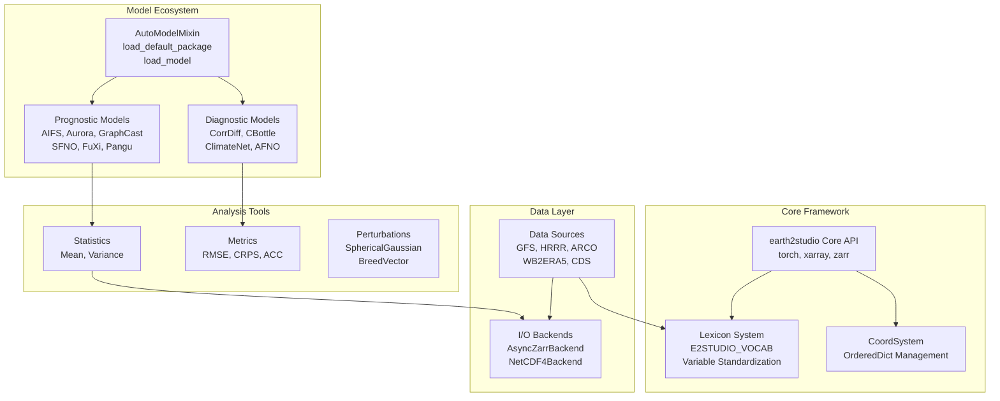
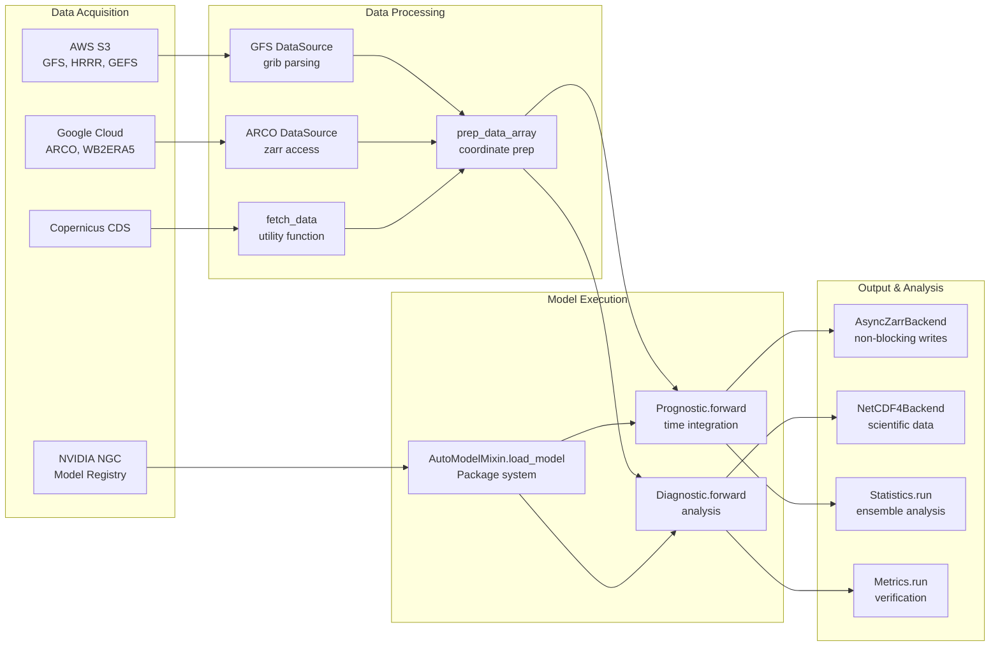
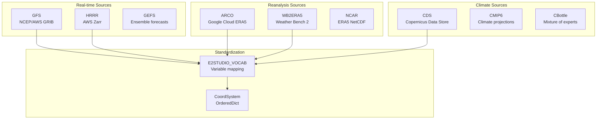
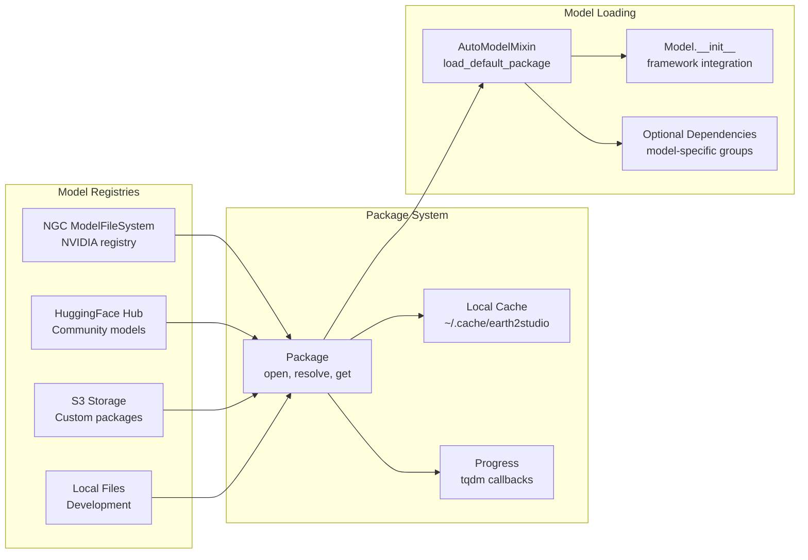

<!-- source: DeepWiki mcp.deepwiki.com · repo NVIDIA/earth2studio · page 1 Overview · fetched 2026-10-26 -->

# Overview

Relevant source files

The following files were used as context for generating this wiki page:

- [CHANGELOG.md](CHANGELOG.md)
- [pyproject.toml](pyproject.toml)
- [uv.lock](uv.lock)

This document provides a comprehensive overview of earth2studio, an open-source deep-learning framework for exploring, building and deploying AI weather and climate workflows. It covers the core architecture, key components, and how the major subsystems interact to enable scientific computing workflows.

For detailed installation instructions, see [Installation and Setup](#2). For specific component documentation, see [Core Architecture](#3) and its subsections covering [Data Sources](#3.1), [Models](#3.2), [I/O Systems](#3.3), and [Statistics and Metrics](#3.4).

## Purpose and Scope

earth2studio is designed as a modular framework that enables researchers and practitioners to:

- Access diverse weather and climate datasets from multiple sources
- Run state-of-the-art AI models for weather prediction and climate analysis  
- Perform statistical analysis and ensemble forecasting
- Deploy workflows with efficient I/O and distributed computing support
- Standardize variables and coordinates across different data sources and models

The framework supports both **prognostic models** (for time-stepping forecasts) and **diagnostic models** (for analysis and post-processing), with a unified interface for model loading, data handling, and workflow execution.

Sources: [pyproject.toml:6-10](), [CHANGELOG.md:1-354]()

## Core Architecture

### System Overview

The architecture consists of four main layers that work together to provide a complete weather and climate modeling platform.

Sources: [pyproject.toml:14-33](), [CHANGELOG.md:42-51](), [CHANGELOG.md:94-102]()

### Component Interaction Flow

This flow shows how data moves from external sources through the processing pipeline to model execution and analysis output.

Sources: [CHANGELOG.md:42-43](), [CHANGELOG.md:306-307](), [CHANGELOG.md:332-334]()

## Key Components

### Model System

The framework supports two primary model categories:

| Model Type | Purpose | Examples | Key Features |
|------------|---------|----------|--------------|
| **Prognostic** | Time-stepping forecasts | `AIFS`, `Aurora`, `GraphCast`, `SFNO`, `FuXi`, `Pangu` | Auto-regressive, ensemble support |
| **Diagnostic** | Analysis & enhancement | `CorrDiff`, `CBottle`, `ClimateNet`, `AFNO` | Post-processing, super-resolution |

All models implement the `AutoModelMixin` interface with methods:
- `load_default_package()` - Downloads model from registry
- `load_model()` - Instantiates model from package
- `input_coords()` - Returns expected input coordinates
- `output_coords()` - Returns output coordinate mapping

Sources: [CHANGELOG.md:94-102](), [CHANGELOG.md:124-128](), [CHANGELOG.md:332-334]()

### Data Sources

Each data source implements async fetching with built-in caching and automatic coordinate standardization through the lexicon system.

Sources: [CHANGELOG.md:13-18](), [CHANGELOG.md:241-248](), [CHANGELOG.md:265-270]()

### Storage and I/O

The framework provides multiple I/O backends optimized for different use cases:

| Backend | Use Case | Key Features |
|---------|----------|--------------|
| `AsyncZarrBackend` | Large-scale parallel writes | Non-blocking, thread-safe |
| `ZarrBackend` | Chunked storage | Compression codecs, Zarr 3.0 |
| `NetCDF4Backend` | Scientific data exchange | CF conventions, metadata |

All backends support:
- Coordinate-aware writing with automatic chunking
- Configurable compression and encoding
- Batch and ensemble dimension handling

Sources: [CHANGELOG.md:43-44](), [CHANGELOG.md:54-55](), [CHANGELOG.md:275-278]()

### Package and Model Loading

The package system enables automatic model downloading with caching and dependency management through optional dependency groups defined in `pyproject.toml`.

Sources: [CHANGELOG.md:270-271](), [CHANGELOG.md:332-334](), [pyproject.toml:58-174]()

## Installation and Dependencies

earth2studio uses a modular dependency system with optional groups for specific functionality:

| Dependency Group | Purpose | Key Packages |
|------------------|---------|--------------|
| Core | Base functionality | `torch`, `xarray`, `zarr`, `fsspec` |
| Model-specific | Individual models | `anemoi-inference`, `microsoft-aurora`, `onnxruntime-gpu` |
| Data | External data sources | `cdsapi`, `eccodes`, `ecmwf-opendata` |
| Analysis | Statistics and metrics | `nvidia-physicsnemo`, `torch-harmonics` |

The framework requires Python 3.11+ and supports both CPU and GPU workflows with automatic PyTorch index selection based on platform.

Sources: [pyproject.toml:12-13](), [pyproject.toml:14-33](), [pyproject.toml:58-174](), [pyproject.toml:219-232]()

## Development and Versioning

earth2studio follows semantic versioning with a comprehensive changelog tracking:
- Model additions and updates
- API changes and improvements  
- Performance optimizations
- Bug fixes and security updates
- Dependency management

The current development version is 0.10.0 with regular releases adding new models, data sources, and capabilities. The framework uses `uv` for package management and `hatch` for building.

Sources: [CHANGELOG.md:9-38](), [pyproject.toml:177-216](), [pyproject.toml:273-278]()

---

