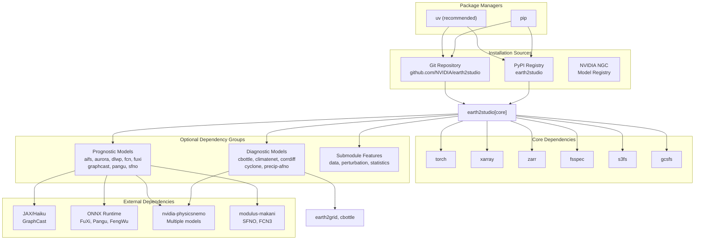
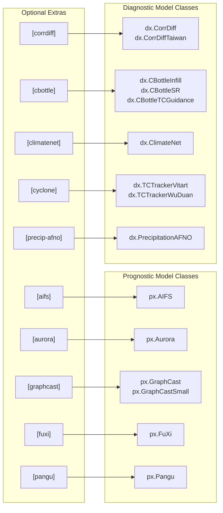

<!-- source: DeepWiki mcp.deepwiki.com · repo NVIDIA/earth2studio · page 2 Installation and Setup · fetched 2026-10-26 -->

# Installation and Setup

<details>
<summary>Relevant source files</summary>

The following files were used as context for generating this wiki page:

- [docs/userguide/about/install.md](docs/userguide/about/install.md)
- [earth2studio/models/dx/__init__.py](earth2studio/models/dx/__init__.py)

</details>


This page provides a comprehensive guide for installing and configuring earth2studio, including package manager options, optional model dependencies, environment setup, and system requirements. 

For information about the core architecture and how components interact after installation, see [Core Architecture](#3). For model-specific usage after installation, see [Models](#3.2).

## Installation Architecture

The following diagram shows the earth2studio installation ecosystem and how different components relate to each other:



Sources: [docs/userguide/about/install.md:1-814]()

## Basic Installation Methods

### Recommended: uv Installation

The `uv` package manager provides the best installation experience with automatic dependency resolution:

```bash
mkdir earth2studio-project && cd earth2studio-project
uv init --python=3.12
uv add "earth2studio @ git+https://github.com/NVIDIA/earth2studio.git@0.9.0"
```

### Alternative: pip Installation

For users preferring pip, install from PyPI:

```bash
pip install earth2studio
```

Or from the Git repository for latest features:

```bash
pip install "earth2studio @ git+https://github.com/NVIDIA/earth2studio"
```

### Installation Verification

Verify the installation works correctly:

```bash
python  # or 'uv run python' when using uv
>>> import earth2studio
>>> earth2studio.__version__
```

Sources: [docs/userguide/about/install.md:16-71]()

## Optional Dependencies

### Model Dependency Architecture

The following diagram shows how optional dependency groups map to actual model classes in the codebase:



Sources: [docs/userguide/about/install.md:100-576](), [earth2studio/models/dx/__init__.py:17-42]()

### Prognostic Model Dependencies

Install dependencies for specific prognostic models:

| Model | uv Command | Special Requirements |
|-------|------------|---------------------|
| AIFS | `uv add earth2studio --extra aifs` | flash-attention (slow build) |
| Aurora | `uv add earth2studio --extra aurora-fork` | Use forked variant |
| GraphCast | `uv add earth2studio --extra graphcast` | JAX/Haiku dependencies |
| FuXi | `uv add earth2studio --extra fuxi` | ONNX GPU Runtime |
| Pangu | `uv add earth2studio --extra pangu` | ONNX GPU Runtime |
| SFNO | `uv add earth2studio --extra sfno` | modulus-makani |

### Diagnostic Model Dependencies

Install dependencies for diagnostic models:

| Model | uv Command | Notes |
|-------|------------|-------|
| CorrDiff | `uv add earth2studio --extra corrdiff` | Diffusion models |
| CBottle | `uv add earth2studio --extra cbottle` | earth2grid required |
| ClimateNet | `uv add earth2studio --extra climatenet` | No additional deps |
| Cyclone Tracking | `uv add earth2studio --extra cyclone` | Python ≤3.12 only |
| Precipitation AFNO | `uv add earth2studio --extra precip-afno` | Standard AFNO model |

### Submodule Dependencies

Install dependencies for specific submodule features:

```bash
# Data processing features
uv add earth2studio --extra data

# Perturbation methods
uv add earth2studio --extra perturbation

# Statistical analysis tools
uv add earth2studio --extra statistics
```

Sources: [docs/userguide/about/install.md:100-640]()

## Environment Setup

### uv Project Environment (Recommended)

Create an isolated uv project:

```bash
mkdir earth2studio-project && cd earth2studio-project
uv init --python=3.12
uv add "earth2studio @ git+https://github.com/NVIDIA/earth2studio.git@0.9.0"
```

### PyTorch Docker Container

Use the NVIDIA PyTorch container as a base:

```bash
docker run -it nvcr.io/nvidia/pytorch:25.05-py3

# Inside container:
apt-get update && apt-get install -y git make curl
unset PIP_CONSTRAINT
curl -LsSf https://astral.sh/uv/install.sh | sh && source $HOME/.local/bin/env
uv pip install --system --break-system-packages "earth2studio@git+https://github.com/NVIDIA/earth2studio.git@0.9.0"
```

### Custom Docker Container

For dedicated containers, use this Dockerfile:

```dockerfile
FROM nvcr.io/nvidia/pytorch:25.05-py3
COPY --from=ghcr.io/astral-sh/uv:0.6.13 /uv /uvx /bin/

RUN apt-get update && apt-get install -y make curl && rm -rf /var/lib/apt/lists/*

WORKDIR /app
ENV PIP_CONSTRAINT=
RUN uv pip install --system --break-system-packages "earth2studio@git+https://github.com/NVIDIA/earth2studio.git@0.9.0"
```

Sources: [docs/userguide/about/install.md:673-751]()

## System Requirements

### Hardware Recommendations

| Component | Requirement | Recommended |
|-----------|-------------|-------------|
| GPU | NVIDIA GPU with compute ≥8.9 | L40S, RTX A6000, H100, B200 |
| GPU Memory | ≥16 GB | ≥40 GB |
| System RAM | ≥16 GB | ≥64 GB |
| Disk Space | ≥32 GB | ≥128 GB |
| Precision Support | FP16/FP32 | FP32 for best accuracy |

### Software Recommendations

| Component | Version | Notes |
|-----------|---------|-------|
| OS | Ubuntu 24.04 LTS | Matches development environment |
| Python | 3.12 | Recommended for all features |
| CUDA | 12.8 | For GPU acceleration |
| Docker | Latest | For containerized environments |

Sources: [docs/userguide/about/install.md:769-801]()

## Configuration

### Environment Variables

Configure earth2studio behavior using these environment variables:

| Variable | Purpose | Default |
|----------|---------|---------|
| `EARTH2STUDIO_CACHE` | Cache directory for models and data | `~/.cache/earth2studio` |
| `EARTH2STUDIO_PACKAGE_TIMEOUT` | Model download timeout (seconds) | 300 |

### Cache Configuration

The cache stores downloaded models and preprocessed data:

```bash
export EARTH2STUDIO_CACHE="/path/to/custom/cache"
```

### Package Download Configuration

Configure model download timeout:

```bash
export EARTH2STUDIO_PACKAGE_TIMEOUT=600  # 10 minutes
```

Sources: [docs/userguide/about/install.md:805-814]()

---

