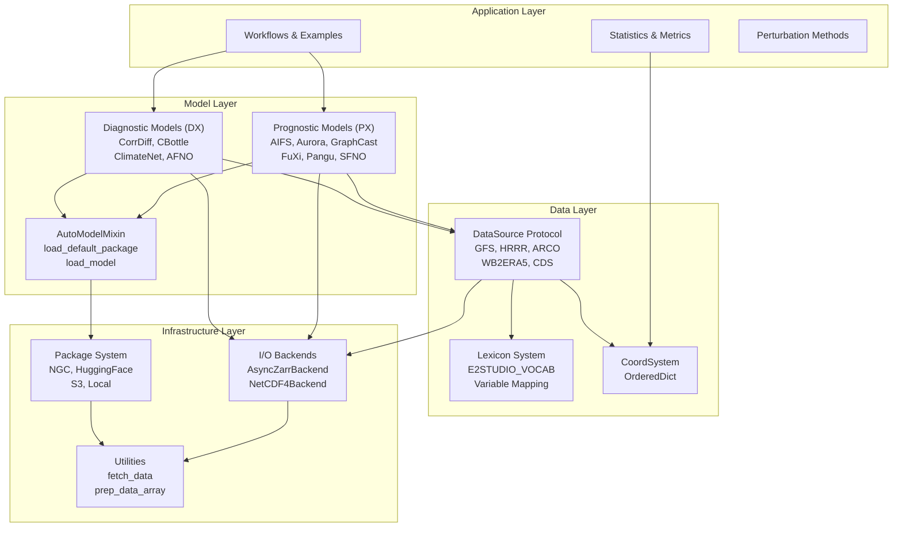
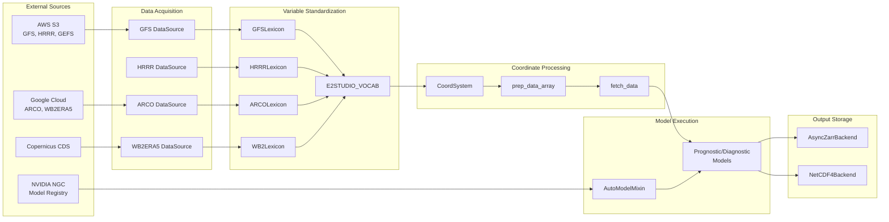
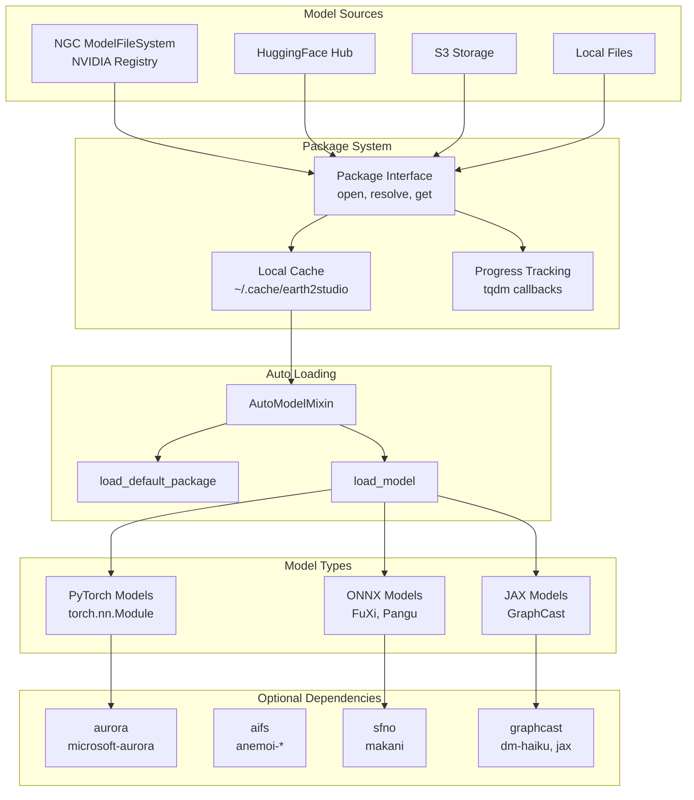
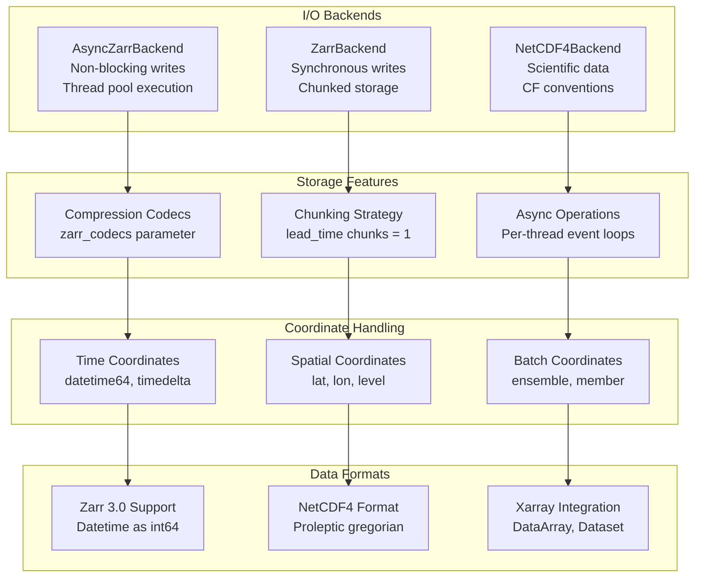

<!-- source: DeepWiki mcp.deepwiki.com · repo NVIDIA/earth2studio · page 3 Core Architecture · fetched 2026-10-26 -->

# Core Architecture

Relevant source files

The following files were used as context for generating this wiki page:

- [CHANGELOG.md](CHANGELOG.md)
- [docs/modules/datasources.rst](docs/modules/datasources.rst)
- [earth2studio/data/__init__.py](earth2studio/data/__init__.py)
- [earth2studio/lexicon/__init__.py](earth2studio/lexicon/__init__.py)
- [earth2studio/lexicon/base.py](earth2studio/lexicon/base.py)
- [pyproject.toml](pyproject.toml)
- [uv.lock](uv.lock)

This page describes the high-level architecture of earth2studio, focusing on the core framework design, component interactions, and key abstractions that enable weather and climate AI workflows. For specific information about data sources, see [Data Sources](#3.1). For details about individual models, see [Models](#3.2). For I/O system specifics, see [I/O Systems](#3.3).

## Design Principles

Earth2studio follows a modular, protocol-based architecture designed around several key principles:

- **Standardized Interfaces**: Common protocols for data sources, models, and I/O backends enable interoperability
- **Asynchronous Operations**: Built-in support for async data fetching and non-blocking I/O operations
- **Auto-loading and Caching**: Intelligent model package management with local caching for performance
- **Variable Standardization**: Unified lexicon system for mapping variables across different data sources
- **Flexible Dependencies**: Optional dependency groups allow minimal installations or full feature sets

The framework is built on a foundation of scientific Python libraries including PyTorch, Xarray, Zarr, and fsspec, providing both CPU and GPU execution capabilities.

**Sources:** [pyproject.toml:1-50](), [CHANGELOG.md:1-50]()

## Core Components Architecture

The earth2studio architecture consists of four primary layers that work together to provide end-to-end weather and climate AI workflows:

**Sources:** [earth2studio/data/__init__.py:17-41](), [pyproject.toml:58-174]()

## Data Flow Architecture

Data flows through earth2studio following a standardized pipeline from external sources through processing to model execution and output storage:

**Sources:** [earth2studio/lexicon/base.py:28-200](), [earth2studio/lexicon/__init__.py:17-29]()

## Model Management Architecture

Earth2studio provides a sophisticated auto-loading system for managing AI models from various sources with local caching and dependency management:

**Sources:** [pyproject.toml:74-174](), [CHANGELOG.md:120-130]()

## Coordinate and Variable Systems

The framework uses a standardized coordinate system and lexicon for managing spatial, temporal, and ensemble dimensions across different data sources and models:

| Component | Purpose | Key Classes |
|-----------|---------|-------------|
| `CoordSystem` | Ordered dictionary of coordinate arrays | `OrderedDict` interface |
| `E2STUDIO_VOCAB` | Standardized variable vocabulary | 200+ meteorological variables |
| Lexicon Classes | Data source-specific variable mapping | `GFSLexicon`, `ARCOLexicon`, etc. |
| Coordinate Arrays | Spatial/temporal coordinates | `lat`, `lon`, `time`, `level` |
| Batch Dimensions | Ensemble and sample handling | `batch`, `ensemble`, `member` |

The lexicon system enables seamless integration between different data sources by providing standardized variable names and units. Each data source implements its own lexicon that maps native variable names to the standardized `E2STUDIO_VOCAB`.

**Sources:** [earth2studio/lexicon/base.py:20-30](), [earth2studio/lexicon/base.py:28-200]()

## I/O and Storage Systems

Earth2studio provides multiple I/O backends optimized for different use cases, with emphasis on asynchronous operations for performance:

The I/O system is designed for high-performance parallel workflows with non-blocking writes and intelligent caching. The `AsyncZarrBackend` enables concurrent model execution and data writing, critical for large-scale ensemble forecasting.

**Sources:** [CHANGELOG.md:43-70](), [CHANGELOG.md:220-230]()

---

