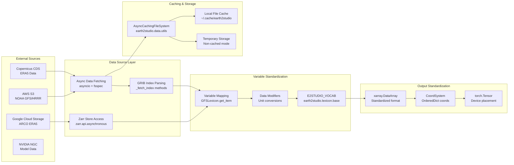
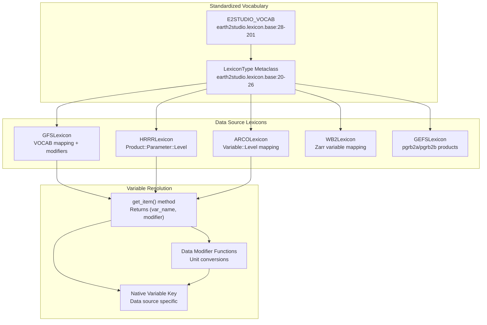
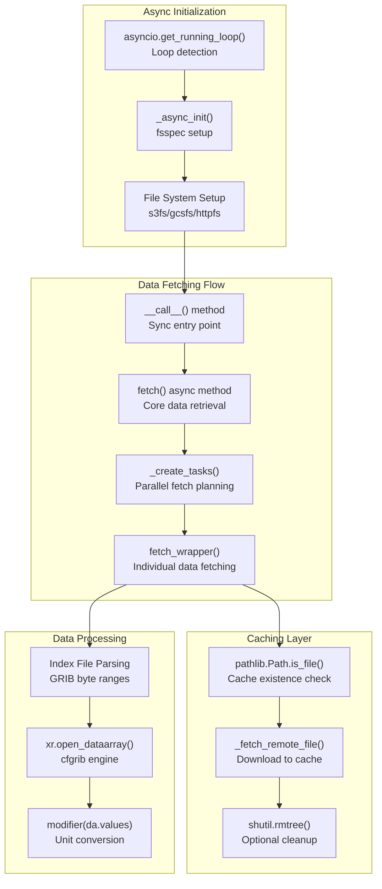

<!-- source: DeepWiki mcp.deepwiki.com · repo NVIDIA/earth2studio · page 3.1 Data Sources · fetched 2026-10-26 -->

# Data Sources

<details>
<summary>Relevant source files</summary>

The following files were used as context for generating this wiki page:

- [docs/modules/datasources.rst](docs/modules/datasources.rst)
- [earth2studio/data/__init__.py](earth2studio/data/__init__.py)
- [earth2studio/data/arco.py](earth2studio/data/arco.py)
- [earth2studio/data/base.py](earth2studio/data/base.py)
- [earth2studio/data/gefs.py](earth2studio/data/gefs.py)
- [earth2studio/data/gfs.py](earth2studio/data/gfs.py)
- [earth2studio/data/hrrr.py](earth2studio/data/hrrr.py)
- [earth2studio/data/rx.py](earth2studio/data/rx.py)
- [earth2studio/data/utils.py](earth2studio/data/utils.py)
- [earth2studio/data/wb2.py](earth2studio/data/wb2.py)
- [earth2studio/lexicon/__init__.py](earth2studio/lexicon/__init__.py)
- [earth2studio/lexicon/base.py](earth2studio/lexicon/base.py)
- [earth2studio/lexicon/cds.py](earth2studio/lexicon/cds.py)
- [earth2studio/lexicon/gefs.py](earth2studio/lexicon/gefs.py)
- [earth2studio/lexicon/hrrr.py](earth2studio/lexicon/hrrr.py)
- [test/data/test_gefs.py](test/data/test_gefs.py)
- [test/data/test_hrrr.py](test/data/test_hrrr.py)
- [test/lexicon/test_hrrr_lexicon.py](test/lexicon/test_hrrr_lexicon.py)

</details>


This document covers the data sources system in earth2studio, which provides interfaces for fetching, caching, and standardizing weather and climate data from various external repositories. Data sources serve as the primary input mechanism for inference workflows, providing initial conditions, validation data, and reference datasets.

For information about models that process this data, see [Models](#3.2). For I/O systems that handle data persistence, see [I/O Systems](#3.3).

## Architecture Overview

The data sources system is built around a modular architecture with standardized interfaces, variable mapping through lexicons, and efficient asynchronous data fetching.

### Core Data Source Architecture

```mermaid
graph TD
    subgraph "Protocol Interfaces"
        DataSource["DataSource Protocol<br/>earth2studio.data.base"]
        ForecastSource["ForecastSource Protocol<br/>earth2studio.data.base"]
    end
    
    subgraph "Analysis Data Sources"
        GFS["GFS<br/>earth2studio.data.gfs"]
        HRRR["HRRR<br/>earth2studio.data.hrrr"]
        ARCO["ARCO<br/>earth2studio.data.arco"]
        WB2ERA5["WB2ERA5<br/>earth2studio.data.wb2"]
        CDS["CDS<br/>earth2studio.data.cds"]
        NCAR["NCAR_ERA5<br/>earth2studio.data.ncar"]
    end
    
    subgraph "Forecast Data Sources"
        GFS_FX["GFS_FX<br/>earth2studio.data.gfs"]
        HRRR_FX["HRRR_FX<br/>earth2studio.data.hrrr"]
        GEFS_FX["GEFS_FX<br/>earth2studio.data.gefs"]
    end
    
    subgraph "Lexicon System"
        GFSLexicon["GFSLexicon<br/>earth2studio.lexicon.gfs"]
        HRRRLexicon["HRRRLexicon<br/>earth2studio.lexicon.hrrr"]
        ARCOLexicon["ARCOLexicon<br/>earth2studio.lexicon.arco"]
        WB2Lexicon["WB2Lexicon<br/>earth2studio.lexicon.wb2"]
    end
    
    subgraph "Data Utilities"
        FetchData["fetch_data<br/>earth2studio.data.utils"]
        PrepDataArray["prep_data_array<br/>earth2studio.data.utils"]
        CacheRoot["datasource_cache_root<br/>earth2studio.data.utils"]
    end
    
    DataSource --> GFS
    DataSource --> HRRR
    DataSource --> ARCO
    DataSource --> WB2ERA5
    DataSource --> CDS
    DataSource --> NCAR
    
    ForecastSource --> GFS_FX
    ForecastSource --> HRRR_FX
    ForecastSource --> GEFS_FX
    
    GFS --> GFSLexicon
    HRRR --> HRRRLexicon
    ARCO --> ARCOLexicon
    WB2ERA5 --> WB2Lexicon
    
    GFS --> FetchData
    HRRR --> FetchData
    ARCO --> PrepDataArray
    WB2ERA5 --> CacheRoot
```



Sources: [earth2studio/data/__init__.py:17-41](), [earth2studio/data/base.py:25-141](), [earth2studio/lexicon/__init__.py:17-29]()

### Data Flow and Processing Pipeline



Sources: [earth2studio/data/gfs.py:48-97](), [earth2studio/data/utils.py:374-508](), [earth2studio/lexicon/base.py:20-201]()

## Data Source Interfaces

The system defines two primary protocols that all data sources must implement, providing a consistent interface for data access across different backends.

### DataSource Protocol

The `DataSource` protocol defines the interface for analysis data sources that provide historical or real-time weather data at specific times:

```python
def __call__(
    self,
    time: datetime | list[datetime] | TimeArray,
    variable: str | list[str] | VariableArray,
) -> xr.DataArray
```

Key implementations include:
- `GFS` - NOAA Global Forecast System analysis data
- `HRRR` - High-Resolution Rapid Refresh analysis data  
- `ARCO` - Google's Analysis-Ready Cloud Optimized ERA5 data
- `WB2ERA5` - WeatherBench2 ERA5 datasets
- `CDS` - Copernicus Climate Data Store
- `NCAR_ERA5` - NCAR's ERA5 repository

Sources: [earth2studio/data/base.py:25-78](), [earth2studio/data/__init__.py:17-29]()

### ForecastSource Protocol

The `ForecastSource` protocol extends data sources to support forecast data with lead times:

```python
def __call__(
    self,
    time: datetime | list[datetime] | TimeArray,
    lead_time: timedelta | list[timedelta] | LeadTimeArray,
    variable: str | list[str] | VariableArray,
) -> xr.DataArray
```

Key implementations include:
- `GFS_FX` - GFS forecast data up to 16 days
- `HRRR_FX` - HRRR forecast data up to 48 hours
- `GEFS_FX` - Global Ensemble Forecast System

Sources: [earth2studio/data/base.py:80-141](), [earth2studio/data/gfs.py:537-721](), [earth2studio/data/hrrr.py:689-903]()

## Variable Mapping and Lexicon System

The lexicon system provides standardized variable naming across different data sources, enabling seamless switching between data providers while maintaining consistent variable semantics.

### Lexicon Architecture



Sources: [earth2studio/lexicon/base.py:20-201](), [earth2studio/lexicon/gfs.py:24-243](), [earth2studio/lexicon/hrrr.py:23-139]()

### Variable Standardization Process

The lexicon system maps earth2studio standard variable IDs to data source-specific variable names and applies necessary unit conversions:

**Example: GFS Lexicon Mapping**
```python
# earth2studio/lexicon/gfs.py:303-314
try:
    gfs_name, modifier = GFSLexicon[v]
except KeyError:
    logger.warning(f"variable id {v} not found in GFS lexicon")
    gfs_name = v
    def modifier(x: np.array) -> np.array:
        return x
```

**Example: Geopotential Height Conversion**
```python
# earth2studio/lexicon/gfs.py:230-241
if gfs_key.split("::")[1] == "HGT":
    def mod(x: np.array) -> np.array:
        return x * 9.81  # Convert to geopotential
```

Sources: [earth2studio/data/gfs.py:303-314](), [earth2studio/lexicon/gfs.py:230-241]()

## Data Fetching and Caching

The data sources system implements sophisticated asynchronous data fetching with local caching to optimize performance and reduce redundant downloads.

### Asynchronous Data Access Pattern



Sources: [earth2studio/data/gfs.py:150-193](), [earth2studio/data/hrrr.py:190-256](), [earth2studio/data/gfs.py:453-477]()

### Caching Implementation

The caching system uses file-based storage with configurable retention policies:

**Cache Location Management**
```python
# earth2studio/data/utils.py:354-367
def datasource_cache_root() -> str:
    default_cache = os.path.join(os.path.expanduser("~"), ".cache", "earth2studio")
    default_cache = os.environ.get("EARTH2STUDIO_CACHE", default_cache)
    os.makedirs(default_cache, exist_ok=True)
    return default_cache
```

**AsyncCachingFileSystem Implementation**
The system includes a custom async caching filesystem for Zarr 3.0 compatibility:
- Configurable expiry times (default: 1 year)
- Automatic cache directory management
- Support for multiple storage backends

Sources: [earth2studio/data/utils.py:354-367](), [earth2studio/data/utils.py:374-508]()

## Specific Data Source Implementations

### GFS (Global Forecast System)

The `GFS` class implements access to NOAA's Global Forecast System data on AWS S3 and NCEP FTP servers:

**Key Features:**
- 0.25 degree equirectangular grid (721x1440)
- 6-hour intervals from Feb 2021 to present
- Byte-range requests for efficient GRIB access
- Supports both analysis (`GFS`) and forecast (`GFS_FX`) data

**Implementation Details:**
```python
# earth2studio/data/gfs.py:58-149
class GFS:
    GFS_BUCKET_NAME = "noaa-gfs-bdp-pds"
    MAX_BYTE_SIZE = 5000000
    GFS_LAT = np.linspace(90, -90, 721)
    GFS_LON = np.linspace(0, 359.75, 1440)
```

Sources: [earth2studio/data/gfs.py:58-149](), [earth2studio/data/gfs.py:272-338]()

### HRRR (High-Resolution Rapid Refresh)

The `HRRR` class provides access to high-resolution North American weather data:

**Key Features:**
- Lambert conformal 3km grid (1059x1799)
- Hourly intervals from July 2018 to present
- Multiple data sources: AWS, Google Cloud, Azure, NOMADS
- Support for surface, pressure, and hybrid levels

**Grid Generation:**
```python
# earth2studio/data/hrrr.py:612-653
@classmethod
def grid(cls) -> tuple[np.array, np.array]:
    p1 = pyproj.CRS("proj=lcc lon_0=262.5 lat_0=38.5...")
    transformer = pyproj.Transformer.from_proj(p2, p1)
    lat, lon = itransformer.transform(E, N)
    return lat, lon
```

Sources: [earth2studio/data/hrrr.py:74-110](), [earth2studio/data/hrrr.py:612-653]()

### ARCO (Analysis-Ready Cloud Optimized)

The `ARCO` class accesses Google's cloud-optimized ERA5 dataset:

**Key Features:**
- Zarr-based storage for efficient access
- 0.25 degree lat-lon grid
- Hourly data from 1940-2023
- 31 surface and pressure level variables

**Zarr Access Pattern:**
```python
# earth2studio/data/arco.py:92-127
async def _async_init(self) -> None:
    fs = gcsfs.GCSFileSystem(cache_timeout=-1, token="anon")
    zstore = zarr.storage.FsspecStore(fs, path="/gcp-public-data-arco-era5/...")
    self.zarr_group = await zarr.api.asynchronous.open(store=zstore, mode="r")
```

Sources: [earth2studio/data/arco.py:41-67](), [earth2studio/data/arco.py:92-127]()

### WeatherBench2 (WB2ERA5)

The `WB2ERA5` family provides access to WeatherBench2's curated ERA5 datasets:

**Available Resolutions:**
- `WB2ERA5`: 0.25° (721x1440)
- `WB2ERA5_121x240`: 1.5° (121x240) 
- `WB2ERA5_32x64`: 5.625° (32x64)

**Base Implementation:**
```python
# earth2studio/data/wb2.py:43-75
class _WB2Base:
    def __init__(self, wb2_zarr_store: str, wb2_product: str = "era5"):
        self._zarr_store_name = wb2_zarr_store
        self._product = wb2_product
```

Sources: [earth2studio/data/wb2.py:331-376](), [earth2studio/data/wb2.py:43-75]()

## Usage Patterns and Utilities

### High-Level Data Fetching

The `fetch_data` utility function provides a simplified interface for model inference:

```python
# earth2studio/data/utils.py:58-120
def fetch_data(
    source: DataSource | ForecastSource,
    time: TimeArray,
    variable: VariableArray,
    lead_time: LeadTimeArray = np.array([np.timedelta64(0, "h")]),
    device: torch.device = "cpu",
    interp_to: CoordSystem = None,
    interp_method: str = "nearest",
) -> tuple[torch.Tensor, CoordSystem]
```

This function automatically:
- Detects data source type (analysis vs forecast)
- Handles coordinate interpolation
- Converts to PyTorch tensors
- Places data on specified devices

Sources: [earth2studio/data/utils.py:58-120](), [earth2studio/data/utils.py:122-218]()

### Data Persistence

The `datasource_to_file` function enables building local data stores:

```python
# earth2studio/data/utils.py:282-352
def datasource_to_file(
    file_name: str,
    source: DataSource,
    time: list[str] | list[datetime] | TimeArray,
    variable: VariableArray,
    backend: Literal["netcdf", "zarr"] = "netcdf",
) -> None
```

This supports creating local caches for repeated inference runs, with support for both NetCDF and Zarr backends.

Sources: [earth2studio/data/utils.py:282-352]()

---

