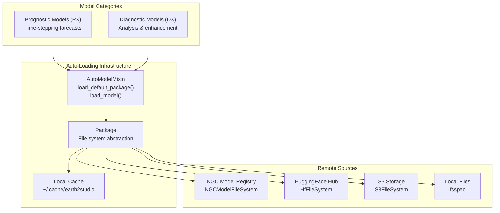
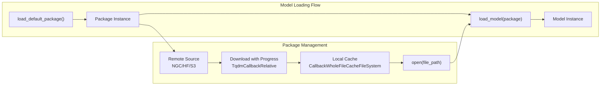
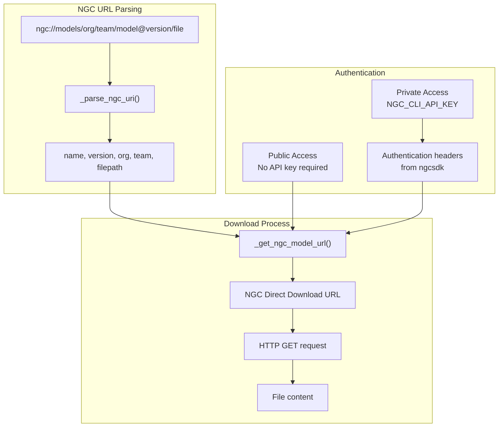
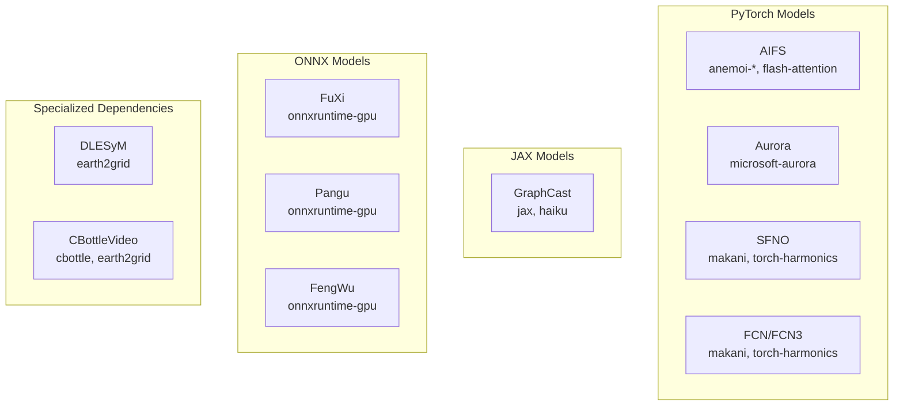
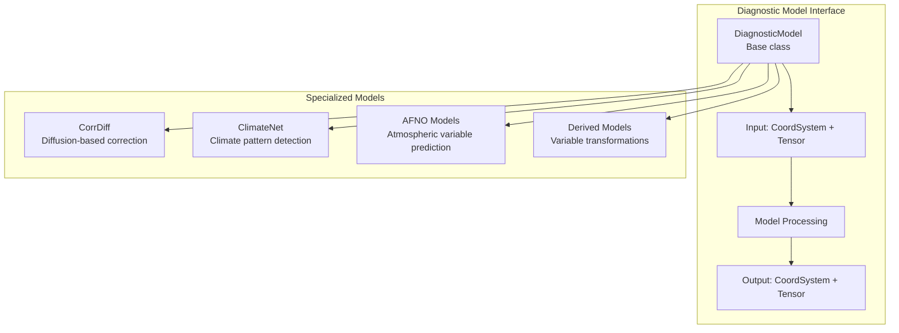
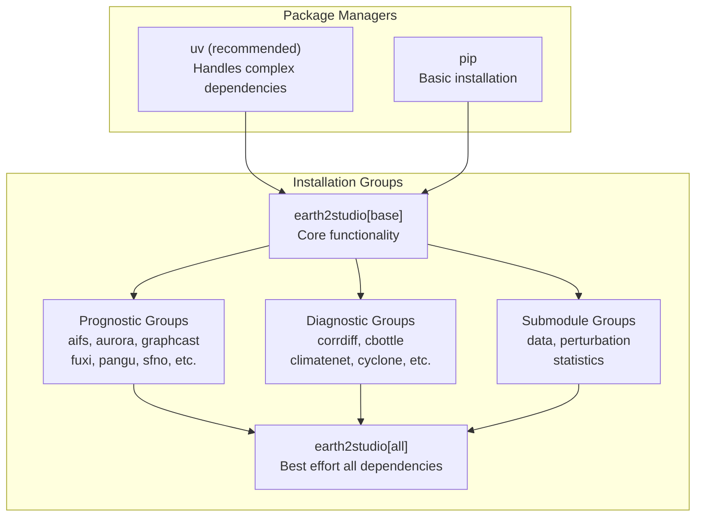

<!-- source: DeepWiki mcp.deepwiki.com · repo NVIDIA/earth2studio · page 3.2 Models · fetched 2026-10-26 -->

# Models

<details>
<summary>Relevant source files</summary>

The following files were used as context for generating this wiki page:

- [docs/userguide/about/install.md](docs/userguide/about/install.md)
- [docs/userguide/support/faq.md](docs/userguide/support/faq.md)
- [earth2studio/models/auto/ngc.py](earth2studio/models/auto/ngc.py)
- [earth2studio/models/auto/package.py](earth2studio/models/auto/package.py)
- [earth2studio/models/dx/__init__.py](earth2studio/models/dx/__init__.py)
- [test/models/test_auto_models.py](test/models/test_auto_models.py)

</details>


Earth2Studio provides a comprehensive model ecosystem that enables weather and climate workflows through two primary categories: prognostic models for time-stepping forecasts and diagnostic models for analysis and enhancement. The framework includes an auto-loading system that manages model packages from various remote sources including NGC, HuggingFace, and S3 storage.

For information about data sources that feed these models, see [Data Sources](#3.1). For I/O systems that handle model outputs, see [I/O Systems](#3.3).

## Model Architecture Overview

Earth2Studio organizes models into two main categories with a unified auto-loading infrastructure:



Sources: [test/models/test_auto_models.py:51-69](), [earth2studio/models/dx/__init__.py:17-42](), [earth2studio/models/auto/package.py:132-155]()

## Auto-Loading System

The auto-loading system provides a unified interface for downloading, caching, and loading models from various remote sources:



Sources: [earth2studio/models/auto/package.py:269-302](), [test/models/test_auto_models.py:316-331]()

### Package Class

The `Package` class provides a generic file system abstraction with local caching:

| Feature | Implementation | Purpose |
|---------|----------------|---------|
| Remote Access | `NGCModelFileSystem`, `HfFileSystem`, `S3FileSystem` | Access models from different sources |
| Local Caching | `CallbackWholeFileCacheFileSystem` | Cache downloads for reuse |
| Progress Tracking | `TqdmCallbackRelative` | Show download progress |
| Timeout Management | `EARTH2STUDIO_PACKAGE_TIMEOUT` | Configure download timeouts |

Sources: [earth2studio/models/auto/package.py:132-341]()

### NGC Model Registry Integration

The `NGCModelFileSystem` enables access to NVIDIA's model registry:



Sources: [earth2studio/models/auto/ngc.py:166-331]()

## Prognostic Models

Prognostic models perform time-stepping weather forecasts and are located in the `earth2studio.models.px` module:

| Model Category | Models | Framework | Purpose |
|----------------|--------|-----------|---------|
| **Transformer-based** | `AIFS`, `Aurora` | PyTorch | Global weather forecasting |
| **Neural Operators** | `SFNO`, `FCN`, `FCN3` | PyTorch | Spherical Fourier operations |
| **Graph Networks** | `GraphCastOperational`, `GraphCastSmall` | JAX | Graph-based meteorology |
| **ONNX Models** | `FuXi`, `Pangu3/6/24`, `FengWu` | ONNX Runtime | Optimized inference |
| **Deep Learning** | `DLWP`, `DLESyM` | PyTorch | Atmospheric dynamics |
| **Specialized** | `CBottleVideo`, `InterpModAFNO`, `StormCast` | PyTorch | Video generation, interpolation, storms |

Sources: [test/models/test_auto_models.py:51-69](), [docs/userguide/about/install.md:105-387]()

### Model Dependencies

Each prognostic model requires specific optional dependencies:



Sources: [docs/userguide/about/install.md:108-387]()

## Diagnostic Models

Diagnostic models perform analysis, enhancement, and post-processing tasks and are located in the `earth2studio.models.dx` module:

| Model Category | Models | Purpose |
|----------------|--------|---------|
| **Diffusion Models** | `CorrDiff`, `CorrDiffTaiwan` | Bias correction and downscaling |
| **Super Resolution** | `CBottleSR`, `CBottleInfill` | Image enhancement and gap filling |
| **Climate Analysis** | `ClimateNet` | Extreme weather detection |
| **AFNO Models** | `PrecipitationAFNO/v2`, `SolarRadiationAFNO1H/6H`, `WindgustAFNO` | Specialized meteorological variables |
| **Tracking** | `TCTrackerVitart`, `TCTrackerWuDuan` | Tropical cyclone tracking |
| **Derived Variables** | `DerivedRH`, `DerivedWS`, `DerivedVPD` | Variable transformations |
| **Guidance** | `CBottleTCGuidance` | Tropical cyclone guidance |

Sources: [earth2studio/models/dx/__init__.py:17-42](), [docs/userguide/about/install.md:389-576]()

### Base Diagnostic Interface

All diagnostic models inherit from the `DiagnosticModel` base class:



Sources: [earth2studio/models/dx/base.py](), [earth2studio/models/dx/__init__.py:17]()

## Installation and Model Management

### Optional Dependencies Structure

Models are organized into optional dependency groups for targeted installation:



Sources: [docs/userguide/about/install.md:100-661]()

### Environment Configuration

The model system uses several environment variables for configuration:

| Variable | Purpose | Default |
|----------|---------|---------|
| `EARTH2STUDIO_CACHE` | Model cache location | `~/.cache/earth2studio` |
| `EARTH2STUDIO_PACKAGE_TIMEOUT` | Download timeout (seconds) | `300` |
| `NGC_CLI_API_KEY` | NGC authentication | None |
| `HF_HUB_DOWNLOAD_TIMEOUT` | HuggingFace timeout | Inherits package timeout |

Sources: [docs/userguide/about/install.md:805-814](), [earth2studio/models/auto/package.py:232-251]()

### Model Loading Example

The auto-loading system provides a consistent interface across all models:

```python
# Load any auto model
package = ModelClass.load_default_package()
model = ModelClass.load_model(package)

# Alternative: direct loading
model = ModelClass.from_pretrained()
```

Sources: [test/models/test_auto_models.py:121-124](), [test/models/test_auto_models.py:399-402]()

---

