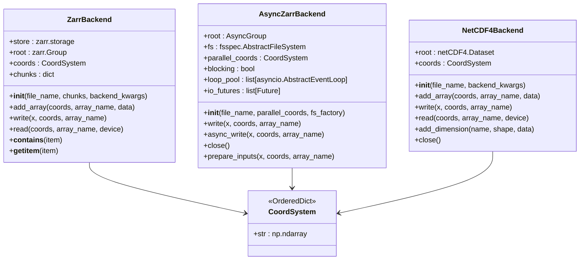
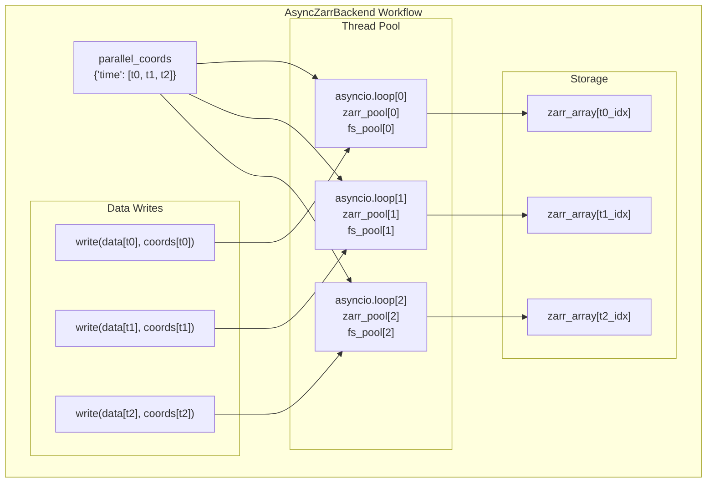
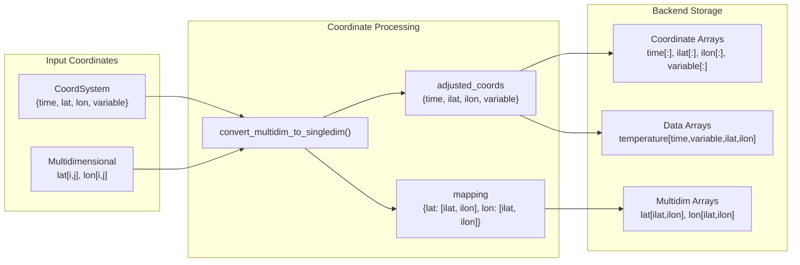
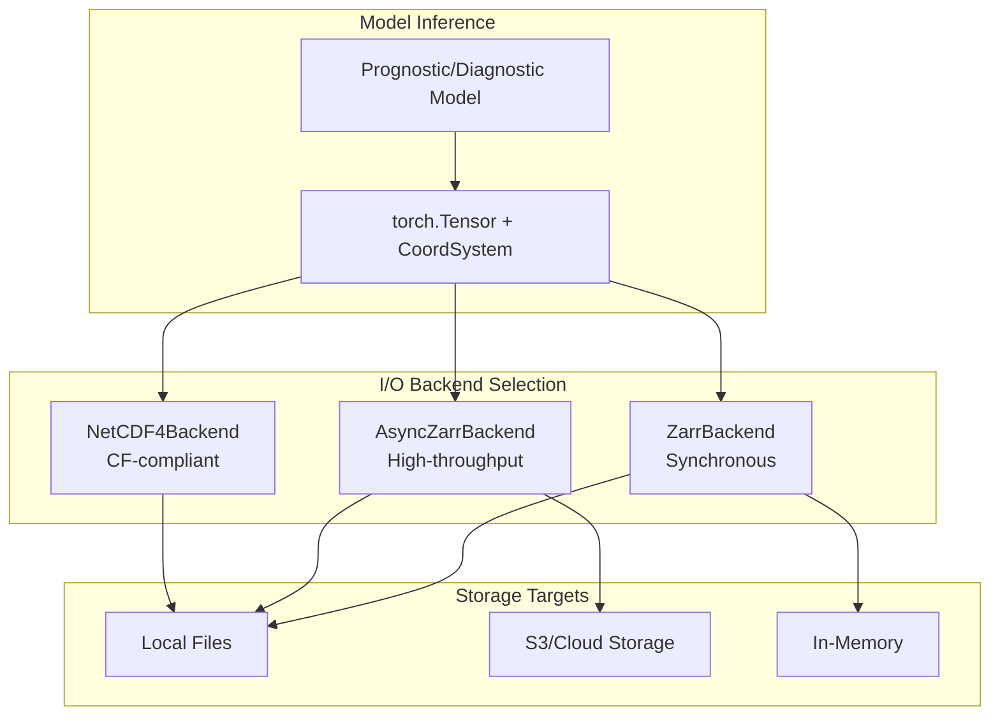

<!-- source: DeepWiki mcp.deepwiki.com · repo NVIDIA/earth2studio · page 3.3 I/O Systems · fetched 2026-10-26 -->

# I/O Systems

<details>
<summary>Relevant source files</summary>

The following files were used as context for generating this wiki page:

- [earth2studio/__init__.py](earth2studio/__init__.py)
- [earth2studio/io/async_zarr.py](earth2studio/io/async_zarr.py)
- [earth2studio/io/netcdf4.py](earth2studio/io/netcdf4.py)
- [earth2studio/io/zarr.py](earth2studio/io/zarr.py)
- [test/io/test_async_zarr.py](test/io/test_async_zarr.py)
- [test/io/test_netcdf4.py](test/io/test_netcdf4.py)
- [test/io/test_zarr.py](test/io/test_zarr.py)

</details>


The I/O Systems in earth2studio provide data persistence and retrieval capabilities for weather and climate model workflows. These systems handle reading and writing tensor data with associated coordinate information to various storage formats including Zarr and NetCDF4. The I/O backends support both synchronous and asynchronous operations, coordinate system management, and integration with distributed computing workflows.

For data acquisition from external sources, see [Data Sources](#3.1). For statistical analysis of stored data, see [Statistics and Metrics](#3.4).

## Architecture Overview

The I/O system is built around pluggable backend classes that implement common interfaces for reading and writing tensor data with coordinate metadata. Each backend handles format-specific serialization while providing consistent APIs for data operations.

### I/O Backend Class Hierarchy



Sources: [earth2studio/io/zarr.py:31-328](), [earth2studio/io/async_zarr.py:54-637](), [earth2studio/io/netcdf4.py:40-342](), [earth2studio/utils/type.py]()

## Storage Backends

### ZarrBackend

The `ZarrBackend` class provides synchronous Zarr format support with memory and file-based storage options. It handles chunked array storage and coordinate system management.

**Key Features:**
- Memory (`zarr.storage.MemoryStore`) and file (`zarr.storage.LocalStore`) storage modes
- Configurable chunking via `chunks` parameter
- Multidimensional coordinate handling via `convert_multidim_to_singledim`
- Zarr v3 compression codec support

**Core Operations:**
```python
# Initialization
backend = ZarrBackend(file_name="output.zarr", chunks={"time": 1, "lat": 180})

# Array creation
backend.add_array(coords, "temperature", data=tensor)

# Data writing
backend.write(tensor, coords, "temperature")

# Data reading
tensor, coords = backend.read(coords, "temperature", device="cuda")
```

Sources: [earth2studio/io/zarr.py:31-87](), [earth2studio/io/zarr.py:119-281](), [test/io/test_zarr.py:42-185]()

### AsyncZarrBackend

The `AsyncZarrBackend` enables high-performance asynchronous I/O operations with thread pool management and parallel coordinate-based writes. This backend is designed for inference workflows requiring non-blocking data persistence.

**Key Features:**
- Asynchronous operations via `asyncio` and `fsspec`
- Thread pool management with configurable `pool_size`
- Parallel writes along specified coordinates (`parallel_coords`)
- Multiple filesystem support (`LocalFileSystem`, `S3FileSystem`, `MemoryFileSystem`)
- Non-blocking mode with `io_futures` tracking

**Parallel Coordinate System:**


Sources: [earth2studio/io/async_zarr.py:54-167](), [earth2studio/io/async_zarr.py:468-510](), [earth2studio/io/async_zarr.py:531-619]()

### NetCDF4Backend

The `NetCDF4Backend` provides scientific data format support with CF-compliant metadata handling and time coordinate processing.

**Key Features:**
- NetCDF4 format with `netCDF4.Dataset` integration
- CF-compliant time handling (`cftime` integration)
- Dimension and variable management
- Calendar and time unit conversion
- Memory and file-based modes via `diskless` parameter

**Time Coordinate Handling:**
- `datetime64` → CF-compliant time with units and calendar
- `timedelta64` → lead_time with proper units mapping
- Automatic calendar assignment (`proleptic_gregorian`, `gregorian`)

Sources: [earth2studio/io/netcdf4.py:40-85](), [earth2studio/io/netcdf4.py:116-223](), [earth2studio/io/netcdf4.py:30-37]()

## Coordinate System Management

All I/O backends use the `CoordSystem` type (an `OrderedDict[str, np.ndarray]`) to manage tensor dimensions and their associated coordinate values. The system handles both single-dimensional and multidimensional coordinates.

### Coordinate Processing Pipeline



Sources: [earth2studio/utils/coords.py](), [earth2studio/io/zarr.py:159-190](), [earth2studio/io/netcdf4.py:194-208]()

## Data Operations

### Write Operations

All backends implement a common `write` method signature:
```python
def write(self, x: torch.Tensor | list[torch.Tensor], 
          coords: CoordSystem, 
          array_name: str | list[str]) -> None
```

The write process involves:
1. **Input validation** - tensor and coordinate shape consistency
2. **Coordinate processing** - multidimensional coordinate handling
3. **Index calculation** - mapping coordinates to array indices via `np.ix_` and `np.where`
4. **Data conversion** - tensor to numpy via `tensor.to("cpu").numpy()`
5. **Backend-specific storage** - format-specific serialization

### Read Operations

Read operations return both tensor data and coordinate metadata:
```python
def read(self, coords: CoordSystem, array_name: str, 
         device: torch.device = "cpu") -> tuple[torch.Tensor, CoordSystem]
```

### Asynchronous Operations

The `AsyncZarrBackend` provides additional async methods:
- `async_write()` - Direct async write without thread pool
- `prepare_inputs()` - Array initialization and input validation
- `close()` - Thread pool cleanup and future completion

Sources: [earth2studio/io/zarr.py:218-281](), [earth2studio/io/async_zarr.py:468-529](), [earth2studio/io/netcdf4.py:224-287]()

## Integration Patterns

### Model Output Storage

I/O backends integrate with model inference workflows through standardized interfaces:



### Filesystem Integration

The `AsyncZarrBackend` uses `fsspec` for filesystem abstraction:
- `LocalFileSystem` - Local storage
- `S3FileSystem` - AWS S3 with async support
- `MemoryFileSystem` - In-memory operations
- Custom filesystem factories via `fs_factory` parameter

Sources: [earth2studio/io/async_zarr.py:108-165](), [test/io/test_async_zarr.py:355-428](), [earth2studio/io/zarr.py:63-68]()

## Error Handling and Validation

### Common Validation Patterns

1. **Tensor-Array Name Consistency**: All backends validate that tensor and array name lists have matching lengths
2. **Coordinate Validation**: Coordinate dimensions must exist in backend coordinate systems
3. **Multidimensional Coordinate Completeness**: Multidimensional coordinates must be passed in full for thread safety
4. **Parallel Coordinate Constraints**: `AsyncZarrBackend` requires coordinate values to be present in `parallel_coords`

### Backend-Specific Constraints

- **ZarrBackend**: Array overwrite protection via `overwrite` parameter
- **AsyncZarrBackend**: Thread-safe coordinate writing restrictions
- **NetCDF4Backend**: Variable redefinition protection, 1D coordinate requirements

Sources: [earth2studio/io/zarr.py:242-280](), [earth2studio/io/async_zarr.py:423-444](), [earth2studio/io/netcdf4.py:256-286](), [test/io/test_async_zarr.py:432-506]()

---

