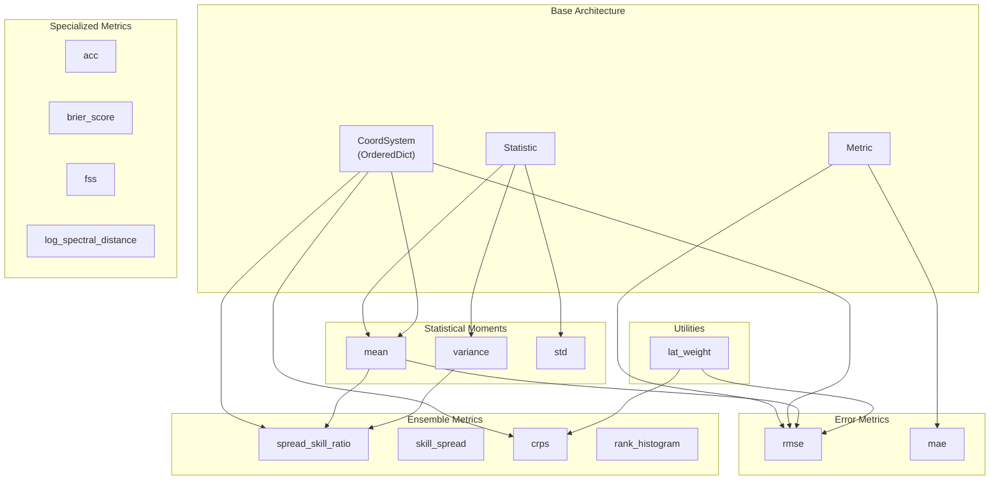
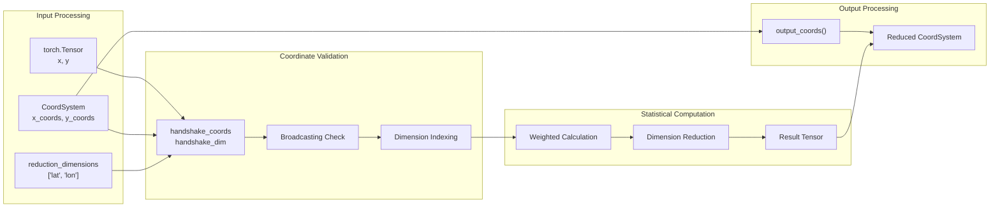
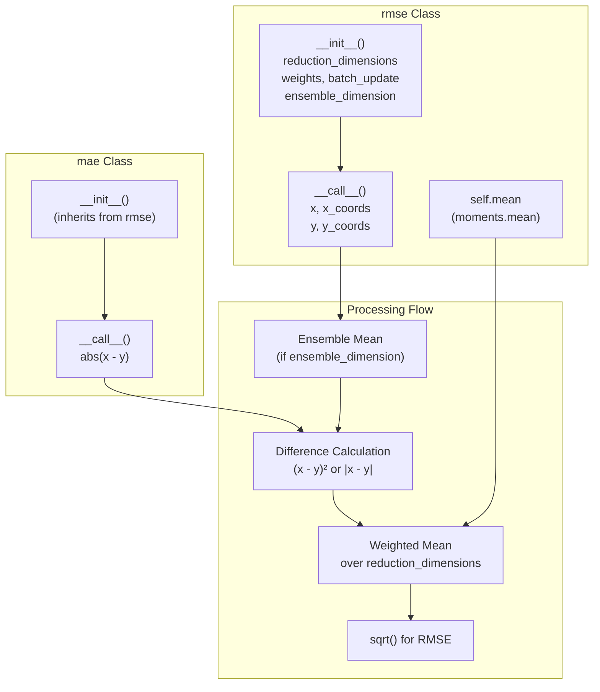
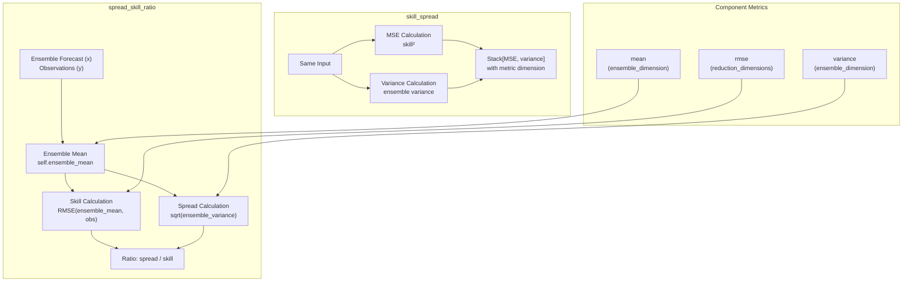
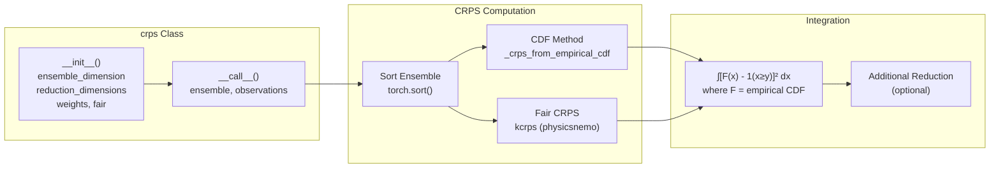
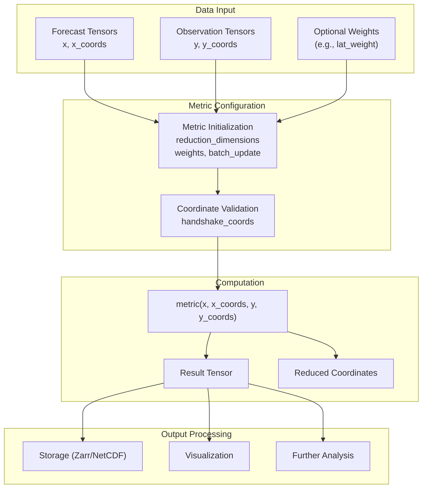

<!-- source: DeepWiki mcp.deepwiki.com · repo NVIDIA/earth2studio · page 3.4 Statistics and Metrics · fetched 2026-10-26 -->

# Statistics and Metrics

<details>
<summary>Relevant source files</summary>

The following files were used as context for generating this wiki page:

- [docs/modules/statistics.rst](docs/modules/statistics.rst)
- [earth2studio/statistics/__init__.py](earth2studio/statistics/__init__.py)
- [earth2studio/statistics/crps.py](earth2studio/statistics/crps.py)
- [earth2studio/statistics/rmse.py](earth2studio/statistics/rmse.py)
- [test/statistics/test_crps.py](test/statistics/test_crps.py)
- [test/statistics/test_metrics.py](test/statistics/test_metrics.py)

</details>


The statistics and metrics system provides a comprehensive suite of statistical analysis tools for evaluating weather and climate model inference data. This module implements various performance metrics, statistical moments, ensemble analysis tools, and specialized verification measures commonly used in atmospheric science applications.

The system is designed to work seamlessly with earth2studio's coordinate system management and supports both deterministic and probabilistic forecast evaluation. All metrics operate on `torch.Tensor` data with `CoordSystem` coordinate tracking, enabling dimension-aware statistical reductions and proper handling of ensemble forecasts.

For information about data processing workflows that use these metrics, see [Advanced Workflows](#5.2). For details on the underlying coordinate system management, see [I/O Systems](#3.3).

## Core Architecture

The statistics system is built around a consistent interface for statistical computations that integrates with earth2studio's coordinate management system. All metrics inherit common patterns for dimension reduction, coordinate handling, and batch processing.

### Base Classes and Interfaces



**Sources**: [earth2studio/statistics/__init__.py:17-27](), [earth2studio/statistics/base.py](), [earth2studio/statistics/rmse.py:20-24]()

### Coordinate System Integration

The statistics system leverages earth2studio's coordinate management to enable dimension-aware computations and proper handling of tensor shapes across different coordinate systems.



**Sources**: [earth2studio/statistics/rmse.py:80-100](), [earth2studio/utils/coords.py](), [test/statistics/test_metrics.py:32-33]()

## Statistical Moments

The fundamental statistical moments provide the building blocks for more complex metrics and support weighted calculations and batch updates for streaming data processing.

### Core Moment Classes

| Class | Purpose | Key Features |
|-------|---------|--------------|
| `mean` | Sample mean calculation | Weighted averaging, batch updates |
| `variance` | Sample variance calculation | Unbiased estimation, ensemble support |
| `std` | Standard deviation | Built on variance, ensemble metrics |

**Sources**: [earth2studio/statistics/moments.py](), [earth2studio/statistics/__init__.py:23]()

## Error Metrics

Error metrics quantify the difference between predictions and observations, supporting both point forecasts and ensemble mean evaluation.

### RMSE and MAE Implementation



**Sources**: [earth2studio/statistics/rmse.py:26-140](), [earth2studio/statistics/rmse.py:142-209]()

### Batch Processing Support

Both RMSE and MAE support batch updates for streaming data scenarios:

```python
# Example from test file
RMSE = rmse(["ensemble"], batch_update=True)
for batch in data_batches:
    result, coords = RMSE(batch_x, coords_x, batch_y, coords_y)
    # Returns running RMSE across all seen batches
```

**Sources**: [test/statistics/test_metrics.py:151-169](), [earth2studio/statistics/rmse.py:42-46]()

## Ensemble Analysis Metrics

Ensemble metrics evaluate the performance and reliability of probabilistic forecasts, focusing on the relationship between ensemble spread and forecast skill.

### Spread-Skill Analysis



**Sources**: [earth2studio/statistics/rmse.py:211-346](), [earth2studio/statistics/rmse.py:348-427]()

### CRPS (Continuous Ranked Probability Score)

The CRPS evaluates probabilistic forecasts by comparing the empirical cumulative distribution function of ensemble forecasts against observations.



**Sources**: [earth2studio/statistics/crps.py:35-181](), [earth2studio/statistics/crps.py:183-259]()

## Specialized Metrics

The system includes domain-specific metrics commonly used in atmospheric science for model verification and skill assessment.

### Available Specialized Metrics

| Metric | Purpose | Key Features |
|--------|---------|--------------|
| `acc` | Anomaly Correlation Coefficient | Pattern correlation analysis |
| `brier_score` | Probabilistic forecast verification | Binary event forecasting |
| `fss` | Fractions Skill Score | Spatial verification |
| `log_spectral_distance` | Spectral analysis | Frequency domain comparison |
| `rank_histogram` | Ensemble reliability | Statistical consistency |

**Sources**: [earth2studio/statistics/__init__.py:17-26](), [docs/modules/statistics.rst:17-28]()

## Utilities

### Latitude Weighting

The `lat_weight` function provides area-weighted calculations for global atmospheric data:

```python
# Typical usage pattern
lat_weights = lat_weight(torch.as_tensor(np.linspace(-90.0, 90.0, 361)))
weighted_rmse = rmse(["lat", "lon"], weights=lat_weights.unsqueeze(1).repeat(1, 720))
```

**Sources**: [earth2studio/statistics/weights.py](), [test/statistics/test_metrics.py:34]()

## Usage Patterns

### Common Workflow Integration



**Sources**: [test/statistics/test_metrics.py:47-93](), [earth2studio/statistics/rmse.py:102-139]()

### Ensemble Analysis Example

```python
# Typical ensemble verification workflow
ensemble_rmse = rmse(
    reduction_dimensions=["time", "lat", "lon"],
    ensemble_dimension="ensemble",
    weights=lat_weights
)

spread_skill = spread_skill_ratio(
    ensemble_dimension="ensemble",
    reduction_dimensions=["time", "lat", "lon"],
    reduction_weights=lat_weights
)

ensemble_crps = crps(
    ensemble_dimension="ensemble",
    reduction_dimensions=["lat", "lon"],
    weights=spatial_weights
)
```

**Sources**: [test/statistics/test_metrics.py:95-134](), [test/statistics/test_crps.py:76-92]()

---

