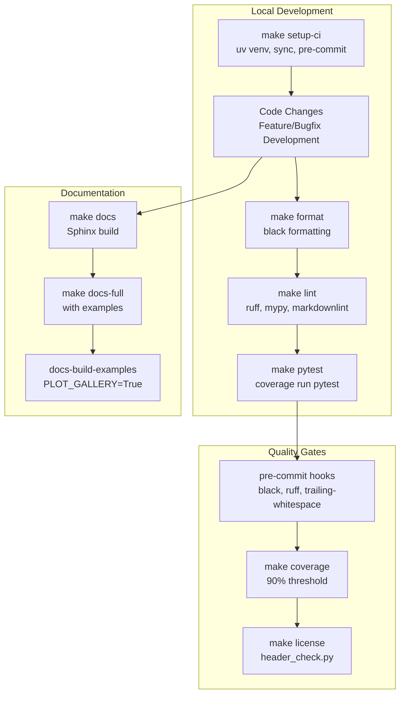
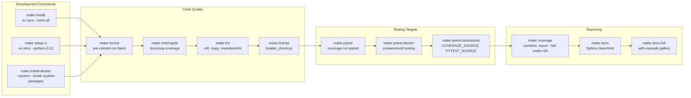
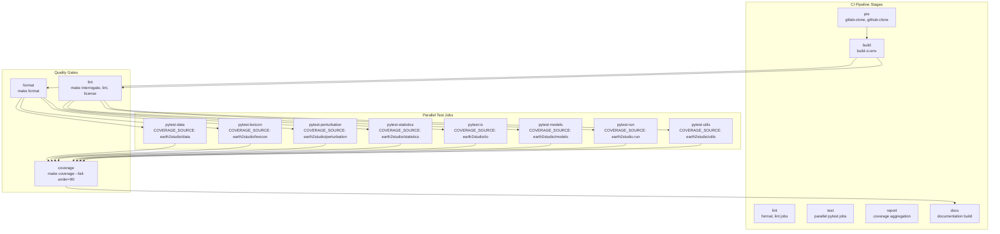
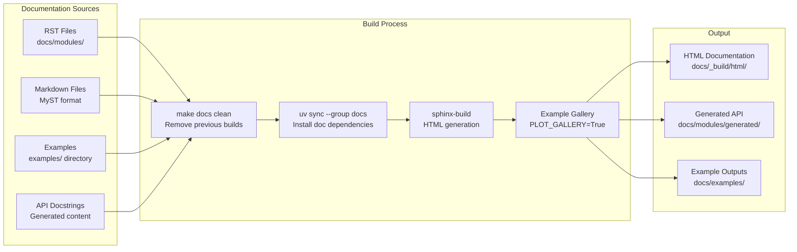
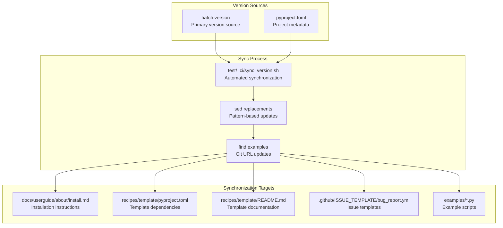

<!-- source: DeepWiki mcp.deepwiki.com · repo NVIDIA/earth2studio · page 4 Development Guide · fetched 2026-10-26 -->

# Development Guide

<details>
<summary>Relevant source files</summary>

The following files were used as context for generating this wiki page:

- [.github/ISSUE_TEMPLATE/bug_report.yml](.github/ISSUE_TEMPLATE/bug_report.yml)
- [.gitlab-ci.yml](.gitlab-ci.yml)
- [Makefile](Makefile)
- [docs/modules/models.rst](docs/modules/models.rst)
- [earth2studio/models/px/__init__.py](earth2studio/models/px/__init__.py)
- [recipes/template/README.md](recipes/template/README.md)
- [recipes/template/pyproject.toml](recipes/template/pyproject.toml)
- [test/_ci/sync_version.sh](test/_ci/sync_version.sh)

</details>


This guide covers the development workflow, build system, testing infrastructure, and contribution process for earth2studio. It provides technical details on the tools, commands, and CI/CD pipeline used to maintain code quality and ensure reliable releases.

For information about the overall architecture and components, see [Core Architecture](#3). For examples of using earth2studio in workflows, see [Examples and Workflows](#5).

## Development Environment Setup

### Prerequisites

earth2studio development requires:
- Python 3.10+ 
- `uv` package manager (recommended) or `pip`
- Git for version control
- Docker for containerized testing (optional)

### Environment Configuration

The primary development setup uses `uv` for dependency management. The [`setup-ci`]() target in the Makefile configures a complete development environment:

```bash
make setup-ci
```

This command performs several setup steps as defined in [Makefile:10-14]():
- Creates a Python 3.12 virtual environment
- Installs all dependencies using `uv sync`
- Installs pre-commit hooks for automated code quality checks

For Docker-based development, use the [`install-docker`]() target which installs system-wide packages with all optional dependencies.

**Development Workflow Overview**



Sources: [Makefile:1-111](), [.gitlab-ci.yml:30-47]()

## Build System and Make Targets

The development workflow is orchestrated through a comprehensive Makefile with specific targets for different aspects of development.

### Core Development Commands

| Target | Purpose | Implementation |
|--------|---------|----------------|
| `make install` | Local development setup | `uv sync` with optional dependencies |
| `make setup-ci` | CI environment configuration | Python 3.12 venv + pre-commit hooks |
| `make format` | Code formatting | `black` via pre-commit |
| `make lint` | Code quality checks | `ruff`, `mypy`, `markdownlint` |
| `make pytest` | Test execution | `coverage run -m pytest` |
| `make coverage` | Coverage reporting | 90% threshold enforcement |
| `make docs` | Documentation build | Sphinx with clean/html targets |

### Testing Infrastructure

The testing system supports both local and containerized execution with modular test organization:

```bash
# Local testing
make pytest

# Docker-based testing  
make pytest-docker

# Module-specific testing
make pytest-submodule COVERAGE_SOURCE=earth2studio/data PYTEST_SOURCE=test/data
```

Module-specific testing allows focused development on individual components as defined in [Makefile:52-58]().

**Build and Test Pipeline**



Sources: [Makefile:1-111]()

## CI/CD Pipeline Architecture

The GitLab CI pipeline implements a multi-stage approach with parallel execution for efficient testing and quality assurance.

### Pipeline Stages

The CI pipeline consists of six primary stages as defined in [.gitlab-ci.yml:1-8]():

1. **pre** - Repository setup and cloning
2. **build** - Environment construction and dependency installation  
3. **lint** - Code quality and formatting verification
4. **test** - Parallel module testing with coverage collection
5. **report** - Coverage aggregation and threshold enforcement
6. **docs** - Documentation generation and validation

### Parallel Testing Strategy

The testing stage employs module-specific parallelization to optimize CI execution time:



Sources: [.gitlab-ci.yml:1-225]()

### CI Job Configuration

Each CI job extends base configurations for consistency and reusability. The key job types include:

- **build-ci-env**: Establishes the development environment using [.gitlab-ci.yml:30-47]()
- **format/lint**: Code quality enforcement using [.gitlab-ci.yml:48-76]()
- **pytest-***: Module-specific testing with coverage collection using [.gitlab-ci.yml:102-175]()
- **coverage**: Aggregated coverage reporting with 90% threshold using [.gitlab-ci.yml:176-215]()

## Code Quality and Standards

### Pre-commit Hooks

The development environment configures automated code quality checks through pre-commit hooks installed via [Makefile:14](). These hooks enforce:

- **black**: Code formatting consistency
- **ruff**: Linting and import organization  
- **trailing-whitespace**: Whitespace cleanup
- **end-of-file-fixer**: File ending normalization
- **debug-statements**: Debug code detection
- **markdownlint**: Documentation formatting

### Linting and Type Checking

The lint target [Makefile:28-38]() performs comprehensive code quality verification:

```bash
make lint
```

This executes multiple tools in sequence:
- `check-added-large-files`: Prevents large file commits
- `ruff`: Fast Python linting 
- `mypy`: Static type checking
- `pyupgrade`: Python syntax modernization

### Documentation Standards

Documentation coverage is enforced through the `interrogate` tool [Makefile:24-26](), which verifies docstring presence and quality.

### License Compliance

License header verification is automated through [Makefile:40-42]() using a custom script at [test/_license/header_check.py]().

## Testing Framework

### Test Organization

Tests are organized by module with corresponding directory structure:
- `test/data/` - Data source and processing tests
- `test/io/` - I/O backend testing
- `test/lexicon/` - Variable mapping and lexicon tests
- `test/models/` - Model loading and execution tests
- `test/perturbation/` - Perturbation method tests
- `test/run/` - Workflow execution tests
- `test/statistics/` - Statistical analysis tests
- `test/utils/` - Utility function tests

### Coverage Requirements

The project enforces a 90% code coverage threshold as defined in [Makefile:69-71](). Coverage is collected during test execution and aggregated across all modules.

### Special Test Categories

The test suite includes specialized testing modes:

```bash
# Auto-model download testing
make pytest-automodels-docker

# CI-specific caching
pytest --ci-cache --slow test/
```

Auto-model testing [Makefile:60-62]() specifically validates the model download and caching functionality with the `--model-download` flag.

## Documentation Generation

### Sphinx Documentation System

Documentation is built using Sphinx with MyST markdown support. The documentation system supports multiple build modes:

```bash
# Basic documentation build
make docs

# Full build with examples
make docs-full

# Development build with selective examples
make docs-dev FILENAME=pattern
```

### Example Gallery Generation

The documentation system includes an automated example gallery generated through [Makefile:84-93]():

```bash
make docs-build-examples
```

This process:
1. Cleans previous builds and generated content
2. Builds base documentation structure
3. Generates example galleries with `PLOT_GALLERY=True`
4. Processes stale examples with `RUN_STALE_EXAMPLES=True`
5. Uses parallel builds with `-j 8` for efficiency

### Docker Documentation Builds

Containerized documentation builds support consistent environments across different systems using [Makefile:94-105]().

**Documentation Build Pipeline**



Sources: [Makefile:73-111](), [docs/modules/models.rst:1-104]()

## Version Management

### Version Synchronization

The project maintains version consistency across multiple files through an automated synchronization script [test/_ci/sync_version.sh:1-28](). This script:

1. Extracts current version using `uv run hatch version`
2. Updates version references in documentation and templates
3. Synchronizes example scripts to use versioned dependencies

### Template and Recipe Management

Development templates are maintained in [recipes/template/]() with standardized structure including:
- `pyproject.toml` with earth2studio dependency specification
- `README.md` with development workflow documentation  
- Version synchronization through the CI process

**Version Management Workflow**



Sources: [test/_ci/sync_version.sh:1-28](), [recipes/template/pyproject.toml:1-28](), [.github/ISSUE_TEMPLATE/bug_report.yml:30-47]()

## Contribution Process

### Issue Reporting

Bug reports follow a structured template defined in [.github/ISSUE_TEMPLATE/bug_report.yml:17-57]() requiring:
- Version information
- Installation method (pip, uv, source)
- Detailed issue description with expected vs. actual behavior

### Development Workflow

The recommended contribution workflow follows these steps:

1. **Environment Setup**: Use `make setup-ci` for consistent development environment
2. **Code Development**: Implement changes following existing patterns
3. **Quality Checks**: Run `make format` and `make lint` before commits
4. **Testing**: Execute relevant test suites with `make pytest`
5. **Documentation**: Update documentation as needed with `make docs`
6. **Coverage Verification**: Ensure 90% coverage threshold with `make coverage`

### Code Standards

All contributions must adhere to:
- Black code formatting standards
- Ruff linting requirements  
- MyPy type checking compliance
- 90% test coverage minimum
- Apache 2.0 license header inclusion
- Comprehensive docstring coverage

The pre-commit hooks automatically enforce these standards, but developers should run manual checks before pushing changes.

Sources: [Makefile:1-111](), [.gitlab-ci.yml:1-225](), [.github/ISSUE_TEMPLATE/bug_report.yml:1-57](), [recipes/template/README.md:1-90]()

---

