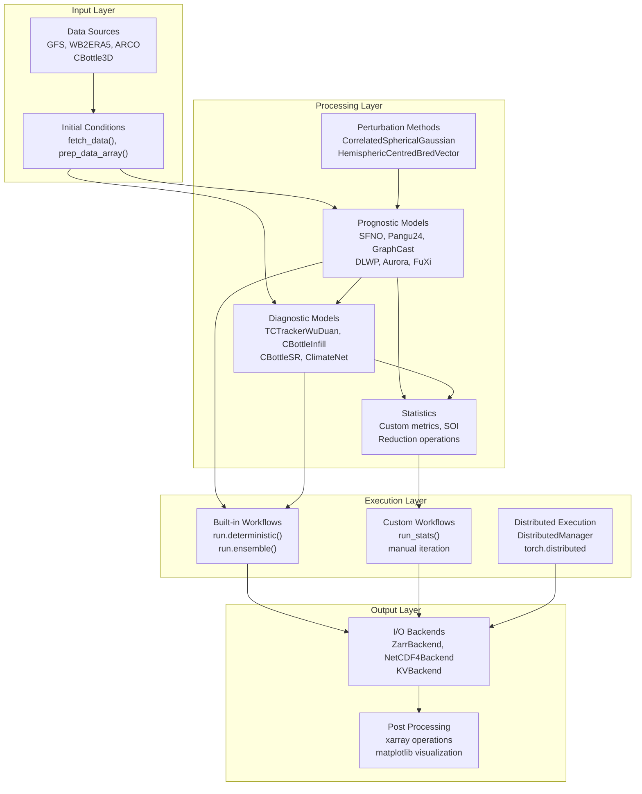
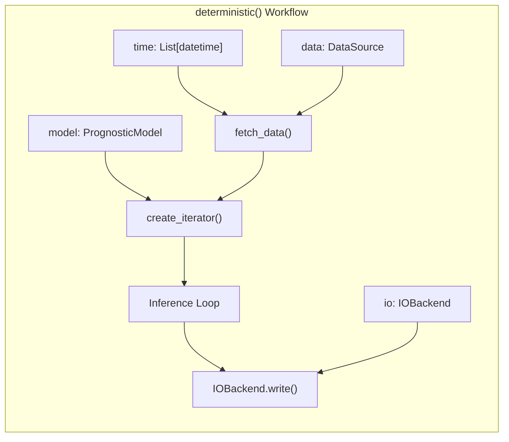
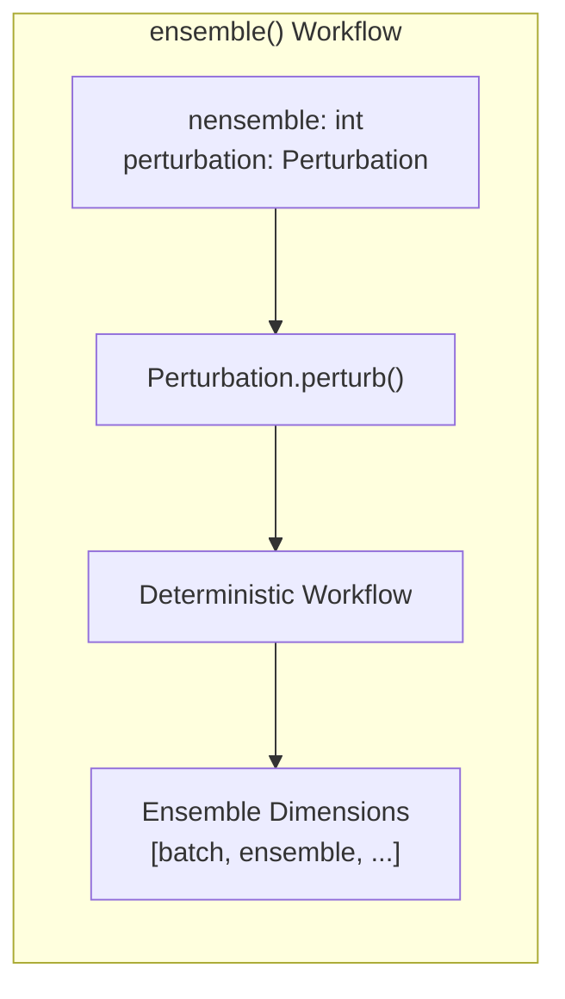
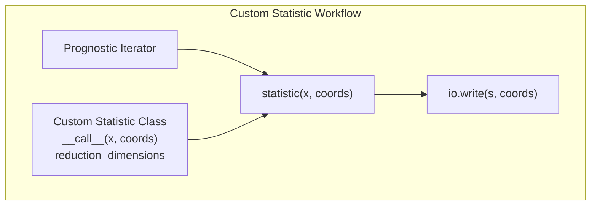
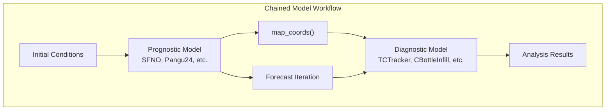
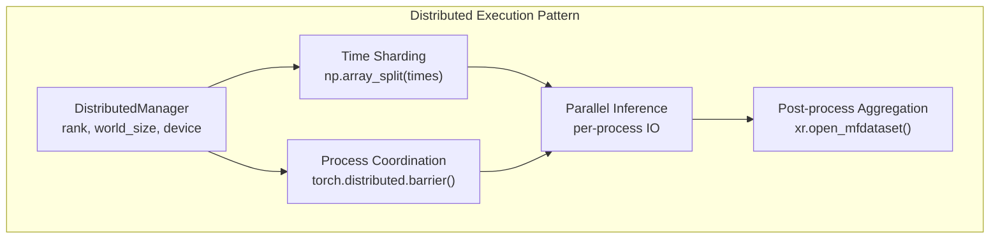
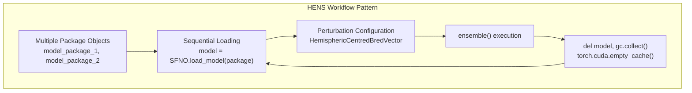

<!-- source: DeepWiki mcp.deepwiki.com · repo NVIDIA/earth2studio · page 5 Examples and Workflows · fetched 2026-10-26 -->

# Examples and Workflows

Relevant source files

The following files were used as context for generating this wiki page:

- [CITATION.cff](CITATION.cff)
- [docs/_static/switcher.json](docs/_static/switcher.json)
- [examples/07_seasonal_statistics.py](examples/07_seasonal_statistics.py)
- [examples/08_distributed_manager.py](examples/08_distributed_manager.py)
- [examples/11_huge_ensembles.py](examples/11_huge_ensembles.py)
- [examples/12_temporal_interpolation.py](examples/12_temporal_interpolation.py)
- [examples/13_cyclone_tracking.py](examples/13_cyclone_tracking.py)
- [examples/14_dlesym_example.py](examples/14_dlesym_example.py)
- [examples/15_cbottle_generation.py](examples/15_cbottle_generation.py)
- [examples/16_cbottle_super_resolution.py](examples/16_cbottle_super_resolution.py)

This page provides comprehensive examples and workflows demonstrating practical usage of earth2studio components. The examples show how to combine prognostic models, diagnostic models, data sources, and I/O systems to solve real-world weather and climate problems.

For information about the core components used in these workflows, see [Core Architecture](#3). For specific model implementations, see [Models](#3.2). For data handling details, see [Data Sources](#3.1).

## Overview

Earth2studio workflows typically follow common patterns that combine multiple components to achieve specific objectives. The framework's modular design enables flexible composition of different forecasting, analysis, and post-processing capabilities.

### Workflow Component Architecture

Sources: [examples/07_seasonal_statistics.py:1-378](), [examples/08_distributed_manager.py:1-205](), [examples/11_huge_ensembles.py:1-254](), [examples/13_cyclone_tracking.py:1-265]()

### Workflow Pattern Categories

Earth2studio supports several distinct workflow patterns, each designed for specific use cases:

| Pattern | Purpose | Key Components | Example Use Cases |
|---------|---------|----------------|-------------------|
| **Deterministic** | Single forecast trajectory | `run.deterministic()`, `PrognosticModel` | Weather prediction, model validation |
| **Ensemble** | Uncertainty quantification | `run.ensemble()`, `Perturbation` methods | Probabilistic forecasting, risk assessment |
| **Statistical** | Custom metrics computation | `Statistic` classes, custom workflows | Climate indices, model evaluation |
| **Diagnostic** | Analysis and enhancement | `DiagnosticModel`, model chaining | Feature detection, super-resolution |
| **Distributed** | Parallel computation | `DistributedManager`, MPI/SLURM | Large-scale simulations, batch processing |
| **Synthetic** | Data generation | AI data sources, diffusion models | Data augmentation, scenario generation |

Sources: [examples/07_seasonal_statistics.py:92-169](), [examples/08_distributed_manager.py:148-162](), [examples/11_huge_ensembles.py:168-179](), [examples/15_cbottle_generation.py:53-159]()

## Basic Workflow Patterns

### Deterministic Forecasting

The fundamental workflow pattern involves running a single forecast trajectory using a prognostic model. The `run.deterministic()` function provides a standardized interface for this pattern.

Sources: [examples/08_distributed_manager.py:159-161](), [examples/12_temporal_interpolation.py:98-100](), [examples/14_dlesym_example.py:209-211]()

### Ensemble Forecasting 

Ensemble workflows add perturbation methods to generate multiple forecast members, enabling uncertainty quantification.

Sources: [examples/11_huge_ensembles.py:168-179]()

### Custom Statistical Workflows

For specialized analysis requirements, custom workflows allow integration of user-defined statistics and metrics.

Sources: [examples/07_seasonal_statistics.py:210-338]()

## Advanced Workflow Patterns

### Model Chaining and Diagnostic Integration

Advanced workflows combine multiple models in sequence, typically using prognostic models for forecasting followed by diagnostic models for analysis or enhancement.

Sources: [examples/13_cyclone_tracking.py:129-163](), [examples/15_cbottle_generation.py:175-231](), [examples/16_cbottle_super_resolution.py:135-161]()

### Distributed Parallel Execution

For large-scale computations, earth2studio supports distributed execution using the `DistributedManager` class, which handles process coordination and resource allocation.

Sources: [examples/08_distributed_manager.py:79-205]()

### Multi-Checkpoint Ensemble (HENS)

The Huge Ensembles (HENS) pattern uses multiple model checkpoints to generate diverse ensemble members, requiring careful memory management and checkpoint cycling.

Sources: [examples/11_huge_ensembles.py:143-186]()

## Example Workflow Implementations

### Statistical Inference: Southern Oscillation Index

The seasonal statistics example demonstrates custom metric computation through a specialized workflow that calculates the Southern Oscillation Index (SOI).

**Key Components:**
- Custom `SOI` statistic class implementing `__call__()` and `reduction_dimensions`
- `run_stats()` function for statistical workflow execution
- Integration with `Pangu24` prognostic model and `GFS` data source

Sources: [examples/07_seasonal_statistics.py:210-341]()

### Tropical Cyclone Tracking

The cyclone tracking workflow demonstrates diagnostic model integration, combining weather prediction with specialized analysis capabilities.

**Key Components:**
- `TCTrackerWuDuan` diagnostic model for storm identification
- `SFNO` prognostic model for forecast generation  
- Manual iteration with `tracker.reset_path_buffer()` for state management
- Coordinate mapping with `map_coords()` for model compatibility

Sources: [examples/13_cyclone_tracking.py:72-164]()

### CBottle Data Generation and Enhancement

The CBottle workflows showcase AI-driven data synthesis and enhancement, including both data generation and super-resolution capabilities.

**Data Generation Workflow:**
- `CBottle3D` data source for synthetic climate data generation
- `CBottleInfill` diagnostic for variable infilling
- Stochastic sampling with seed control for reproducibility

**Super-Resolution Workflow:**
- `CBottleSR` diagnostic model for spatial enhancement
- Regional windowing with `super_resolution_window` parameter
- Multi-stage processing: infilling → super-resolution

Sources: [examples/15_cbottle_generation.py:70-229](), [examples/16_cbottle_super_resolution.py:84-161]()

### DLESyM Earth System Modeling

The DLESyM example demonstrates specialized earth system modeling with atmosphere-ocean coupling and coordinate system handling.

**Key Features:**
- `DLESyMLatLon` wrapper for standard lat/lon workflows
- `DLESyM` native model with HEALPix coordinate handling
- Component-specific output selection: `retrieve_valid_atmos_outputs()`, `retrieve_valid_ocean_outputs()`
- Extended forecast periods (60+ days) with 4-day model steps

Sources: [examples/14_dlesym_example.py:87-214]()

### Temporal Interpolation Enhancement

The temporal interpolation workflow demonstrates model enhancement for increasing temporal resolution of forecasts.

**Implementation Pattern:**
- Base model (`SFNO`) for coarse temporal resolution (6-hour steps)
- `InterpModAFNO` enhancement model for fine resolution (1-hour steps)  
- Model composition where interpolation model wraps the base model
- Standard workflow integration via `run.deterministic()`

Sources: [examples/12_temporal_interpolation.py:71-100]()

---

