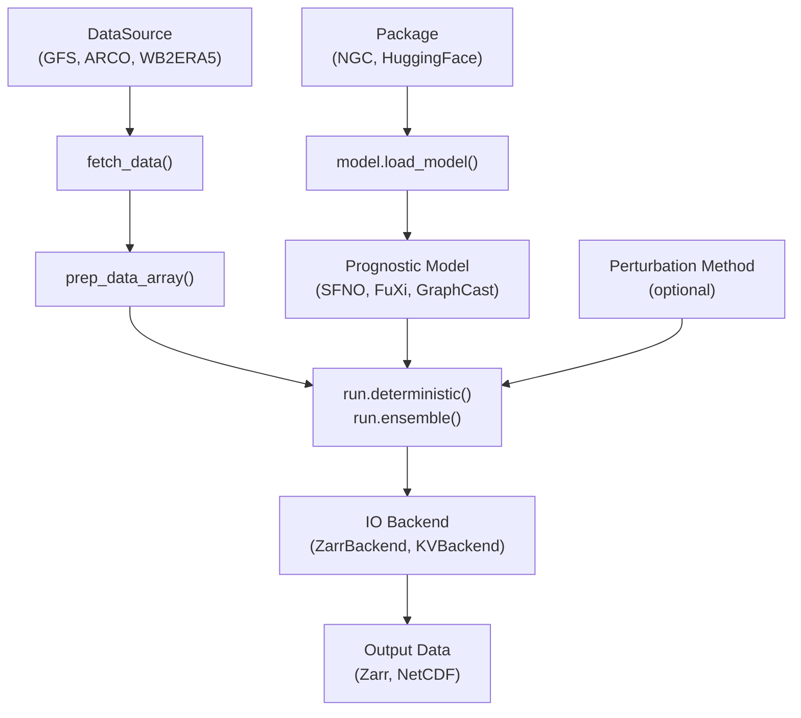
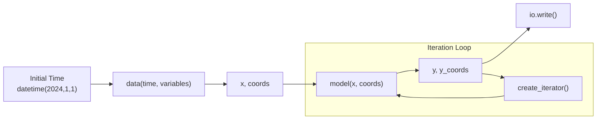
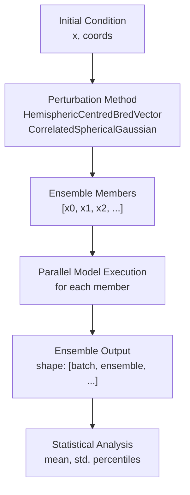
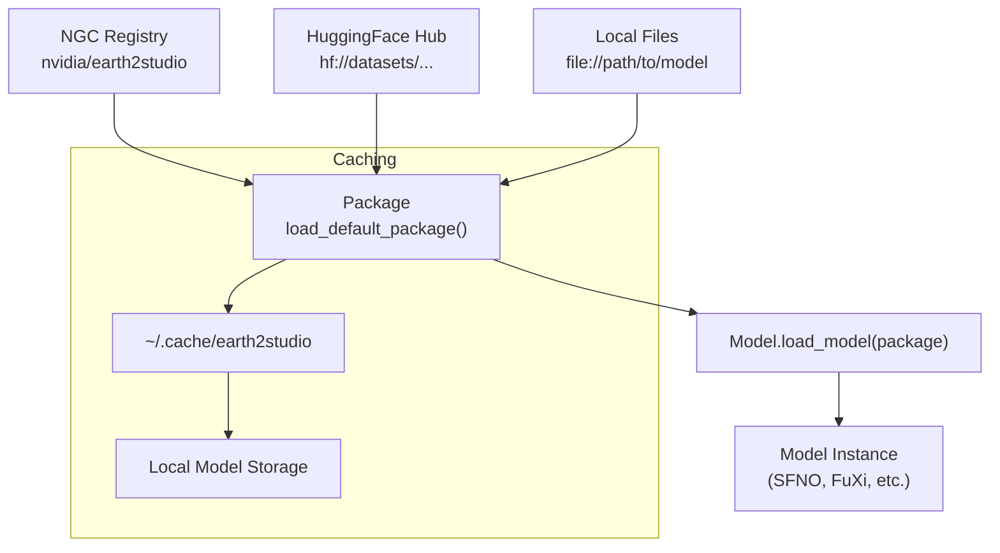

<!-- source: DeepWiki mcp.deepwiki.com · repo NVIDIA/earth2studio · page 5.1 Basic Workflows · fetched 2026-10-26 -->

# Basic Workflows

<details>
<summary>Relevant source files</summary>

The following files were used as context for generating this wiki page:

- [CITATION.cff](CITATION.cff)
- [docs/_static/switcher.json](docs/_static/switcher.json)
- [examples/11_huge_ensembles.py](examples/11_huge_ensembles.py)
- [examples/12_temporal_interpolation.py](examples/12_temporal_interpolation.py)
- [examples/13_cyclone_tracking.py](examples/13_cyclone_tracking.py)
- [examples/14_dlesym_example.py](examples/14_dlesym_example.py)

</details>


This page provides simple examples for getting started with deterministic and ensemble forecasting in earth2studio. The workflows covered here demonstrate the fundamental patterns for running AI weather models, including data loading, model execution, and result storage. For more complex distributed inference and specialized model usage, see [Advanced Workflows](#5.2).

## Workflow Architecture

The basic workflow architecture in earth2studio follows a consistent pattern connecting data sources, models, and output storage through standardized interfaces.

### Core Workflow Components



**Sources:** [examples/11_huge_ensembles.py:85-94](), [examples/12_temporal_interpolation.py:64-82](), [examples/14_dlesym_example.py:77-93]()

### Deterministic Workflow Pattern



**Sources:** [examples/14_dlesym_example.py:130-184](), [examples/12_temporal_interpolation.py:94-101]()

## Basic Deterministic Forecast

A deterministic forecast produces a single prediction trajectory from initial conditions using a prognostic model.

### Simple Deterministic Example

The deterministic workflow uses the `earth2studio.run.deterministic` function to orchestrate the forecast:

```python
from earth2studio.run import deterministic
from earth2studio.data import GFS  
from earth2studio.models.px import SFNO
from earth2studio.io import ZarrBackend

# Load model and data source
model = SFNO.load_model(SFNO.load_default_package())
data = GFS()
io = ZarrBackend()

# Run deterministic forecast  
io = deterministic(
    ["2024-01-01"],  # Initial times
    20,              # Number of forecast steps  
    model,           # Prognostic model
    data,            # Data source
    io               # Output backend
)
```

### Core Components

| Component | Purpose | Key Classes |
|-----------|---------|-------------|
| **Data Source** | Fetch initial conditions | `GFS`, `ARCO`, `WB2ERA5` |
| **Prognostic Model** | Generate forecasts | `SFNO`, `FuXi`, `GraphCast`, `DLESyM` |
| **IO Backend** | Store results | `ZarrBackend`, `KVBackend`, `NetCDF4Backend` |

**Sources:** [examples/12_temporal_interpolation.py:94-101](), [examples/14_dlesym_example.py:196-214]()

## Basic Ensemble Forecast

Ensemble forecasts generate multiple prediction trajectories by applying perturbations to initial conditions or model parameters.

### Ensemble Workflow Components



**Sources:** [examples/11_huge_ensembles.py:149-178]()

### Simple Ensemble Example

The ensemble workflow uses `earth2studio.run.ensemble` with perturbation methods:

```python
from earth2studio.run import ensemble
from earth2studio.perturbation import CorrelatedSphericalGaussian
import numpy as np

# Set up perturbation method
noise_amplitude = torch.zeros(model.input_coords()["variable"].shape[0]) 
noise_amplitude[z500_index] = 39.27  # Amplify z500 perturbations
perturbation = CorrelatedSphericalGaussian(noise_amplitude=noise_amplitude)

# Run ensemble forecast
io = ensemble(
    ["2024-01-01"],     # Initial times
    20,                 # Forecast steps
    10,                 # Ensemble size
    model,              # Prognostic model  
    data,               # Data source
    io,                 # Output backend
    perturbation,       # Perturbation method
    output_coords={"variable": np.array(["u10m", "v10m"])}
)
```

**Sources:** [examples/11_huge_ensembles.py:149-178]()

## Model Loading and Packages

Earth2studio uses a package system to automatically download and cache model checkpoints from various sources.

### Model Package System



**Sources:** [examples/11_huge_ensembles.py:96-111](), [examples/14_dlesym_example.py:88-93]()

### Custom Package Example

For specialized model checkpoints, create custom `Package` instances:

```python
from earth2studio.models.auto import Package

# Custom HuggingFace package
custom_package = Package(
    "hf://datasets/maheshankur10/hens/earth2mip_prod_registry/sfno_linear_74chq_sc2_layers8_edim620_wstgl2-epoch70_seed102",
    cache_options={
        "cache_storage": Package.default_cache("custom_model"),
        "same_names": True,
    }
)

model = SFNO.load_model(custom_package)
```

**Sources:** [examples/11_huge_ensembles.py:96-111]()

## Data Flow and Coordination

The workflow execution follows a standardized data flow pattern with coordinate system management.

### Data Processing Pipeline

```mermaid
graph LR
    RawData["Raw Data<br/>(GRIB, NetCDF)"] --> fetch_data["fetch_data()"]
    fetch_data --> DataArray["xarray.DataArray"]
    DataArray --> prep_data_array["prep_data_array()"]
    prep_data_array --> TensorData["torch.Tensor + CoordSystem"]
    
    TensorData --> map_coords["map_coords()"]
    map_coords --> ModelInput["Model Input<br/>(x, coords)"]
    ModelInput --> ModelForward["model(x, coords)"]
    ModelForward --> ModelOutput["(y, y_coords)"]
    
    ModelOutput --> IOWrite["io.write()"]
    IOWrite --> StoredData["Zarr/NetCDF Output"]
```



**Sources:** [examples/13_cyclone_tracking.py:100-112](), [examples/14_dlesym_example.py:130-144]()

### Coordinate System Management

Earth2studio uses `CoordSystem` objects to track tensor dimensions and metadata:

```python
# Coordinate system example
coords = {
    "time": np.array([datetime(2024, 1, 1)]),
    "lead_time": np.array([0, 6, 12, 18]) * np.timedelta64(1, 'h'),
    "variable": np.array(["u10m", "v10m", "t2m", "msl"]),
    "lat": np.linspace(90, -90, 721),
    "lon": np.linspace(0, 359.75, 1440)
}
```

**Sources:** [examples/13_cyclone_tracking.py:132-145](), [examples/14_dlesym_example.py:134-144]()

## Common Workflow Patterns

### Iterator Pattern for Long Forecasts

For memory-efficient long forecasts, use the model iterator pattern:

```python
# Create model iterator
model_iter = model.create_iterator(x, coords)

for step in range(n_steps):
    x, coords = next(model_iter)
    # Process output for this step
    output, output_coords = diagnostic_model(x, coords)
```

**Sources:** [examples/14_dlesym_example.py:175-184](), [examples/13_cyclone_tracking.py:147-160]()

### Output Coordinate Specification

Control output variables and dimensions using `output_coords`:

```python
# Specify subset of output variables
output_coords = {"variable": np.array(["u10m", "v10m"])}

io = deterministic([date], nsteps, model, data, io, 
                  output_coords=output_coords)
```

**Sources:** [examples/11_huge_ensembles.py:177](), [examples/14_dlesym_example.py:202-210]()

### Memory Management for GPU Workflows

For GPU-intensive workflows, implement explicit memory management:

```python
import gc
import torch

# Process multiple models sequentially
for i, package in enumerate(model_packages):
    model = SFNO.load_model(package)
    # Run inference...
    
    # Clean up GPU memory
    del model
    gc.collect()
    torch.cuda.empty_cache()
```

**Sources:** [examples/11_huge_ensembles.py:180-185]()

---

