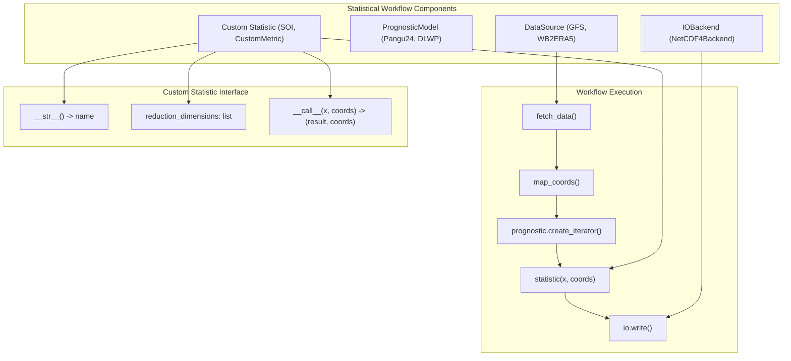
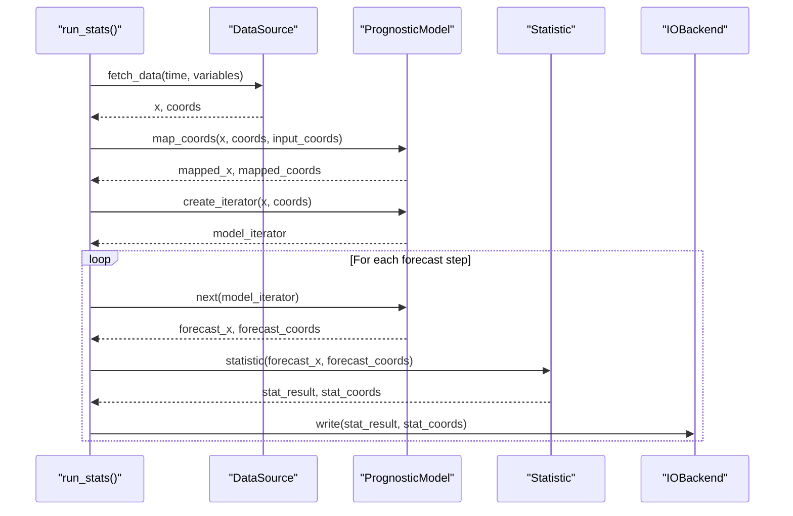
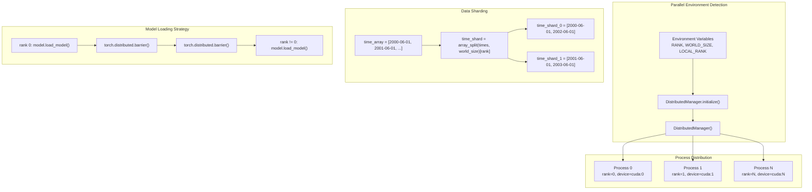
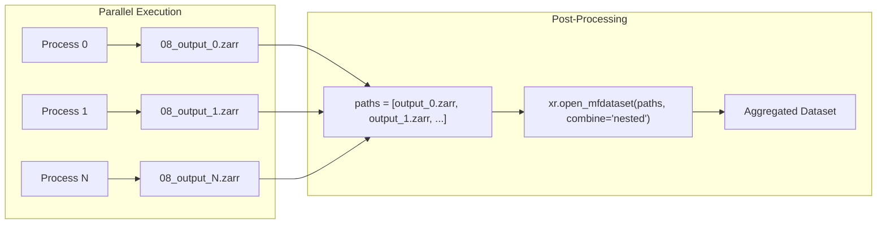
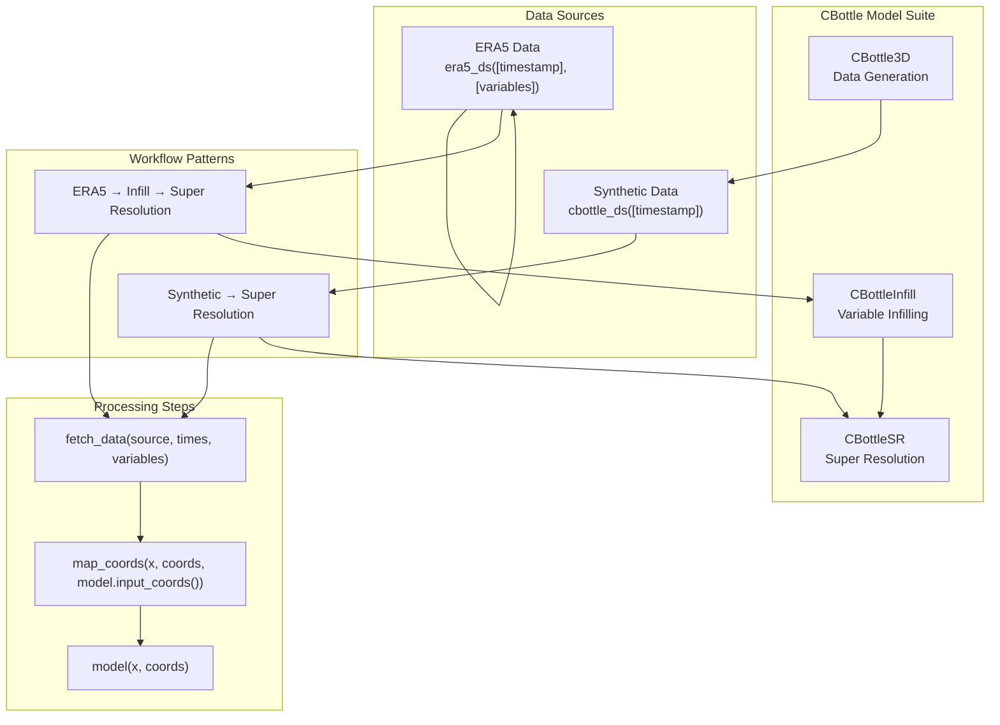
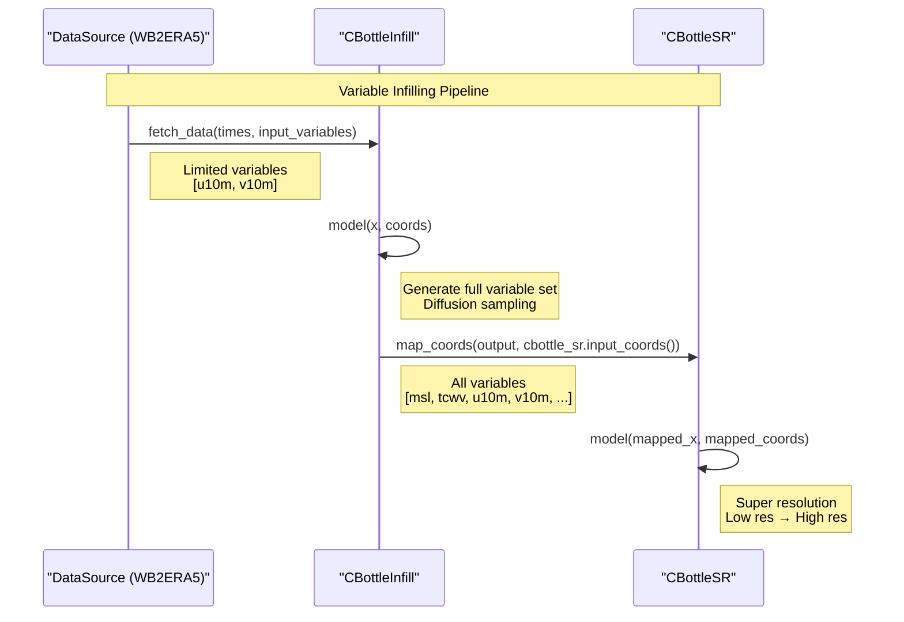
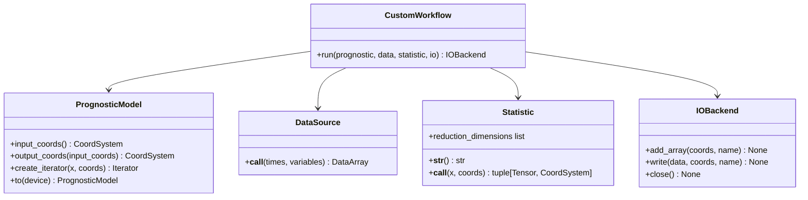
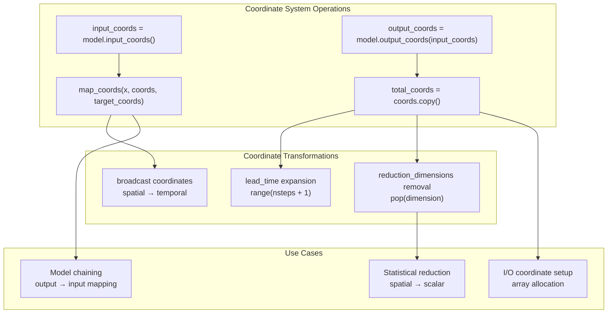

<!-- source: DeepWiki mcp.deepwiki.com · repo NVIDIA/earth2studio · page 5.2 Advanced Workflows · fetched 2026-10-26 -->

# Advanced Workflows

Relevant source files

The following files were used as context for generating this wiki page:

- [examples/07_seasonal_statistics.py](examples/07_seasonal_statistics.py)
- [examples/08_distributed_manager.py](examples/08_distributed_manager.py)
- [examples/15_cbottle_generation.py](examples/15_cbottle_generation.py)
- [examples/16_cbottle_super_resolution.py](examples/16_cbottle_super_resolution.py)

This document covers complex inference patterns and specialized workflows in earth2studio that go beyond basic deterministic and ensemble forecasting. These examples demonstrate custom workflow development, distributed computing, statistical inference, and advanced AI model usage.

For basic deterministic and ensemble forecasting examples, see [Basic Workflows](#5.1). For core architecture concepts, see [Core Architecture](#3).

## Statistical Inference Workflows

Statistical inference workflows enable computation of custom metrics and derived quantities during model inference. These workflows typically combine prognostic models with statistical operators to produce meaningful climatological indicators.

### Custom Statistics Implementation

Custom statistics in earth2studio implement a specific interface pattern that allows seamless integration with inference workflows. The statistic must define reduction dimensions and coordinate transformations.

The Southern Oscillation Index (SOI) implementation demonstrates this pattern by reducing spatial dimensions to compute a scalar time series from sea level pressure data at specific locations.

**Sources:** [examples/07_seasonal_statistics.py:92-169](), [examples/07_seasonal_statistics.py:210-339]()

### Statistical Workflow Architecture

Statistical workflows follow a standardized pattern that separates concerns between data fetching, model inference, statistical computation, and I/O operations.

**Sources:** [examples/07_seasonal_statistics.py:92-169]()

## Distributed Computing Workflows

Earth2studio supports distributed inference through integration with `DistributedManager` from PhysicsNeMo. This enables parallel execution across multiple GPUs or nodes for embarrassingly parallel workloads.

### Distributed Manager Integration

The distributed manager provides environment detection and device assignment for parallel execution contexts including MPI, SLURM, and PyTorch distributed environments.

**Sources:** [examples/08_distributed_manager.py:78-108](), [examples/08_distributed_manager.py:150-161]()

### Parallel I/O Strategy

Earth2studio recommends separate output files per process to avoid I/O conflicts, with post-processing aggregation using tools like `xarray.open_mfdataset`.

**Sources:** [examples/08_distributed_manager.py:129-134](), [examples/08_distributed_manager.py:179-187]()

## Advanced AI Model Workflows

Earth2studio provides access to state-of-the-art AI models for specialized tasks including data generation, variable infilling, and super-resolution enhancement. The CBottle suite represents the most advanced capabilities.

### CBottle Model Pipeline

The CBottle (Climate in a Bottle) suite includes three complementary models that can be chained together for comprehensive climate data processing workflows.

**Sources:** [examples/15_cbottle_generation.py:74-82](), [examples/16_cbottle_super_resolution.py:84-105]()

### Variable Infilling Workflow

The `CBottleInfill` model enables generation of missing variables from a subset of input variables, allowing conditioning on partial observations.

**Sources:** [examples/15_cbottle_generation.py:180-230](), [examples/16_cbottle_super_resolution.py:147-161]()

## Custom Workflow Development

Advanced workflows in earth2studio follow dependency injection patterns that enable flexible composition of components. Understanding these patterns enables development of specialized workflows.

### Component Interface Patterns

Earth2studio components implement standardized interfaces that enable interoperability and testing through dependency injection.

**Sources:** [examples/07_seasonal_statistics.py:92-100]()

### Advanced Coordinate Management

Complex workflows often require sophisticated coordinate system transformations and mappings between different model inputs and outputs.

**Sources:** [examples/07_seasonal_statistics.py:141-154](), [examples/15_cbottle_generation.py:192-194]()

---

