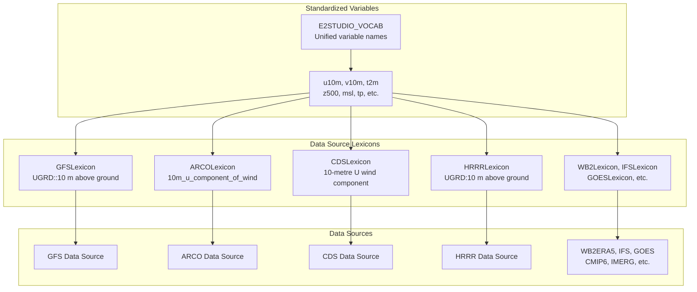
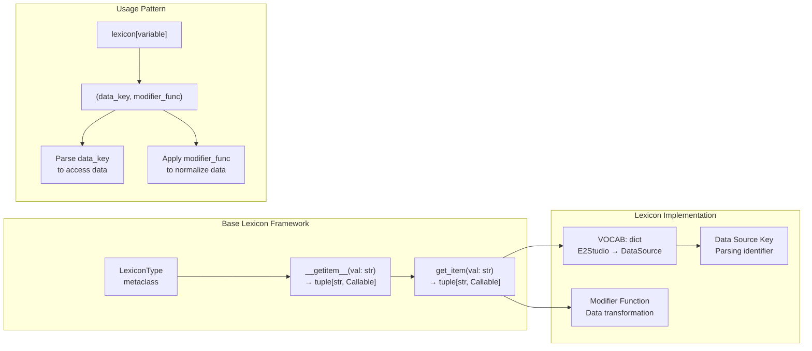
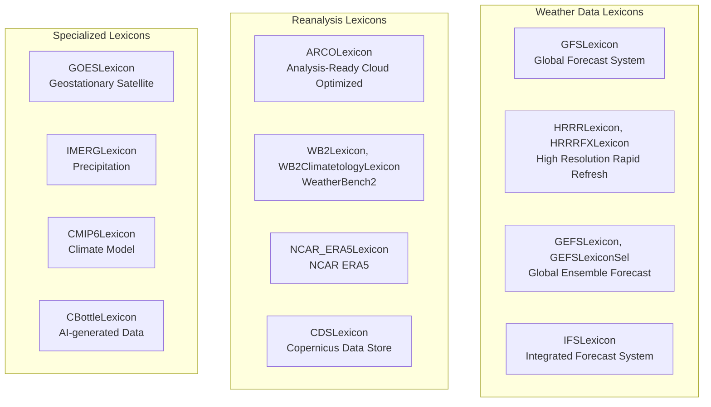
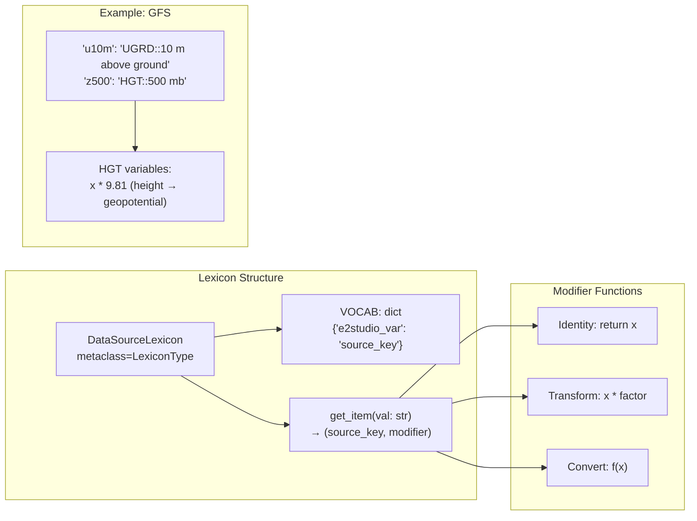
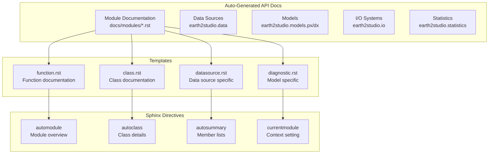

<!-- source: DeepWiki mcp.deepwiki.com · repo NVIDIA/earth2studio · page 6 Reference · fetched 2026-10-26 -->

# Reference

Relevant source files

The following files were used as context for generating this wiki page:

- [docs/modules/datasources.rst](docs/modules/datasources.rst)
- [docs/templates/class.rst](docs/templates/class.rst)
- [docs/userguide/advanced/lexicon.md](docs/userguide/advanced/lexicon.md)
- [docs/userguide/components/diagnostic.md](docs/userguide/components/diagnostic.md)
- [docs/userguide/components/prognostic.md](docs/userguide/components/prognostic.md)
- [docs/userguide/components/statistics.md](docs/userguide/components/statistics.md)
- [docs/userguide/developer/documentation.md](docs/userguide/developer/documentation.md)
- [docs/userguide/index.md](docs/userguide/index.md)
- [earth2studio/data/__init__.py](earth2studio/data/__init__.py)
- [earth2studio/lexicon/__init__.py](earth2studio/lexicon/__init__.py)
- [earth2studio/lexicon/base.py](earth2studio/lexicon/base.py)
- [earth2studio/lexicon/gfs.py](earth2studio/lexicon/gfs.py)

This page provides comprehensive reference documentation for earth2studio's standardized systems, including the lexicon vocabulary, variable mappings across data sources, and links to auto-generated API documentation.

For conceptual explanations of these systems, see [Core Architecture](#3). For implementation guides and examples, see [Examples and Workflows](#5).

## Lexicon System Overview

The earth2studio lexicon system provides standardized variable naming and mapping between the framework's unified vocabulary (`E2STUDIO_VOCAB`) and data source-specific variable names. This enables consistent variable handling across different weather and climate data sources.

### Lexicon Architecture

Sources: [earth2studio/lexicon/base.py:28-200](), [earth2studio/lexicon/__init__.py:17-29](), [earth2studio/data/__init__.py:17-40]()

### Lexicon Type System

Sources: [earth2studio/lexicon/base.py:20-26](), [earth2studio/lexicon/gfs.py:288-306]()

## E2STUDIO_VOCAB Reference

The standardized vocabulary contains meteorological variables organized by category. Each variable has a standardized name and physical description.

### Surface Variables

| Variable | Description | Units |
|----------|-------------|-------|
| `u10m` | u-component (eastward, zonal) of wind at 10 m | m s⁻¹ |
| `v10m` | v-component (northward, meridional) of wind at 10 m | m s⁻¹ |
| `u100m` | u-component of wind at 100 m | m s⁻¹ |
| `v100m` | v-component of wind at 100 m | m s⁻¹ |
| `t2m` | temperature at 2m | K |
| `d2m` | dewpoint temperature at 2m | K |
| `r2m` | relative humidity at 2 m | % |
| `q2m` | specific humidity at 2 m | kg kg⁻¹ |
| `sp` | surface pressure | Pa |
| `msl` | mean sea level pressure | Pa |
| `skt` | skin temperature at surface | K |

### Atmospheric Column Variables

| Variable | Description | Units |
|----------|-------------|-------|
| `tcwv` | total column water vapor / precipitable water | kg m⁻² |
| `tclw` | total column liquid water / vertically integrated liquid water path | kg m⁻² |
| `tciw` | total column ice water / vertically integrated ice water path | kg m⁻² |

### Precipitation Variables

| Variable | Description | Units |
|----------|-------------|-------|
| `tp` | total precipitation | m |
| `tpp` | total precipitation probability | - |
| `tpi` | total precipitation index | - |
| `tp06` | total precipitation accumulated over past 6 hours | - |
| `tpf` | total precipitation flux | kg m⁻² s⁻¹ |

### Pressure Level Variables

The lexicon includes atmospheric variables at standard pressure levels (50, 100, 150, 200, 250, 300, 400, 500, 600, 700, 850, 925, 1000 hPa):

- **Wind Components**: `u{level}`, `v{level}`, `w{level}` (m s⁻¹)
- **Geopotential**: `z{level}` (m² s⁻²) 
- **Temperature**: `t{level}` (K)
- **Humidity**: `r{level}` (%), `q{level}` (kg kg⁻¹)
- **Additional**: `vpd{level}` (vapor pressure deficit), `ws{level}` (wind speed)

### Specialized Variables

| Variable | Description | Units |
|----------|-------------|-------|
| `sic` | sea ice concentration / sea ice area fraction | 0-1 |
| `sst` | Temperature of sea water near the surface | K |
| `lsm` | land-sea mask | - |
| `z` | geopotential at surface (orography) | m² s⁻² |
| `fg10m` | maximum 10 m wind gust since previous post-processing | m s⁻¹ |
| `refc` | Maximum/Composite radar reflectivity | dB |

Sources: [earth2studio/lexicon/base.py:28-200]()

## Data Source Lexicons

Each data source implements its own lexicon class that maps `E2STUDIO_VOCAB` variables to data source-specific identifiers.

### Available Lexicons

Sources: [earth2studio/lexicon/__init__.py:17-29]()

### Lexicon Implementation Pattern

Data source lexicons follow a consistent pattern with vocabulary mapping and optional data modifiers:

Sources: [earth2studio/lexicon/gfs.py:24-306](), [earth2studio/lexicon/base.py:20-26]()

### Example: GFS Lexicon Mapping

| E2Studio Variable | GFS Key | Modifier |
|-------------------|---------|----------|
| `u10m` | `UGRD::10 m above ground` | Identity |
| `v10m` | `VGRD::10 m above ground` | Identity |
| `t2m` | `TMP::2 m above ground` | Identity |
| `z500` | `HGT::500 mb` | `x * 9.81` |
| `msl` | `PRMSL::mean sea level` | Identity |
| `tp` | `596::APCP::surface` | Identity |

Sources: [earth2studio/lexicon/gfs.py:39-85](), [earth2studio/lexicon/gfs.py:288-306]()

## API Documentation System

earth2studio uses Sphinx with auto-generation to create comprehensive API documentation from docstrings.

### Documentation Structure

Sources: [docs/modules/datasources.rst:1-89](), [docs/templates/class.rst:1-17](), [docs/userguide/developer/documentation.md:15-42]()

### API Documentation Links

| Component | Documentation Path | Description |
|-----------|-------------------|-------------|
| **Data Sources** | `earth2studio.data` | Weather/climate data APIs, caching, lexicon integration |
| **Prognostic Models** | `earth2studio.models.px` | Time-integration models for forecasting |
| **Diagnostic Models** | `earth2studio.models.dx` | Instantaneous prediction and analysis models |
| **I/O Backends** | `earth2studio.io` | Asynchronous Zarr, NetCDF4, coordinate systems |
| **Statistics** | `earth2studio.statistics` | Metrics, moments, ensemble analysis |
| **Lexicon** | `earth2studio.lexicon` | Variable mapping and data source vocabularies |
| **Utilities** | `earth2studio.utils` | Coordinate systems, data utilities, type definitions |

### Documentation Generation

The documentation system uses several key components:

- **Sphinx**: Core documentation engine with MyST markdown support
- **sphinx-gallery**: Executable examples with auto-generated notebooks  
- **AutoDocstring**: NumPy-style docstring enforcement via interrogate
- **API Templates**: Consistent formatting across all auto-generated content

Sources: [docs/userguide/developer/documentation.md:1-242](), [docs/userguide/index.md:1-132]()

---

