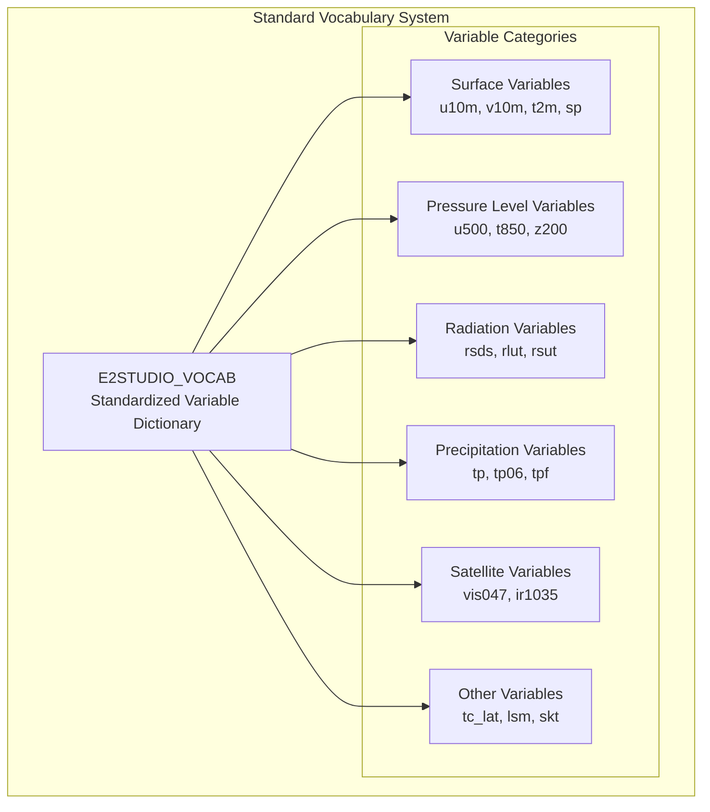
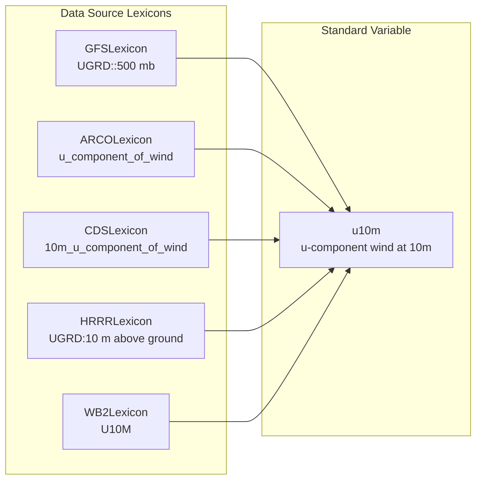
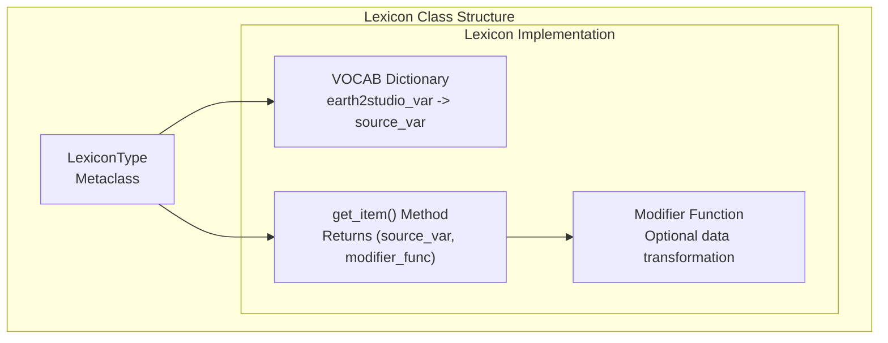
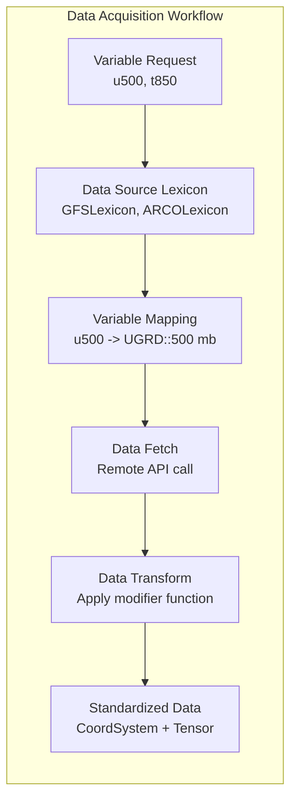

<!-- source: DeepWiki mcp.deepwiki.com · repo NVIDIA/earth2studio · page 6.1 Lexicon and Variables · fetched 2026-10-26 -->

# Lexicon and Variables

Relevant source files

The following files were used as context for generating this wiki page:

- [docs/modules/datasources.rst](docs/modules/datasources.rst)
- [docs/templates/class.rst](docs/templates/class.rst)
- [docs/userguide/advanced/lexicon.md](docs/userguide/advanced/lexicon.md)
- [docs/userguide/components/diagnostic.md](docs/userguide/components/diagnostic.md)
- [docs/userguide/components/prognostic.md](docs/userguide/components/prognostic.md)
- [docs/userguide/components/statistics.md](docs/userguide/components/statistics.md)
- [docs/userguide/developer/documentation.md](docs/userguide/developer/documentation.md)
- [docs/userguide/index.md](docs/userguide/index.md)
- [earth2studio/data/__init__.py](earth2studio/data/__init__.py)
- [earth2studio/lexicon/__init__.py](earth2studio/lexicon/__init__.py)
- [earth2studio/lexicon/base.py](earth2studio/lexicon/base.py)
- [earth2studio/lexicon/gfs.py](earth2studio/lexicon/gfs.py)

This reference documents the lexicon system in earth2studio, which provides standardized variable naming and mapping across different weather and climate data sources. The lexicon ensures consistent variable identification throughout the framework while enabling seamless integration with diverse data formats and naming conventions.

For conceptual information about how the lexicon works in practice, see the [advanced lexicon guide](#3.1). For information about specific data sources and their integration, see [Data Sources](#3.1).

## Standard Variable Vocabulary

Earth2studio uses a standardized vocabulary defined in `E2STUDIO_VOCAB` that serves as the canonical naming scheme for all meteorological and climate variables throughout the framework. This vocabulary provides short, descriptive variable names with consistent units and physical meanings.

*Sources: [earth2studio/lexicon/base.py:28-200]()*

The vocabulary follows these naming conventions:

- **Surface variables**: Include level indicator (e.g., `10m`, `2m`)
- **Pressure level variables**: Include pressure level (e.g., `500`, `850`, `200`)
- **Units**: Specified in variable descriptions (K for temperature, m/s for wind, Pa for pressure)
- **Components**: Wind components use `u` (zonal) and `v` (meridional) prefixes

## Data Source Lexicon System

Each data source implements its own lexicon class that maps earth2studio variable names to source-specific identifiers. This mapping system enables transparent data access while maintaining standardized variable names throughout workflows.

*Sources: [earth2studio/lexicon/gfs.py:24-307](), [earth2studio/lexicon/__init__.py:17-28]()*

### Lexicon Implementation

Data source lexicons inherit from `LexiconType` metaclass and implement the following pattern:

*Sources: [earth2studio/lexicon/base.py:20-26](), [earth2studio/lexicon/gfs.py:288-306]()*

The `get_item` method returns both the source-specific variable identifier and an optional modifier function for unit conversions or data transformations. For example, GFS geopotential height is converted to geopotential by multiplying by 9.81.

## Variable Categories

### Surface Variables

| Variable | Description | Units |
|----------|-------------|-------|
| `u10m`, `v10m` | Wind components at 10m | m s⁻¹ |
| `u100m`, `v100m` | Wind components at 100m | m s⁻¹ |
| `t2m` | Temperature at 2m | K |
| `d2m` | Dewpoint temperature at 2m | K |
| `r2m` | Relative humidity at 2m | % |
| `q2m` | Specific humidity at 2m | kg kg⁻¹ |
| `sp` | Surface pressure | Pa |
| `msl` | Mean sea level pressure | Pa |
| `sst` | Sea surface temperature | K |
| `sic` | Sea ice concentration | 0-1 |

*Sources: [earth2studio/lexicon/base.py:29-40]()*

### Pressure Level Variables

Atmospheric variables are available at standard pressure levels: 50, 100, 150, 200, 250, 300, 400, 500, 600, 700, 850, 925, 1000 hPa.

| Variable Type | Pattern | Description | Units |
|---------------|---------|-------------|-------|
| Zonal wind | `u{level}` | u-component of wind | m s⁻¹ |
| Meridional wind | `v{level}` | v-component of wind | m s⁻¹ |
| Vertical wind | `w{level}` | Vertical wind component | m s⁻¹ |
| Geopotential | `z{level}` | Geopotential | m² s⁻² |
| Temperature | `t{level}` | Temperature | K |
| Relative humidity | `r{level}` | Relative humidity | % |
| Specific humidity | `q{level}` | Specific humidity | kg kg⁻¹ |

*Sources: [earth2studio/lexicon/base.py:66-156]()*

### Column and Radiation Variables

| Variable | Description | Units |
|----------|-------------|-------|
| `tcwv` | Total column water vapor | kg m⁻² |
| `tclw` | Total column liquid water | kg m⁻² |
| `tciw` | Total column ice water | kg m⁻² |
| `rsds` | Surface downwelling shortwave radiation | W m⁻² |
| `rlut` | Outgoing longwave radiation | W m⁻² |
| `rsut` | Outgoing shortwave radiation | W m⁻² |

*Sources: [earth2studio/lexicon/base.py:41-52]()*

### Precipitation Variables

| Variable | Description | Units |
|----------|-------------|-------|
| `tp` | Total precipitation | m |
| `tp06` | 6-hour accumulated precipitation | m |
| `tpf` | Total precipitation flux | kg m⁻² s⁻¹ |
| `tpp` | Total precipitation probability | - |

*Sources: [earth2studio/lexicon/base.py:44-48]()*

### Satellite Variables

GOES satellite bands for remote sensing applications:

| Variable | Description | Wavelength |
|----------|-------------|------------|
| `vis047` | Visible band (Blue) | 0.47 μm |
| `vis064` | Visible band (Red) | 0.64 μm |
| `nir086` | Near-IR (Vegetation) | 0.86 μm |
| `ir1035` | Clean IR longwave window | 10.35 μm |
| `ir1120` | IR longwave window | 11.20 μm |

*Sources: [earth2studio/lexicon/base.py:184-198]()*

### Specialized Variables

| Variable | Description | Units |
|----------|-------------|-------|
| `lsm` | Land-sea mask | - |
| `z` | Surface geopotential (orography) | m² s⁻² |
| `tc_lat`, `tc_lon` | Tropical cyclone center position | degrees |
| `tc_msl` | Tropical cyclone min pressure | Pa |
| `tc_w10m` | Tropical cyclone max wind speed | m s⁻¹ |
| `refc` | Composite radar reflectivity | dB |

*Sources: [earth2studio/lexicon/base.py:53-65]()*

## Data Source Integration

The lexicon system integrates with data sources through the following workflow:

*Sources: [earth2studio/data/__init__.py:17-40](), [docs/userguide/advanced/lexicon.md:32-82]()*

Each data source class uses its lexicon to:

1. **Validate** requested variables against available vocabulary
2. **Map** earth2studio variable names to source-specific identifiers
3. **Apply** any necessary unit conversions or transformations
4. **Return** data with standardized coordinate systems

This design ensures that models and workflows can request variables using consistent names regardless of the underlying data source, while data sources handle the complexity of format-specific variable naming and unit conventions.

---

