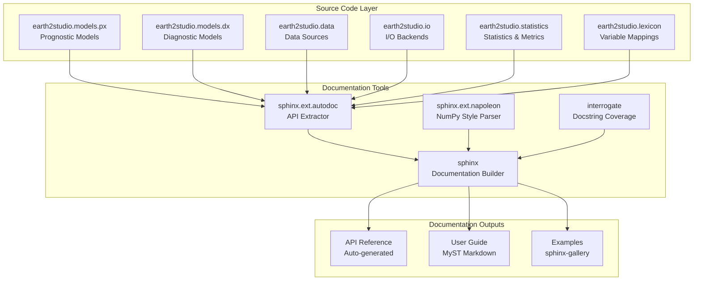
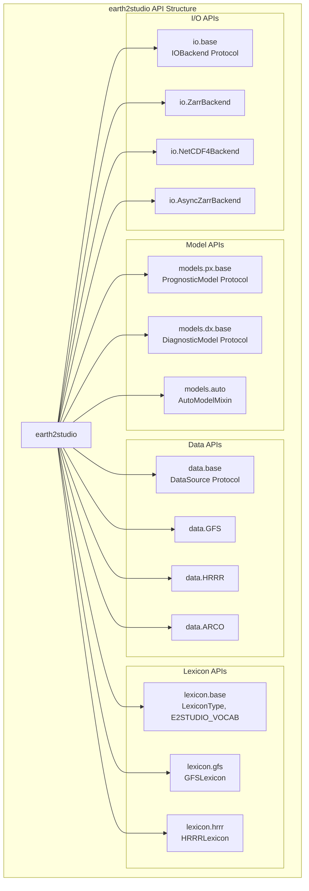
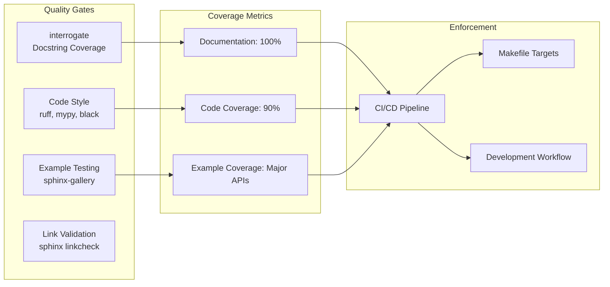

<!-- source: DeepWiki mcp.deepwiki.com · repo NVIDIA/earth2studio · page 6.2 API Documentation · fetched 2026-10-26 -->

# API Documentation

<details>
<summary>Relevant source files</summary>

The following files were used as context for generating this wiki page:

- [docs/templates/class.rst](docs/templates/class.rst)
- [docs/userguide/advanced/lexicon.md](docs/userguide/advanced/lexicon.md)
- [docs/userguide/components/diagnostic.md](docs/userguide/components/diagnostic.md)
- [docs/userguide/components/prognostic.md](docs/userguide/components/prognostic.md)
- [docs/userguide/components/statistics.md](docs/userguide/components/statistics.md)
- [docs/userguide/developer/documentation.md](docs/userguide/developer/documentation.md)
- [docs/userguide/index.md](docs/userguide/index.md)
- [earth2studio/lexicon/gfs.py](earth2studio/lexicon/gfs.py)

</details>


This page provides guidance on the earth2studio API documentation system, including how to access auto-generated API documentation, understand the documentation structure, and contribute to documentation. For information about the lexicon system and variable mappings, see [Lexicon and Variables](#6.1).

## Documentation System Overview

Earth2studio uses Sphinx to generate comprehensive API documentation with strict requirements for code coverage and consistency. The documentation system automatically generates API references from docstrings while maintaining high quality standards.

### Documentation Architecture



**Documentation System Architecture**

Sources: [docs/userguide/developer/documentation.md:1-242](), [docs/userguide/index.md:1-132]()

## API Documentation Structure

The API documentation is automatically generated from source code docstrings using Sphinx's autodoc extension. All public classes and functions must have comprehensive documentation.

### Core Module Organization



**API Module Structure and Key Protocols**

Sources: [docs/userguide/components/prognostic.md:20-32](), [docs/userguide/components/diagnostic.md:20-32](), [earth2studio/lexicon/gfs.py:24-37]()

## Documentation Standards

Earth2studio enforces strict documentation standards using automated tools and style guidelines.

### Docstring Requirements

| Component | Requirement | Tool | Coverage |
|-----------|-------------|------|----------|
| Public Classes | NumPy style docstrings | `interrogate` | 100% |
| Public Functions | Type hints + descriptions | `sphinx.ext.napoleon` | Required |
| Parameters | Type + description | Manual review | All params |
| Returns | Type + description | Manual review | All returns |
| Examples | Working code snippets | `sphinx-gallery` | Major APIs |

### Documentation Style Standards

The documentation follows specific formatting rules as defined in [docs/userguide/developer/documentation.md:15-88]():

- **DocString Format**: NumPy style with description starting on same line as opening `"""`
- **Class Documentation**: Placed under class definition, not `__init__` method  
- **Type Hints**: Included in docstrings for all parameters and returns
- **Optional Arguments**: Denoted with "optional" following type, default values specified
- **Cross-References**: Use `:py:class:` and `:py:func:` for API references

### Template System

Documentation uses RST templates for consistent API reference generation:

```rst
:mod:`{{module}}`.{{objname}}
{{ underline }}==============

.. currentmodule:: {{ module }}

.. autoclass:: {{ objname }}
    :members:
```

Sources: [docs/templates/class.rst:1-17](), [docs/userguide/developer/documentation.md:15-88]()

## Building and Accessing Documentation

The documentation build system provides multiple targets for different development and deployment needs.

### Build Commands

```bash
# Core documentation without examples
make docs

# Full documentation with all examples
make docs-full

# Development build for single example
make docs-dev FILENAME=<example.py>

# Serve locally at http://localhost:8000
cd docs/_build/html && python -m http.server 8000
```

### Documentation Dependencies

The build system requires specific tools and environment setup:

| Tool | Purpose | Configuration |
|------|---------|---------------|
| `sphinx-build` | Core builder | Auto-detected or explicit |
| `sphinx-gallery` | Example generation | End-to-end testing |
| `interrogate` | Coverage enforcement | 100% requirement |
| `MyST` | Markdown processing | User guide content |

Sources: [docs/userguide/developer/documentation.md:205-242]()

## API Coverage and Quality Assurance

The documentation system includes automated quality checks and coverage enforcement.

### Coverage Requirements



**Documentation Quality Assurance Pipeline**

### API Reference Organization

The auto-generated API documentation is organized by functional modules:

- **Models**: `earth2studio.models.px` (prognostic), `earth2studio.models.dx` (diagnostic)
- **Data Sources**: `earth2studio.data` with source-specific classes like `GFS`, `HRRR`, `ARCO`
- **I/O Systems**: `earth2studio.io` with backends like `ZarrBackend`, `NetCDF4Backend`
- **Lexicon**: `earth2studio.lexicon` with mapping classes like `GFSLexicon`
- **Statistics**: `earth2studio.statistics` with metrics and reduction operations
- **Utilities**: Cross-cutting utilities and coordinate systems

Sources: [docs/userguide/developer/documentation.md:1-25](), [docs/userguide/index.md:47-99]()

## Contributing to Documentation

Documentation contributions follow the same standards as code contributions, with specific requirements for API documentation.

### API Documentation Requirements

1. **Complete Coverage**: All public methods must have NumPy-style docstrings
2. **Type Information**: Parameters and returns must include type hints in docstrings  
3. **Examples**: Major APIs should include usage examples in docstrings
4. **Cross-References**: Use Sphinx directives for linking related functionality
5. **Consistency**: Follow established patterns in existing documentation

### Example Documentation Process

For classes like `GFSLexicon` shown in [earth2studio/lexicon/gfs.py:24-304](), documentation must include:

- Class-level description explaining purpose and usage
- Parameter documentation for initialization arguments
- Method documentation with clear examples
- Notes and warnings for important usage patterns
- References to related functionality

Sources: [docs/userguide/developer/documentation.md:15-88](), [earth2studio/lexicon/gfs.py:24-37]()