# Page: Overview

# Overview

<details>
<summary>Relevant source files</summary>

The following files were used as context for generating this wiki page:

- [CHANGELOG.md](CHANGELOG.md)
- [pyproject.toml](pyproject.toml)
- [uv.lock](uv.lock)

</details>


This document provides a comprehensive overview of earth2studio, an open-source deep-learning framework for exploring, building and deploying AI weather and climate workflows. It covers the core architecture, key components, and how the major subsystems interact to enable scientific computing workflows.

For detailed installation instructions, see [Installation and Setup](#2). For specific component documentation, see [Core Architecture](#3) and its subsections covering [Data Sources](#3.1), [Models](#3.2), [I/O Systems](#3.3), and [Statistics and Metrics](#3.4).

## Purpose and Scope

earth2studio is designed as a modular framework that enables researchers and practitioners to:

- Access diverse weather and climate datasets from multiple sources
- Run state-of-the-art AI models for weather prediction and climate analysis  
- Perform statistical analysis and ensemble forecasting
- Deploy workflows with efficient I/O and distributed computing support
- Standardize variables and coordinates across different data sources and models

The framework supports both **prognostic models** (for time-stepping forecasts) and **diagnostic models** (for analysis and post-processing), with a unified interface for model loading, data handling, and workflow execution.

Sources: [pyproject.toml:6-10](), [CHANGELOG.md:1-354]()

## Core Architecture

### System Overview

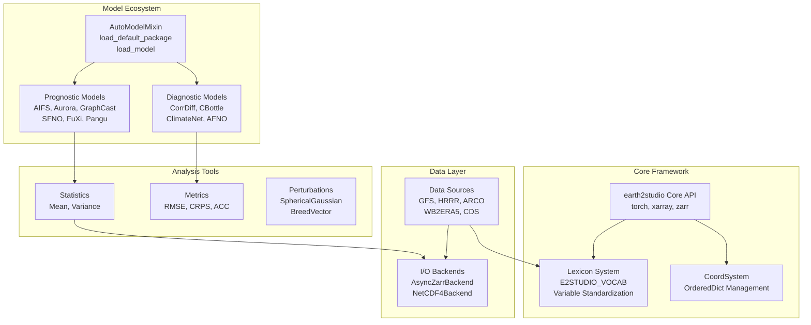

The architecture consists of four main layers that work together to provide a complete weather and climate modeling platform.

Sources: [pyproject.toml:14-33](), [CHANGELOG.md:42-51](), [CHANGELOG.md:94-102]()

### Component Interaction Flow

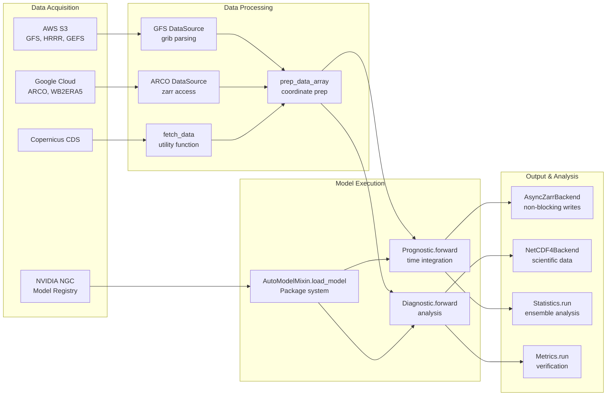

This flow shows how data moves from external sources through the processing pipeline to model execution and analysis output.

Sources: [CHANGELOG.md:42-43](), [CHANGELOG.md:306-307](), [CHANGELOG.md:332-334]()

## Key Components

### Model System

The framework supports two primary model categories:

| Model Type | Purpose | Examples | Key Features |
|------------|---------|----------|--------------|
| **Prognostic** | Time-stepping forecasts | `AIFS`, `Aurora`, `GraphCast`, `SFNO`, `FuXi`, `Pangu` | Auto-regressive, ensemble support |
| **Diagnostic** | Analysis & enhancement | `CorrDiff`, `CBottle`, `ClimateNet`, `AFNO` | Post-processing, super-resolution |

All models implement the `AutoModelMixin` interface with methods:
- `load_default_package()` - Downloads model from registry
- `load_model()` - Instantiates model from package
- `input_coords()` - Returns expected input coordinates
- `output_coords()` - Returns output coordinate mapping

Sources: [CHANGELOG.md:94-102](), [CHANGELOG.md:124-128](), [CHANGELOG.md:332-334]()

### Data Sources

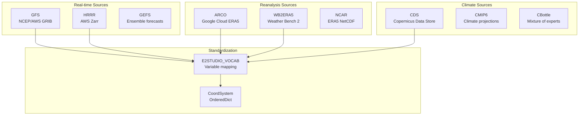

Each data source implements async fetching with built-in caching and automatic coordinate standardization through the lexicon system.

Sources: [CHANGELOG.md:13-18](), [CHANGELOG.md:241-248](), [CHANGELOG.md:265-270]()

### Storage and I/O

The framework provides multiple I/O backends optimized for different use cases:

| Backend | Use Case | Key Features |
|---------|----------|--------------|
| `AsyncZarrBackend` | Large-scale parallel writes | Non-blocking, thread-safe |
| `ZarrBackend` | Chunked storage | Compression codecs, Zarr 3.0 |
| `NetCDF4Backend` | Scientific data exchange | CF conventions, metadata |

All backends support:
- Coordinate-aware writing with automatic chunking
- Configurable compression and encoding
- Batch and ensemble dimension handling

Sources: [CHANGELOG.md:43-44](), [CHANGELOG.md:54-55](), [CHANGELOG.md:275-278]()

### Package and Model Loading

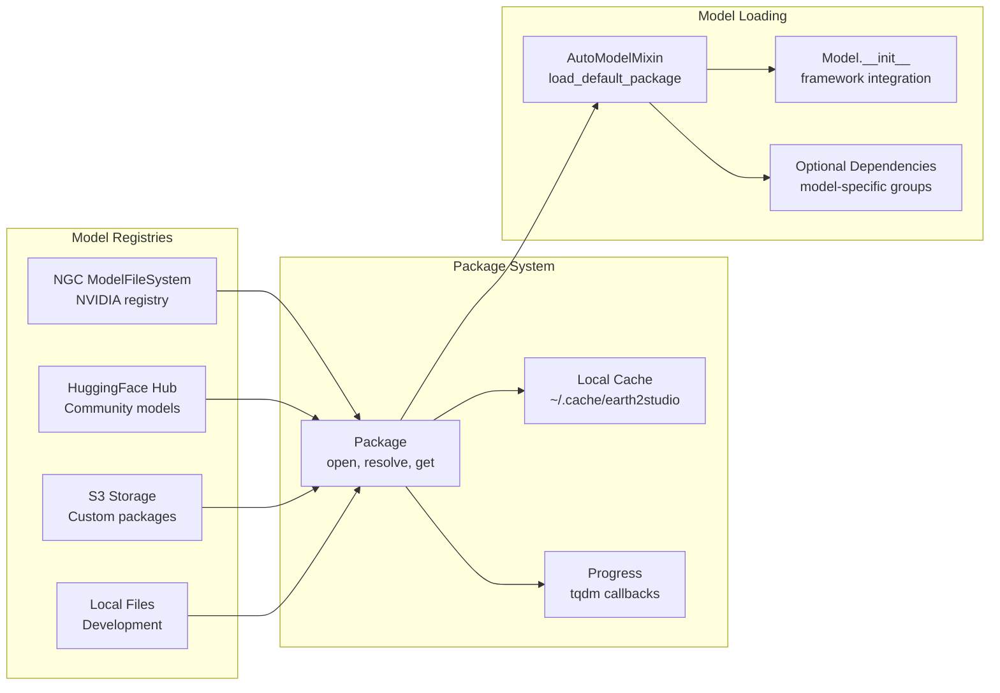

The package system enables automatic model downloading with caching and dependency management through optional dependency groups defined in `pyproject.toml`.

Sources: [CHANGELOG.md:270-271](), [CHANGELOG.md:332-334](), [pyproject.toml:58-174]()

## Installation and Dependencies

earth2studio uses a modular dependency system with optional groups for specific functionality:

| Dependency Group | Purpose | Key Packages |
|------------------|---------|--------------|
| Core | Base functionality | `torch`, `xarray`, `zarr`, `fsspec` |
| Model-specific | Individual models | `anemoi-inference`, `microsoft-aurora`, `onnxruntime-gpu` |
| Data | External data sources | `cdsapi`, `eccodes`, `ecmwf-opendata` |
| Analysis | Statistics and metrics | `nvidia-physicsnemo`, `torch-harmonics` |

The framework requires Python 3.11+ and supports both CPU and GPU workflows with automatic PyTorch index selection based on platform.

Sources: [pyproject.toml:12-13](), [pyproject.toml:14-33](), [pyproject.toml:58-174](), [pyproject.toml:219-232]()

## Development and Versioning

earth2studio follows semantic versioning with a comprehensive changelog tracking:
- Model additions and updates
- API changes and improvements  
- Performance optimizations
- Bug fixes and security updates
- Dependency management

The current development version is 0.10.0 with regular releases adding new models, data sources, and capabilities. The framework uses `uv` for package management and `hatch` for building.

Sources: [CHANGELOG.md:9-38](), [pyproject.toml:177-216](), [pyproject.toml:273-278]()

---

# Page: Installation and Setup

# Installation and Setup

<details>
<summary>Relevant source files</summary>

The following files were used as context for generating this wiki page:

- [docs/userguide/about/install.md](docs/userguide/about/install.md)
- [earth2studio/models/dx/__init__.py](earth2studio/models/dx/__init__.py)

</details>


This page provides a comprehensive guide for installing and configuring earth2studio, including package manager options, optional model dependencies, environment setup, and system requirements. 

For information about the core architecture and how components interact after installation, see [Core Architecture](#3). For model-specific usage after installation, see [Models](#3.2).

## Installation Architecture

The following diagram shows the earth2studio installation ecosystem and how different components relate to each other:

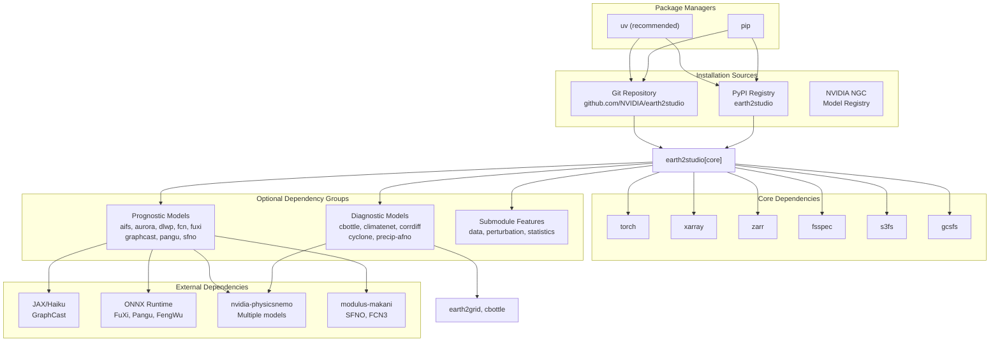

Sources: [docs/userguide/about/install.md:1-814]()

## Basic Installation Methods

### Recommended: uv Installation

The `uv` package manager provides the best installation experience with automatic dependency resolution:

```bash
mkdir earth2studio-project && cd earth2studio-project
uv init --python=3.12
uv add "earth2studio @ git+https://github.com/NVIDIA/earth2studio.git@0.9.0"
```

### Alternative: pip Installation

For users preferring pip, install from PyPI:

```bash
pip install earth2studio
```

Or from the Git repository for latest features:

```bash
pip install "earth2studio @ git+https://github.com/NVIDIA/earth2studio"
```

### Installation Verification

Verify the installation works correctly:

```bash
python  # or 'uv run python' when using uv
>>> import earth2studio
>>> earth2studio.__version__
```

Sources: [docs/userguide/about/install.md:16-71]()

## Optional Dependencies

### Model Dependency Architecture

The following diagram shows how optional dependency groups map to actual model classes in the codebase:

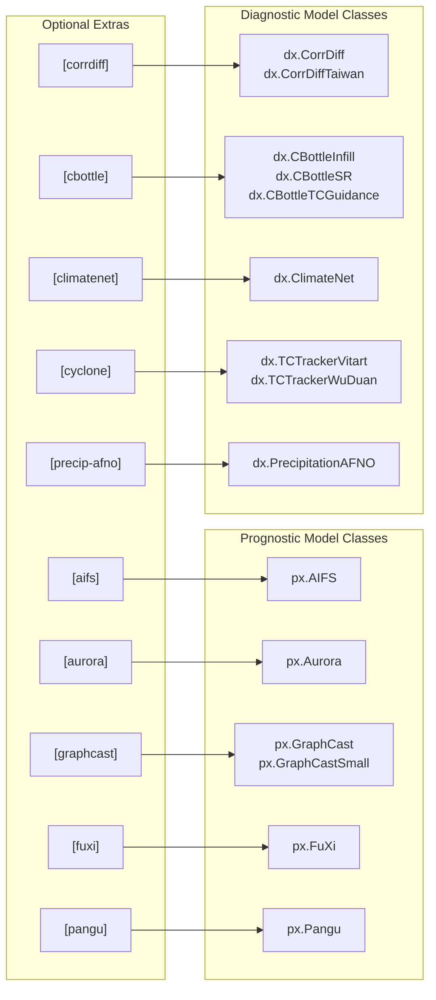

Sources: [docs/userguide/about/install.md:100-576](), [earth2studio/models/dx/__init__.py:17-42]()

### Prognostic Model Dependencies

Install dependencies for specific prognostic models:

| Model | uv Command | Special Requirements |
|-------|------------|---------------------|
| AIFS | `uv add earth2studio --extra aifs` | flash-attention (slow build) |
| Aurora | `uv add earth2studio --extra aurora-fork` | Use forked variant |
| GraphCast | `uv add earth2studio --extra graphcast` | JAX/Haiku dependencies |
| FuXi | `uv add earth2studio --extra fuxi` | ONNX GPU Runtime |
| Pangu | `uv add earth2studio --extra pangu` | ONNX GPU Runtime |
| SFNO | `uv add earth2studio --extra sfno` | modulus-makani |

### Diagnostic Model Dependencies

Install dependencies for diagnostic models:

| Model | uv Command | Notes |
|-------|------------|-------|
| CorrDiff | `uv add earth2studio --extra corrdiff` | Diffusion models |
| CBottle | `uv add earth2studio --extra cbottle` | earth2grid required |
| ClimateNet | `uv add earth2studio --extra climatenet` | No additional deps |
| Cyclone Tracking | `uv add earth2studio --extra cyclone` | Python ≤3.12 only |
| Precipitation AFNO | `uv add earth2studio --extra precip-afno` | Standard AFNO model |

### Submodule Dependencies

Install dependencies for specific submodule features:

```bash
# Data processing features
uv add earth2studio --extra data

# Perturbation methods
uv add earth2studio --extra perturbation

# Statistical analysis tools
uv add earth2studio --extra statistics
```

Sources: [docs/userguide/about/install.md:100-640]()

## Environment Setup

### uv Project Environment (Recommended)

Create an isolated uv project:

```bash
mkdir earth2studio-project && cd earth2studio-project
uv init --python=3.12
uv add "earth2studio @ git+https://github.com/NVIDIA/earth2studio.git@0.9.0"
```

### PyTorch Docker Container

Use the NVIDIA PyTorch container as a base:

```bash
docker run -it nvcr.io/nvidia/pytorch:25.05-py3

# Inside container:
apt-get update && apt-get install -y git make curl
unset PIP_CONSTRAINT
curl -LsSf https://astral.sh/uv/install.sh | sh && source $HOME/.local/bin/env
uv pip install --system --break-system-packages "earth2studio@git+https://github.com/NVIDIA/earth2studio.git@0.9.0"
```

### Custom Docker Container

For dedicated containers, use this Dockerfile:

```dockerfile
FROM nvcr.io/nvidia/pytorch:25.05-py3
COPY --from=ghcr.io/astral-sh/uv:0.6.13 /uv /uvx /bin/

RUN apt-get update && apt-get install -y make curl && rm -rf /var/lib/apt/lists/*

WORKDIR /app
ENV PIP_CONSTRAINT=
RUN uv pip install --system --break-system-packages "earth2studio@git+https://github.com/NVIDIA/earth2studio.git@0.9.0"
```

Sources: [docs/userguide/about/install.md:673-751]()

## System Requirements

### Hardware Recommendations

| Component | Requirement | Recommended |
|-----------|-------------|-------------|
| GPU | NVIDIA GPU with compute ≥8.9 | L40S, RTX A6000, H100, B200 |
| GPU Memory | ≥16 GB | ≥40 GB |
| System RAM | ≥16 GB | ≥64 GB |
| Disk Space | ≥32 GB | ≥128 GB |
| Precision Support | FP16/FP32 | FP32 for best accuracy |

### Software Recommendations

| Component | Version | Notes |
|-----------|---------|-------|
| OS | Ubuntu 24.04 LTS | Matches development environment |
| Python | 3.12 | Recommended for all features |
| CUDA | 12.8 | For GPU acceleration |
| Docker | Latest | For containerized environments |

Sources: [docs/userguide/about/install.md:769-801]()

## Configuration

### Environment Variables

Configure earth2studio behavior using these environment variables:

| Variable | Purpose | Default |
|----------|---------|---------|
| `EARTH2STUDIO_CACHE` | Cache directory for models and data | `~/.cache/earth2studio` |
| `EARTH2STUDIO_PACKAGE_TIMEOUT` | Model download timeout (seconds) | 300 |

### Cache Configuration

The cache stores downloaded models and preprocessed data:

```bash
export EARTH2STUDIO_CACHE="/path/to/custom/cache"
```

### Package Download Configuration

Configure model download timeout:

```bash
export EARTH2STUDIO_PACKAGE_TIMEOUT=600  # 10 minutes
```

Sources: [docs/userguide/about/install.md:805-814]()

---

# Page: Core Architecture

# Core Architecture

<details>
<summary>Relevant source files</summary>

The following files were used as context for generating this wiki page:

- [CHANGELOG.md](CHANGELOG.md)
- [docs/modules/datasources.rst](docs/modules/datasources.rst)
- [earth2studio/data/__init__.py](earth2studio/data/__init__.py)
- [earth2studio/lexicon/__init__.py](earth2studio/lexicon/__init__.py)
- [earth2studio/lexicon/base.py](earth2studio/lexicon/base.py)
- [pyproject.toml](pyproject.toml)
- [uv.lock](uv.lock)

</details>


This page describes the high-level architecture of earth2studio, focusing on the core framework design, component interactions, and key abstractions that enable weather and climate AI workflows. For specific information about data sources, see [Data Sources](#3.1). For details about individual models, see [Models](#3.2). For I/O system specifics, see [I/O Systems](#3.3).

## Design Principles

Earth2studio follows a modular, protocol-based architecture designed around several key principles:

- **Standardized Interfaces**: Common protocols for data sources, models, and I/O backends enable interoperability
- **Asynchronous Operations**: Built-in support for async data fetching and non-blocking I/O operations
- **Auto-loading and Caching**: Intelligent model package management with local caching for performance
- **Variable Standardization**: Unified lexicon system for mapping variables across different data sources
- **Flexible Dependencies**: Optional dependency groups allow minimal installations or full feature sets

The framework is built on a foundation of scientific Python libraries including PyTorch, Xarray, Zarr, and fsspec, providing both CPU and GPU execution capabilities.

**Sources:** [pyproject.toml:1-50](), [CHANGELOG.md:1-50]()

## Core Components Architecture

The earth2studio architecture consists of four primary layers that work together to provide end-to-end weather and climate AI workflows:

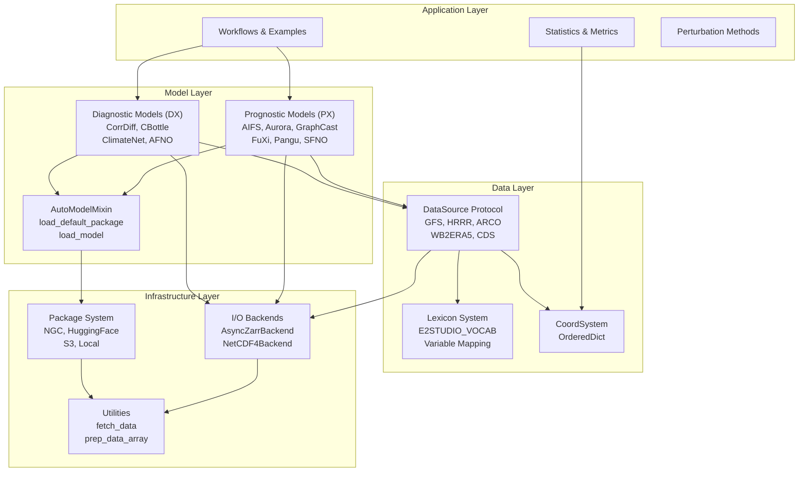

**Sources:** [earth2studio/data/__init__.py:17-41](), [pyproject.toml:58-174]()

## Data Flow Architecture

Data flows through earth2studio following a standardized pipeline from external sources through processing to model execution and output storage:

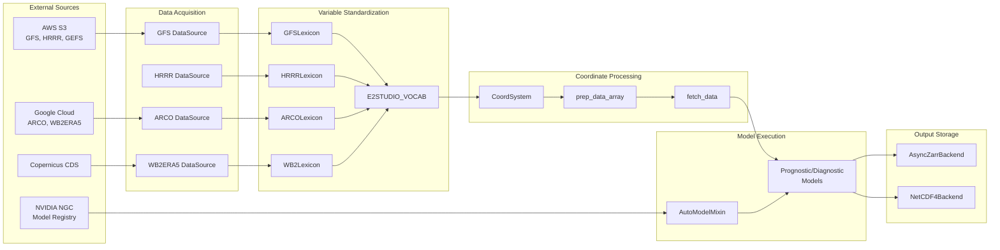

**Sources:** [earth2studio/lexicon/base.py:28-200](), [earth2studio/lexicon/__init__.py:17-29]()

## Model Management Architecture

Earth2studio provides a sophisticated auto-loading system for managing AI models from various sources with local caching and dependency management:

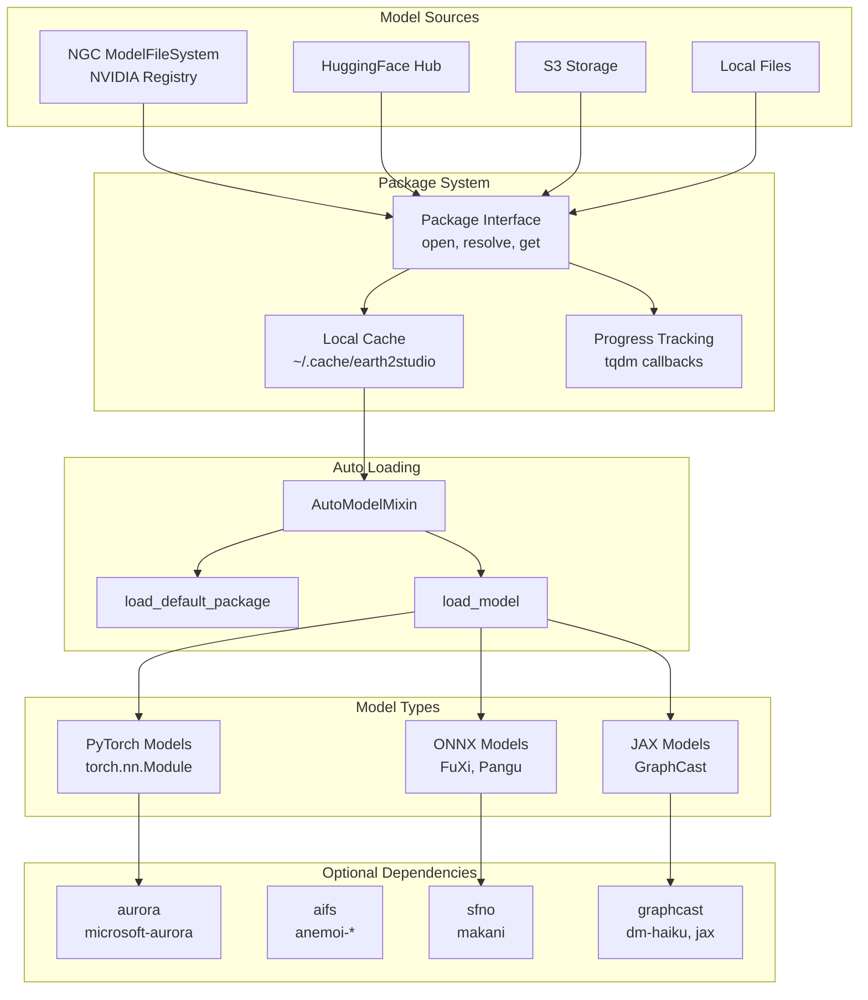

**Sources:** [pyproject.toml:74-174](), [CHANGELOG.md:120-130]()

## Coordinate and Variable Systems

The framework uses a standardized coordinate system and lexicon for managing spatial, temporal, and ensemble dimensions across different data sources and models:

| Component | Purpose | Key Classes |
|-----------|---------|-------------|
| `CoordSystem` | Ordered dictionary of coordinate arrays | `OrderedDict` interface |
| `E2STUDIO_VOCAB` | Standardized variable vocabulary | 200+ meteorological variables |
| Lexicon Classes | Data source-specific variable mapping | `GFSLexicon`, `ARCOLexicon`, etc. |
| Coordinate Arrays | Spatial/temporal coordinates | `lat`, `lon`, `time`, `level` |
| Batch Dimensions | Ensemble and sample handling | `batch`, `ensemble`, `member` |

The lexicon system enables seamless integration between different data sources by providing standardized variable names and units. Each data source implements its own lexicon that maps native variable names to the standardized `E2STUDIO_VOCAB`.

**Sources:** [earth2studio/lexicon/base.py:20-30](), [earth2studio/lexicon/base.py:28-200]()

## I/O and Storage Systems

Earth2studio provides multiple I/O backends optimized for different use cases, with emphasis on asynchronous operations for performance:

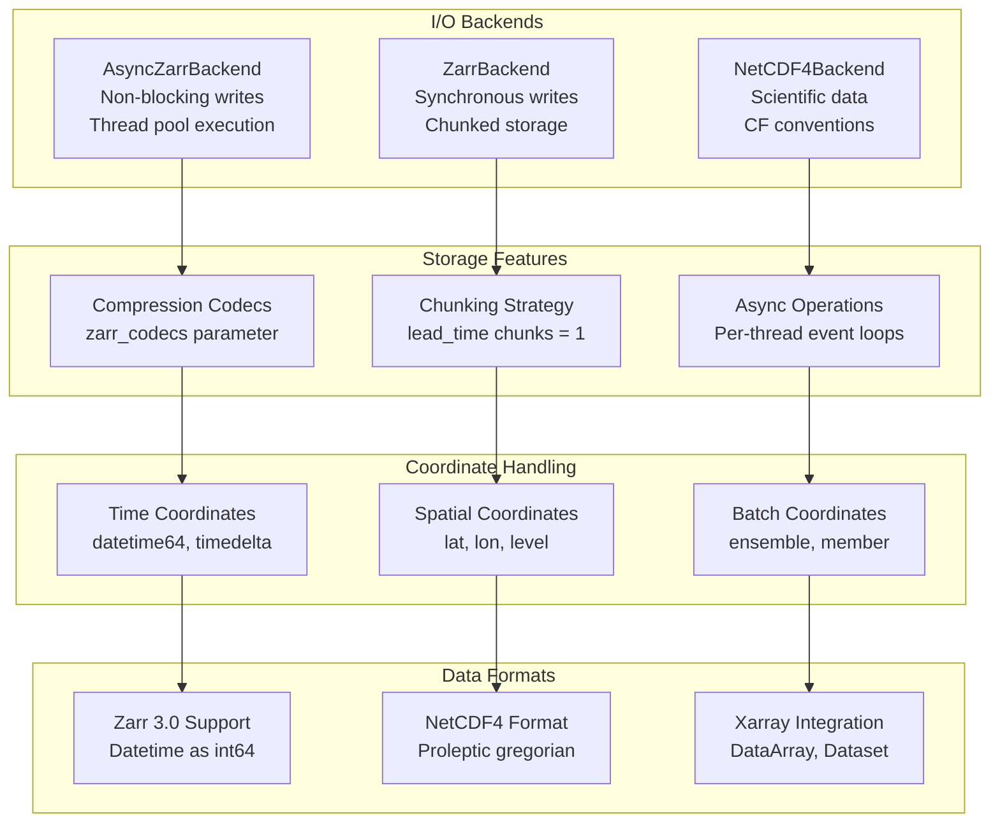

The I/O system is designed for high-performance parallel workflows with non-blocking writes and intelligent caching. The `AsyncZarrBackend` enables concurrent model execution and data writing, critical for large-scale ensemble forecasting.

**Sources:** [CHANGELOG.md:43-70](), [CHANGELOG.md:220-230]()

---

# Page: Data Sources

# Data Sources

<details>
<summary>Relevant source files</summary>

The following files were used as context for generating this wiki page:

- [docs/modules/datasources.rst](docs/modules/datasources.rst)
- [earth2studio/data/__init__.py](earth2studio/data/__init__.py)
- [earth2studio/data/arco.py](earth2studio/data/arco.py)
- [earth2studio/data/base.py](earth2studio/data/base.py)
- [earth2studio/data/gefs.py](earth2studio/data/gefs.py)
- [earth2studio/data/gfs.py](earth2studio/data/gfs.py)
- [earth2studio/data/hrrr.py](earth2studio/data/hrrr.py)
- [earth2studio/data/rx.py](earth2studio/data/rx.py)
- [earth2studio/data/utils.py](earth2studio/data/utils.py)
- [earth2studio/data/wb2.py](earth2studio/data/wb2.py)
- [earth2studio/lexicon/__init__.py](earth2studio/lexicon/__init__.py)
- [earth2studio/lexicon/base.py](earth2studio/lexicon/base.py)
- [earth2studio/lexicon/cds.py](earth2studio/lexicon/cds.py)
- [earth2studio/lexicon/gefs.py](earth2studio/lexicon/gefs.py)
- [earth2studio/lexicon/hrrr.py](earth2studio/lexicon/hrrr.py)
- [test/data/test_gefs.py](test/data/test_gefs.py)
- [test/data/test_hrrr.py](test/data/test_hrrr.py)
- [test/lexicon/test_hrrr_lexicon.py](test/lexicon/test_hrrr_lexicon.py)

</details>


This document covers the data sources system in earth2studio, which provides interfaces for fetching, caching, and standardizing weather and climate data from various external repositories. Data sources serve as the primary input mechanism for inference workflows, providing initial conditions, validation data, and reference datasets.

For information about models that process this data, see [Models](#3.2). For I/O systems that handle data persistence, see [I/O Systems](#3.3).

## Architecture Overview

The data sources system is built around a modular architecture with standardized interfaces, variable mapping through lexicons, and efficient asynchronous data fetching.

### Core Data Source Architecture

```mermaid
graph TD
    subgraph "Protocol Interfaces"
        DataSource["DataSource Protocol<br/>earth2studio.data.base"]
        ForecastSource["ForecastSource Protocol<br/>earth2studio.data.base"]
    end
    
    subgraph "Analysis Data Sources"
        GFS["GFS<br/>earth2studio.data.gfs"]
        HRRR["HRRR<br/>earth2studio.data.hrrr"]
        ARCO["ARCO<br/>earth2studio.data.arco"]
        WB2ERA5["WB2ERA5<br/>earth2studio.data.wb2"]
        CDS["CDS<br/>earth2studio.data.cds"]
        NCAR["NCAR_ERA5<br/>earth2studio.data.ncar"]
    end
    
    subgraph "Forecast Data Sources"
        GFS_FX["GFS_FX<br/>earth2studio.data.gfs"]
        HRRR_FX["HRRR_FX<br/>earth2studio.data.hrrr"]
        GEFS_FX["GEFS_FX<br/>earth2studio.data.gefs"]
    end
    
    subgraph "Lexicon System"
        GFSLexicon["GFSLexicon<br/>earth2studio.lexicon.gfs"]
        HRRRLexicon["HRRRLexicon<br/>earth2studio.lexicon.hrrr"]
        ARCOLexicon["ARCOLexicon<br/>earth2studio.lexicon.arco"]
        WB2Lexicon["WB2Lexicon<br/>earth2studio.lexicon.wb2"]
    end
    
    subgraph "Data Utilities"
        FetchData["fetch_data<br/>earth2studio.data.utils"]
        PrepDataArray["prep_data_array<br/>earth2studio.data.utils"]
        CacheRoot["datasource_cache_root<br/>earth2studio.data.utils"]
    end
    
    DataSource --> GFS
    DataSource --> HRRR
    DataSource --> ARCO
    DataSource --> WB2ERA5
    DataSource --> CDS
    DataSource --> NCAR
    
    ForecastSource --> GFS_FX
    ForecastSource --> HRRR_FX
    ForecastSource --> GEFS_FX
    
    GFS --> GFSLexicon
    HRRR --> HRRRLexicon
    ARCO --> ARCOLexicon
    WB2ERA5 --> WB2Lexicon
    
    GFS --> FetchData
    HRRR --> FetchData
    ARCO --> PrepDataArray
    WB2ERA5 --> CacheRoot
```

Sources: [earth2studio/data/__init__.py:17-41](), [earth2studio/data/base.py:25-141](), [earth2studio/lexicon/__init__.py:17-29]()

### Data Flow and Processing Pipeline

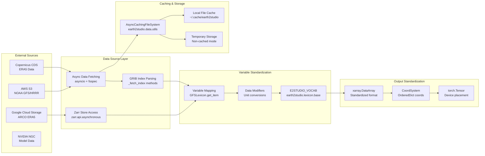

Sources: [earth2studio/data/gfs.py:48-97](), [earth2studio/data/utils.py:374-508](), [earth2studio/lexicon/base.py:20-201]()

## Data Source Interfaces

The system defines two primary protocols that all data sources must implement, providing a consistent interface for data access across different backends.

### DataSource Protocol

The `DataSource` protocol defines the interface for analysis data sources that provide historical or real-time weather data at specific times:

```python
def __call__(
    self,
    time: datetime | list[datetime] | TimeArray,
    variable: str | list[str] | VariableArray,
) -> xr.DataArray
```

Key implementations include:
- `GFS` - NOAA Global Forecast System analysis data
- `HRRR` - High-Resolution Rapid Refresh analysis data  
- `ARCO` - Google's Analysis-Ready Cloud Optimized ERA5 data
- `WB2ERA5` - WeatherBench2 ERA5 datasets
- `CDS` - Copernicus Climate Data Store
- `NCAR_ERA5` - NCAR's ERA5 repository

Sources: [earth2studio/data/base.py:25-78](), [earth2studio/data/__init__.py:17-29]()

### ForecastSource Protocol

The `ForecastSource` protocol extends data sources to support forecast data with lead times:

```python
def __call__(
    self,
    time: datetime | list[datetime] | TimeArray,
    lead_time: timedelta | list[timedelta] | LeadTimeArray,
    variable: str | list[str] | VariableArray,
) -> xr.DataArray
```

Key implementations include:
- `GFS_FX` - GFS forecast data up to 16 days
- `HRRR_FX` - HRRR forecast data up to 48 hours
- `GEFS_FX` - Global Ensemble Forecast System

Sources: [earth2studio/data/base.py:80-141](), [earth2studio/data/gfs.py:537-721](), [earth2studio/data/hrrr.py:689-903]()

## Variable Mapping and Lexicon System

The lexicon system provides standardized variable naming across different data sources, enabling seamless switching between data providers while maintaining consistent variable semantics.

### Lexicon Architecture

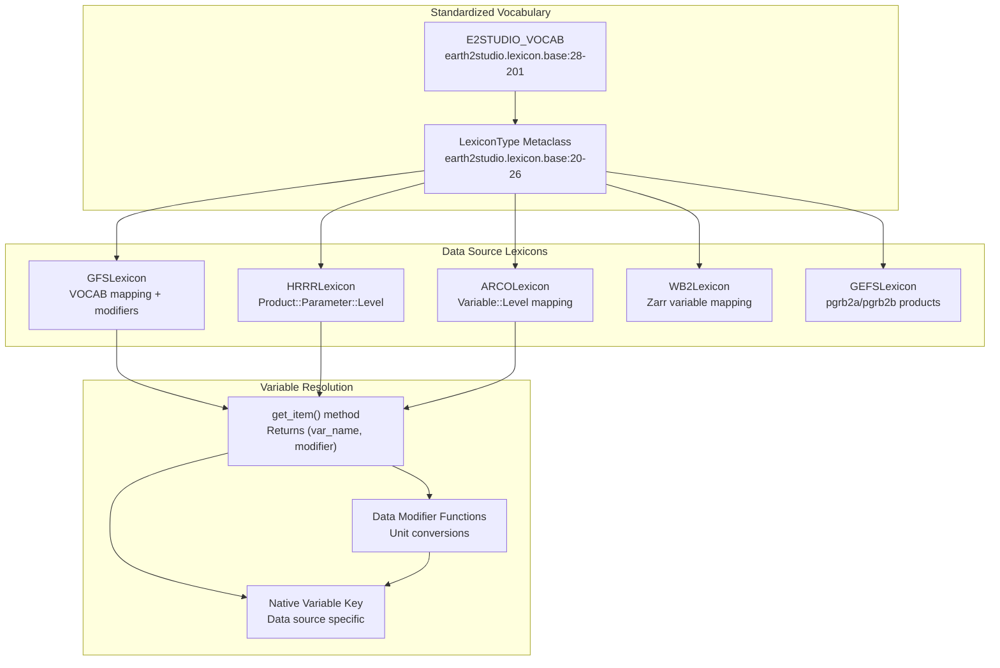

Sources: [earth2studio/lexicon/base.py:20-201](), [earth2studio/lexicon/gfs.py:24-243](), [earth2studio/lexicon/hrrr.py:23-139]()

### Variable Standardization Process

The lexicon system maps earth2studio standard variable IDs to data source-specific variable names and applies necessary unit conversions:

**Example: GFS Lexicon Mapping**
```python
# earth2studio/lexicon/gfs.py:303-314
try:
    gfs_name, modifier = GFSLexicon[v]
except KeyError:
    logger.warning(f"variable id {v} not found in GFS lexicon")
    gfs_name = v
    def modifier(x: np.array) -> np.array:
        return x
```

**Example: Geopotential Height Conversion**
```python
# earth2studio/lexicon/gfs.py:230-241
if gfs_key.split("::")[1] == "HGT":
    def mod(x: np.array) -> np.array:
        return x * 9.81  # Convert to geopotential
```

Sources: [earth2studio/data/gfs.py:303-314](), [earth2studio/lexicon/gfs.py:230-241]()

## Data Fetching and Caching

The data sources system implements sophisticated asynchronous data fetching with local caching to optimize performance and reduce redundant downloads.

### Asynchronous Data Access Pattern

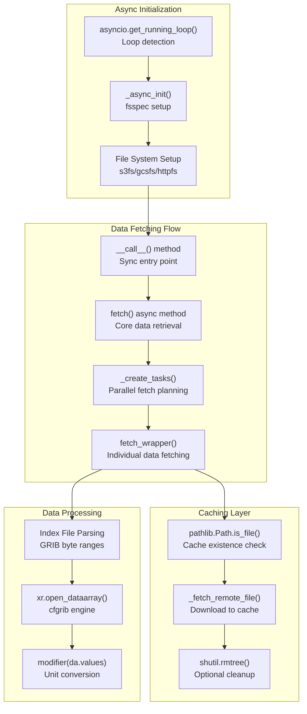

Sources: [earth2studio/data/gfs.py:150-193](), [earth2studio/data/hrrr.py:190-256](), [earth2studio/data/gfs.py:453-477]()

### Caching Implementation

The caching system uses file-based storage with configurable retention policies:

**Cache Location Management**
```python
# earth2studio/data/utils.py:354-367
def datasource_cache_root() -> str:
    default_cache = os.path.join(os.path.expanduser("~"), ".cache", "earth2studio")
    default_cache = os.environ.get("EARTH2STUDIO_CACHE", default_cache)
    os.makedirs(default_cache, exist_ok=True)
    return default_cache
```

**AsyncCachingFileSystem Implementation**
The system includes a custom async caching filesystem for Zarr 3.0 compatibility:
- Configurable expiry times (default: 1 year)
- Automatic cache directory management
- Support for multiple storage backends

Sources: [earth2studio/data/utils.py:354-367](), [earth2studio/data/utils.py:374-508]()

## Specific Data Source Implementations

### GFS (Global Forecast System)

The `GFS` class implements access to NOAA's Global Forecast System data on AWS S3 and NCEP FTP servers:

**Key Features:**
- 0.25 degree equirectangular grid (721x1440)
- 6-hour intervals from Feb 2021 to present
- Byte-range requests for efficient GRIB access
- Supports both analysis (`GFS`) and forecast (`GFS_FX`) data

**Implementation Details:**
```python
# earth2studio/data/gfs.py:58-149
class GFS:
    GFS_BUCKET_NAME = "noaa-gfs-bdp-pds"
    MAX_BYTE_SIZE = 5000000
    GFS_LAT = np.linspace(90, -90, 721)
    GFS_LON = np.linspace(0, 359.75, 1440)
```

Sources: [earth2studio/data/gfs.py:58-149](), [earth2studio/data/gfs.py:272-338]()

### HRRR (High-Resolution Rapid Refresh)

The `HRRR` class provides access to high-resolution North American weather data:

**Key Features:**
- Lambert conformal 3km grid (1059x1799)
- Hourly intervals from July 2018 to present
- Multiple data sources: AWS, Google Cloud, Azure, NOMADS
- Support for surface, pressure, and hybrid levels

**Grid Generation:**
```python
# earth2studio/data/hrrr.py:612-653
@classmethod
def grid(cls) -> tuple[np.array, np.array]:
    p1 = pyproj.CRS("proj=lcc lon_0=262.5 lat_0=38.5...")
    transformer = pyproj.Transformer.from_proj(p2, p1)
    lat, lon = itransformer.transform(E, N)
    return lat, lon
```

Sources: [earth2studio/data/hrrr.py:74-110](), [earth2studio/data/hrrr.py:612-653]()

### ARCO (Analysis-Ready Cloud Optimized)

The `ARCO` class accesses Google's cloud-optimized ERA5 dataset:

**Key Features:**
- Zarr-based storage for efficient access
- 0.25 degree lat-lon grid
- Hourly data from 1940-2023
- 31 surface and pressure level variables

**Zarr Access Pattern:**
```python
# earth2studio/data/arco.py:92-127
async def _async_init(self) -> None:
    fs = gcsfs.GCSFileSystem(cache_timeout=-1, token="anon")
    zstore = zarr.storage.FsspecStore(fs, path="/gcp-public-data-arco-era5/...")
    self.zarr_group = await zarr.api.asynchronous.open(store=zstore, mode="r")
```

Sources: [earth2studio/data/arco.py:41-67](), [earth2studio/data/arco.py:92-127]()

### WeatherBench2 (WB2ERA5)

The `WB2ERA5` family provides access to WeatherBench2's curated ERA5 datasets:

**Available Resolutions:**
- `WB2ERA5`: 0.25° (721x1440)
- `WB2ERA5_121x240`: 1.5° (121x240) 
- `WB2ERA5_32x64`: 5.625° (32x64)

**Base Implementation:**
```python
# earth2studio/data/wb2.py:43-75
class _WB2Base:
    def __init__(self, wb2_zarr_store: str, wb2_product: str = "era5"):
        self._zarr_store_name = wb2_zarr_store
        self._product = wb2_product
```

Sources: [earth2studio/data/wb2.py:331-376](), [earth2studio/data/wb2.py:43-75]()

## Usage Patterns and Utilities

### High-Level Data Fetching

The `fetch_data` utility function provides a simplified interface for model inference:

```python
# earth2studio/data/utils.py:58-120
def fetch_data(
    source: DataSource | ForecastSource,
    time: TimeArray,
    variable: VariableArray,
    lead_time: LeadTimeArray = np.array([np.timedelta64(0, "h")]),
    device: torch.device = "cpu",
    interp_to: CoordSystem = None,
    interp_method: str = "nearest",
) -> tuple[torch.Tensor, CoordSystem]
```

This function automatically:
- Detects data source type (analysis vs forecast)
- Handles coordinate interpolation
- Converts to PyTorch tensors
- Places data on specified devices

Sources: [earth2studio/data/utils.py:58-120](), [earth2studio/data/utils.py:122-218]()

### Data Persistence

The `datasource_to_file` function enables building local data stores:

```python
# earth2studio/data/utils.py:282-352
def datasource_to_file(
    file_name: str,
    source: DataSource,
    time: list[str] | list[datetime] | TimeArray,
    variable: VariableArray,
    backend: Literal["netcdf", "zarr"] = "netcdf",
) -> None
```

This supports creating local caches for repeated inference runs, with support for both NetCDF and Zarr backends.

Sources: [earth2studio/data/utils.py:282-352]()

---

# Page: Models

# Models

<details>
<summary>Relevant source files</summary>

The following files were used as context for generating this wiki page:

- [docs/userguide/about/install.md](docs/userguide/about/install.md)
- [docs/userguide/support/faq.md](docs/userguide/support/faq.md)
- [earth2studio/models/auto/ngc.py](earth2studio/models/auto/ngc.py)
- [earth2studio/models/auto/package.py](earth2studio/models/auto/package.py)
- [earth2studio/models/dx/__init__.py](earth2studio/models/dx/__init__.py)
- [test/models/test_auto_models.py](test/models/test_auto_models.py)

</details>


Earth2Studio provides a comprehensive model ecosystem that enables weather and climate workflows through two primary categories: prognostic models for time-stepping forecasts and diagnostic models for analysis and enhancement. The framework includes an auto-loading system that manages model packages from various remote sources including NGC, HuggingFace, and S3 storage.

For information about data sources that feed these models, see [Data Sources](#3.1). For I/O systems that handle model outputs, see [I/O Systems](#3.3).

## Model Architecture Overview

Earth2Studio organizes models into two main categories with a unified auto-loading infrastructure:

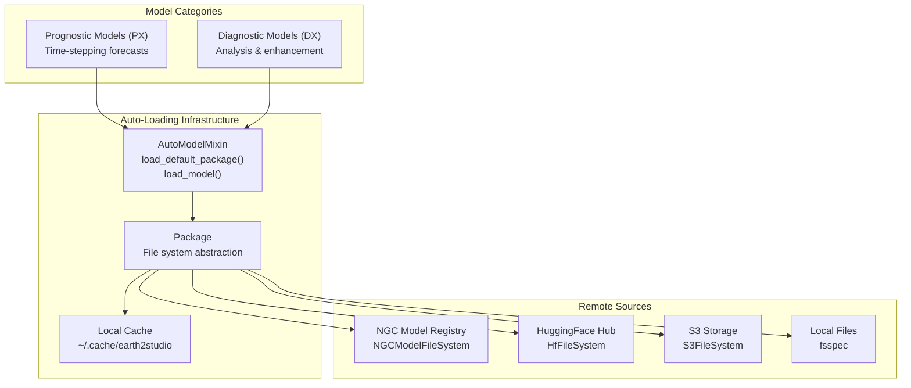

Sources: [test/models/test_auto_models.py:51-69](), [earth2studio/models/dx/__init__.py:17-42](), [earth2studio/models/auto/package.py:132-155]()

## Auto-Loading System

The auto-loading system provides a unified interface for downloading, caching, and loading models from various remote sources:

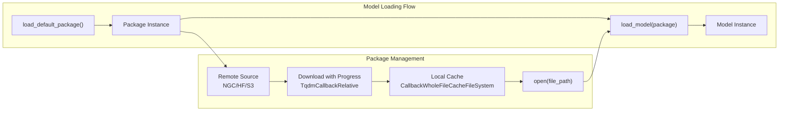

Sources: [earth2studio/models/auto/package.py:269-302](), [test/models/test_auto_models.py:316-331]()

### Package Class

The `Package` class provides a generic file system abstraction with local caching:

| Feature | Implementation | Purpose |
|---------|----------------|---------|
| Remote Access | `NGCModelFileSystem`, `HfFileSystem`, `S3FileSystem` | Access models from different sources |
| Local Caching | `CallbackWholeFileCacheFileSystem` | Cache downloads for reuse |
| Progress Tracking | `TqdmCallbackRelative` | Show download progress |
| Timeout Management | `EARTH2STUDIO_PACKAGE_TIMEOUT` | Configure download timeouts |

Sources: [earth2studio/models/auto/package.py:132-341]()

### NGC Model Registry Integration

The `NGCModelFileSystem` enables access to NVIDIA's model registry:

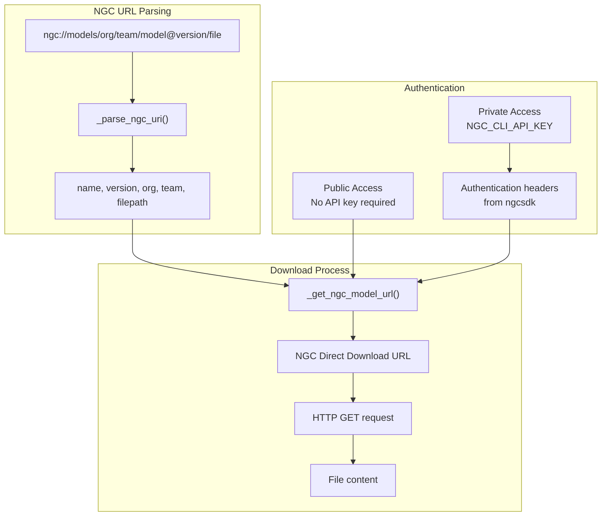

Sources: [earth2studio/models/auto/ngc.py:166-331]()

## Prognostic Models

Prognostic models perform time-stepping weather forecasts and are located in the `earth2studio.models.px` module:

| Model Category | Models | Framework | Purpose |
|----------------|--------|-----------|---------|
| **Transformer-based** | `AIFS`, `Aurora` | PyTorch | Global weather forecasting |
| **Neural Operators** | `SFNO`, `FCN`, `FCN3` | PyTorch | Spherical Fourier operations |
| **Graph Networks** | `GraphCastOperational`, `GraphCastSmall` | JAX | Graph-based meteorology |
| **ONNX Models** | `FuXi`, `Pangu3/6/24`, `FengWu` | ONNX Runtime | Optimized inference |
| **Deep Learning** | `DLWP`, `DLESyM` | PyTorch | Atmospheric dynamics |
| **Specialized** | `CBottleVideo`, `InterpModAFNO`, `StormCast` | PyTorch | Video generation, interpolation, storms |

Sources: [test/models/test_auto_models.py:51-69](), [docs/userguide/about/install.md:105-387]()

### Model Dependencies

Each prognostic model requires specific optional dependencies:

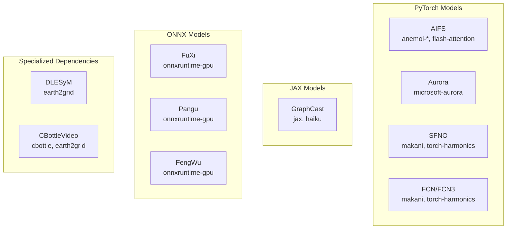

Sources: [docs/userguide/about/install.md:108-387]()

## Diagnostic Models

Diagnostic models perform analysis, enhancement, and post-processing tasks and are located in the `earth2studio.models.dx` module:

| Model Category | Models | Purpose |
|----------------|--------|---------|
| **Diffusion Models** | `CorrDiff`, `CorrDiffTaiwan` | Bias correction and downscaling |
| **Super Resolution** | `CBottleSR`, `CBottleInfill` | Image enhancement and gap filling |
| **Climate Analysis** | `ClimateNet` | Extreme weather detection |
| **AFNO Models** | `PrecipitationAFNO/v2`, `SolarRadiationAFNO1H/6H`, `WindgustAFNO` | Specialized meteorological variables |
| **Tracking** | `TCTrackerVitart`, `TCTrackerWuDuan` | Tropical cyclone tracking |
| **Derived Variables** | `DerivedRH`, `DerivedWS`, `DerivedVPD` | Variable transformations |
| **Guidance** | `CBottleTCGuidance` | Tropical cyclone guidance |

Sources: [earth2studio/models/dx/__init__.py:17-42](), [docs/userguide/about/install.md:389-576]()

### Base Diagnostic Interface

All diagnostic models inherit from the `DiagnosticModel` base class:

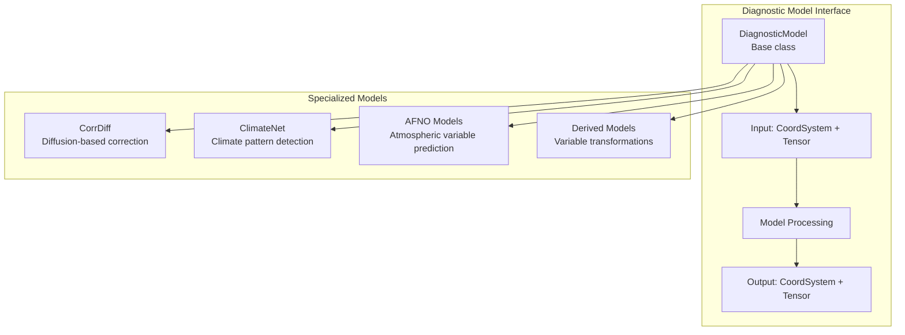

Sources: [earth2studio/models/dx/base.py](), [earth2studio/models/dx/__init__.py:17]()

## Installation and Model Management

### Optional Dependencies Structure

Models are organized into optional dependency groups for targeted installation:

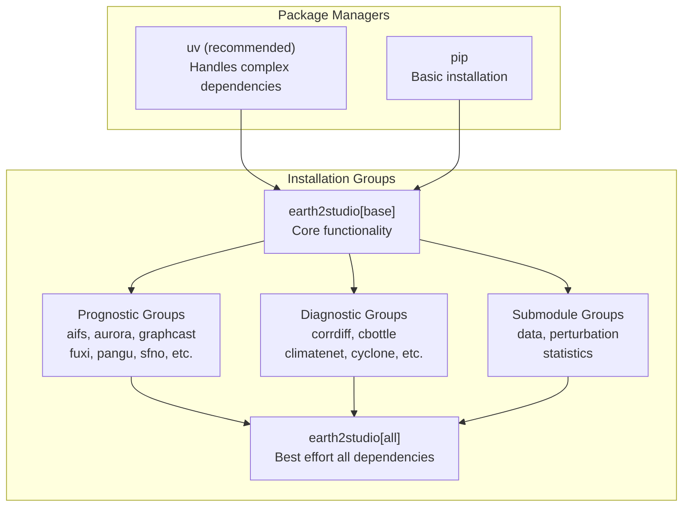

Sources: [docs/userguide/about/install.md:100-661]()

### Environment Configuration

The model system uses several environment variables for configuration:

| Variable | Purpose | Default |
|----------|---------|---------|
| `EARTH2STUDIO_CACHE` | Model cache location | `~/.cache/earth2studio` |
| `EARTH2STUDIO_PACKAGE_TIMEOUT` | Download timeout (seconds) | `300` |
| `NGC_CLI_API_KEY` | NGC authentication | None |
| `HF_HUB_DOWNLOAD_TIMEOUT` | HuggingFace timeout | Inherits package timeout |

Sources: [docs/userguide/about/install.md:805-814](), [earth2studio/models/auto/package.py:232-251]()

### Model Loading Example

The auto-loading system provides a consistent interface across all models:

```python
# Load any auto model
package = ModelClass.load_default_package()
model = ModelClass.load_model(package)

# Alternative: direct loading
model = ModelClass.from_pretrained()
```

Sources: [test/models/test_auto_models.py:121-124](), [test/models/test_auto_models.py:399-402]()

---

# Page: Prognostic Models

# Prognostic Models

<details>
<summary>Relevant source files</summary>

The following files were used as context for generating this wiki page:

- [CITATION.cff](CITATION.cff)
- [docs/_static/switcher.json](docs/_static/switcher.json)
- [earth2studio/models/px/fuxi.py](earth2studio/models/px/fuxi.py)
- [earth2studio/models/px/sfno.py](earth2studio/models/px/sfno.py)
- [examples/11_huge_ensembles.py](examples/11_huge_ensembles.py)
- [examples/12_temporal_interpolation.py](examples/12_temporal_interpolation.py)
- [examples/13_cyclone_tracking.py](examples/13_cyclone_tracking.py)
- [examples/14_dlesym_example.py](examples/14_dlesym_example.py)
- [test/models/px/test_dlwp.py](test/models/px/test_dlwp.py)
- [test/models/px/test_fcn.py](test/models/px/test_fcn.py)
- [test/models/px/test_fengwu.py](test/models/px/test_fengwu.py)
- [test/models/px/test_fuxi.py](test/models/px/test_fuxi.py)
- [test/models/px/test_graphcast.py](test/models/px/test_graphcast.py)
- [test/models/px/test_interpmodafno.py](test/models/px/test_interpmodafno.py)
- [test/models/px/test_pangu.py](test/models/px/test_pangu.py)
- [test/models/px/test_sfno.py](test/models/px/test_sfno.py)

</details>


Prognostic models in earth2studio are AI-based weather prediction models that perform time-integration to generate forecasts. These models take atmospheric state data as input and predict future atmospheric conditions, typically advancing the simulation by fixed time steps (3, 6, or 24 hours). For diagnostic models that analyze existing data without time integration, see [Diagnostic Models](#3.2.2).

## Overview

Prognostic models form the core forecasting capability of earth2studio, implementing various state-of-the-art AI weather prediction architectures. All prognostic models inherit from `torch.nn.Module` and implement the `PrognosticModel` interface, providing standardized coordinate systems, auto-loading capabilities, and iterative time-stepping functionality.

### Model Architecture

```mermaid
graph TB
    subgraph "Base Interfaces"
        PrognosticModel["PrognosticModel"]
        TorchModule["torch.nn.Module"]
    end
    
    subgraph "Mixins"
        AutoModelMixin["AutoModelMixin<br/>load_default_package()<br/>load_model()"]
        PrognosticMixin["PrognosticMixin<br/>front_hook()<br/>rear_hook()"]
    end
    
    subgraph "Coordinate System"
        InputCoords["input_coords()<br/>CoordSystem"]
        OutputCoords["output_coords()<br/>CoordSystem"]
        BatchCoords["@batch_coords<br/>@batch_func"]
    end
    
    subgraph "Time Integration"
        CreateIterator["create_iterator()<br/>Iterator"]
        ForwardPass["__call__()<br/>Single Step"]
        Generator["_default_generator()<br/>Multi-step"]
    end
    
    PrognosticModel --> AutoModelMixin
    PrognosticModel --> PrognosticMixin
    TorchModule --> PrognosticModel
    
    AutoModelMixin --> InputCoords
    PrognosticMixin --> OutputCoords
    
    InputCoords --> CreateIterator
    OutputCoords --> ForwardPass
    BatchCoords --> Generator
```

**Model Implementation Flow**
Sources: [earth2studio/models/px/base.py](), [earth2studio/models/px/utils.py](), [earth2studio/models/batch.py]()

## Auto-Loading System

The auto-loading system enables seamless model distribution and instantiation through the `Package` abstraction. Models are distributed via NGC (NVIDIA GPU Cloud), HuggingFace Hub, or other storage backends.

```mermaid
graph LR
    subgraph "Package Sources"
        NGC["NGC Registry<br/>ngc://models/nvidia/..."]
        HF["HuggingFace Hub<br/>hf://datasets/..."]
        S3["S3 Storage<br/>s3://bucket/..."]
        Local["Local Files<br/>file:///path/..."]
    end
    
    subgraph "Loading Process"
        LoadDefault["load_default_package()<br/>Returns Package"]
        LoadModel["load_model(package)<br/>Returns Model Instance"]
        Cache["Local Cache<br/>~/.cache/earth2studio"]
    end
    
    subgraph "Model Classes"
        SFNO["SFNO"]
        FuXi["FuXi"]
        Pangu["Pangu3/6/24"]
        GraphCast["GraphCast"]
    end
    
    NGC --> LoadDefault
    HF --> LoadDefault
    S3 --> LoadDefault
    Local --> LoadDefault
    
    LoadDefault --> Cache
    Cache --> LoadModel
    
    LoadModel --> SFNO
    LoadModel --> FuXi
    LoadModel --> Pangu
    LoadModel --> GraphCast
```

**Package-Based Model Loading**
Sources: [earth2studio/models/auto.py](), [earth2studio/models/px/sfno.py:234-244](), [earth2studio/models/px/fuxi.py:254-262]()

## Available Models

### SFNO (Spherical Fourier Operator Network)

**Architecture**: PyTorch-based using Modulus-Makani backend  
**Time Step**: 6 hours  
**Resolution**: 0.25° lat-lon (721×1440)  
**Variables**: 73 atmospheric and surface variables  
**Backend**: `ModelWrapper` from makani package

```python
# Model instantiation
package = SFNO.load_default_package()
model = SFNO.load_model(package)
```

Sources: [earth2studio/models/px/sfno.py:133-173](), [earth2studio/models/px/sfno.py:246-329]()

### FuXi

**Architecture**: ONNX-based cascade of three models  
**Time Step**: 6 hours  
**Resolution**: 0.25° lat-lon (721×1440)  
**Variables**: 70 atmospheric variables  
**Models**: Short (5 days), Medium (10 days), Long (15 days)

The FuXi model automatically switches between different ONNX models based on forecast length to optimize prediction quality.

Sources: [earth2studio/models/px/fuxi.py:121-157](), [earth2studio/models/px/fuxi.py:436-447]()

### Pangu Weather Models

**Architecture**: ONNX-based  
**Variants**: Pangu3 (3h), Pangu6 (6h), Pangu24 (24h)  
**Resolution**: 0.25° lat-lon (721×1440)  
**Variables**: 69 atmospheric variables

Sources: [test/models/px/test_pangu.py:27-28]()

### GraphCast

**Architecture**: JAX-based graph neural network  
**Variants**: GraphCastSmall (1° resolution), GraphCastOperational (0.25° resolution)  
**Time Step**: 6 hours  
**Variables**: 85 atmospheric variables

Sources: [test/models/px/test_graphcast.py:28-29]()

### Additional Models

| Model | Architecture | Time Step | Resolution | Variables |
|-------|-------------|-----------|------------|-----------|
| FCN | PyTorch | 6h | 0.25° | 26 |
| DLWP | PyTorch (Cubed Sphere) | 6h | 0.25° | 7 |
| FengWu | ONNX | 6h | 0.25° | 69 |
| InterpModAFNO | PyTorch (Interpolation) | 1h | 0.25° | 73 |
| DLESyM | PyTorch (HEALPix) | Variable | ~1° | Multiple |

Sources: [test/models/px/test_fcn.py](), [test/models/px/test_dlwp.py](), [test/models/px/test_fengwu.py](), [test/models/px/test_interpmodafno.py](), [examples/14_dlesym_example.py]()

## Coordinate Systems

All prognostic models implement standardized coordinate systems using `CoordSystem` (OrderedDict) with the following dimensions:

```python
# Standard coordinate system structure
coords = OrderedDict({
    "batch": np.empty(0),           # Batch dimension
    "time": np.empty(0),            # Time instances
    "lead_time": np.array([...]),   # Forecast lead times
    "variable": np.array([...]),     # Atmospheric variables
    "lat": np.array([...]),         # Latitude coordinates
    "lon": np.array([...])          # Longitude coordinates
})
```

### Coordinate Transformation

```mermaid
graph LR
    subgraph "Input Processing"
        InputCoords["input_coords()<br/>Fixed coordinate system"]
        HandshakeCoords["handshake_coords()<br/>Validate compatibility"]
        HandshakeDim["handshake_dim()<br/>Validate dimensions"]
    end
    
    subgraph "Model Execution"
        BatchFunc["@batch_func<br/>Handle batching"]
        Forward["_forward()<br/>Core computation"]
        OutputTransform["output_coords()<br/>Transform coordinates"]
    end
    
    subgraph "Output"
        OutputCoords["Output CoordSystem<br/>Updated lead_time"]
        OutputTensor["Output Tensor<br/>Same shape structure"]
    end
    
    InputCoords --> HandshakeCoords
    HandshakeCoords --> HandshakeDim
    HandshakeDim --> BatchFunc
    BatchFunc --> Forward
    Forward --> OutputTransform
    OutputTransform --> OutputCoords
    OutputTransform --> OutputTensor
```

**Coordinate Validation and Transformation**
Sources: [earth2studio/utils/__init__.py](), [earth2studio/models/batch.py](), [earth2studio/models/px/sfno.py:174-231]()

## Time Integration

Prognostic models support iterative time-stepping through the `create_iterator()` method, which yields successive forecast states.

### Iterator Pattern

```mermaid
graph TB
    subgraph "Iterator Creation"
        CreateIter["create_iterator(x, coords)<br/>Returns Iterator"]
        DefaultGen["_default_generator()<br/>Generator function"]
        InitialYield["yield x, coords<br/>Initial condition"]
    end
    
    subgraph "Time Step Loop"
        FrontHook["front_hook(x, coords)<br/>Pre-processing"]
        ForwardStep["_forward(x, coords)<br/>Model prediction"]
        RearHook["rear_hook(x, coords)<br/>Post-processing"]
        UpdateCoords["Update lead_time<br/>coords[lead_time] += dt"]
        YieldOutput["yield x, coords<br/>Next time step"]
    end
    
    CreateIter --> DefaultGen
    DefaultGen --> InitialYield
    InitialYield --> FrontHook
    FrontHook --> ForwardStep
    ForwardStep --> RearHook
    RearHook --> UpdateCoords
    UpdateCoords --> YieldOutput
    YieldOutput --> FrontHook
```

**Time Integration Flow**
Sources: [earth2studio/models/px/sfno.py:374-387](), [earth2studio/models/px/fuxi.py:424-468](), [earth2studio/models/px/utils.py]()

### Usage Example

```python
# Create iterator for time integration
model_iter = model.create_iterator(initial_state, coords)

# Get initial condition (step 0)
x0, coords0 = next(model_iter)

# Iterate through forecast steps
for step, (x, coords) in enumerate(model_iter):
    # x contains forecast at coords["lead_time"]
    print(f"Step {step}: Lead time {coords['lead_time']}")
    if step >= max_steps:
        break
```

## Model Cascading

Some models like FuXi implement cascading architectures where different model variants are used for different forecast ranges to optimize accuracy.

```mermaid
graph LR
    subgraph "FuXi Cascade"
        Short["Short Model<br/>Steps 0-19<br/>5 day optimized"]
        Medium["Medium Model<br/>Steps 20-39<br/>10 day optimized"]
        Long["Long Model<br/>Steps 40+<br/>15 day optimized"]
    end
    
    subgraph "Model Loading"
        OrtShort["ort_short_path<br/>short.onnx"]
        OrtMedium["ort_medium_path<br/>medium.onnx"]
        OrtLong["ort_long_path<br/>long.onnx"]
    end
    
    subgraph "Execution"
        StepCheck["Check step number"]
        LoadModel["Load appropriate ONNX"]
        RunInference["Run inference"]
    end
    
    Short --> OrtShort
    Medium --> OrtMedium
    Long --> OrtLong
    
    OrtShort --> StepCheck
    OrtMedium --> StepCheck
    OrtLong --> StepCheck
    
    StepCheck --> LoadModel
    LoadModel --> RunInference
```

**FuXi Model Cascading**
Sources: [earth2studio/models/px/fuxi.py:436-447](), [earth2studio/models/px/fuxi.py:151-165]()

## Specialized Architectures

### Interpolation Models

`InterpModAFNO` provides temporal interpolation between base model forecasts, generating hourly outputs from 6-hourly base predictions.

### Earth System Models

`DLESyM` implements coupled atmosphere-ocean modeling with different temporal resolutions for atmosphere (6h) and ocean (48h) components.

### Cubed Sphere Models

`DLWP` operates on cubed sphere coordinates, requiring transformation between equirectangular and cubed sphere grids.

Sources: [test/models/px/test_interpmodafno.py](), [examples/14_dlesym_example.py](), [test/models/px/test_dlwp.py]()

---

# Page: Diagnostic Models

# Diagnostic Models

<details>
<summary>Relevant source files</summary>

The following files were used as context for generating this wiki page:

- [README.md](README.md)
- [earth2studio/data/cbottle.py](earth2studio/data/cbottle.py)
- [earth2studio/models/dx/cbottle_sr.py](earth2studio/models/dx/cbottle_sr.py)
- [earth2studio/models/dx/cbottle_tc.py](earth2studio/models/dx/cbottle_tc.py)
- [earth2studio/models/dx/corrdiff.py](earth2studio/models/dx/corrdiff.py)
- [earth2studio/models/utils.py](earth2studio/models/utils.py)
- [test/Dockerfile](test/Dockerfile)
- [test/data/test_cbottle.py](test/data/test_cbottle.py)
- [test/models/dx/test_cbottle_infill.py](test/models/dx/test_cbottle_infill.py)
- [test/models/dx/test_cbottle_sr.py](test/models/dx/test_cbottle_sr.py)
- [test/models/dx/test_corrdiff.py](test/models/dx/test_corrdiff.py)

</details>


Diagnostic models in earth2studio perform time-independent transformations on geospatial data, typically taking atmospheric or climate fields at a specific time and predicting derived quantities without time integration. These models enable enhancement, analysis, and post-processing workflows including super-resolution, infilling, and specialized predictions.

For information about time-integrating forecast models, see [Prognostic Models](#3.2.1). For general model architecture and loading systems, see [Models](#3.2).

## Overview

Diagnostic models implement the `DiagnosticModel` interface and provide functionality for transforming input fields into enhanced or derived outputs. Unlike prognostic models that advance fields forward in time, diagnostic models operate on instantaneous data to produce spatially or qualitatively enhanced results.

### Architecture

```mermaid
graph TB
    subgraph "Diagnostic Model Interface"
        DiagnosticModel["DiagnosticModel<br/>Abstract Base"]
        AutoModelMixin["AutoModelMixin<br/>Package Loading"]
        BatchDecorators["@batch_coords()<br/>@batch_func()"]
    end
    
    subgraph "Core Methods"
        InputCoords["input_coords()<br/>CoordSystem"]
        OutputCoords["output_coords()<br/>CoordSystem → CoordSystem"]
        Forward["__call__()<br/>Tensor × CoordSystem → Tensor × CoordSystem"]
    end
    
    subgraph "Model Categories"
        SuperRes["Super-Resolution<br/>CorrDiff, CBottleSR"]
        Infill["Infilling<br/>CBottleInfill"]
        Guidance["Specialized Analysis<br/>CBottleTCGuidance"]
    end
    
    DiagnosticModel --> InputCoords
    DiagnosticModel --> OutputCoords
    DiagnosticModel --> Forward
    AutoModelMixin --> DiagnosticModel
    BatchDecorators --> DiagnosticModel
    
    SuperRes --> DiagnosticModel
    Infill --> DiagnosticModel
    Guidance --> DiagnosticModel
```

Sources: [earth2studio/models/dx/base.py](), [earth2studio/models/dx/corrdiff.py:63-118](), [earth2studio/models/dx/cbottle_sr.py:81-117]()

### Data Flow Pipeline

```mermaid
graph LR
    subgraph "Input Processing"
        InputData["Input Tensor<br/>torch.Tensor"]
        InputCoords["Input Coordinates<br/>CoordSystem"]
        Validation["handshake_coords()<br/>handshake_dim()"]
    end
    
    subgraph "Model Processing"
        Preprocess["preprocess_input()<br/>Normalization"]
        CoreModel["Core Model<br/>torch.nn.Module"]
        Postprocess["postprocess_output()<br/>Denormalization"]
    end
    
    subgraph "Grid Operations"
        Interpolation["Interpolation<br/>latlon_interpolation_regular()"]
        Regridding["Regridding<br/>earth2grid.get_regridder()"]
        Transformation["Grid Transformation<br/>HEALPix ↔ Lat/Lon"]
    end
    
    subgraph "Output"
        OutputTensor["Output Tensor<br/>Enhanced/Derived Fields"]
        OutputCoords["Output Coordinates<br/>Updated CoordSystem"]
    end
    
    InputData --> Validation
    InputCoords --> Validation
    Validation --> Preprocess
    Preprocess --> CoreModel
    CoreModel --> Postprocess
    
    Preprocess --> Interpolation
    Interpolation --> Regridding
    Regridding --> Transformation
    Transformation --> Postprocess
    
    Postprocess --> OutputTensor
    Postprocess --> OutputCoords
```

Sources: [earth2studio/models/dx/corrdiff.py:553-582](), [earth2studio/models/dx/cbottle_sr.py:338-410](), [earth2studio/utils/interp.py]()

## Super-Resolution Models

Super-resolution diagnostic models enhance spatial resolution of input fields using diffusion-based or neural operator approaches.

### CorrDiff

`CorrDiff` implements a Corrector Diffusion model that combines regression and diffusion steps to generate high-resolution weather predictions from low-resolution inputs.

```mermaid
graph TB
    subgraph "CorrDiff Architecture"
        CorrDiffClass["CorrDiff<br/>torch.nn.Module + AutoModelMixin"]
        RegressionModel["regression_model<br/>PhysicsNemoModule"]
        ResidualModel["residual_model<br/>PhysicsNemoModule"]
        Sampler["sampler<br/>deterministic_sampler | stochastic_sampler"]
    end
    
    subgraph "Processing Steps"
        Interpolate["_interpolate()<br/>Input → Output Grid"]
        NormalizeInput["preprocess_input()<br/>(x - center) / scale"]
        RegressionStep["regression_step()<br/>Base Prediction"]
        DiffusionStep["diffusion_step()<br/>Residual Enhancement"]
        DenormalizeOutput["postprocess_output()<br/>x * scale + center"]
    end
    
    subgraph "Grid Management"
        InputGrid["lat_input_grid<br/>lon_input_grid"]
        OutputGrid["lat_output_grid<br/>lon_output_grid"]
        Invariants["invariants<br/>OrderedDict"]
    end
    
    CorrDiffClass --> RegressionModel
    CorrDiffClass --> ResidualModel
    CorrDiffClass --> Sampler
    
    Interpolate --> NormalizeInput
    NormalizeInput --> RegressionStep
    RegressionStep --> DiffusionStep
    DiffusionStep --> DenormalizeOutput
    
    InputGrid --> Interpolate
    OutputGrid --> Interpolate
    Invariants --> NormalizeInput
```

Sources: [earth2studio/models/dx/corrdiff.py:63-118](), [earth2studio/models/dx/corrdiff.py:584-672]()

### CBottleSR

`CBottleSR` provides super-resolution capabilities for climate data using the Climate in a Bottle diffusion model, transforming 0.25° resolution inputs to 5km resolution outputs.

```mermaid
graph TB
    subgraph "CBottleSR Components"
        CBottleSRClass["CBottleSR<br/>torch.nn.Module + AutoModelMixin"]
        CoreModel["core_model<br/>Diffusion Model"]
        Regridders["regrid_latlon_to_hpx<br/>regrid_hpx_to_latlon"]
    end
    
    subgraph "Resolution Processing"
        LowResGrid["Low-Res Input<br/>721 × 1440 lat/lon"]
        HPXHighRes["High-Res HEALPix<br/>Level 10"]
        HighResOutput["High-Res Output<br/>2161 × 4320 or custom"]
    end
    
    subgraph "Sampling Configuration"
        SamplerSteps["sampler_steps: int = 18"]
        SigmaMax["sigma_max: int = 800"]
        OutputResolution["output_resolution<br/>tuple[int, int]"]
        SRWindow["super_resolution_window<br/>Optional[tuple[int,int,int,int]]"]
    end
    
    CBottleSRClass --> CoreModel
    CBottleSRClass --> Regridders
    
    LowResGrid --> HPXHighRes
    HPXHighRes --> HighResOutput
    
    SamplerSteps --> CoreModel
    SigmaMax --> CoreModel
    OutputResolution --> HighResOutput
    SRWindow --> HighResOutput
```

Sources: [earth2studio/models/dx/cbottle_sr.py:81-117](), [earth2studio/models/dx/cbottle_sr.py:338-410]()

## Infilling Models

Infilling diagnostic models generate complete climate realizations by filling in missing or incomplete fields based on provided constraints.

### CBottleInfill

`CBottleInfill` uses diffusion-based sampling to generate global climate fields while preserving specified input variables as constraints.

```mermaid
graph TB
    subgraph "CBottleInfill Structure"
        CBottleInfillClass["CBottleInfill<br/>torch.nn.Module + AutoModelMixin"]
        CoreModel["core_model<br/>cbottle.inference.MixtureOfExpertsDenoiser"]
        SSTDataset["sst_ds<br/>xr.Dataset"]
        InputVariables["input_variables<br/>Constraint Fields"]
    end
    
    subgraph "Input Processing"
        TimeValidation["_validate_time()<br/>1940-2022 Range"]
        SSTRegridding["sst_regridder<br/>lat/lon → HEALPix"]
        VariableMapping["input_variable_idx<br/>Index Mapping"]
    end
    
    subgraph "Sampling Process"
        LatentGeneration["Latent Variables<br/>torch.randn_like()"]
        DiffusionSampling["edm_sampler()<br/>Denoising Process"]
        ConstraintApplication["Constraint Preservation<br/>Input Variable Indices"]
    end
    
    subgraph "Output Variables"
        AllVariables["All cBottle Variables<br/>45 climate fields"]
        ConstrainedOutput["Constrained + Generated<br/>Preserved inputs + synthesized"]
    end
    
    CBottleInfillClass --> CoreModel
    CBottleInfillClass --> SSTDataset
    CBottleInfillClass --> InputVariables
    
    TimeValidation --> SSTRegridding
    SSTRegridding --> VariableMapping
    
    LatentGeneration --> DiffusionSampling
    DiffusionSampling --> ConstraintApplication
    
    AllVariables --> ConstrainedOutput
    ConstraintApplication --> ConstrainedOutput
```

Sources: [earth2studio/models/dx/cbottle_infill.py](), [earth2studio/data/cbottle.py:57-112]()

## Model Loading and Configuration

All diagnostic models implement the `AutoModelMixin` interface for standardized package-based loading from model registries.

### Package Loading Pattern

```mermaid
graph LR
    subgraph "Package System"
        DefaultPackage["load_default_package()<br/>Package from NGC"]
        CustomPackage["Package<br/>Custom Location"]
        PackageResolve["package.resolve()<br/>File Resolution"]
    end
    
    subgraph "Model Loading"
        LoadModel["load_model(package)<br/>Class Method"]
        CheckpointLoading["Checkpoint Loading<br/>Model Weights"]
        ConfigLoading["Configuration<br/>Metadata + Stats"]
        ModelInstantiation["Model Instance<br/>Initialized Object"]
    end
    
    subgraph "Common Assets"
        ModelWeights["Model Checkpoints<br/>.mdlus, .checkpoint"]
        Metadata["metadata.json<br/>Configuration"]
        Statistics["stats.json<br/>Normalization"]
        GridData["Grid Files<br/>latlon_grid.nc"]
    end
    
    DefaultPackage --> LoadModel
    CustomPackage --> LoadModel
    LoadModel --> PackageResolve
    
    PackageResolve --> ModelWeights
    PackageResolve --> Metadata
    PackageResolve --> Statistics
    PackageResolve --> GridData
    
    ModelWeights --> ModelInstantiation
    Metadata --> ModelInstantiation
    Statistics --> ModelInstantiation
    GridData --> ModelInstantiation
```

Sources: [earth2studio/models/dx/corrdiff.py:370-500](), [earth2studio/models/dx/cbottle_sr.py:281-336](), [earth2studio/models/auto/mixin.py]()

### Configuration Parameters

| Model | Key Parameters | Default Values | Purpose |
|-------|---------------|----------------|---------|
| `CorrDiff` | `number_of_samples`, `number_of_steps`, `solver` | `1`, `18`, `"euler"` | Diffusion sampling control |
| `CBottleSR` | `output_resolution`, `sampler_steps`, `sigma_max` | `(2161, 4320)`, `18`, `800` | Resolution and noise control |
| `CBottleInfill` | `input_variables`, `sampler_steps` | User-defined, `18` | Constraint specification |
| `CBottleTCGuidance` | `lat_lon`, `sampler_steps`, `seed` | `True`, `18`, `None` | Output format and reproducibility |

Sources: [earth2studio/models/dx/corrdiff.py:119-143](), [earth2studio/models/dx/cbottle_sr.py:119-126]()

### Coordinate System Handling

Diagnostic models use the `@batch_coords` and `@batch_func` decorators to handle coordinate transformations and ensure compatibility with earth2studio's data pipeline.

```mermaid
graph TB
    subgraph "Coordinate Processing"
        InputCoords["input_coords()<br/>Define Expected Input"]
        OutputCoords["output_coords(input_coords)<br/>Transform to Output"]
        Handshake["handshake_coords()<br/>handshake_dim()<br/>Validation"]
    end
    
    subgraph "Batch Processing"
        BatchCoords["@batch_coords()<br/>Coordinate Decorator"]
        BatchFunc["@batch_func()<br/>Function Decorator"]
        CoordValidation["Coordinate Validation<br/>Dimension Checking"]
    end
    
    subgraph "Grid Transformations"
        LatLonGrid["Lat/Lon Grid<br/>Regular/Irregular"]
        HEALPixGrid["HEALPix Grid<br/>Nested/Ring Order"]
        CustomGrid["Custom Grids<br/>Model-Specific"]
    end
    
    InputCoords --> Handshake
    OutputCoords --> Handshake
    Handshake --> CoordValidation
    
    BatchCoords --> CoordValidation
    BatchFunc --> CoordValidation
    
    LatLonGrid --> InputCoords
    HEALPixGrid --> InputCoords
    CustomGrid --> InputCoords
```

Sources: [earth2studio/models/batch.py](), [earth2studio/utils/coords.py](), [earth2studio/models/dx/corrdiff.py:316-368]()

---

# Page: I/O Systems

# I/O Systems

<details>
<summary>Relevant source files</summary>

The following files were used as context for generating this wiki page:

- [earth2studio/__init__.py](earth2studio/__init__.py)
- [earth2studio/io/async_zarr.py](earth2studio/io/async_zarr.py)
- [earth2studio/io/netcdf4.py](earth2studio/io/netcdf4.py)
- [earth2studio/io/zarr.py](earth2studio/io/zarr.py)
- [test/io/test_async_zarr.py](test/io/test_async_zarr.py)
- [test/io/test_netcdf4.py](test/io/test_netcdf4.py)
- [test/io/test_zarr.py](test/io/test_zarr.py)

</details>


The I/O Systems in earth2studio provide data persistence and retrieval capabilities for weather and climate model workflows. These systems handle reading and writing tensor data with associated coordinate information to various storage formats including Zarr and NetCDF4. The I/O backends support both synchronous and asynchronous operations, coordinate system management, and integration with distributed computing workflows.

For data acquisition from external sources, see [Data Sources](#3.1). For statistical analysis of stored data, see [Statistics and Metrics](#3.4).

## Architecture Overview

The I/O system is built around pluggable backend classes that implement common interfaces for reading and writing tensor data with coordinate metadata. Each backend handles format-specific serialization while providing consistent APIs for data operations.

### I/O Backend Class Hierarchy

```mermaid
classDiagram
    class ZarrBackend {
        +store : zarr.storage
        +root : zarr.Group
        +coords : CoordSystem
        +chunks : dict
        +__init__(file_name, chunks, backend_kwargs)
        +add_array(coords, array_name, data)
        +write(x, coords, array_name)
        +read(coords, array_name, device)
        +__contains__(item)
        +__getitem__(item)
    }
    
    class AsyncZarrBackend {
        +root : AsyncGroup
        +fs : fsspec.AbstractFileSystem
        +parallel_coords : CoordSystem
        +blocking : bool
        +loop_pool : list[asyncio.AbstractEventLoop]
        +io_futures : list[Future]
        +__init__(file_name, parallel_coords, fs_factory)
        +write(x, coords, array_name)
        +async_write(x, coords, array_name)
        +close()
        +prepare_inputs(x, coords, array_name)
    }
    
    class NetCDF4Backend {
        +root : netCDF4.Dataset
        +coords : CoordSystem
        +__init__(file_name, backend_kwargs)
        +add_array(coords, array_name, data)
        +write(x, coords, array_name)
        +read(coords, array_name, device)
        +add_dimension(name, shape, data)
        +close()
    }
    
    class CoordSystem {
        <<OrderedDict>>
        +str : np.ndarray
    }
    
    ZarrBackend --> CoordSystem
    AsyncZarrBackend --> CoordSystem
    NetCDF4Backend --> CoordSystem
```

Sources: [earth2studio/io/zarr.py:31-328](), [earth2studio/io/async_zarr.py:54-637](), [earth2studio/io/netcdf4.py:40-342](), [earth2studio/utils/type.py]()

## Storage Backends

### ZarrBackend

The `ZarrBackend` class provides synchronous Zarr format support with memory and file-based storage options. It handles chunked array storage and coordinate system management.

**Key Features:**
- Memory (`zarr.storage.MemoryStore`) and file (`zarr.storage.LocalStore`) storage modes
- Configurable chunking via `chunks` parameter
- Multidimensional coordinate handling via `convert_multidim_to_singledim`
- Zarr v3 compression codec support

**Core Operations:**
```python
# Initialization
backend = ZarrBackend(file_name="output.zarr", chunks={"time": 1, "lat": 180})

# Array creation
backend.add_array(coords, "temperature", data=tensor)

# Data writing
backend.write(tensor, coords, "temperature")

# Data reading
tensor, coords = backend.read(coords, "temperature", device="cuda")
```

Sources: [earth2studio/io/zarr.py:31-87](), [earth2studio/io/zarr.py:119-281](), [test/io/test_zarr.py:42-185]()

### AsyncZarrBackend

The `AsyncZarrBackend` enables high-performance asynchronous I/O operations with thread pool management and parallel coordinate-based writes. This backend is designed for inference workflows requiring non-blocking data persistence.

**Key Features:**
- Asynchronous operations via `asyncio` and `fsspec`
- Thread pool management with configurable `pool_size`
- Parallel writes along specified coordinates (`parallel_coords`)
- Multiple filesystem support (`LocalFileSystem`, `S3FileSystem`, `MemoryFileSystem`)
- Non-blocking mode with `io_futures` tracking

**Parallel Coordinate System:**
```mermaid
graph TB
    subgraph "AsyncZarrBackend Workflow"
        parallel_coords["parallel_coords<br/>{'time': [t0, t1, t2]}"]
        
        subgraph "Thread Pool"
            loop1["asyncio.loop[0]<br/>zarr_pool[0]<br/>fs_pool[0]"]
            loop2["asyncio.loop[1]<br/>zarr_pool[1]<br/>fs_pool[1]"]
            loop3["asyncio.loop[2]<br/>zarr_pool[2]<br/>fs_pool[2]"]
        end
        
        subgraph "Data Writes"
            write1["write(data[t0], coords[t0])"]
            write2["write(data[t1], coords[t1])"]
            write3["write(data[t2], coords[t2])"]
        end
        
        subgraph "Storage"
            chunks1["zarr_array[t0_idx]"]
            chunks2["zarr_array[t1_idx]"]
            chunks3["zarr_array[t2_idx]"]
        end
    end
    
    parallel_coords --> loop1
    parallel_coords --> loop2
    parallel_coords --> loop3
    
    write1 --> loop1
    write2 --> loop2
    write3 --> loop3
    
    loop1 --> chunks1
    loop2 --> chunks2
    loop3 --> chunks3
```

Sources: [earth2studio/io/async_zarr.py:54-167](), [earth2studio/io/async_zarr.py:468-510](), [earth2studio/io/async_zarr.py:531-619]()

### NetCDF4Backend

The `NetCDF4Backend` provides scientific data format support with CF-compliant metadata handling and time coordinate processing.

**Key Features:**
- NetCDF4 format with `netCDF4.Dataset` integration
- CF-compliant time handling (`cftime` integration)
- Dimension and variable management
- Calendar and time unit conversion
- Memory and file-based modes via `diskless` parameter

**Time Coordinate Handling:**
- `datetime64` → CF-compliant time with units and calendar
- `timedelta64` → lead_time with proper units mapping
- Automatic calendar assignment (`proleptic_gregorian`, `gregorian`)

Sources: [earth2studio/io/netcdf4.py:40-85](), [earth2studio/io/netcdf4.py:116-223](), [earth2studio/io/netcdf4.py:30-37]()

## Coordinate System Management

All I/O backends use the `CoordSystem` type (an `OrderedDict[str, np.ndarray]`) to manage tensor dimensions and their associated coordinate values. The system handles both single-dimensional and multidimensional coordinates.

### Coordinate Processing Pipeline

```mermaid
graph LR
    subgraph "Input Coordinates"
        input_coords["CoordSystem<br/>{time, lat, lon, variable}"]
        multidim["Multidimensional<br/>lat[i,j], lon[i,j]"]
    end
    
    subgraph "Coordinate Processing"
        convert["convert_multidim_to_singledim()"]
        adjusted["adjusted_coords<br/>{time, ilat, ilon, variable}"]
        mapping["mapping<br/>{lat: [ilat, ilon], lon: [ilat, ilon]}"]
    end
    
    subgraph "Backend Storage"
        coord_arrays["Coordinate Arrays<br/>time[:], ilat[:], ilon[:], variable[:]"]
        multidim_arrays["Multidim Arrays<br/>lat[ilat,ilon], lon[ilat,ilon]"]
        data_arrays["Data Arrays<br/>temperature[time,variable,ilat,ilon]"]
    end
    
    input_coords --> convert
    multidim --> convert
    convert --> adjusted
    convert --> mapping
    
    adjusted --> coord_arrays
    mapping --> multidim_arrays
    adjusted --> data_arrays
```

Sources: [earth2studio/utils/coords.py](), [earth2studio/io/zarr.py:159-190](), [earth2studio/io/netcdf4.py:194-208]()

## Data Operations

### Write Operations

All backends implement a common `write` method signature:
```python
def write(self, x: torch.Tensor | list[torch.Tensor], 
          coords: CoordSystem, 
          array_name: str | list[str]) -> None
```

The write process involves:
1. **Input validation** - tensor and coordinate shape consistency
2. **Coordinate processing** - multidimensional coordinate handling
3. **Index calculation** - mapping coordinates to array indices via `np.ix_` and `np.where`
4. **Data conversion** - tensor to numpy via `tensor.to("cpu").numpy()`
5. **Backend-specific storage** - format-specific serialization

### Read Operations

Read operations return both tensor data and coordinate metadata:
```python
def read(self, coords: CoordSystem, array_name: str, 
         device: torch.device = "cpu") -> tuple[torch.Tensor, CoordSystem]
```

### Asynchronous Operations

The `AsyncZarrBackend` provides additional async methods:
- `async_write()` - Direct async write without thread pool
- `prepare_inputs()` - Array initialization and input validation
- `close()` - Thread pool cleanup and future completion

Sources: [earth2studio/io/zarr.py:218-281](), [earth2studio/io/async_zarr.py:468-529](), [earth2studio/io/netcdf4.py:224-287]()

## Integration Patterns

### Model Output Storage

I/O backends integrate with model inference workflows through standardized interfaces:

```mermaid
graph TB
    subgraph "Model Inference"
        model["Prognostic/Diagnostic Model"]
        output["torch.Tensor + CoordSystem"]
    end
    
    subgraph "I/O Backend Selection"
        zarr_sync["ZarrBackend<br/>Synchronous"]
        zarr_async["AsyncZarrBackend<br/>High-throughput"]
        netcdf["NetCDF4Backend<br/>CF-compliant"]
    end
    
    subgraph "Storage Targets"
        local["Local Files"]
        s3["S3/Cloud Storage"]
        memory["In-Memory"]
    end
    
    model --> output
    output --> zarr_sync
    output --> zarr_async
    output --> netcdf
    
    zarr_sync --> local
    zarr_sync --> memory
    zarr_async --> local
    zarr_async --> s3
    netcdf --> local
```

### Filesystem Integration

The `AsyncZarrBackend` uses `fsspec` for filesystem abstraction:
- `LocalFileSystem` - Local storage
- `S3FileSystem` - AWS S3 with async support
- `MemoryFileSystem` - In-memory operations
- Custom filesystem factories via `fs_factory` parameter

Sources: [earth2studio/io/async_zarr.py:108-165](), [test/io/test_async_zarr.py:355-428](), [earth2studio/io/zarr.py:63-68]()

## Error Handling and Validation

### Common Validation Patterns

1. **Tensor-Array Name Consistency**: All backends validate that tensor and array name lists have matching lengths
2. **Coordinate Validation**: Coordinate dimensions must exist in backend coordinate systems
3. **Multidimensional Coordinate Completeness**: Multidimensional coordinates must be passed in full for thread safety
4. **Parallel Coordinate Constraints**: `AsyncZarrBackend` requires coordinate values to be present in `parallel_coords`

### Backend-Specific Constraints

- **ZarrBackend**: Array overwrite protection via `overwrite` parameter
- **AsyncZarrBackend**: Thread-safe coordinate writing restrictions
- **NetCDF4Backend**: Variable redefinition protection, 1D coordinate requirements

Sources: [earth2studio/io/zarr.py:242-280](), [earth2studio/io/async_zarr.py:423-444](), [earth2studio/io/netcdf4.py:256-286](), [test/io/test_async_zarr.py:432-506]()

---

# Page: Statistics and Metrics

# Statistics and Metrics

<details>
<summary>Relevant source files</summary>

The following files were used as context for generating this wiki page:

- [docs/modules/statistics.rst](docs/modules/statistics.rst)
- [earth2studio/statistics/__init__.py](earth2studio/statistics/__init__.py)
- [earth2studio/statistics/crps.py](earth2studio/statistics/crps.py)
- [earth2studio/statistics/rmse.py](earth2studio/statistics/rmse.py)
- [test/statistics/test_crps.py](test/statistics/test_crps.py)
- [test/statistics/test_metrics.py](test/statistics/test_metrics.py)

</details>


The statistics and metrics system provides a comprehensive suite of statistical analysis tools for evaluating weather and climate model inference data. This module implements various performance metrics, statistical moments, ensemble analysis tools, and specialized verification measures commonly used in atmospheric science applications.

The system is designed to work seamlessly with earth2studio's coordinate system management and supports both deterministic and probabilistic forecast evaluation. All metrics operate on `torch.Tensor` data with `CoordSystem` coordinate tracking, enabling dimension-aware statistical reductions and proper handling of ensemble forecasts.

For information about data processing workflows that use these metrics, see [Advanced Workflows](#5.2). For details on the underlying coordinate system management, see [I/O Systems](#3.3).

## Core Architecture

The statistics system is built around a consistent interface for statistical computations that integrates with earth2studio's coordinate management system. All metrics inherit common patterns for dimension reduction, coordinate handling, and batch processing.

### Base Classes and Interfaces

```mermaid
graph TB
    subgraph "Base Architecture"
        Metric["Metric"]
        Statistic["Statistic"] 
        CoordSystem["CoordSystem<br/>(OrderedDict)"]
    end
    
    subgraph "Statistical Moments"
        Mean["mean"]
        Variance["variance"] 
        Std["std"]
    end
    
    subgraph "Error Metrics"
        RMSE["rmse"]
        MAE["mae"]
    end
    
    subgraph "Ensemble Metrics"
        SpreadSkill["spread_skill_ratio"]
        SkillSpread["skill_spread"]
        CRPS["crps"]
        RankHist["rank_histogram"]
    end
    
    subgraph "Specialized Metrics"
        ACC["acc"]
        Brier["brier_score"]
        FSS["fss"]
        LSD["log_spectral_distance"]
    end
    
    subgraph "Utilities"
        LatWeight["lat_weight"]
    end
    
    Metric --> RMSE
    Metric --> MAE
    Statistic --> Mean
    Statistic --> Variance
    Statistic --> Std
    
    CoordSystem --> Mean
    CoordSystem --> RMSE
    CoordSystem --> SpreadSkill
    CoordSystem --> CRPS
    
    Mean --> RMSE
    Mean --> SpreadSkill
    Variance --> SpreadSkill
    
    LatWeight --> RMSE
    LatWeight --> CRPS
```

**Sources**: [earth2studio/statistics/__init__.py:17-27](), [earth2studio/statistics/base.py](), [earth2studio/statistics/rmse.py:20-24]()

### Coordinate System Integration

The statistics system leverages earth2studio's coordinate management to enable dimension-aware computations and proper handling of tensor shapes across different coordinate systems.

```mermaid
graph LR
    subgraph "Input Processing"
        InputTensor["torch.Tensor<br/>x, y"]
        InputCoords["CoordSystem<br/>x_coords, y_coords"]
        DimSpec["reduction_dimensions<br/>['lat', 'lon']"]
    end
    
    subgraph "Coordinate Validation"
        Handshake["handshake_coords<br/>handshake_dim"]
        Broadcast["Broadcasting Check"]
        DimIndex["Dimension Indexing"]
    end
    
    subgraph "Statistical Computation"
        WeightedCalc["Weighted Calculation"]
        DimReduction["Dimension Reduction"]
        ResultTensor["Result Tensor"]
    end
    
    subgraph "Output Processing"
        OutputCoords["output_coords()"]
        ResultCoords["Reduced CoordSystem"]
    end
    
    InputTensor --> Handshake
    InputCoords --> Handshake
    DimSpec --> Handshake
    
    Handshake --> Broadcast
    Broadcast --> DimIndex
    DimIndex --> WeightedCalc
    
    WeightedCalc --> DimReduction
    DimReduction --> ResultTensor
    
    InputCoords --> OutputCoords
    OutputCoords --> ResultCoords
    
    ResultTensor --> ResultCoords
```

**Sources**: [earth2studio/statistics/rmse.py:80-100](), [earth2studio/utils/coords.py](), [test/statistics/test_metrics.py:32-33]()

## Statistical Moments

The fundamental statistical moments provide the building blocks for more complex metrics and support weighted calculations and batch updates for streaming data processing.

### Core Moment Classes

| Class | Purpose | Key Features |
|-------|---------|--------------|
| `mean` | Sample mean calculation | Weighted averaging, batch updates |
| `variance` | Sample variance calculation | Unbiased estimation, ensemble support |
| `std` | Standard deviation | Built on variance, ensemble metrics |

**Sources**: [earth2studio/statistics/moments.py](), [earth2studio/statistics/__init__.py:23]()

## Error Metrics

Error metrics quantify the difference between predictions and observations, supporting both point forecasts and ensemble mean evaluation.

### RMSE and MAE Implementation

```mermaid
graph TB
    subgraph "rmse Class"
        RMSEInit["__init__()<br/>reduction_dimensions<br/>weights, batch_update<br/>ensemble_dimension"]
        RMSECall["__call__()<br/>x, x_coords<br/>y, y_coords"]
        RMSEMean["self.mean<br/>(moments.mean)"]
    end
    
    subgraph "mae Class"
        MAEInit["__init__()<br/>(inherits from rmse)"]
        MAECall["__call__()<br/>abs(x - y)"]
    end
    
    subgraph "Processing Flow"
        EnsembleMean["Ensemble Mean<br/>(if ensemble_dimension)"]
        Difference["Difference Calculation<br/>(x - y)²  or  |x - y|"]
        WeightedMean["Weighted Mean<br/>over reduction_dimensions"]
        SquareRoot["sqrt() for RMSE"]
    end
    
    RMSEInit --> RMSECall
    RMSECall --> EnsembleMean
    EnsembleMean --> Difference
    Difference --> WeightedMean
    WeightedMean --> SquareRoot
    
    MAEInit --> MAECall
    MAECall --> Difference
    
    RMSEMean --> WeightedMean
```

**Sources**: [earth2studio/statistics/rmse.py:26-140](), [earth2studio/statistics/rmse.py:142-209]()

### Batch Processing Support

Both RMSE and MAE support batch updates for streaming data scenarios:

```python
# Example from test file
RMSE = rmse(["ensemble"], batch_update=True)
for batch in data_batches:
    result, coords = RMSE(batch_x, coords_x, batch_y, coords_y)
    # Returns running RMSE across all seen batches
```

**Sources**: [test/statistics/test_metrics.py:151-169](), [earth2studio/statistics/rmse.py:42-46]()

## Ensemble Analysis Metrics

Ensemble metrics evaluate the performance and reliability of probabilistic forecasts, focusing on the relationship between ensemble spread and forecast skill.

### Spread-Skill Analysis

```mermaid
graph TB
    subgraph "spread_skill_ratio"
        SSRInput["Ensemble Forecast (x)<br/>Observations (y)"]
        EnsembleMeanCalc["Ensemble Mean<br/>self.ensemble_mean"]
        SkillCalc["Skill Calculation<br/>RMSE(ensemble_mean, obs)"]
        SpreadCalc["Spread Calculation<br/>sqrt(ensemble_variance)"]
        RatioCalc["Ratio: spread / skill"]
    end
    
    subgraph "skill_spread"
        SSInput["Same Input"]
        MSECalc["MSE Calculation<br/>skill²"]
        VarCalc["Variance Calculation<br/>ensemble variance"]
        StackOutput["Stack[MSE, variance]<br/>with metric dimension"]
    end
    
    subgraph "Component Metrics"
        MeanMetric["mean<br/>(ensemble_dimension)"]
        VarMetric["variance<br/>(ensemble_dimension)"]
        RMSEMetric["rmse<br/>(reduction_dimensions)"]
    end
    
    SSRInput --> EnsembleMeanCalc
    EnsembleMeanCalc --> SkillCalc
    EnsembleMeanCalc --> SpreadCalc
    SkillCalc --> RatioCalc
    SpreadCalc --> RatioCalc
    
    SSInput --> MSECalc
    SSInput --> VarCalc
    MSECalc --> StackOutput
    VarCalc --> StackOutput
    
    MeanMetric --> EnsembleMeanCalc
    VarMetric --> SpreadCalc
    RMSEMetric --> SkillCalc
```

**Sources**: [earth2studio/statistics/rmse.py:211-346](), [earth2studio/statistics/rmse.py:348-427]()

### CRPS (Continuous Ranked Probability Score)

The CRPS evaluates probabilistic forecasts by comparing the empirical cumulative distribution function of ensemble forecasts against observations.

```mermaid
graph LR
    subgraph "crps Class"
        CRPSInit["__init__()<br/>ensemble_dimension<br/>reduction_dimensions<br/>weights, fair"]
        CRPSCall["__call__()<br/>ensemble, observations"]
    end
    
    subgraph "CRPS Computation"
        SortEnsemble["Sort Ensemble<br/>torch.sort()"]
        CDFMethod["CDF Method<br/>_crps_from_empirical_cdf"]
        FairCRPS["Fair CRPS<br/>kcrps (physicsnemo)"]
    end
    
    subgraph "Integration"
        EmpiricalCDF["∫[F(x) - 1(x≥y)]² dx<br/>where F = empirical CDF"]
        ReductionMean["Additional Reduction<br/>(optional)"]
    end
    
    CRPSInit --> CRPSCall
    CRPSCall --> SortEnsemble
    SortEnsemble --> CDFMethod
    SortEnsemble --> FairCRPS
    
    CDFMethod --> EmpiricalCDF
    FairCRPS --> EmpiricalCDF
    EmpiricalCDF --> ReductionMean
```

**Sources**: [earth2studio/statistics/crps.py:35-181](), [earth2studio/statistics/crps.py:183-259]()

## Specialized Metrics

The system includes domain-specific metrics commonly used in atmospheric science for model verification and skill assessment.

### Available Specialized Metrics

| Metric | Purpose | Key Features |
|--------|---------|--------------|
| `acc` | Anomaly Correlation Coefficient | Pattern correlation analysis |
| `brier_score` | Probabilistic forecast verification | Binary event forecasting |
| `fss` | Fractions Skill Score | Spatial verification |
| `log_spectral_distance` | Spectral analysis | Frequency domain comparison |
| `rank_histogram` | Ensemble reliability | Statistical consistency |

**Sources**: [earth2studio/statistics/__init__.py:17-26](), [docs/modules/statistics.rst:17-28]()

## Utilities

### Latitude Weighting

The `lat_weight` function provides area-weighted calculations for global atmospheric data:

```python
# Typical usage pattern
lat_weights = lat_weight(torch.as_tensor(np.linspace(-90.0, 90.0, 361)))
weighted_rmse = rmse(["lat", "lon"], weights=lat_weights.unsqueeze(1).repeat(1, 720))
```

**Sources**: [earth2studio/statistics/weights.py](), [test/statistics/test_metrics.py:34]()

## Usage Patterns

### Common Workflow Integration

```mermaid
graph TB
    subgraph "Data Input"
        ForecastData["Forecast Tensors<br/>x, x_coords"]
        ObsData["Observation Tensors<br/>y, y_coords"]
        Weights["Optional Weights<br/>(e.g., lat_weight)"]
    end
    
    subgraph "Metric Configuration"
        MetricInit["Metric Initialization<br/>reduction_dimensions<br/>weights, batch_update"]
        CoordCheck["Coordinate Validation<br/>handshake_coords"]
    end
    
    subgraph "Computation"
        MetricCall["metric(x, x_coords, y, y_coords)"]
        ResultTensor["Result Tensor"]
        ResultCoords["Reduced Coordinates"]
    end
    
    subgraph "Output Processing"
        Storage["Storage (Zarr/NetCDF)"]
        Visualization["Visualization"]
        Analysis["Further Analysis"]
    end
    
    ForecastData --> MetricInit
    ObsData --> MetricInit
    Weights --> MetricInit
    
    MetricInit --> CoordCheck
    CoordCheck --> MetricCall
    
    MetricCall --> ResultTensor
    MetricCall --> ResultCoords
    
    ResultTensor --> Storage
    ResultTensor --> Visualization
    ResultTensor --> Analysis
```

**Sources**: [test/statistics/test_metrics.py:47-93](), [earth2studio/statistics/rmse.py:102-139]()

### Ensemble Analysis Example

```python
# Typical ensemble verification workflow
ensemble_rmse = rmse(
    reduction_dimensions=["time", "lat", "lon"],
    ensemble_dimension="ensemble",
    weights=lat_weights
)

spread_skill = spread_skill_ratio(
    ensemble_dimension="ensemble",
    reduction_dimensions=["time", "lat", "lon"],
    reduction_weights=lat_weights
)

ensemble_crps = crps(
    ensemble_dimension="ensemble",
    reduction_dimensions=["lat", "lon"],
    weights=spatial_weights
)
```

**Sources**: [test/statistics/test_metrics.py:95-134](), [test/statistics/test_crps.py:76-92]()

---

# Page: Development Guide

# Development Guide

<details>
<summary>Relevant source files</summary>

The following files were used as context for generating this wiki page:

- [.github/ISSUE_TEMPLATE/bug_report.yml](.github/ISSUE_TEMPLATE/bug_report.yml)
- [.gitlab-ci.yml](.gitlab-ci.yml)
- [Makefile](Makefile)
- [docs/modules/models.rst](docs/modules/models.rst)
- [earth2studio/models/px/__init__.py](earth2studio/models/px/__init__.py)
- [recipes/template/README.md](recipes/template/README.md)
- [recipes/template/pyproject.toml](recipes/template/pyproject.toml)
- [test/_ci/sync_version.sh](test/_ci/sync_version.sh)

</details>


This guide covers the development workflow, build system, testing infrastructure, and contribution process for earth2studio. It provides technical details on the tools, commands, and CI/CD pipeline used to maintain code quality and ensure reliable releases.

For information about the overall architecture and components, see [Core Architecture](#3). For examples of using earth2studio in workflows, see [Examples and Workflows](#5).

## Development Environment Setup

### Prerequisites

earth2studio development requires:
- Python 3.10+ 
- `uv` package manager (recommended) or `pip`
- Git for version control
- Docker for containerized testing (optional)

### Environment Configuration

The primary development setup uses `uv` for dependency management. The [`setup-ci`]() target in the Makefile configures a complete development environment:

```bash
make setup-ci
```

This command performs several setup steps as defined in [Makefile:10-14]():
- Creates a Python 3.12 virtual environment
- Installs all dependencies using `uv sync`
- Installs pre-commit hooks for automated code quality checks

For Docker-based development, use the [`install-docker`]() target which installs system-wide packages with all optional dependencies.

**Development Workflow Overview**

```mermaid
graph TB
    subgraph "Local Development"
        Setup["make setup-ci<br/>uv venv, sync, pre-commit"]
        Code["Code Changes<br/>Feature/Bugfix Development"]
        Format["make format<br/>black formatting"]
        Lint["make lint<br/>ruff, mypy, markdownlint"]
        Test["make pytest<br/>coverage run pytest"]
    end
    
    subgraph "Quality Gates"
        PreCommit["pre-commit hooks<br/>black, ruff, trailing-whitespace"]
        Coverage["make coverage<br/>90% threshold"]
        License["make license<br/>header_check.py"]
    end
    
    subgraph "Documentation"
        Docs["make docs<br/>Sphinx build"]
        DocsFull["make docs-full<br/>with examples"]
        DocsExamples["docs-build-examples<br/>PLOT_GALLERY=True"]
    end
    
    Setup --> Code
    Code --> Format
    Format --> Lint
    Lint --> Test
    Test --> PreCommit
    PreCommit --> Coverage
    Coverage --> License
    
    Code --> Docs
    Docs --> DocsFull
    DocsFull --> DocsExamples
```

Sources: [Makefile:1-111](), [.gitlab-ci.yml:30-47]()

## Build System and Make Targets

The development workflow is orchestrated through a comprehensive Makefile with specific targets for different aspects of development.

### Core Development Commands

| Target | Purpose | Implementation |
|--------|---------|----------------|
| `make install` | Local development setup | `uv sync` with optional dependencies |
| `make setup-ci` | CI environment configuration | Python 3.12 venv + pre-commit hooks |
| `make format` | Code formatting | `black` via pre-commit |
| `make lint` | Code quality checks | `ruff`, `mypy`, `markdownlint` |
| `make pytest` | Test execution | `coverage run -m pytest` |
| `make coverage` | Coverage reporting | 90% threshold enforcement |
| `make docs` | Documentation build | Sphinx with clean/html targets |

### Testing Infrastructure

The testing system supports both local and containerized execution with modular test organization:

```bash
# Local testing
make pytest

# Docker-based testing  
make pytest-docker

# Module-specific testing
make pytest-submodule COVERAGE_SOURCE=earth2studio/data PYTEST_SOURCE=test/data
```

Module-specific testing allows focused development on individual components as defined in [Makefile:52-58]().

**Build and Test Pipeline**

```mermaid
graph LR
    subgraph "Development Commands"
        install["make install<br/>uv sync --extra all"]
        setup["make setup-ci<br/>uv venv --python=3.12"]
        installDocker["make install-docker<br/>--system --break-system-packages"]
    end
    
    subgraph "Code Quality"
        format["make format<br/>pre-commit run black"]
        interrogate["make interrogate<br/>docstring coverage"]
        lint["make lint<br/>ruff, mypy, markdownlint"]
        license["make license<br/>header_check.py"]
    end
    
    subgraph "Testing Targets"
        pytest["make pytest<br/>coverage run pytest"]
        pytestDocker["make pytest-docker<br/>containerized testing"]
        pytestSubmodule["make pytest-submodule<br/>COVERAGE_SOURCE, PYTEST_SOURCE"]
    end
    
    subgraph "Reporting"
        coverage["make coverage<br/>combine, report --fail-under=90"]
        docs["make docs<br/>Sphinx clean/html"]
        docsFull["make docs-full<br/>with example gallery"]
    end
    
    install --> format
    setup --> format
    installDocker --> format
    
    format --> interrogate
    interrogate --> lint
    lint --> license
    
    license --> pytest
    pytest --> pytestDocker
    pytestDocker --> pytestSubmodule
    
    pytestSubmodule --> coverage
    coverage --> docs
    docs --> docsFull
```

Sources: [Makefile:1-111]()

## CI/CD Pipeline Architecture

The GitLab CI pipeline implements a multi-stage approach with parallel execution for efficient testing and quality assurance.

### Pipeline Stages

The CI pipeline consists of six primary stages as defined in [.gitlab-ci.yml:1-8]():

1. **pre** - Repository setup and cloning
2. **build** - Environment construction and dependency installation  
3. **lint** - Code quality and formatting verification
4. **test** - Parallel module testing with coverage collection
5. **report** - Coverage aggregation and threshold enforcement
6. **docs** - Documentation generation and validation

### Parallel Testing Strategy

The testing stage employs module-specific parallelization to optimize CI execution time:

```mermaid
graph TB
    subgraph "CI Pipeline Stages"
        pre["pre<br/>gitlab-clone, github-clone"]
        build["build<br/>build-ci-env"]
        lint["lint<br/>format, lint jobs"]
        test["test<br/>parallel pytest jobs"]
        report["report<br/>coverage aggregation"]
        docs["docs<br/>documentation build"]
    end
    
    subgraph "Parallel Test Jobs"
        pytestData["pytest-data<br/>COVERAGE_SOURCE: earth2studio/data"]
        pytestIO["pytest-io<br/>COVERAGE_SOURCE: earth2studio/io"]
        pytestLexicon["pytest-lexicon<br/>COVERAGE_SOURCE: earth2studio/lexicon"]
        pytestModels["pytest-models<br/>COVERAGE_SOURCE: earth2studio/models"]
        pytestPerturbation["pytest-perturbation<br/>COVERAGE_SOURCE: earth2studio/perturbation"]
        pytestRun["pytest-run<br/>COVERAGE_SOURCE: earth2studio.run"]
        pytestStatistics["pytest-statistics<br/>COVERAGE_SOURCE: earth2studio/statistics"]
        pytestUtils["pytest-utils<br/>COVERAGE_SOURCE: earth2studio/utils"]
    end
    
    subgraph "Quality Gates"
        formatJob["format<br/>make format"]
        lintJob["lint<br/>make interrogate, lint, license"]
        coverageJob["coverage<br/>make coverage --fail-under=90"]
    end
    
    pre --> build
    build --> formatJob
    build --> lintJob
    
    formatJob --> pytestData
    lintJob --> pytestIO
    formatJob --> pytestLexicon
    lintJob --> pytestModels
    formatJob --> pytestPerturbation
    lintJob --> pytestRun
    formatJob --> pytestStatistics
    lintJob --> pytestUtils
    
    pytestData --> coverageJob
    pytestIO --> coverageJob
    pytestLexicon --> coverageJob
    pytestModels --> coverageJob
    pytestPerturbation --> coverageJob
    pytestRun --> coverageJob
    pytestStatistics --> coverageJob
    pytestUtils --> coverageJob
    
    coverageJob --> docs
```

Sources: [.gitlab-ci.yml:1-225]()

### CI Job Configuration

Each CI job extends base configurations for consistency and reusability. The key job types include:

- **build-ci-env**: Establishes the development environment using [.gitlab-ci.yml:30-47]()
- **format/lint**: Code quality enforcement using [.gitlab-ci.yml:48-76]()
- **pytest-***: Module-specific testing with coverage collection using [.gitlab-ci.yml:102-175]()
- **coverage**: Aggregated coverage reporting with 90% threshold using [.gitlab-ci.yml:176-215]()

## Code Quality and Standards

### Pre-commit Hooks

The development environment configures automated code quality checks through pre-commit hooks installed via [Makefile:14](). These hooks enforce:

- **black**: Code formatting consistency
- **ruff**: Linting and import organization  
- **trailing-whitespace**: Whitespace cleanup
- **end-of-file-fixer**: File ending normalization
- **debug-statements**: Debug code detection
- **markdownlint**: Documentation formatting

### Linting and Type Checking

The lint target [Makefile:28-38]() performs comprehensive code quality verification:

```bash
make lint
```

This executes multiple tools in sequence:
- `check-added-large-files`: Prevents large file commits
- `ruff`: Fast Python linting 
- `mypy`: Static type checking
- `pyupgrade`: Python syntax modernization

### Documentation Standards

Documentation coverage is enforced through the `interrogate` tool [Makefile:24-26](), which verifies docstring presence and quality.

### License Compliance

License header verification is automated through [Makefile:40-42]() using a custom script at [test/_license/header_check.py]().

## Testing Framework

### Test Organization

Tests are organized by module with corresponding directory structure:
- `test/data/` - Data source and processing tests
- `test/io/` - I/O backend testing
- `test/lexicon/` - Variable mapping and lexicon tests
- `test/models/` - Model loading and execution tests
- `test/perturbation/` - Perturbation method tests
- `test/run/` - Workflow execution tests
- `test/statistics/` - Statistical analysis tests
- `test/utils/` - Utility function tests

### Coverage Requirements

The project enforces a 90% code coverage threshold as defined in [Makefile:69-71](). Coverage is collected during test execution and aggregated across all modules.

### Special Test Categories

The test suite includes specialized testing modes:

```bash
# Auto-model download testing
make pytest-automodels-docker

# CI-specific caching
pytest --ci-cache --slow test/
```

Auto-model testing [Makefile:60-62]() specifically validates the model download and caching functionality with the `--model-download` flag.

## Documentation Generation

### Sphinx Documentation System

Documentation is built using Sphinx with MyST markdown support. The documentation system supports multiple build modes:

```bash
# Basic documentation build
make docs

# Full build with examples
make docs-full

# Development build with selective examples
make docs-dev FILENAME=pattern
```

### Example Gallery Generation

The documentation system includes an automated example gallery generated through [Makefile:84-93]():

```bash
make docs-build-examples
```

This process:
1. Cleans previous builds and generated content
2. Builds base documentation structure
3. Generates example galleries with `PLOT_GALLERY=True`
4. Processes stale examples with `RUN_STALE_EXAMPLES=True`
5. Uses parallel builds with `-j 8` for efficiency

### Docker Documentation Builds

Containerized documentation builds support consistent environments across different systems using [Makefile:94-105]().

**Documentation Build Pipeline**

```mermaid
graph LR
    subgraph "Documentation Sources"
        rst["RST Files<br/>docs/modules/"]
        md["Markdown Files<br/>MyST format"]
        examples["Examples<br/>examples/ directory"]
        api["API Docstrings<br/>Generated content"]
    end
    
    subgraph "Build Process"
        clean["make docs clean<br/>Remove previous builds"]
        sync["uv sync --group docs<br/>Install doc dependencies"]
        sphinxBuild["sphinx-build<br/>HTML generation"]
        gallery["Example Gallery<br/>PLOT_GALLERY=True"]
    end
    
    subgraph "Output"
        html["HTML Documentation<br/>docs/_build/html/"]
        generated["Generated API<br/>docs/modules/generated/"]
        exampleOutputs["Example Outputs<br/>docs/examples/"]
    end
    
    rst --> clean
    md --> clean
    examples --> clean
    api --> clean
    
    clean --> sync
    sync --> sphinxBuild
    sphinxBuild --> gallery
    
    gallery --> html
    gallery --> generated
    gallery --> exampleOutputs
```

Sources: [Makefile:73-111](), [docs/modules/models.rst:1-104]()

## Version Management

### Version Synchronization

The project maintains version consistency across multiple files through an automated synchronization script [test/_ci/sync_version.sh:1-28](). This script:

1. Extracts current version using `uv run hatch version`
2. Updates version references in documentation and templates
3. Synchronizes example scripts to use versioned dependencies

### Template and Recipe Management

Development templates are maintained in [recipes/template/]() with standardized structure including:
- `pyproject.toml` with earth2studio dependency specification
- `README.md` with development workflow documentation  
- Version synchronization through the CI process

**Version Management Workflow**

```mermaid
graph TB
    subgraph "Version Sources"
        hatch["hatch version<br/>Primary version source"]
        pyproject["pyproject.toml<br/>Project metadata"]
    end
    
    subgraph "Synchronization Targets"
        installMd["docs/userguide/about/install.md<br/>Installation instructions"]
        templatePyproject["recipes/template/pyproject.toml<br/>Template dependencies"]
        templateReadme["recipes/template/README.md<br/>Template documentation"]
        bugReport[".github/ISSUE_TEMPLATE/bug_report.yml<br/>Issue templates"]
        examples["examples/*.py<br/>Example scripts"]
    end
    
    subgraph "Sync Process"
        syncScript["test/_ci/sync_version.sh<br/>Automated synchronization"]
        sedReplace["sed replacements<br/>Pattern-based updates"]
        findExamples["find examples<br/>Git URL updates"]
    end
    
    hatch --> syncScript
    pyproject --> syncScript
    
    syncScript --> sedReplace
    sedReplace --> findExamples
    
    findExamples --> installMd
    findExamples --> templatePyproject
    findExamples --> templateReadme
    findExamples --> bugReport
    findExamples --> examples
```

Sources: [test/_ci/sync_version.sh:1-28](), [recipes/template/pyproject.toml:1-28](), [.github/ISSUE_TEMPLATE/bug_report.yml:30-47]()

## Contribution Process

### Issue Reporting

Bug reports follow a structured template defined in [.github/ISSUE_TEMPLATE/bug_report.yml:17-57]() requiring:
- Version information
- Installation method (pip, uv, source)
- Detailed issue description with expected vs. actual behavior

### Development Workflow

The recommended contribution workflow follows these steps:

1. **Environment Setup**: Use `make setup-ci` for consistent development environment
2. **Code Development**: Implement changes following existing patterns
3. **Quality Checks**: Run `make format` and `make lint` before commits
4. **Testing**: Execute relevant test suites with `make pytest`
5. **Documentation**: Update documentation as needed with `make docs`
6. **Coverage Verification**: Ensure 90% coverage threshold with `make coverage`

### Code Standards

All contributions must adhere to:
- Black code formatting standards
- Ruff linting requirements  
- MyPy type checking compliance
- 90% test coverage minimum
- Apache 2.0 license header inclusion
- Comprehensive docstring coverage

The pre-commit hooks automatically enforce these standards, but developers should run manual checks before pushing changes.

Sources: [Makefile:1-111](), [.gitlab-ci.yml:1-225](), [.github/ISSUE_TEMPLATE/bug_report.yml:1-57](), [recipes/template/README.md:1-90]()

---

# Page: Examples and Workflows

# Examples and Workflows

<details>
<summary>Relevant source files</summary>

The following files were used as context for generating this wiki page:

- [CITATION.cff](CITATION.cff)
- [docs/_static/switcher.json](docs/_static/switcher.json)
- [examples/07_seasonal_statistics.py](examples/07_seasonal_statistics.py)
- [examples/08_distributed_manager.py](examples/08_distributed_manager.py)
- [examples/11_huge_ensembles.py](examples/11_huge_ensembles.py)
- [examples/12_temporal_interpolation.py](examples/12_temporal_interpolation.py)
- [examples/13_cyclone_tracking.py](examples/13_cyclone_tracking.py)
- [examples/14_dlesym_example.py](examples/14_dlesym_example.py)
- [examples/15_cbottle_generation.py](examples/15_cbottle_generation.py)
- [examples/16_cbottle_super_resolution.py](examples/16_cbottle_super_resolution.py)

</details>


This page provides comprehensive examples and workflows demonstrating practical usage of earth2studio components. The examples show how to combine prognostic models, diagnostic models, data sources, and I/O systems to solve real-world weather and climate problems.

For information about the core components used in these workflows, see [Core Architecture](#3). For specific model implementations, see [Models](#3.2). For data handling details, see [Data Sources](#3.1).

## Overview

Earth2studio workflows typically follow common patterns that combine multiple components to achieve specific objectives. The framework's modular design enables flexible composition of different forecasting, analysis, and post-processing capabilities.

### Workflow Component Architecture

```mermaid
graph TB
    subgraph "Input Layer"
        DataSources["Data Sources<br/>GFS, WB2ERA5, ARCO<br/>CBottle3D"]
        InitialConditions["Initial Conditions<br/>fetch_data(), prep_data_array()"]
    end
    
    subgraph "Processing Layer"
        PrognosticModels["Prognostic Models<br/>SFNO, Pangu24, GraphCast<br/>DLWP, Aurora, FuXi"]
        DiagnosticModels["Diagnostic Models<br/>TCTrackerWuDuan, CBottleInfill<br/>CBottleSR, ClimateNet"]
        Perturbations["Perturbation Methods<br/>CorrelatedSphericalGaussian<br/>HemisphericCentredBredVector"]
        Statistics["Statistics<br/>Custom metrics, SOI<br/>Reduction operations"]
    end
    
    subgraph "Execution Layer"  
        Workflows["Built-in Workflows<br/>run.deterministic()<br/>run.ensemble()"]
        CustomWorkflows["Custom Workflows<br/>run_stats()<br/>manual iteration"]
        DistributedExecution["Distributed Execution<br/>DistributedManager<br/>torch.distributed"]
    end
    
    subgraph "Output Layer"
        IOBackends["I/O Backends<br/>ZarrBackend, NetCDF4Backend<br/>KVBackend"]
        PostProcessing["Post Processing<br/>xarray operations<br/>matplotlib visualization"]
    end
    
    DataSources --> InitialConditions
    InitialConditions --> PrognosticModels
    InitialConditions --> DiagnosticModels
    
    PrognosticModels --> DiagnosticModels
    Perturbations --> PrognosticModels
    PrognosticModels --> Statistics
    DiagnosticModels --> Statistics
    
    PrognosticModels --> Workflows
    DiagnosticModels --> Workflows
    Statistics --> CustomWorkflows
    
    Workflows --> IOBackends
    CustomWorkflows --> IOBackends
    DistributedExecution --> IOBackends
    
    IOBackends --> PostProcessing
```

Sources: [examples/07_seasonal_statistics.py:1-378](), [examples/08_distributed_manager.py:1-205](), [examples/11_huge_ensembles.py:1-254](), [examples/13_cyclone_tracking.py:1-265]()

### Workflow Pattern Categories

Earth2studio supports several distinct workflow patterns, each designed for specific use cases:

| Pattern | Purpose | Key Components | Example Use Cases |
|---------|---------|----------------|-------------------|
| **Deterministic** | Single forecast trajectory | `run.deterministic()`, `PrognosticModel` | Weather prediction, model validation |
| **Ensemble** | Uncertainty quantification | `run.ensemble()`, `Perturbation` methods | Probabilistic forecasting, risk assessment |
| **Statistical** | Custom metrics computation | `Statistic` classes, custom workflows | Climate indices, model evaluation |
| **Diagnostic** | Analysis and enhancement | `DiagnosticModel`, model chaining | Feature detection, super-resolution |
| **Distributed** | Parallel computation | `DistributedManager`, MPI/SLURM | Large-scale simulations, batch processing |
| **Synthetic** | Data generation | AI data sources, diffusion models | Data augmentation, scenario generation |

Sources: [examples/07_seasonal_statistics.py:92-169](), [examples/08_distributed_manager.py:148-162](), [examples/11_huge_ensembles.py:168-179](), [examples/15_cbottle_generation.py:53-159]()

## Basic Workflow Patterns

### Deterministic Forecasting

The fundamental workflow pattern involves running a single forecast trajectory using a prognostic model. The `run.deterministic()` function provides a standardized interface for this pattern.

```mermaid
graph LR
    subgraph "deterministic() Workflow"
        TimeInput["time: List[datetime]"]
        ModelInput["model: PrognosticModel"] 
        DataInput["data: DataSource"]
        IOInput["io: IOBackend"]
        
        TimeInput --> FetchData["fetch_data()"]
        ModelInput --> CreateIterator["create_iterator()"]
        DataInput --> FetchData
        FetchData --> CreateIterator
        CreateIterator --> InferenceLoop["Inference Loop"]
        InferenceLoop --> IOOutput["IOBackend.write()"]
        IOInput --> IOOutput
    end
```

Sources: [examples/08_distributed_manager.py:159-161](), [examples/12_temporal_interpolation.py:98-100](), [examples/14_dlesym_example.py:209-211]()

### Ensemble Forecasting 

Ensemble workflows add perturbation methods to generate multiple forecast members, enabling uncertainty quantification.

```mermaid
graph LR
    subgraph "ensemble() Workflow"
        EnsembleParams["nensemble: int<br/>perturbation: Perturbation"]
        BaseWorkflow["Deterministic Workflow"]
        
        EnsembleParams --> PerturbMethod["Perturbation.perturb()"]
        PerturbMethod --> BaseWorkflow
        BaseWorkflow --> EnsembleOutput["Ensemble Dimensions<br/>[batch, ensemble, ...]"]
    end
```

Sources: [examples/11_huge_ensembles.py:168-179]()

### Custom Statistical Workflows

For specialized analysis requirements, custom workflows allow integration of user-defined statistics and metrics.

```mermaid
graph TB
    subgraph "Custom Statistic Workflow"
        StatisticClass["Custom Statistic Class<br/>__call__(x, coords)<br/>reduction_dimensions"]
        InferenceLoop["Prognostic Iterator"]
        
        InferenceLoop --> StatisticCall["statistic(x, coords)"]
        StatisticCall --> IOWrite["io.write(s, coords)"]
        StatisticClass --> StatisticCall
    end
```

Sources: [examples/07_seasonal_statistics.py:210-338]()

## Advanced Workflow Patterns

### Model Chaining and Diagnostic Integration

Advanced workflows combine multiple models in sequence, typically using prognostic models for forecasting followed by diagnostic models for analysis or enhancement.

```mermaid
graph TB
    subgraph "Chained Model Workflow"
        PrognosticStep["Prognostic Model<br/>SFNO, Pangu24, etc."]
        DiagnosticStep["Diagnostic Model<br/>TCTracker, CBottleInfill, etc."]
        
        InitialData["Initial Conditions"] --> PrognosticStep
        PrognosticStep --> CoordMapping["map_coords()"]
        CoordMapping --> DiagnosticStep
        DiagnosticStep --> AnalysisOutput["Analysis Results"]
        
        PrognosticStep --> ForecastLoop["Forecast Iteration"]
        ForecastLoop --> DiagnosticStep
    end
```

Sources: [examples/13_cyclone_tracking.py:129-163](), [examples/15_cbottle_generation.py:175-231](), [examples/16_cbottle_super_resolution.py:135-161]()

### Distributed Parallel Execution

For large-scale computations, earth2studio supports distributed execution using the `DistributedManager` class, which handles process coordination and resource allocation.

```mermaid
graph TB
    subgraph "Distributed Execution Pattern"
        DistManager["DistributedManager<br/>rank, world_size, device"]
        ProcessCoord["Process Coordination<br/>torch.distributed.barrier()"]
        DataSharding["Time Sharding<br/>np.array_split(times)"]
        
        DistManager --> ProcessCoord
        DistManager --> DataSharding
        DataSharding --> ParallelWork["Parallel Inference<br/>per-process IO"]
        ProcessCoord --> ParallelWork
        ParallelWork --> Aggregation["Post-process Aggregation<br/>xr.open_mfdataset()"]
    end
```

Sources: [examples/08_distributed_manager.py:79-205]()

### Multi-Checkpoint Ensemble (HENS)

The Huge Ensembles (HENS) pattern uses multiple model checkpoints to generate diverse ensemble members, requiring careful memory management and checkpoint cycling.

```mermaid
graph TB
    subgraph "HENS Workflow Pattern"
        CheckpointList["Multiple Package Objects<br/>model_package_1, model_package_2"]
        LoadingPattern["Sequential Loading<br/>model = SFNO.load_model(package)"]
        PerturbationSetup["Perturbation Configuration<br/>HemisphericCentredBredVector"]
        
        CheckpointList --> LoadingPattern
        LoadingPattern --> PerturbationSetup
        PerturbationSetup --> EnsembleRun["ensemble() execution"]
        EnsembleRun --> MemoryCleanup["del model, gc.collect()<br/>torch.cuda.empty_cache()"]
        MemoryCleanup --> LoadingPattern
    end
```

Sources: [examples/11_huge_ensembles.py:143-186]()

## Example Workflow Implementations

### Statistical Inference: Southern Oscillation Index

The seasonal statistics example demonstrates custom metric computation through a specialized workflow that calculates the Southern Oscillation Index (SOI).

**Key Components:**
- Custom `SOI` statistic class implementing `__call__()` and `reduction_dimensions`
- `run_stats()` function for statistical workflow execution
- Integration with `Pangu24` prognostic model and `GFS` data source

Sources: [examples/07_seasonal_statistics.py:210-341]()

### Tropical Cyclone Tracking

The cyclone tracking workflow demonstrates diagnostic model integration, combining weather prediction with specialized analysis capabilities.

**Key Components:**
- `TCTrackerWuDuan` diagnostic model for storm identification
- `SFNO` prognostic model for forecast generation  
- Manual iteration with `tracker.reset_path_buffer()` for state management
- Coordinate mapping with `map_coords()` for model compatibility

Sources: [examples/13_cyclone_tracking.py:72-164]()

### CBottle Data Generation and Enhancement

The CBottle workflows showcase AI-driven data synthesis and enhancement, including both data generation and super-resolution capabilities.

**Data Generation Workflow:**
- `CBottle3D` data source for synthetic climate data generation
- `CBottleInfill` diagnostic for variable infilling
- Stochastic sampling with seed control for reproducibility

**Super-Resolution Workflow:**
- `CBottleSR` diagnostic model for spatial enhancement
- Regional windowing with `super_resolution_window` parameter
- Multi-stage processing: infilling → super-resolution

Sources: [examples/15_cbottle_generation.py:70-229](), [examples/16_cbottle_super_resolution.py:84-161]()

### DLESyM Earth System Modeling

The DLESyM example demonstrates specialized earth system modeling with atmosphere-ocean coupling and coordinate system handling.

**Key Features:**
- `DLESyMLatLon` wrapper for standard lat/lon workflows
- `DLESyM` native model with HEALPix coordinate handling
- Component-specific output selection: `retrieve_valid_atmos_outputs()`, `retrieve_valid_ocean_outputs()`
- Extended forecast periods (60+ days) with 4-day model steps

Sources: [examples/14_dlesym_example.py:87-214]()

### Temporal Interpolation Enhancement

The temporal interpolation workflow demonstrates model enhancement for increasing temporal resolution of forecasts.

**Implementation Pattern:**
- Base model (`SFNO`) for coarse temporal resolution (6-hour steps)
- `InterpModAFNO` enhancement model for fine resolution (1-hour steps)  
- Model composition where interpolation model wraps the base model
- Standard workflow integration via `run.deterministic()`

Sources: [examples/12_temporal_interpolation.py:71-100]()

---

# Page: Basic Workflows

# Basic Workflows

<details>
<summary>Relevant source files</summary>

The following files were used as context for generating this wiki page:

- [CITATION.cff](CITATION.cff)
- [docs/_static/switcher.json](docs/_static/switcher.json)
- [examples/11_huge_ensembles.py](examples/11_huge_ensembles.py)
- [examples/12_temporal_interpolation.py](examples/12_temporal_interpolation.py)
- [examples/13_cyclone_tracking.py](examples/13_cyclone_tracking.py)
- [examples/14_dlesym_example.py](examples/14_dlesym_example.py)

</details>


This page provides simple examples for getting started with deterministic and ensemble forecasting in earth2studio. The workflows covered here demonstrate the fundamental patterns for running AI weather models, including data loading, model execution, and result storage. For more complex distributed inference and specialized model usage, see [Advanced Workflows](#5.2).

## Workflow Architecture

The basic workflow architecture in earth2studio follows a consistent pattern connecting data sources, models, and output storage through standardized interfaces.

### Core Workflow Components

```mermaid
graph TD
    DataSource["DataSource<br/>(GFS, ARCO, WB2ERA5)"] --> fetch_data["fetch_data()"]
    ModelPackage["Package<br/>(NGC, HuggingFace)"] --> LoadModel["model.load_model()"]
    
    fetch_data --> PrepData["prep_data_array()"]
    LoadModel --> Model["Prognostic Model<br/>(SFNO, FuXi, GraphCast)"]
    
    PrepData --> RunWorkflow["run.deterministic()<br/>run.ensemble()"]
    Model --> RunWorkflow
    Perturbation["Perturbation Method<br/>(optional)"] --> RunWorkflow
    
    RunWorkflow --> IOBackend["IO Backend<br/>(ZarrBackend, KVBackend)"]
    IOBackend --> Results["Output Data<br/>(Zarr, NetCDF)"]
```

**Sources:** [examples/11_huge_ensembles.py:85-94](), [examples/12_temporal_interpolation.py:64-82](), [examples/14_dlesym_example.py:77-93]()

### Deterministic Workflow Pattern

```mermaid
graph LR
    InitTime["Initial Time<br/>datetime(2024,1,1)"] --> DataFetch["data(time, variables)"]
    DataFetch --> ModelInput["x, coords"]
    ModelInput --> Model["model(x, coords)"]
    Model --> ModelOutput["y, y_coords"]
    ModelOutput --> IOWrite["io.write()"]
    
    subgraph "Iteration Loop"
        ModelOutput --> NextStep["create_iterator()"]
        NextStep --> Model
    end
```

**Sources:** [examples/14_dlesym_example.py:130-184](), [examples/12_temporal_interpolation.py:94-101]()

## Basic Deterministic Forecast

A deterministic forecast produces a single prediction trajectory from initial conditions using a prognostic model.

### Simple Deterministic Example

The deterministic workflow uses the `earth2studio.run.deterministic` function to orchestrate the forecast:

```python
from earth2studio.run import deterministic
from earth2studio.data import GFS  
from earth2studio.models.px import SFNO
from earth2studio.io import ZarrBackend

# Load model and data source
model = SFNO.load_model(SFNO.load_default_package())
data = GFS()
io = ZarrBackend()

# Run deterministic forecast  
io = deterministic(
    ["2024-01-01"],  # Initial times
    20,              # Number of forecast steps  
    model,           # Prognostic model
    data,            # Data source
    io               # Output backend
)
```

### Core Components

| Component | Purpose | Key Classes |
|-----------|---------|-------------|
| **Data Source** | Fetch initial conditions | `GFS`, `ARCO`, `WB2ERA5` |
| **Prognostic Model** | Generate forecasts | `SFNO`, `FuXi`, `GraphCast`, `DLESyM` |
| **IO Backend** | Store results | `ZarrBackend`, `KVBackend`, `NetCDF4Backend` |

**Sources:** [examples/12_temporal_interpolation.py:94-101](), [examples/14_dlesym_example.py:196-214]()

## Basic Ensemble Forecast

Ensemble forecasts generate multiple prediction trajectories by applying perturbations to initial conditions or model parameters.

### Ensemble Workflow Components

```mermaid
graph TD
    InitialCondition["Initial Condition<br/>x, coords"] --> Perturbation["Perturbation Method<br/>HemisphericCentredBredVector<br/>CorrelatedSphericalGaussian"]
    Perturbation --> EnsembleMembers["Ensemble Members<br/>[x0, x1, x2, ...]"]
    EnsembleMembers --> ParallelForecast["Parallel Model Execution<br/>for each member"]
    ParallelForecast --> EnsembleOutput["Ensemble Output<br/>shape: [batch, ensemble, ...]"]
    EnsembleOutput --> Statistics["Statistical Analysis<br/>mean, std, percentiles"]
```

**Sources:** [examples/11_huge_ensembles.py:149-178]()

### Simple Ensemble Example

The ensemble workflow uses `earth2studio.run.ensemble` with perturbation methods:

```python
from earth2studio.run import ensemble
from earth2studio.perturbation import CorrelatedSphericalGaussian
import numpy as np

# Set up perturbation method
noise_amplitude = torch.zeros(model.input_coords()["variable"].shape[0]) 
noise_amplitude[z500_index] = 39.27  # Amplify z500 perturbations
perturbation = CorrelatedSphericalGaussian(noise_amplitude=noise_amplitude)

# Run ensemble forecast
io = ensemble(
    ["2024-01-01"],     # Initial times
    20,                 # Forecast steps
    10,                 # Ensemble size
    model,              # Prognostic model  
    data,               # Data source
    io,                 # Output backend
    perturbation,       # Perturbation method
    output_coords={"variable": np.array(["u10m", "v10m"])}
)
```

**Sources:** [examples/11_huge_ensembles.py:149-178]()

## Model Loading and Packages

Earth2studio uses a package system to automatically download and cache model checkpoints from various sources.

### Model Package System

```mermaid
graph TD
    NGC["NGC Registry<br/>nvidia/earth2studio"] --> Package["Package<br/>load_default_package()"]
    HuggingFace["HuggingFace Hub<br/>hf://datasets/..."] --> Package
    LocalPath["Local Files<br/>file://path/to/model"] --> Package
    
    Package --> ModelLoad["Model.load_model(package)"]
    ModelLoad --> ModelInstance["Model Instance<br/>(SFNO, FuXi, etc.)"]
    
    subgraph "Caching"
        Package --> Cache["~/.cache/earth2studio"]
        Cache --> LocalStorage["Local Model Storage"]
    end
```

**Sources:** [examples/11_huge_ensembles.py:96-111](), [examples/14_dlesym_example.py:88-93]()

### Custom Package Example

For specialized model checkpoints, create custom `Package` instances:

```python
from earth2studio.models.auto import Package

# Custom HuggingFace package
custom_package = Package(
    "hf://datasets/maheshankur10/hens/earth2mip_prod_registry/sfno_linear_74chq_sc2_layers8_edim620_wstgl2-epoch70_seed102",
    cache_options={
        "cache_storage": Package.default_cache("custom_model"),
        "same_names": True,
    }
)

model = SFNO.load_model(custom_package)
```

**Sources:** [examples/11_huge_ensembles.py:96-111]()

## Data Flow and Coordination

The workflow execution follows a standardized data flow pattern with coordinate system management.

### Data Processing Pipeline

```mermaid
graph LR
    RawData["Raw Data<br/>(GRIB, NetCDF)"] --> fetch_data["fetch_data()"]
    fetch_data --> DataArray["xarray.DataArray"]
    DataArray --> prep_data_array["prep_data_array()"]
    prep_data_array --> TensorData["torch.Tensor + CoordSystem"]
    
    TensorData --> map_coords["map_coords()"]
    map_coords --> ModelInput["Model Input<br/>(x, coords)"]
    ModelInput --> ModelForward["model(x, coords)"]
    ModelForward --> ModelOutput["(y, y_coords)"]
    
    ModelOutput --> IOWrite["io.write()"]
    IOWrite --> StoredData["Zarr/NetCDF Output"]
```

**Sources:** [examples/13_cyclone_tracking.py:100-112](), [examples/14_dlesym_example.py:130-144]()

### Coordinate System Management

Earth2studio uses `CoordSystem` objects to track tensor dimensions and metadata:

```python
# Coordinate system example
coords = {
    "time": np.array([datetime(2024, 1, 1)]),
    "lead_time": np.array([0, 6, 12, 18]) * np.timedelta64(1, 'h'),
    "variable": np.array(["u10m", "v10m", "t2m", "msl"]),
    "lat": np.linspace(90, -90, 721),
    "lon": np.linspace(0, 359.75, 1440)
}
```

**Sources:** [examples/13_cyclone_tracking.py:132-145](), [examples/14_dlesym_example.py:134-144]()

## Common Workflow Patterns

### Iterator Pattern for Long Forecasts

For memory-efficient long forecasts, use the model iterator pattern:

```python
# Create model iterator
model_iter = model.create_iterator(x, coords)

for step in range(n_steps):
    x, coords = next(model_iter)
    # Process output for this step
    output, output_coords = diagnostic_model(x, coords)
```

**Sources:** [examples/14_dlesym_example.py:175-184](), [examples/13_cyclone_tracking.py:147-160]()

### Output Coordinate Specification

Control output variables and dimensions using `output_coords`:

```python
# Specify subset of output variables
output_coords = {"variable": np.array(["u10m", "v10m"])}

io = deterministic([date], nsteps, model, data, io, 
                  output_coords=output_coords)
```

**Sources:** [examples/11_huge_ensembles.py:177](), [examples/14_dlesym_example.py:202-210]()

### Memory Management for GPU Workflows

For GPU-intensive workflows, implement explicit memory management:

```python
import gc
import torch

# Process multiple models sequentially
for i, package in enumerate(model_packages):
    model = SFNO.load_model(package)
    # Run inference...
    
    # Clean up GPU memory
    del model
    gc.collect()
    torch.cuda.empty_cache()
```

**Sources:** [examples/11_huge_ensembles.py:180-185]()

---

# Page: Advanced Workflows

# Advanced Workflows

<details>
<summary>Relevant source files</summary>

The following files were used as context for generating this wiki page:

- [examples/07_seasonal_statistics.py](examples/07_seasonal_statistics.py)
- [examples/08_distributed_manager.py](examples/08_distributed_manager.py)
- [examples/15_cbottle_generation.py](examples/15_cbottle_generation.py)
- [examples/16_cbottle_super_resolution.py](examples/16_cbottle_super_resolution.py)

</details>


This document covers complex inference patterns and specialized workflows in earth2studio that go beyond basic deterministic and ensemble forecasting. These examples demonstrate custom workflow development, distributed computing, statistical inference, and advanced AI model usage.

For basic deterministic and ensemble forecasting examples, see [Basic Workflows](#5.1). For core architecture concepts, see [Core Architecture](#3).

## Statistical Inference Workflows

Statistical inference workflows enable computation of custom metrics and derived quantities during model inference. These workflows typically combine prognostic models with statistical operators to produce meaningful climatological indicators.

### Custom Statistics Implementation

Custom statistics in earth2studio implement a specific interface pattern that allows seamless integration with inference workflows. The statistic must define reduction dimensions and coordinate transformations.

```mermaid
flowchart TD
    subgraph "Statistical Workflow Components"
        DS["DataSource (GFS, WB2ERA5)"] 
        PM["PrognosticModel (Pangu24, DLWP)"]
        CS["Custom Statistic (SOI, CustomMetric)"]
        IO["IOBackend (NetCDF4Backend)"]
    end
    
    subgraph "Workflow Execution"
        FD["fetch_data()"]
        MC["map_coords()"]
        PI["prognostic.create_iterator()"]
        SC["statistic(x, coords)"]
        WR["io.write()"]
    end
    
    DS --> FD
    FD --> MC
    MC --> PI
    PI --> SC
    CS --> SC
    SC --> WR
    IO --> WR
    
    subgraph "Custom Statistic Interface"
        STR["__str__() -> name"]
        RD["reduction_dimensions: list"]
        CALL["__call__(x, coords) -> (result, coords)"]
    end
    
    CS --> STR
    CS --> RD  
    CS --> CALL
```

The Southern Oscillation Index (SOI) implementation demonstrates this pattern by reducing spatial dimensions to compute a scalar time series from sea level pressure data at specific locations.

**Sources:** [examples/07_seasonal_statistics.py:92-169](), [examples/07_seasonal_statistics.py:210-339]()

### Statistical Workflow Architecture

Statistical workflows follow a standardized pattern that separates concerns between data fetching, model inference, statistical computation, and I/O operations.

```mermaid
sequenceDiagram
    participant WF as "run_stats()"
    participant DS as "DataSource" 
    participant PM as "PrognosticModel"
    participant ST as "Statistic"
    participant IO as "IOBackend"
    
    WF->>DS: fetch_data(time, variables)
    DS-->>WF: x, coords
    
    WF->>PM: map_coords(x, coords, input_coords)
    PM-->>WF: mapped_x, mapped_coords
    
    WF->>PM: create_iterator(x, coords) 
    PM-->>WF: model_iterator
    
    loop For each forecast step
        WF->>PM: next(model_iterator)
        PM-->>WF: forecast_x, forecast_coords
        
        WF->>ST: statistic(forecast_x, forecast_coords)
        ST-->>WF: stat_result, stat_coords
        
        WF->>IO: write(stat_result, stat_coords)
    end
```

**Sources:** [examples/07_seasonal_statistics.py:92-169]()

## Distributed Computing Workflows

Earth2studio supports distributed inference through integration with `DistributedManager` from PhysicsNeMo. This enables parallel execution across multiple GPUs or nodes for embarrassingly parallel workloads.

### Distributed Manager Integration

The distributed manager provides environment detection and device assignment for parallel execution contexts including MPI, SLURM, and PyTorch distributed environments.

```mermaid
flowchart TB
    subgraph "Parallel Environment Detection"
        ENV["Environment Variables<br/>RANK, WORLD_SIZE, LOCAL_RANK"]
        DM["DistributedManager.initialize()"]
        DIST["DistributedManager()"]
    end
    
    subgraph "Process Distribution"
        P0["Process 0<br/>rank=0, device=cuda:0"]
        P1["Process 1<br/>rank=1, device=cuda:1"]  
        PN["Process N<br/>rank=N, device=cuda:N"]
    end
    
    subgraph "Data Sharding"
        TIMES["time_array = [2000-06-01, 2001-06-01, ...]"]
        SHARD["time_shard = array_split(times, world_size)[rank]"]
        TS0["time_shard_0 = [2000-06-01, 2002-06-01]"]
        TS1["time_shard_1 = [2001-06-01, 2003-06-01]"]
    end
    
    subgraph "Model Loading Strategy"
        BARRIER1["torch.distributed.barrier()"]
        LOAD0["rank 0: model.load_model()"]
        BARRIER2["torch.distributed.barrier()"]
        LOADN["rank != 0: model.load_model()"]
    end
    
    ENV --> DM
    DM --> DIST
    DIST --> P0
    DIST --> P1  
    DIST --> PN
    
    TIMES --> SHARD
    SHARD --> TS0
    SHARD --> TS1
    
    LOAD0 --> BARRIER1
    BARRIER1 --> BARRIER2
    BARRIER2 --> LOADN
```

**Sources:** [examples/08_distributed_manager.py:78-108](), [examples/08_distributed_manager.py:150-161]()

### Parallel I/O Strategy

Earth2studio recommends separate output files per process to avoid I/O conflicts, with post-processing aggregation using tools like `xarray.open_mfdataset`.

```mermaid
flowchart LR
    subgraph "Parallel Execution"
        P0["Process 0"] --> Z0["08_output_0.zarr"]
        P1["Process 1"] --> Z1["08_output_1.zarr"] 
        PN["Process N"] --> ZN["08_output_N.zarr"]
    end
    
    subgraph "Post-Processing"
        PATHS["paths = [output_0.zarr, output_1.zarr, ...]"]
        MFD["xr.open_mfdataset(paths, combine='nested')"]
        AGG["Aggregated Dataset"]
    end
    
    Z0 --> PATHS
    Z1 --> PATHS
    ZN --> PATHS
    PATHS --> MFD
    MFD --> AGG
```

**Sources:** [examples/08_distributed_manager.py:129-134](), [examples/08_distributed_manager.py:179-187]()

## Advanced AI Model Workflows

Earth2studio provides access to state-of-the-art AI models for specialized tasks including data generation, variable infilling, and super-resolution enhancement. The CBottle suite represents the most advanced capabilities.

### CBottle Model Pipeline

The CBottle (Climate in a Bottle) suite includes three complementary models that can be chained together for comprehensive climate data processing workflows.

```mermaid
flowchart TD
    subgraph "CBottle Model Suite"
        CB3D["CBottle3D<br/>Data Generation"]
        CBI["CBottleInfill<br/>Variable Infilling"]  
        CBSR["CBottleSR<br/>Super Resolution"]
    end
    
    subgraph "Data Sources"
        SYNTH["Synthetic Data<br/>cbottle_ds([timestamp])"]
        ERA5["ERA5 Data<br/>era5_ds([timestamp], [variables])"]
    end
    
    subgraph "Workflow Patterns"
        WF1["Synthetic → Super Resolution"]
        WF2["ERA5 → Infill → Super Resolution"]
    end
    
    subgraph "Processing Steps"
        FD["fetch_data(source, times, variables)"]
        MC["map_coords(x, coords, model.input_coords())"]
        MODEL["model(x, coords)"]
    end
    
    CB3D --> SYNTH
    ERA5 --> ERA5
    
    SYNTH --> WF1
    ERA5 --> WF2
    
    WF1 --> FD
    WF2 --> FD
    FD --> MC
    MC --> MODEL
    
    WF1 --> CBSR
    WF2 --> CBI
    CBI --> CBSR
```

**Sources:** [examples/15_cbottle_generation.py:74-82](), [examples/16_cbottle_super_resolution.py:84-105]()

### Variable Infilling Workflow

The `CBottleInfill` model enables generation of missing variables from a subset of input variables, allowing conditioning on partial observations.

```mermaid
sequenceDiagram
    participant DS as "DataSource (WB2ERA5)"
    participant CI as "CBottleInfill"
    participant SR as "CBottleSR" 
    
    Note over DS,SR: Variable Infilling Pipeline
    
    DS->>CI: fetch_data(times, input_variables)
    Note right of DS: Limited variables<br/>[u10m, v10m]
    
    CI->>CI: model(x, coords)
    Note right of CI: Generate full variable set<br/>Diffusion sampling
    
    CI->>SR: map_coords(output, cbottle_sr.input_coords())
    Note right of CI: All variables<br/>[msl, tcwv, u10m, v10m, ...]
    
    SR->>SR: model(mapped_x, mapped_coords)
    Note right of SR: Super resolution<br/>Low res → High res
```

**Sources:** [examples/15_cbottle_generation.py:180-230](), [examples/16_cbottle_super_resolution.py:147-161]()

## Custom Workflow Development

Advanced workflows in earth2studio follow dependency injection patterns that enable flexible composition of components. Understanding these patterns enables development of specialized workflows.

### Component Interface Patterns

Earth2studio components implement standardized interfaces that enable interoperability and testing through dependency injection.

```mermaid
classDiagram
    class PrognosticModel {
        +input_coords() CoordSystem
        +output_coords(input_coords) CoordSystem  
        +create_iterator(x, coords) Iterator
        +to(device) PrognosticModel
    }
    
    class DataSource {
        +__call__(times, variables) DataArray
    }
    
    class Statistic {
        +__str__() str
        +reduction_dimensions list
        +__call__(x, coords) tuple[Tensor, CoordSystem]
    }
    
    class IOBackend {
        +add_array(coords, name) None
        +write(data, coords, name) None
        +close() None
    }
    
    class CustomWorkflow {
        +run(prognostic, data, statistic, io) IOBackend
    }
    
    CustomWorkflow --> PrognosticModel
    CustomWorkflow --> DataSource
    CustomWorkflow --> Statistic
    CustomWorkflow --> IOBackend
```

**Sources:** [examples/07_seasonal_statistics.py:92-100]()

### Advanced Coordinate Management

Complex workflows often require sophisticated coordinate system transformations and mappings between different model inputs and outputs.

```mermaid
flowchart TB
    subgraph "Coordinate System Operations"
        IC["input_coords = model.input_coords()"]
        OC["output_coords = model.output_coords(input_coords)"]
        MC["map_coords(x, coords, target_coords)"]
        TC["total_coords = coords.copy()"]
    end
    
    subgraph "Coordinate Transformations"
        LT["lead_time expansion<br/>range(nsteps + 1)"]
        RD["reduction_dimensions removal<br/>pop(dimension)"]
        BC["broadcast coordinates<br/>spatial → temporal"]
    end
    
    subgraph "Use Cases"
        STAT["Statistical reduction<br/>spatial → scalar"]
        CHAIN["Model chaining<br/>output → input mapping"]
        IO["I/O coordinate setup<br/>array allocation"]
    end
    
    IC --> MC
    OC --> TC
    TC --> LT
    TC --> RD
    MC --> BC
    
    RD --> STAT
    MC --> CHAIN
    TC --> IO
```

**Sources:** [examples/07_seasonal_statistics.py:141-154](), [examples/15_cbottle_generation.py:192-194]()

---

# Page: Reference

# Reference

<details>
<summary>Relevant source files</summary>

The following files were used as context for generating this wiki page:

- [docs/modules/datasources.rst](docs/modules/datasources.rst)
- [docs/templates/class.rst](docs/templates/class.rst)
- [docs/userguide/advanced/lexicon.md](docs/userguide/advanced/lexicon.md)
- [docs/userguide/components/diagnostic.md](docs/userguide/components/diagnostic.md)
- [docs/userguide/components/prognostic.md](docs/userguide/components/prognostic.md)
- [docs/userguide/components/statistics.md](docs/userguide/components/statistics.md)
- [docs/userguide/developer/documentation.md](docs/userguide/developer/documentation.md)
- [docs/userguide/index.md](docs/userguide/index.md)
- [earth2studio/data/__init__.py](earth2studio/data/__init__.py)
- [earth2studio/lexicon/__init__.py](earth2studio/lexicon/__init__.py)
- [earth2studio/lexicon/base.py](earth2studio/lexicon/base.py)
- [earth2studio/lexicon/gfs.py](earth2studio/lexicon/gfs.py)

</details>


This page provides comprehensive reference documentation for earth2studio's standardized systems, including the lexicon vocabulary, variable mappings across data sources, and links to auto-generated API documentation.

For conceptual explanations of these systems, see [Core Architecture](#3). For implementation guides and examples, see [Examples and Workflows](#5).

## Lexicon System Overview

The earth2studio lexicon system provides standardized variable naming and mapping between the framework's unified vocabulary (`E2STUDIO_VOCAB`) and data source-specific variable names. This enables consistent variable handling across different weather and climate data sources.

### Lexicon Architecture

```mermaid
graph TD
    subgraph "Standardized Variables"
        E2STUDIO["E2STUDIO_VOCAB<br/>Unified variable names"]
        StandardVars["u10m, v10m, t2m<br/>z500, msl, tp, etc."]
    end
    
    subgraph "Data Source Lexicons"
        GFSLex["GFSLexicon<br/>UGRD::10 m above ground"]
        ARCOLex["ARCOLexicon<br/>10m_u_component_of_wind"]
        CDSLex["CDSLexicon<br/>10-metre U wind component"]
        HRRRLex["HRRRLexicon<br/>UGRD:10 m above ground"]
        OtherLex["WB2Lexicon, IFSLexicon<br/>GOESLexicon, etc."]
    end
    
    subgraph "Data Sources"
        GFS["GFS Data Source"]
        ARCO["ARCO Data Source"]
        CDS["CDS Data Source"] 
        HRRR["HRRR Data Source"]
        Others["WB2ERA5, IFS, GOES<br/>CMIP6, IMERG, etc."]
    end
    
    E2STUDIO --> StandardVars
    StandardVars --> GFSLex
    StandardVars --> ARCOLex
    StandardVars --> CDSLex
    StandardVars --> HRRRLex
    StandardVars --> OtherLex
    
    GFSLex --> GFS
    ARCOLex --> ARCO
    CDSLex --> CDS
    HRRRLex --> HRRR
    OtherLex --> Others
```

Sources: [earth2studio/lexicon/base.py:28-200](), [earth2studio/lexicon/__init__.py:17-29](), [earth2studio/data/__init__.py:17-40]()

### Lexicon Type System

```mermaid
graph LR
    subgraph "Base Lexicon Framework"
        LexiconType["LexiconType<br/>metaclass"]
        GetItem["__getitem__(val: str)<br/>→ tuple[str, Callable]"]
        GetItemImpl["get_item(val: str)<br/>→ tuple[str, Callable]"]
    end
    
    subgraph "Lexicon Implementation"
        VOCAB["VOCAB: dict<br/>E2Studio → DataSource"]
        Modifier["Modifier Function<br/>Data transformation"]
        DataSourceKey["Data Source Key<br/>Parsing identifier"]
    end
    
    subgraph "Usage Pattern"
        Lookup["lexicon[variable]"]
        Result["(data_key, modifier_func)"]
        Parse["Parse data_key<br/>to access data"]
        Transform["Apply modifier_func<br/>to normalize data"]
    end
    
    LexiconType --> GetItem
    GetItem --> GetItemImpl
    GetItemImpl --> VOCAB
    GetItemImpl --> Modifier
    VOCAB --> DataSourceKey
    
    Lookup --> Result
    Result --> Parse
    Result --> Transform
```

Sources: [earth2studio/lexicon/base.py:20-26](), [earth2studio/lexicon/gfs.py:288-306]()

## E2STUDIO_VOCAB Reference

The standardized vocabulary contains meteorological variables organized by category. Each variable has a standardized name and physical description.

### Surface Variables

| Variable | Description | Units |
|----------|-------------|-------|
| `u10m` | u-component (eastward, zonal) of wind at 10 m | m s⁻¹ |
| `v10m` | v-component (northward, meridional) of wind at 10 m | m s⁻¹ |
| `u100m` | u-component of wind at 100 m | m s⁻¹ |
| `v100m` | v-component of wind at 100 m | m s⁻¹ |
| `t2m` | temperature at 2m | K |
| `d2m` | dewpoint temperature at 2m | K |
| `r2m` | relative humidity at 2 m | % |
| `q2m` | specific humidity at 2 m | kg kg⁻¹ |
| `sp` | surface pressure | Pa |
| `msl` | mean sea level pressure | Pa |
| `skt` | skin temperature at surface | K |

### Atmospheric Column Variables

| Variable | Description | Units |
|----------|-------------|-------|
| `tcwv` | total column water vapor / precipitable water | kg m⁻² |
| `tclw` | total column liquid water / vertically integrated liquid water path | kg m⁻² |
| `tciw` | total column ice water / vertically integrated ice water path | kg m⁻² |

### Precipitation Variables

| Variable | Description | Units |
|----------|-------------|-------|
| `tp` | total precipitation | m |
| `tpp` | total precipitation probability | - |
| `tpi` | total precipitation index | - |
| `tp06` | total precipitation accumulated over past 6 hours | - |
| `tpf` | total precipitation flux | kg m⁻² s⁻¹ |

### Pressure Level Variables

The lexicon includes atmospheric variables at standard pressure levels (50, 100, 150, 200, 250, 300, 400, 500, 600, 700, 850, 925, 1000 hPa):

- **Wind Components**: `u{level}`, `v{level}`, `w{level}` (m s⁻¹)
- **Geopotential**: `z{level}` (m² s⁻²) 
- **Temperature**: `t{level}` (K)
- **Humidity**: `r{level}` (%), `q{level}` (kg kg⁻¹)
- **Additional**: `vpd{level}` (vapor pressure deficit), `ws{level}` (wind speed)

### Specialized Variables

| Variable | Description | Units |
|----------|-------------|-------|
| `sic` | sea ice concentration / sea ice area fraction | 0-1 |
| `sst` | Temperature of sea water near the surface | K |
| `lsm` | land-sea mask | - |
| `z` | geopotential at surface (orography) | m² s⁻² |
| `fg10m` | maximum 10 m wind gust since previous post-processing | m s⁻¹ |
| `refc` | Maximum/Composite radar reflectivity | dB |

Sources: [earth2studio/lexicon/base.py:28-200]()

## Data Source Lexicons

Each data source implements its own lexicon class that maps `E2STUDIO_VOCAB` variables to data source-specific identifiers.

### Available Lexicons

```mermaid
graph TB
    subgraph "Weather Data Lexicons"
        GFSLex["GFSLexicon<br/>Global Forecast System"]
        HRRRLex["HRRRLexicon, HRRRFXLexicon<br/>High Resolution Rapid Refresh"]
        GEFSLex["GEFSLexicon, GEFSLexiconSel<br/>Global Ensemble Forecast"]
        IFSLex["IFSLexicon<br/>Integrated Forecast System"]
    end
    
    subgraph "Reanalysis Lexicons"
        ARCOLex["ARCOLexicon<br/>Analysis-Ready Cloud Optimized"]
        WB2Lex["WB2Lexicon, WB2ClimatetologyLexicon<br/>WeatherBench2"]
        NCARLex["NCAR_ERA5Lexicon<br/>NCAR ERA5"]
        CDSLex["CDSLexicon<br/>Copernicus Data Store"]
    end
    
    subgraph "Specialized Lexicons"
        GOESLex["GOESLexicon<br/>Geostationary Satellite"]
        IMERGLex["IMERGLexicon<br/>Precipitation"]
        CMIP6Lex["CMIP6Lexicon<br/>Climate Model"]
        CBottleLex["CBottleLexicon<br/>AI-generated Data"]
    end
```

Sources: [earth2studio/lexicon/__init__.py:17-29]()

### Lexicon Implementation Pattern

Data source lexicons follow a consistent pattern with vocabulary mapping and optional data modifiers:

```mermaid
graph LR
    subgraph "Lexicon Structure"
        Class["DataSourceLexicon<br/>metaclass=LexiconType"]
        VOCAB["VOCAB: dict<br/>{'e2studio_var': 'source_key'}"]
        GetItem["get_item(val: str)<br/>→ (source_key, modifier)"]
    end
    
    subgraph "Modifier Functions"
        Identity["Identity: return x"]
        Transform["Transform: x * factor"]
        Convert["Convert: f(x)"]
    end
    
    subgraph "Example: GFS"
        GFSVocab["'u10m': 'UGRD::10 m above ground'<br/>'z500': 'HGT::500 mb'"]
        GFSMod["HGT variables:<br/>x * 9.81 (height → geopotential)"]
    end
    
    Class --> VOCAB
    Class --> GetItem
    GetItem --> Identity
    GetItem --> Transform  
    GetItem --> Convert
    
    GFSVocab --> GFSMod
```

Sources: [earth2studio/lexicon/gfs.py:24-306](), [earth2studio/lexicon/base.py:20-26]()

### Example: GFS Lexicon Mapping

| E2Studio Variable | GFS Key | Modifier |
|-------------------|---------|----------|
| `u10m` | `UGRD::10 m above ground` | Identity |
| `v10m` | `VGRD::10 m above ground` | Identity |
| `t2m` | `TMP::2 m above ground` | Identity |
| `z500` | `HGT::500 mb` | `x * 9.81` |
| `msl` | `PRMSL::mean sea level` | Identity |
| `tp` | `596::APCP::surface` | Identity |

Sources: [earth2studio/lexicon/gfs.py:39-85](), [earth2studio/lexicon/gfs.py:288-306]()

## API Documentation System

earth2studio uses Sphinx with auto-generation to create comprehensive API documentation from docstrings.

### Documentation Structure

```mermaid
graph TB
    subgraph "Auto-Generated API Docs"
        ModuleDocs["Module Documentation<br/>docs/modules/*.rst"]
        DataSources["Data Sources<br/>earth2studio.data"]
        Models["Models<br/>earth2studio.models.px/dx"]
        IO["I/O Systems<br/>earth2studio.io"]
        Stats["Statistics<br/>earth2studio.statistics"]
    end
    
    subgraph "Templates"
        ClassTemplate["class.rst<br/>Class documentation"]
        FunctionTemplate["function.rst<br/>Function documentation"]
        DataSourceTemplate["datasource.rst<br/>Data source specific"]
        DiagnosticTemplate["diagnostic.rst<br/>Model specific"]
    end
    
    subgraph "Sphinx Directives"
        AutoModule["automodule<br/>Module overview"]
        AutoClass["autoclass<br/>Class details"]
        AutoSummary["autosummary<br/>Member lists"]
        CurrentModule["currentmodule<br/>Context setting"]
    end
    
    ModuleDocs --> ClassTemplate
    ModuleDocs --> FunctionTemplate
    ModuleDocs --> DataSourceTemplate
    ModuleDocs --> DiagnosticTemplate
    
    ClassTemplate --> AutoClass
    FunctionTemplate --> AutoModule
    DataSourceTemplate --> AutoSummary
    DiagnosticTemplate --> CurrentModule
```

Sources: [docs/modules/datasources.rst:1-89](), [docs/templates/class.rst:1-17](), [docs/userguide/developer/documentation.md:15-42]()

### API Documentation Links

| Component | Documentation Path | Description |
|-----------|-------------------|-------------|
| **Data Sources** | `earth2studio.data` | Weather/climate data APIs, caching, lexicon integration |
| **Prognostic Models** | `earth2studio.models.px` | Time-integration models for forecasting |
| **Diagnostic Models** | `earth2studio.models.dx` | Instantaneous prediction and analysis models |
| **I/O Backends** | `earth2studio.io` | Asynchronous Zarr, NetCDF4, coordinate systems |
| **Statistics** | `earth2studio.statistics` | Metrics, moments, ensemble analysis |
| **Lexicon** | `earth2studio.lexicon` | Variable mapping and data source vocabularies |
| **Utilities** | `earth2studio.utils` | Coordinate systems, data utilities, type definitions |

### Documentation Generation

The documentation system uses several key components:

- **Sphinx**: Core documentation engine with MyST markdown support
- **sphinx-gallery**: Executable examples with auto-generated notebooks  
- **AutoDocstring**: NumPy-style docstring enforcement via interrogate
- **API Templates**: Consistent formatting across all auto-generated content

Sources: [docs/userguide/developer/documentation.md:1-242](), [docs/userguide/index.md:1-132]()

---

# Page: Lexicon and Variables

# Lexicon and Variables

<details>
<summary>Relevant source files</summary>

The following files were used as context for generating this wiki page:

- [docs/modules/datasources.rst](docs/modules/datasources.rst)
- [docs/templates/class.rst](docs/templates/class.rst)
- [docs/userguide/advanced/lexicon.md](docs/userguide/advanced/lexicon.md)
- [docs/userguide/components/diagnostic.md](docs/userguide/components/diagnostic.md)
- [docs/userguide/components/prognostic.md](docs/userguide/components/prognostic.md)
- [docs/userguide/components/statistics.md](docs/userguide/components/statistics.md)
- [docs/userguide/developer/documentation.md](docs/userguide/developer/documentation.md)
- [docs/userguide/index.md](docs/userguide/index.md)
- [earth2studio/data/__init__.py](earth2studio/data/__init__.py)
- [earth2studio/lexicon/__init__.py](earth2studio/lexicon/__init__.py)
- [earth2studio/lexicon/base.py](earth2studio/lexicon/base.py)
- [earth2studio/lexicon/gfs.py](earth2studio/lexicon/gfs.py)

</details>


This reference documents the lexicon system in earth2studio, which provides standardized variable naming and mapping across different weather and climate data sources. The lexicon ensures consistent variable identification throughout the framework while enabling seamless integration with diverse data formats and naming conventions.

For conceptual information about how the lexicon works in practice, see the [advanced lexicon guide](#3.1). For information about specific data sources and their integration, see [Data Sources](#3.1).

## Standard Variable Vocabulary

Earth2studio uses a standardized vocabulary defined in `E2STUDIO_VOCAB` that serves as the canonical naming scheme for all meteorological and climate variables throughout the framework. This vocabulary provides short, descriptive variable names with consistent units and physical meanings.

```mermaid
graph TB
    subgraph "Standard Vocabulary System"
        E2STUDIO_VOCAB["E2STUDIO_VOCAB<br/>Standardized Variable Dictionary"]
        
        subgraph "Variable Categories"
            Surface["Surface Variables<br/>u10m, v10m, t2m, sp"]
            Pressure["Pressure Level Variables<br/>u500, t850, z200"]
            Radiation["Radiation Variables<br/>rsds, rlut, rsut"]
            Precip["Precipitation Variables<br/>tp, tp06, tpf"]
            Satellite["Satellite Variables<br/>vis047, ir1035"]
            Other["Other Variables<br/>tc_lat, lsm, skt"]
        end
        
        E2STUDIO_VOCAB --> Surface
        E2STUDIO_VOCAB --> Pressure  
        E2STUDIO_VOCAB --> Radiation
        E2STUDIO_VOCAB --> Precip
        E2STUDIO_VOCAB --> Satellite
        E2STUDIO_VOCAB --> Other
    end
```

*Sources: [earth2studio/lexicon/base.py:28-200]()*

The vocabulary follows these naming conventions:

- **Surface variables**: Include level indicator (e.g., `10m`, `2m`)
- **Pressure level variables**: Include pressure level (e.g., `500`, `850`, `200`)
- **Units**: Specified in variable descriptions (K for temperature, m/s for wind, Pa for pressure)
- **Components**: Wind components use `u` (zonal) and `v` (meridional) prefixes

## Data Source Lexicon System

Each data source implements its own lexicon class that maps earth2studio variable names to source-specific identifiers. This mapping system enables transparent data access while maintaining standardized variable names throughout workflows.

```mermaid
graph LR
    subgraph "Data Source Lexicons"
        GFS["GFSLexicon<br/>UGRD::500 mb"]
        ARCO["ARCOLexicon<br/>u_component_of_wind"]
        CDS["CDSLexicon<br/>10m_u_component_of_wind"]
        HRRR["HRRRLexicon<br/>UGRD:10 m above ground"]
        WB2["WB2Lexicon<br/>U10M"]
    end
    
    subgraph "Standard Variable"
        u10m["u10m<br/>u-component wind at 10m"]
    end
    
    GFS --> u10m
    ARCO --> u10m
    CDS --> u10m
    HRRR --> u10m
    WB2 --> u10m
```

*Sources: [earth2studio/lexicon/gfs.py:24-307](), [earth2studio/lexicon/__init__.py:17-28]()*

### Lexicon Implementation

Data source lexicons inherit from `LexiconType` metaclass and implement the following pattern:

```mermaid
graph TB
    subgraph "Lexicon Class Structure"
        LexiconType["LexiconType<br/>Metaclass"]
        
        subgraph "Lexicon Implementation"
            VOCAB["VOCAB Dictionary<br/>earth2studio_var -> source_var"]
            get_item["get_item() Method<br/>Returns (source_var, modifier_func)"]
            modifier["Modifier Function<br/>Optional data transformation"]
        end
        
        LexiconType --> VOCAB
        LexiconType --> get_item
        get_item --> modifier
    end
```

*Sources: [earth2studio/lexicon/base.py:20-26](), [earth2studio/lexicon/gfs.py:288-306]()*

The `get_item` method returns both the source-specific variable identifier and an optional modifier function for unit conversions or data transformations. For example, GFS geopotential height is converted to geopotential by multiplying by 9.81.

## Variable Categories

### Surface Variables

| Variable | Description | Units |
|----------|-------------|-------|
| `u10m`, `v10m` | Wind components at 10m | m s⁻¹ |
| `u100m`, `v100m` | Wind components at 100m | m s⁻¹ |
| `t2m` | Temperature at 2m | K |
| `d2m` | Dewpoint temperature at 2m | K |
| `r2m` | Relative humidity at 2m | % |
| `q2m` | Specific humidity at 2m | kg kg⁻¹ |
| `sp` | Surface pressure | Pa |
| `msl` | Mean sea level pressure | Pa |
| `sst` | Sea surface temperature | K |
| `sic` | Sea ice concentration | 0-1 |

*Sources: [earth2studio/lexicon/base.py:29-40]()*

### Pressure Level Variables

Atmospheric variables are available at standard pressure levels: 50, 100, 150, 200, 250, 300, 400, 500, 600, 700, 850, 925, 1000 hPa.

| Variable Type | Pattern | Description | Units |
|---------------|---------|-------------|-------|
| Zonal wind | `u{level}` | u-component of wind | m s⁻¹ |
| Meridional wind | `v{level}` | v-component of wind | m s⁻¹ |
| Vertical wind | `w{level}` | Vertical wind component | m s⁻¹ |
| Geopotential | `z{level}` | Geopotential | m² s⁻² |
| Temperature | `t{level}` | Temperature | K |
| Relative humidity | `r{level}` | Relative humidity | % |
| Specific humidity | `q{level}` | Specific humidity | kg kg⁻¹ |

*Sources: [earth2studio/lexicon/base.py:66-156]()*

### Column and Radiation Variables

| Variable | Description | Units |
|----------|-------------|-------|
| `tcwv` | Total column water vapor | kg m⁻² |
| `tclw` | Total column liquid water | kg m⁻² |
| `tciw` | Total column ice water | kg m⁻² |
| `rsds` | Surface downwelling shortwave radiation | W m⁻² |
| `rlut` | Outgoing longwave radiation | W m⁻² |
| `rsut` | Outgoing shortwave radiation | W m⁻² |

*Sources: [earth2studio/lexicon/base.py:41-52]()*

### Precipitation Variables

| Variable | Description | Units |
|----------|-------------|-------|
| `tp` | Total precipitation | m |
| `tp06` | 6-hour accumulated precipitation | m |
| `tpf` | Total precipitation flux | kg m⁻² s⁻¹ |
| `tpp` | Total precipitation probability | - |

*Sources: [earth2studio/lexicon/base.py:44-48]()*

### Satellite Variables

GOES satellite bands for remote sensing applications:

| Variable | Description | Wavelength |
|----------|-------------|------------|
| `vis047` | Visible band (Blue) | 0.47 μm |
| `vis064` | Visible band (Red) | 0.64 μm |
| `nir086` | Near-IR (Vegetation) | 0.86 μm |
| `ir1035` | Clean IR longwave window | 10.35 μm |
| `ir1120` | IR longwave window | 11.20 μm |

*Sources: [earth2studio/lexicon/base.py:184-198]()*

### Specialized Variables

| Variable | Description | Units |
|----------|-------------|-------|
| `lsm` | Land-sea mask | - |
| `z` | Surface geopotential (orography) | m² s⁻² |
| `tc_lat`, `tc_lon` | Tropical cyclone center position | degrees |
| `tc_msl` | Tropical cyclone min pressure | Pa |
| `tc_w10m` | Tropical cyclone max wind speed | m s⁻¹ |
| `refc` | Composite radar reflectivity | dB |

*Sources: [earth2studio/lexicon/base.py:53-65]()*

## Data Source Integration

The lexicon system integrates with data sources through the following workflow:

```mermaid
graph LR
    subgraph "Data Acquisition Workflow"
        Request["Variable Request<br/>u500, t850"]
        Lexicon["Data Source Lexicon<br/>GFSLexicon, ARCOLexicon"]
        Mapping["Variable Mapping<br/>u500 -> UGRD::500 mb"]
        Fetch["Data Fetch<br/>Remote API call"]
        Transform["Data Transform<br/>Apply modifier function"]
        Standard["Standardized Data<br/>CoordSystem + Tensor"]
    end
    
    Request --> Lexicon
    Lexicon --> Mapping
    Mapping --> Fetch
    Fetch --> Transform
    Transform --> Standard
```

*Sources: [earth2studio/data/__init__.py:17-40](), [docs/userguide/advanced/lexicon.md:32-82]()*

Each data source class uses its lexicon to:

1. **Validate** requested variables against available vocabulary
2. **Map** earth2studio variable names to source-specific identifiers
3. **Apply** any necessary unit conversions or transformations
4. **Return** data with standardized coordinate systems

This design ensures that models and workflows can request variables using consistent names regardless of the underlying data source, while data sources handle the complexity of format-specific variable naming and unit conventions.

---

# Page: API Documentation

# API Documentation

<details>
<summary>Relevant source files</summary>

The following files were used as context for generating this wiki page:

- [docs/templates/class.rst](docs/templates/class.rst)
- [docs/userguide/advanced/lexicon.md](docs/userguide/advanced/lexicon.md)
- [docs/userguide/components/diagnostic.md](docs/userguide/components/diagnostic.md)
- [docs/userguide/components/prognostic.md](docs/userguide/components/prognostic.md)
- [docs/userguide/components/statistics.md](docs/userguide/components/statistics.md)
- [docs/userguide/developer/documentation.md](docs/userguide/developer/documentation.md)
- [docs/userguide/index.md](docs/userguide/index.md)
- [earth2studio/lexicon/gfs.py](earth2studio/lexicon/gfs.py)

</details>


This page provides guidance on the earth2studio API documentation system, including how to access auto-generated API documentation, understand the documentation structure, and contribute to documentation. For information about the lexicon system and variable mappings, see [Lexicon and Variables](#6.1).

## Documentation System Overview

Earth2studio uses Sphinx to generate comprehensive API documentation with strict requirements for code coverage and consistency. The documentation system automatically generates API references from docstrings while maintaining high quality standards.

### Documentation Architecture

```mermaid
graph TB
    subgraph "Source Code Layer"
        PX["earth2studio.models.px<br/>Prognostic Models"]
        DX["earth2studio.models.dx<br/>Diagnostic Models"] 
        Data["earth2studio.data<br/>Data Sources"]
        IO["earth2studio.io<br/>I/O Backends"]
        Stats["earth2studio.statistics<br/>Statistics & Metrics"]
        Lexicon["earth2studio.lexicon<br/>Variable Mappings"]
    end
    
    subgraph "Documentation Tools"
        Sphinx["sphinx<br/>Documentation Builder"]
        Interrogate["interrogate<br/>Docstring Coverage"]
        Napoleon["sphinx.ext.napoleon<br/>NumPy Style Parser"]
        Autodoc["sphinx.ext.autodoc<br/>API Extractor"]
    end
    
    subgraph "Documentation Outputs"
        API["API Reference<br/>Auto-generated"]
        UserGuide["User Guide<br/>MyST Markdown"]
        Examples["Examples<br/>sphinx-gallery"]
    end
    
    PX --> Autodoc
    DX --> Autodoc
    Data --> Autodoc
    IO --> Autodoc
    Stats --> Autodoc
    Lexicon --> Autodoc
    
    Autodoc --> Sphinx
    Napoleon --> Sphinx
    Interrogate --> Sphinx
    
    Sphinx --> API
    Sphinx --> UserGuide
    Sphinx --> Examples
```

**Documentation System Architecture**

Sources: [docs/userguide/developer/documentation.md:1-242](), [docs/userguide/index.md:1-132]()

## API Documentation Structure

The API documentation is automatically generated from source code docstrings using Sphinx's autodoc extension. All public classes and functions must have comprehensive documentation.

### Core Module Organization

```mermaid
graph TB
    subgraph "earth2studio API Structure"
        Root["earth2studio"]
        
        subgraph "Model APIs"
            PxBase["models.px.base<br/>PrognosticModel Protocol"]
            DxBase["models.dx.base<br/>DiagnosticModel Protocol"]
            AutoModel["models.auto<br/>AutoModelMixin"]
        end
        
        subgraph "Data APIs"
            DataBase["data.base<br/>DataSource Protocol"]
            GFS["data.GFS"]
            HRRR["data.HRRR"]
            ARCO["data.ARCO"]
        end
        
        subgraph "Lexicon APIs"
            LexBase["lexicon.base<br/>LexiconType, E2STUDIO_VOCAB"]
            GFSLex["lexicon.gfs<br/>GFSLexicon"]
            HRRRLex["lexicon.hrrr<br/>HRRRLexicon"]
        end
        
        subgraph "I/O APIs"
            IOBase["io.base<br/>IOBackend Protocol"]
            Zarr["io.ZarrBackend"]
            NetCDF["io.NetCDF4Backend"]
            AsyncZarr["io.AsyncZarrBackend"]
        end
    end
    
    Root --> PxBase
    Root --> DxBase
    Root --> AutoModel
    Root --> DataBase
    Root --> GFS
    Root --> HRRR
    Root --> ARCO
    Root --> LexBase
    Root --> GFSLex
    Root --> HRRRLex
    Root --> IOBase
    Root --> Zarr
    Root --> NetCDF
    Root --> AsyncZarr
```

**API Module Structure and Key Protocols**

Sources: [docs/userguide/components/prognostic.md:20-32](), [docs/userguide/components/diagnostic.md:20-32](), [earth2studio/lexicon/gfs.py:24-37]()

## Documentation Standards

Earth2studio enforces strict documentation standards using automated tools and style guidelines.

### Docstring Requirements

| Component | Requirement | Tool | Coverage |
|-----------|-------------|------|----------|
| Public Classes | NumPy style docstrings | `interrogate` | 100% |
| Public Functions | Type hints + descriptions | `sphinx.ext.napoleon` | Required |
| Parameters | Type + description | Manual review | All params |
| Returns | Type + description | Manual review | All returns |
| Examples | Working code snippets | `sphinx-gallery` | Major APIs |

### Documentation Style Standards

The documentation follows specific formatting rules as defined in [docs/userguide/developer/documentation.md:15-88]():

- **DocString Format**: NumPy style with description starting on same line as opening `"""`
- **Class Documentation**: Placed under class definition, not `__init__` method  
- **Type Hints**: Included in docstrings for all parameters and returns
- **Optional Arguments**: Denoted with "optional" following type, default values specified
- **Cross-References**: Use `:py:class:` and `:py:func:` for API references

### Template System

Documentation uses RST templates for consistent API reference generation:

```rst
:mod:`{{module}}`.{{objname}}
{{ underline }}==============

.. currentmodule:: {{ module }}

.. autoclass:: {{ objname }}
    :members:
```

Sources: [docs/templates/class.rst:1-17](), [docs/userguide/developer/documentation.md:15-88]()

## Building and Accessing Documentation

The documentation build system provides multiple targets for different development and deployment needs.

### Build Commands

```bash
# Core documentation without examples
make docs

# Full documentation with all examples
make docs-full

# Development build for single example
make docs-dev FILENAME=<example.py>

# Serve locally at http://localhost:8000
cd docs/_build/html && python -m http.server 8000
```

### Documentation Dependencies

The build system requires specific tools and environment setup:

| Tool | Purpose | Configuration |
|------|---------|---------------|
| `sphinx-build` | Core builder | Auto-detected or explicit |
| `sphinx-gallery` | Example generation | End-to-end testing |
| `interrogate` | Coverage enforcement | 100% requirement |
| `MyST` | Markdown processing | User guide content |

Sources: [docs/userguide/developer/documentation.md:205-242]()

## API Coverage and Quality Assurance

The documentation system includes automated quality checks and coverage enforcement.

### Coverage Requirements

```mermaid
graph LR
    subgraph "Quality Gates"
        Interrogate["interrogate<br/>Docstring Coverage"]
        StyleCheck["Code Style<br/>ruff, mypy, black"]
        ExampleTest["Example Testing<br/>sphinx-gallery"]
        LinkCheck["Link Validation<br/>sphinx linkcheck"]
    end
    
    subgraph "Coverage Metrics"
        DocCov["Documentation: 100%"]
        CodeCov["Code Coverage: 90%"]
        ExampleCov["Example Coverage: Major APIs"]
    end
    
    subgraph "Enforcement"
        CI["CI/CD Pipeline"]
        MakeTargets["Makefile Targets"]
        PreCommit["Development Workflow"]
    end
    
    Interrogate --> DocCov
    StyleCheck --> CodeCov
    ExampleTest --> ExampleCov
    
    DocCov --> CI
    CodeCov --> CI
    ExampleCov --> CI
    
    CI --> MakeTargets
    CI --> PreCommit
```

**Documentation Quality Assurance Pipeline**

### API Reference Organization

The auto-generated API documentation is organized by functional modules:

- **Models**: `earth2studio.models.px` (prognostic), `earth2studio.models.dx` (diagnostic)
- **Data Sources**: `earth2studio.data` with source-specific classes like `GFS`, `HRRR`, `ARCO`
- **I/O Systems**: `earth2studio.io` with backends like `ZarrBackend`, `NetCDF4Backend`
- **Lexicon**: `earth2studio.lexicon` with mapping classes like `GFSLexicon`
- **Statistics**: `earth2studio.statistics` with metrics and reduction operations
- **Utilities**: Cross-cutting utilities and coordinate systems

Sources: [docs/userguide/developer/documentation.md:1-25](), [docs/userguide/index.md:47-99]()

## Contributing to Documentation

Documentation contributions follow the same standards as code contributions, with specific requirements for API documentation.

### API Documentation Requirements

1. **Complete Coverage**: All public methods must have NumPy-style docstrings
2. **Type Information**: Parameters and returns must include type hints in docstrings  
3. **Examples**: Major APIs should include usage examples in docstrings
4. **Cross-References**: Use Sphinx directives for linking related functionality
5. **Consistency**: Follow established patterns in existing documentation

### Example Documentation Process

For classes like `GFSLexicon` shown in [earth2studio/lexicon/gfs.py:24-304](), documentation must include:

- Class-level description explaining purpose and usage
- Parameter documentation for initialization arguments
- Method documentation with clear examples
- Notes and warnings for important usage patterns
- References to related functionality

Sources: [docs/userguide/developer/documentation.md:15-88](), [earth2studio/lexicon/gfs.py:24-37]()