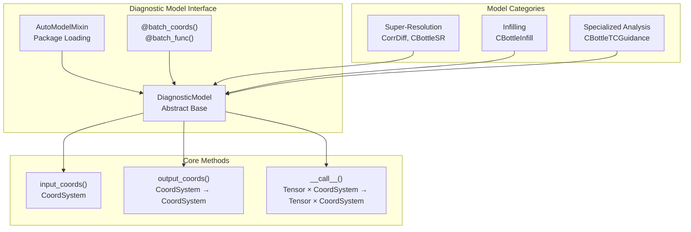
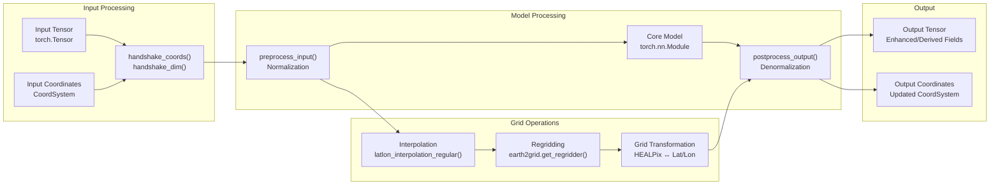
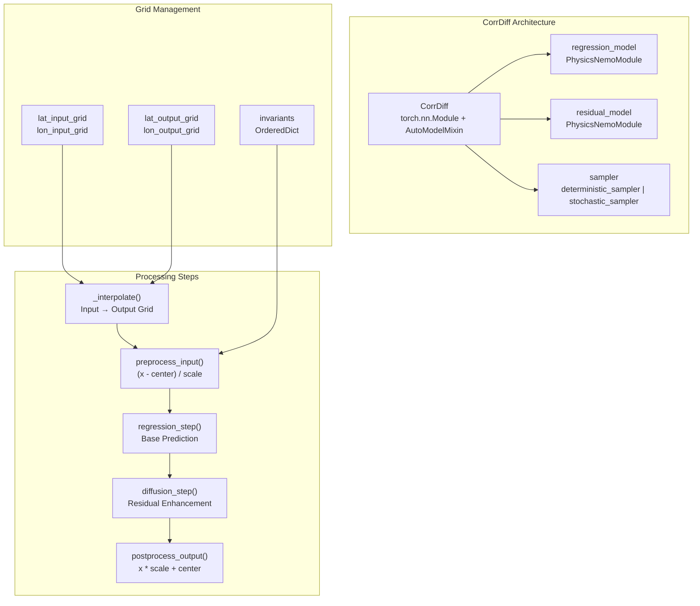
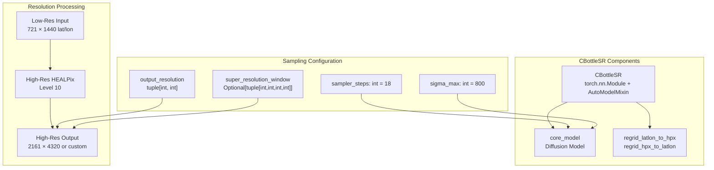
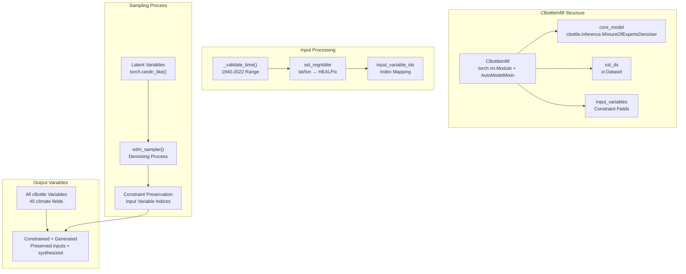
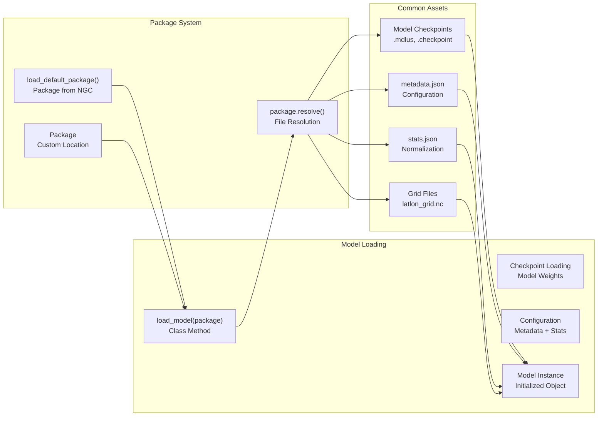
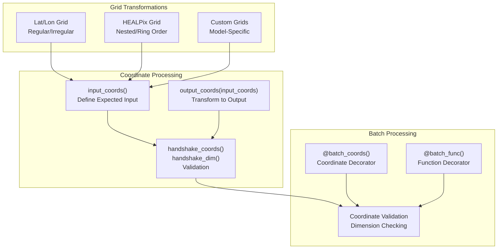

<!-- source: DeepWiki mcp.deepwiki.com · repo NVIDIA/earth2studio · extra page Diagnostic Models · fetched 2026-10-26 -->

# Diagnostic Models

Relevant source files

The following files were used as context for generating this wiki page:

- [README.md](README.md)
- [earth2studio/data/cbottle.py](earth2studio/data/cbottle.py)
- [earth2studio/models/dx/cbottle_sr.py](earth2studio/models/dx/cbottle_sr.py)
- [earth2studio/models/dx/cbottle_tc.py](earth2studio/models/dx/cbottle_tc.py)
- [earth2studio/models/dx/corrdiff.py](earth2studio/models/dx/corrdiff.py)
- [earth2studio/models/utils.py](earth2studio/models/utils.py)
- [test/Dockerfile](test/Dockerfile)
- [test/data/test_cbottle.py](test/data/test_cbottle.py)
- [test/models/dx/test_cbottle_infill.py](test/models/dx/test_cbottle_infill.py)
- [test/models/dx/test_cbottle_sr.py](test/models/dx/test_cbottle_sr.py)
- [test/models/dx/test_corrdiff.py](test/models/dx/test_corrdiff.py)

Diagnostic models in earth2studio perform time-independent transformations on geospatial data, typically taking atmospheric or climate fields at a specific time and predicting derived quantities without time integration. These models enable enhancement, analysis, and post-processing workflows including super-resolution, infilling, and specialized predictions.

For information about time-integrating forecast models, see [Prognostic Models](#3.2.1). For general model architecture and loading systems, see [Models](#3.2).

## Overview

Diagnostic models implement the `DiagnosticModel` interface and provide functionality for transforming input fields into enhanced or derived outputs. Unlike prognostic models that advance fields forward in time, diagnostic models operate on instantaneous data to produce spatially or qualitatively enhanced results.

### Architecture

Sources: [earth2studio/models/dx/base.py](), [earth2studio/models/dx/corrdiff.py:63-118](), [earth2studio/models/dx/cbottle_sr.py:81-117]()

### Data Flow Pipeline

Sources: [earth2studio/models/dx/corrdiff.py:553-582](), [earth2studio/models/dx/cbottle_sr.py:338-410](), [earth2studio/utils/interp.py]()

## Super-Resolution Models

Super-resolution diagnostic models enhance spatial resolution of input fields using diffusion-based or neural operator approaches.

### CorrDiff

`CorrDiff` implements a Corrector Diffusion model that combines regression and diffusion steps to generate high-resolution weather predictions from low-resolution inputs.

Sources: [earth2studio/models/dx/corrdiff.py:63-118](), [earth2studio/models/dx/corrdiff.py:584-672]()

### CBottleSR

`CBottleSR` provides super-resolution capabilities for climate data using the Climate in a Bottle diffusion model, transforming 0.25° resolution inputs to 5km resolution outputs.

Sources: [earth2studio/models/dx/cbottle_sr.py:81-117](), [earth2studio/models/dx/cbottle_sr.py:338-410]()

## Infilling Models

Infilling diagnostic models generate complete climate realizations by filling in missing or incomplete fields based on provided constraints.

### CBottleInfill

`CBottleInfill` uses diffusion-based sampling to generate global climate fields while preserving specified input variables as constraints.

Sources: [earth2studio/models/dx/cbottle_infill.py](), [earth2studio/data/cbottle.py:57-112]()

## Model Loading and Configuration

All diagnostic models implement the `AutoModelMixin` interface for standardized package-based loading from model registries.

### Package Loading Pattern

Sources: [earth2studio/models/dx/corrdiff.py:370-500](), [earth2studio/models/dx/cbottle_sr.py:281-336](), [earth2studio/models/auto/mixin.py]()

### Configuration Parameters

| Model | Key Parameters | Default Values | Purpose |
|-------|---------------|----------------|---------|
| `CorrDiff` | `number_of_samples`, `number_of_steps`, `solver` | `1`, `18`, `"euler"` | Diffusion sampling control |
| `CBottleSR` | `output_resolution`, `sampler_steps`, `sigma_max` | `(2161, 4320)`, `18`, `800` | Resolution and noise control |
| `CBottleInfill` | `input_variables`, `sampler_steps` | User-defined, `18` | Constraint specification |
| `CBottleTCGuidance` | `lat_lon`, `sampler_steps`, `seed` | `True`, `18`, `None` | Output format and reproducibility |

Sources: [earth2studio/models/dx/corrdiff.py:119-143](), [earth2studio/models/dx/cbottle_sr.py:119-126]()

### Coordinate System Handling

Diagnostic models use the `@batch_coords` and `@batch_func` decorators to handle coordinate transformations and ensure compatibility with earth2studio's data pipeline.

Sources: [earth2studio/models/batch.py](), [earth2studio/utils/coords.py](), [earth2studio/models/dx/corrdiff.py:316-368]()

---

