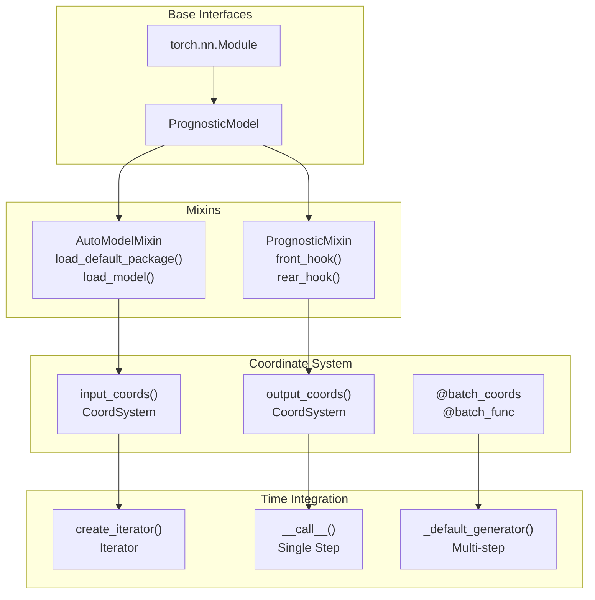
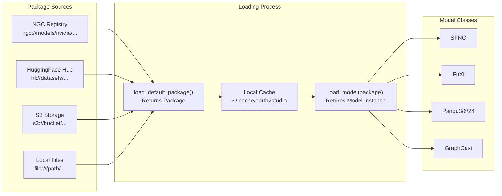
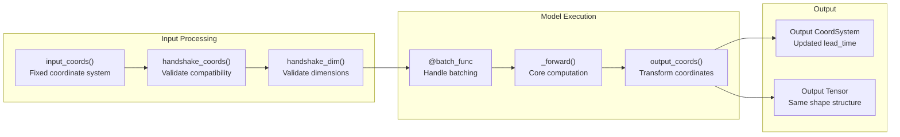
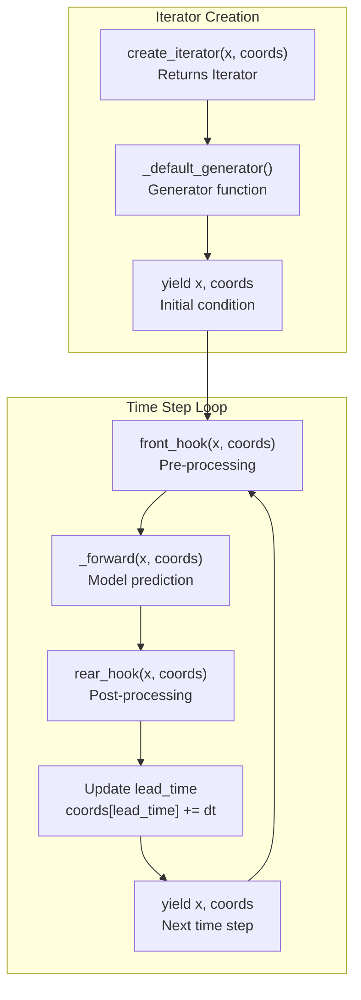
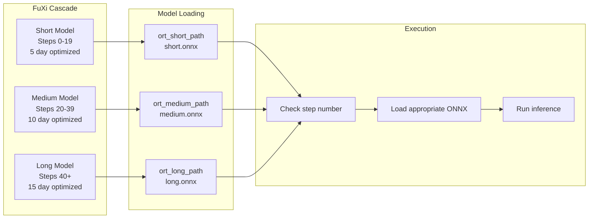

<!-- source: DeepWiki mcp.deepwiki.com · repo NVIDIA/earth2studio · extra page Prognostic Models · fetched 2026-10-26 -->

# Prognostic Models

<details>
<summary>Relevant source files</summary>

The following files were used as context for generating this wiki page:

- [CITATION.cff](CITATION.cff)
- [docs/_static/switcher.json](docs/_static/switcher.json)
- [earth2studio/models/px/fuxi.py](earth2studio/models/px/fuxi.py)
- [earth2studio/models/px/sfno.py](earth2studio/models/px/sfno.py)
- [examples/11_huge_ensembles.py](examples/11_huge_ensembles.py)
- [examples/12_temporal_interpolation.py](examples/12_temporal_interpolation.py)
- [examples/13_cyclone_tracking.py](examples/13_cyclone_tracking.py)
- [examples/14_dlesym_example.py](examples/14_dlesym_example.py)
- [test/models/px/test_dlwp.py](test/models/px/test_dlwp.py)
- [test/models/px/test_fcn.py](test/models/px/test_fcn.py)
- [test/models/px/test_fengwu.py](test/models/px/test_fengwu.py)
- [test/models/px/test_fuxi.py](test/models/px/test_fuxi.py)
- [test/models/px/test_graphcast.py](test/models/px/test_graphcast.py)
- [test/models/px/test_interpmodafno.py](test/models/px/test_interpmodafno.py)
- [test/models/px/test_pangu.py](test/models/px/test_pangu.py)
- [test/models/px/test_sfno.py](test/models/px/test_sfno.py)

</details>


Prognostic models in earth2studio are AI-based weather prediction models that perform time-integration to generate forecasts. These models take atmospheric state data as input and predict future atmospheric conditions, typically advancing the simulation by fixed time steps (3, 6, or 24 hours). For diagnostic models that analyze existing data without time integration, see [Diagnostic Models](#3.2.2).

## Overview

Prognostic models form the core forecasting capability of earth2studio, implementing various state-of-the-art AI weather prediction architectures. All prognostic models inherit from `torch.nn.Module` and implement the `PrognosticModel` interface, providing standardized coordinate systems, auto-loading capabilities, and iterative time-stepping functionality.

### Model Architecture



**Model Implementation Flow**
Sources: [earth2studio/models/px/base.py](), [earth2studio/models/px/utils.py](), [earth2studio/models/batch.py]()

## Auto-Loading System

The auto-loading system enables seamless model distribution and instantiation through the `Package` abstraction. Models are distributed via NGC (NVIDIA GPU Cloud), HuggingFace Hub, or other storage backends.



**Package-Based Model Loading**
Sources: [earth2studio/models/auto.py](), [earth2studio/models/px/sfno.py:234-244](), [earth2studio/models/px/fuxi.py:254-262]()

## Available Models

### SFNO (Spherical Fourier Operator Network)

**Architecture**: PyTorch-based using Modulus-Makani backend  
**Time Step**: 6 hours  
**Resolution**: 0.25° lat-lon (721×1440)  
**Variables**: 73 atmospheric and surface variables  
**Backend**: `ModelWrapper` from makani package

```python
# Model instantiation
package = SFNO.load_default_package()
model = SFNO.load_model(package)
```

Sources: [earth2studio/models/px/sfno.py:133-173](), [earth2studio/models/px/sfno.py:246-329]()

### FuXi

**Architecture**: ONNX-based cascade of three models  
**Time Step**: 6 hours  
**Resolution**: 0.25° lat-lon (721×1440)  
**Variables**: 70 atmospheric variables  
**Models**: Short (5 days), Medium (10 days), Long (15 days)

The FuXi model automatically switches between different ONNX models based on forecast length to optimize prediction quality.

Sources: [earth2studio/models/px/fuxi.py:121-157](), [earth2studio/models/px/fuxi.py:436-447]()

### Pangu Weather Models

**Architecture**: ONNX-based  
**Variants**: Pangu3 (3h), Pangu6 (6h), Pangu24 (24h)  
**Resolution**: 0.25° lat-lon (721×1440)  
**Variables**: 69 atmospheric variables

Sources: [test/models/px/test_pangu.py:27-28]()

### GraphCast

**Architecture**: JAX-based graph neural network  
**Variants**: GraphCastSmall (1° resolution), GraphCastOperational (0.25° resolution)  
**Time Step**: 6 hours  
**Variables**: 85 atmospheric variables

Sources: [test/models/px/test_graphcast.py:28-29]()

### Additional Models

| Model | Architecture | Time Step | Resolution | Variables |
|-------|-------------|-----------|------------|-----------|
| FCN | PyTorch | 6h | 0.25° | 26 |
| DLWP | PyTorch (Cubed Sphere) | 6h | 0.25° | 7 |
| FengWu | ONNX | 6h | 0.25° | 69 |
| InterpModAFNO | PyTorch (Interpolation) | 1h | 0.25° | 73 |
| DLESyM | PyTorch (HEALPix) | Variable | ~1° | Multiple |

Sources: [test/models/px/test_fcn.py](), [test/models/px/test_dlwp.py](), [test/models/px/test_fengwu.py](), [test/models/px/test_interpmodafno.py](), [examples/14_dlesym_example.py]()

## Coordinate Systems

All prognostic models implement standardized coordinate systems using `CoordSystem` (OrderedDict) with the following dimensions:

```python
# Standard coordinate system structure
coords = OrderedDict({
    "batch": np.empty(0),           # Batch dimension
    "time": np.empty(0),            # Time instances
    "lead_time": np.array([...]),   # Forecast lead times
    "variable": np.array([...]),     # Atmospheric variables
    "lat": np.array([...]),         # Latitude coordinates
    "lon": np.array([...])          # Longitude coordinates
})
```

### Coordinate Transformation



**Coordinate Validation and Transformation**
Sources: [earth2studio/utils/__init__.py](), [earth2studio/models/batch.py](), [earth2studio/models/px/sfno.py:174-231]()

## Time Integration

Prognostic models support iterative time-stepping through the `create_iterator()` method, which yields successive forecast states.

### Iterator Pattern



**Time Integration Flow**
Sources: [earth2studio/models/px/sfno.py:374-387](), [earth2studio/models/px/fuxi.py:424-468](), [earth2studio/models/px/utils.py]()

### Usage Example

```python
# Create iterator for time integration
model_iter = model.create_iterator(initial_state, coords)

# Get initial condition (step 0)
x0, coords0 = next(model_iter)

# Iterate through forecast steps
for step, (x, coords) in enumerate(model_iter):
    # x contains forecast at coords["lead_time"]
    print(f"Step {step}: Lead time {coords['lead_time']}")
    if step >= max_steps:
        break
```

## Model Cascading

Some models like FuXi implement cascading architectures where different model variants are used for different forecast ranges to optimize accuracy.



**FuXi Model Cascading**
Sources: [earth2studio/models/px/fuxi.py:436-447](), [earth2studio/models/px/fuxi.py:151-165]()

## Specialized Architectures

### Interpolation Models

`InterpModAFNO` provides temporal interpolation between base model forecasts, generating hourly outputs from 6-hourly base predictions.

### Earth System Models

`DLESyM` implements coupled atmosphere-ocean modeling with different temporal resolutions for atmosphere (6h) and ocean (48h) components.

### Cubed Sphere Models

`DLWP` operates on cubed sphere coordinates, requiring transformation between equirectangular and cubed sphere grids.

Sources: [test/models/px/test_interpmodafno.py](), [examples/14_dlesym_example.py](), [test/models/px/test_dlwp.py]()

---

