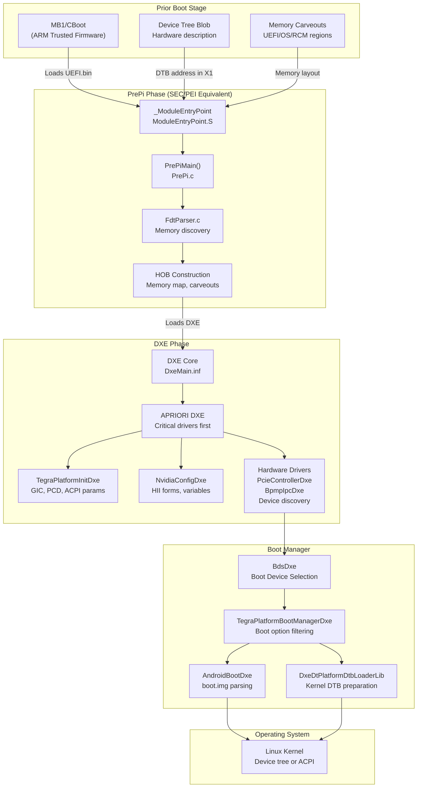
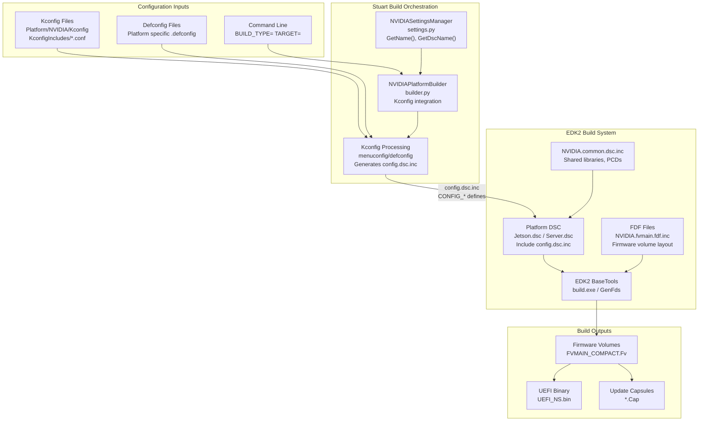
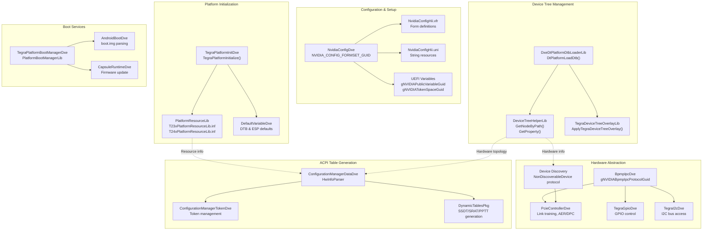

<!-- source: DeepWiki mcp.deepwiki.com · repo NVIDIA/edk2-nvidia · page 1 Overview · fetched 2026-10-26 -->

# Overview

<details>
<summary>Relevant source files</summary>

The following files were used as context for generating this wiki page:

- [.github/release-drafter.yml](.github/release-drafter.yml)
- [.github/workflows/build.yml](.github/workflows/build.yml)
- [Platform/NVIDIA/Kconfig](Platform/NVIDIA/Kconfig)
- [Platform/NVIDIA/L4TLauncher/PlatformBuild.py](Platform/NVIDIA/L4TLauncher/PlatformBuild.py)
- [Platform/NVIDIA/L4TLauncher/build.sh](Platform/NVIDIA/L4TLauncher/build.sh)
- [Platform/NVIDIA/NVIDIA.common.dsc.inc](Platform/NVIDIA/NVIDIA.common.dsc.inc)
- [Platform/NVIDIA/NVIDIA.defconfig](Platform/NVIDIA/NVIDIA.defconfig)
- [Platform/NVIDIA/NVIDIA.fvmain.fdf.inc](Platform/NVIDIA/NVIDIA.fvmain.fdf.inc)
- [Silicon/NVIDIA/Drivers/NvidiaConfigDxe/NvidiaConfigDxe.c](Silicon/NVIDIA/Drivers/NvidiaConfigDxe/NvidiaConfigDxe.c)
- [Silicon/NVIDIA/Drivers/NvidiaConfigDxe/NvidiaConfigDxe.inf](Silicon/NVIDIA/Drivers/NvidiaConfigDxe/NvidiaConfigDxe.inf)
- [Silicon/NVIDIA/Drivers/NvidiaConfigDxe/NvidiaConfigHii.h](Silicon/NVIDIA/Drivers/NvidiaConfigDxe/NvidiaConfigHii.h)
- [Silicon/NVIDIA/Drivers/NvidiaConfigDxe/NvidiaConfigHii.uni](Silicon/NVIDIA/Drivers/NvidiaConfigDxe/NvidiaConfigHii.uni)
- [Silicon/NVIDIA/Drivers/NvidiaConfigDxe/NvidiaConfigHii.vfr](Silicon/NVIDIA/Drivers/NvidiaConfigDxe/NvidiaConfigHii.vfr)
- [Silicon/NVIDIA/Drivers/NvidiaConfigDxe/NvidiaConfigHiiMap.uni](Silicon/NVIDIA/Drivers/NvidiaConfigDxe/NvidiaConfigHiiMap.uni)
- [Silicon/NVIDIA/Include/NVIDIAConfiguration.h](Silicon/NVIDIA/Include/NVIDIAConfiguration.h)
- [Silicon/NVIDIA/Include/Server/TH500/TH500MB1Configuration.h](Silicon/NVIDIA/Include/Server/TH500/TH500MB1Configuration.h)
- [Silicon/NVIDIA/Library/PlatformBootManagerLib/PlatformBm.c](Silicon/NVIDIA/Library/PlatformBootManagerLib/PlatformBm.c)
- [Silicon/NVIDIA/Library/PlatformBootManagerLib/PlatformBm.h](Silicon/NVIDIA/Library/PlatformBootManagerLib/PlatformBm.h)
- [Silicon/NVIDIA/Library/PlatformBootManagerLib/PlatformBootManagerLib.inf](Silicon/NVIDIA/Library/PlatformBootManagerLib/PlatformBootManagerLib.inf)
- [Silicon/NVIDIA/NVIDIA.dec](Silicon/NVIDIA/NVIDIA.dec)
- [Silicon/NVIDIA/edk2nv/stuart/builder.py](Silicon/NVIDIA/edk2nv/stuart/builder.py)
- [Silicon/NVIDIA/edk2nv/stuart/settings.py](Silicon/NVIDIA/edk2nv/stuart/settings.py)

</details>


The **edk2-nvidia** repository contains NVIDIA's implementation of UEFI (Unified Extensible Firmware Interface) firmware for Tegra system-on-chip (SoC) platforms. This firmware provides the platform initialization layer, hardware abstraction, boot services, and operating system loader functionality for NVIDIA's embedded, workstation, and datacenter server products.

This page provides a high-level introduction to the repository's architecture, supported platforms, and major subsystems. For detailed information about specific subsystems, refer to the specialized pages:
- Build system and configuration: [Build System and Configuration](#2)
- Early boot and initialization: [Firmware Initialization Phases](#3)
- Device tree handling: [Device Tree System](#4)
- Runtime configuration: [Platform Configuration Services](#5)
- Hardware drivers: [Hardware Drivers and Protocols](#6)
- OS boot support: [Operating System Boot Support](#7)
- Platform-specific details: [Platform Variants](#8)

## Repository Purpose and Scope

This repository implements the platform-specific UEFI firmware layer for NVIDIA Tegra SoCs, built on top of the TianoCore EDK2 framework. The firmware:

1. **Initializes hardware** - Configures CPUs, memory controllers, PCIe, GPUs, and peripherals
2. **Provides boot services** - Implements UEFI protocols for device access, memory management, and configuration
3. **Loads operating systems** - Supports standard UEFI boot, Android boot images, and direct kernel loading
4. **Exposes hardware to OS** - Generates ACPI tables or provides device tree to Linux/Android
5. **Manages configuration** - Provides BIOS setup menus and persistent NVRAM storage

The implementation supports both embedded systems (Jetson platforms) and enterprise servers (TH500 multi-socket systems), with a common core and platform-specific extensions.

**Sources:** [NVIDIA.common.dsc.inc:1-50](), [Silicon/NVIDIA/NVIDIA.dec:1-30]()

## Supported Platform Families

### Hardware Platforms

The firmware supports three primary deployment targets:

| Platform Type | SOC Family | Representative Products | Configuration |
|--------------|------------|------------------------|---------------|
| **Jetson Embedded** | T234 (Tegra234), T264 (Tegra264) | Jetson AGX Orin, Jetson Orin NX | Single-socket, PCIe Gen4, embedded storage (eMMC/SD/NVMe) |
| **Server Datacenter** | TH500 (Grace Hopper) | Grace Hopper Superchip, Grace CPU Superchip | Multi-socket (up to 4), PCIe Gen5, extensive NUMA, MPAM, RAS features |
| **Virtualized** | TegraVirt | KVM/QEMU virtual machines | Dynamic resource discovery, virtio devices |

**Sources:** [Platform/NVIDIA/Kconfig:93-112](), [Silicon/NVIDIA/NVIDIA.dec:63-79]()

### SOC Selection

The build system uses Kconfig to select the target SOC family, which determines available features and drivers:

```
CONFIG_SOC_T23X  - Tegra234 (Jetson platforms)
CONFIG_SOC_T24X  - TH500 (Server platforms) 
CONFIG_SOC_T26X  - Tegra264 (Next-gen Jetson)
CONFIG_SOC_GENERAL - General embedded platforms
CONFIG_SOC_DATACENTER - Server-specific features
```

Platform SKU detection at runtime uses the `TegraPlatformInfoLib` to identify the specific chip variant (silicon vs pre-silicon, fused vs unfused) and configure accordingly.

**Sources:** [Platform/NVIDIA/Kconfig:93-102](), [Platform/NVIDIA/NVIDIA.common.dsc.inc:61-79]()

## Firmware Boot Flow



**Firmware Boot Sequence**

The boot process follows the standard UEFI architecture with NVIDIA-specific adaptations:

1. **Pre-UEFI Boot Loader**: ARM Trusted Firmware (MB1/CBoot) initializes basic hardware, sets up memory controllers, loads the UEFI binary into DRAM, and passes a device tree blob describing the hardware configuration.

2. **PrePi Phase** ([Silicon/NVIDIA/PrePi/]()): The `_ModuleEntryPoint` assembly entry point receives the DTB address from the bootloader, performs position-independent code relocation for physical platforms, and invokes `PrePiMain()` which parses the DTB to discover DRAM regions and carveouts, constructs Hand-Off Blocks (HOBs) describing the memory map, and loads the DXE Core.

3. **DXE Phase** ([Platform/NVIDIA/NVIDIA.fvmain.fdf.inc:39-74]()): The `APRIORI DXE` section ensures critical drivers load first, including `TegraPlatformInitDxe` which configures platform-specific PCDs, GIC base addresses, and NUMA parameters. Hardware drivers (`PcieControllerDxe`, `BpmpIpcDxe`, storage, and network) are loaded based on the platform DSC configuration. `NvidiaConfigDxe` initializes HII forms for BIOS setup and manages persistent NVRAM variables.

4. **Boot Device Selection** ([Silicon/NVIDIA/Library/PlatformBootManagerLib/PlatformBm.c]()): `TegraPlatformBootManagerDxe` filters and prioritizes boot options (eMMC, UFS, NVMe, network). Platform-specific boot order can be controlled via IPMI on server platforms. Kernel command line arguments are aggregated from multiple sources (DTB, variables, boot image).

5. **OS Handoff**: For Android, `AndroidBootDxe` parses boot.img/vendor_boot.img format (v0-v4), extracts kernel/ramdisk, applies DTB overlays, and launches via LoadImage protocol. For standard UEFI boot, the system provides ACPI tables via ConfigurationManagerData or passes a prepared device tree with board-specific overlays applied.

**Sources:** [Platform/NVIDIA/NVIDIA.fvmain.fdf.inc:18-74](), [Silicon/NVIDIA/Library/PlatformBootManagerLib/PlatformBm.c:1-100]()

## Build System Architecture



**Multi-Layered Build Configuration**

The build system combines three layers of configuration:

1. **Stuart Build Framework** ([Silicon/NVIDIA/edk2nv/stuart/]()): Python-based build orchestration using `NVIDIASettingsManager` and `NVIDIAPlatformBuilder`. Platform-specific subclasses define `GetName()` (e.g., "Jetson"), `GetDscName()` (path to platform DSC), and `GetPackagesPath()`. Stuart manages workspace setup, dependency installation (stuart_setup), configuration (stuart_update), and build invocation.

2. **Kconfig Configuration System** ([Platform/NVIDIA/Kconfig]()): Linux-style configuration with SOC selection (SOC_T23X, SOC_T24X, SOC_T26X), build type recipes (BUILD_T234_JETSON, BUILD_TH500_SERVER), and feature enables (CONFIG_PCIE, CONFIG_NETWORKING, CONFIG_ACPI). The `builder.py` processes Kconfig files and generates `config.dsc.inc` with `CONFIG_*` defines that control conditional compilation in DSC files.

3. **EDK2 DSC/FDF Files**: `NVIDIA.common.dsc.inc` provides shared configuration including library class mappings (PlatformResourceLib, DeviceTreeHelperLib), PCD defaults, and build options. Platform-specific DSC files include `config.dsc.inc` and use conditional directives like `!ifdef CONFIG_PCIE` to include/exclude components. FDF files define firmware volume layout and driver load order via `APRIORI DXE` sections.

**Sources:** [Silicon/NVIDIA/edk2nv/stuart/settings.py:35-180](), [Silicon/NVIDIA/edk2nv/stuart/builder.py:1-50](), [Platform/NVIDIA/Kconfig:1-90](), [Platform/NVIDIA/NVIDIA.common.dsc.inc:1-50]()

## Major Subsystem Components



**Key Subsystem Responsibilities**

| Subsystem | Primary Components | Key Functions |
|-----------|-------------------|---------------|
| **Configuration & Setup** | `NvidiaConfigDxe`, HII forms (.vfr/.uni) | BIOS setup menu with PCIe config, boot options, TH500 MB1 settings, L4T config, debug options. Managed via HII protocols and UEFI variables with Redfish integration. |
| **Platform Initialization** | `TegraPlatformInitDxe`, `PlatformResourceLib` | SOC-specific initialization, PCD configuration (GIC bases, NUMA distances), resource info (socket mask, boot chain, memory regions, floorsweeping data). |
| **Device Tree** | `DxeDtPlatformDtbLoaderLib`, `DeviceTreeHelperLib`, overlay libraries | Load and modify kernel DTB, apply overlays from firmware media, inject board properties, floorsweeping, security hardening (remove DSU PMU nodes). |
| **Hardware Abstraction** | `BpmpIpcDxe`, `PcieControllerDxe`, GPIO/I2C drivers | BPMP IPC for firmware services (MRQ_RESET, MRQ_PG, MRQ_UPHY, MRQ_C2C), PCIe controller configuration and link training, device discovery via DTB parsing. |
| **Boot Services** | `TegraPlatformBootManagerDxe`, `AndroidBootDxe` | Boot option management (eMMC, UFS, PCIe NIC filtering), Android boot image parsing (v0-v4 headers), kernel command line aggregation, IPMI boot order control. |
| **ACPI Generation** | `ConfigurationManagerDataDxe`, Dynamic Tables | Generate ACPI tables (SRAT, PPTT, MPAM, HMAT) from platform resource data and DTB hardware topology for server platforms. |

**Sources:** [Silicon/NVIDIA/Drivers/NvidiaConfigDxe/NvidiaConfigDxe.c:1-100](), [Silicon/NVIDIA/Drivers/TegraPlatformInit/](), [Silicon/NVIDIA/Library/PlatformBootManagerLib/PlatformBm.c:1-100](), [Platform/NVIDIA/NVIDIA.fvmain.fdf.inc:130-175]()

## Platform Specialization Approach

The firmware uses a common core with platform-specific extensions to support diverse hardware:

**Common Core Components:**
- Standard UEFI services (memory, variables, boot manager, capsule update)
- EDK2 standard drivers (USB, network stack, filesystem, shell)
- NVIDIA base libraries (DeviceTreeHelperLib, BPMP IPC, configuration management)

**Platform-Specific Implementations:**

1. **PlatformResourceLib** ([Platform/NVIDIA/NVIDIA.common.dsc.inc:257-266]()): SOC-specific resource configuration:
   - `T23xPlatformResourceLib.inf` - Jetson platforms (single socket, MCE ARI interface)
   - `T24xPlatformResourceLib.inf` - TH500 servers (multi-socket, memory modes, MPAM)
   - `T26xPlatformResourceLib.inf` - Next-generation Tegra platforms

2. **Build Configuration** ([Platform/NVIDIA/Kconfig:93-113]()): Kconfig-based feature selection:
   - SOC choice: `CONFIG_SOC_T23X`, `CONFIG_SOC_T24X`, `CONFIG_SOC_T26X`
   - Build type recipes that imply appropriate features for target platform
   - Conditional driver inclusion based on hardware capabilities (supports PCIe Gen5, MPAM, etc.)

3. **HII Configuration Forms** ([Silicon/NVIDIA/Drivers/NvidiaConfigDxe/NvidiaConfigHii.vfr]()): Platform-specific setup options:
   - TH500-specific: Socket configuration (0-3), UPHY bifurcation, MPAM partitioning, EGM memory modes
   - Jetson-specific: L4T boot mode, display handoff, GPIO configuration
   - Common: PCIe max speed/width, boot order, kernel command line

4. **MB1 Configuration Data** ([Silicon/NVIDIA/Include/Server/TH500/TH500MB1Configuration.h]()): Platform-specific early boot data passed from bootloader, includes UPHY configuration, PCIe settings, feature flags (EGM, TPM, spread spectrum), MPAM partition IDs, floorsweeping data.

**Sources:** [Platform/NVIDIA/NVIDIA.common.dsc.inc:257-266](), [Platform/NVIDIA/Kconfig:93-113](), [Silicon/NVIDIA/Drivers/NvidiaConfigDxe/NvidiaConfigHii.vfr:1-100](), [Silicon/NVIDIA/Include/Server/TH500/TH500MB1Configuration.h:1-100]()

## Key Protocols and GUIDs

The firmware defines custom NVIDIA protocols and GUIDs for platform-specific functionality:

**Hardware Management Protocols:**
- `gNVIDIABpmpIpcProtocolGuid` - BPMP IPC communication for firmware services
- `gNVIDIAPciHostBridgeProtocolGuid` - PCIe host bridge configuration
- `gNVIDIADeviceTreeNodeProtocolGuid` - Device tree node access
- `gNVIDIANonDiscoverableDeviceProtocolGuid` - Non-standard device registration

**Configuration Protocols:**
- `gNVIDIAConfigurationManagerDataProtocolGuid` - ACPI configuration data provider
- `gNVIDIAConfigurationManagerTokenProtocolGuid` - Configuration object token management
- `gNVIDIAPciConfigurationDataProtocolGuid` - PCIe configuration data

**Boot and Update Protocols:**
- `gNVIDIABootChainProtocolGuid` - Boot chain (A/B) management
- `gNVIDIAFwPartitionProtocolGuid` - Firmware partition access
- `gNVIDIABrBctUpdateProtocolGuid` - Boot configuration table updates

**Variable GUIDs:**
- `gNVIDIAPublicVariableGuid` - User-accessible configuration variables
- `gNVIDIATokenSpaceGuid` - Platform-specific PCD namespace

**Sources:** [Silicon/NVIDIA/NVIDIA.dec:226-322]()

---

