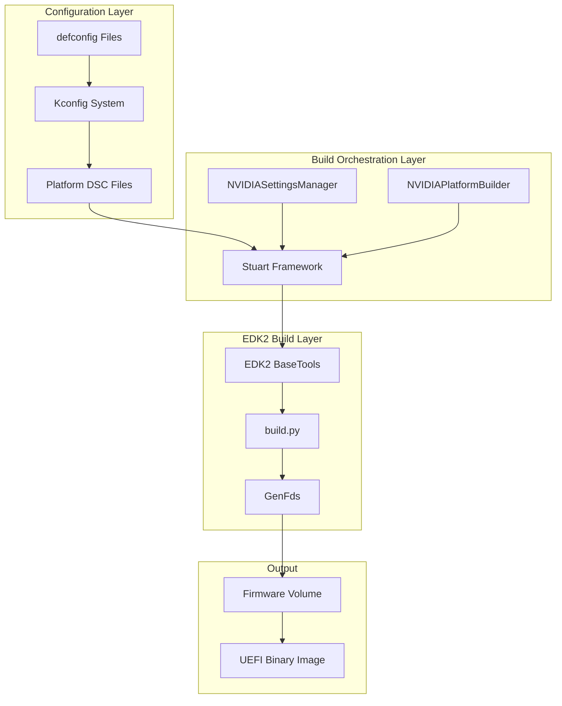
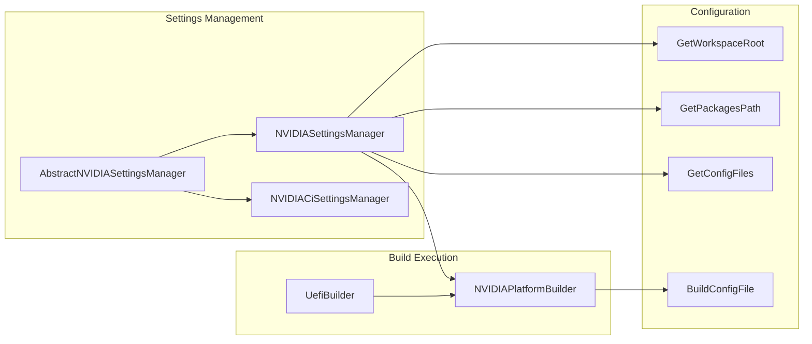
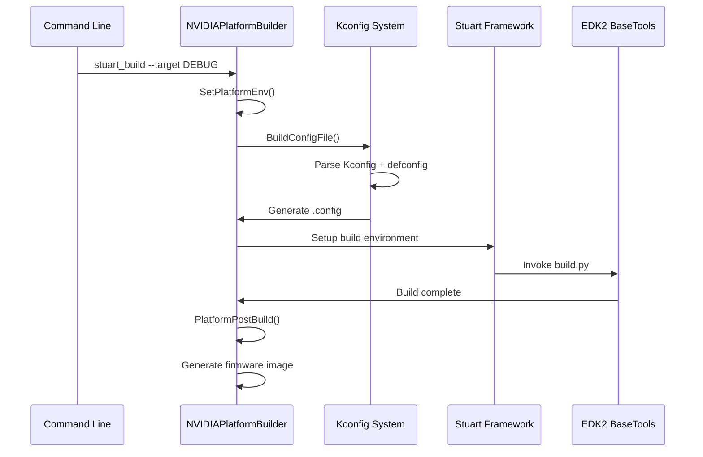
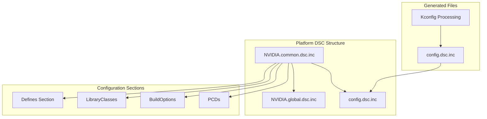
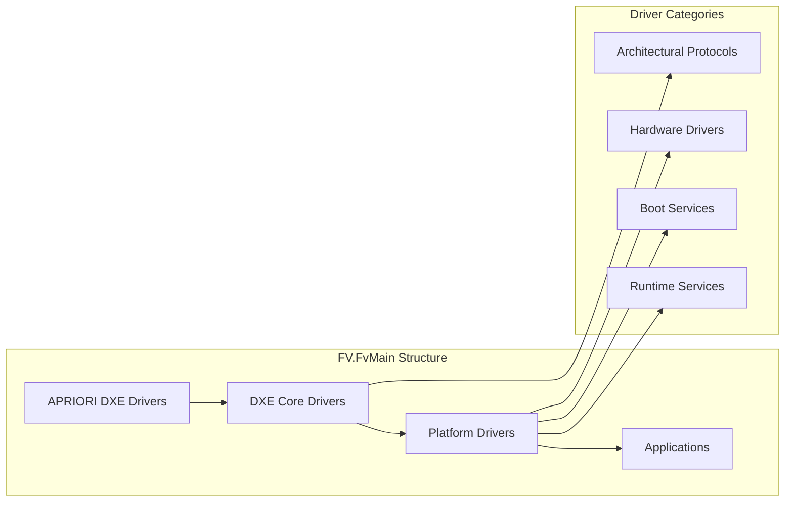
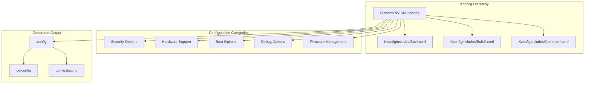
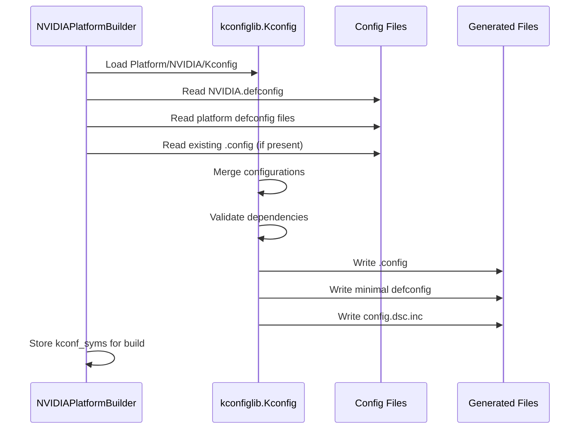
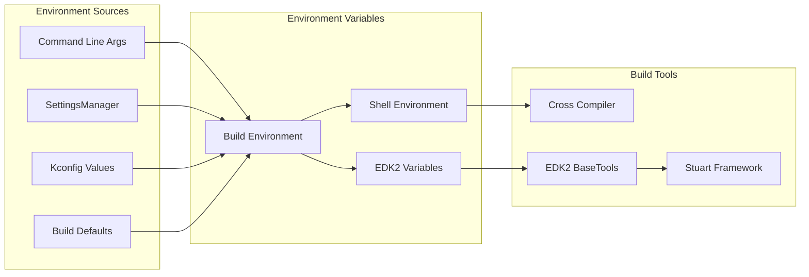

<!-- source: DeepWiki mcp.deepwiki.com · repo NVIDIA/edk2-nvidia · page 2 Build System and Configuration · fetched 2026-10-26 -->

# Build System and Configuration

Relevant source files

The following files were used as context for generating this wiki page:

- [.github/release-drafter.yml](.github/release-drafter.yml)
- [.github/workflows/build.yml](.github/workflows/build.yml)
- [Platform/NVIDIA/Kconfig](Platform/NVIDIA/Kconfig)
- [Platform/NVIDIA/L4TLauncher/PlatformBuild.py](Platform/NVIDIA/L4TLauncher/PlatformBuild.py)
- [Platform/NVIDIA/L4TLauncher/build.sh](Platform/NVIDIA/L4TLauncher/build.sh)
- [Platform/NVIDIA/NVIDIA.common.dsc.inc](Platform/NVIDIA/NVIDIA.common.dsc.inc)
- [Platform/NVIDIA/NVIDIA.defconfig](Platform/NVIDIA/NVIDIA.defconfig)
- [Platform/NVIDIA/NVIDIA.fvmain.fdf.inc](Platform/NVIDIA/NVIDIA.fvmain.fdf.inc)
- [Silicon/NVIDIA/edk2nv/stuart/builder.py](Silicon/NVIDIA/edk2nv/stuart/builder.py)
- [Silicon/NVIDIA/edk2nv/stuart/settings.py](Silicon/NVIDIA/edk2nv/stuart/settings.py)

This document covers the build system architecture used to construct NVIDIA UEFI firmware images, including the Stuart build framework, platform configuration files, and Kconfig-based configuration management. The build system orchestrates compilation, linking, and firmware image generation across multiple platforms and build variants.

For information about platform-specific boot management, see [Platform Definitions and Boot Management](#3.1). For details about hardware-specific drivers built by this system, see [Hardware Drivers](#4).

## Build System Architecture

The NVIDIA UEFI build system consists of three main components that work together to produce firmware images:

Sources: [Platform/NVIDIA/NVIDIA.common.dsc.inc:1-50](), [Silicon/NVIDIA/edk2nv/stuart/settings.py:35-85](), [Silicon/NVIDIA/edk2nv/stuart/builder.py:34-51]()

## Stuart Build Framework

The Stuart framework provides the foundation for NVIDIA's build system, handling workspace management, dependency resolution, and build orchestration through two key classes:

### Core Stuart Components

The `NVIDIASettingsManager` class extends Stuart's base settings interfaces to provide platform-specific configuration:

| Method | Purpose | Implementation |
|--------|---------|----------------|
| `GetWorkspaceRoot()` | Workspace location | Uses `WORKSPACE` environment variable |
| `GetPackagesPath()` | Package search paths | Includes edk2, edk2-platforms, edk2-nvidia |  
| `GetConfigFiles()` | Kconfig files list | Platform-specific defconfig files |
| `GetDscName()` | Main DSC file | Returns `NVIDIA.common.dsc` path |

Sources: [Silicon/NVIDIA/edk2nv/stuart/settings.py:57-131](), [Silicon/NVIDIA/edk2nv/stuart/builder.py:34-51]()

### Build Process Flow

The `NVIDIAPlatformBuilder` orchestrates the complete build process:

Sources: [Silicon/NVIDIA/edk2nv/stuart/builder.py:290-331](), [Silicon/NVIDIA/edk2nv/stuart/builder.py:435-499]()

## Platform Configuration Files

Platform configuration is managed through a hierarchy of DSC (Description) and FDF (Flash Description File) includes that define build settings, library mappings, and firmware layout.

### DSC Configuration Hierarchy

The main platform configuration is defined in `NVIDIA.common.dsc.inc`, which includes:

| Section | Purpose | Key Settings |
|---------|---------|--------------|
| `[Defines]` | Platform metadata | `PLATFORM_NAME`, `BUILD_TARGETS`, `OUTPUT_DIRECTORY` |
| `[LibraryClasses]` | Library mappings | Debug, crypto, platform-specific libraries |
| `[BuildOptions]` | Compiler flags | GCC flags, ASL options, security options |
| `[PcdsFeatureFlag]` | Feature toggles | Secure boot, TPM, network features |

Sources: [Platform/NVIDIA/NVIDIA.common.dsc.inc:9-50](), [Platform/NVIDIA/NVIDIA.common.dsc.inc:98-250]()

### Firmware Volume Definition

The `NVIDIA.fvmain.fdf.inc` file defines how firmware components are packaged:

The APRIORI section ensures critical drivers load first:

- PCD services (`MdeModulePkg/Universal/PCD/Dxe/Pcd.inf`)
- Status code routing (`ReportStatusCodeRouterRuntimeDxe`)
- Platform initialization (`TegraPlatformInitDxe`)
- Interrupt controller (`ArmGicDxe`)

Sources: [Platform/NVIDIA/NVIDIA.fvmain.fdf.inc:39-73](), [Platform/NVIDIA/NVIDIA.fvmain.fdf.inc:75-120]()

## Kconfig System

The Kconfig system provides build-time configuration through a hierarchical menu system that generates configuration files consumed by the EDK2 build.

### Kconfig Structure

Key configuration categories include:

| Category | Configuration Options | Impact |
|----------|----------------------|--------|
| Security | TPM type, Secure Boot, MM type | Security drivers, authentication |
| Hardware | PCIe, USB, networking, display | Hardware driver inclusion |
| Boot Options | Android, L4T, RCM boot | Boot flow and applications |
| Debug | Print levels, memory tests | Debug capabilities |

Sources: [Platform/NVIDIA/Kconfig:93-270](), [Platform/NVIDIA/Kconfig:824-986]()

### Configuration Processing

The `BuildConfigFile()` method in `NVIDIAPlatformBuilder` processes Kconfig:

The generated `config.dsc.inc` translates Kconfig symbols to EDK2 DEFINE statements:
- `CONFIG_VARIABLE=value` becomes `DEFINE VARIABLE value`
- Empty values are commented out as EDK2 cannot define empty values
- String values have quotes stripped for EDK2 compatibility

Sources: [Silicon/NVIDIA/edk2nv/stuart/builder.py:193-288]()

## Build Environment Setup

The build system establishes the compilation environment through environment variables and build settings managed by the Stuart framework.

### Environment Configuration

Key environment variables set by `SetPlatformEnv()`:

| Variable | Source | Purpose |
|----------|---------|---------|
| `ACTIVE_PLATFORM` | `GetDscName()` | Main platform DSC file |
| `TARGET` | `--target` argument | Build target (DEBUG/RELEASE) |
| `TARGET_ARCH` | Fixed | Always AARCH64 for NVIDIA |
| `TOOL_CHAIN_TAG` | `GetToolchainTag()` | Toolchain identifier (GCC) |
| `BLD_*_BUILD_NAME` | `GetName()` | Platform name |
| `BLD_*_BUILD_GUID` | Kconfig/`GetGuid()` | Platform GUID |

Sources: [Silicon/NVIDIA/edk2nv/stuart/builder.py:349-430](), [Silicon/NVIDIA/edk2nv/stuart/settings.py:239-251]()

---

