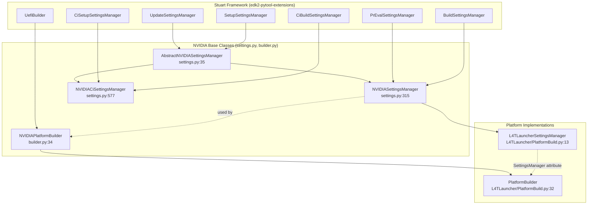
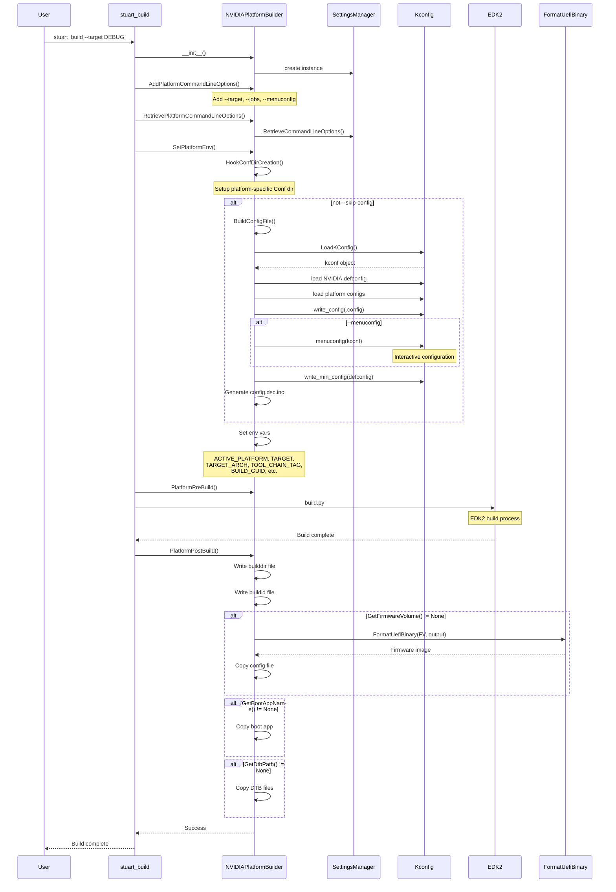
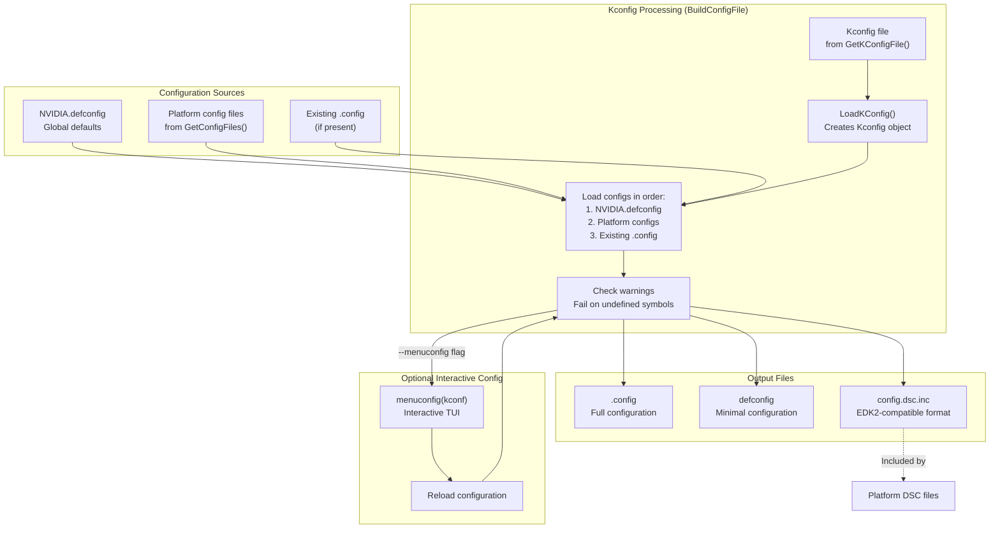

<!-- source: DeepWiki mcp.deepwiki.com · repo NVIDIA/edk2-nvidia · page 2.1 Stuart Build Orchestration · fetched 2026-10-26 -->

# Stuart Build Orchestration

<details>
<summary>Relevant source files</summary>

The following files were used as context for generating this wiki page:

- [.github/release-drafter.yml](.github/release-drafter.yml)
- [.github/workflows/build.yml](.github/workflows/build.yml)
- [Platform/NVIDIA/L4TLauncher/PlatformBuild.py](Platform/NVIDIA/L4TLauncher/PlatformBuild.py)
- [Platform/NVIDIA/L4TLauncher/build.sh](Platform/NVIDIA/L4TLauncher/build.sh)
- [Platform/NVIDIA/NVIDIA.defconfig](Platform/NVIDIA/NVIDIA.defconfig)
- [Silicon/NVIDIA/edk2nv/stuart/builder.py](Silicon/NVIDIA/edk2nv/stuart/builder.py)
- [Silicon/NVIDIA/edk2nv/stuart/settings.py](Silicon/NVIDIA/edk2nv/stuart/settings.py)

</details>


## Purpose and Scope

This document describes the Stuart build framework integration used to build NVIDIA UEFI firmware images. Stuart is a build orchestration tool from TianoCore that wraps the EDK2 build system with dependency management, configuration processing, and CI/CD support. The NVIDIA implementation extends Stuart with Kconfig integration, platform-specific configuration management, and automated image generation.

For details on the platform configuration files (DSC/FDF) that Stuart processes, see [Platform Configuration Files (DSC/FDF)](#2.2). For information on the Kconfig system that Stuart integrates with, see [Kconfig Configuration System](#2.3).

## Architecture Overview

The Stuart build orchestration consists of two primary class hierarchies: **Settings Managers** and **Platform Builders**. Settings managers provide platform metadata and configuration, while platform builders execute the build workflow and post-processing steps.

### Component Architecture



Sources: [Silicon/NVIDIA/edk2nv/stuart/settings.py:35-323](), [Silicon/NVIDIA/edk2nv/stuart/builder.py:34-519](), [Platform/NVIDIA/L4TLauncher/PlatformBuild.py:13-36]()

## Settings Manager Classes

Settings managers implement the interface between Stuart and platform-specific build requirements. They provide methods that return platform metadata, file paths, build options, and configuration.

### AbstractNVIDIASettingsManager

The base settings manager provides common functionality for all NVIDIA platforms.

| Method | Purpose | Default Implementation |
|--------|---------|----------------------|
| `GetName()` | Platform identifier | Must be overridden |
| `GetGuid()` | Platform GUID | Returns `None`, can be overridden |
| `GetWorkspaceRoot()` | Workspace directory | Returns `WORKSPACE` environment variable |
| `GetEdk2NvidiaDir()` | edk2-nvidia path | Auto-discovered relative to settings.py |
| `GetNvidiaConfigDir()` | Config storage path | `nvidia-config/<name>` |
| `GetSourcePackagesPath()` | Package source paths | List of edk2 package directories |
| `GetPackagesPath()` | Resolved package paths | Combines workspace and UEFI_SOURCE paths |
| `GetActiveScopes()` | Build scopes | `['edk2-build', 'nvidia']` + additional |
| `GetConfigFiles()` | Kconfig files | Returns `None` by default |
| `GetConfDirName()` | Conf directory name | Returns `None` by default |
| `GetToolchainTag()` | Toolchain identifier | `GCC` or `TOOL_CHAIN_TAG` environment variable |

**Command Line Options:**

The settings manager adds custom command-line arguments via `AddCommandLineOptions()`:

- `--insert-packages-path`: Insert additional package paths
- `--insert-skipped-dir`: Skip directories during processing
- `--require-submodule`: Add required submodules
- `--skip-verify`: Skip dependency verification
- `--uefi-source-dir`: Specify UEFI source directory outside workspace

Sources: [Silicon/NVIDIA/edk2nv/stuart/settings.py:35-313]()

### NVIDIASettingsManager

The main settings manager for production builds extends `AbstractNVIDIASettingsManager` with build-specific functionality.

**Build Configuration Methods:**

| Method | Purpose | Default Value |
|--------|---------|---------------|
| `GetDscName()` | Platform DSC file | `Silicon/NVIDIA/Platform/NVIDIA/NVIDIA.common.dsc` |
| `GetFirmwareVolume()` | Firmware volume path | `FV/UEFI_NS.Fv` |
| `GetFirmwareImageFile()` | Output image path | `images/uefi_{platform}_{target}.bin` |
| `GetReportFile()` | Build report path | `reports/{platform}_{target}.report` |
| `GetBootAppName()` | Boot application | Returns `None` |
| `GetBootAppFile()` | Boot app output | `images/BOOTAA64_{platform}_{target}.efi` |
| `GetDtbPath()` | DTB build directory | Returns `None` |
| `GetDtbFile(stem)` | DTB output path | `images/{stem}_{platform}_{target}.dtbo` |
| `GetBuildDirFile()` | Build directory file | `images/builddir_{platform}_{target}.txt` |
| `GetBuildIdFile()` | Build ID file | `images/buildid_{platform}_{target}.txt` |
| `GetKConfigFile()` | Main Kconfig file | `Silicon/NVIDIA/Platform/NVIDIA/Kconfig` |

**Firmware Versioning:**

The firmware version is constructed by `GetFirmwareVersion()` using:
1. Base version from `GetFirmwareVersionBase()` - derives from git tag via `git describe --tags --abbrev=0`
2. Suffix from `GIT_SYNC_REVISION` environment variable or `git rev-parse --short HEAD`

Format: `{base}-{suffix}` (e.g., `r35.5.0-abc1234`)

Sources: [Silicon/NVIDIA/edk2nv/stuart/settings.py:315-575]()

### NVIDIACiSettingsManager

The CI settings manager provides defaults for continuous integration builds. Key differences from `NVIDIASettingsManager`:

- Simplified architecture support: returns `("X64",)` for host-based testing
- Single target: `("NOOPT",)` for debug builds
- Additional scopes: `["cibuild", "host-based-test"]` to enable unit test plugins
- Initializes build environment in `__init__()` rather than relying on callbacks

Sources: [Silicon/NVIDIA/edk2nv/stuart/settings.py:577-644]()

## Platform Builder Class

The `NVIDIAPlatformBuilder` extends `UefiBuilder` to implement the NVIDIA-specific build workflow, including Kconfig processing, environment setup, and post-build artifact generation.

### Build Workflow Sequence



Sources: [Silicon/NVIDIA/edk2nv/stuart/builder.py:34-519]()

### Key Builder Methods

**Environment Setup (`SetPlatformEnv()`):**

This method is called before the build to configure the environment. It:

1. Hooks the Conf directory creation via `HookConfDirCreation()`
2. Generates Kconfig configuration via `BuildConfigFile()` if not skipped
3. Sets build environment variables that override `target.txt`:
   - `ACTIVE_PLATFORM`: Platform DSC file from `GetDscName()`
   - `TARGET`: Build target (DEBUG/RELEASE) from `--target` argument
   - `TARGET_ARCH`: Always `AARCH64` for NVIDIA platforms
   - `TOOL_CHAIN_TAG`: Toolchain identifier from `GetToolchainTag()`
   - `MAX_CONCURRENT_THREAD_NUMBER`: From `--jobs` if specified
4. Sets build metadata variables:
   - `BLD_*_BUILD_NAME`: Platform name
   - `BLD_*_BUILD_GUID`: Platform GUID
   - `BLD_*_BUILD_DATE_TIME`: ISO timestamp
   - `BLD_*_BUILD_EPOCH`: Unix epoch time
   - `BLD_*_BUILDID_STRING`: Firmware version
5. Configures build reporting:
   - `BUILDREPORTING`: `TRUE`
   - `BUILDREPORT_TYPES`: `PCD LIBRARY FLASH DEPEX BUILD_FLAGS FIXED_ADDRESS HASH COMPILE_INFO`
   - `BUILDREPORT_FILE`: Report output path
6. Sets shell environment variables:
   - `{TOOL_CHAIN_TAG}_AARCH64_PREFIX`: Cross-compiler prefix
   - `DTCPP_PREFIX`: Device tree compiler prefix
   - `CONF_PATH`: Conf directory path

Sources: [Silicon/NVIDIA/edk2nv/stuart/builder.py:305-445]()

**Conf Directory Customization (`HookConfDirCreation()`):**

NVIDIA platforms use target-specific Conf directories (e.g., `Conf/{platform}/{target}`) to:
- Enable parallel builds of different targets
- Allow platform-specific Conf customization
- Avoid race conditions

The hook:
1. Determines the Conf directory path from `GetConfDirName()`
2. Monkey-patches `ConfMgmt.populate_conf_dir()` to use the custom path
3. Modifies `tools_def.txt` to include `Silicon/NVIDIA/tools_def.inc` via `AddToolsDefInclude()`
4. Creates a `Conf/Conf` symlink for Stuart compatibility

Sources: [Silicon/NVIDIA/edk2nv/stuart/builder.py:72-122]()

**Post-Build Processing (`PlatformPostBuild()`):**

After the EDK2 build completes, this method:

1. **Writes build metadata:**
   - `builddir_{platform}_{target}.txt`: Full path to build output directory
   - `buildid_{platform}_{target}.txt`: Firmware version string

2. **Generates firmware image (if `GetFirmwareVolume()` returns a path):**
   - Calls `FormatUefiBinary()` to convert the firmware volume to a bootable image
   - Copies the `.config` file alongside the image for build reproducibility

3. **Copies boot application (if `GetBootAppName()` returns a path):**
   - Copies the built EFI application to the workspace images directory

4. **Copies DTB files (if `GetDtbPath()` returns a path):**
   - Finds all `.dtb` files in the build directory
   - Copies each to the workspace images directory with platform suffix

5. **Cleanup:**
   - Removes the `Conf/Conf` symlink to avoid confusing filesystem tools

Sources: [Silicon/NVIDIA/edk2nv/stuart/builder.py:450-514]()

## Kconfig Integration

The Stuart build system integrates Kconfig for flexible platform configuration. Kconfig files define configuration options, and defconfig files provide platform-specific defaults.

### Kconfig Processing Flow



Sources: [Silicon/NVIDIA/edk2nv/stuart/builder.py:193-303]()

### Configuration File Formats

**`.config` Format:**

Full configuration with all symbols explicitly set:
```
CONFIG_PLATFORM_GUID="xyz"
CONFIG_SOME_FEATURE=y
CONFIG_SOME_VALUE=42
# CONFIG_DISABLED_FEATURE is not set
```

**`defconfig` Format:**

Minimal configuration with only non-default values:
```
CONFIG_PLATFORM_GUID="xyz"
CONFIG_SOME_FEATURE=y
```

**`config.dsc.inc` Format:**

EDK2-compatible format (quotes and empty values removed):
```
CONFIG_PLATFORM_GUID=xyz
CONFIG_SOME_FEATURE=y
CONFIG_SOME_VALUE=42
# Undefining empty: CONFIG_EMPTY_VAR=
# CONFIG_DISABLED_FEATURE is not set
```

The `config.dsc.inc` file is included by the platform DSC file to access Kconfig values during the build.

Sources: [Silicon/NVIDIA/edk2nv/stuart/builder.py:238-303]()

### LoadKConfig() Implementation

The `LoadKConfig()` method creates and configures a `kconfiglib.Kconfig` object:

1. Creates `Kconfig` object with the main Kconfig file from `GetKConfigFile()`
2. Enables warning for undefined symbol assignments (`warn_assign_undef = True`)
3. Disables warnings for overrides and redundant assignments
4. Loads configuration files in order:
   - Global defaults: `Platform/NVIDIA/NVIDIA.defconfig`
   - Platform configs: from `GetConfigFiles()` list
   - Existing config: `.config` file if present
5. Uses `replace=False` for merging (later files override earlier ones)
6. Stores symbol values in `self.kconf_syms` for later use (e.g., `PLATFORM_GUID`)

Sources: [Silicon/NVIDIA/edk2nv/stuart/builder.py:193-236]()

## CI/CD Integration

The GitHub Actions workflow demonstrates the Stuart build system in a CI/CD context.

### CI Workflow Overview

```mermaid
graph LR
    subgraph "Preparation Steps"
        INSTALL["Install packages<br/>apt-get install"]
        EDKREPO_INSTALL["Install edkrepo<br/>wget + install.py"]
        EDKREPO_CONFIG["Configure edkrepo<br/>add nvidia manifest repo"]
        CLONE["Clone workspace<br/>edkrepo clone NVIDIA-Platforms"]
        CHECKOUT["Checkout PR ref<br/>git checkout FETCH_HEAD"]
    end
    
    subgraph "Build Steps"
        TEST["Run unit tests<br/>HostBasedTests/test.sh"]
        BUILD_LOOP["Build all defconfigs<br/>for defconfig in DefConfigs/*.defconfig"]
        BUILD_NOCONF["Build non-Kconfig images<br/>StandaloneMm, DeviceTree, L4TLauncher"]
    end
    
    subgraph "Artifact Steps"
        PACKAGE["Package artifacts<br/>Extract buildid, copy images"]
        UPLOAD["Upload artifact<br/>actions/upload-artifact"]
        RELEASE["Create draft release<br/>release-drafter"]
    end
    
    INSTALL --> EDKREPO_INSTALL
    EDKREPO_INSTALL --> EDKREPO_CONFIG
    EDKREPO_CONFIG --> CLONE
    CLONE --> CHECKOUT
    CHECKOUT --> TEST
    TEST --> BUILD_LOOP
    BUILD_LOOP --> BUILD_NOCONF
    BUILD_NOCONF --> PACKAGE
    PACKAGE --> UPLOAD
    UPLOAD --> RELEASE
```



Sources: [.github/workflows/build.yml:1-170]()

### Build Script Pattern

NVIDIA platforms provide a three-script pattern for Stuart builds:

1. **`build.sh`**: Top-level script that orchestrates the build
   - Sets script directory and workspace root
   - Calls `prepare_stuart.sh` to setup dependencies
   - Calls `build_stuart.sh` with platform-specific `PlatformBuild.py`

2. **`prepare_stuart.sh`**: Handles Stuart setup and dependency updates
   - Runs `stuart_setup` to verify tools and dependencies
   - Runs `stuart_update` to fetch/update git submodules

3. **`build_stuart.sh`**: Executes the Stuart build
   - Runs `stuart_build` with the platform's `PlatformBuild.py`
   - Passes through command-line arguments (e.g., `--target RELEASE`)

Sources: [Platform/NVIDIA/L4TLauncher/build.sh:1-27]()

## Platform Specialization

Each platform provides a `PlatformBuild.py` that defines two classes:

### Platform Settings Manager

Specializes `NVIDIASettingsManager` to provide platform-specific configuration:

```python
class L4TLauncherSettingsManager(NVIDIASettingsManager):
    def GetName(self):
        return "L4TLauncher"
    
    def GetGuid(self):
        return "be4936a8-d418-405c-9f5c-a61723884a40"
    
    def GetDscName(self):
        return self.GetEdk2NvidiaDir() + "Platform/NVIDIA/L4TLauncher/L4TLauncher.dsc"
    
    def GetBootAppName(self):
        return "AARCH64/L4TLauncher.efi"
    
    def GetFirmwareVolume(self):
        return None  # This platform doesn't generate a firmware volume
```

**Common Customizations:**

| Platform Type | Typical Overrides |
|---------------|-------------------|
| Firmware Image | `GetName()`, `GetGuid()`, `GetDscName()`, `GetConfigFiles()` |
| Boot Application | `GetName()`, `GetGuid()`, `GetDscName()`, `GetBootAppName()`, `GetFirmwareVolume() = None` |
| Device Tree | `GetName()`, `GetGuid()`, `GetDscName()`, `GetDtbPath()`, `GetFirmwareVolume() = None` |

Sources: [Platform/NVIDIA/L4TLauncher/PlatformBuild.py:13-30]()

### Platform Builder

Specializes `NVIDIAPlatformBuilder` and associates it with the platform's settings manager:

```python
class PlatformBuilder(NVIDIAPlatformBuilder):
    SettingsManager = L4TLauncherSettingsManager
```

The platform builder typically doesn't need customization unless the platform requires special build logic beyond what the base `NVIDIAPlatformBuilder` provides.

Sources: [Platform/NVIDIA/L4TLauncher/PlatformBuild.py:32-36]()

## Command Line Interface

### Common Stuart Commands

| Command | Purpose | Key Arguments |
|---------|---------|---------------|
| `stuart_setup` | Install build dependencies | `--skip-verify` |
| `stuart_update` | Update git submodules | `--skip-verify` |
| `stuart_build` | Build the platform | `--target`, `--jobs`, `--menuconfig`, `--skip-config` |
| `stuart_ci_setup` | Setup CI environment | N/A |
| `stuart_ci_build` | Run CI build and tests | N/A |

### Build Command Examples

**Standard DEBUG build:**
```bash
stuart_build -c PlatformBuild.py --target DEBUG
```

**RELEASE build with parallel jobs:**
```bash
stuart_build -c PlatformBuild.py --target RELEASE --jobs 8
```

**Interactive configuration before build:**
```bash
stuart_build -c PlatformBuild.py --target DEBUG --menuconfig
```

**Skip configuration (use existing .config):**
```bash
stuart_build -c PlatformBuild.py --target DEBUG --skip-config
```

**Skip all build steps (useful for testing configuration):**
```bash
stuart_build -c PlatformBuild.py --target DEBUG --skipallbuild
```

Sources: [Silicon/NVIDIA/edk2nv/stuart/builder.py:139-173]()

## Build Artifacts

The build process generates several categories of artifacts:

### Primary Artifacts

| Artifact | Path Pattern | Generated By | Condition |
|----------|--------------|--------------|-----------|
| Firmware Image | `images/uefi_{platform}_{target}.bin` | `FormatUefiBinary()` | `GetFirmwareVolume() != None` |
| Boot Application | `images/BOOTAA64_{platform}_{target}.efi` | Direct copy | `GetBootAppName() != None` |
| Device Tree Blob | `images/{stem}_{platform}_{target}.dtbo` | Direct copy | `GetDtbPath() != None` |

### Metadata Artifacts

| Artifact | Path Pattern | Content | Purpose |
|----------|--------------|---------|---------|
| Build Directory | `images/builddir_{platform}_{target}.txt` | Full path to build output | Upstream build system integration |
| Build ID | `images/buildid_{platform}_{target}.txt` | Firmware version string | Version tracking |
| Configuration | `config_uefi_{platform}_{target}` | Copy of `.config` | Build reproducibility |
| Build Report | `reports/{platform}_{target}.report` | Detailed build report | Build analysis |

### Intermediate Artifacts

| Artifact | Location | Purpose |
|----------|----------|---------|
| `.config` | `nvidia-config/{platform}/.config` | Full Kconfig configuration |
| `defconfig` | `nvidia-config/{platform}/defconfig` | Minimal Kconfig configuration |
| `config.dsc.inc` | `nvidia-config/{platform}/config.dsc.inc` | EDK2-compatible configuration |

Sources: [Silicon/NVIDIA/edk2nv/stuart/builder.py:450-513](), [Silicon/NVIDIA/edk2nv/stuart/settings.py:397-553]()

---

