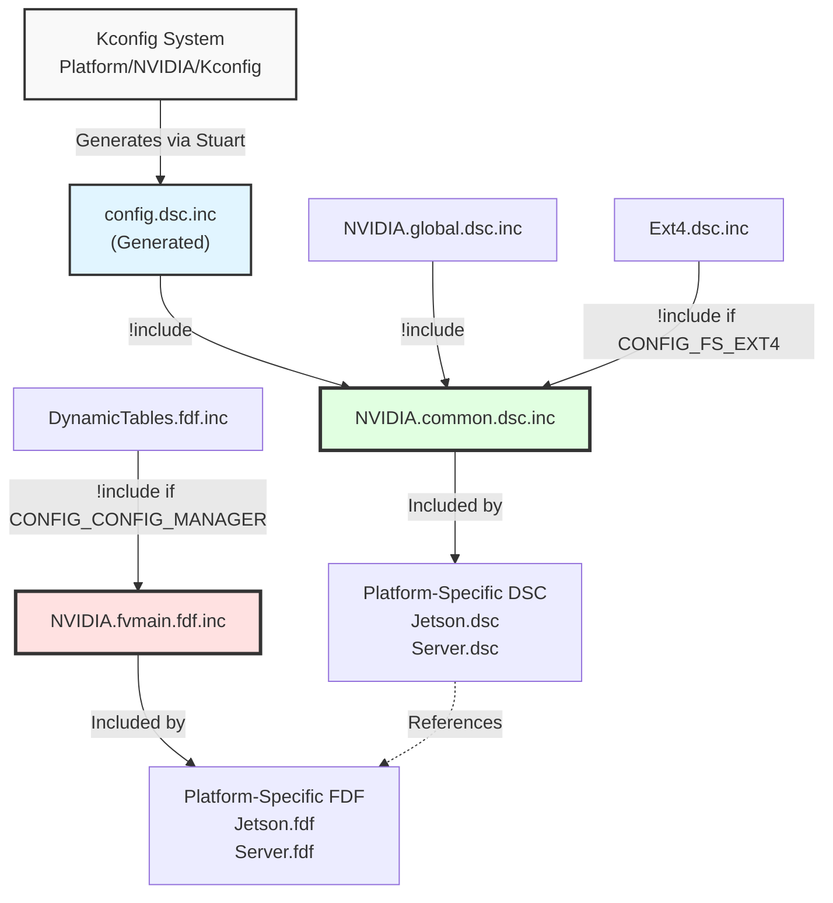
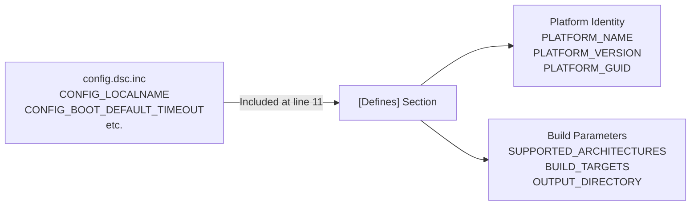
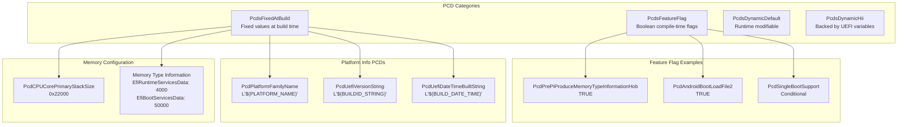
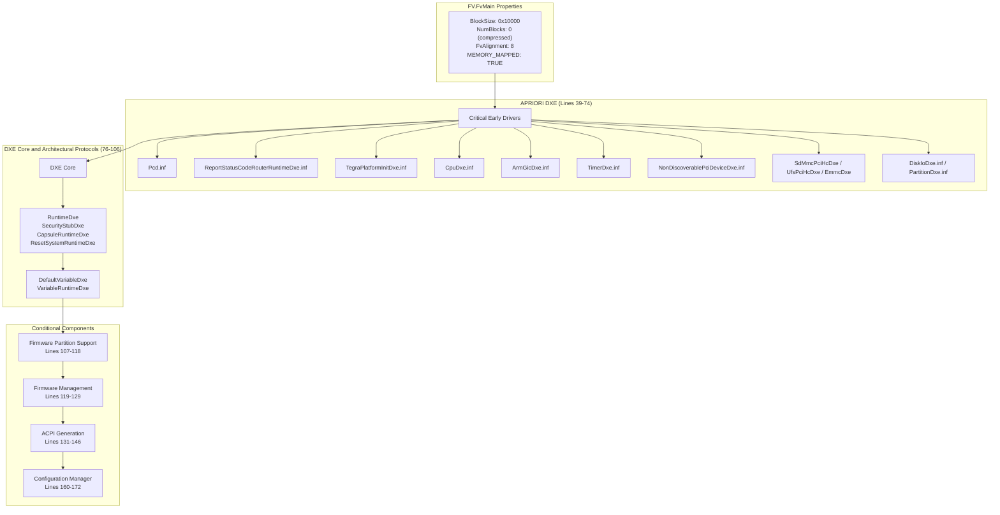
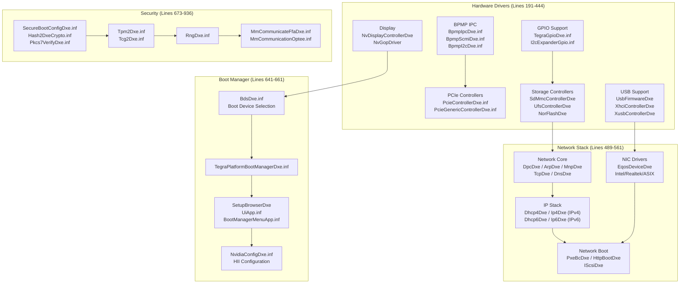
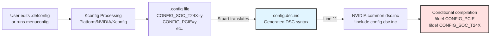
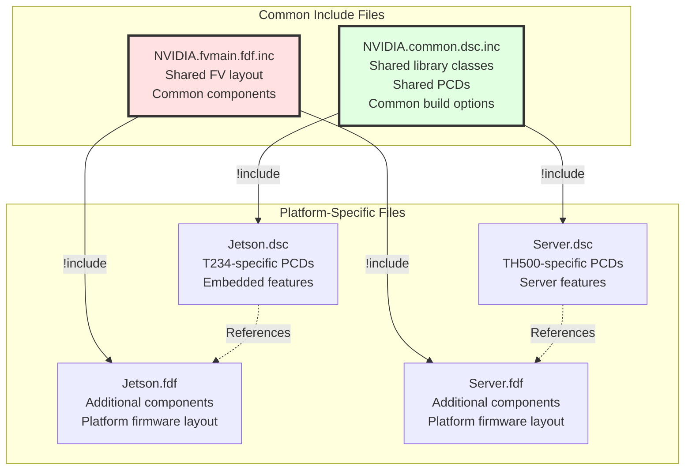
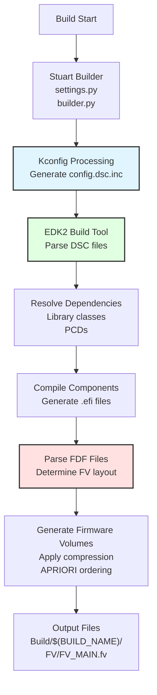

<!-- source: DeepWiki mcp.deepwiki.com · repo NVIDIA/edk2-nvidia · page 2.2 Platform Configuration Files (DSC/FDF) · fetched 2026-10-26 -->

# Platform Configuration Files (DSC/FDF)

<details>
<summary>Relevant source files</summary>

The following files were used as context for generating this wiki page:

- [Platform/NVIDIA/Kconfig](Platform/NVIDIA/Kconfig)
- [Platform/NVIDIA/NVIDIA.common.dsc.inc](Platform/NVIDIA/NVIDIA.common.dsc.inc)
- [Platform/NVIDIA/NVIDIA.fvmain.fdf.inc](Platform/NVIDIA/NVIDIA.fvmain.fdf.inc)

</details>


This document describes the EDK2 Platform Configuration Files used in the NVIDIA UEFI firmware: DSC (Driver Specification) and FDF (Flash Description) files. These files define what components to build and how they are organized into firmware volumes. For information about the Stuart build orchestration that processes these files, see [Stuart Build Orchestration](#2.1). For information about Kconfig configuration that generates platform-specific values, see [Kconfig Configuration System](#2.3).

## Purpose and Scope

DSC and FDF files are core EDK2 build system components that control firmware composition:
- **DSC files** specify which drivers, libraries, and applications to build, along with their library dependencies and Platform Configuration Database (PCD) values
- **FDF files** define the firmware volume layout and determine the order in which DXE drivers are loaded

The NVIDIA implementation uses include files (`NVIDIA.common.dsc.inc` and `NVIDIA.fvmain.fdf.inc`) that are shared across multiple platform-specific DSC/FDF files.

## File Organization and Relationships



**Sources:** [Platform/NVIDIA/NVIDIA.common.dsc.inc:1-11](), [Platform/NVIDIA/NVIDIA.fvmain.fdf.inc:1-987]()

## DSC File Structure: NVIDIA.common.dsc.inc

### [Defines] Section

The `[Defines]` section establishes platform identity and build parameters:



Key definitions at [Platform/NVIDIA/NVIDIA.common.dsc.inc:9-24]():
- `PLATFORM_NAME`: Derived from `BUILD_NAME` plus optional `CONFIG_LOCALNAME`
- `SUPPORTED_ARCHITECTURES`: `AARCH64` only
- `OUTPUT_DIRECTORY`: `Build/$(BUILD_NAME)`

**Sources:** [Platform/NVIDIA/NVIDIA.common.dsc.inc:9-60]()

### [SkuIds] Section - Platform Variants

The SKU system allows conditional component inclusion based on SOC type:

| SKU ID | SKU Name | Parent | SOC Type |
|--------|----------|--------|----------|
| 0 | DEFAULT | - | All platforms |
| 2 | T234 | - | Tegra234 (Jetson) |
| 3 | T234SLT | T234 | Tegra234 SLT variant |
| 4 | T264 | - | Tegra264 |
| 5 | TH500 | - | TH500 Server |
| 253 | TH500Presil | TH500 | Pre-silicon TH500 |
| 254 | T264Presil | T264 | Pre-silicon T264 |
| 255 | T234Presil | T234 | Pre-silicon T234 |

Defined by Kconfig conditionals at [Platform/NVIDIA/NVIDIA.common.dsc.inc:61-79]().

**Sources:** [Platform/NVIDIA/NVIDIA.common.dsc.inc:61-79]()

### [BuildOptions] Section

Build options control compiler and linker flags:

```
[BuildOptions.common.EDKII.DXE_CORE,BuildOptions.common.EDKII.DXE_DRIVER,...]
  GCC:*_*_*_DLINK_FLAGS = -Wl,-z,common-page-size=0x1000

[BuildOptions.common]
  GCC:*_*_*_PLATFORM_FLAGS = -fstack-protector-strong
```

Key security features enabled:
- Stack protection (`-fstack-protector-strong`)
- Page size alignment for DXE modules
- MD5 deprecated interfaces defined

**Sources:** [Platform/NVIDIA/NVIDIA.common.dsc.inc:81-94]()

### [LibraryClasses] Section - Library Dependency Resolution

The library classes section maps abstract library interfaces to concrete implementations. This is organized by module type:

```mermaid
graph TB
    subgraph "Common Libraries (All Module Types)"
        DEBUG["DebugLib<br/>PeiDxeDebugLibReportStatusCode"]
        BASE["BaseLib<br/>BaseMemoryLib<br/>PrintLib"]
        UEFI["UefiLib<br/>UefiBootServicesTableLib<br/>UefiRuntimeServicesTableLib"]
    end
    
    subgraph "ARM Architecture Libraries"
        ARM_ARCH["ArmLib<br/>ArmMmuLib<br/>ArmGenericTimerCounterLib"]
        ARM_CACHE["CacheMaintenanceLib<br/>ArmCacheMaintenanceLib"]
        ARM_EXCEPT["CpuExceptionHandlerLib<br/>ArmExceptionLib"]
    end
    
    subgraph "NVIDIA Platform Libraries"
        PLAT_RES["PlatformResourceLib<br/>T23xPlatformResourceLib<br/>T24xPlatformResourceLib<br/>T26xPlatformResourceLib"]
        TEGRA["TegraPlatformInfoLib<br/>SystemResourceLib<br/>BootChainInfoLib"]
        DTB["DtPlatformDtbLoaderLib<br/>DeviceTreeHelperLib<br/>TegraDeviceTreeOverlayLib"]
    end
    
    subgraph "Module Type Specific"
        SEC["SEC<br/>PrePiLib<br/>PrePiHobLib"]
        DXE_CORE["DXE_CORE<br/>DxeCoreMemoryAllocationLib"]
        DXE_DRIVER["DXE_DRIVER<br/>SecurityManagementLib"]
        RUNTIME["DXE_RUNTIME_DRIVER<br/>RuntimeCryptLib<br/>VariablePolicyLib"]
    end
    
    COMMON["[LibraryClasses.common]<br/>Lines 104-516"] --> DEBUG
    COMMON --> BASE
    COMMON --> UEFI
    COMMON --> ARM_ARCH
    COMMON --> ARM_CACHE
    COMMON --> ARM_EXCEPT
    COMMON --> PLAT_RES
    COMMON --> TEGRA
    COMMON --> DTB
    
    TYPE_SPECIFIC["Type-Specific Classes"] --> SEC
    TYPE_SPECIFIC --> DXE_CORE
    TYPE_SPECIFIC --> DXE_DRIVER
    TYPE_SPECIFIC --> RUNTIME
```



**SOC-Specific Library Resolution**

Platform resource libraries are conditionally selected based on SOC type at [Platform/NVIDIA/NVIDIA.common.dsc.inc:258-266]():

```
!ifdef CONFIG_SOC_T23X
  PlatformResourceLib|Silicon/NVIDIA/Library/PlatformResourceLib/T23xPlatformResourceLib.inf
!endif
!ifdef CONFIG_SOC_T24X
  PlatformResourceLib|Silicon/NVIDIA/Library/PlatformResourceLib/T24xPlatformResourceLib.inf
!endif
!ifdef CONFIG_SOC_T26X
  PlatformResourceLib|Silicon/NVIDIA/Library/PlatformResourceLib/T26xPlatformResourceLib.inf
!endif
```

**Sources:** [Platform/NVIDIA/NVIDIA.common.dsc.inc:104-654]()

### [PcdsFeatureFlag] and [PcdsFixedAtBuild] - Platform Configuration Database

PCDs provide compile-time and runtime configuration values:



**Critical PCDs for Platform Initialization:**

At [Platform/NVIDIA/NVIDIA.common.dsc.inc:666-894]():
- `PcdPrePiProduceMemoryTypeInformationHob|TRUE`: Enables memory type optimization
- `PcdCpuStackGuard|TRUE`: Stack overflow protection
- `PcdImageProtectionPolicy|0x3`: Strict image memory protections
- `PcdDxeNxMemoryProtectionPolicy|0xC000000000007FD1`: NX memory protection for non-code regions

**Kconfig-Derived PCDs:**

The document shows extensive use of conditional compilation based on Kconfig symbols:

```
!ifdef CONFIG_BOOT_ANDROID_IMAGE
  gNVIDIATokenSpaceGuid.PcdBootAndroidImage|TRUE
!endif

!ifdef CONFIG_FIRMWARE_MANAGEMENT
  gFmpDevicePkgTokenSpaceGuid.PcdFmpDeviceImageIdName|L"NVIDIA System Firmware"
!endif
```

**Sources:** [Platform/NVIDIA/NVIDIA.common.dsc.inc:666-1343]()

### Dynamic PCDs and UEFI Variables

The `[PcdsDynamicHii]` section at [Platform/NVIDIA/NVIDIA.common.dsc.inc:1236-1334]() maps PCDs to UEFI variables for runtime modification:

| PCD | Variable Name | GUID | Default | Attributes |
|-----|---------------|------|---------|------------|
| `PcdPlatformBootTimeOut` | `Timeout` | `gEfiGlobalVariableGuid` | `CONFIG_BOOT_DEFAULT_TIMEOUT` | Global |
| `PcdPcieResourceConfigNeeded` | `PCIeResourceConfig` | `gNVIDIATokenSpaceGuid` | 0 | BS |
| `PcdQuickBootEnabled` | `QuickBootEnabled` | `gNVIDIAPublicVariableGuid` | 0/1 | BS,NV |
| `PcdUefiShellEnabled` | `UefiShellEnabled` | `gNVIDIAPublicVariableGuid` | 0x01 | BS,NV |

**Sources:** [Platform/NVIDIA/NVIDIA.common.dsc.inc:1236-1334]()

## FDF File Structure: NVIDIA.fvmain.fdf.inc

### Firmware Volume Definition

The main firmware volume `[FV.FvMain]` is defined at [Platform/NVIDIA/NVIDIA.fvmain.fdf.inc:18-987]():



**Sources:** [Platform/NVIDIA/NVIDIA.fvmain.fdf.inc:18-172]()

### APRIORI DXE - Driver Load Ordering

The `APRIORI DXE` section at [Platform/NVIDIA/NVIDIA.fvmain.fdf.inc:39-74]() specifies drivers that must load before general DXE dispatch:

1. **Core Services**: PCD, ReportStatusCode
2. **Platform Initialization**: `TegraPlatformInitDxe.inf` - critical for SOC-specific setup
3. **CPU/Interrupt**: `CpuDxe.inf`, `ArmGicDxe.inf`, `TimerDxe.inf`
4. **Storage Stack**: Required for variable access from storage
   - `NonDiscoverablePciDeviceDxe.inf`
   - Storage controllers (SDHCI, UFS)
   - Disk I/O and partitioning

**Sources:** [Platform/NVIDIA/NVIDIA.fvmain.fdf.inc:39-74]()

### Component Organization by Function



**Sources:** [Platform/NVIDIA/NVIDIA.fvmain.fdf.inc:191-936]()

### Conditional Component Inclusion

Components are conditionally included based on Kconfig symbols. Key examples:

**Firmware Management** at [Platform/NVIDIA/NVIDIA.fvmain.fdf.inc:119-129]():
```
!ifdef CONFIG_FIRMWARE_MANAGEMENT
  INF MdeModulePkg/Universal/EsrtFmpDxe/EsrtFmpDxe.inf
  INF FILE_GUID = $(FMP_SYSTEM_IMAGE_TYPE_ID) FmpDevicePkg/FmpDxe/FmpDxe.inf
!endif
```

**ACPI Support** at [Platform/NVIDIA/NVIDIA.fvmain.fdf.inc:131-146]():
```
!ifdef CONFIG_ACPI
  INF Silicon/NVIDIA/Drivers/AmlGenerationDxe/AmlGenerationDxe.inf
  INF Silicon/NVIDIA/Drivers/AmlPatchDxe/AmlPatchDxe.inf
  INF MdeModulePkg/Universal/Acpi/AcpiTableDxe/AcpiTableDxe.inf
!endif
```

**Configuration Manager** at [Platform/NVIDIA/NVIDIA.fvmain.fdf.inc:160-172]():
```
!ifdef CONFIG_CONFIG_MANAGER
  INF Silicon/NVIDIA/Drivers/ConfigurationManagerTokenDxe/ConfigurationManagerTokenDxe.inf
  INF Silicon/NVIDIA/Drivers/ConfigurationManagerData/ConfigurationManagerDataDxe.inf
  INF Silicon/NVIDIA/Drivers/ConfigurationManager/ConfigurationManagerDxe.inf
  !include DynamicTablesPkg/DynamicTables.fdf.inc
!endif
```

**PCIe Support** at [Platform/NVIDIA/NVIDIA.fvmain.fdf.inc:332-344]():
```
!ifdef CONFIG_PCIE
  INF MdeModulePkg/Bus/Pci/PciBusDxe/PciBusDxe.inf
  INF MdeModulePkg/Bus/Pci/PciHostBridgeDxe/PciHostBridgeDxe.inf
!endif
!ifdef CONFIG_DESIGNWARE_PCIE
  INF Silicon/NVIDIA/Drivers/PcieDWControllerDxe/PcieControllerDxe.inf
!endif
!ifdef CONFIG_NVIDIA_PCIE
  INF Silicon/NVIDIA/Drivers/PcieControllerDxe/PcieControllerDxe.inf
!endif
```

**Sources:** [Platform/NVIDIA/NVIDIA.fvmain.fdf.inc:119-444]()

## Kconfig Integration

The build system integrates Kconfig configuration through `config.dsc.inc`:



**Example Kconfig-to-DSC Flow:**

1. User sets `CONFIG_PCIE=y` in defconfig
2. Kconfig generates `CONFIG_PCIE=y` in `.config`
3. Stuart translates to `config.dsc.inc`
4. DSC includes at [Platform/NVIDIA/NVIDIA.common.dsc.inc:11]()
5. Conditional sections activate:
   ```
   !ifdef CONFIG_PCIE
     PciHostBridgeLib|Silicon/NVIDIA/Library/PciHostBridgeLib/PciHostBridgeLib.inf
   !endif
   ```

**SOC Selection Example:**

From [Platform/NVIDIA/Kconfig:93-102]():
```
choice
  prompt "SOC Support"
  
  config SOC_NONE
    bool "None - no hardware dependent features supported"
  
  # Include Kconfig files for different SOC families
  orsource "KconfigIncludes/Soc*.conf"
endchoice
```

This drives library selection at [Platform/NVIDIA/NVIDIA.common.dsc.inc:258-266]():
```
!ifdef CONFIG_SOC_T23X
  PlatformResourceLib|Silicon/NVIDIA/Library/PlatformResourceLib/T23xPlatformResourceLib.inf
!endif
!ifdef CONFIG_SOC_T24X
  PlatformResourceLib|Silicon/NVIDIA/Library/PlatformResourceLib/T24xPlatformResourceLib.inf
!endif
```

**Sources:** [Platform/NVIDIA/NVIDIA.common.dsc.inc:11](), [Platform/NVIDIA/Kconfig:93-102]()

## Platform-Specific DSC/FDF Files

While `NVIDIA.common.dsc.inc` and `NVIDIA.fvmain.fdf.inc` provide shared definitions, platform-specific files extend them:



Platform-specific files can:
- Override PCD values
- Add platform-specific components
- Define additional firmware volumes
- Customize library class mappings

**Sources:** [Platform/NVIDIA/NVIDIA.common.dsc.inc:7]()

## Build System Processing Flow



**Processing Steps:**

1. **Stuart Orchestration**: Invokes Kconfig to generate `config.dsc.inc`
2. **DSC Parsing**: EDK2 build tool parses `NVIDIA.common.dsc.inc` and platform-specific DSC
3. **Dependency Resolution**: Resolves library dependencies and PCD values
4. **Component Compilation**: Builds all INF files specified in DSC
5. **FDF Processing**: Parses `NVIDIA.fvmain.fdf.inc` and platform FDF
6. **Firmware Volume Generation**: Creates compressed firmware volumes with components in specified order

**Sources:** [Platform/NVIDIA/NVIDIA.common.dsc.inc:1-1343](), [Platform/NVIDIA/NVIDIA.fvmain.fdf.inc:1-987]()

## Key Component Categories in FDF

### Storage and File System Components

Located at [Platform/NVIDIA/NVIDIA.fvmain.fdf.inc:252-267]():

```
INF MdeModulePkg/Universal/Disk/DiskIoDxe/DiskIoDxe.inf
INF MdeModulePkg/Universal/Disk/PartitionDxe/PartitionDxe.inf
INF MdeModulePkg/Universal/Disk/UnicodeCollation/EnglishDxe/EnglishDxe.inf

!ifdef CONFIG_FS_FAT
  INF FatPkg/EnhancedFatDxe/Fat.inf
!endif
!ifdef CONFIG_FS_EXT4
  !include Features/Ext4Pkg/Ext4.fdf.inc
!endif
```

### Network Stack Components

Located at [Platform/NVIDIA/NVIDIA.fvmain.fdf.inc:489-524]():

```
!ifdef CONFIG_NETWORKING
  INF NetworkPkg/DpcDxe/DpcDxe.inf
  INF NetworkPkg/ArpDxe/ArpDxe.inf
  INF NetworkPkg/MnpDxe/MnpDxe.inf
  INF NetworkPkg/TcpDxe/TcpDxe.inf
  !ifdef CONFIG_NETWORKING_HTTP
    INF NetworkPkg/HttpBootDxe/HttpBootDxe.inf
  !endif
!endif
```

### Platform-Specific Drivers

TH500 server components at [Platform/NVIDIA/NVIDIA.fvmain.fdf.inc:461-472]():

```
!ifdef CONFIG_SOC_T24X
  INF Silicon/NVIDIA/Server/TH500/Drivers/TH500GpuDxe/TH500GpuDxe.inf
!endif

!ifdef CONFIG_SOC_DATACENTER
  INF Silicon/NVIDIA/Drivers/FpgaI2c/FpgaI2c.inf
!endif
```

**Sources:** [Platform/NVIDIA/NVIDIA.fvmain.fdf.inc:252-472]()

## Summary

The DSC and FDF file system provides flexible, platform-configurable firmware composition:

- **DSC files** define what to build: components, libraries, and configuration values
- **FDF files** define how to organize components into firmware volumes
- **Kconfig integration** allows user-configurable builds through `config.dsc.inc`
- **APRIORI DXE** ensures critical drivers load in correct order
- **Conditional compilation** supports multiple SOC families and feature sets from a single codebase

The system balances common infrastructure in `NVIDIA.common.dsc.inc` and `NVIDIA.fvmain.fdf.inc` with platform-specific customization in per-platform DSC/FDF files.

**Sources:** [Platform/NVIDIA/NVIDIA.common.dsc.inc:1-1343](), [Platform/NVIDIA/NVIDIA.fvmain.fdf.inc:1-987](), [Platform/NVIDIA/Kconfig:1-1555]()

---

