<!-- source: DeepWiki mcp.deepwiki.com · repo NVIDIA/edk2-nvidia · page 2.3 Kconfig Configuration System · fetched 2026-10-26 -->

# Kconfig Configuration System

<details>
<summary>Relevant source files</summary>

The following files were used as context for generating this wiki page:

- [Platform/NVIDIA/Kconfig](Platform/NVIDIA/Kconfig)
- [Platform/NVIDIA/NVIDIA.common.dsc.inc](Platform/NVIDIA/NVIDIA.common.dsc.inc)
- [Platform/NVIDIA/NVIDIA.fvmain.fdf.inc](Platform/NVIDIA/NVIDIA.fvmain.fdf.inc)

</details>


## Purpose and Scope

The Kconfig Configuration System provides flexible, build-time customization of NVIDIA UEFI firmware images. It enables platform-specific feature selection, hardware support configuration, and build variant management through a hierarchical menu-driven interface. This system bridges user-friendly configuration options with the EDK2 build infrastructure.

For information about the Stuart build orchestration layer that processes Kconfig, see [Stuart Build Orchestration](#2.1). For details on how generated configuration is consumed by platform files, see [Platform Configuration Files (DSC/FDF)](#2.2).

## System Overview

The Kconfig system serves as a front-end configuration layer that translates user choices into EDK2-compatible build directives. It generates a `config.dsc.inc` file containing preprocessor symbols (`CONFIG_*`) that control conditional compilation throughout DSC and FDF files.

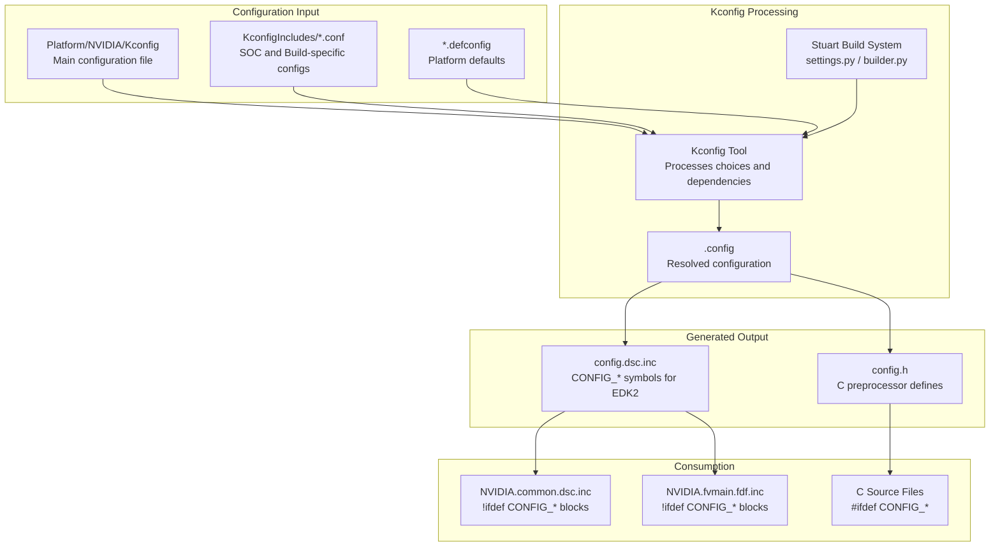

Sources: [Platform/NVIDIA/Kconfig:1-1555](), [Platform/NVIDIA/NVIDIA.common.dsc.inc:1-1343]()

## Configuration File Structure

### Main Kconfig File

The primary configuration file is `Platform/NVIDIA/Kconfig`, which defines the top-level structure:

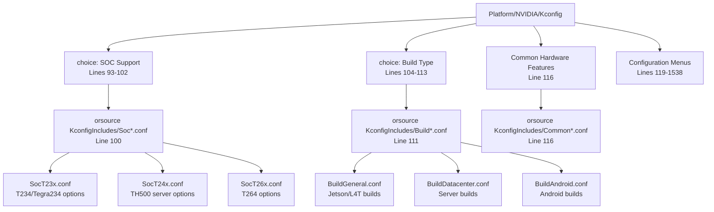

Sources: [Platform/NVIDIA/Kconfig:93-116]()

### Configuration Categories

The main Kconfig file organizes configuration into hierarchical menus:

| Menu | Purpose | Key Options | Line Range |
|------|---------|-------------|------------|
| General | Platform identification | `LOCALNAME`, `PLATFORM_GUID` | 121-134 |
| Security options | TPM, Secure Boot, MM, RNG | `SECURITY_TPM_*`, `SECURITY_UEFI_SECURE_BOOT`, `SECURITY_MM_*` | 136-269 |
| Variable options | UEFI variable storage | `VARIABLE_EMULATED`, `VARIABLE_NON_SECURE_SUPPORTED` | 271-289 |
| Hardware support | PCIe, USB, storage, networking | `PCIE`, `USB`, `EMMC`, `NETWORKING` | 291-799 |
| OS Hardware description | ACPI, DeviceTree, SMBIOS | `ACPI`, `DEVICETREE`, `SMBIOS` | 801-851 |
| Boot Options | Boot modes and timeout | `RCM_BOOT`, `BOOT_QUICK_BOOT`, `SINGLE_BOOT_*` | 853-1015 |
| Debug Options | Print levels, memory test | `DEBUG_DYNAMIC_PRINT_LEVEL`, `MEMORY_TEST` | 1017-1167 |
| Firmware Management | Capsule update configuration | `FIRMWARE_MANAGEMENT_*`, `FIRMWARE_CAPSULE_SUPPORTED` | 1169-1292 |
| Networking Options | Protocol and device support | `NETWORKING_HTTP`, `NETWORKING_IPV4`, `NETWORKING_DEVICE_*` | 1330-1400 |

Sources: [Platform/NVIDIA/Kconfig:119-1538]()

## Symbol Types and Naming Conventions

The Kconfig system distinguishes between user-visible symbols (saveable in defconfig) and internal helper symbols (not saveable):

### User Symbols (Saveable in Defconfig)

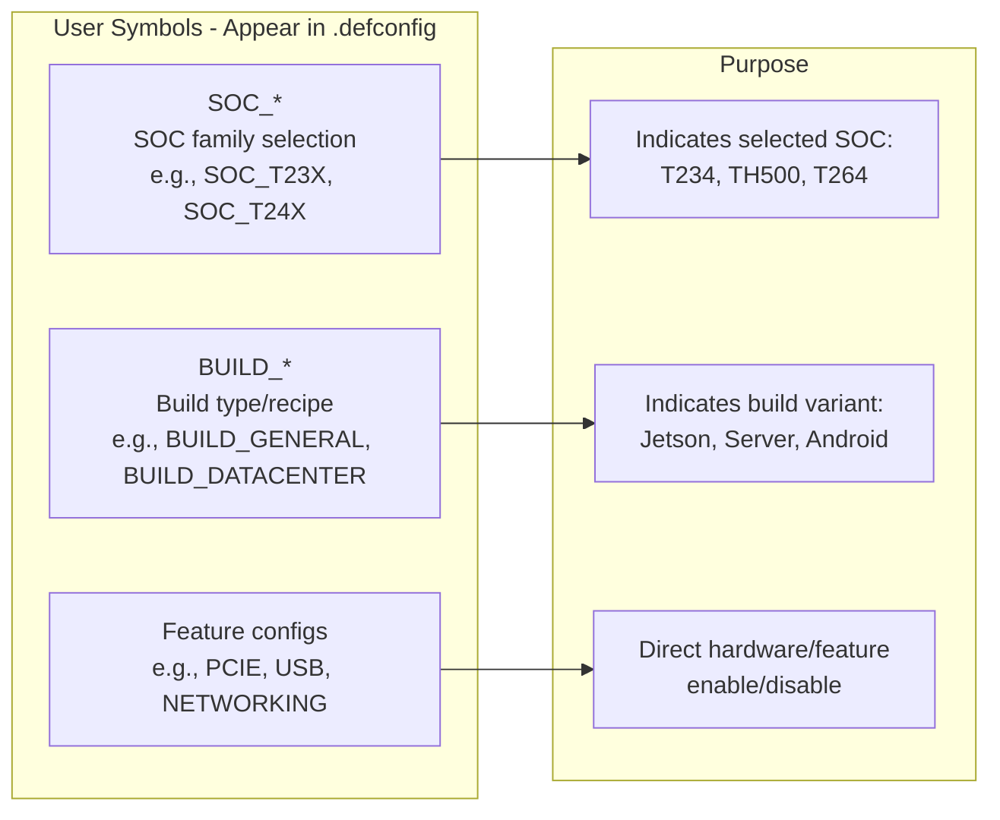

Sources: [Platform/NVIDIA/Kconfig:11-92]()

### Helper Symbols (Internal Only)

The Kconfig file defines several categories of helper symbols that should NOT appear in defconfig files:

| Prefix | Purpose | Example | Description |
|--------|---------|---------|-------------|
| `SUPPORTS_*` | HW capability indicator | `SUPPORTS_DESIGNWARE_PCIE` | Indicates SOC has hardware feature |
| `NEED_*` | Dependency tracker | `NEED_USB`, `NEED_NETWORKING` | Indicates another config needs this |
| `DEFAULT_*` | Choice defaults | `DEFAULT_SECURITY_TPM_DISCRETE` | Sets default for choice statements |
| `SELECT_ALL_*` | Bulk enablement | `SELECT_ALL_USB_DEVICES` | Enables all sub-features |
| `USE_*` | Numeric defaults | `USE_40_PERCENT_LOGO_SCALING` | Selects specific numeric value |

Sources: [Platform/NVIDIA/Kconfig:75-91]()

### Symbol Relationship Example

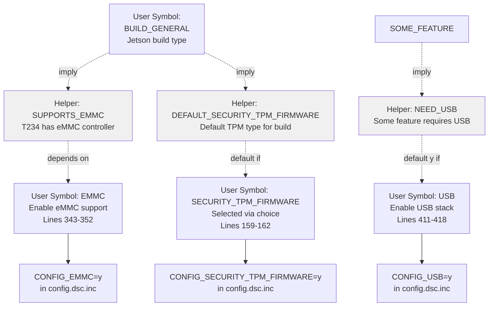

Sources: [Platform/NVIDIA/Kconfig:343-352,411-418]()

## Dependency Management Mechanisms

Kconfig provides several mechanisms for managing dependencies between configuration options:

### Dependency Directives

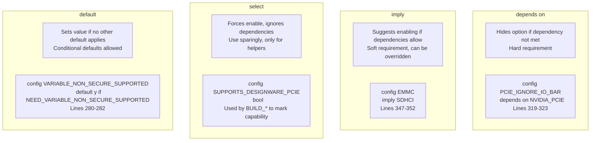

Sources: [Platform/NVIDIA/Kconfig:19-46]()

### Dependency Pattern: Feature Requirements

A common pattern uses `NEED_*` helper symbols to track dependencies:

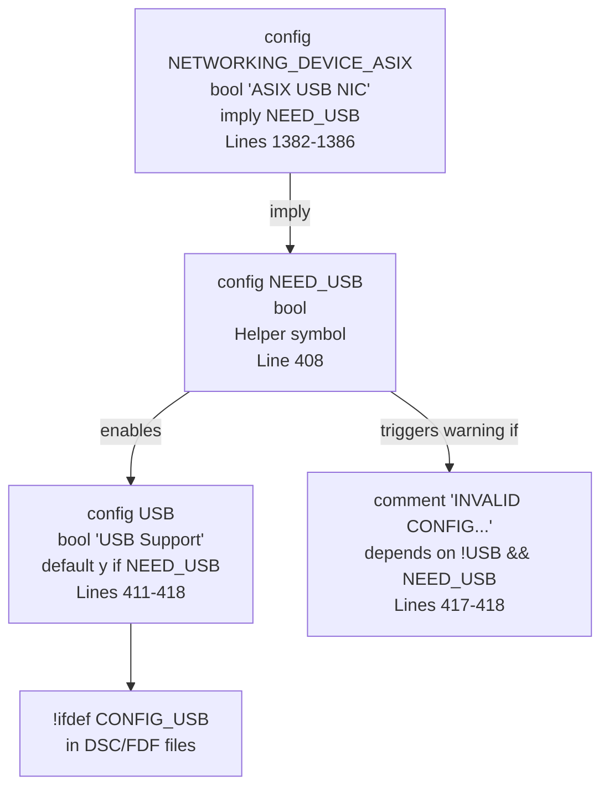

This pattern allows:
1. Feature A implies it needs USB (`imply NEED_USB`)
2. USB defaults to enabled if needed (`default y if NEED_USB`)
3. Warning appears if USB disabled but needed (`comment` with dependency)

Sources: [Platform/NVIDIA/Kconfig:408-418,1382-1386]()

### Choice Statement Defaults

Choice statements cannot be directly implied/selected, so a helper pattern is used:

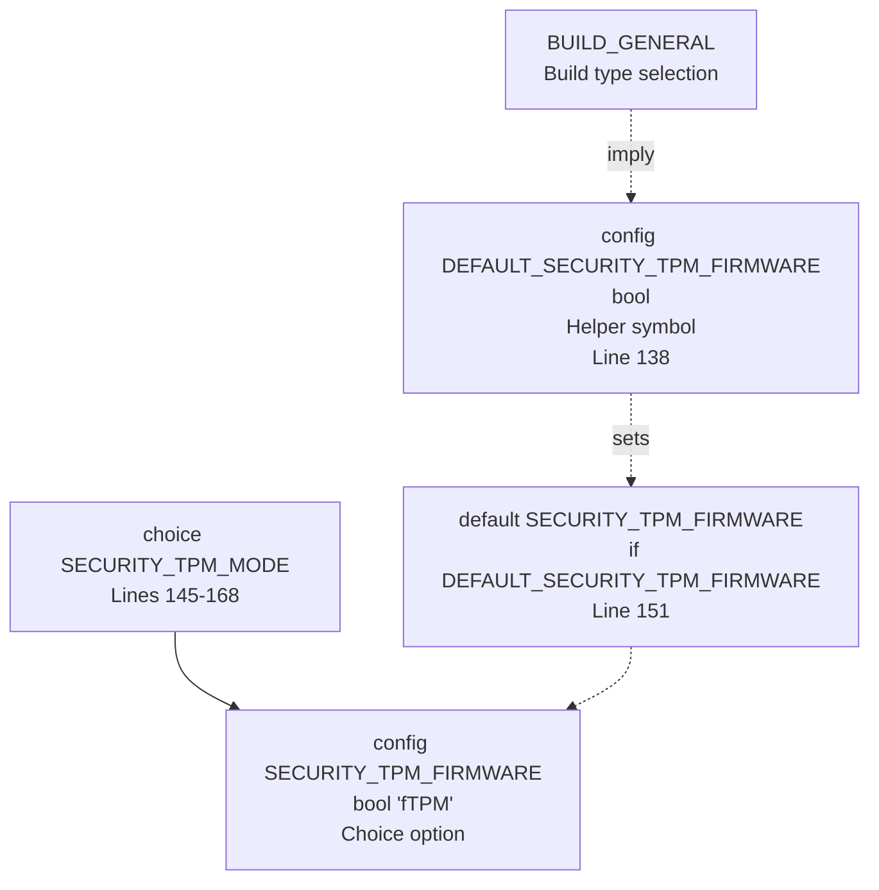

Sources: [Platform/NVIDIA/Kconfig:138-168]()

## Build Integration

### Generation of config.dsc.inc

The Stuart build system processes Kconfig and generates `config.dsc.inc`, which is included by the main DSC file:

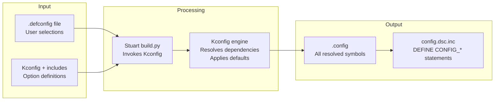

Sources: Based on system design from Diagram 1 overview

### Consumption in DSC Files

The generated `config.dsc.inc` is included at the start of `NVIDIA.common.dsc.inc`:

**Include statement:**
```
!include config.dsc.inc
```
[Platform/NVIDIA/NVIDIA.common.dsc.inc:11]()

**Default value handling for undefined symbols:**
```
!ifndef CONFIG_BOOT_DEFAULT_TIMEOUT
CONFIG_BOOT_DEFAULT_TIMEOUT=0
!endif
```
[Platform/NVIDIA/NVIDIA.common.dsc.inc:26-28]()

**Conditional sections based on Kconfig:**

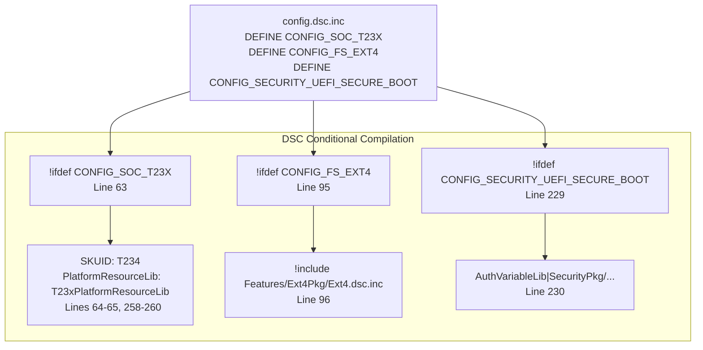

Sources: [Platform/NVIDIA/NVIDIA.common.dsc.inc:63-65,95-96,229-233,258-266]()

### Consumption in FDF Files

Firmware volume definitions use CONFIG symbols to conditionally include drivers:

**APRIORI DXE ordering:**
```
APRIORI DXE {
  !ifdef CONFIG_SDHCI
    INF MdeModulePkg/Bus/Pci/SdMmcPciHcDxe/SdMmcPciHcDxe.inf
  !endif
  !ifdef CONFIG_UFS
    INF MdeModulePkg/Bus/Pci/UfsPciHcDxe/UfsPciHcDxe.inf
  !endif
}
```
[Platform/NVIDIA/NVIDIA.fvmain.fdf.inc:48-53]()

**Driver inclusion:**
```
!ifdef CONFIG_PCIE
  INF MdeModulePkg/Bus/Pci/PciBusDxe/PciBusDxe.inf
  INF MdeModulePkg/Bus/Pci/PciHostBridgeDxe/PciHostBridgeDxe.inf
!endif
```
[Platform/NVIDIA/NVIDIA.fvmain.fdf.inc:332-335]()

Sources: [Platform/NVIDIA/NVIDIA.fvmain.fdf.inc:39-74,332-344]()

## SOC and Build Type Selection

The Kconfig system uses two primary choice statements to define the build configuration:

### SOC Selection

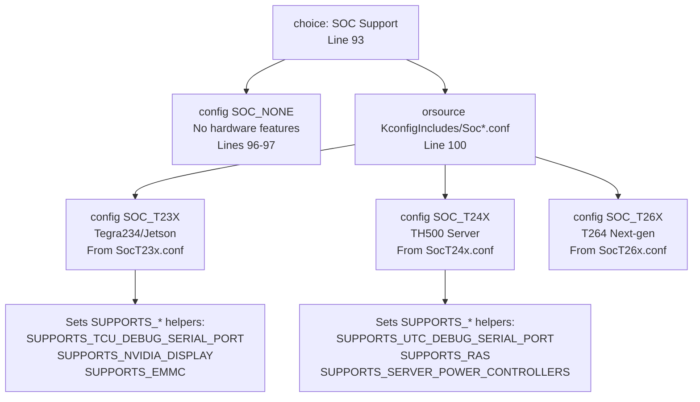

Each SOC configuration file defines hardware capabilities through `SUPPORTS_*` helper symbols that gate hardware-specific features.

Sources: [Platform/NVIDIA/Kconfig:93-102]()

### Build Type Selection

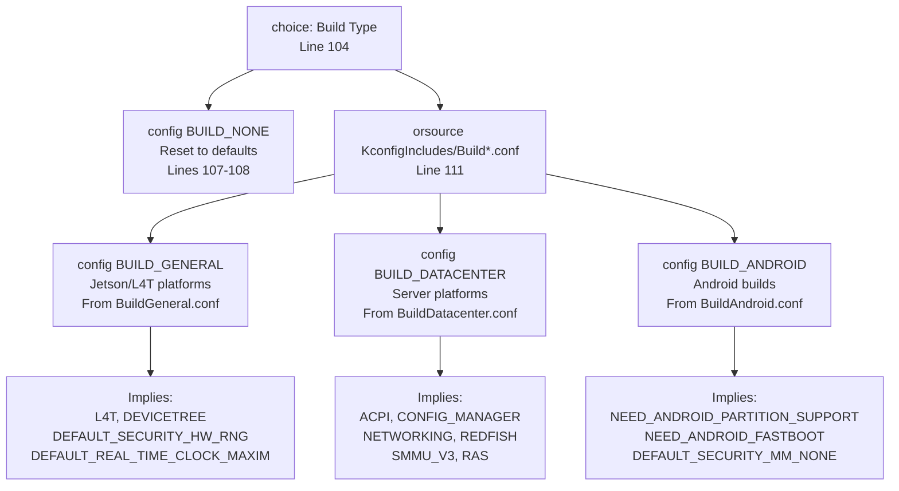

Build type configurations set platform-specific defaults and feature sets appropriate for the target use case.

Sources: [Platform/NVIDIA/Kconfig:104-113]()

## Configuration Workflow

### Interactive Configuration

Users can configure builds using menuconfig-style interface:

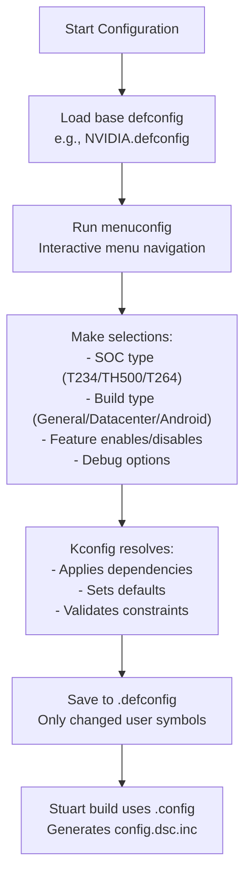

### Defconfig File Management

Platform-specific defconfig files store minimal configuration (only non-default values):

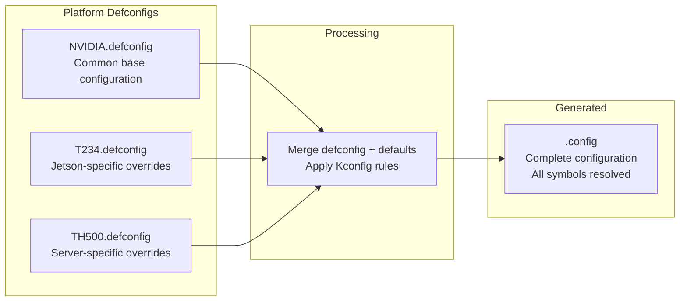

Sources: Inferred from system design

## Example: Hardware Feature Configuration

This example demonstrates how a hardware feature flows through the Kconfig system:

### PCIe Support Configuration

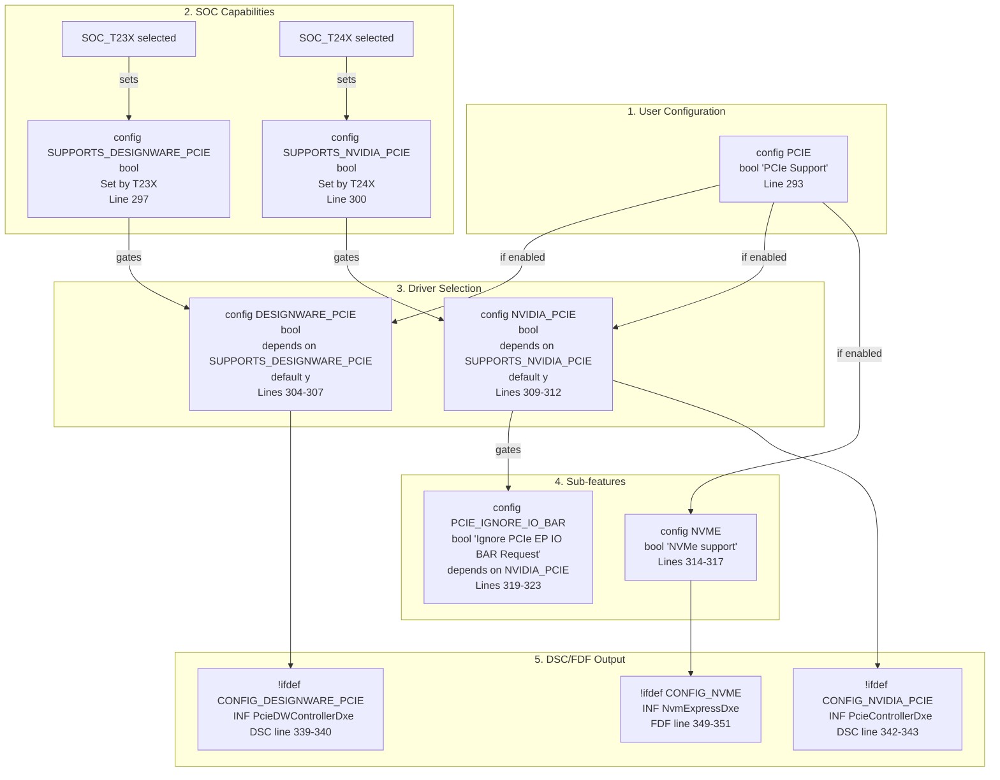

**Configuration symbols generated:**
- If `PCIE=y` and `SOC_T23X=y`: `CONFIG_PCIE=y`, `CONFIG_DESIGNWARE_PCIE=y`
- If `PCIE=y` and `SOC_T24X=y`: `CONFIG_PCIE=y`, `CONFIG_NVIDIA_PCIE=y`
- If `NVME=y`: `CONFIG_NVME=y`

**DSC/FDF conditional compilation:**
- `CONFIG_DESIGNWARE_PCIE` includes `PcieDWControllerDxe`
- `CONFIG_NVIDIA_PCIE` includes `PcieControllerDxe`
- `CONFIG_NVME` includes `NvmExpressDxe` in firmware volume

Sources: [Platform/NVIDIA/Kconfig:291-324](), [Platform/NVIDIA/NVIDIA.fvmain.fdf.inc:332-351]()

## Advanced Features

### Comment Warnings for Invalid Configurations

Kconfig can display warnings when configurations are invalid:

```
config NEED_USB
bool

config USB
bool "USB Support"
default y if NEED_USB

comment "INVALID CONFIG - a selected config requires USB, but USB has been disabled"
depends on !USB && NEED_USB
```

The comment appears in menuconfig when USB is disabled but something requires it (`NEED_USB` is set).

Sources: [Platform/NVIDIA/Kconfig:408-418]()

### Numeric Configuration

Integer and hex values can be configured with ranges:

```
config LOGO_SCALED_SCREEN_RATIO
int "Logo Screen Ratio"
depends on LOGO
range 0 1000
default 1000 if USE_FULL_SCREEN_LOGO_SCALING
default 400 if USE_40_PERCENT_LOGO_SCALING
default 0 if USE_NO_LOGO_SCALING
default 400
```

This is consumed in DSC as:
```
gNVIDIATokenSpaceGuid.PcdLogoScreenRatio|$(CONFIG_LOGO_SCALED_SCREEN_RATIO)
```

Sources: [Platform/NVIDIA/Kconfig:573-582](), [Platform/NVIDIA/NVIDIA.common.dsc.inc:923]()

### String Configuration

String options for GUIDs and file paths:

```
config FMP_SYSTEM_IMAGE_TYPE_ID
string "Platform ESRT System FW GUID"
help
  System FW GUID for ESRT table and capsules.
  Must be unique for each platform.
```

Consumed as:
```
!ifdef CONFIG_FIRMWARE_MANAGEMENT
  DEFINE FMP_SYSTEM_IMAGE_TYPE_ID = $(CONFIG_FMP_SYSTEM_IMAGE_TYPE_ID)
!endif
```

Sources: [Platform/NVIDIA/Kconfig:1235-1239](), [Platform/NVIDIA/NVIDIA.common.dsc.inc:57-59]()

## Best Practices Summary

Based on the extensive guidance in the Kconfig file header:

1. **Use `imply` instead of `select`** for user symbols to respect dependencies
2. **Use helper symbols** (`SUPPORTS_*`, `NEED_*`, `DEFAULT_*`) to manage complex logic
3. **Avoid `menuconfig`** as it blocks access to implying/selecting sub-options
4. **Use `depends on` sparingly** as it hides options; prefer `imply` with validation comments
5. **For choice defaults**, create `DEFAULT_*` helper symbols and imply them
6. **Document invalid configurations** with comment warnings
7. **Only put user symbols in defconfig** files; helper symbols are ignored

Sources: [Platform/NVIDIA/Kconfig:11-92]()

---

