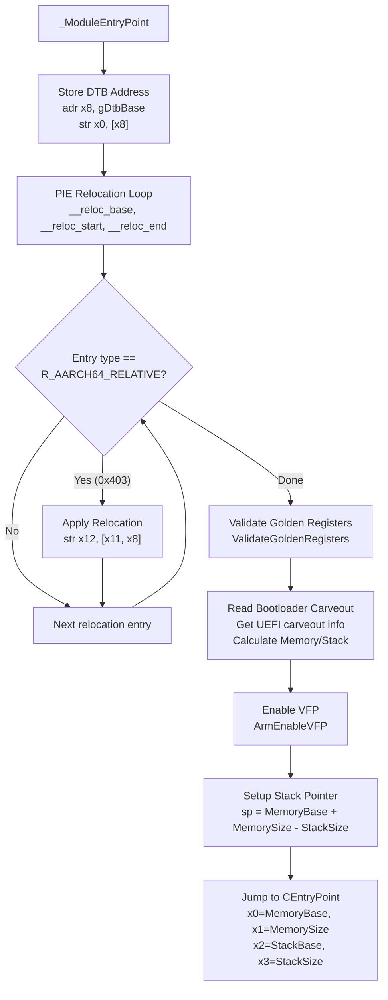
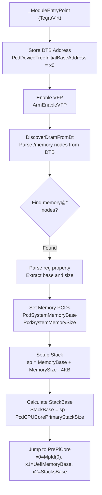
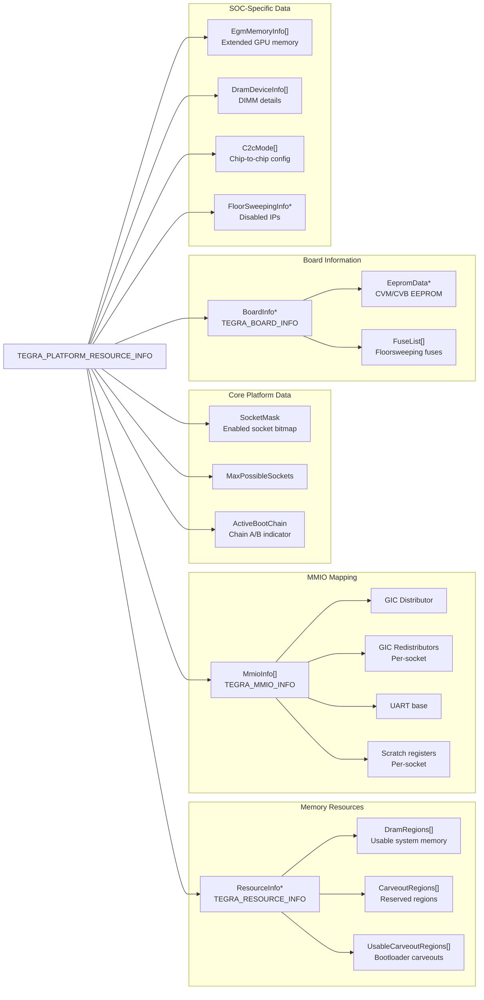
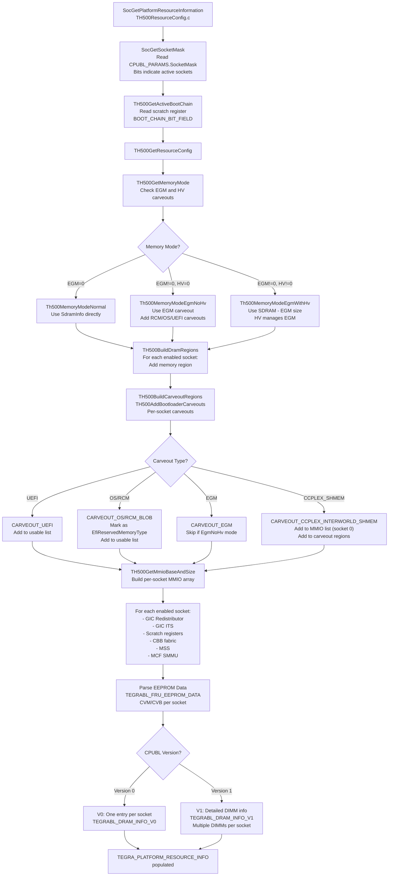
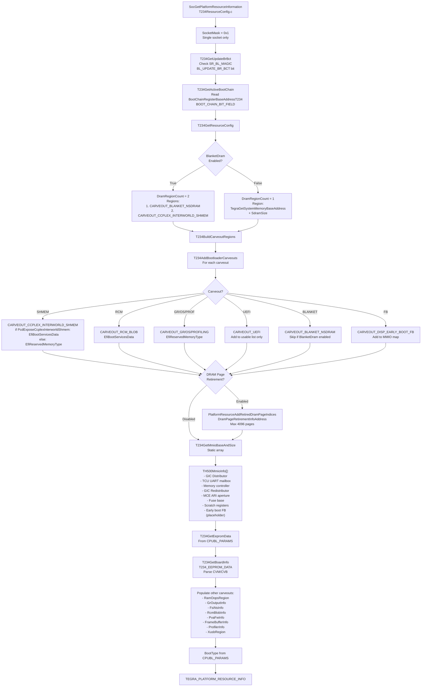
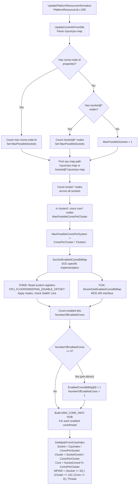

<!-- source: DeepWiki mcp.deepwiki.com · repo NVIDIA/edk2-nvidia · page 3 Firmware Initialization Phases · fetched 2026-10-26 -->

# Firmware Initialization Phases

<details>
<summary>Relevant source files</summary>

The following files were used as context for generating this wiki page:

- [Platform/NVIDIA/NVIDIA.common.fdf](Platform/NVIDIA/NVIDIA.common.fdf)
- [Platform/NVIDIA/NVIDIA.common.fdf.inc](Platform/NVIDIA/NVIDIA.common.fdf.inc)
- [Platform/NVIDIA/TegraVirt/TegraVirt.dsc](Platform/NVIDIA/TegraVirt/TegraVirt.dsc)
- [Platform/NVIDIA/TegraVirt/TegraVirt.fdf](Platform/NVIDIA/TegraVirt/TegraVirt.fdf)
- [Silicon/NVIDIA/Drivers/ConfigurationManagerData/MpamParser/MpamParser.c](Silicon/NVIDIA/Drivers/ConfigurationManagerData/MpamParser/MpamParser.c)
- [Silicon/NVIDIA/Drivers/DefaultVariableDxe/DefaultVariableDxe.c](Silicon/NVIDIA/Drivers/DefaultVariableDxe/DefaultVariableDxe.c)
- [Silicon/NVIDIA/Drivers/DefaultVariableDxe/DefaultVariableDxe.inf](Silicon/NVIDIA/Drivers/DefaultVariableDxe/DefaultVariableDxe.inf)
- [Silicon/NVIDIA/Drivers/FvbDxe/FvbDxe.inf](Silicon/NVIDIA/Drivers/FvbDxe/FvbDxe.inf)
- [Silicon/NVIDIA/Drivers/TegraPlatformInit/TegraPlatformInitDxe.c](Silicon/NVIDIA/Drivers/TegraPlatformInit/TegraPlatformInitDxe.c)
- [Silicon/NVIDIA/Drivers/TegraPlatformInit/TegraPlatformInitDxe.inf](Silicon/NVIDIA/Drivers/TegraPlatformInit/TegraPlatformInitDxe.inf)
- [Silicon/NVIDIA/Include/Library/PlatformResourceLib.h](Silicon/NVIDIA/Include/Library/PlatformResourceLib.h)
- [Silicon/NVIDIA/Library/PlatformResourceLib/PlatformResourceLib.c](Silicon/NVIDIA/Library/PlatformResourceLib/PlatformResourceLib.c)
- [Silicon/NVIDIA/Library/PlatformResourceLib/T234ResourceConfig.c](Silicon/NVIDIA/Library/PlatformResourceLib/T234ResourceConfig.c)
- [Silicon/NVIDIA/Library/PlatformResourceLib/TH500ResourceConfig.c](Silicon/NVIDIA/Library/PlatformResourceLib/TH500ResourceConfig.c)
- [Silicon/NVIDIA/Library/PlatformResourceLib/TH500ResourceConfigPrivate.h](Silicon/NVIDIA/Library/PlatformResourceLib/TH500ResourceConfigPrivate.h)
- [Silicon/NVIDIA/PrePi/AArch64/ArchPrePi.c](Silicon/NVIDIA/PrePi/AArch64/ArchPrePi.c)
- [Silicon/NVIDIA/PrePi/AArch64/ModuleEntryPoint.S](Silicon/NVIDIA/PrePi/AArch64/ModuleEntryPoint.S)
- [Silicon/NVIDIA/PrePi/PrePi.c](Silicon/NVIDIA/PrePi/PrePi.c)
- [Silicon/NVIDIA/PrePi/PrePi.h](Silicon/NVIDIA/PrePi/PrePi.h)
- [Silicon/NVIDIA/PrePi/PrePi.inf](Silicon/NVIDIA/PrePi/PrePi.inf)
- [Silicon/NVIDIA/PrePi/PrePiMemory.c](Silicon/NVIDIA/PrePi/PrePiMemory.c)
- [Silicon/NVIDIA/TegraVirt/PrePi/AArch64/ArchPrePi.c](Silicon/NVIDIA/TegraVirt/PrePi/AArch64/ArchPrePi.c)
- [Silicon/NVIDIA/TegraVirt/PrePi/AArch64/ModuleEntryPoint.S](Silicon/NVIDIA/TegraVirt/PrePi/AArch64/ModuleEntryPoint.S)
- [Silicon/NVIDIA/TegraVirt/PrePi/PrePi.c](Silicon/NVIDIA/TegraVirt/PrePi/PrePi.c)
- [Silicon/NVIDIA/TegraVirt/PrePi/PrePi.h](Silicon/NVIDIA/TegraVirt/PrePi/PrePi.h)
- [Silicon/NVIDIA/TegraVirt/PrePi/TegraVirtPrePi.inf](Silicon/NVIDIA/TegraVirt/PrePi/TegraVirtPrePi.inf)

</details>


## Purpose and Scope

This page documents the complete firmware initialization sequence from hardware reset through DXE platform setup. It covers the PrePi phase (equivalent to SEC/PEI in traditional UEFI), platform resource discovery, memory initialization, HOB construction, and the transition to DXE execution.

For information about:
- Build system configuration that produces these firmware components, see [Build System and Configuration](#2)
- Specific PrePi implementation details and memory management, see [Pre-EFI Initialization (PrePi)](#3.1)
- Platform resource abstraction architecture, see [Platform Resource Management](#3.2)
- DXE-phase platform configuration, see [DXE Platform Initialization](#3.3)

## Firmware Boot Sequence Overview

The NVIDIA Tegra firmware follows a non-traditional UEFI boot flow where the PrePi phase combines functionality typically split across SEC and PEI phases. The sequence progresses through distinct phases with different responsibilities.

```mermaid
graph TB
    RESET["Hardware Reset / Bootloader Handoff"]
    
    subgraph "PrePi Phase (SEC/PEI Equivalent)"
        ASM_ENTRY["_ModuleEntryPoint (Assembly)<br/>ModuleEntryPoint.S"]
        
        PLATFORM_DETECT{"Platform Type?"}
        
        PHYSICAL_PATH["Physical Platform Path<br/>- Bootloader carveout validation<br/>- PIE relocation<br/>- Golden register checks"]
        
        VIRTUAL_PATH["Virtual Platform Path<br/>- DiscoverDramFromDt<br/>- Dynamic memory discovery"]
        
        C_ENTRY["CEntryPoint / PrePiMain<br/>PrePi.c"]
        
        INIT_SEQUENCE["Initialization Sequence<br/>- Create HOB list<br/>- Build memory descriptors<br/>- Configure MMU<br/>- Setup serial output<br/>- Install exception handlers"]
    end
    
    subgraph "Resource Configuration"
        RESOURCE_LIB["PlatformResourceLib<br/>GetPlatformResourceInformation"]
        
        SOC_CONFIG{"SOC Type?"}
        
        TH500_CONFIG["TH500ResourceConfig<br/>- Multi-socket setup<br/>- Memory mode detection<br/>- EGM/HV handling"]
        
        T234_CONFIG["T234ResourceConfig<br/>- Single socket<br/>- DRAM encryption check<br/>- Blanket NSDRAM handling"]
        
        RESOURCE_INFO["TEGRA_PLATFORM_RESOURCE_INFO<br/>- DramRegions<br/>- CarveoutRegions<br/>- MmioInfo<br/>- BoardInfo"]
    end
    
    subgraph "Memory Finalization"
        BUILD_HOBS["Build Resource HOBs<br/>- System memory<br/>- MMIO regions<br/>- Carveouts<br/>- FV location"]
        
        REGISTER_FV["RegisterFirmwareVolume<br/>- Split memory HOB<br/>- Mark FV as allocated"]
        
        MMU_INIT["InitMmu<br/>- Configure page tables<br/>- Enable MMU"]
    end
    
    subgraph "DXE Transition"
        LOAD_DXE["LoadDxeCoreFromFv<br/>Find and decompress DXE Core"]
        
        DXE_ENTRY["DXE Core Entry Point<br/>DxeMain"]
    end
    
    subgraph "DXE Platform Initialization"
        ARCH_PROTO["Architectural Protocols<br/>- CPU, Timer, Metronome<br/>- Variable services<br/>- Security"]
        
        PLATFORM_DXE["TegraPlatformInitDxe<br/>TegraPlatformInitialize"]
        
        CONFIG_PCDS["Configure Platform PCDs<br/>- GIC base addresses<br/>- NUMA distances<br/>- Latency/bandwidth info"]
        
        DEFAULT_VAR["DefaultVariableDxe<br/>- Parse DTB variables<br/>- Process ESP variables<br/>- Lock policies"]
    end
    
    RESET --> ASM_ENTRY
    ASM_ENTRY --> PLATFORM_DETECT
    PLATFORM_DETECT -->|"Physical SOC"| PHYSICAL_PATH
    PLATFORM_DETECT -->|"TegraVirt (KVM/QEMU)"| VIRTUAL_PATH
    PHYSICAL_PATH --> C_ENTRY
    VIRTUAL_PATH --> C_ENTRY
    C_ENTRY --> INIT_SEQUENCE
    
    INIT_SEQUENCE --> RESOURCE_LIB
    RESOURCE_LIB --> SOC_CONFIG
    SOC_CONFIG -->|"TH500"| TH500_CONFIG
    SOC_CONFIG -->|"T234/Tegra234"| T234_CONFIG
    TH500_CONFIG --> RESOURCE_INFO
    T234_CONFIG --> RESOURCE_INFO
    
    RESOURCE_INFO --> BUILD_HOBS
    BUILD_HOBS --> REGISTER_FV
    REGISTER_FV --> MMU_INIT
    
    MMU_INIT --> LOAD_DXE
    LOAD_DXE --> DXE_ENTRY
    
    DXE_ENTRY --> ARCH_PROTO
    ARCH_PROTO --> PLATFORM_DXE
    PLATFORM_DXE --> CONFIG_PCDS
    PLATFORM_DXE --> DEFAULT_VAR
```



**Sources:**
- [Silicon/NVIDIA/PrePi/PrePi.c:228-547]()
- [Silicon/NVIDIA/PrePi/AArch64/ModuleEntryPoint.S:10-120]()
- [Silicon/NVIDIA/TegraVirt/PrePi/PrePi.c:23-195]()
- [Silicon/NVIDIA/Drivers/TegraPlatformInit/TegraPlatformInitDxe.c:1-548]()

## Assembly Entry Point and Early Initialization

The firmware's very first code executes in `_ModuleEntryPoint`, which differs between physical and virtual platforms.

### Physical Platform Entry (_ModuleEntryPoint)

The physical platform entry point handles Position Independent Executable (PIE) relocation before any C code can execute.



**Key Implementation Details:**

| Aspect | Implementation |
|--------|----------------|
| DTB Storage | DTB pointer from bootloader (x0) stored in `gDtbBase` for later access |
| PIE Relocation | Processes ELF64 RELA relocations for `R_AARCH64_RELATIVE` (type 0x403) |
| Golden Register | Validates platform state via `ValidateGoldenRegisters()` |
| Memory Layout | Retrieved from bootloader carveout (`CARVEOUT_UEFI`) via `TEGRA_CPUBL_PARAMS` |
| Stack Placement | Top of UEFI carveout minus `PcdCPUCorePrimaryStackSize` |

**Sources:**
- [Silicon/NVIDIA/PrePi/AArch64/ModuleEntryPoint.S:10-120]()
- [Silicon/NVIDIA/PrePi/PrePi.c:228-265]()

### Virtual Platform Entry (TegraVirt)

The virtual platform (KVM/QEMU) follows a simpler path with dynamic memory discovery from the device tree.



**Sources:**
- [Silicon/NVIDIA/TegraVirt/PrePi/AArch64/ModuleEntryPoint.S:12-68]()
- [Silicon/NVIDIA/TegraVirt/PrePi/FdtParser.c:1-120]()

## C Entry Point and HOB Construction

The `CEntryPoint` function in PrePi.c initializes the firmware environment and builds the Hand-Off Block (HOB) list that describes the platform to DXE.

### HOB List Initialization Sequence

```mermaid
graph TB
    C_ENTRY["CEntryPoint<br/>PrePi.c:228"]
    
    PERF_START["Record Performance Timestamp<br/>GetPerformanceCounter"]
    
    FIND_FV["Locate Firmware Volume<br/>Search for EFI_FVH_SIGNATURE<br/>Scan in 64KB increments"]
    
    FV_FOUND["FvHeader located<br/>Calculate FvSize (aligned to 64KB)"]
    
    GR_CHECK{"Golden Register<br/>blob present?"}
    
    ADD_GR_SIZE["Add GrBlobBinarySize to FvSize"]
    
    LOCATE_DTB["Locate DTB<br/>GetDTBBaseAddress"]
    
    FIND_OVERLAYS["Find DTB Overlay Region<br/>Scan 4KB-aligned DTBs<br/>until invalid header"]
    
    CALC_DTB_SIZE["Calculate Total DTB Size<br/>Align to page boundary"]
    
    DETERMINE_HOB["Determine HOB Location<br/>Choose largest gap:<br/>- Before FV<br/>- Between FV and DTB<br/>- After DTB"]
    
    CREATE_HOB["CreateHobList<br/>BuildCpuHob<br/>BuildStackHob"]
    
    BUILD_FDT_HOB["BuildFdtHob<br/>Copy DTB to HOB region"]
    
    GET_RESOURCES["GetPlatformResourceInformation<br/>Call PlatformResourceLib"]
    
    BUILD_RESOURCE_HOBS["Build Resource HOBs<br/>- DRAM regions<br/>- Carveout regions<br/>- MMIO regions"]
    
    UPDATE_PLAT_INFO["UpdatePlatformResourceInformation<br/>- Parse DTB for CPU topology<br/>- Get enabled cores bitmap<br/>- Build ARM_CORE_INFO HOB"]
    
    REGISTER_FV["RegisterFirmwareVolume<br/>Split HOB, mark as allocated"]
    
    INIT_MMU["InitMmu<br/>ArmConfigureMmu"]
    
    INSTALL_FV_HOB["BuildFvHob for main FV"]
    
    LOAD_DXE["LoadDxeCoreFromFv"]
    
    C_ENTRY --> PERF_START
    PERF_START --> FIND_FV
    FIND_FV --> FV_FOUND
    FV_FOUND --> GR_CHECK
    GR_CHECK -->|"Yes"| ADD_GR_SIZE
    GR_CHECK -->|"No"| LOCATE_DTB
    ADD_GR_SIZE --> LOCATE_DTB
    LOCATE_DTB --> FIND_OVERLAYS
    FIND_OVERLAYS --> CALC_DTB_SIZE
    CALC_DTB_SIZE --> DETERMINE_HOB
    DETERMINE_HOB --> CREATE_HOB
    CREATE_HOB --> BUILD_FDT_HOB
    BUILD_FDT_HOB --> GET_RESOURCES
    GET_RESOURCES --> BUILD_RESOURCE_HOBS
    BUILD_RESOURCE_HOBS --> UPDATE_PLAT_INFO
    UPDATE_PLAT_INFO --> REGISTER_FV
    REGISTER_FV --> INIT_MMU
    INIT_MMU --> INSTALL_FV_HOB
    INSTALL_FV_HOB --> LOAD_DXE
```



**Memory Layout Calculation:**

The firmware must carefully position the HOB list, FV, and DTB within the available UEFI carveout. The algorithm finds the largest available gap:

```
Memory Layout Example (Physical Platform):
┌─────────────────────────────────┐ ← MemoryBase + MemorySize
│          Stack                  │
├─────────────────────────────────┤ ← StackBase
│                                 │
│      Available Memory           │
│                                 │
├─────────────────────────────────┤ ← DTB End (if DTB after FV)
│      DTB + Overlays             │
├─────────────────────────────────┤ ← DTB Base
│      (gap - potential HOB)      │
├─────────────────────────────────┤ ← FV End
│    Firmware Volume (FV)         │
├─────────────────────────────────┤ ← FV Base (MemoryBase + FvOffset)
│      (gap - potential HOB)      │
├─────────────────────────────────┤
│      (reserved/unusable)        │
└─────────────────────────────────┘ ← MemoryBase
```

**Sources:**
- [Silicon/NVIDIA/PrePi/PrePi.c:228-547]()
- [Silicon/NVIDIA/PrePi/PrePiMemory.c:66-206]()

## Platform Resource Information Gathering

The `PlatformResourceLib` provides SOC-specific implementations that gather platform configuration data into the `TEGRA_PLATFORM_RESOURCE_INFO` structure.

### Resource Information Structure



**Sources:**
- [Silicon/NVIDIA/Include/Library/PlatformResourceLib.h:164-196]()
- [Silicon/NVIDIA/Library/PlatformResourceLib/PlatformResourceLib.c:306-327]()

### SOC-Specific Resource Configuration: TH500

The TH500 server platform supports up to 4 sockets with sophisticated memory modes and Extended GPU Memory (EGM).



**TH500 Memory Modes:**

| Mode | EGM Carveout | HV Carveout | Memory Used | Use Case |
|------|--------------|-------------|-------------|----------|
| `Th500MemoryModeNormal` | Not present | N/A | `SdramInfo[socket]` | Standard server configuration |
| `Th500MemoryModeEgmNoHv` | Present | Not present | `EGM carveout` | GPU-accelerated with EGM, no hypervisor |
| `Th500MemoryModeEgmWithHv` | Present | Present | `SDRAM - EGM size` | GPU-accelerated with hypervisor managing EGM |

**TH500 Carveout Types (CARVEOUT_* constants):**

The TH500 bootloader communicates carveout information through the `TEGRA_CPUBL_PARAMS` structure, with carveouts numbered 0-50. Key carveouts handled specially:

- **CARVEOUT_UEFI (37)**: UEFI firmware location, added to usable list
- **CARVEOUT_RCM_BLOB (36)**: RCM boot blob, marked reserved, usable in EgmNoHv mode
- **CARVEOUT_OS (39)**: OS carveout, marked reserved, usable in EgmNoHv mode  
- **CARVEOUT_EGM (1)**: Extended GPU memory, handling depends on memory mode
- **CARVEOUT_HV (40)**: Hypervisor memory, existence determines memory mode
- **CARVEOUT_CCPLEX_INTERWORLD_SHMEM (4)**: Inter-world shared memory, added to MMIO map on socket 0

**Sources:**
- [Silicon/NVIDIA/Library/PlatformResourceLib/TH500ResourceConfig.c:263-289]()
- [Silicon/NVIDIA/Library/PlatformResourceLib/TH500ResourceConfig.c:299-376]()
- [Silicon/NVIDIA/Library/PlatformResourceLib/TH500ResourceConfig.c:390-475]()
- [Silicon/NVIDIA/Library/PlatformResourceLib/TH500ResourceConfig.c:580-666]()
- [Silicon/NVIDIA/Library/PlatformResourceLib/TH500ResourceConfig.c:681-723]()
- [Silicon/NVIDIA/Library/PlatformResourceLib/TH500ResourceConfig.c:1101-1282]()
- [Silicon/NVIDIA/Library/PlatformResourceLib/TH500ResourceConfigPrivate.h:34-86]()

### SOC-Specific Resource Configuration: T234

The T234 (Tegra234/Jetson) platform is a single-socket embedded design with optional DRAM encryption support.



**T234 Blanket DRAM Encryption:**

When `FeatureFlagData.EnableBlanketNsdramCarveout` is set in the bootloader parameters, the T234 platform uses encrypted DRAM. In this mode, UEFI can only access memory within specific carveouts:

1. **CARVEOUT_BLANKET_NSDRAM**: Encrypted main memory region for UEFI
2. **CARVEOUT_CCPLEX_INTERWORLD_SHMEM**: Inter-world shared memory

The normal system memory (`SdramSize`) is not directly accessible. This is used for security-sensitive deployments.

**Sources:**
- [Silicon/NVIDIA/Library/PlatformResourceLib/T234ResourceConfig.c:352-394]()
- [Silicon/NVIDIA/Library/PlatformResourceLib/T234ResourceConfig.c:112-156]()
- [Silicon/NVIDIA/Library/PlatformResourceLib/T234ResourceConfig.c:268-336]()
- [Silicon/NVIDIA/Library/PlatformResourceLib/T234ResourceConfig.c:664-738]()

## CPU Core Topology Discovery

After platform resources are gathered, the firmware must determine which CPU cores are enabled. This information is used to build the `ARM_CORE_INFO` HOB for DXE and to configure ACPI tables.



**MPIDR Construction:**

The Multi-Processor ID Register (MPIDR) value is constructed from the CPU topology:

```
MPIDR_EL1 Format (AArch64):
┌─────────────┬──────────┬──────────┬──────────┬──────────┐
│   Aff3      │   Aff2   │   Aff1   │   Aff0   │  Other   │
│  [39:32]    │ [23:16]  │ [15:8]   │  [7:0]   │          │
├─────────────┼──────────┼──────────┼──────────┼──────────┤
│   Socket    │ Cluster  │   Core   │  Thread  │          │
└─────────────┴──────────┴──────────┴──────────┴──────────┘
```

For example, on a 4-socket TH500 system with 12 clusters per socket and 4 cores per cluster:
- Core 0 of cluster 0 of socket 0: `MPIDR = 0x0000_0000_0000_0000`
- Core 2 of cluster 5 of socket 1: `MPIDR = 0x0001_0005_0002_0000`
- Core 3 of cluster 11 of socket 3: `MPIDR = 0x0003_000B_0003_0000`

**Sources:**
- [Silicon/NVIDIA/Library/PlatformResourceLib/PlatformResourceLib.c:335-434]()
- [Silicon/NVIDIA/Library/PlatformResourceLib/PlatformResourceLib.c:70-226]()
- [Silicon/NVIDIA/Library/PlatformResourceLib/PlatformResourceLib.c:251-299]()
- [Silicon/NVIDIA/Library/PlatformResourceLib/TH500ResourceConfig.c:987-1015]()

## DXE Phase Platform Initialization

Once the DXE core is loaded and begins executing, platform-specific initialization occurs through the `TegraPlatformInitDxe` driver.

### TegraPlatformInitialize Entry Point

```mermaid
graph TB
    DXE_ENTRY["TegraPlatformInitialize<br/>TegraPlatformInitDxe.c"]
    
    GET_HOB["Get PlatformResourceInfo HOB<br/>gNVIDIAPlatformResourceDataGuid"]
    
    CHIPID["TegraGetChipID"]
    
    CHIP_SWITCH{"ChipID?"}
    
    T234_INIT["T234 Initialization"]
    TH500_INIT["TH500 Initialization"]
    T264_INIT["T264 Initialization"]
    
    LOAD_DTB["DtPlatformLoadDtb<br/>Get UEFI DTB"]
    
    INSTALL_FDT["Install FdtClientProtocol"]
    
    GIC_CONFIG["Configure GIC PCDs<br/>Parse /interrupt-controller"]
    
    READ_COMPAT["Read compatible property"]
    
    COMPAT_CHECK{"GIC version?"}
    
    GICV3["GICv3 Configuration<br/>PcdGicDistributorBase<br/>PcdGicRedistributorsBase"]
    
    GICV2["GICv2 Configuration<br/>PcdGicDistributorBase<br/>PcdGicInterruptInterfaceBase"]
    
    ACPI_NODE["Find /firmware/acpi node"]
    
    ACPI_EXISTS{"Node exists?"}
    
    NUMA_CONFIG["SetBandwidthLatencyInfoPcdsFromdtb<br/>Read latency/bandwidth properties:<br/>- cpu-localcpu-*<br/>- cpu-remotecpu-*<br/>- cpu-localhbm-*<br/>- gpu-localhbm-*<br/>etc."]
    
    DISTANCE_CALC["Calculate NUMA distances<br/>PcdCpuToRemoteCpuDistance<br/>PcdGpuToRemoteGpuDistance<br/>etc."]
    
    TH500_SPECIFIC{"ChipID ==<br/>TH500?"}
    
    OEM_TABLE_ID["SetOemTableIdPcdForTh500<br/>Detect GPU presence<br/>Count sockets<br/>Set PcdAcpiDefaultOemTableId"]
    
    PRESIL_CHECK["Check if pre-silicon<br/>TEGRA_PLATFORM_VDK/SYSTEM_FPGA"]
    
    PRESIL_PROTO{"Pre-silicon?"}
    
    INSTALL_PRESIL["Install gNVIDIAIsPresiliconDeviceGuid"]
    
    INSTALL_SILICON["Install gNVIDIAIsSiliconDeviceGuid"]
    
    EMULATED_VAR{"Needs emulated<br/>variable store?"}
    
    USE_EMU_VAR["UseEmulatedVariableStore<br/>PcdEmuVariableNvModeEnable = TRUE<br/>Install EdkiiNvVarStoreFormattedGuid<br/>Install RT Properties Table"]
    
    DONE["Return EFI_SUCCESS"]
    
    DXE_ENTRY --> GET_HOB
    GET_HOB --> CHIPID
    CHIPID --> CHIP_SWITCH
    CHIP_SWITCH -->|"T234"| T234_INIT
    CHIP_SWITCH -->|"TH500"| TH500_INIT
    CHIP_SWITCH -->|"T264"| T264_INIT
    T234_INIT --> LOAD_DTB
    TH500_INIT --> LOAD_DTB
    T264_INIT --> LOAD_DTB
    LOAD_DTB --> INSTALL_FDT
    INSTALL_FDT --> GIC_CONFIG
    GIC_CONFIG --> READ_COMPAT
    READ_COMPAT --> COMPAT_CHECK
    COMPAT_CHECK -->|"arm,gic-v3"| GICV3
    COMPAT_CHECK -->|"arm,cortex-a15-gic"| GICV2
    GICV3 --> ACPI_NODE
    GICV2 --> ACPI_NODE
    ACPI_NODE --> ACPI_EXISTS
    ACPI_EXISTS -->|"Yes"| NUMA_CONFIG
    ACPI_EXISTS -->|"No"| TH500_SPECIFIC
    NUMA_CONFIG --> DISTANCE_CALC
    DISTANCE_CALC --> TH500_SPECIFIC
    TH500_SPECIFIC -->|"Yes"| OEM_TABLE_ID
    TH500_SPECIFIC -->|"No"| PRESIL_CHECK
    OEM_TABLE_ID --> PRESIL_CHECK
    PRESIL_CHECK --> PRESIL_PROTO
    PRESIL_PROTO -->|"Yes"| INSTALL_PRESIL
    PRESIL_PROTO -->|"No"| INSTALL_SILICON
    INSTALL_PRESIL --> EMULATED_VAR
    INSTALL_SILICON --> EMULATED_VAR
    EMULATED_VAR -->|"Yes"| USE_EMU_VAR
    EMULATED_VAR -->|"No"| DONE
    USE_EMU_VAR --> DONE
```



**NUMA Configuration from Device Tree:**

For TH500 systems, the `/firmware/acpi` node in the device tree contains properties that describe memory access latencies and bandwidths between different initiators (CPU, GPU) and targets (local/remote CPU DRAM, local/remote HBM). These values are read and set into PCDs that are later used to generate HMAT (Heterogeneous Memory Attribute Table) and SRAT (System Resource Affinity Table) in ACPI.

**Example /firmware/acpi properties:**
- `cpu-localcpu-read-latency`: Latency for CPU reading from local socket's DRAM
- `cpu-remotecpu-read-latency`: Latency for CPU reading from remote socket's DRAM  
- `cpu-localhbm-accessbandwidth`: Bandwidth for CPU accessing local GPU's HBM
- `gpu-remotehbm-write-latency`: Latency for GPU writing to remote GPU's HBM

These properties populate 24 different PCDs covering all combinations of initiator/target/operation.

**Sources:**
- [Silicon/NVIDIA/Drivers/TegraPlatformInit/TegraPlatformInitDxe.c:429-548]()
- [Silicon/NVIDIA/Drivers/TegraPlatformInit/TegraPlatformInitDxe.c:148-427]()
- [Silicon/NVIDIA/Drivers/TegraPlatformInit/TegraPlatformInitDxe.c:77-143]()
- [Silicon/NVIDIA/Drivers/TegraPlatformInit/TegraPlatformInitDxe.c:40-71]()

## Default Variable Initialization

The `DefaultVariableDxe` driver runs early in DXE to populate default UEFI variables from two sources: the device tree and files on the ESP (EFI System Partition).

### Variable Processing Flow

```mermaid
graph TB
    VAR_ENTRY["DefaultVariableEntry<br/>DefaultVariableDxe.c"]
    
    CHECK_VAR_STORE["CheckVarStoreState<br/>Check VarIntCheckFailed<br/>Reboot if tampered"]
    
    SET_SEC_PCD["SetSecurityPcd<br/>if SecureBoot + PcdDisablePhysicalPresence:<br/>  PcdUserPhysicalPresence = FALSE"]
    
    WAIT_VAR_ARCH["Wait for gEfiVariableWriteArchProtocolGuid"]
    
    VAR_ARCH_NOTIFY["OnVariableArchProtocolNotification"]
    
    ALREADY_PARSED{"VariablesParsed<br/>flag set?"}
    
    DTB_LOAD["DtPlatformLoadDtb"]
    
    DTB_VARS["Process DTB Variables"]
    
    FIND_VAR_NODE["Find /firmware/uefi/variables node"]
    
    VAR_NODE_EXISTS{"Node exists?"}
    
    GUID_BASED_CHECK{"Has guid-based<br/>property?"}
    
    PARSE_GUID_VARS["Parse GUID-based variables<br/>For each subnode with guid property"]
    
    EXTRACT_GUID["Extract GUID from guid property"]
    
    GET_VAR_NAME["Get variable name from node name<br/>Remove @unit-address if present"]
    
    READ_PROPS["Read properties:<br/>- runtime (EFI_VARIABLE_RUNTIME_ACCESS)<br/>- non-volatile (EFI_VARIABLE_NON_VOLATILE)<br/>- locked (lock via VariablePolicy)<br/>- data (variable content)"]
    
    VAR_EXISTS{"Variable<br/>already exists?"}
    
    SET_VAR["gRT->SetVariable<br/>Create/update variable"]
    
    LOCK_VAR{"locked property<br/>present?"}
    
    APPLY_LOCK["LockVariable<br/>RegisterBasicVariablePolicy"]
    
    NEXT_VAR["Next variable in DTB"]
    
    PARSE_NAME_VARS["Parse name-based variables<br/>(legacy format)"]
    
    ESP_VARS["Process ESP Variables"]
    
    LOCATE_ESP["Locate ESP partition<br/>gEfiPartTypeSystemPartGuid"]
    
    ESP_FOUND{"ESP found?"}
    
    OPEN_VAR_DIR["Open EFI/NVDA/Variables directory"]
    
    DIR_EXISTS{"Directory<br/>exists?"}
    
    READ_FILES["For each file in directory"]
    
    PARSE_FILENAME["Parse filename<br/>Format: VarName_Guid.var"]
    
    READ_FILE_DATA["Read file content<br/>First 4 bytes = attributes<br/>Rest = variable data"]
    
    VERIFY_ATTR["Verify attributes ==<br/>EFI_VARIABLE_NON_VOLATILE |<br/>EFI_VARIABLE_BOOTSERVICE_ACCESS |<br/>EFI_VARIABLE_RUNTIME_ACCESS"]
    
    ESP_VAR_EXISTS{"Variable<br/>exists?"}
    
    SET_ESP_VAR["gRT->SetVariable<br/>from ESP file"]
    
    NEXT_FILE["Next file"]
    
    WAIT_POLICY["Wait for gEdkiiVariablePolicyProtocolGuid"]
    
    POLICY_NOTIFY["OnVariablePolicyProtocolNotification"]
    
    INSTALL_DONE["Install gNVIDIADefaultVarDoneGuid"]
    
    VAR_ENTRY --> CHECK_VAR_STORE
    CHECK_VAR_STORE --> SET_SEC_PCD
    SET_SEC_PCD --> WAIT_VAR_ARCH
    WAIT_VAR_ARCH --> VAR_ARCH_NOTIFY
    VAR_ARCH_NOTIFY --> ALREADY_PARSED
    ALREADY_PARSED -->|"Yes"| WAIT_POLICY
    ALREADY_PARSED -->|"No"| DTB_LOAD
    DTB_LOAD --> DTB_VARS
    DTB_VARS --> FIND_VAR_NODE
    FIND_VAR_NODE --> VAR_NODE_EXISTS
    VAR_NODE_EXISTS -->|"Yes"| GUID_BASED_CHECK
    VAR_NODE_EXISTS -->|"No"| ESP_VARS
    GUID_BASED_CHECK -->|"Yes"| PARSE_GUID_VARS
    GUID_BASED_CHECK -->|"No"| PARSE_NAME_VARS
    PARSE_GUID_VARS --> EXTRACT_GUID
    EXTRACT_GUID --> GET_VAR_NAME
    GET_VAR_NAME --> READ_PROPS
    READ_PROPS --> VAR_EXISTS
    VAR_EXISTS -->|"No"| SET_VAR
    VAR_EXISTS -->|"Yes"| LOCK_VAR
    SET_VAR --> LOCK_VAR
    LOCK_VAR -->|"Yes"| APPLY_LOCK
    LOCK_VAR -->|"No"| NEXT_VAR
    APPLY_LOCK --> NEXT_VAR
    NEXT_VAR --> PARSE_GUID_VARS
    PARSE_NAME_VARS --> ESP_VARS
    ESP_VARS --> LOCATE_ESP
    LOCATE_ESP --> ESP_FOUND
    ESP_FOUND -->|"Yes"| OPEN_VAR_DIR
    ESP_FOUND -->|"No"| WAIT_POLICY
    OPEN_VAR_DIR --> DIR_EXISTS
    DIR_EXISTS -->|"Yes"| READ_FILES
    DIR_EXISTS -->|"No"| WAIT_POLICY
    READ_FILES --> PARSE_FILENAME
    PARSE_FILENAME --> READ_FILE_DATA
    READ_FILE_DATA --> VERIFY_ATTR
    VERIFY_ATTR --> ESP_VAR_EXISTS
    ESP_VAR_EXISTS -->|"No"| SET_ESP_VAR
    ESP_VAR_EXISTS -->|"Yes"| NEXT_FILE
    SET_ESP_VAR --> NEXT_FILE
    NEXT_FILE --> READ_FILES
    READ_FILES --> WAIT_POLICY
    WAIT_POLICY --> POLICY_NOTIFY
    POLICY_NOTIFY --> INSTALL_DONE
```



**DTB Variable Format Example:**

```dts
/firmware/uefi/variables {
    guid-based;
    
    SerialNumber@0 {
        guid = <0xb5970dfd 0x4acd 0x492a 0xab 0x87 0x05 0xd8 0x90 0x13 0xe6 0xc7>;
        non-volatile;
        runtime;
        locked;
        data = [48 65 6c 6c 6f];  // "Hello"
    };
    
    BootOrder@1 {
        guid = <0x8be4df61 0x93ca 0x11d2 0xaa 0x0d 0x00 0xe0 0x98 0x03 0x2b 0x8c>;
        non-volatile;
        runtime;
        data = [00 00 01 00];
    };
};
```

**ESP Variable File Format:**

Files in `EFI/NVDA/Variables/` on the ESP partition use the naming convention `VariableName_VariableGuid.var`. The file content is:
- Bytes 0-3: Attributes (little-endian UINT32), must be `0x00000007` (BS|RT|NV)
- Bytes 4+: Variable data

Example: `SerialNumber_b5970dfd-4acd-492a-ab87-05d89013e6c7.var`
```
Offset  0  1  2  3  4  5  6  7  8  9
     0  07 00 00 00 48 65 6c 6c 6f
        [attributes]  H  e  l  l  o
```

**Sources:**
- [Silicon/NVIDIA/Drivers/DefaultVariableDxe/DefaultVariableDxe.c:465-719]()
- [Silicon/NVIDIA/Drivers/DefaultVariableDxe/DefaultVariableDxe.c:166-252]()
- [Silicon/NVIDIA/Drivers/DefaultVariableDxe/DefaultVariableDxe.c:254-459]()
- [Silicon/NVIDIA/Drivers/DefaultVariableDxe/DefaultVariableDxe.c:54-93]()
- [Silicon/NVIDIA/Drivers/DefaultVariableDxe/DefaultVariableDxe.c:100-119]()

## Platform-Specific Initialization Paths

The following table summarizes the key differences in initialization between platform variants:

| Aspect | Physical (TH500/T234) | TegraVirt (Virtual) |
|--------|----------------------|---------------------|
| **Entry Point** | `_ModuleEntryPoint` with PIE relocation | `_ModuleEntryPoint` without PIE |
| **Memory Discovery** | From bootloader carveout (`TEGRA_CPUBL_PARAMS`) | Dynamic from DTB `/memory@*` nodes via `DiscoverDramFromDt` |
| **Golden Register** | Validated via `ValidateGoldenRegisters()` | Not performed |
| **DTB Source** | Bootloader appends to UEFI carveout | Passed in x0 by hypervisor/QEMU |
| **Socket Support** | TH500: 1-4 sockets<br/>T234: 1 socket | Single socket (virtual) |
| **Resource Lib** | `TH500ResourceConfig.c` or `T234ResourceConfig.c` | `PlatformResourceLibNull` |
| **MMIO Discovery** | SOC-specific arrays with per-socket regions | From FDT nodes |
| **Boot Chain** | A/B redundancy with scratch register validation | Not applicable |
| **Memory Modes** | TH500: Normal/EGM/EGM+HV<br/>T234: Normal/Blanket DRAM | Normal only |

**Sources:**
- [Silicon/NVIDIA/PrePi/AArch64/ModuleEntryPoint.S:10-120]()
- [Silicon/NVIDIA/TegraVirt/PrePi/AArch64/ModuleEntryPoint.S:12-68]()
- [Silicon/NVIDIA/Library/PlatformResourceLib/TH500ResourceConfig.c:681-723]()
- [Silicon/NVIDIA/Library/PlatformResourceLib/T234ResourceConfig.c:664-738]()
- [Platform/NVIDIA/TegraVirt/TegraVirt.dsc:96-97]()

## Summary of Initialization Phase Transitions

The firmware progresses through distinct phases with well-defined handoff points:

1. **Hardware Reset → Assembly Entry** 
   - Bootloader hands off to `_ModuleEntryPoint` with DTB in x0
   - Physical: PIE relocation, golden register validation, carveout lookup
   - Virtual: Dynamic memory discovery from DTB

2. **Assembly Entry → C Entry (PrePi)**
   - Stack established at top of memory
   - Control transfers to `CEntryPoint` with memory parameters
   - Serial port initialized for debug output

3. **PrePi → Resource Configuration**
   - `GetPlatformResourceInformation` called
   - SOC-specific `TH500ResourceConfig` or `T234ResourceConfig` executes
   - `TEGRA_PLATFORM_RESOURCE_INFO` structure populated
   - Memory regions (DRAM, carveouts, MMIO) identified

4. **Resource Configuration → HOB Construction**
   - System memory HOBs built from DRAM regions
   - Carveout regions marked as allocated/reserved
   - MMIO regions defined for GIC, UARTs, etc.
   - FV location registered and split from system memory

5. **HOB Construction → MMU Initialization**
   - Memory map finalized
   - `InitMmu` / `ArmConfigureMmu` called
   - Page tables configured and MMU enabled

6. **MMU Enabled → DXE Core Load**
   - `LoadDxeCoreFromFv` decompresses and loads DXE
   - Control transfers to DXE Core entry point
   - PrePi phase complete

7. **DXE Core → Platform Initialization**
   - Architectural protocols installed (CPU, Timer, Variable, etc.)
   - `TegraPlatformInitDxe` executes
   - GIC base addresses configured from DTB
   - NUMA latency/bandwidth PCDs set (TH500)
   - Variable store initialized via `DefaultVariableDxe`

8. **Platform Initialization → BDS**
   - Platform fully configured
   - Boot Device Selection phase begins
   - See [Boot Manager and Boot Options](#5.3) for continuation

**Sources:**
- [Silicon/NVIDIA/PrePi/PrePi.c:228-547]()
- [Silicon/NVIDIA/Library/PlatformResourceLib/PlatformResourceLib.c:306-434]()
- [Silicon/NVIDIA/Drivers/TegraPlatformInit/TegraPlatformInitDxe.c:429-548]()

---

