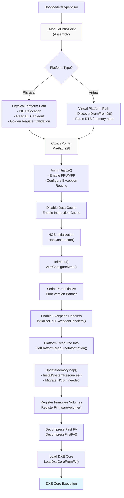
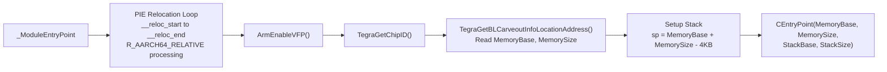
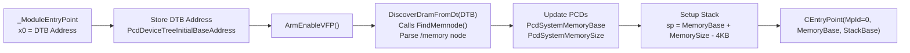
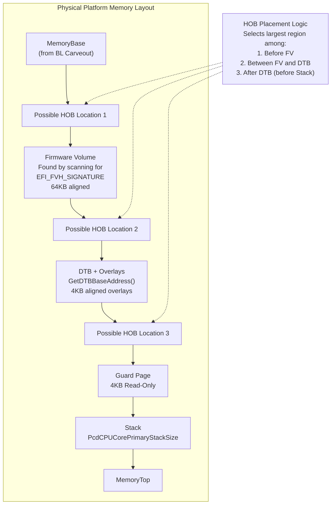
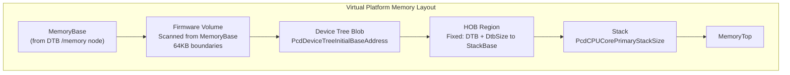
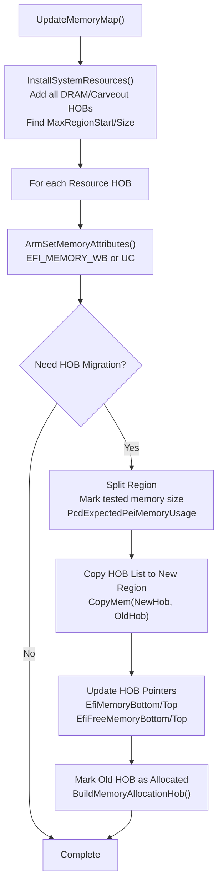

<!-- source: DeepWiki mcp.deepwiki.com · repo NVIDIA/edk2-nvidia · page 3.1 Pre-EFI Initialization (PrePi) · fetched 2026-10-26 -->

# Pre-EFI Initialization (PrePi)

<details>
<summary>Relevant source files</summary>

The following files were used as context for generating this wiki page:

- [Platform/NVIDIA/TegraVirt/TegraVirt.dsc](Platform/NVIDIA/TegraVirt/TegraVirt.dsc)
- [Platform/NVIDIA/TegraVirt/TegraVirt.fdf](Platform/NVIDIA/TegraVirt/TegraVirt.fdf)
- [Silicon/NVIDIA/Drivers/ConfigurationManagerData/MpamParser/MpamParser.c](Silicon/NVIDIA/Drivers/ConfigurationManagerData/MpamParser/MpamParser.c)
- [Silicon/NVIDIA/PrePi/AArch64/ArchPrePi.c](Silicon/NVIDIA/PrePi/AArch64/ArchPrePi.c)
- [Silicon/NVIDIA/PrePi/AArch64/ModuleEntryPoint.S](Silicon/NVIDIA/PrePi/AArch64/ModuleEntryPoint.S)
- [Silicon/NVIDIA/PrePi/PrePi.c](Silicon/NVIDIA/PrePi/PrePi.c)
- [Silicon/NVIDIA/PrePi/PrePi.h](Silicon/NVIDIA/PrePi/PrePi.h)
- [Silicon/NVIDIA/PrePi/PrePi.inf](Silicon/NVIDIA/PrePi/PrePi.inf)
- [Silicon/NVIDIA/PrePi/PrePiMemory.c](Silicon/NVIDIA/PrePi/PrePiMemory.c)
- [Silicon/NVIDIA/TegraVirt/PrePi/AArch64/ArchPrePi.c](Silicon/NVIDIA/TegraVirt/PrePi/AArch64/ArchPrePi.c)
- [Silicon/NVIDIA/TegraVirt/PrePi/AArch64/ModuleEntryPoint.S](Silicon/NVIDIA/TegraVirt/PrePi/AArch64/ModuleEntryPoint.S)
- [Silicon/NVIDIA/TegraVirt/PrePi/PrePi.c](Silicon/NVIDIA/TegraVirt/PrePi/PrePi.c)
- [Silicon/NVIDIA/TegraVirt/PrePi/PrePi.h](Silicon/NVIDIA/TegraVirt/PrePi/PrePi.h)
- [Silicon/NVIDIA/TegraVirt/PrePi/TegraVirtPrePi.inf](Silicon/NVIDIA/TegraVirt/PrePi/TegraVirtPrePi.inf)

</details>


## Purpose and Scope

This document describes the Pre-EFI Initialization (PrePi) phase, which is the first UEFI firmware code that executes after the bootloader or hypervisor hands control to UEFI. PrePi is responsible for:

- Performing early architecture initialization (FPU, exception vectors)
- Discovering available memory regions
- Setting up the initial stack and HOB (Hand-Off Block) list
- Configuring the MMU (Memory Management Unit)
- Collecting platform resource information
- Loading and transferring control to the DXE (Driver Execution Environment) Core

This phase is equivalent to the SEC (Security) and PEI (Pre-EFI Initialization) phases in traditional EDK2, but is implemented as a single unified module. For information about the subsequent DXE phase platform initialization, see [DXE Platform Initialization](#3.3). For platform resource management details, see [Platform Resource Management](#3.2).

## Overview

PrePi executes in the following sequence:

1. **Assembly Entry Point**: Platform-specific entry code in `ModuleEntryPoint.S` that handles relocation (physical platforms) or memory discovery from DTB (virtual platforms)
2. **C Entry Point (`CEntryPoint`)**: Architecture initialization, cache configuration, initial memory setup
3. **Main Initialization (`PrePiMain` or `CEntryPoint`)**: HOB construction, MMU initialization, platform resource gathering
4. **DXE Core Loading**: Decompression of firmware volume and transfer to DXE



**Diagram: PrePi Boot Flow**

Sources: 
- [Silicon/NVIDIA/PrePi/PrePi.c:228-575]()
- [Silicon/NVIDIA/TegraVirt/PrePi/PrePi.c:23-241]()
- [Silicon/NVIDIA/PrePi/AArch64/ModuleEntryPoint.S:10-77]()
- [Silicon/NVIDIA/TegraVirt/PrePi/AArch64/ModuleEntryPoint.S:12-78]()

## Platform Entry Points

### Physical Platform Entry (_ModuleEntryPoint)

Physical platforms (Jetson, Server) execute position-independent code (PIE) that must self-relocate before executing any C code. The entry point performs:

**Key Functions:**
- **PIE Relocation** [Silicon/NVIDIA/PrePi/AArch64/ModuleEntryPoint.S:17-43](): Processes ELF64 RELA relocations to adjust all address references based on the actual load address
- **FPU Enablement** [Silicon/NVIDIA/PrePi/AArch64/ModuleEntryPoint.S:46-47](): Calls `ArmEnableVFP()` to enable floating-point/SIMD before C code
- **Memory Discovery** [Silicon/NVIDIA/PrePi/AArch64/ModuleEntryPoint.S:49-66](): Reads memory base and size from bootloader carveout information via `TegraGetBLCarveoutInfoLocationAddress()`
- **Stack Setup** [Silicon/NVIDIA/PrePi/AArch64/ModuleEntryPoint.S:60-66](): Positions stack at top of memory minus guard page



**Diagram: Physical Platform Assembly Entry**

The PIE relocation loop processes each entry in the `.rela.dyn` section, adjusting addresses by adding the relocation base (`__reloc_base`) to the addend value for each `R_AARCH64_RELATIVE` entry.

Sources:
- [Silicon/NVIDIA/PrePi/AArch64/ModuleEntryPoint.S:10-77]()
- [Silicon/NVIDIA/PrePi/PrePi.inf:22-24]()

### Virtual Platform Entry (TegraVirt)

Virtual platforms (QEMU, KVM) receive the device tree base address in `x0` from the bootloader/hypervisor and must parse it to discover memory layout.

**Key Functions:**
- **DTB Storage** [Silicon/NVIDIA/TegraVirt/PrePi/AArch64/ModuleEntryPoint.S:18-19](): Saves DTB pointer to `PcdDeviceTreeInitialBaseAddress`
- **Memory Discovery** [Silicon/NVIDIA/TegraVirt/PrePi/AArch64/ModuleEntryPoint.S:25-28](): Calls `DiscoverDramFromDt()` which parses the DTB `/memory` node via `FindMemnode()`
- **Stack Positioning** [Silicon/NVIDIA/TegraVirt/PrePi/AArch64/ModuleEntryPoint.S:34-42](): Uses top of discovered memory for stack
- **Simplified Entry** [Silicon/NVIDIA/TegraVirt/PrePi/AArch64/ModuleEntryPoint.S:44-51](): No PIE relocation needed; jumps directly to `CEntryPoint()`



**Diagram: Virtual Platform Assembly Entry**

Sources:
- [Silicon/NVIDIA/TegraVirt/PrePi/AArch64/ModuleEntryPoint.S:12-78]()
- [Silicon/NVIDIA/TegraVirt/PrePi/FdtParser.c]()

## Memory Layout Discovery

PrePi must determine the layout of firmware components in memory to properly allocate the HOB region without overlapping with the firmware volume, DTB, or stack.

### Physical Platform Memory Layout

Physical platforms receive a contiguous memory region from the bootloader containing:
- **Firmware Volume (FV)**: Compressed UEFI DXE drivers and applications
- **Device Tree Blob (DTB)**: Platform hardware description and overlays
- **Stack**: Top of memory reserved for stack (with guard page)
- **HOB Region**: Allocated in the largest free area

The FV is located by scanning for the EFI firmware volume header signature (`EFI_FVH_SIGNATURE`) on 64KB boundaries [Silicon/NVIDIA/PrePi/PrePi.c:268-275](). DTB location is obtained from `GetDTBBaseAddress()` and overlay DTBs are detected by scanning 4KB-aligned regions [Silicon/NVIDIA/PrePi/PrePi.c:292-308]().



**Diagram: Physical Platform Memory Layout**

The HOB placement algorithm [Silicon/NVIDIA/PrePi/PrePi.c:318-394]() compares the sizes of available regions and selects the largest to maximize HOB space for memory allocation during DXE phase.

Sources:
- [Silicon/NVIDIA/PrePi/PrePi.c:268-394]()

### Virtual Platform Memory Layout

Virtual platforms have a simpler, predetermined layout:
- **DTB**: At `PcdDeviceTreeInitialBaseAddress` (passed by hypervisor)
- **FV**: Located by scanning for signature, typically at fixed offset
- **HOB**: Between DTB and Stack
- **Stack**: At top of memory



**Diagram: Virtual Platform Memory Layout**

Sources:
- [Silicon/NVIDIA/TegraVirt/PrePi/PrePi.c:99-177]()

## HOB List Initialization

The Hand-Off Block (HOB) list is the primary mechanism for passing information from PrePi to the DXE phase. PrePi constructs the initial HOB list and populates it with critical data structures.

### Initial HOB Construction

Physical Platform [Silicon/NVIDIA/PrePi/PrePi.c:408-414]():
```
HobList = HobConstructor(
    (VOID *)HobBase,
    HobSize,
    (VOID *)HobBase,
    (VOID *)HobFree
);
```

Virtual Platform [Silicon/NVIDIA/TegraVirt/PrePi/PrePi.c:184-190]():
```
HobList = HobConstructor(
    (VOID *)HobBase,
    HobSize,
    (VOID *)HobBase,
    (VOID *)HobBase + HobSize
);
```

### Key HOBs Created

| HOB Type | Created By | Purpose |
|----------|-----------|---------|
| **CPU HOB** | `BuildCpuHob()` | Physical address bits for memory management |
| **Stack HOB** | `BuildStackHob()` | Stack location reservation |
| **DTB Allocation HOB** | `BuildMemoryAllocationHob()` | DTB memory reservation |
| **FV HOB** | `BuildFvHob()` | Firmware volume location |
| **FDT HOB** | `BuildGuidDataHob(&gFdtHobGuid)` | DTB pointer for DXE drivers (TegraVirt only) |
| **Platform Resource HOB** | `BuildGuidHob(&gNVIDIAPlatformResourceDataGuid)` | Platform-specific resource data |
| **MMU Function HOB** | `BuildGuidDataHob(&gArmMmuReplaceLiveTranslationEntryFuncGuid)` | Pointer to PrePi MMU function |
| **SEC Performance HOB** | `BuildGuidDataHob(&gEfiFirmwarePerformanceGuid)` | Boot performance timing |

Sources:
- [Silicon/NVIDIA/PrePi/PrePi.c:408-548]()
- [Silicon/NVIDIA/TegraVirt/PrePi/PrePi.c:184-202]()

## MMU and Cache Configuration

### Initial Cache State

PrePi begins with minimal cache configuration [Silicon/NVIDIA/PrePi/PrePi.c:396-401]():
1. Disable data cache
2. Invalidate instruction cache
3. Enable instruction cache

This ensures instruction fetches are cached while data accesses remain uncached until the MMU is configured.

### MMU Initialization

The `InitMmu()` function [Silicon/NVIDIA/PrePi/PrePi.c:38-53]() configures the MMU with an initial memory map marking the main memory region as write-back cacheable:

```
InitialMemory[0].PhysicalBase = MemoryBase;
InitialMemory[0].VirtualBase  = MemoryBase;
InitialMemory[0].Length       = MemorySize;
InitialMemory[0].Attributes   = ARM_MEMORY_REGION_ATTRIBUTE_WRITE_BACK;
```

For virtual platforms, this is handled by `MemoryPeim()` which creates more granular memory HOBs based on the DTB.

### Platform-Specific Memory Mapping

After basic MMU setup, `MapCorePlatformMemory()` [Silicon/NVIDIA/PrePi/PrePiMemory.c:188-224]() adds platform-specific mappings:

| Region | Attributes | Purpose |
|--------|-----------|---------|
| Misc Registers (`PcdMiscRegBaseAddress`) | `EFI_MEMORY_UC` | Uncached MMIO |
| BL Info Location | `EFI_MEMORY_UC` | Bootloader data structure |
| CPUBL Base | `EFI_MEMORY_WB` | CPU bootloader parameters |
| DTB Base | `EFI_MEMORY_WB` | Device tree access |
| Serial Registers | `EFI_MEMORY_UC` | UART MMIO |
| DRAM Blacklist Pages | `EFI_MEMORY_WB` | Retired memory pages |

Sources:
- [Silicon/NVIDIA/PrePi/PrePi.c:38-53, 396-425]()
- [Silicon/NVIDIA/PrePi/PrePiMemory.c:188-224]()

## Platform Resource Information

Physical platforms collect extensive platform resource data in the `TEGRA_PLATFORM_RESOURCE_INFO` structure via `GetPlatformResourceInformation()` [Silicon/NVIDIA/PrePi/PrePi.c:490-495](). This HOB is created with the GUID `gNVIDIAPlatformResourceDataGuid` and later updated by `UpdatePlatformResourceInformation()` [Silicon/NVIDIA/PrePi/PrePi.c:512-513]().

The platform resource information includes:
- **Socket Configuration**: Active sockets, socket mask, boot chain status
- **Memory Regions**: DRAM regions, carveout regions, EGM configuration
- **MMIO Mappings**: GIC, SMMU, PCIe controller base addresses
- **Floorsweeping Data**: Disabled CPU cores, cache slice configuration
- **Boot Chain Info**: Active/inactive chain selection

This information is consumed by:
- DXE platform initialization drivers [TegraPlatformInitDxe](#3.3)
- Platform resource libraries [PlatformResourceLib](#3.2)
- Configuration Manager for ACPI table generation

Sources:
- [Silicon/NVIDIA/PrePi/PrePi.c:490-513]()

## Memory Map Updates and HOB Migration

### System Resource Installation

The `UpdateMemoryMap()` function [Silicon/NVIDIA/PrePi/PrePiMemory.c:231-275]() performs critical memory management:

1. **Install System Resources** via `InstallSystemResources()`: Adds all DRAM regions and carveouts as resource descriptor HOBs
2. **Configure MMU Attributes**: Maps each resource with appropriate caching (`EFI_MEMORY_WB` for DRAM, `EFI_MEMORY_UC` for MMIO)
3. **Identify Largest Region**: Tracks the largest contiguous memory region for HOB migration

### HOB List Migration

If a larger memory region is available than the initial HOB location, `MigrateHobList()` [Silicon/NVIDIA/PrePi/PrePiMemory.c:107-180]() relocates the HOB list to maximize available memory:



**Diagram: HOB List Migration Flow**

The migration ensures that the HOB free space can grow into the largest available memory region, preventing fragmentation during DXE phase memory allocations.

Sources:
- [Silicon/NVIDIA/PrePi/PrePiMemory.c:107-275]()

## Firmware Volume Registration

Before loading the DXE Core, PrePi must register the firmware volume containing the compressed DXE drivers.

### FV HOB Creation

The firmware volume is first registered as a HOB [Silicon/NVIDIA/PrePi/PrePi.c:488]():
```
BuildFvHob((EFI_PHYSICAL_ADDRESS)FvHeader, FvSize);
```

### FV Memory Protection

`RegisterFirmwareVolume()` [Silicon/NVIDIA/PrePi/PrePi.c:74-156]() performs additional steps:

1. **Split Resource Descriptor**: If the FV is within a larger DRAM region, split the resource HOB to create a dedicated descriptor for the FV
2. **Create Memory Allocation HOB**: Mark the FV region as `EfiBootServicesCode` to prevent DXE from overwriting it
3. **Validate Location**: Assert that the FV is contained within an existing system memory HOB

This three-step process ensures the DXE Core won't allocate memory that overlaps with the firmware volume during boot.

Sources:
- [Silicon/NVIDIA/PrePi/PrePi.c:74-156, 488, 554-555]()

## Architecture-Specific Initialization

### Exception Routing Configuration

`ArchInitialize()` configures exception routing based on the current exception level:

Physical Platform [Silicon/NVIDIA/PrePi/AArch64/ArchPrePi.c:14-30]():
```c
if (ArmReadCurrentEL() == AARCH64_EL2) {
    // Trap General Exceptions to EL2
    ArmWriteHcr(ARM_HCR_TGE);
    
    // Enable Timer access for non-secure EL1 and EL0
    ArmWriteCntHctl(CNTHCTL_EL2_EL1PCTEN | CNTHCTL_EL2_EL1PCEN);
}
```

Virtual Platform [Silicon/NVIDIA/TegraVirt/PrePi/AArch64/ArchPrePi.c:14-23]():
```c
if (ArmReadCurrentEL() == AARCH64_EL2) {
    // Trap General Exceptions to EL2
    ArmWriteHcr(ARM_HCR_TGE);
}
```

The physical platform additionally enables timer access for EL1, which is necessary for bare-metal execution where UEFI manages the timer directly.

Sources:
- [Silicon/NVIDIA/PrePi/AArch64/ArchPrePi.c:14-30]()
- [Silicon/NVIDIA/TegraVirt/PrePi/AArch64/ArchPrePi.c:14-23]()

## DXE Core Handoff

The final steps of PrePi prepare for and execute the handoff to DXE:

### Performance Measurement

If enabled, PrePi records timing information in a SEC Performance HOB [Silicon/NVIDIA/PrePi/PrePi.c:544-548]():
```c
Performance.ResetEnd = GetTimeInNanoSecond(StartTimeStamp);
BuildGuidDataHob(&gEfiFirmwarePerformanceGuid, &Performance, sizeof(Performance));
```

### Boot Mode Selection

PrePi sets the boot mode to full configuration [Silicon/NVIDIA/PrePi/PrePi.c:551]():
```c
SetBootMode(BOOT_WITH_FULL_CONFIGURATION);
```

### Library Constructor Execution

Process library constructors manually since there's no PEI dispatcher [Silicon/NVIDIA/PrePi/PrePi.c:561]():
```c
ProcessLibraryConstructorList();
```

### FV Decompression and DXE Loading

The final operations load the DXE Core:

1. **Decompress FV** [Silicon/NVIDIA/PrePi/PrePi.c:566-567](): `DecompressFirstFv()` extracts the compressed firmware volume containing DXE drivers
2. **Load DXE Core** [Silicon/NVIDIA/PrePi/PrePi.c:569-571](): `LoadDxeCoreFromFv()` locates the DXE Core PE32 image and transfers control to it
3. **Never Return**: If control returns from DXE, PrePi enters an infinite loop with `ASSERT(FALSE)`

At this point, the DXE dispatcher takes over and begins loading DXE drivers based on dependency expressions.

Sources:
- [Silicon/NVIDIA/PrePi/PrePi.c:544-574]()
- [Silicon/NVIDIA/TegraVirt/PrePi/PrePi.c:224-240]()

## Key Differences: Physical vs Virtual Platforms

| Aspect | Physical Platform | Virtual Platform | 
|--------|------------------|------------------|
| **Entry Code** | PIE relocation required | No relocation |
| **Memory Discovery** | Bootloader carveout (`TegraGetBLCarveoutInfoLocationAddress()`) | DTB `/memory` node (`FindMemnode()`) |
| **DTB Location** | `GetDTBBaseAddress()` | `PcdDeviceTreeInitialBaseAddress` (from hypervisor) |
| **Golden Registers** | Validated via `ValidateGrBlobHeader()` | Not applicable |
| **Platform Resources** | Extensive `TEGRA_PLATFORM_RESOURCE_INFO` structure | Minimal, from DTB only |
| **Timer Configuration** | Explicit `CNTHCTL_EL2` setup | Hypervisor configured |
| **HOB Placement** | Complex algorithm based on FV/DTB locations | Simple: between DTB and stack |
| **MMU Complexity** | Platform-specific MMIO mappings | Basic memory regions |

Sources:
- [Silicon/NVIDIA/PrePi/PrePi.c]()
- [Silicon/NVIDIA/TegraVirt/PrePi/PrePi.c]()
- [Silicon/NVIDIA/PrePi/AArch64/ModuleEntryPoint.S]()
- [Silicon/NVIDIA/TegraVirt/PrePi/AArch64/ModuleEntryPoint.S]()

## Module Configuration

### Physical Platform Module

INF File: [Silicon/NVIDIA/PrePi/PrePi.inf]()

**Key Library Dependencies:**
- `PlatformResourceLib`: Platform-specific resource information
- `GoldenRegisterLib`: Register validation for physical hardware
- `SystemResourceLib`: Memory and resource management
- `DtPlatformDtbLoaderLib`: DTB loading and parsing
- `StatusRegLib`: Boot status register access

**Build Options:**
- PIE linker script: `PrePi-PIE.lds` or `PrePi-PIE-clang.lds`
- Stack protection enabled

### Virtual Platform Module  

INF File: [Silicon/NVIDIA/TegraVirt/PrePi/TegraVirtPrePi.inf]()

**Key Library Dependencies:**
- `PlatformPeiLib`: KVM-specific platform initialization
- `MemoryInitPeiLib`: Virtual memory initialization
- `FdtLib`: Flattened device tree parsing

**Differences from Physical:**
- Uses `KvmtoolVirtMemInfoLib` for memory discovery
- No `GoldenRegisterLib` or `StatusRegLib` dependencies
- Simpler memory initialization path

Sources:
- [Silicon/NVIDIA/PrePi/PrePi.inf]()
- [Silicon/NVIDIA/TegraVirt/PrePi/TegraVirtPrePi.inf]()
- [Platform/NVIDIA/TegraVirt/TegraVirt.dsc:288-297]()

---

