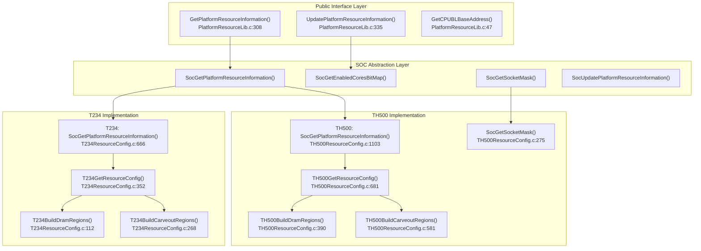
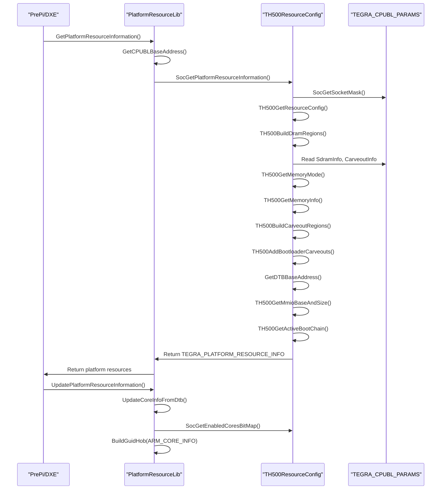
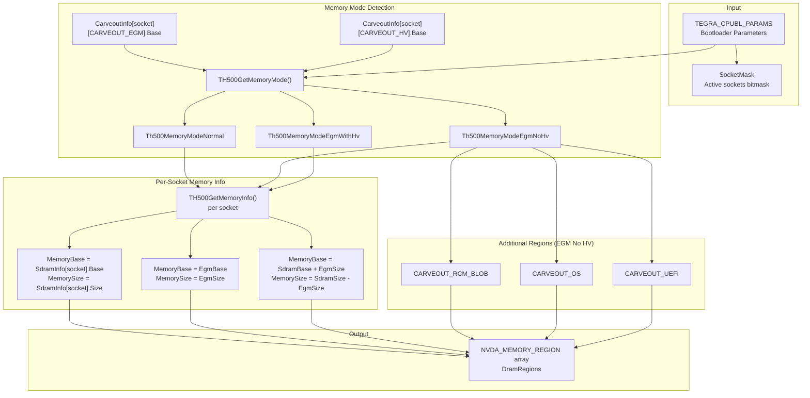
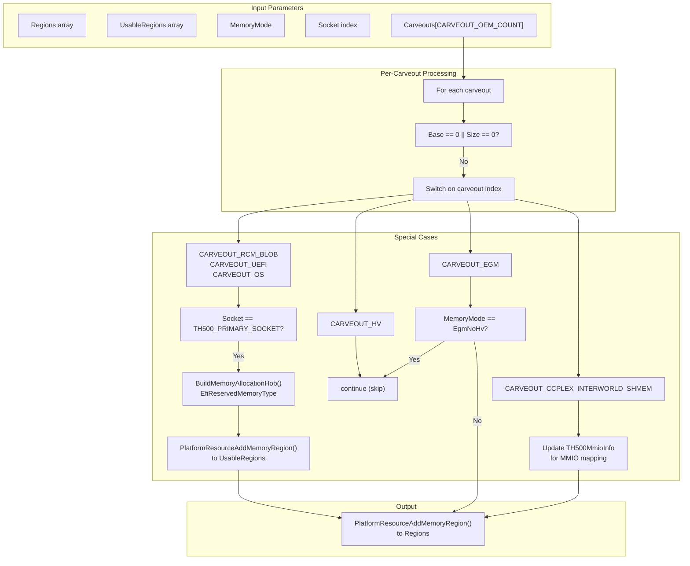
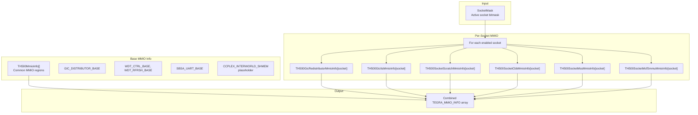
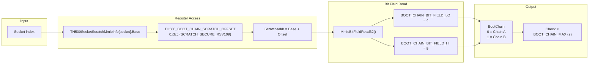
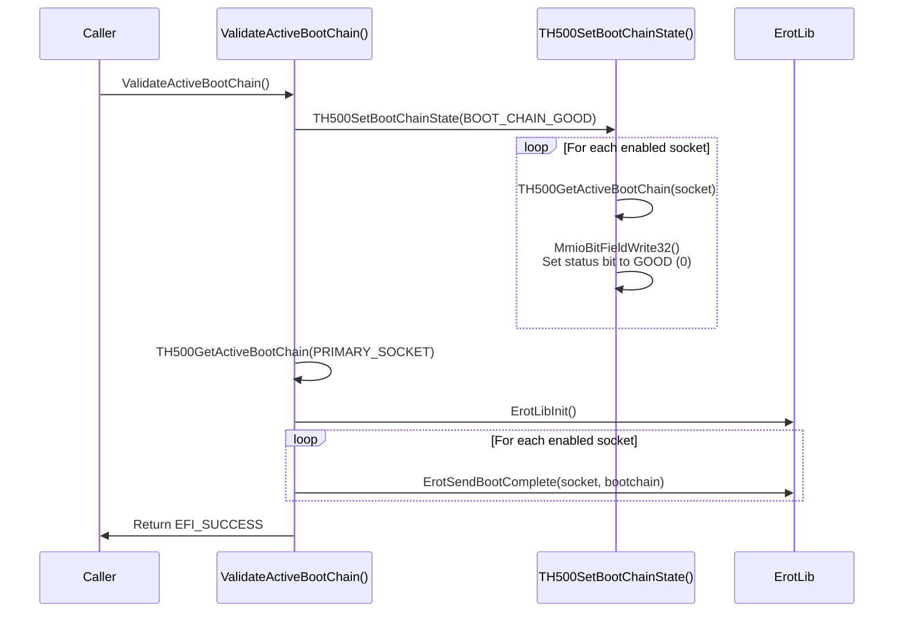
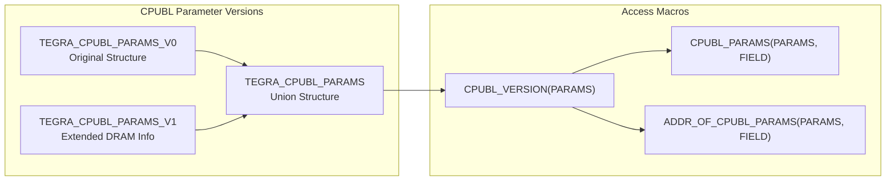

<!-- source: DeepWiki mcp.deepwiki.com · repo NVIDIA/edk2-nvidia · page 3.2 Platform Resource Management · fetched 2026-10-26 -->

# Platform Resource Management

<details>
<summary>Relevant source files</summary>

The following files were used as context for generating this wiki page:

- [Silicon/NVIDIA/Include/Library/PlatformResourceLib.h](Silicon/NVIDIA/Include/Library/PlatformResourceLib.h)
- [Silicon/NVIDIA/Library/PlatformResourceLib/PlatformResourceLib.c](Silicon/NVIDIA/Library/PlatformResourceLib/PlatformResourceLib.c)
- [Silicon/NVIDIA/Library/PlatformResourceLib/T234ResourceConfig.c](Silicon/NVIDIA/Library/PlatformResourceLib/T234ResourceConfig.c)
- [Silicon/NVIDIA/Library/PlatformResourceLib/TH500ResourceConfig.c](Silicon/NVIDIA/Library/PlatformResourceLib/TH500ResourceConfig.c)
- [Silicon/NVIDIA/Library/PlatformResourceLib/TH500ResourceConfigPrivate.h](Silicon/NVIDIA/Library/PlatformResourceLib/TH500ResourceConfigPrivate.h)

</details>


The Platform Resource Management system provides SOC-specific discovery, configuration, and management of hardware resources across NVIDIA Tegra platforms through the `PlatformResourceLib` library. This library implements a layered architecture with SOC-specific implementations (TH500ResourceConfig, T234ResourceConfig) that handle multi-socket memory management, DRAM region building, carveout management, and boot chain handling.

For information about early boot initialization, see [Pre-EFI Initialization (PrePi)](#3.1). For platform-specific DXE initialization, see [DXE Platform Initialization](#3.3).

## PlatformResourceLib Architecture

The `PlatformResourceLib` provides a layered architecture with a common interface and SOC-specific implementations that handle platform resource discovery and configuration.

### Library Structure

**PlatformResourceLib Layering**


**Sources:** [Silicon/NVIDIA/Library/PlatformResourceLib/PlatformResourceLib.c:306-327](), [Silicon/NVIDIA/Library/PlatformResourceLib/TH500ResourceConfig.c:681-723](), [Silicon/NVIDIA/Library/PlatformResourceLib/TH500ResourceConfig.c:1103-1223](), [Silicon/NVIDIA/Library/PlatformResourceLib/T234ResourceConfig.c:352-394](), [Silicon/NVIDIA/Library/PlatformResourceLib/T234ResourceConfig.c:666-738]()

### Resource Discovery Flow

**TH500 Resource Initialization Sequence**


**Sources:** [Silicon/NVIDIA/Library/PlatformResourceLib/PlatformResourceLib.c:306-327](), [Silicon/NVIDIA/Library/PlatformResourceLib/PlatformResourceLib.c:335-434](), [Silicon/NVIDIA/Library/PlatformResourceLib/TH500ResourceConfig.c:1103-1223](), [Silicon/NVIDIA/Library/PlatformResourceLib/TH500ResourceConfig.c:681-723]()

## Multi-Socket Memory Management

The TH500 platform supports up to 4 CPU sockets, each with independent DRAM and carveout configurations. The memory management system handles three distinct memory modes based on Extended GPU Memory (EGM) configuration.

### TH500 Memory Modes

The `TH500GetMemoryMode()` function determines the system memory configuration:

| Mode | Enum Value | EGM Carveout | HV Carveout | Memory Layout |
|------|-----------|--------------|-------------|---------------|
| Normal | `Th500MemoryModeNormal` | None | None | Standard SDRAM only |
| EGM No HV | `Th500MemoryModeEgmNoHv` | Present | None | EGM replaces SDRAM |
| EGM With HV | `Th500MemoryModeEgmWithHv` | Present | Present | SDRAM reduced by EGM size |

**Sources:** [Silicon/NVIDIA/Library/PlatformResourceLib/TH500ResourceConfig.c:299-328](), [Silicon/NVIDIA/Library/PlatformResourceLib/TH500ResourceConfigPrivate.h:93-98]()

### DRAM Region Building

**TH500BuildDramRegions() Process**


**Sources:** [Silicon/NVIDIA/Library/PlatformResourceLib/TH500ResourceConfig.c:390-475](), [Silicon/NVIDIA/Library/PlatformResourceLib/TH500ResourceConfig.c:299-328](), [Silicon/NVIDIA/Library/PlatformResourceLib/TH500ResourceConfig.c:341-376]()

### Socket Mask and Addressing

The `SocGetSocketMask()` function retrieves the active socket configuration from `CPUBL_PARAMS`:

```c
// Socket mask extraction from TH500ResourceConfig.c:275-289
UINT32 SocketMask = CPUBL_PARAMS(CpuBootloaderParams, SocketMask);
```

Socket addressing uses bits 44-45 of the physical address to determine the target socket, with each socket at a 256TB offset (defined as `TH500_SOCKET_SHFT` and `TH500_SOCKET_MASK`).

**Sources:** [Silicon/NVIDIA/Library/PlatformResourceLib/TH500ResourceConfig.c:274-289](), [Silicon/NVIDIA/Library/PlatformResourceLib/TH500ResourceConfig.c:1085-1086]()

## Carveout Management

The system manages per-socket carveout regions through `TH500BuildCarveoutRegions()` and `TH500AddBootloaderCarveouts()`. Carveouts are specialized memory regions reserved by the bootloader for specific purposes.

### Carveout Types

The system defines 51 carveout types in `TH500ResourceConfigPrivate.h`:

| Carveout Index | Name | Purpose | Special Handling |
|----------------|------|---------|------------------|
| 1 | `CARVEOUT_EGM` | Extended GPU Memory | Skipped in EGM No HV mode |
| 4 | `CARVEOUT_CCPLEX_INTERWORLD_SHMEM` | Inter-world shared memory | Mapped as MMIO for primary socket |
| 36 | `CARVEOUT_RCM_BLOB` | Recovery mode blob | Added as usable in EGM No HV |
| 37 | `CARVEOUT_UEFI` | UEFI firmware | Added as usable in all modes |
| 39 | `CARVEOUT_OS` | Operating system | Added as usable in EGM No HV |
| 40 | `CARVEOUT_HV` | Hypervisor | Skipped (not added to regions) |

**Sources:** [Silicon/NVIDIA/Library/PlatformResourceLib/TH500ResourceConfigPrivate.h:34-86]()

### Carveout Processing Flow

**TH500AddBootloaderCarveouts() Logic**


**Sources:** [Silicon/NVIDIA/Library/PlatformResourceLib/TH500ResourceConfig.c:491-565]()

### Retired DRAM Pages

The system tracks retired (bad) DRAM pages using `PlatformResourceAddRetiredDramPages()`:

```c
// TH500ResourceConfig.c:645-659
for (Socket = TH500_PRIMARY_SOCKET; Socket < TH500_MAX_SOCKETS; Socket++) {
  if ((SocketMask & (1 << Socket)) != 0) {
    RetiredDramPageList = (EFI_PHYSICAL_ADDRESS *)CPUBL_PARAMS(CpuBootloaderParams, RetiredDramPageListAddr[Socket]);
    if (RetiredDramPageList != NULL) {
      PlatformResourceAddRetiredDramPages(
        Regions, &RegionCount,
        RetiredDramPageList,
        MAX_RETIRED_DRAM_PAGES,
        SIZE_64KB
      );
    }
  }
}
```

**Sources:** [Silicon/NVIDIA/Library/PlatformResourceLib/TH500ResourceConfig.c:645-659](), [Silicon/NVIDIA/Library/PlatformResourceLib/TH500ResourceConfigPrivate.h:20]()

## MMIO and Per-Socket Resources

The TH500 platform maintains separate MMIO regions for each socket, including GIC redistributors, scratch registers, and system controllers.

### Socket-Specific MMIO Arrays

The implementation uses parallel arrays indexed by socket number:

| Array | Definition | Size | Purpose |
|-------|-----------|------|---------|
| `TH500SocketScratchBaseAddr` | Line 32-37 | 4 entries | Scratch register bases for floorsweeping and boot chain |
| `TH500GicRedistributorMmioInfo` | Line 121-138 | 4 entries | GIC redistributor regions (84 instances per socket) |
| `TH500GicItsMmioInfo` | Line 140-157 | 4 entries | GIC ITS controller regions |
| `TH500SocketScratchMmioInfo` | Line 159-176 | 4 entries | Scratch register spaces |
| `TH500SocketCbbMmioInfo` | Line 178-195 | 4 entries | CBB fabric regions |
| `TH500SocketMssMmioInfo` | Line 198-214 | 4 entries | Memory subsystem controllers |
| `TH500SocketMcfSmmuMmioInfo` | Line 216-233 | 4 entries | MCF SMMU regions |

**Sources:** [Silicon/NVIDIA/Library/PlatformResourceLib/TH500ResourceConfig.c:32-37](), [Silicon/NVIDIA/Library/PlatformResourceLib/TH500ResourceConfig.c:121-233]()

### MMIO Region Building

**TH500GetMmioBaseAndSize() Implementation**


**Sources:** [Silicon/NVIDIA/Library/PlatformResourceLib/TH500ResourceConfig.c:810-841](), [Silicon/NVIDIA/Library/PlatformResourceLib/TH500ResourceConfig.c:90-117]()

### C2C Mode Detection

The system reads C2C (Chip-to-Chip) mode from MSS registers for each enabled socket:

```c
// TH500ResourceConfig.c:1025-1045
STATIC EFI_STATUS EFIAPI Th500CpuC2cMode(
  IN TEGRA_PLATFORM_RESOURCE_INFO *PlatformResourceInfo
) {
  PlatformResourceInfo->C2cMode = TH500C2cMode;
  for (Socket = 0; Socket < TH500_MAX_SOCKETS; Socket++) {
    if ((PlatformResourceInfo->SocketMask & (1UL << Socket)) == 0) {
      continue;
    }
    TH500C2cMode[Socket] = MmioRead32(
      TH500SocketMssMmioInfo[Socket].Base + TH500_MSS_C2C_MODE
    ) & 0x03;
  }
}
```

**Sources:** [Silicon/NVIDIA/Library/PlatformResourceLib/TH500ResourceConfig.c:1025-1045]()

## Boot Chain Handling

The system manages A/B boot chain configuration and validation through scratch registers on each socket.

### Boot Chain Detection

**TH500GetActiveBootChain() Implementation**


**Sources:** [Silicon/NVIDIA/Library/PlatformResourceLib/TH500ResourceConfig.c:849-870](), [Silicon/NVIDIA/Library/PlatformResourceLib/TH500ResourceConfigPrivate.h:25-28]()

### Boot Chain Validation Flow

**ValidateActiveBootChain() Process**


**Sources:** [Silicon/NVIDIA/Library/PlatformResourceLib/TH500ResourceConfig.c:920-964](), [Silicon/NVIDIA/Library/PlatformResourceLib/TH500ResourceConfig.c:878-912]()

### Boot Chain Scratch Register Layout

The scratch register at offset 0x3cc contains:

| Bits | Field | Values |
|------|-------|--------|
| 5:4 | Boot Chain Select | 0 = Chain A, 1 = Chain B |
| 0 | Chain A Status | 0 = Good, 1 = Bad |
| 1 | Chain B Status | 0 = Good, 1 = Bad |
| 3:2 | Reserved | - |

**Sources:** [Silicon/NVIDIA/Library/PlatformResourceLib/TH500ResourceConfigPrivate.h:25-32]()

## SOC-Specific Implementations

### TH500ResourceConfig.c

The TH500 implementation handles server platforms with multi-socket configurations:

**Key TH500 Functions:**

| Function | Line | Purpose |
|----------|------|---------|
| `SocGetSocketMask()` | 275-289 | Extract socket mask from CPUBL params |
| `TH500GetMemoryMode()` | 299-328 | Determine Normal/EGM/HV memory mode |
| `TH500GetMemoryInfo()` | 341-376 | Get memory base/size per socket |
| `TH500BuildDramRegions()` | 390-475 | Build DRAM region list |
| `TH500BuildCarveoutRegions()` | 581-666 | Build carveout region list |
| `TH500GetMmioBaseAndSize()` | 810-841 | Build MMIO info for all sockets |
| `TH500GetActiveBootChain()` | 849-870 | Read boot chain from scratch register |
| `ValidateActiveBootChain()` | 920-964 | Mark boot chain good and notify EROT |
| `SocGetEnabledCoresBitMap()` | 989-1015 | Get enabled cores with SatMC handling |
| `TH500InitFloorSweepingInfo()` | 1053-1095 | Initialize PCIe/SCF floorsweeping |

**TH500-Specific Features:**
- Multi-socket support (up to 4 sockets via `TH500_MAX_SOCKETS`)
- Three memory modes: Normal, EGM No HV, EGM With HV
- Per-socket DRAM, carveout, and MMIO management
- SatMC (Satellite MCU) core reservation on socket 0
- SCF cache floorsweeping (96 slices per socket)

**Sources:** [Silicon/NVIDIA/Library/PlatformResourceLib/TH500ResourceConfig.c:1-1438]()

### T234ResourceConfig.c

The T234 implementation supports Jetson embedded platforms:

**Key T234 Functions:**

| Function | Line | Purpose |
|----------|------|---------|
| `T234BuildDramRegions()` | 112-156 | Build DRAM with blanket encryption support |
| `T234BuildCarveoutRegions()` | 268-336 | Build carveout regions with retirement |
| `T234GetMmioBaseAndSize()` | 488-493 | Return T234 MMIO info array |
| `T234GetActiveBootChain()` | 558-574 | Read boot chain from scratch register |
| `ValidateActiveBootChain()` | 581-604 | Mark boot chain good |
| `T234GetUpdateBrBct()` | 612-643 | Check BR-BCT update flag |
| `SocGetPlatformResourceInformation()` | 666-738 | Main platform resource function |

**T234-Specific Features:**
- Single socket design (SocketMask = 0x1)
- Blanket DRAM encryption support via `CARVEOUT_BLANKET_NSDRAM`
- VPR (Video Protected Region) management
- DRAM page retirement (up to `NUM_DRAM_BAD_PAGES`)
- Frame buffer carveout as MMIO region
- MCE ARI interface for core bitmap

**Sources:** [Silicon/NVIDIA/Library/PlatformResourceLib/T234ResourceConfig.c:1-992]()

## Core Data Structures

### TEGRA_PLATFORM_RESOURCE_INFO

The primary container for all platform resource information:

| Field | Type | Purpose |
|-------|------|---------|
| `SocketMask` | `UINT32` | Bitmask of enabled CPU sockets |
| `MaxPossibleSockets` | `UINT32` | Maximum socket count (4 for TH500, 1 for T234) |
| `ActiveBootChain` | `UINT32` | Currently active boot chain (0=A, 1=B) |
| `ResourceInfo` | `TEGRA_RESOURCE_INFO*` | DRAM regions, carveouts, DTB location |
| `MmioInfo` | `TEGRA_MMIO_INFO*` | MMIO region array |
| `BoardInfo` | `TEGRA_BOARD_INFO*` | Board identification, fuses, MAC addresses |
| `DramDeviceInfo` | `TEGRA_DRAM_DEVICE_INFO*` | DRAM module details per socket |
| `EgmMemoryInfo` | `TEGRA_BASE_AND_SIZE_INFO*` | Extended GPU memory per socket |
| `FloorSweepingInfo` | `TEGRA_FLOOR_SWEEPING_INFO*` | Hardware disable configuration |
| `HypervisorMode` | `BOOLEAN` | TRUE if HV carveout present |
| `C2cMode` | `UINT8*` | C2C mode per socket |

**Sources:** [Silicon/NVIDIA/Include/Library/PlatformResourceLib.h:163-196]()

### TEGRA_RESOURCE_INFO

Memory region information returned by SOC implementations:

| Field | Type | Purpose |
|-------|------|---------|
| `DramRegions` | `NVDA_MEMORY_REGION*` | Array of DRAM regions |
| `DramRegionsCount` | `UINTN` | Number of DRAM regions |
| `CarveoutRegions` | `NVDA_MEMORY_REGION*` | Array of carveout regions |
| `CarveoutRegionsCount` | `UINTN` | Number of carveouts |
| `UsableCarveoutRegions` | `NVDA_MEMORY_REGION*` | Usable carveout subset |
| `UsableCarveoutRegionsCount` | `UINTN` | Number of usable carveouts |
| `DtbLoadAddress` | `UINTN` | Device tree blob address |

**Sources:** [Silicon/NVIDIA/Include/Library/PlatformResourceLib.h:52-65]()

### TEGRA_CPUBL_PARAMS

Versioned bootloader parameter structure with union-based access:

```c
// TH500ResourceConfigPrivate.h:342-367
typedef struct {
  union {
    TEGRA_CPUBL_PARAMS_V0 v0;
    TEGRA_CPUBL_PARAMS_V1 v1;
    struct {
      UEFI_DECLARE_ALIGNED(UINT32 Version, 4);
    } common;
  };
} TEGRA_CPUBL_PARAMS;

// Access macros
#define CPUBL_VERSION(PARAMS) (((TEGRA_CPUBL_PARAMS*)PARAMS)->common.Version)
#define CPUBL_PARAMS(PARAMS, FIELD) ((CPUBL_VERSION(PARAMS) == 0) ? \
  ((TEGRA_CPUBL_PARAMS*)PARAMS)->v0.FIELD : \
  ((TEGRA_CPUBL_PARAMS*)PARAMS)->v1.FIELD)
```

**Key Fields:**
- `SocketMask`: Enabled socket bitmask
- `SdramInfo[TH500_MAX_SOCKETS]`: Base and size per socket
- `CarveoutInfo[TH500_MAX_SOCKETS][CARVEOUT_OEM_COUNT]`: Per-socket carveouts
- `RetiredDramPageListAddr[TH500_MAX_SOCKETS]`: Retired page addresses
- `DramInfo[]`: DRAM device information (v0 vs v1 layouts)
- `EarlyBootVariables[TH500_MAX_SOCKETS]`: MB1 configuration data

**Sources:** [Silicon/NVIDIA/Library/PlatformResourceLib/TH500ResourceConfigPrivate.h:196-367]()

## Resource Data Structures

### Primary Resource Container

The `TEGRA_PLATFORM_RESOURCE_INFO` structure serves as the primary container for all platform resource information:

| Field | Type | Purpose |
|-------|------|---------|
| `SocketMask` | `UINT32` | Bitmask of enabled CPU sockets |
| `ResourceInfo` | `TEGRA_RESOURCE_INFO*` | Memory regions and carveouts |
| `MmioInfo` | `TEGRA_MMIO_INFO*` | MMIO region mappings |
| `BoardInfo` | `TEGRA_BOARD_INFO*` | Board identification and fusing |
| `DramDeviceInfo` | `TEGRA_DRAM_DEVICE_INFO*` | DRAM module information |
| `FloorSweepingInfo` | `TEGRA_FLOOR_SWEEPING_INFO*` | Hardware disable configuration |

**Sources:** [Silicon/NVIDIA/Include/Library/PlatformResourceLib.h:163-195]()

### CPU Bootloader Parameters

The system parses bootloader parameters through versioned structures supporting backward compatibility:



**Sources:** [Silicon/NVIDIA/Library/PlatformResourceLib/TH500ResourceConfigPrivate.h:342-367]()

---

