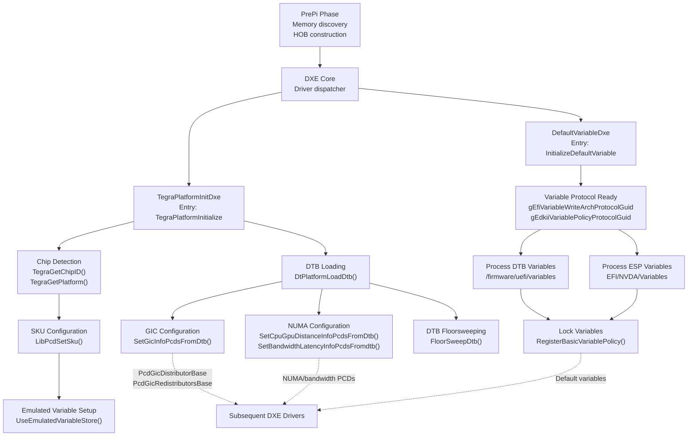
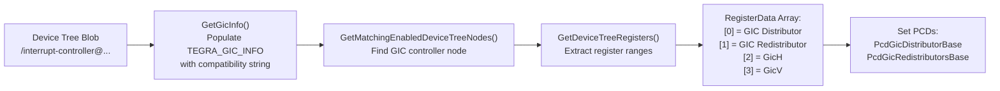
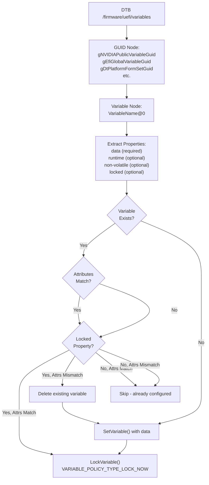
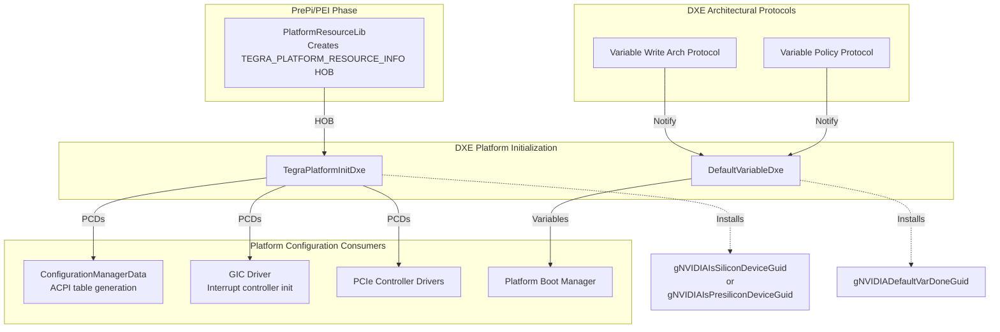

<!-- source: DeepWiki mcp.deepwiki.com · repo NVIDIA/edk2-nvidia · page 3.3 DXE Platform Initialization · fetched 2026-10-26 -->

# DXE Platform Initialization

<details>
<summary>Relevant source files</summary>

The following files were used as context for generating this wiki page:

- [Platform/NVIDIA/NVIDIA.common.fdf](Platform/NVIDIA/NVIDIA.common.fdf)
- [Platform/NVIDIA/NVIDIA.common.fdf.inc](Platform/NVIDIA/NVIDIA.common.fdf.inc)
- [Silicon/NVIDIA/Drivers/DefaultVariableDxe/DefaultVariableDxe.c](Silicon/NVIDIA/Drivers/DefaultVariableDxe/DefaultVariableDxe.c)
- [Silicon/NVIDIA/Drivers/DefaultVariableDxe/DefaultVariableDxe.inf](Silicon/NVIDIA/Drivers/DefaultVariableDxe/DefaultVariableDxe.inf)
- [Silicon/NVIDIA/Drivers/FvbDxe/FvbDxe.inf](Silicon/NVIDIA/Drivers/FvbDxe/FvbDxe.inf)
- [Silicon/NVIDIA/Drivers/TegraPlatformInit/TegraPlatformInitDxe.c](Silicon/NVIDIA/Drivers/TegraPlatformInit/TegraPlatformInitDxe.c)
- [Silicon/NVIDIA/Drivers/TegraPlatformInit/TegraPlatformInitDxe.inf](Silicon/NVIDIA/Drivers/TegraPlatformInit/TegraPlatformInitDxe.inf)

</details>


## Purpose and Scope

This document covers the DXE (Driver Execution Environment) platform initialization phase, which occurs after the PrePi phase completes and hands control to the DXE Core. The focus is on platform-specific configuration performed by two key drivers: **TegraPlatformInitDxe** and **DefaultVariableDxe**.

TegraPlatformInitDxe performs hardware-specific initialization including chip/SKU detection, GIC configuration, NUMA topology setup, and DTB floorsweeping. DefaultVariableDxe establishes default UEFI variables from DTB definitions and ESP partition files.

For information about the earlier PrePi phase that precedes DXE initialization, see [Pre-EFI Initialization](#3.1). For platform resource discovery and HOB construction that feeds into DXE initialization, see [Platform Resource Management](#3.2).

---

## DXE Platform Initialization Overview

The DXE phase begins when the PrePi phase loads and transfers control to the DXE Core. During early DXE initialization, platform-specific drivers execute to configure the system based on hardware detection and device tree information. The two primary platform initialization drivers are:

1. **TegraPlatformInitDxe** - Performs chip detection, SKU configuration, GIC setup, NUMA topology configuration, and DTB modifications
2. **DefaultVariableDxe** - Creates default UEFI variables from DTB and ESP partition sources

These drivers execute early in the DXE phase (typically with no explicit dependencies or `TRUE` depex) and configure Platform Configuration Database (PCD) values that subsequent drivers consume.



**Diagram: DXE Platform Initialization Flow**

Sources: [Silicon/NVIDIA/Drivers/TegraPlatformInit/TegraPlatformInitDxe.c:645-789](), [Silicon/NVIDIA/Drivers/DefaultVariableDxe/DefaultVariableDxe.c:825-859]()

---

## TegraPlatformInitDxe Driver

### Driver Entry Point and Initialization Sequence

The `TegraPlatformInitDxe` driver is the primary platform initialization driver that configures PCDs and performs DTB modifications based on hardware detection. Its entry point is `TegraPlatformInitialize()`.

**Key Operations:**
1. Detect chip ID and platform type (silicon vs. pre-silicon)
2. Load the platform DTB
3. Set dynamic SKU based on chip ID and platform type
4. Configure emulated variable store if required
5. Extract GIC configuration from DTB and set PCDs
6. Perform DTB floorsweeping
7. Set NUMA distance and bandwidth/latency PCDs from DTB
8. Set OEM table ID for TH500 platforms

```mermaid
flowchart TD
    Entry["TegraPlatformInitialize()<br/>Entry Point"]
    
    GetChip["TegraGetChipID()<br/>Returns: T234, TH500, T264"]
    GetPlat["TegraGetPlatform()<br/>Returns: SILICON or other"]
    LoadDTB["DtPlatformLoadDtb(&DtbBase, &DtbSize)<br/>Load platform DTB"]
    
    CheckSilicon{"Platform Type<br/>SILICON?"}
    
    SetSKU_Silicon["Set SKU based on ChipID:<br/>T234_SKU/T234SLT_SKU<br/>TH500_SKU<br/>T264_SKU"]
    SetSKU_Presil["Set Pre-Silicon SKU:<br/>T234_PRESIL_SKU<br/>TH500_PRESIL_SKU<br/>T264_PRESIL_SKU"]
    
    InstallProto_Silicon["Install Protocol:<br/>gNVIDIAIsSiliconDeviceGuid"]
    InstallProto_Presil["Install Protocol:<br/>gNVIDIAIsPresiliconDeviceGuid"]
    
    CheckEmuVar{"Emulated Variables<br/>Required?<br/>(RCM boot or DTB flag)"}
    
    EmuVarSetup["UseEmulatedVariableStore()<br/>Set PcdEmuVariableNvModeEnable<br/>Install gEdkiiNvVarStoreFormattedGuid<br/>Install RT properties table"]
    
    SetMaxSockets["PcdSet32S(PcdTegraMaxSockets)"]
    SetGIC["SetGicInfoPcdsFromDtb()<br/>PcdGicDistributorBase<br/>PcdGicRedistributorsBase"]
    
    Floorsweep["FloorSweepDtb(DtbBase)<br/>Remove disabled hardware from DTB"]
    DTBUpdate["DtbUpdateForUefi(DtbBase)<br/>Apply UEFI-specific DTB updates"]
    
    SetNUMA["SetCpuGpuDistanceInfoPcdsFromDtb()<br/>Set NUMA distance PCDs"]
    SetBandwidth["SetBandwidthLatencyInfoPcdsFromdtb()<br/>Set bandwidth/latency PCDs"]
    
    CheckTH500{"ChipID ==<br/>TH500?"}
    SetOEM["SetOemTableIdPcdForTh500()<br/>Detect GPU presence<br/>Set PcdAcpiDefaultOemTableId"]
    
    Done["Return EFI_SUCCESS"]
    
    Entry --> GetChip
    GetChip --> GetPlat
    GetPlat --> LoadDTB
    LoadDTB --> CheckSilicon
    
    CheckSilicon -->|Yes| SetSKU_Silicon
    CheckSilicon -->|No| SetSKU_Presil
    
    SetSKU_Silicon --> InstallProto_Silicon
    SetSKU_Presil --> InstallProto_Presil
    
    InstallProto_Silicon --> CheckEmuVar
    InstallProto_Presil --> CheckEmuVar
    
    CheckEmuVar -->|Yes| EmuVarSetup
    CheckEmuVar -->|No| SetMaxSockets
    EmuVarSetup --> SetMaxSockets
    
    SetMaxSockets --> SetGIC
    SetGIC --> Floorsweep
    Floorsweep --> DTBUpdate
    DTBUpdate --> SetNUMA
    SetNUMA --> SetBandwidth
    SetBandwidth --> CheckTH500
    
    CheckTH500 -->|Yes| SetOEM
    CheckTH500 -->|No| Done
    SetOEM --> Done
```



**Diagram: TegraPlatformInitialize() Execution Flow**

Sources: [Silicon/NVIDIA/Drivers/TegraPlatformInit/TegraPlatformInitDxe.c:645-789]()

### Platform and Chip Detection

The driver uses `TegraPlatformInfoLib` to detect the hardware platform:

| Function | Return Value | Usage |
|----------|--------------|-------|
| `TegraGetChipID()` | `T234_CHIP_ID`, `TH500_CHIP_ID`, `T264_CHIP_ID` | Identifies the SoC type |
| `TegraGetPlatform()` | `TEGRA_PLATFORM_SILICON`, `TEGRA_PLATFORM_*` | Distinguishes silicon from pre-silicon (simulation/emulation) |

Sources: [Silicon/NVIDIA/Drivers/TegraPlatformInit/TegraPlatformInitDxe.c:665-668]()

### SKU Configuration

Based on chip detection, the driver sets the dynamic SKU using `LibPcdSetSku()`, which affects PCD values throughout the system. SKU selection follows this logic:

**For Silicon Platforms:**
- **T234**: Check DTB `/model` property for "SLT" string
  - If found: `T234SLT_SKU`
  - Otherwise: `T234_SKU`
- **TH500**: `TH500_SKU`
- **T264**: `T264_SKU`

**For Pre-Silicon Platforms:**
- **T234**: `T234_PRESIL_SKU`
- **TH500**: `TH500_PRESIL_SKU`
- **T264**: `T264_PRESIL_SKU`

After setting the SKU, the driver installs a protocol GUID (`gNVIDIAIsSiliconDeviceGuid` or `gNVIDIAIsPresiliconDeviceGuid`) that other drivers can use to determine the platform type.

Sources: [Silicon/NVIDIA/Drivers/TegraPlatformInit/TegraPlatformInitDxe.c:675-722]()

### GIC Configuration from Device Tree

The `SetGicInfoPcdsFromDtb()` function extracts GIC (Generic Interrupt Controller) configuration from the DTB and configures PCDs that architectural drivers consume.

**Process:**
1. Allocate and populate `TEGRA_GIC_INFO` structure using `GetGicInfo()`
2. Use `GetMatchingEnabledDeviceTreeNodes()` with the GIC compatibility string
3. Extract register information using `GetDeviceTreeRegisters()`
4. Set PCDs from register data:
   - `PcdGicDistributorBase` = RegisterData[0].BaseAddress
   - `PcdGicRedistributorsBase` = RegisterData[1].BaseAddress



**Diagram: GIC Configuration Process**

Sources: [Silicon/NVIDIA/Drivers/TegraPlatformInit/TegraPlatformInitDxe.c:544-638]()

### NUMA Configuration from Device Tree

For multi-socket server platforms (particularly TH500), the driver reads NUMA (Non-Uniform Memory Access) topology information from the DTB `/firmware/acpi` node and configures PCDs that the ConfigurationManager uses to generate ACPI SRAT and HMAT tables.

**NUMA Distance PCDs:**
- `PcdCpuToRemoteCpuDistance`
- `PcdGpuToRemoteGpuDistance`
- `PcdCpuToLocalHbmDistance` / `PcdCpuToRemoteHbmDistance`
- `PcdGpuToLocalHbmDistance` / `PcdGpuToRemoteHbmDistance`
- `PcdHbmToLocalCpuDistance` / `PcdHbmToRemoteCpuDistance`
- `PcdHbmToLocalGpuDistance` / `PcdHbmToRemoteGpuDistance`

**Bandwidth and Latency PCDs (16 total):**
- CPU-to-local/remote-CPU read/write latency and bandwidth
- CPU-to-local/remote-HBM read/write latency and bandwidth
- GPU-to-local/remote-HBM read/write latency and bandwidth
- GPU-to-local/remote-CPU read/write latency and bandwidth

Each PCD is read from a corresponding DTB property (e.g., `cpu-remotecpu-read-latency`) in the `/firmware/acpi` node. If a property is missing, the code logs a debug message and uses the default PCD value.

Sources: [Silicon/NVIDIA/Drivers/TegraPlatformInit/TegraPlatformInitDxe.c:148-400](), [Silicon/NVIDIA/Drivers/TegraPlatformInit/TegraPlatformInitDxe.c:408-536]()

### DTB Floorsweeping

The driver calls `FloorSweepDtb()` to remove hardware components from the DTB that have been disabled or are not present due to manufacturing defects or configuration. This ensures the OS receives accurate hardware topology.

Following floorsweeping, `DtbUpdateForUefi()` applies additional UEFI-specific modifications to the DTB.

Sources: [Silicon/NVIDIA/Drivers/TegraPlatformInit/TegraPlatformInitDxe.c:772-779]()

### TH500-Specific OEM Table ID Configuration

For TH500 platforms, the driver determines whether GPUs are present in the system and sets the ACPI OEM Table ID accordingly. This identification appears in all ACPI tables and helps distinguish different platform configurations.

**Process:**
1. Search for PCIe nodes with compatibility string `"nvidia,th500-pcie"`
2. Check each PCIe node for GPU indicators:
   - Presence of `c2c-partitions` property (C2C GPU interconnect)
   - Presence of `hbm-ranges` property (GPU HBM memory)
3. Count the number of active sockets using `MPCORE_FOR_EACH_ENABLED_SOCKET()`
4. Set `PcdAcpiDefaultOemTableId`:
   - With GPU: `"T241x<N>"` where N = socket count
   - Without GPU: `"T241c<N>"` where N = socket count

**Example OEM Table IDs:**
- `T241x1` = 1-socket system with GPU
- `T241x4` = 4-socket system with GPU
- `T241c2` = 2-socket system without GPU

Sources: [Silicon/NVIDIA/Drivers/TegraPlatformInit/TegraPlatformInitDxe.c:80-143]()

### Emulated Variable Store Setup

When non-volatile storage is unavailable (RCM boot, pre-silicon platforms, or DTB flag), the driver configures an emulated variable store that keeps variables in RAM:

**Conditions for Emulated Variables:**
1. Boot type is `TegrablBootRcm` (from `TEGRA_PLATFORM_RESOURCE_INFO` HOB)
2. `PcdEmuVariableNvModeEnable` is already `TRUE`
3. DTB contains `/firmware/uefi/use-emulated-variables` property

**Setup Actions:**
1. Set `PcdEmuVariableNvModeEnable = TRUE`
2. Install `gEdkiiNvVarStoreFormattedGuid` protocol
3. Allocate and install `EFI_RT_PROPERTIES_TABLE` with limited runtime services support
4. For silicon platforms: Disable STMM (`PcdTegraStmmEnabled = FALSE`)

Sources: [Silicon/NVIDIA/Drivers/TegraPlatformInit/TegraPlatformInitDxe.c:40-71](), [Silicon/NVIDIA/Drivers/TegraPlatformInit/TegraPlatformInitDxe.c:748-766]()

---

## DefaultVariableDxe Driver

### Driver Purpose and Initialization

The `DefaultVariableDxe` driver populates default UEFI variables from two sources:
1. **DTB-based variables** - Defined in the device tree at `/firmware/uefi/variables`
2. **ESP-based variables** - Files in the EFI System Partition at `EFI\NVDA\Variables`

The driver registers callbacks for variable protocol availability and processes variables once the variable write and policy protocols are ready.

**Entry Point:** `InitializeDefaultVariable()`
- Creates two protocol notification events:
  - `gEfiVariableWriteArchProtocolGuid`
  - `gEdkiiVariablePolicyProtocolGuid`
- Callback: `VariableReady()`

Sources: [Silicon/NVIDIA/Drivers/DefaultVariableDxe/DefaultVariableDxe.c:825-859]()

### DTB-Based Variable Creation

The DTB can define default variables under `/firmware/uefi/variables` with a hierarchical structure:

```
/firmware/uefi/variables/
  ├── gNVIDIAPublicVariableGuid/
  │   ├── VariableName1@0
  │   └── VariableName2@0
  ├── gEfiGlobalVariableGuid/
  │   └── VariableName3@0
  └── guid-based/
      └── VariableName4@0
```

**Supported GUID Nodes:**
- `gNVIDIAPublicVariableGuid`
- `gEfiGlobalVariableGuid`
- `gDtPlatformFormSetGuid`
- `gNVIDIATokenSpaceGuid`
- `gEfiImageSecurityDatabaseGuid`
- `guid-based` - For arbitrary GUIDs specified in the variable node

**Variable Properties:**
| DTB Property | Effect |
|--------------|--------|
| `data` | Variable data (required) |
| `runtime` | Add `EFI_VARIABLE_RUNTIME_ACCESS` attribute |
| `non-volatile` | Add `EFI_VARIABLE_NON_VOLATILE` attribute |
| `locked` | Lock variable with variable policy after creation |
| `guid` | (guid-based nodes only) Specify the variable GUID |

**Processing Logic:**
1. If variable already exists with matching attributes: skip or lock
2. If variable exists with mismatched attributes and `locked` is set: delete and recreate
3. If variable exists with mismatched attributes and `locked` is not set: skip
4. If variable doesn't exist: create with specified attributes
5. If `locked` property exists: apply `VARIABLE_POLICY_TYPE_LOCK_NOW` policy



**Diagram: DTB Variable Processing Logic**

Sources: [Silicon/NVIDIA/Drivers/DefaultVariableDxe/DefaultVariableDxe.c:176-271](), [Silicon/NVIDIA/Drivers/DefaultVariableDxe/DefaultVariableDxe.c:724-782]()

### ESP-Based Variable Creation

Variables can also be provisioned by placing files in the ESP partition at `EFI\NVDA\Variables\`. This mechanism supports dynamic variable creation without modifying the DTB.

**File Naming Convention:**
```
VariableName-VariableGuid
```
Example: `BootOrder-8be4df61-93ca-11d2-aa0d-00e098032b8c`

**File Format:**
```
[4 bytes] Variable Attributes (UINT32)
[N bytes] Variable Data
```

**Expected Attributes:**
```c
EFI_VARIABLE_NON_VOLATILE | 
EFI_VARIABLE_BOOTSERVICE_ACCESS | 
EFI_VARIABLE_RUNTIME_ACCESS
```

**Processing:**
1. Locate ESP using `gEfiPartTypeSystemPartGuid`
2. Open directory `EFI\NVDA\Variables`
3. For each file:
   - Parse filename to extract variable name and GUID
   - Read first 4 bytes as attributes
   - Read remaining bytes as variable data
   - Validate attributes match expected value
   - Call `SetVariable()` to create the variable
   - Delete the file from ESP

This mechanism is particularly useful for one-time variable provisioning during manufacturing or system setup.

Sources: [Silicon/NVIDIA/Drivers/DefaultVariableDxe/DefaultVariableDxe.c:283-332](), [Silicon/NVIDIA/Drivers/DefaultVariableDxe/DefaultVariableDxe.c:348-404](), [Silicon/NVIDIA/Drivers/DefaultVariableDxe/DefaultVariableDxe.c:415-553](), [Silicon/NVIDIA/Drivers/DefaultVariableDxe/DefaultVariableDxe.c:561-649]()

### Variable Locking and Policy Management

The driver uses the EDKII Variable Policy Protocol to lock critical variables and prevent unauthorized modification.

**Lock Types:**
- `VARIABLE_POLICY_TYPE_LOCK_NOW` - Immediate lock, cannot be modified
- `VARIABLE_POLICY_TYPE_LOCK_ON_CREATE` - Lock after first creation
- `VARIABLE_POLICY_TYPE_NO_LOCK` - No locking policy

**Special Variables:**
| Variable Name | GUID | Lock Policy | Purpose |
|---------------|------|-------------|---------|
| `TegraPlatformSpec` | `gNVIDIAPublicVariableGuid` | `LOCK_ON_CREATE` | Platform specification identifier |
| `TegraPlatformCompatSpec` | `gNVIDIAPublicVariableGuid` | `NO_LOCK` | Compatibility specification |

The `LockVariable()` function uses `RegisterBasicVariablePolicy()` to apply policies through the `gEdkiiVariablePolicyProtocolGuid`.

Sources: [Silicon/NVIDIA/Drivers/DefaultVariableDxe/DefaultVariableDxe.c:131-164](), [Silicon/NVIDIA/Drivers/DefaultVariableDxe/DefaultVariableDxe.c:657-671]()

### Security and Variable Store Integrity

The driver implements several security mechanisms:

**Physical Presence Management:**
If Secure Boot is enabled and `PcdDisablePhysicalPresence` is `TRUE`, the driver sets `PcdUserPhysicalPresence` to `FALSE`, which affects variable authentication policies.

**Variable Store Integrity Check:**
The driver checks for the `VarIntCheckFailed` variable (set by STMM when detecting variable store tampering). If found with value `1`, the driver:
1. Deletes the `VarIntCheckFailed` variable
2. Triggers a cold reset via `ResetCold()`

This ensures a corrupted variable store is re-initialized on the next boot.

Sources: [Silicon/NVIDIA/Drivers/DefaultVariableDxe/DefaultVariableDxe.c:57-93](), [Silicon/NVIDIA/Drivers/DefaultVariableDxe/DefaultVariableDxe.c:102-119]()

---

## Platform Configuration Database (PCD) Management

The DXE platform initialization drivers configure numerous PCDs that subsequent drivers and ACPI table generators consume. PCDs are set dynamically based on hardware detection and DTB content.

### Key PCDs Set by TegraPlatformInitDxe

| PCD Category | PCDs | Source |
|--------------|------|--------|
| **GIC Configuration** | `PcdGicDistributorBase`<br/>`PcdGicRedistributorsBase` | DTB GIC node registers |
| **Socket Configuration** | `PcdTegraMaxSockets` | `TEGRA_PLATFORM_RESOURCE_INFO` HOB |
| **NUMA Distances** | `PcdCpuToRemoteCpuDistance`<br/>`PcdGpuToRemoteGpuDistance`<br/>`PcdCpuToLocalHbmDistance`<br/>etc. (10 total) | DTB `/firmware/acpi` properties |
| **Bandwidth/Latency** | `PcdCpuToLocalCpuReadLatency`<br/>`PcdCpuToLocalCpuWriteLatency`<br/>`PcdCpuToLocalCpuAccessBandwidth`<br/>etc. (24 total) | DTB `/firmware/acpi` properties |
| **ACPI Configuration** | `PcdAcpiDefaultOemTableId` | Computed from GPU presence and socket count |
| **Variable Store** | `PcdEmuVariableNvModeEnable`<br/>`PcdTegraStmmEnabled` | Boot type and DTB flags |
| **Security** | `PcdUserPhysicalPresence` | Secure Boot status and config |

Sources: [Silicon/NVIDIA/Drivers/TegraPlatformInit/TegraPlatformInitDxe.inf:59-108]()

---

## Integration with Other DXE Components

The platform initialization drivers integrate with other DXE components through protocols, PCDs, and HOBs:



**Diagram: DXE Platform Initialization Integration**

**HOB Dependencies:**
- Reads `gNVIDIAPlatformResourceDataGuid` HOB created by PlatformResourceLib
- Contains boot type, socket mask, memory regions, etc.

**Protocol Dependencies:**
- TegraPlatformInitDxe: No explicit dependencies (`DEPEX = TRUE`)
- DefaultVariableDxe: No explicit dependencies (`DEPEX = TRUE`)
- Both execute early in DXE phase

**Protocol Installations:**
- `gNVIDIAIsSiliconDeviceGuid` or `gNVIDIAIsPresiliconDeviceGuid` - Platform type indicator
- `gNVIDIADefaultVarDoneGuid` - Signals completion of default variable setup
- `gEdkiiNvVarStoreFormattedGuid` - Signals emulated variable store is ready

**PCD Consumers:**
- ConfigurationManagerData uses NUMA/bandwidth PCDs for ACPI SRAT/HMAT/PPTT generation
- GIC driver uses `PcdGicDistributorBase` and `PcdGicRedistributorsBase`
- Boot manager uses variables created by DefaultVariableDxe

Sources: [Silicon/NVIDIA/Drivers/TegraPlatformInit/TegraPlatformInitDxe.inf:50-58](), [Silicon/NVIDIA/Drivers/DefaultVariableDxe/DefaultVariableDxe.inf:56-69]()

---

## Firmware Volume Layout

The platform initialization drivers are included in the main DXE firmware volume defined in the FDF files:

**FVMAIN Volume** (compressed):
- Contains all DXE drivers including TegraPlatformInitDxe and DefaultVariableDxe
- Compressed using LZMA compression (`GUIDED EE4E5898-3914-4259-9D6E-DC7BD79403CF`)

**UEFI_NS Volume**:
- Contains PrePi and the compressed FVMAIN image
- First volume loaded after bootloader handoff

The DXE Core extracts FVMAIN and dispatches drivers based on their dependency expressions. Both platform initialization drivers have `TRUE` depex, ensuring they execute early before most other drivers.

Sources: [Platform/NVIDIA/NVIDIA.common.fdf.inc:7-34](), [Platform/NVIDIA/NVIDIA.common.fdf:1-9]()

---

