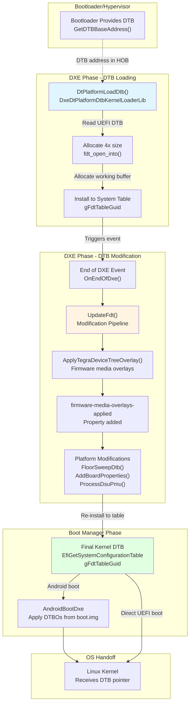
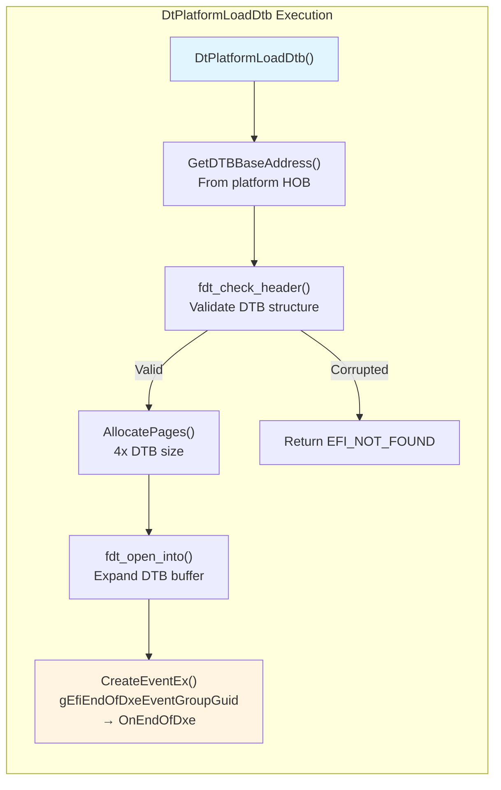
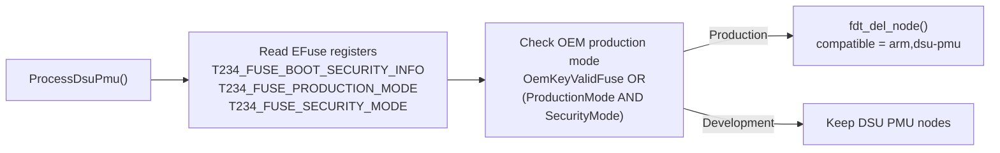

<!-- source: DeepWiki mcp.deepwiki.com · repo NVIDIA/edk2-nvidia · page 4 Device Tree System · fetched 2026-10-26 -->

# Device Tree System

<details>
<summary>Relevant source files</summary>

The following files were used as context for generating this wiki page:

- [Silicon/NVIDIA/Include/Library/DeviceTreeHelperLib.h](Silicon/NVIDIA/Include/Library/DeviceTreeHelperLib.h)
- [Silicon/NVIDIA/Library/DeviceTreeHelperLib/DeviceTreeHelperLib.inf](Silicon/NVIDIA/Library/DeviceTreeHelperLib/DeviceTreeHelperLib.inf)
- [Silicon/NVIDIA/Library/DeviceTreeHelperLib/DeviceTreeHelperLibCore.c](Silicon/NVIDIA/Library/DeviceTreeHelperLib/DeviceTreeHelperLibCore.c)
- [Silicon/NVIDIA/Library/DeviceTreeHelperLib/DeviceTreeHelperLibDeprecated.c](Silicon/NVIDIA/Library/DeviceTreeHelperLib/DeviceTreeHelperLibDeprecated.c)
- [Silicon/NVIDIA/Library/DeviceTreeHelperLib/DeviceTreeHelperLibParser.c](Silicon/NVIDIA/Library/DeviceTreeHelperLib/DeviceTreeHelperLibParser.c)
- [Silicon/NVIDIA/Library/DeviceTreeHelperLib/DeviceTreeHelperLibParserAArch64.c](Silicon/NVIDIA/Library/DeviceTreeHelperLib/DeviceTreeHelperLibParserAArch64.c)
- [Silicon/NVIDIA/Library/DeviceTreeHelperLib/DeviceTreeHelperLibParserX86.c](Silicon/NVIDIA/Library/DeviceTreeHelperLib/DeviceTreeHelperLibParserX86.c)
- [Silicon/NVIDIA/Library/DeviceTreeHelperLib/DeviceTreeHelperLibPointer.c](Silicon/NVIDIA/Library/DeviceTreeHelperLib/DeviceTreeHelperLibPointer.c)
- [Silicon/NVIDIA/Library/DeviceTreeHelperLib/DeviceTreeHelperLibPrivate.h](Silicon/NVIDIA/Library/DeviceTreeHelperLib/DeviceTreeHelperLibPrivate.h)
- [Silicon/NVIDIA/Library/DeviceTreeHelperLib/DeviceTreeHelperLibUtility.c](Silicon/NVIDIA/Library/DeviceTreeHelperLib/DeviceTreeHelperLibUtility.c)
- [Silicon/NVIDIA/Library/DeviceTreeHelperLib/UnitTest/DeviceTreeHelperLibGoogleTest.cpp](Silicon/NVIDIA/Library/DeviceTreeHelperLib/UnitTest/DeviceTreeHelperLibGoogleTest.cpp)
- [Silicon/NVIDIA/Library/DxeDtPlatformDtbLoaderLib/DxeDtPlatformDtbKernelLoaderLib.c](Silicon/NVIDIA/Library/DxeDtPlatformDtbLoaderLib/DxeDtPlatformDtbKernelLoaderLib.c)
- [Silicon/NVIDIA/Library/DxeDtPlatformDtbLoaderLib/DxeDtPlatformDtbKernelLoaderLib.inf](Silicon/NVIDIA/Library/DxeDtPlatformDtbLoaderLib/DxeDtPlatformDtbKernelLoaderLib.inf)

</details>


The Device Tree System manages the hardware description data structure (Device Tree Blob/DTB) that flows from the bootloader through UEFI to the operating system. This system is responsible for loading the initial UEFI DTB, applying platform-specific overlays and modifications, and preparing the final kernel DTB for OS handoff.

For information about early DTB parsing during PrePi phase, see [Pre-EFI Initialization (PrePi)](#3.1). For DTB-based ACPI table generation, see [TH500 Server Platform](#8.1).

## Device Tree Flow Through Boot Phases

The device tree passes through multiple transformation stages as firmware progresses from early boot to OS handoff:



**Sources:** [Silicon/NVIDIA/Library/DxeDtPlatformDtbLoaderLib/DxeDtPlatformDtbKernelLoaderLib.c:669-726]()

## DtPlatformLoadDtb - Initial DTB Loading

The `DtPlatformLoadDtb()` function in `DxeDtPlatformDtbKernelLoaderLib` is the entry point for loading the device tree during DXE initialization. This function is called by the DXE platform initialization infrastructure.

### Loading Process



The DTB buffer is allocated at **4x the original size** to accommodate runtime additions including overlays, board properties, and reserved memory regions.

**Sources:** [Silicon/NVIDIA/Library/DxeDtPlatformDtbLoaderLib/DxeDtPlatformDtbKernelLoaderLib.c:667-726]()

## UpdateFdt - DTB Modification Pipeline

The `UpdateFdt()` function orchestrates all device tree modifications. It is triggered by an event registered on `gFdtTableGuid` and executes during the End of DXE phase.

### Modification Pipeline

```mermaid
graph TB
    subgraph "UpdateFdt Pipeline"
        START["UpdateFdt()"]
        CHECK_ACPI["Check ACPI Table<br/>gEfiAcpiTableGuid"]
        GET_DTB["Get DTB from Config Table<br/>gFdtTableGuid"]
        RESET_PTR["SetDeviceTreePointer()<br/>Update global pointer"]
        
        CHECK_OVERLAY["Check overlay flag<br/>firmware-media-overlays-applied"]
        
        APPLY_OVERLAY["Apply Firmware Overlays<br/>ApplyTegraDeviceTreeOverlay()"]
        SET_FLAG["Set overlay flag<br/>firmware-media-overlays-applied"]
        REINSTALL1["gBS→InstallConfigurationTable<br/>Trigger re-processing"]
        
        REMOVE_PM["Remove /plugin-manager"]
        REMOVE_GOS["Remove grid-of-semaphores"]
        FLOORSWEEP["FloorSweepDtb()<br/>Disable unused hardware"]
        REMOVE_QSPI["RemoveQspiNodes()<br/>Conditional on PcdAllowOsAccessQspi"]
        
        ADD_BOARD["AddBoardProperties()<br/>Serial, SKU, IDs"]
        UPDATE_RAMOOPS["UpdateRamOopsMemory()"]
        UPDATE_PVA["UpdatePvaFwMemory()"]
        PROCESS_DSU["ProcessDsuPmu()<br/>Security: Remove DSU PMU"]
        
        ENABLE_OPTEE["EnableOpteeNode()/EnableTrustyNode()<br/>Conditional on presence"]
        ENABLE_FTPM["EnableFtpmNode()"]
        DTB_UPDATE["DtbUpdateForKernel()<br/>Platform-specific updates"]
        
        START --> CHECK_ACPI
        CHECK_ACPI -->|"ACPI present"| RETURN["Return early<br/>ACPI boot"]
        CHECK_ACPI -->|"No ACPI"| GET_DTB
        GET_DTB --> RESET_PTR
        RESET_PTR --> CHECK_OVERLAY
        
        CHECK_OVERLAY -->|"Not applied"| APPLY_OVERLAY
        APPLY_OVERLAY --> SET_FLAG
        SET_FLAG --> REINSTALL1
        REINSTALL1 --> RETURN
        
        CHECK_OVERLAY -->|"Already applied"| REMOVE_PM
        REMOVE_PM --> REMOVE_GOS
        REMOVE_GOS --> FLOORSWEEP
        FLOORSWEEP --> REMOVE_QSPI
        REMOVE_QSPI --> ADD_BOARD
        
        ADD_BOARD --> UPDATE_RAMOOPS
        UPDATE_RAMOOPS --> UPDATE_PVA
        UPDATE_PVA --> PROCESS_DSU
        
        PROCESS_DSU --> ENABLE_OPTEE
        ENABLE_OPTEE --> ENABLE_FTPM
        ENABLE_FTPM --> DTB_UPDATE
    end
    
    style START fill:#e1f5ff
    style APPLY_OVERLAY fill:#fff4e1
    style FLOORSWEEP fill:#ffe1e1
```



**Sources:** [Silicon/NVIDIA/Library/DxeDtPlatformDtbLoaderLib/DxeDtPlatformDtbKernelLoaderLib.c:524-632]()

### Key Modification Operations

| Operation | Function | Purpose |
|-----------|----------|---------|
| **Overlay Application** | `ApplyTegraDeviceTreeOverlay()` | Apply DTB overlays from firmware media (aligned after UEFI DTB) |
| **Plugin Manager Removal** | `fdt_del_node()` on `/plugin-manager` | Remove L4T plugin manager metadata |
| **Floorsweeping** | `FloorSweepDtb()` | Disable hardware based on fuse/strapping info |
| **QSPI Removal** | `RemoveQspiNodes()` | Conditionally remove QSPI flash nodes for security |
| **Board Properties** | `AddBoardProperties()` | Inject serial number, SKU, camera IDs from EEPROM |
| **RamOops Configuration** | `UpdateRamOopsMemory()` | Setup kernel crash dump region |
| **PVA Carveout** | `UpdatePvaFwMemory()` | Reserve memory for PVA firmware |
| **DSU PMU Security** | `ProcessDsuPmu()` | Remove DSU PMU nodes in production mode |
| **TEE Enablement** | `EnableOpteeNode()`/`EnableTrustyNode()` | Enable OP-TEE or Trusty node based on SMC detection |
| **fTPM Enablement** | `EnableFtpmNode()` | Enable firmware TPM node if protocol present |

**Sources:** [Silicon/NVIDIA/Library/DxeDtPlatformDtbLoaderLib/DxeDtPlatformDtbKernelLoaderLib.c:68-632]()

### Security: DSU PMU Removal

The `ProcessDsuPmu()` function removes ARM DSU (DynamoIQ Shared Unit) PMU nodes from the device tree in production/secure mode to prevent exposure of performance monitoring capabilities:



**Sources:** [Silicon/NVIDIA/Library/DxeDtPlatformDtbLoaderLib/DxeDtPlatformDtbKernelLoaderLib.c:441-522]()

### Memory Region Updates

Device tree modifications include updating reserved memory regions based on runtime platform information:

**RamOops (Kernel Crash Dump):**
- Reads `RamOopsRegion` from `TEGRA_PLATFORM_RESOURCE_INFO` HOB
- Updates `/ramoops` node with correct base address and size
- Handles variable `#address-cells` and `#size-cells` from parent node

**PVA Firmware Carveout:**
- Reads `PvaFwInfo` from `TEGRA_PLATFORM_RESOURCE_INFO` HOB
- Creates `/reserved-memory/pva-carveout` subnode
- Sets `compatible = "nvidia,pva-carveout"` and `nomap` properties

**Sources:** [Silicon/NVIDIA/Library/DxeDtPlatformDtbLoaderLib/DxeDtPlatformDtbKernelLoaderLib.c:296-439]()

## DeviceTreeHelperLib - DTB Access APIs

The `DeviceTreeHelperLib` provides a comprehensive API for traversing and querying device tree data. This library abstracts the underlying `libfdt` operations and provides NVIDIA-specific extensions.

### Library Architecture

```mermaid
graph TB
    subgraph "DeviceTreeHelperLib API Layers"
        subgraph "Pointer Management"
            SET_PTR["SetDeviceTreePointer()"]
            GET_PTR["GetDeviceTreePointer()"]
            DTB_LOADER["DtPlatformLoadDtb()"]
        end
        
        subgraph "Node Traversal"
            GET_COMPAT["DeviceTreeGetNextCompatibleNode()"]
            GET_CPU["DeviceTreeGetNextCpuNode()"]
            GET_MEM["DeviceTreeGetNextMemoryNode()"]
            GET_SUBNODE["DeviceTreeGetNamedSubnode()"]
            COUNT_NODES["DeviceTreeGetCompatibleNodeCount()"]
        end
        
        subgraph "Node Lookup"
            BY_PATH["DeviceTreeGetNodeByPath()"]
            BY_PHANDLE["DeviceTreeGetNodeByPHandle()"]
            GET_PHANDLE["DeviceTreeGetNodePHandle()"]
            GET_PATH["DeviceTreeGetNodePath()"]
            GET_PARENT["DeviceTreeGetParentOffset()"]
        end
        
        subgraph "Property Access"
            GET_PROP["DeviceTreeGetNodeProperty()"]
            GET_VAL64["DeviceTreeGetNodePropertyValue64()"]
            GET_VAL32["DeviceTreeGetNodePropertyValue32()"]
            LOCATE_STR["DeviceTreeLocateStringIndex()"]
        end
        
        subgraph "Hardware Descriptor Parsing"
            GET_REGS["DeviceTreeGetRegisters()"]
            GET_RANGES["DeviceTreeGetRanges()"]
            GET_INT["DeviceTreeGetInterrupts()"]
            GET_INT_MAP["DeviceTreeGetInterruptMap()"]
            GET_MSI_MAP["DeviceTreeGetMsiIommuMap()"]
            GET_IOMMUS["DeviceTreeGetIommus()"]
            GET_CACHE["DeviceTreeGetCacheData()"]
        end
        
        GET_PTR -.->|"Loads if not set"| DTB_LOADER
        
        GET_COMPAT --> GET_PTR
        BY_PATH --> GET_PTR
        GET_PROP --> GET_PTR
        GET_REGS --> GET_PTR
    end
    
    subgraph "Underlying FDT Library"
        LIBFDT["libfdt APIs<br/>fdt_next_node()<br/>fdt_get_property()<br/>etc."]
    end
    
    GET_PTR --> LIBFDT
    
    style GET_PTR fill:#e1f5ff
    style GET_REGS fill:#fff4e1
```



**Sources:** [Silicon/NVIDIA/Include/Library/DeviceTreeHelperLib.h:1-1101](), [Silicon/NVIDIA/Library/DeviceTreeHelperLib/DeviceTreeHelperLibCore.c:1-1316]()

### Device Tree Pointer Management

The library maintains a global device tree pointer that can be explicitly set or lazily loaded:

```c
// Explicit setting (used by DtPlatformLoadDtb)
SetDeviceTreePointer(Dtb, fdt_totalsize(Dtb));

// Getting pointer (auto-loads if not set)
VOID *DeviceTree;
UINTN Size;
Status = GetDeviceTreePointer(&DeviceTree, &Size);
```

The pointer is initially NULL and will call `DtPlatformLoadDtb()` on first access if not explicitly set.

**Sources:** [Silicon/NVIDIA/Library/DeviceTreeHelperLib/DeviceTreeHelperLibPointer.c:1-88]()

### Node Traversal and Search

The library provides multiple methods for finding nodes:

**By Compatibility String:**
```c
CONST CHAR8 *CompatStrings[] = { "nvidia,tegra234-qspi", NULL };
INT32 NodeOffset = -1;

// Find first matching node
Status = DeviceTreeGetNextCompatibleNode(CompatStrings, &NodeOffset);

// Count all matching nodes
UINT32 Count;
Status = DeviceTreeGetCompatibleNodeCount(CompatStrings, &Count);
```

**By Device Type:**
```c
INT32 NodeOffset = -1;

// Find CPU nodes (device_type = "cpu")
Status = DeviceTreeGetNextCpuNode(&NodeOffset);

// Find memory nodes (device_type = "memory")  
Status = DeviceTreeGetNextMemoryNode(&NodeOffset);
```

**By Path:**
```c
INT32 NodeOffset;
Status = DeviceTreeGetNodeByPath("/firmware/acpi", &NodeOffset);

// Path can use aliases
Status = DeviceTreeGetNodeByPath("serial0", &NodeOffset);
```

**By Phandle:**
```c
UINT32 Phandle = 0x123;
INT32 NodeOffset;
Status = DeviceTreeGetNodeByPHandle(Phandle, &NodeOffset);
```

All traversal functions check the `status` property and only return nodes with `status = "okay"` or missing status.

**Sources:** [Silicon/NVIDIA/Library/DeviceTreeHelperLib/DeviceTreeHelperLibCore.c:69-637]()

### Hardware Descriptor Parsing

The library provides specialized parsers for common device tree descriptor formats:

#### Register Parsing

```c
NVIDIA_DEVICE_TREE_REGISTER_DATA RegisterArray[10];
UINT32 NumberOfRegisters = 10;

Status = DeviceTreeGetRegisters(NodeOffset, RegisterArray, &NumberOfRegisters);

// RegisterArray[i].BaseAddress - Physical address
// RegisterArray[i].Size        - Region size  
// RegisterArray[i].Name        - Name from "reg-names" (or NULL)
```

The parser handles variable `#address-cells` and `#size-cells` from the parent node (1 or 2 cells each).

**Sources:** [Silicon/NVIDIA/Library/DeviceTreeHelperLib/DeviceTreeHelperLibParser.c:90-206]()

#### Interrupt Parsing

```c
NVIDIA_DEVICE_TREE_INTERRUPT_DATA InterruptArray[5];
UINT32 NumberOfInterrupts = 5;

Status = DeviceTreeGetInterrupts(NodeOffset, InterruptArray, &NumberOfInterrupts);

// InterruptArray[i].Type              - INTERRUPT_SPI_TYPE or INTERRUPT_PPI_TYPE
// InterruptArray[i].Interrupt         - Interrupt number
// InterruptArray[i].Flag              - Trigger type (edge/level)
// InterruptArray[i].Name              - Name from "interrupt-names"
// InterruptArray[i].ControllerCompatible - Parent controller compatible string
```

Supports both `interrupts` and `interrupts-extended` properties. Automatically resolves interrupt parent controllers and reads `#interrupt-cells`.

**Sources:** [Silicon/NVIDIA/Library/DeviceTreeHelperLib/DeviceTreeHelperLibParser.c:542-688]()

#### Ranges Parsing

```c
NVIDIA_DEVICE_TREE_RANGES_DATA RangesArray[10];
UINT32 NumberOfRanges = 10;

Status = DeviceTreeGetRanges(NodeOffset, "ranges", RangesArray, &NumberOfRanges);
// Also supports "dma-ranges", "hbm-ranges", etc.

// RangesArray[i].ChildAddressHigh - High 32-bits (for PCIe)
// RangesArray[i].ChildAddress     - Child address space
// RangesArray[i].ParentAddress    - Parent address space
// RangesArray[i].Size            - Region size
// RangesArray[i].Name            - Name from range-names property
```

Handles 1-3 address cells for child, 1-2 for parent, and 1-2 size cells. Special handling for `hbm-ranges` which omits child address field.

**Sources:** [Silicon/NVIDIA/Library/DeviceTreeHelperLib/DeviceTreeHelperLibParser.c:224-404]()

### Advanced Parsing: Interrupt Maps and IOMMU Maps

For complex routing scenarios:

```c
// Interrupt map (e.g., PCIe legacy interrupts)
NVIDIA_DEVICE_TREE_INTERRUPT_MAP_DATA InterruptMapArray[100];
UINT32 NumberOfMaps = 100;
Status = DeviceTreeGetInterruptMap(NodeOffset, InterruptMapArray, &NumberOfMaps);

// IOMMU map (stream ID to SMMU mapping)
NVIDIA_DEVICE_TREE_IOMMUS_DATA IommusArray[10];
UINT32 NumberOfIommus = 10;
Status = DeviceTreeGetIommus(NodeOffset, IommusArray, &NumberOfIommus);

// MSI/IOMMU map (RID to MSI parent/IOMMU mapping)
NVIDIA_DEVICE_TREE_MSI_IOMMU_MAP_DATA MapArray[50];
UINT32 NumberOfMaps = 50;
Status = DeviceTreeGetMsiIommuMap(NodeOffset, "msi-map", MapArray, &NumberOfMaps);
```

These parsers handle complex multi-level mappings with variable cell counts determined by `#address-cells`, `#interrupt-cells`, `#msi-cells`, and `#iommu-cells` properties.

**Sources:** [Silicon/NVIDIA/Library/DeviceTreeHelperLib/DeviceTreeHelperLibParser.c:757-1125]()

## Device Tree Usage Patterns

### Pattern 1: Platform Resource Discovery

Hardware drivers use the device tree to discover platform resources during DXE initialization:

```c
// Example: Finding PCIe controller nodes
CONST CHAR8 *PcieCompatible[] = { 
    "nvidia,tegra234-pcie",
    "nvidia,th500-pcie",
    NULL 
};

INT32 NodeOffset = -1;
while (!EFI_ERROR(DeviceTreeGetNextCompatibleNode(PcieCompatible, &NodeOffset))) {
    // Get register regions
    NVIDIA_DEVICE_TREE_REGISTER_DATA Registers[5];
    UINT32 NumRegs = 5;
    DeviceTreeGetRegisters(NodeOffset, Registers, &NumRegs);
    
    // Get interrupts
    NVIDIA_DEVICE_TREE_INTERRUPT_DATA Interrupts[10];
    UINT32 NumInts = 10;
    DeviceTreeGetInterrupts(NodeOffset, Interrupts, &NumInts);
    
    // Install driver on this controller
    InstallPcieController(Registers, Interrupts);
}
```

**Sources:** [Silicon/NVIDIA/Library/DeviceTreeHelperLib/DeviceTreeHelperLibCore.c:91-127]()

### Pattern 2: ACPI Table Generation from DTB

The ConfigurationManager uses device tree data to generate ACPI tables on platforms that support ACPI boot:

```c
// Read GIC distributor base from DTB
Status = DeviceTreeGetNodeByPath("/interrupt-controller", &GicNode);
DeviceTreeGetRegisters(GicNode, &GicRegisters, &NumGicRegs);
PcdSet64(PcdGicDistributorBase, GicRegisters[0].BaseAddress);

// Read memory regions from DTB
INT32 MemNode = -1;
while (!EFI_ERROR(DeviceTreeGetNextMemoryNode(&MemNode))) {
    DeviceTreeGetRegisters(MemNode, &MemRegs, &NumMemRegs);
    // Build SRAT memory affinity entries
}
```

This pattern allows the same DTB to drive both device tree boot (Linux) and ACPI boot paths.

**Sources:** Referenced in [Diagram 2: Platform Resource and Configuration Management]()

### Pattern 3: Overlay Application

The overlay application mechanism allows board-specific customizations:

```c
// DTB layout in memory:
// [UEFI DTB][4KB aligned][Overlay DTB]

VOID *CpublDtb = (VOID *)(UINTN)GetDTBBaseAddress();
VOID *OverlayDtb = (VOID *)ALIGN_VALUE((UINTN)CpublDtb + fdt_totalsize(CpublDtb), SIZE_4KB);

if (fdt_check_header(OverlayDtb) == 0) {
    Status = ApplyTegraDeviceTreeOverlay(Dtb, OverlayDtb, "kernel");
}
```

Overlays are applied once and marked with the `firmware-media-overlays-applied` property to prevent re-application.

**Sources:** [Silicon/NVIDIA/Library/DxeDtPlatformDtbLoaderLib/DxeDtPlatformDtbKernelLoaderLib.c:554-601]()

### Pattern 4: Node Status Control

The firmware controls which hardware is visible to the OS by manipulating the `status` property:

```c
// Disable QSPI access from OS
INT32 QspiNode;
while (fdt_node_offset_by_compatible(Dtb, 0, "nvidia,tegra234-qspi") >= 0) {
    if (NodeHasSubnode(QspiNode, "flash@0")) {
        fdt_del_node(Dtb, QspiNode);  // Remove entirely
    }
}

// Enable Trusty node
INT32 TrustyNode = fdt_path_offset(Dtb, "/trusty");
fdt_setprop(Dtb, TrustyNode, "status", "okay", sizeof("okay"));
```

**Sources:** [Silicon/NVIDIA/Library/DxeDtPlatformDtbLoaderLib/DxeDtPlatformDtbKernelLoaderLib.c:254-294](), [Silicon/NVIDIA/Library/DxeDtPlatformDtbLoaderLib/DxeDtPlatformDtbKernelLoaderLib.c:146-176]()

## Summary

The Device Tree System provides a complete pipeline for managing hardware description data from bootloader through UEFI to OS. Key capabilities include:

- **Loading and Validation**: `DtPlatformLoadDtb()` loads the UEFI DTB and allocates expansion space
- **Overlay Support**: Firmware media overlays are applied via `ApplyTegraDeviceTreeOverlay()`
- **Platform Customization**: Board properties, memory regions, and hardware configuration injected via `UpdateFdt()`
- **Security Hardening**: Production mode disables debug features (DSU PMU) and QSPI access
- **API Abstraction**: `DeviceTreeHelperLib` provides type-safe APIs for DTB access across all DXE drivers
- **Dual Boot Support**: Same DTB can drive device tree boot (Linux) or ACPI table generation

The system ensures that the OS receives a complete, accurate, and secure hardware description tailored to the specific platform configuration and boot mode.

---

