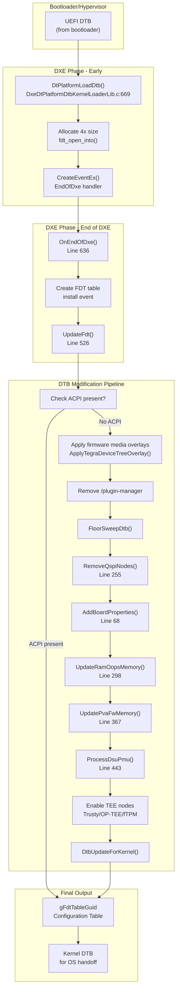
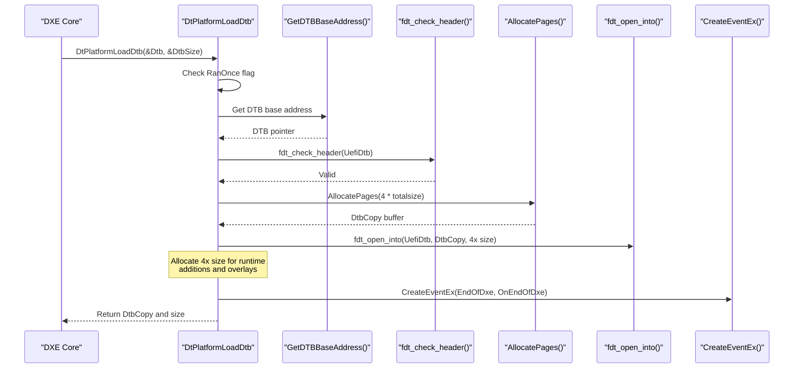
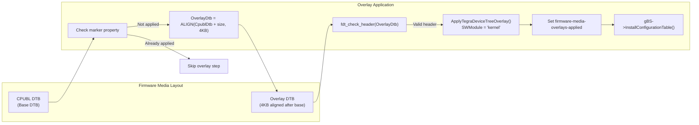
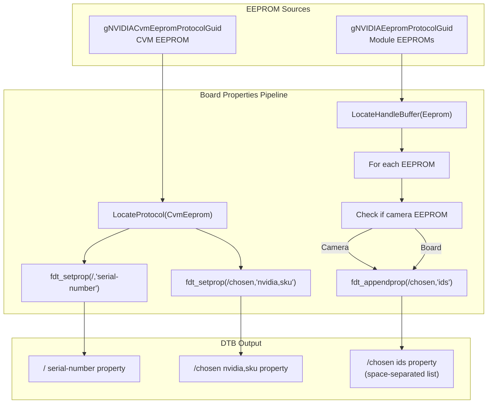
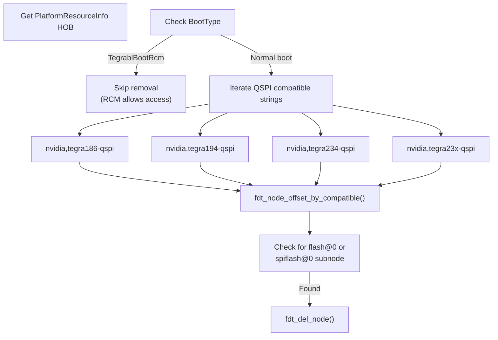
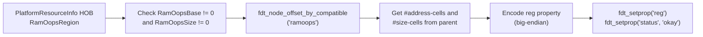
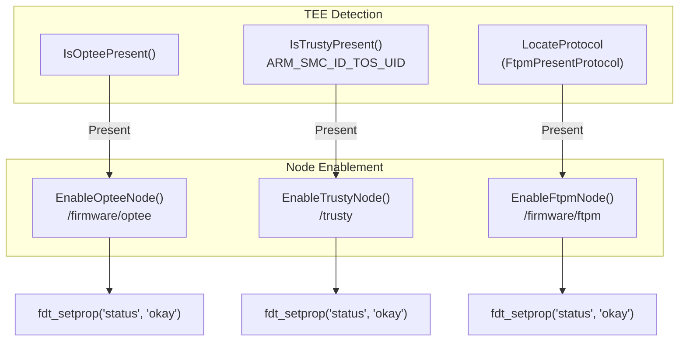
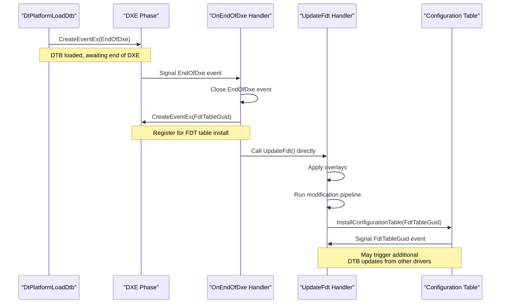
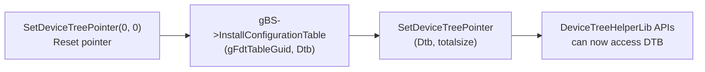

<!-- source: DeepWiki mcp.deepwiki.com · repo NVIDIA/edk2-nvidia · page 4.1 Device Tree Loading and Preparation · fetched 2026-10-26 -->

# Device Tree Loading and Preparation

Relevant source files

The following files were used as context for generating this wiki page:

- [Silicon/NVIDIA/Include/Library/DeviceTreeHelperLib.h](Silicon/NVIDIA/Include/Library/DeviceTreeHelperLib.h)
- [Silicon/NVIDIA/Library/DeviceTreeHelperLib/DeviceTreeHelperLib.inf](Silicon/NVIDIA/Library/DeviceTreeHelperLib/DeviceTreeHelperLib.inf)
- [Silicon/NVIDIA/Library/DeviceTreeHelperLib/DeviceTreeHelperLibCore.c](Silicon/NVIDIA/Library/DeviceTreeHelperLib/DeviceTreeHelperLibCore.c)
- [Silicon/NVIDIA/Library/DeviceTreeHelperLib/DeviceTreeHelperLibDeprecated.c](Silicon/NVIDIA/Library/DeviceTreeHelperLib/DeviceTreeHelperLibDeprecated.c)
- [Silicon/NVIDIA/Library/DeviceTreeHelperLib/DeviceTreeHelperLibParser.c](Silicon/NVIDIA/Library/DeviceTreeHelperLib/DeviceTreeHelperLibParser.c)
- [Silicon/NVIDIA/Library/DeviceTreeHelperLib/DeviceTreeHelperLibParserAArch64.c](Silicon/NVIDIA/Library/DeviceTreeHelperLib/DeviceTreeHelperLibParserAArch64.c)
- [Silicon/NVIDIA/Library/DeviceTreeHelperLib/DeviceTreeHelperLibParserX86.c](Silicon/NVIDIA/Library/DeviceTreeHelperLib/DeviceTreeHelperLibParserX86.c)
- [Silicon/NVIDIA/Library/DeviceTreeHelperLib/DeviceTreeHelperLibPointer.c](Silicon/NVIDIA/Library/DeviceTreeHelperLib/DeviceTreeHelperLibPointer.c)
- [Silicon/NVIDIA/Library/DeviceTreeHelperLib/DeviceTreeHelperLibPrivate.h](Silicon/NVIDIA/Library/DeviceTreeHelperLib/DeviceTreeHelperLibPrivate.h)
- [Silicon/NVIDIA/Library/DeviceTreeHelperLib/DeviceTreeHelperLibUtility.c](Silicon/NVIDIA/Library/DeviceTreeHelperLib/DeviceTreeHelperLibUtility.c)
- [Silicon/NVIDIA/Library/DeviceTreeHelperLib/UnitTest/DeviceTreeHelperLibGoogleTest.cpp](Silicon/NVIDIA/Library/DeviceTreeHelperLib/UnitTest/DeviceTreeHelperLibGoogleTest.cpp)
- [Silicon/NVIDIA/Library/DxeDtPlatformDtbLoaderLib/DxeDtPlatformDtbKernelLoaderLib.c](Silicon/NVIDIA/Library/DxeDtPlatformDtbLoaderLib/DxeDtPlatformDtbKernelLoaderLib.c)
- [Silicon/NVIDIA/Library/DxeDtPlatformDtbLoaderLib/DxeDtPlatformDtbKernelLoaderLib.inf](Silicon/NVIDIA/Library/DxeDtPlatformDtbLoaderLib/DxeDtPlatformDtbKernelLoaderLib.inf)

## Purpose and Scope

This document describes the device tree loading and preparation system that prepares the kernel device tree blob (DTB) for OS handoff during the DXE phase. The system loads the base DTB provided by the bootloader, applies overlays from firmware media, performs platform-specific modifications, injects board properties, and enforces security policies before installing the final DTB for kernel boot.

For information about device tree parsing and property access APIs, see [Device Tree Helper Library](#4.2). For early boot DTB usage during PrePi, see [Pre-EFI Initialization](#3.1). For Android-specific DTB overlay application during boot image parsing, see [Android Boot Implementation](#7.1).

## System Architecture

The device tree preparation system is implemented in the `DxeDtPlatformDtbKernelLoaderLib` library, which provides the `DtPlatformLoadDtb` interface required by the EDK2 platform infrastructure. The system operates in two phases: initial loading during DXE driver initialization, and final modification at the end of DXE phase.

**Sources:** [Silicon/NVIDIA/Library/DxeDtPlatformDtbLoaderLib/DxeDtPlatformDtbKernelLoaderLib.c:526-726]()

## Initial DTB Loading

The `DtPlatformLoadDtb` function serves as the library's main entry point, called during DXE phase initialization to load the device tree. This function runs only once and loads the UEFI DTB provided by the bootloader.

### Loading Sequence

**Key Implementation Details:**

| Aspect | Implementation |
|--------|----------------|
| Size Allocation | 4x the original DTB size to accommodate overlays and modifications |
| Run Once Protection | Static `RanOnce` flag prevents multiple loads |
| Error Handling | Returns `EFI_NOT_FOUND` if header check fails |
| Event Registration | Registers `OnEndOfDxe` callback for final modifications |
| Memory Type | Uses `AllocatePages` for page-aligned allocation |

**Sources:** [Silicon/NVIDIA/Library/DxeDtPlatformDtbLoaderLib/DxeDtPlatformDtbKernelLoaderLib.c:667-726]()

## Firmware Media Overlay Application

After the initial DTB is loaded, the system can apply overlays from firmware media. These overlays are kernel-specific device tree modifications stored adjacent to the DTB on the boot media.

### Overlay Detection and Application

The system checks for the presence of overlays by:
1. Looking for a marker property `/firmware/uefi/firmware-media-overlays-applied`
2. If not present, loading the overlay DTB from adjacent memory region
3. Applying overlays using `ApplyTegraDeviceTreeOverlay`
4. Setting the marker to prevent re-application

**Sources:** [Silicon/NVIDIA/Library/DxeDtPlatformDtbLoaderLib/DxeDtPlatformDtbKernelLoaderLib.c:554-601]()

## DTB Modification Pipeline

The `UpdateFdt` function implements the main modification pipeline, orchestrating a series of transformations on the device tree. This function is triggered by the `gFdtTableGuid` configuration table installation event.

### Modification Stages

| Stage | Function | Purpose | Conditional |
|-------|----------|---------|-------------|
| ACPI Check | `EfiGetSystemConfigurationTable` | Skip DTB prep if ACPI is present | Always |
| Overlay Application | `ApplyTegraDeviceTreeOverlay` | Apply kernel-dtb overlays from firmware | If not already applied |
| Plugin Manager Removal | `fdt_del_node` | Remove `/plugin-manager` node | Always |
| Grid of Semaphores Removal | `fdt_del_node` | Remove `/reserved-memory/grid-of-semaphores` | Always |
| Floorsweeping | `FloorSweepDtb` | Disable hardware based on configuration | Always |
| QSPI Removal | `RemoveQspiNodes` | Remove QSPI flash access | If `!PcdAllowOsAccessQspi` |
| Board Properties | `AddBoardProperties` | Inject EEPROM data | Always |
| RamOops | `UpdateRamOopsMemory` | Configure kernel crash logging region | If configured |
| PVA Firmware | `UpdatePvaFwMemory` | Configure PVA firmware carveout | If configured |
| DSU PMU Security | `ProcessDsuPmu` | Remove DSU PMU in production | If production fuses set |
| TEE Enablement | `EnableOpteeNode` / `EnableTrustyNode` | Enable secure OS node | If TEE present |
| fTPM Enablement | `EnableFtpmNode` | Enable firmware TPM | If fTPM available |
| Platform Updates | `DtbUpdateForKernel` | Platform-specific modifications | Always |

**Sources:** [Silicon/NVIDIA/Library/DxeDtPlatformDtbLoaderLib/DxeDtPlatformDtbKernelLoaderLib.c:526-632]()

## Board Property Injection

The `AddBoardProperties` function enriches the device tree with board-specific identification data read from EEPROM protocols. This data includes serial numbers, SKU information, and camera module identifiers.

### Property Sources and Targets

**Key Properties Set:**

| Property Path | Source | Format | Example |
|---------------|--------|--------|---------|
| `/serial-number` | CVM EEPROM `SerialNumber` | Binary blob | Board serial |
| `/chosen/nvidia,sku` | CVM EEPROM `ProductId` | Binary blob | Product ID |
| `/chosen/ids` | Module EEPROM `BoardId` | Space-separated ASCII | "Board1 Board2 Camera1 " |

**Sources:** [Silicon/NVIDIA/Library/DxeDtPlatformDtbLoaderLib/DxeDtPlatformDtbKernelLoaderLib.c:68-120]()

## Security-Related Modifications

Several modifications enforce security policies by removing or disabling device tree nodes that could expose sensitive hardware or debugging interfaces.

### QSPI Flash Node Removal

The `RemoveQspiNodes` function removes QSPI flash controller nodes from the kernel DTB to prevent OS access to the boot flash device, except in RCM (Recovery Mode) boot.

**Sources:** [Silicon/NVIDIA/Library/DxeDtPlatformDtbLoaderLib/DxeDtPlatformDtbKernelLoaderLib.c:255-294]()

### DSU PMU Removal in Production Mode

The `ProcessDsuPmu` function removes ARM DSU (DynamIQ Shared Unit) Performance Monitor Unit nodes on production devices to prevent performance counter access that could be used for side-channel attacks.

**Production Detection Logic (T234):**

| Fuse Register | Offset | Bit | Meaning |
|---------------|--------|-----|---------|
| `BOOT_SECURITY_INFO` | 0x268 | 9 | OEM Key Valid |
| `PRODUCTION_MODE` | 0x100 | 0 | Production Mode |
| `PRODUCTION_MODE_SHADOW` | 0x7ac | 0 | Production Mode Shadow |
| `SECURITY_MODE` | 0x1a0 | 0 | Security Mode |
| `SECURITY_MODE_SHADOW` | 0x7b0 | 0 | Security Mode Shadow |

**Production Determination:**
- `OdmProductionMode = (ProductionMode || ProductionModeShadow) && (SecurityMode || SecurityModeShadow)`
- `OemProduction = OemKeyValid || OdmProductionMode`

If `OemProduction` is true, all `compatible = "arm,dsu-pmu"` nodes are deleted.

**Sources:** [Silicon/NVIDIA/Library/DxeDtPlatformDtbLoaderLib/DxeDtPlatformDtbKernelLoaderLib.c:443-522]()

## Memory Region Configuration

The system updates device tree memory regions for kernel subsystems including crash logging and accelerator firmware.

### RamOops Memory Region

The `UpdateRamOopsMemory` function configures the `ramoops` node for persistent kernel crash logging (pstore/ramoops subsystem).

**Configuration Process:**

**Sources:** [Silicon/NVIDIA/Library/DxeDtPlatformDtbLoaderLib/DxeDtPlatformDtbKernelLoaderLib.c:298-363]()

### PVA Firmware Carveout

The `UpdatePvaFwMemory` function creates a reserved memory node for the PVA (Programmable Vision Accelerator) firmware carveout.

**Node Creation:**
1. Reads PVA firmware base/size from `PlatformResourceInfo->PvaFwInfo`
2. Creates `/reserved-memory/pva-carveout` node
3. Sets properties:
   - `compatible = "nvidia,pva-carveout"`
   - `reg = <address size>` (encoded per parent's cell sizes)
   - `status = "okay"`
   - `nomap` (empty property indicating non-mappable)

**Sources:** [Silicon/NVIDIA/Library/DxeDtPlatformDtbLoaderLib/DxeDtPlatformDtbKernelLoaderLib.c:367-439]()

## Trusted Execution Environment Enablement

The system enables device tree nodes for Trusted Execution Environment (TEE) components based on runtime detection.

### TEE Detection and Enablement

**Trusty OS Detection:**

The `IsTrustyPresent` function uses ARM SMC calls to detect the Trusty OS:
- Calls `ARM_SMC_ID_TOS_UID` (0xbf00ff01)
- Checks return values against Trusty UID constants:
  - `TRUSTY_OS_UID0 = 0xf025ee40`
  - `TRUSTY_OS_UID1 = 0x4c30bca2`
  - `TRUSTY_OS_UID2 = 0x73a14c8c`
  - `TRUSTY_OS_UID3 = 0xf18a7dc5`

**Sources:** [Silicon/NVIDIA/Library/DxeDtPlatformDtbLoaderLib/DxeDtPlatformDtbKernelLoaderLib.c:124-251](), [Silicon/NVIDIA/Library/DxeDtPlatformDtbLoaderLib/DxeDtPlatformDtbKernelLoaderLib.c:624-630]()

## Event-Driven Modification Timing

The DTB modification pipeline uses EDK2 event notifications to ensure modifications occur at the correct phase of boot.

### Event Flow

**Event Registration Strategy:**
1. **EndOfDxe Event**: Created in `DtPlatformLoadDtb`, signals when DXE drivers are loaded
2. **FdtTableGuid Event**: Created in `OnEndOfDxe`, signals when FDT table is installed/updated
3. **Direct Call**: `UpdateFdt` called immediately in `OnEndOfDxe` to perform initial modifications
4. **Re-entry Support**: FdtTableGuid event allows re-triggering if DTB is updated by other drivers

**Sources:** [Silicon/NVIDIA/Library/DxeDtPlatformDtbLoaderLib/DxeDtPlatformDtbKernelLoaderLib.c:636-653](), [Silicon/NVIDIA/Library/DxeDtPlatformDtbLoaderLib/DxeDtPlatformDtbKernelLoaderLib.c:701-708]()

## Device Tree Pointer Management

The system uses `DeviceTreeHelperLib` to manage the device tree pointer globally, allowing other components to access the prepared DTB.

### Pointer Update Flow

**Key Operations:**

| Operation | Location | Purpose |
|-----------|----------|---------|
| Reset pointer | UpdateFdt:551 | Clear before overlay application |
| Set pointer | UpdateFdt:552 | Update after modifications |
| Install table | UpdateFdt:598 | Publish DTB for other drivers |

**Sources:** [Silicon/NVIDIA/Library/DxeDtPlatformDtbLoaderLib/DxeDtPlatformDtbKernelLoaderLib.c:551-552](), [Silicon/NVIDIA/Library/DxeDtPlatformDtbLoaderLib/DxeDtPlatformDtbKernelLoaderLib.c:598]()

## Integration with Platform-Specific Updates

The final stage of the modification pipeline calls `DtbUpdateForKernel`, a platform-specific hook that allows additional customizations.

**Hook Invocation:**

The `DtbUpdateLib` provides the `DtbUpdateForKernel` function, which is implemented differently for each platform (Jetson, Server, etc.) to apply platform-specific device tree modifications.

**Sources:** [Silicon/NVIDIA/Library/DxeDtPlatformDtbLoaderLib/DxeDtPlatformDtbKernelLoaderLib.c:631](), [Silicon/NVIDIA/Library/DxeDtPlatformDtbLoaderLib/DxeDtPlatformDtbKernelLoaderLib.inf:42]()

## Summary

The Device Tree Loading and Preparation system transforms the bootloader-provided DTB into a kernel-ready configuration through a multi-stage pipeline:

1. **Load**: Copies base DTB with 4x size allocation
2. **Overlay**: Applies kernel-dtb overlays from firmware media  
3. **Clean**: Removes plugin-manager and reserved regions
4. **Floorsweep**: Disables hardware per configuration
5. **Secure**: Removes QSPI and DSU PMU access
6. **Enrich**: Adds board properties from EEPROM
7. **Configure**: Updates memory regions (RamOops, PVA)
8. **Enable**: Activates TEE nodes (OP-TEE/Trusty/fTPM)
9. **Customize**: Applies platform-specific modifications
10. **Publish**: Installs final DTB via configuration table

This prepared DTB is then consumed by the boot manager and passed to the kernel during OS handoff, providing complete hardware description and configuration data.

---

