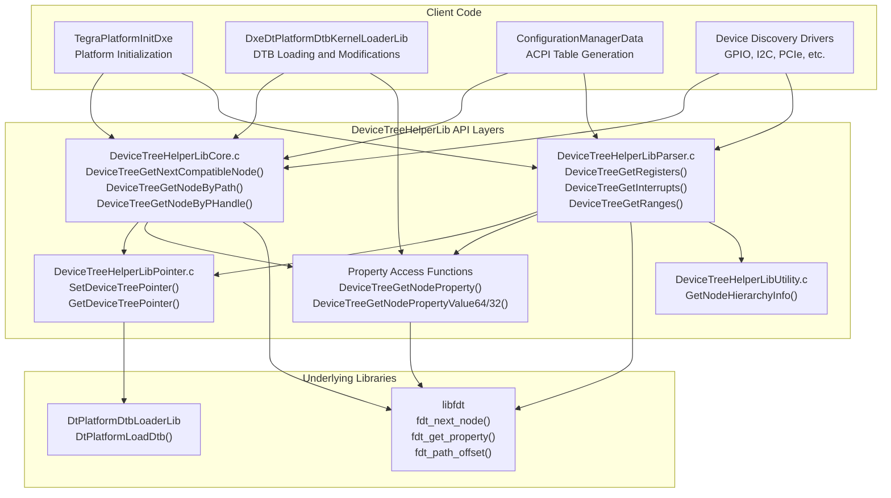
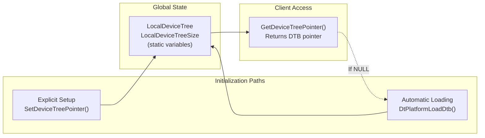
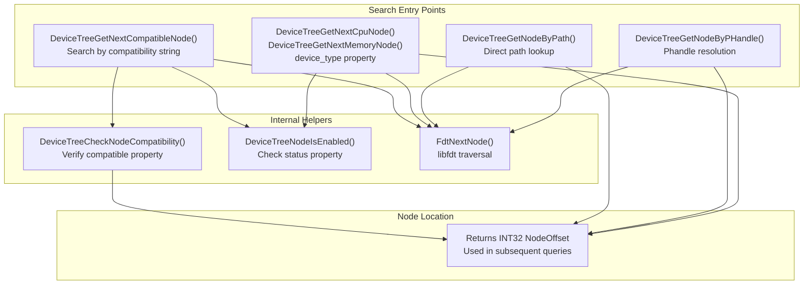
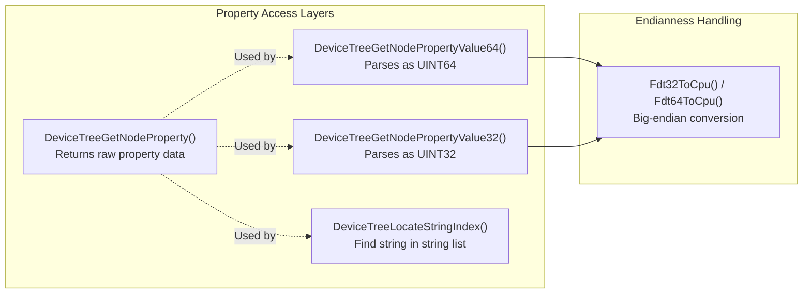
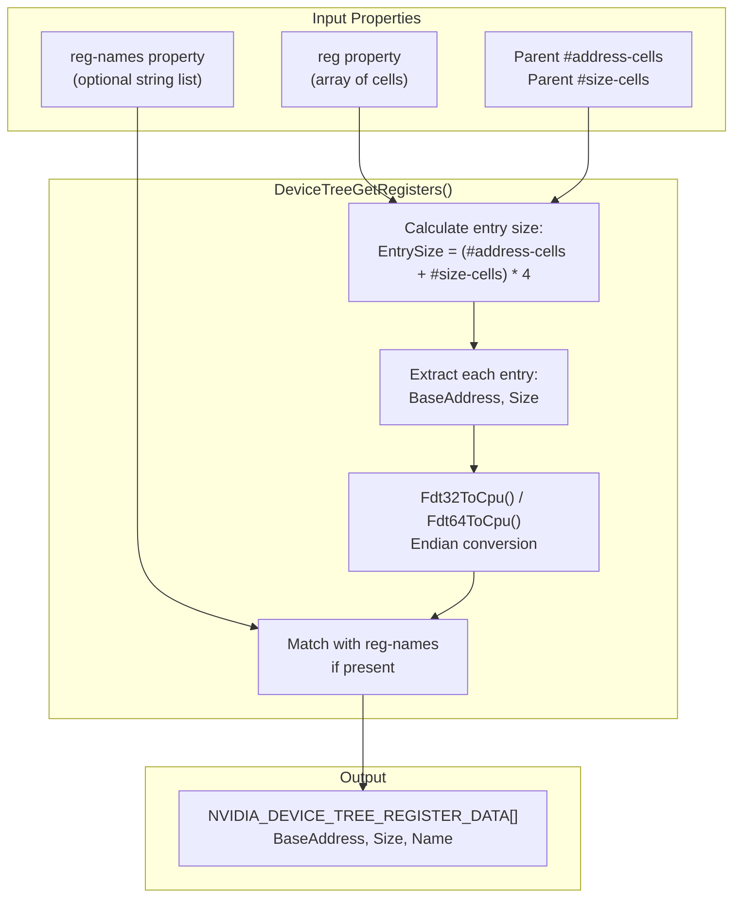
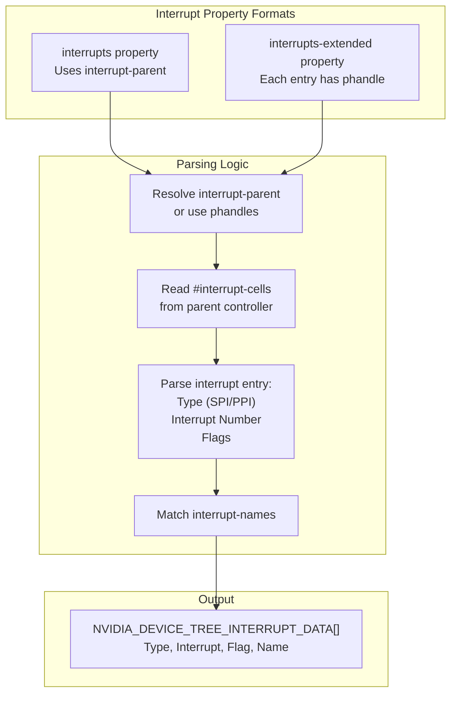
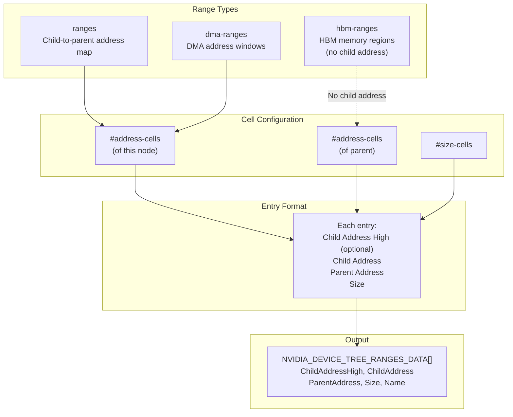
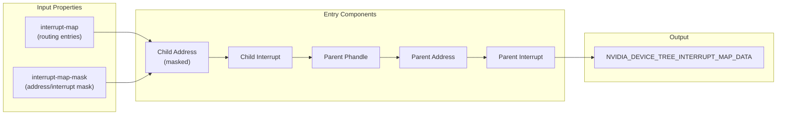
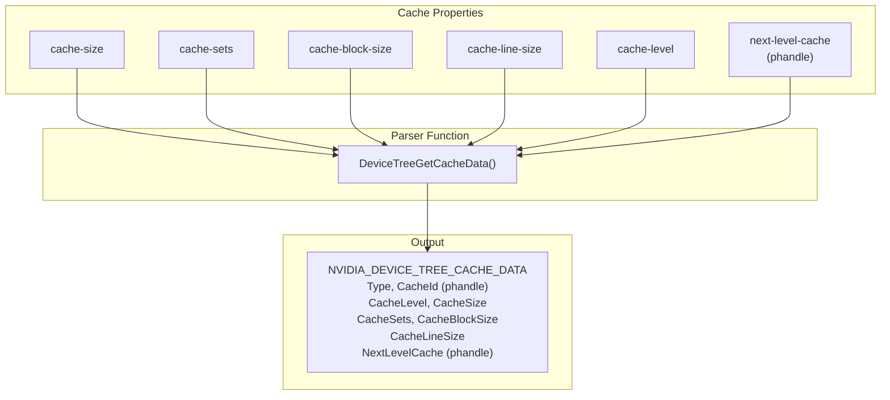
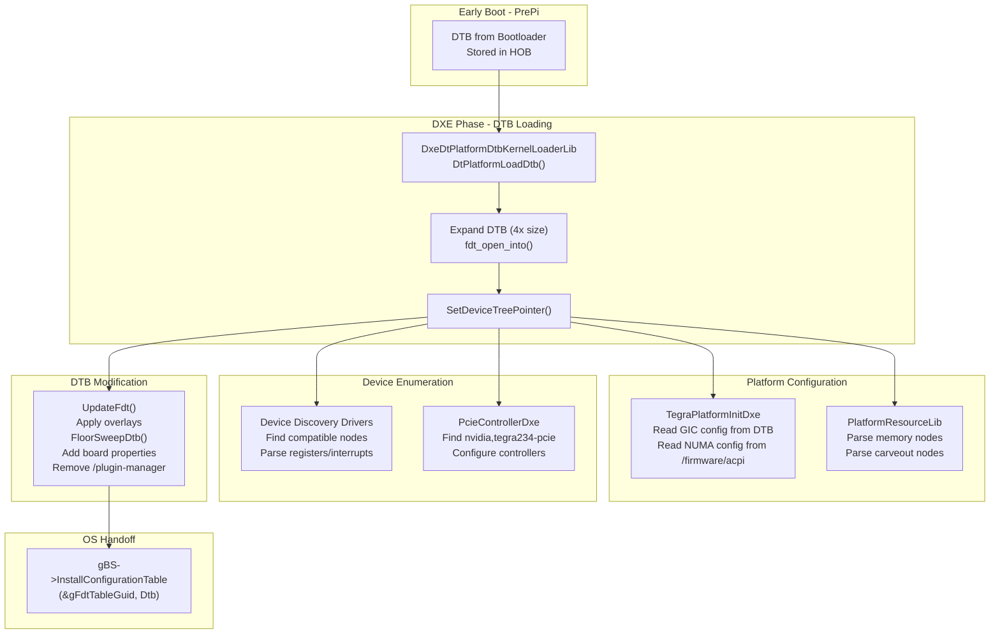

<!-- source: DeepWiki mcp.deepwiki.com · repo NVIDIA/edk2-nvidia · page 4.2 Device Tree Helper Library · fetched 2026-10-26 -->

# Device Tree Helper Library

<details>
<summary>Relevant source files</summary>

The following files were used as context for generating this wiki page:

- [Silicon/NVIDIA/Include/Library/DeviceTreeHelperLib.h](Silicon/NVIDIA/Include/Library/DeviceTreeHelperLib.h)
- [Silicon/NVIDIA/Library/DeviceTreeHelperLib/DeviceTreeHelperLib.inf](Silicon/NVIDIA/Library/DeviceTreeHelperLib/DeviceTreeHelperLib.inf)
- [Silicon/NVIDIA/Library/DeviceTreeHelperLib/DeviceTreeHelperLibCore.c](Silicon/NVIDIA/Library/DeviceTreeHelperLib/DeviceTreeHelperLibCore.c)
- [Silicon/NVIDIA/Library/DeviceTreeHelperLib/DeviceTreeHelperLibDeprecated.c](Silicon/NVIDIA/Library/DeviceTreeHelperLib/DeviceTreeHelperLibDeprecated.c)
- [Silicon/NVIDIA/Library/DeviceTreeHelperLib/DeviceTreeHelperLibParser.c](Silicon/NVIDIA/Library/DeviceTreeHelperLib/DeviceTreeHelperLibParser.c)
- [Silicon/NVIDIA/Library/DeviceTreeHelperLib/DeviceTreeHelperLibParserAArch64.c](Silicon/NVIDIA/Library/DeviceTreeHelperLib/DeviceTreeHelperLibParserAArch64.c)
- [Silicon/NVIDIA/Library/DeviceTreeHelperLib/DeviceTreeHelperLibParserX86.c](Silicon/NVIDIA/Library/DeviceTreeHelperLib/DeviceTreeHelperLibParserX86.c)
- [Silicon/NVIDIA/Library/DeviceTreeHelperLib/DeviceTreeHelperLibPointer.c](Silicon/NVIDIA/Library/DeviceTreeHelperLib/DeviceTreeHelperLibPointer.c)
- [Silicon/NVIDIA/Library/DeviceTreeHelperLib/DeviceTreeHelperLibPrivate.h](Silicon/NVIDIA/Library/DeviceTreeHelperLib/DeviceTreeHelperLibPrivate.h)
- [Silicon/NVIDIA/Library/DeviceTreeHelperLib/DeviceTreeHelperLibUtility.c](Silicon/NVIDIA/Library/DeviceTreeHelperLib/DeviceTreeHelperLibUtility.c)
- [Silicon/NVIDIA/Library/DeviceTreeHelperLib/UnitTest/DeviceTreeHelperLibGoogleTest.cpp](Silicon/NVIDIA/Library/DeviceTreeHelperLib/UnitTest/DeviceTreeHelperLibGoogleTest.cpp)
- [Silicon/NVIDIA/Library/DxeDtPlatformDtbLoaderLib/DxeDtPlatformDtbKernelLoaderLib.c](Silicon/NVIDIA/Library/DxeDtPlatformDtbLoaderLib/DxeDtPlatformDtbKernelLoaderLib.c)
- [Silicon/NVIDIA/Library/DxeDtPlatformDtbLoaderLib/DxeDtPlatformDtbKernelLoaderLib.inf](Silicon/NVIDIA/Library/DxeDtPlatformDtbLoaderLib/DxeDtPlatformDtbKernelLoaderLib.inf)

</details>


## Purpose and Scope

The Device Tree Helper Library (`DeviceTreeHelperLib`) provides a high-level abstraction layer for parsing and querying UEFI Device Tree Blob (DTB) data structures throughout the NVIDIA EDK2 firmware. This library wraps the low-level `libfdt` library with UEFI-idiomatic interfaces, offering type-safe parsing functions for common device tree patterns such as registers, interrupts, ranges, and compatibility-based device enumeration.

This document covers the library's API, internal architecture, and usage patterns. For information about how the device tree is loaded and prepared for kernel handoff, see [Device Tree Loading and Preparation](#4.1). For broader device tree system architecture, see [Device Tree System](#4).

**Sources:** [Silicon/NVIDIA/Include/Library/DeviceTreeHelperLib.h:1-21]()

---

## Library Architecture

The Device Tree Helper Library is organized into several functional modules, each implemented in separate compilation units:



**Key Module Responsibilities:**

| Module | File | Primary Functions |
|--------|------|------------------|
| Pointer Management | `DeviceTreeHelperLibPointer.c` | Manages global DTB pointer, loads from platform if needed |
| Core Navigation | `DeviceTreeHelperLibCore.c` | Node traversal by compatibility, path, phandle, device_type |
| Property Parser | `DeviceTreeHelperLibParser.c` | Parses complex properties: registers, interrupts, ranges, MSI/IOMMU maps |
| Utilities | `DeviceTreeHelperLibUtility.c` | Helper functions like node hierarchy computation |
| Deprecated APIs | `DeviceTreeHelperLibDeprecated.c` | Legacy handle-based APIs for backward compatibility |

**Sources:** [Silicon/NVIDIA/Library/DeviceTreeHelperLib/DeviceTreeHelperLib.inf:17-22](), [Silicon/NVIDIA/Library/DeviceTreeHelperLib/DeviceTreeHelperLibCore.c:1-20](), [Silicon/NVIDIA/Library/DeviceTreeHelperLib/DeviceTreeHelperLibParser.c:1-20]()

---

## Device Tree Pointer Management

The library maintains a singleton pointer to the active device tree, accessible throughout the DXE phase. This pointer can be explicitly set or automatically loaded from the platform's DTB loader.

### Pointer Management API



**Core Functions:**

| Function | Purpose | Location |
|----------|---------|----------|
| `SetDeviceTreePointer()` | Explicitly sets the DTB pointer and size | [DeviceTreeHelperLibPointer.c:30-47]() |
| `GetDeviceTreePointer()` | Retrieves DTB pointer, loading from platform if unset | [DeviceTreeHelperLibPointer.c:61-87]() |

**Usage Pattern:**

```c
// Explicit initialization (e.g., in DxeDtPlatformDtbKernelLoaderLib)
VOID *DtbCopy = AllocatePages(...);
fdt_open_into(UefiDtb, DtbCopy, ...);
SetDeviceTreePointer(DtbCopy, fdt_totalsize(DtbCopy));

// Automatic loading (first access triggers DtPlatformLoadDtb)
VOID *DeviceTree;
Status = GetDeviceTreePointer(&DeviceTree, NULL);
```

**Sources:** [Silicon/NVIDIA/Library/DeviceTreeHelperLib/DeviceTreeHelperLibPointer.c:19-87](), [Silicon/NVIDIA/Include/Library/DeviceTreeHelperLib.h:113-144]()

---

## Node Traversal and Search

The library provides multiple mechanisms for locating device tree nodes based on different criteria:

### Node Search Methods



### Compatibility-Based Search

The most common search pattern uses compatibility strings to find devices:

| Function | Purpose | Location |
|----------|---------|----------|
| `DeviceTreeGetNextCompatibleNode()` | Find next node matching compatibility | [DeviceTreeHelperLibCore.c:93-127]() |
| `DeviceTreeGetNextCompatibleSubnode()` | Find matching child nodes only | [DeviceTreeHelperLibCore.c:154-191]() |
| `DeviceTreeGetCompatibleNodeCount()` | Count matching nodes | [DeviceTreeHelperLibCore.c:209-240]() |

**Example Usage (from PcieControllerDxe):**

```c
CONST CHAR8 *CompatibleInfo[] = {"nvidia,tegra234-pcie", NULL};
INT32 NodeOffset = -1;

while (!EFI_ERROR(DeviceTreeGetNextCompatibleNode(CompatibleInfo, &NodeOffset))) {
    // Process each PCIe controller node
    DeviceTreeGetRegisters(NodeOffset, RegisterArray, &NumRegisters);
    DeviceTreeGetInterrupts(NodeOffset, InterruptArray, &NumInterrupts);
}
```

**Status Property Filtering:**

All compatibility searches automatically check the `status` property and only return nodes that are:
- Missing the `status` property (assumed enabled)
- Have `status = "okay"`

Nodes with `status = "disabled"` are automatically skipped.

**Sources:** [Silicon/NVIDIA/Library/DeviceTreeHelperLib/DeviceTreeHelperLibCore.c:69-240](), [Silicon/NVIDIA/Include/Library/DeviceTreeHelperLib.h:172-251]()

### Path and Phandle Lookups

| Function | Purpose | Location |
|----------|---------|----------|
| `DeviceTreeGetNodeByPath()` | Lookup by absolute or alias path | [DeviceTreeHelperLibCore.c:562-637]() |
| `DeviceTreeGetNodePath()` | Get full path from node offset | [DeviceTreeHelperLibCore.c:658-755]() |
| `DeviceTreeGetNodeByPHandle()` | Resolve phandle to node offset | [DeviceTreeHelperLibCore.c:476-512]() |
| `DeviceTreeGetNodePHandle()` | Get node's phandle value | [DeviceTreeHelperLibCore.c:528-545]() |

**Alias Resolution Example:**

```c
// Lookup by alias (e.g., "serial0" -> "/serial@3100000")
INT32 NodeOffset;
DeviceTreeGetNodeByPath("serial0", &NodeOffset);

// Direct path lookup
DeviceTreeGetNodeByPath("/firmware/optee", &NodeOffset);
```

**Sources:** [Silicon/NVIDIA/Library/DeviceTreeHelperLib/DeviceTreeHelperLibCore.c:462-755](), [Silicon/NVIDIA/Include/Library/DeviceTreeHelperLib.h:368-450]()

---

## Property Access APIs

The library provides type-safe accessors for device tree properties:

### Generic Property Access



### Core Property Functions

| Function | Return Type | Endian Conversion | Location |
|----------|-------------|-------------------|----------|
| `DeviceTreeGetNodeProperty()` | `CONST VOID *` | None (raw) | [DeviceTreeHelperLibCore.c:758-795]() |
| `DeviceTreeGetNodePropertyValue64()` | `UINT64` | Yes | [DeviceTreeHelperLibCore.c:798-854]() |
| `DeviceTreeGetNodePropertyValue32()` | `UINT32` | Yes | [DeviceTreeHelperLibCore.c:857-919]() |
| `DeviceTreeLocateStringIndex()` | `UINT32` (index) | N/A | [DeviceTreeHelperLibCore.c:922-974]() |

**Example Usage:**

```c
// Read numeric property
UINT32 AddressCells;
DeviceTreeGetNodePropertyValue32(NodeOffset, "#address-cells", &AddressCells);

// Read raw property
CONST VOID *CompatibleData;
UINT32 CompatibleSize;
DeviceTreeGetNodeProperty(NodeOffset, "compatible", &CompatibleData, &CompatibleSize);

// Find string in list property
UINT32 ClockIndex;
DeviceTreeLocateStringIndex(NodeOffset, "clock-names", "pclk", &ClockIndex);
```

**Sources:** [Silicon/NVIDIA/Library/DeviceTreeHelperLib/DeviceTreeHelperLibCore.c:758-974](), [Silicon/NVIDIA/Include/Library/DeviceTreeHelperLib.h:469-573]()

---

## Specialized Property Parsers

The library includes sophisticated parsers for standard device tree property formats:

### Register Property Parser

Parses the `reg` property into address/size pairs, accounting for parent node's `#address-cells` and `#size-cells`:



**Data Structure:**

```c
typedef struct {
  EFI_PHYSICAL_ADDRESS    BaseAddress;
  UINTN                   Size;
  CONST CHAR8             *Name;  // From reg-names if present
} NVIDIA_DEVICE_TREE_REGISTER_DATA;
```

**Usage Example:**

```c
NVIDIA_DEVICE_TREE_REGISTER_DATA RegisterArray[10];
UINT32 NumberOfRegisters = 10;

Status = DeviceTreeGetRegisters(NodeOffset, RegisterArray, &NumberOfRegisters);
if (Status == EFI_BUFFER_TOO_SMALL) {
    // Resize array and retry
}

for (UINT32 i = 0; i < NumberOfRegisters; i++) {
    DEBUG((DEBUG_INFO, "Register[%u] %a: Base=0x%lx Size=0x%lx\n",
           i, RegisterArray[i].Name, RegisterArray[i].BaseAddress, 
           RegisterArray[i].Size));
}
```

**Sources:** [Silicon/NVIDIA/Library/DeviceTreeHelperLib/DeviceTreeHelperLibParser.c:92-206](), [Silicon/NVIDIA/Include/Library/DeviceTreeHelperLib.h:39-43](), [Silicon/NVIDIA/Include/Library/DeviceTreeHelperLib.h:666-672]()

### Interrupt Property Parser

Parses both `interrupts` and `interrupts-extended` properties, handling variable interrupt cell counts:



**Data Structure:**

```c
typedef struct {
  NVIDIA_DEVICE_TREE_INTERRUPT_TYPE    Type;        // SPI or PPI
  HARDWARE_INTERRUPT_SOURCE            Interrupt;   // IRQ number
  NVIDIA_DEVICE_TREE_INTERRUPT_FLAG    Flag;        // Edge/Level trigger
  CONST CHAR8                          *Name;       // From interrupt-names
  CONST CHAR8                          *ControllerCompatible;
} NVIDIA_DEVICE_TREE_INTERRUPT_DATA;
```

**Standard GIC Interrupt Format (3 cells):**
- Cell 0: Type (0 = SPI, 1 = PPI)
- Cell 1: Interrupt number
- Cell 2: Flags (trigger type)

**Usage Example:**

```c
NVIDIA_DEVICE_TREE_INTERRUPT_DATA InterruptArray[5];
UINT32 NumberOfInterrupts = 5;

DeviceTreeGetInterrupts(NodeOffset, InterruptArray, &NumberOfInterrupts);

for (UINT32 i = 0; i < NumberOfInterrupts; i++) {
    UINT32 AcpiIrq = DEVICETREE_TO_ACPI_INTERRUPT_NUM(InterruptArray[i]);
    // Configure interrupt controller
}
```

**Sources:** [Silicon/NVIDIA/Library/DeviceTreeHelperLib/DeviceTreeHelperLibParser.c:544-688](), [Silicon/NVIDIA/Include/Library/DeviceTreeHelperLib.h:26-59](), [Silicon/NVIDIA/Include/Library/DeviceTreeHelperLib.h:744-750]()

### Ranges Property Parser

Parses `ranges`, `dma-ranges`, and `hbm-ranges` properties for address translation:



**Data Structure:**

```c
typedef struct {
  EFI_PHYSICAL_ADDRESS    ChildAddressHigh;  // High 32-bits for 3-cell addresses
  EFI_PHYSICAL_ADDRESS    ChildAddress;
  EFI_PHYSICAL_ADDRESS    ParentAddress;
  UINTN                   Size;
  CONST CHAR8             *Name;  // From ranges-names if present
} NVIDIA_DEVICE_TREE_RANGES_DATA;
```

**Special Handling:**
- **PCIe ranges**: 3-cell child addresses (flags, high, low)
- **hbm-ranges**: No child address field (ChildAddressCells = 0)
- **Memory ranges**: 2-cell addresses

**Sources:** [Silicon/NVIDIA/Library/DeviceTreeHelperLib/DeviceTreeHelperLibParser.c:226-404](), [Silicon/NVIDIA/Include/Library/DeviceTreeHelperLib.h:45-51](), [Silicon/NVIDIA/Include/Library/DeviceTreeHelperLib.h:690-697]()

---

## Advanced Property Parsers

### Interrupt Map Parser

Parses complex `interrupt-map` properties for interrupt routing (e.g., in PCIe bridges):



**Function:** `DeviceTreeGetInterruptMap()`

**Sources:** [Silicon/NVIDIA/Library/DeviceTreeHelperLib/DeviceTreeHelperLibParser.c:759-912](), [Silicon/NVIDIA/Include/Library/DeviceTreeHelperLib.h:61-69]()

### MSI and IOMMU Map Parsers

Parse `msi-map` and `iommu-map` properties for device ID to controller mappings:

| Function | Property Parsed | Output Structure |
|----------|----------------|------------------|
| `DeviceTreeGetMsiIommuMap()` | `msi-map` or `iommu-map` | `NVIDIA_DEVICE_TREE_MSI_IOMMU_MAP_DATA` |
| `DeviceTreeGetMsiParent()` | `msi-parent` | `NVIDIA_DEVICE_TREE_CONTROLLER_DATA` |
| `DeviceTreeGetIommus()` | `iommus` | `NVIDIA_DEVICE_TREE_IOMMUS_DATA` |

**MSI/IOMMU Map Data Structure:**

```c
typedef struct {
  UINT32                                RidBase;      // Device ID base
  NVIDIA_DEVICE_TREE_CONTROLLER_DATA    Controller;  // Phandle + Base
  UINT32                                Length;       // Number of IDs
} NVIDIA_DEVICE_TREE_MSI_IOMMU_MAP_DATA;
```

**Sources:** [Silicon/NVIDIA/Library/DeviceTreeHelperLib/DeviceTreeHelperLibParser.c:914-1085](), [Silicon/NVIDIA/Include/Library/DeviceTreeHelperLib.h:76-112]()

---

## Cache Topology Parser

The library includes specialized support for parsing cache hierarchy information:



**Cache Type Enumeration:**

```c
typedef enum {
  CACHE_TYPE_UNIFIED = 0,  // L3 caches (MPAM wants Type=0 for L3)
  CACHE_TYPE_ICACHE,
  CACHE_TYPE_DCACHE
} NVIDIA_DEVICE_TREE_CACHE_TYPE;
```

**Usage (from ConfigurationManagerData):**
The cache parser is used to build ACPI PPTT (Processor Properties Topology Table) entries for multi-level cache hierarchies in TH500 server platforms.

**Sources:** [Silicon/NVIDIA/Include/Library/DeviceTreeHelperLib.h:82-104](), [Silicon/NVIDIA/Library/DeviceTreeHelperLib/DeviceTreeHelperLibParser.c]()

---

## Integration with Firmware Components

### Usage in Platform Initialization



**Key Integration Points:**

1. **TegraPlatformInitDxe** [line reference needed]:
   - Reads GIC base addresses from `/interrupt-controller@*` nodes
   - Parses `/firmware/acpi` node for NUMA configuration
   - Configures PCDs based on DTB content

2. **Device Discovery** (GPIO, I2C, UART, etc.):
   - Use `DeviceTreeGetNextCompatibleNode()` to find devices
   - Parse registers with `DeviceTreeGetRegisters()`
   - Parse interrupts with `DeviceTreeGetInterrupts()`
   - Install `EFI_DEVICE_PATH_PROTOCOL` and device-specific protocols

3. **ConfigurationManagerData**:
   - Parses cache topology for PPTT table generation
   - Reads NUMA domains from DTB
   - Generates SRAT, HMAT tables from memory node information

4. **DTB Modification Pipeline** [DxeDtPlatformDtbKernelLoaderLib.c:526-632]():
   - Applies kernel overlays from firmware partition
   - Removes `/plugin-manager` node
   - Calls `FloorSweepDtb()` to disable unavailable hardware
   - Adds board properties (serial number, SKU)
   - Updates memory carveouts (RamOops, PVA firmware)
   - Enables secure firmware nodes (Trusty, OP-TEE, fTPM)

**Sources:** [Silicon/NVIDIA/Library/DxeDtPlatformDtbLoaderLib/DxeDtPlatformDtbKernelLoaderLib.c:526-726]()

---

## Error Handling and Validation

The library follows consistent error handling patterns:

### Status Code Semantics

| Status Code | Meaning | Typical Cause |
|-------------|---------|---------------|
| `EFI_SUCCESS` | Operation completed successfully | - |
| `EFI_INVALID_PARAMETER` | NULL pointer or invalid input | Missing required parameters |
| `EFI_NOT_FOUND` | Requested item not found | Property/node doesn't exist |
| `EFI_BUFFER_TOO_SMALL` | Output buffer insufficient | Caller should resize and retry |
| `EFI_DEVICE_ERROR` | DTB access or libfdt error | Corrupted DTB, internal error |
| `EFI_BAD_BUFFER_SIZE` | Property size mismatch | Property not correct cell count |
| `EFI_NO_MAPPING` | Value out of range | 64-bit value exceeds 32-bit limit |
| `EFI_UNSUPPORTED` | Unsupported configuration | Unusual cell counts, unknown formats |

### Buffer Size Pattern

Many functions use the standard EDK2 pattern for variable-sized output:

```c
// First call to get size
UINT32 NumberOfRegisters = 0;
Status = DeviceTreeGetRegisters(NodeOffset, NULL, &NumberOfRegisters);
// Status == EFI_BUFFER_TOO_SMALL, NumberOfRegisters = actual count

// Allocate buffer
RegisterArray = AllocatePool(sizeof(NVIDIA_DEVICE_TREE_REGISTER_DATA) * NumberOfRegisters);

// Second call to get data
Status = DeviceTreeGetRegisters(NodeOffset, RegisterArray, &NumberOfRegisters);
// Status == EFI_SUCCESS
```

**Sources:** [Silicon/NVIDIA/Library/DeviceTreeHelperLib/DeviceTreeHelperLibParser.c:92-206]()

---

## Testing and Validation

The library includes comprehensive unit tests using Google Test framework:

### Test Coverage Areas

| Test Suite | Coverage | File |
|------------|----------|------|
| Pointer Management | Set/Get pointer, platform loading, error cases | [DeviceTreeHelperLibGoogleTest.cpp:208-348]() |
| Node Enumeration | Compatible/CPU/Memory node iteration | [DeviceTreeHelperLibGoogleTest.cpp:509-689]() |
| Property Parsing | Registers, interrupts, ranges with various cell counts | [DeviceTreeHelperLibGoogleTest.cpp]() |
| Error Cases | NULL parameters, missing DTB, invalid offsets | [DeviceTreeHelperLibGoogleTest.cpp:259-316]() |

**Mock Dependencies:**
- `MockFdtLib`: Mocks libfdt functions for controlled testing
- `MockDtPlatformDtbLoaderLib`: Mocks platform DTB loading

**Test Pattern Example:**

```cpp
TEST_F(DeviceEnumerationCompatible, FindCompatibleNodes) {
  CONST CHAR8 *CompatibleInfo[] = {"device1", NULL};
  INT32 NodeOffset = -1;
  
  // Should find nodes at specific offsets
  EXPECT_EQ(EFI_SUCCESS, DeviceTreeGetNextCompatibleNode(CompatibleInfo, &NodeOffset));
  EXPECT_EQ(SINGLE_COMPAT + (STATUS_OKAY * NUMBER_OF_COMPATIBLE_TYPES), NodeOffset);
}
```

**Sources:** [Silicon/NVIDIA/Library/DeviceTreeHelperLib/UnitTest/DeviceTreeHelperLibGoogleTest.cpp:1-1500]()

---

## Deprecated APIs

For backward compatibility, the library maintains deprecated handle-based APIs:

| Deprecated Function | Modern Equivalent | Location |
|---------------------|-------------------|----------|
| `GetMatchingEnabledDeviceTreeNodes()` | `DeviceTreeGetNextCompatibleNode()` | [DeviceTreeHelperLibDeprecated.c:35-90]() |
| `GetKernelAddress()` | Direct property access on `/chosen` | [DeviceTreeHelperLibDeprecated.c:110-142]() |
| `GetDeviceTreeNode()` | Direct offset usage | [DeviceTreeHelperLibDeprecated.c:160-188]() |
| `GetDeviceTreeHandle()` | Direct offset usage | [DeviceTreeHelperLibDeprecated.c:205-236]() |
| `GetDeviceTreeRegisters()` | `DeviceTreeGetRegisters()` | [DeviceTreeHelperLibDeprecated.c:255-272]() |

These APIs can be disabled at compile time by defining `DISABLE_DEVICETREE_HELPER_DEPRECATED_APIS`.

**Sources:** [Silicon/NVIDIA/Library/DeviceTreeHelperLib/DeviceTreeHelperLibDeprecated.c:1-309](), [Silicon/NVIDIA/Include/Library/DeviceTreeHelperLib.h:336-854]()

---

## Summary

The Device Tree Helper Library serves as the central abstraction layer for all device tree operations in NVIDIA UEFI firmware. It provides:

- **Type-safe parsing** of standard properties (registers, interrupts, ranges)
- **Automatic endianness conversion** from big-endian DTB format
- **Status filtering** to respect device enable/disable state
- **Multiple search methods** (compatibility, path, phandle, device_type)
- **Buffer management patterns** following EDK2 conventions
- **Comprehensive test coverage** for reliability

The library is used extensively throughout platform initialization, device enumeration, ACPI table generation, and kernel handoff preparation, making it a foundational component of the firmware's device configuration infrastructure.

**Sources:** [Silicon/NVIDIA/Include/Library/DeviceTreeHelperLib.h:1-1200](), [Silicon/NVIDIA/Library/DeviceTreeHelperLib/DeviceTreeHelperLib.inf:1-43]()

---

