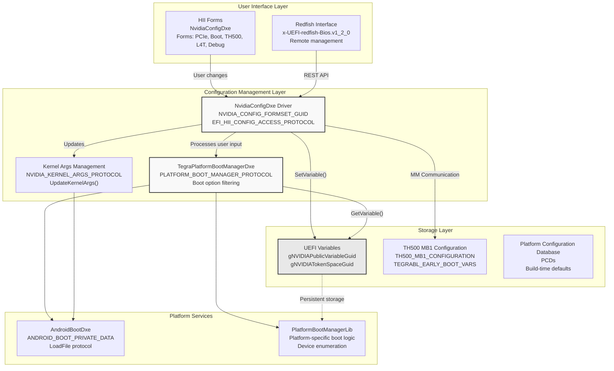
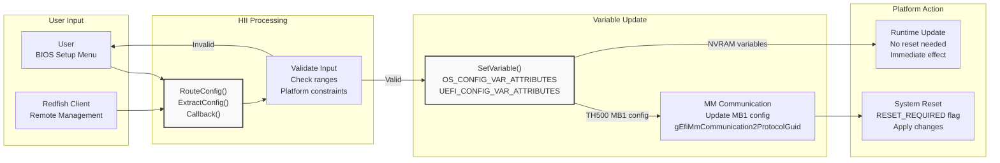
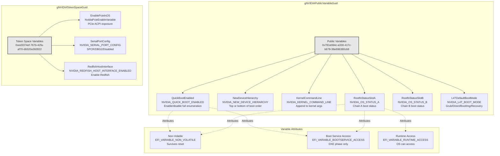
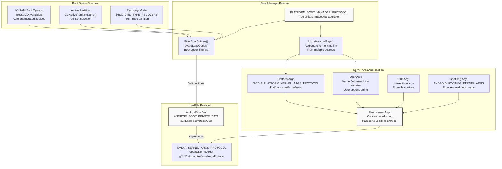
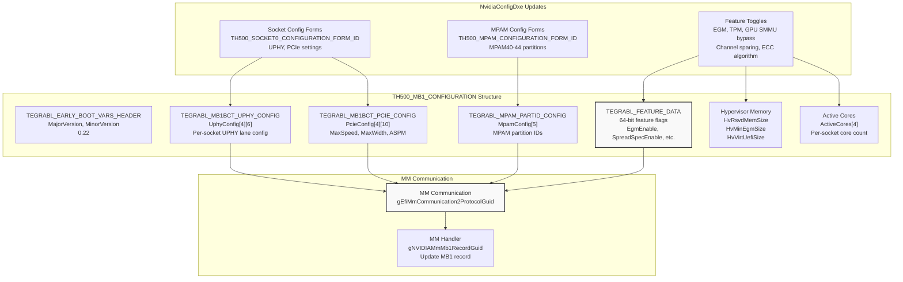

<!-- source: DeepWiki mcp.deepwiki.com · repo NVIDIA/edk2-nvidia · page 5 Platform Configuration Services · fetched 2026-10-26 -->

# Platform Configuration Services

<details>
<summary>Relevant source files</summary>

The following files were used as context for generating this wiki page:

- [Silicon/NVIDIA/Drivers/AndroidBootDxe/AndroidBootDxe.c](Silicon/NVIDIA/Drivers/AndroidBootDxe/AndroidBootDxe.c)
- [Silicon/NVIDIA/Drivers/AndroidBootDxe/AndroidBootDxe.h](Silicon/NVIDIA/Drivers/AndroidBootDxe/AndroidBootDxe.h)
- [Silicon/NVIDIA/Drivers/AndroidBootDxe/AndroidBootDxe.inf](Silicon/NVIDIA/Drivers/AndroidBootDxe/AndroidBootDxe.inf)
- [Silicon/NVIDIA/Drivers/AndroidBootDxe/UnitTest/AndroidBootDxeUnitTest.inf](Silicon/NVIDIA/Drivers/AndroidBootDxe/UnitTest/AndroidBootDxeUnitTest.inf)
- [Silicon/NVIDIA/Drivers/AndroidBootDxe/UnitTest/BootImgHeaderUnitTests.c](Silicon/NVIDIA/Drivers/AndroidBootDxe/UnitTest/BootImgHeaderUnitTests.c)
- [Silicon/NVIDIA/Drivers/NvidiaConfigDxe/NvidiaConfigDxe.c](Silicon/NVIDIA/Drivers/NvidiaConfigDxe/NvidiaConfigDxe.c)
- [Silicon/NVIDIA/Drivers/NvidiaConfigDxe/NvidiaConfigDxe.inf](Silicon/NVIDIA/Drivers/NvidiaConfigDxe/NvidiaConfigDxe.inf)
- [Silicon/NVIDIA/Drivers/NvidiaConfigDxe/NvidiaConfigHii.h](Silicon/NVIDIA/Drivers/NvidiaConfigDxe/NvidiaConfigHii.h)
- [Silicon/NVIDIA/Drivers/NvidiaConfigDxe/NvidiaConfigHii.uni](Silicon/NVIDIA/Drivers/NvidiaConfigDxe/NvidiaConfigHii.uni)
- [Silicon/NVIDIA/Drivers/NvidiaConfigDxe/NvidiaConfigHii.vfr](Silicon/NVIDIA/Drivers/NvidiaConfigDxe/NvidiaConfigHii.vfr)
- [Silicon/NVIDIA/Drivers/NvidiaConfigDxe/NvidiaConfigHiiMap.uni](Silicon/NVIDIA/Drivers/NvidiaConfigDxe/NvidiaConfigHiiMap.uni)
- [Silicon/NVIDIA/Drivers/TegraPlatformBootManager/TegraPlatformBootManagerDxe.c](Silicon/NVIDIA/Drivers/TegraPlatformBootManager/TegraPlatformBootManagerDxe.c)
- [Silicon/NVIDIA/Drivers/TegraPlatformBootManager/TegraPlatformBootManagerDxe.inf](Silicon/NVIDIA/Drivers/TegraPlatformBootManager/TegraPlatformBootManagerDxe.inf)
- [Silicon/NVIDIA/Include/AndroidBootImgHeader.h](Silicon/NVIDIA/Include/AndroidBootImgHeader.h)
- [Silicon/NVIDIA/Include/NVIDIAConfiguration.h](Silicon/NVIDIA/Include/NVIDIAConfiguration.h)
- [Silicon/NVIDIA/Include/Protocol/KernelArgsProtocol.h](Silicon/NVIDIA/Include/Protocol/KernelArgsProtocol.h)
- [Silicon/NVIDIA/Include/Server/TH500/TH500MB1Configuration.h](Silicon/NVIDIA/Include/Server/TH500/TH500MB1Configuration.h)
- [Silicon/NVIDIA/Library/PlatformBootManagerLib/PlatformBm.c](Silicon/NVIDIA/Library/PlatformBootManagerLib/PlatformBm.c)
- [Silicon/NVIDIA/Library/PlatformBootManagerLib/PlatformBm.h](Silicon/NVIDIA/Library/PlatformBootManagerLib/PlatformBm.h)
- [Silicon/NVIDIA/Library/PlatformBootManagerLib/PlatformBootManagerLib.inf](Silicon/NVIDIA/Library/PlatformBootManagerLib/PlatformBootManagerLib.inf)
- [Silicon/NVIDIA/NVIDIA.dec](Silicon/NVIDIA/NVIDIA.dec)

</details>


## Purpose and Scope

Platform Configuration Services provide user-facing interfaces for configuring NVIDIA Tegra UEFI firmware behavior. This includes the BIOS Setup menu (HII interface), UEFI variable storage and management, boot option control, and kernel command-line argument processing. The configuration system supports multiple platform variants (Jetson embedded platforms, TH500 server platforms, TegraVirt virtualization) and integrates with Redfish for remote management on server platforms.

For detailed information on specific subsystems:
- BIOS Setup and HII Interface implementation: see [5.1](#5.1)
- UEFI Variable Management architecture: see [5.2](#5.2)
- Boot Manager and Boot Options: see [5.3](#5.3)
- Boot path architecture including Android boot: see [Diagram 4](#) in the Overview
- Hardware driver configuration: see [6](#6)

## Configuration System Architecture

The platform configuration system consists of three main layers:



**Configuration System Architecture**

The system is organized into three distinct layers:

1. **User Interface Layer**: Provides HII forms (BIOS Setup menu) and Redfish REST API for remote management
2. **Configuration Management Layer**: Processes configuration changes and manages boot behavior
3. **Storage Layer**: Persists configuration data in UEFI variables, MB1 configuration structures, and PCDs

Sources: [Silicon/NVIDIA/Drivers/NvidiaConfigDxe/NvidiaConfigDxe.c:1-100](), [Silicon/NVIDIA/Drivers/TegraPlatformBootManager/TegraPlatformBootManagerDxe.c:1-50](), [Silicon/NVIDIA/Drivers/NvidiaConfigDxe/NvidiaConfigHii.h:1-82]()

## Configuration Categories

The BIOS Setup interface organizes configuration options into multiple categories:

| Form ID | Category | Purpose | Key Variables |
|---------|----------|---------|---------------|
| `NVIDIA_CONFIG_FORM_ID` (0x0001) | Main Configuration | Entry point, serial port config, quick boot | `SerialPortConfig`, `QuickBootEnabled` |
| `PCIE_CONFIGURATION_FORM_ID` (0x0002) | PCIe Configuration | PCIe enablement, ACPI table control | `EnablePcieInOS`, `PCIeResourceConfig` |
| `BOOT_CONFIGURATION_FORM_ID` (0x0003) | Boot Configuration | Boot hierarchy, IPMI network boot, UEFI shell | `NewDeviceHierarchy`, `IpmiNetworkBootMode` |
| `L4T_CONFIGURATION_FORM_ID` (0x0004) | L4T Configuration | Linux for Tegra boot modes | `L4TDefaultBootMode`, `BoardRecoveryBoot` |
| `TH500_CONFIGURATION_FORM_ID` (0x0005) | SoC Configuration | TH500 server-specific settings | Socket configs, UPHY, MPAM |
| `DEBUG_CONFIGURATION_FORM_ID` (0x0032) | Debug Configuration | Debug output, UART baud rate | `UefiDebugLogLevel`, `UartBaudRate` |
| `MEMORY_TEST_FORM_ID` (0x0034) | Memory Test | Memory testing configuration | `MemoryTestControl` |
| `BMC_CONFIGURATION_FORM_ID` (0x003B) | BMC Configuration | Baseboard Management Controller | BMC credentials, factory reset |

Each form ID corresponds to a specific VFR form definition and set of configuration variables.

Sources: [Silicon/NVIDIA/Drivers/NvidiaConfigDxe/NvidiaConfigHii.h:23-81](), [Silicon/NVIDIA/Drivers/NvidiaConfigDxe/NvidiaConfigHii.vfr:152-200]()

## Configuration Data Flow



**Configuration Data Flow**

The configuration data flows from user input through HII processing to variable storage and platform actions:

1. **User Input**: Changes from BIOS Setup menu or Redfish API
2. **HII Processing**: `RouteConfig()` and `Callback()` functions in `NvidiaConfigDxe` validate and process changes
3. **Variable Update**: Variables are stored with appropriate attributes (`EFI_VARIABLE_NON_VOLATILE`, `EFI_VARIABLE_RUNTIME_ACCESS`)
4. **Platform Action**: Some changes require system reset, others take effect immediately

Sources: [Silicon/NVIDIA/Drivers/NvidiaConfigDxe/NvidiaConfigDxe.c:800-1200](), [Silicon/NVIDIA/Include/NVIDIAConfiguration.h:1-100]()

## UEFI Variable Organization

Configuration data is stored in UEFI variables organized by GUID namespace:



**UEFI Variable Organization**

Variables are organized by GUID namespace with appropriate access attributes:

- **gNVIDIAPublicVariableGuid**: User-facing configuration (boot mode, kernel args, OS status)
- **gNVIDIATokenSpaceGuid**: Platform-specific settings (PCIe, serial port, Redfish)

Variable attributes control persistence and access:
- **Non-Volatile**: Survives resets and power cycles
- **Boot Service Access**: Accessible during DXE phase
- **Runtime Access**: OS can read/write after ExitBootServices

Sources: [Silicon/NVIDIA/NVIDIA.dec:36-37](), [Silicon/NVIDIA/Drivers/NvidiaConfigDxe/NvidiaConfigHii.vfr:28-146](), [Silicon/NVIDIA/Drivers/NvidiaConfigDxe/NvidiaConfigDxe.c:59-60]()

## Boot Manager Integration

The boot manager integrates configuration services with boot option processing:



**Boot Manager Integration**

The boot manager coordinates multiple configuration sources:

1. **Boot Option Filtering**: `IsValidLoadOption()` filters boot options based on device type (eMMC, UFS, PCIe NIC) and configuration
2. **Active Partition Selection**: Determines which partition (A/B slot) to boot based on `GetActivePartitionName()`
3. **Kernel Args Aggregation**: Combines args from platform defaults, user configuration, DTB, and boot.img
4. **LoadFile Protocol**: `AndroidBootDxe` implements `NVIDIA_KERNEL_ARGS_PROTOCOL` to provide final kernel command line

Sources: [Silicon/NVIDIA/Drivers/TegraPlatformBootManager/TegraPlatformBootManagerDxe.c:70-150](), [Silicon/NVIDIA/Drivers/AndroidBootDxe/AndroidBootDxe.c:108-165](), [Silicon/NVIDIA/Library/PlatformBootManagerLib/PlatformBm.c:1-100]()

## TH500 Server Configuration

TH500 server platforms have additional configuration stored in MB1 early boot variables:



**TH500 Server Configuration**

TH500 platforms store extensive configuration in the `TH500_MB1_CONFIGURATION` structure:

- **Feature Flags**: EGM, spread spectrum, TPM, GPU SMMU bypass, UART baud rate, ECC algorithm
- **UPHY Configuration**: PCIe lane bifurcation for 4 sockets × 6 UPHY blocks
- **PCIe Configuration**: Speed, width, ASPM settings for 4 sockets × 10 controllers
- **MPAM Configuration**: Memory partitioning and allocation for 5 partition IDs
- **Core Configuration**: Active core count per socket for power/performance tuning

Configuration updates are sent to MM (Management Mode) via `gEfiMmCommunication2ProtocolGuid` and handled by the MM MB1 record handler.

Sources: [Silicon/NVIDIA/Include/Server/TH500/TH500MB1Configuration.h:9-150](), [Silicon/NVIDIA/Drivers/NvidiaConfigDxe/NvidiaConfigDxe.c:2000-2500](), [Silicon/NVIDIA/Drivers/NvidiaConfigDxe/NvidiaConfigHii.h:27-80]()

## Key Code Components

| Component | File Path | Primary Functions |
|-----------|-----------|-------------------|
| **NvidiaConfigDxe** | [Silicon/NVIDIA/Drivers/NvidiaConfigDxe/NvidiaConfigDxe.c]() | `NvidiaConfigDxeInitialize()`, `RouteConfig()`, `Callback()` |
| **HII Forms** | [Silicon/NVIDIA/Drivers/NvidiaConfigDxe/NvidiaConfigHii.vfr]() | VFR form definitions for all configuration categories |
| **TegraPlatformBootManager** | [Silicon/NVIDIA/Drivers/TegraPlatformBootManager/TegraPlatformBootManagerDxe.c]() | `PlatformBootManagerEntryPoint()`, `FilterBootOptions()`, `IsValidLoadOption()` |
| **AndroidBootDxe** | [Silicon/NVIDIA/Drivers/AndroidBootDxe/AndroidBootDxe.c]() | `AndroidBootDxeDriverEntryPoint()`, `UpdateKernelArgs()`, `AndroidBootLoadFile()` |
| **PlatformBootManagerLib** | [Silicon/NVIDIA/Library/PlatformBootManagerLib/PlatformBm.c]() | `PlatformBootManagerBeforeConsole()`, `PlatformBootManagerAfterConsole()` |
| **Configuration Headers** | [Silicon/NVIDIA/Include/NVIDIAConfiguration.h]() | Configuration data structure definitions |
| **TH500 MB1 Config** | [Silicon/NVIDIA/Include/Server/TH500/TH500MB1Configuration.h]() | `TH500_MB1_CONFIGURATION`, `TEGRABL_FEATURE_DATA` |

Sources: All file paths listed in the table

## Configuration Variable Attributes

Variable attributes control persistence, access, and security:

```c
// Non-volatile variables that persist across resets
#define OS_CONFIG_VAR_ATTRIBUTES (EFI_VARIABLE_BOOTSERVICE_ACCESS | \
                                  EFI_VARIABLE_NON_VOLATILE | \
                                  EFI_VARIABLE_RUNTIME_ACCESS)

// Volatile variables that reset to defaults
#define UEFI_CONFIG_VAR_ATTRIBUTES (EFI_VARIABLE_BOOTSERVICE_ACCESS | \
                                    EFI_VARIABLE_RUNTIME_ACCESS)
```

Common attribute combinations:
- **Boot Service + Non-Volatile**: Configuration that persists but OS cannot modify
- **Boot Service + Non-Volatile + Runtime**: Configuration accessible to OS at runtime
- **Boot Service only**: Volatile configuration for current boot

Sources: [Silicon/NVIDIA/Drivers/NvidiaConfigDxe/NvidiaConfigDxe.c:59-60]()

---

