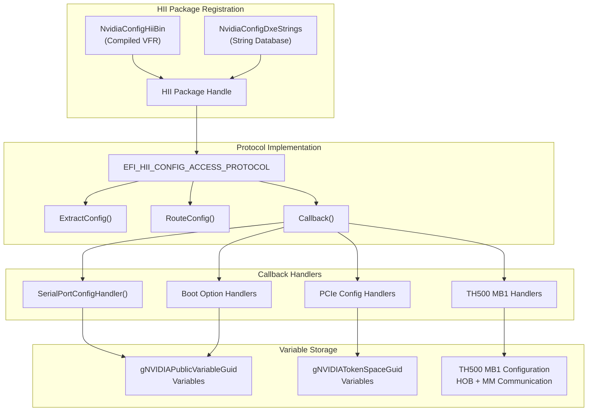
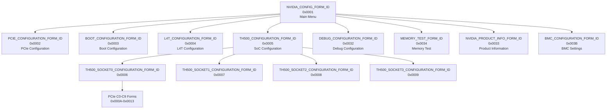
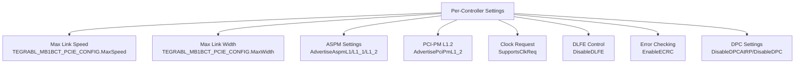
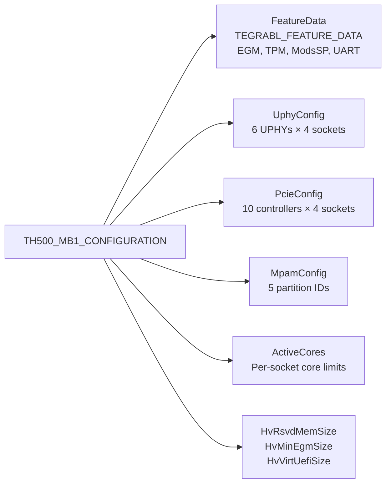
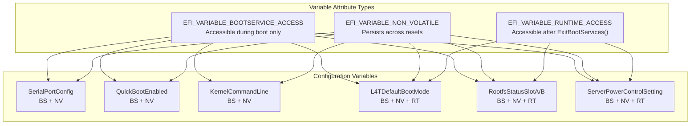
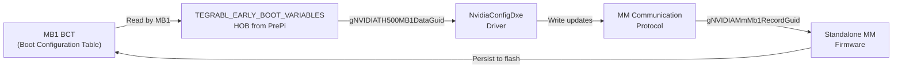
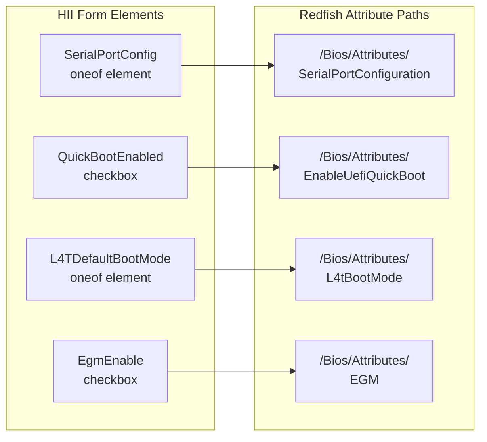
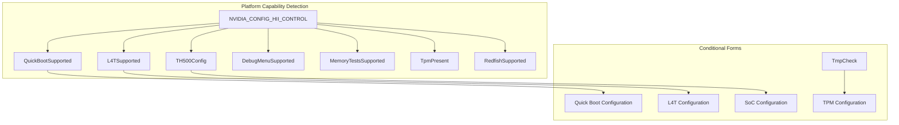
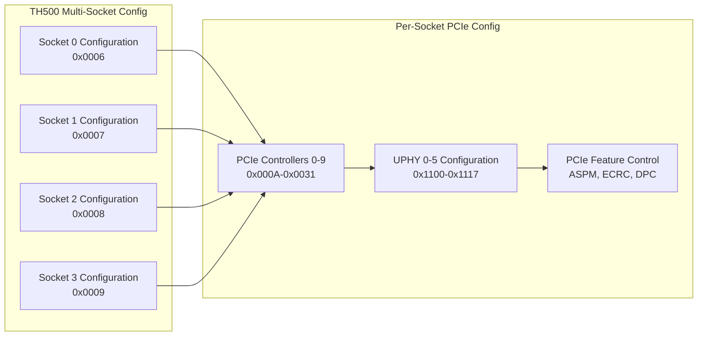
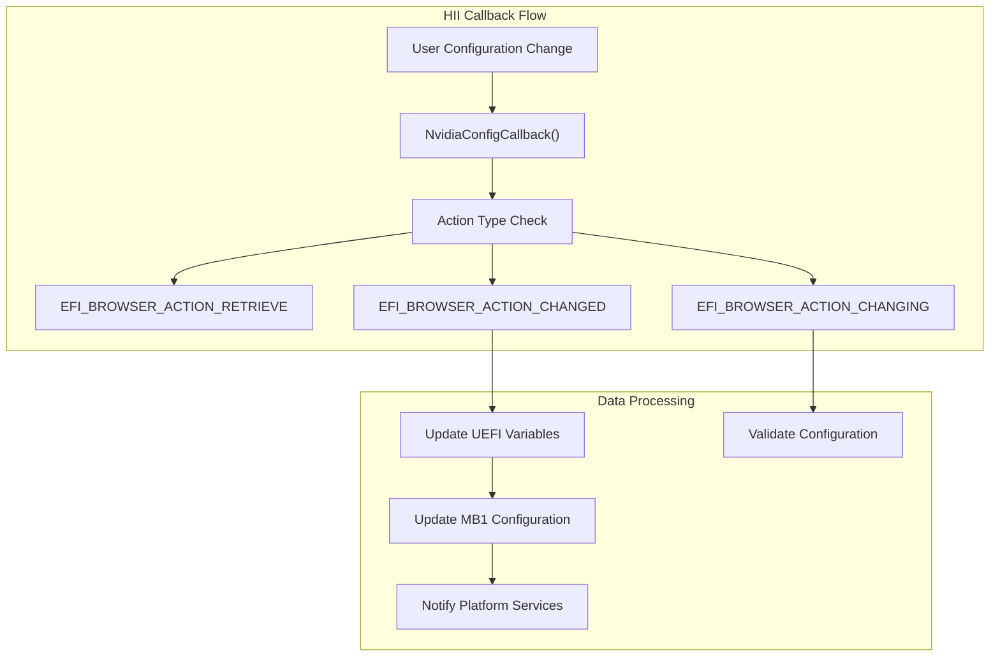

<!-- source: DeepWiki mcp.deepwiki.com · repo NVIDIA/edk2-nvidia · page 5.1 BIOS Setup and HII Interface · fetched 2026-10-26 -->

# BIOS Setup and HII Interface

<details>
<summary>Relevant source files</summary>

The following files were used as context for generating this wiki page:

- [Silicon/NVIDIA/Drivers/NvidiaConfigDxe/NvidiaConfigDxe.c](Silicon/NVIDIA/Drivers/NvidiaConfigDxe/NvidiaConfigDxe.c)
- [Silicon/NVIDIA/Drivers/NvidiaConfigDxe/NvidiaConfigDxe.inf](Silicon/NVIDIA/Drivers/NvidiaConfigDxe/NvidiaConfigDxe.inf)
- [Silicon/NVIDIA/Drivers/NvidiaConfigDxe/NvidiaConfigHii.h](Silicon/NVIDIA/Drivers/NvidiaConfigDxe/NvidiaConfigHii.h)
- [Silicon/NVIDIA/Drivers/NvidiaConfigDxe/NvidiaConfigHii.uni](Silicon/NVIDIA/Drivers/NvidiaConfigDxe/NvidiaConfigHii.uni)
- [Silicon/NVIDIA/Drivers/NvidiaConfigDxe/NvidiaConfigHii.vfr](Silicon/NVIDIA/Drivers/NvidiaConfigDxe/NvidiaConfigHii.vfr)
- [Silicon/NVIDIA/Drivers/NvidiaConfigDxe/NvidiaConfigHiiMap.uni](Silicon/NVIDIA/Drivers/NvidiaConfigDxe/NvidiaConfigHiiMap.uni)
- [Silicon/NVIDIA/Include/NVIDIAConfiguration.h](Silicon/NVIDIA/Include/NVIDIAConfiguration.h)
- [Silicon/NVIDIA/Include/Server/TH500/TH500MB1Configuration.h](Silicon/NVIDIA/Include/Server/TH500/TH500MB1Configuration.h)
- [Silicon/NVIDIA/Library/PlatformBootManagerLib/PlatformBm.c](Silicon/NVIDIA/Library/PlatformBootManagerLib/PlatformBm.c)
- [Silicon/NVIDIA/Library/PlatformBootManagerLib/PlatformBm.h](Silicon/NVIDIA/Library/PlatformBootManagerLib/PlatformBm.h)
- [Silicon/NVIDIA/Library/PlatformBootManagerLib/PlatformBootManagerLib.inf](Silicon/NVIDIA/Library/PlatformBootManagerLib/PlatformBootManagerLib.inf)
- [Silicon/NVIDIA/NVIDIA.dec](Silicon/NVIDIA/NVIDIA.dec)

</details>


## Purpose and Scope

The BIOS Setup system provides a user-facing configuration interface for NVIDIA Tegra platforms through the UEFI Human Interface Infrastructure (HII) framework. Implemented by the `NvidiaConfigDxe` driver, this system presents structured forms for configuring PCIe controllers, boot options, serial ports, memory testing, and platform-specific features. The interface supports both local setup menu access and remote management via Redfish APIs.

Configuration categories include:
- **PCIe Configuration**: Controller settings, UPHY lane assignments, link speed/width limits, ASPM settings
- **Boot Configuration**: Quick boot, new device hierarchy, boot order management
- **TH500 Configuration**: Multi-socket server settings, EGM memory modes, MPAM partitioning
- **L4T Configuration**: Linux for Tegra boot modes and kernel command line options
- **Debug Configuration**: UART baud rates, debug log levels, error injection

For build-time configuration, see [Platform Configuration Files](#2.2). For variable management details, see [UEFI Variable Management](#5.2).

## NvidiaConfigDxe Driver Architecture

The `NvidiaConfigDxe` driver implements the BIOS Setup interface using the UEFI HII framework. The driver registers HII packages containing form definitions (VFR), string databases (UNI), and implements the `EFI_HII_CONFIG_ACCESS_PROTOCOL` for configuration routing.

**NvidiaConfigDxe Driver Architecture**


The driver entry point `NvidiaConfigDxeInitialize()` performs:
1. HII package installation via `HiiAddPackages()` [NvidiaConfigDxe.c:3180-3200]()
2. Protocol installation for `EFI_HII_CONFIG_ACCESS_PROTOCOL` [NvidiaConfigDxe.c:3200-3220]()
3. Variable policy registration for security [NvidiaConfigDxe.c:3220-3250]()
4. Default value initialization from DTB and MB1 data [NvidiaConfigDxe.c:3250-3300]()

Sources: [Silicon/NVIDIA/Drivers/NvidiaConfigDxe/NvidiaConfigDxe.c:3150-3350](), [Silicon/NVIDIA/Drivers/NvidiaConfigDxe/NvidiaConfigDxe.inf:15-70]()

## HII Form Structure

Configuration forms are defined in VFR (Visual Forms Representation) format [NvidiaConfigHii.vfr](), compiled into binary IFR (Internal Forms Representation), and presented through the UEFI setup browser.

### Form Hierarchy

**BIOS Setup Form Organization**


Each socket form branches to 10 individual PCIe controller configuration forms (C0-C9), totaling 40 PCIe configuration forms for a 4-socket TH500 system (form IDs 0x000A through 0x0031).

### VFR Form Definition Structure

Forms are declared using VFR syntax with associated variable stores:

```
formset
  guid = NVIDIA_CONFIG_FORMSET_GUID
  title = STRING_TOKEN(STR_NVIDIA_CONFIG_TITLE)
  
  varstore NVIDIA_CONFIG_HII_CONTROL
  efivarstore NvidiaPcieEnableVariable, name = EnablePcieInOS
  efivarstore NVIDIA_SERIAL_PORT_CONFIG, name = SerialPortConfig
  
  form formid = NVIDIA_CONFIG_FORM_ID
    goto PCIE_CONFIGURATION_FORM_ID, key = KEY_ENABLE_PCIE_CONFIG
    goto BOOT_CONFIGURATION_FORM_ID, key = KEY_BOOT_CONFIG
    oneof varid = SerialPortConfig.Configuration
      option text = STR_SP_DISABLED, value = NVIDIA_SERIAL_PORT_DISABLED
      option text = STR_SP_ENABLED_SPCR_SBSA, value = NVIDIA_SERIAL_PORT_SPCR_SBSA
    endoneof
  endform
endformset
```

Sources: [Silicon/NVIDIA/Drivers/NvidiaConfigDxe/NvidiaConfigHii.vfr:18-231](), [Silicon/NVIDIA/Drivers/NvidiaConfigDxe/NvidiaConfigHii.h:23-82]()

### Question Keys and Callback Routing

Each interactive form element has a unique `questionid` (key) that routes to the appropriate callback handler:

| Key Range | Purpose | Example Keys |
|-----------|---------|--------------|
| `0x1000-0x102F` | Basic configuration | `KEY_ENABLE_PCIE_CONFIG`, `KEY_SERIAL_PORT_CONFIG`, `KEY_QUICK_BOOT` |
| `0x1100-0x1117` | UPHY lane configuration | `KEY_UPHY0_SOCKET0_CONFIG`, `KEY_UPHY5_SOCKET3_CONFIG` |
| `0x1201-0x1228` | PCIe max speed settings | `KEY_SOCKET0_PCIE0_MAX_SPEED` through `KEY_SOCKET3_PCIE9_MAX_SPEED` |
| `0x1301-0x1328` | PCIe max width settings | `KEY_SOCKET0_PCIE0_MAX_WIDTH` through `KEY_SOCKET3_PCIE9_MAX_WIDTH` |
| `0x1401-0x1428` | PCIe ASPM L1 advertise | `KEY_SOCKET0_PCIE0_ADVERTISE_ASPML1` through socket/controller variants |

The callback function `NvidiaConfigCallback()` [NvidiaConfigDxe.c:2500-2900]() uses a switch statement on the `QuestionId` parameter to dispatch to specialized handlers.

Sources: [Silicon/NVIDIA/Drivers/NvidiaConfigDxe/NvidiaConfigHii.h:83-667](), [Silicon/NVIDIA/Drivers/NvidiaConfigDxe/NvidiaConfigDxe.c:2500-2900]()

## Configuration Categories

The BIOS Setup menu organizes platform settings into distinct categories, each mapped to specific form definitions and variable stores.

### PCIe Configuration

PCIe settings control physical layer parameters, power management, and error handling for up to 40 PCIe controllers (10 per socket on 4-socket TH500 systems).

**PCIe Configuration Options per Controller**


PCIe configuration is stored in both UEFI variables and the TH500 MB1 configuration structure [TH500MB1Configuration.h:67-116](). Changes require system reset to take effect.

**UPHY Lane Assignment**: UPHY (Universal PHY) blocks control PCIe lane bifurcation. For example, UPHY0 can configure PCIe C0 as x16 or split C0/C1 as x8/x8 [NvidiaConfigHii.uni:115-121]().

### Boot Configuration

Boot settings control device enumeration, boot option management, and boot menu behavior.

| Setting | Variable | Description |
|---------|----------|-------------|
| Quick Boot | `QuickBootEnabled` | Skip full device enumeration for faster boot |
| New Device Hierarchy | `NewDeviceHierarchy` | Add new devices to top/bottom of boot order |
| Serial Port Config | `SerialPortConfig` | Enable/disable serial console and debug output |
| ACPI Timer | `AcpiTimerEnabled` | Enable legacy ACPI timer for OS compatibility |
| UEFI Shell | `UefiShellEnabled` | Enable embedded UEFI Shell in boot options |

Sources: [Silicon/NVIDIA/Drivers/NvidiaConfigDxe/NvidiaConfigHii.vfr:43-101](), [Silicon/NVIDIA/Include/NVIDIAConfiguration.h:56-177]()

### TH500 Server Configuration

TH500-specific settings manage multi-socket server features including EGM (Extended GPU Memory), MPAM (Memory Partitioning and Monitoring), and core configuration.

**TH500 MB1 Configuration Structure**


The MB1 configuration is read from HOBs during initialization [NvidiaConfigDxe.c:3100-3150]() and written back to Standalonmm via MM communication protocol when modified [NvidiaConfigDxe.c:1800-1900]().

**EGM Configuration**: EGM enables GPU HBM (High Bandwidth Memory) to be used as system memory. Settings include:
- `EgmEnable`: Enable/disable EGM mode
- `HvRsvdMemSize`: Hypervisor reserved memory per socket (MB)
- `HvMinEgmSize`: Minimum EGM memory per socket (MB)
- `HvVirtUefiSize`: Virtual UEFI memory per socket (MB)

**MPAM Partitioning**: Memory Partitioning and Monitoring controls cache and bandwidth allocation [TH500MB1Configuration.h:118-127]():
- `CporWayMask`: 12-bit cache way mask for partition isolation
- `MinBw`: Minimum guaranteed bandwidth (7-bit value)
- `MaxBw`: Maximum allowed bandwidth (7-bit value)

Sources: [Silicon/NVIDIA/Include/Server/TH500/TH500MB1Configuration.h:131-147](), [Silicon/NVIDIA/Drivers/NvidiaConfigDxe/NvidiaConfigHii.uni:59-114]()

### L4T Configuration

Linux for Tegra configuration controls kernel boot modes and command-line parameters for embedded platforms.

**L4T Boot Modes**:
| Mode | Value | Description |
|------|-------|-------------|
| GRUB | `0x0` | Boot via GRUB bootloader |
| ExtLinux | `0x1` | Direct kernel boot via extlinux.conf |
| Kernel Partition | `0x2` | Boot from boot.img partition (Android format) |
| Recovery | `0x3` | Boot recovery partition |
| Default | `0xFF` | Use application-determined default |

**Kernel Command Line**: The `KernelCommandLine` variable [NVIDIAConfiguration.h:83-85]() stores additional kernel parameters appended to the default command line. Maximum length is 255 characters.

Sources: [Silicon/NVIDIA/Drivers/NvidiaConfigDxe/NvidiaConfigHii.uni:20-56](), [Silicon/NVIDIA/Include/NVIDIAConfiguration.h:25-85]()

### Debug Configuration

Debug settings control logging, error injection, and diagnostic features.

| Setting | Variable | Purpose |
|---------|----------|---------|
| UART Baud Rate | `UartBaudRate` (in FeatureData) | Serial port speed: 9600, 19200, 38400, 57600, 115200 |
| UEFI Debug Level | `UefiDebugLevel` | Controls DEBUG() macro output verbosity |
| Error Injection | `EInjEnable` | Enable ACPI EINJ table for error injection testing |
| DBG2 Network Device | `Dbg2NetworkDevice` | Select PCIe NIC for network kernel debugging |

Debug level values correspond to standard UEFI debug masks defined in `DebugLib.h`.

Sources: [Silicon/NVIDIA/Drivers/NvidiaConfigDxe/NvidiaConfigHii.uni:73-92](), [Silicon/NVIDIA/Include/Server/TH500/TH500MB1Configuration.h:42-61]()

## Variable Storage and Persistence

Configuration data is stored in UEFI variables with attributes controlling persistence and access timing.

### Variable Storage Mechanisms

**UEFI Variable Attributes and Usage**


Most configuration variables use `gNVIDIAPublicVariableGuid` [NVIDIA.dec:37](), while some internal settings use `gNVIDIATokenSpaceGuid` [NVIDIA.dec:35](). Variables with runtime access (RT) can be modified by the OS after boot.

### Variable Definitions

Variables are declared in VFR as `efivarstore` entries that map to C structures:

```
efivarstore NVIDIA_SERIAL_PORT_CONFIG,
  attribute = EFI_VARIABLE_BOOTSERVICE_ACCESS | EFI_VARIABLE_NON_VOLATILE,
  name = SerialPortConfig,
  guid = NVIDIA_TOKEN_SPACE_GUID;

efivarstore NVIDIA_KERNEL_COMMAND_LINE,
  attribute = EFI_VARIABLE_BOOTSERVICE_ACCESS | EFI_VARIABLE_NON_VOLATILE,
  name = KernelCommandLine,
  guid = NVIDIA_PUBLIC_VARIABLE_GUID;
```

The C structure definitions are in [NVIDIAConfiguration.h:78-177]():

```c
typedef struct {
  UINT8 Configuration;
} NVIDIA_SERIAL_PORT_CONFIG;

typedef struct {
  CHAR16 KernelCommand[KERNEL_CMD_STR_MAX_SIZE];
} NVIDIA_KERNEL_COMMAND_LINE;
```

### TH500 MB1 Configuration Storage

TH500 server platforms store additional configuration in the MB1 early boot structure, which is read from HOBs and synchronized with Standalone MM firmware.

**TH500 MB1 Data Flow**


The MB1 configuration structure [TH500MB1Configuration.h:131-147]() contains:
- `TEGRABL_EARLY_BOOT_VARS_HEADER`: Version information (Major.Minor)
- `TEGRABL_FEATURE_DATA`: Bitfield of feature enables
- `TEGRABL_MB1BCT_UPHY_CONFIG`: UPHY lane assignments [6 UPHYs × 4 sockets]
- `TEGRABL_MB1BCT_PCIE_CONFIG`: PCIe controller settings [10 controllers × 4 sockets]
- `TEGRABL_MPAM_PARTID_CONFIG`: MPAM partition configurations [5 partitions]
- Per-socket settings: `ActiveCores`, `HvRsvdMemSize`, etc.

Sources: [Silicon/NVIDIA/Drivers/NvidiaConfigDxe/NvidiaConfigHii.vfr:28-146](), [Silicon/NVIDIA/Include/Server/TH500/TH500MB1Configuration.h:131-161](), [Silicon/NVIDIA/Drivers/NvidiaConfigDxe/NvidiaConfigDxe.c:1800-1900]()

## Redfish Integration

The HII configuration system supports remote management through Redfish BIOS attribute schema mappings defined in `NvidiaConfigHiiMap.uni`.

### Redfish Attribute Path Mapping

String tokens in the `x-UEFI-redfish-Bios.v1_2_0` language map HII form elements to Redfish JSON paths:

**Sample Redfish Attribute Mappings**


Mapping entries in [NvidiaConfigHiiMap.uni]():
```
#string STR_SERIAL_PORT_CONFIG_PROMPT 
  #language x-UEFI-redfish-Bios.v1_2_0 "/Bios/Attributes/SerialPortConfiguration"
#string STR_QUICK_BOOT_ENABLED_PROMPT
  #language x-UEFI-redfish-Bios.v1_2_0 "/Bios/Attributes/EnableUefiQuickBoot"
#string STR_L4T_BOOTMODE_PROMPT
  #language x-UEFI-redfish-Bios.v1_2_0 "/Bios/Attributes/L4tBootMode"
```

### Enumeration Value Translation

Option text strings also map to Redfish enumeration values:

| Configuration | HII Display Value | Redfish Enumeration Value |
|---------------|-------------------|---------------------------|
| Serial Port | "Port Disabled" | `"PortDisabled"` |
| Serial Port | "Console Enabled SBSA" | `"ConsoleEnabledSbsa"` |
| Serial Port | "Serial Debug Enabled SBSA" | `"SerialDebugEnabledSbsa"` |
| L4T Boot Mode | "Grub" | `"Grub"` |
| L4T Boot Mode | "ExtLinux" | `"ExtLinux"` |
| L4T Boot Mode | "Kernel Partition" | `"KernelPartition"` |
| OS Chain Status | "Normal" | `"Normal"` |
| OS Chain Status | "Unbootable" | `"Unbootable"` |
| UPHY Config | "PCIe C0 - x16" | `"PCIeC0x16"` |
| UPHY Config | "PCIe C0 x8 - C1 x8" | `"PCIeC0x8C1x8"` |

This allows Redfish clients to query and modify BIOS settings using standard JSON PATCH operations:
```json
PATCH /redfish/v1/Systems/1/Bios/Settings
{
  "Attributes": {
    "SerialPortConfiguration": "ConsoleEnabledSbsa",
    "EnableUefiQuickBoot": "Enabled",
    "L4tBootMode": "Grub"
  }
}
```

Sources: [Silicon/NVIDIA/Drivers/NvidiaConfigDxe/NvidiaConfigHiiMap.uni:11-456]()

## Platform-Specific Features

The configuration system adapts to different platform capabilities through feature detection and conditional form rendering.

### Feature Detection



### TH500 Server Configuration

For TH500 server platforms, the system provides extensive multi-socket configuration capabilities:



Sources: [Silicon/NVIDIA/Drivers/NvidiaConfigDxe/NvidiaConfigHii.vfr:201-207](), [Silicon/NVIDIA/Drivers/NvidiaConfigDxe/NvidiaConfigHii.h:28-81]()

## Configuration Forms and Data Flow

The system implements a comprehensive callback mechanism to handle configuration changes and maintain consistency across different storage backends.

### Callback Processing



### Configuration Persistence

The system ensures configuration changes are properly persisted across system resets and power cycles:

| Configuration Type | Storage Location | Persistence | Access |
|-------------------|------------------|-------------|---------|
| Boot Settings | UEFI Variables | Non-volatile | Boot + Runtime |
| PCIe Configuration | UEFI Variables + MB1 | Non-volatile | Boot Service |
| Serial Port Config | UEFI Variables | Non-volatile | Boot Service |
| Debug Settings | UEFI Variables | Volatile | Boot Service |
| Memory Test | UEFI Variables | Non-volatile | Runtime |

Sources: [Silicon/NVIDIA/Drivers/NvidiaConfigDxe/NvidiaConfigDxe.c:2500-2800](), [Silicon/NVIDIA/Drivers/NvidiaConfigDxe/NvidiaConfigHii.vfr:43-141]()

---

