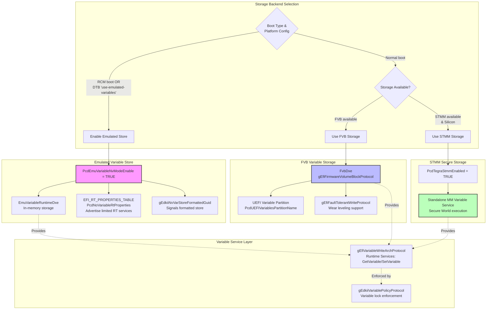
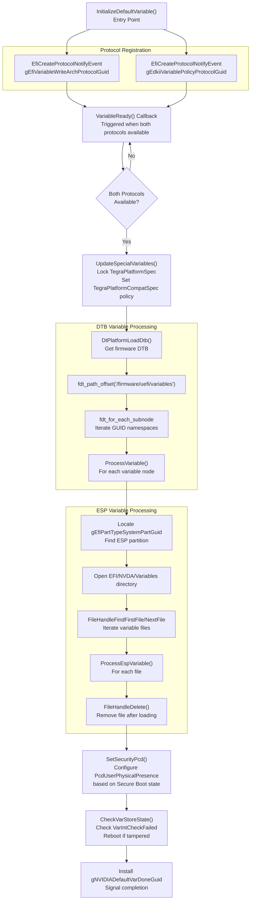
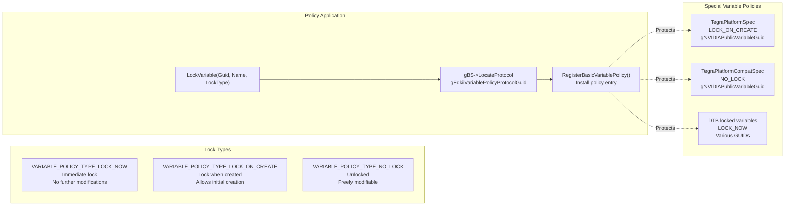

<!-- source: DeepWiki mcp.deepwiki.com · repo NVIDIA/edk2-nvidia · page 5.2 UEFI Variable Management · fetched 2026-10-26 -->

# UEFI Variable Management

<details>
<summary>Relevant source files</summary>

The following files were used as context for generating this wiki page:

- [Platform/NVIDIA/NVIDIA.common.fdf](Platform/NVIDIA/NVIDIA.common.fdf)
- [Platform/NVIDIA/NVIDIA.common.fdf.inc](Platform/NVIDIA/NVIDIA.common.fdf.inc)
- [Silicon/NVIDIA/Drivers/DefaultVariableDxe/DefaultVariableDxe.c](Silicon/NVIDIA/Drivers/DefaultVariableDxe/DefaultVariableDxe.c)
- [Silicon/NVIDIA/Drivers/DefaultVariableDxe/DefaultVariableDxe.inf](Silicon/NVIDIA/Drivers/DefaultVariableDxe/DefaultVariableDxe.inf)
- [Silicon/NVIDIA/Drivers/FvbDxe/FvbDxe.inf](Silicon/NVIDIA/Drivers/FvbDxe/FvbDxe.inf)
- [Silicon/NVIDIA/Drivers/TegraPlatformInit/TegraPlatformInitDxe.c](Silicon/NVIDIA/Drivers/TegraPlatformInit/TegraPlatformInitDxe.c)
- [Silicon/NVIDIA/Drivers/TegraPlatformInit/TegraPlatformInitDxe.inf](Silicon/NVIDIA/Drivers/TegraPlatformInit/TegraPlatformInitDxe.inf)

</details>


This document describes the UEFI variable management system in the NVIDIA EDK2 firmware, including variable storage backends, default variable initialization from multiple sources, variable policies, and security mechanisms. For information about the BIOS setup interface for configuring variables, see [BIOS Setup and HII Interface](#5.1). For boot option management that uses variables, see [Boot Manager and Boot Options](#5.3).

## Overview

The NVIDIA firmware implements a flexible variable management system that supports multiple storage backends and initialization sources. Variables can be stored persistently via Firmware Volume Block (FVB) storage, through Standalone MM (STMM) for secure variables, or in an emulated in-memory store for recovery scenarios. Default variables are automatically created from Device Tree definitions and files on the EFI System Partition (ESP).

## Variable Storage Architecture

The firmware supports three variable storage backends, selected at runtime based on platform configuration and boot conditions:

| Storage Backend | Persistence | Use Case | Configuration |
|----------------|-------------|----------|---------------|
| **FVB Storage** | Persistent on flash/eMMC | Normal boot with dedicated UEFI variable partition | Default when `PcdEmuVariableNvModeEnable = FALSE` |
| **STMM Storage** | Persistent, secure | Silicon platforms with Standalone MM support | Enabled via `PcdTegraStmmEnabled = TRUE` |
| **Emulated Store** | Non-persistent (RAM) | Recovery mode, RCM boot, pre-silicon platforms | Enabled via `PcdEmuVariableNvModeEnable = TRUE` |



**Sources:** [Silicon/NVIDIA/Drivers/TegraPlatformInit/TegraPlatformInitDxe.c:40-71](), [Silicon/NVIDIA/Drivers/FvbDxe/FvbDxe.inf:38-50]()

### Emulated Variable Store Configuration

The emulated variable store is enabled under specific conditions, configured by the `UseEmulatedVariableStore()` function:

**Activation Conditions:**
- Boot type is RCM recovery mode (`PlatformResourceInfo->BootType == TegrablBootRcm`)
- Platform explicitly requests via DTB property `/firmware/uefi/use-emulated-variables`
- Pre-silicon platforms (presil SKU detected)

**Side Effects:**
- Sets `PcdEmuVariableNvModeEnable = TRUE`
- Installs `gEdkiiNvVarStoreFormattedGuid` protocol to signal formatted store
- Configures `EFI_RT_PROPERTIES_TABLE` with `PcdNoVariableRtProperties` to advertise limited runtime service support
- Disables STMM on silicon platforms (`PcdTegraStmmEnabled = FALSE`)

**Sources:** [Silicon/NVIDIA/Drivers/TegraPlatformInit/TegraPlatformInitDxe.c:40-71](), [Silicon/NVIDIA/Drivers/TegraPlatformInit/TegraPlatformInitDxe.c:724-766]()

## Default Variable Initialization Flow

The `DefaultVariableDxe` driver orchestrates default variable creation from multiple sources. It registers callbacks for the Variable Write Arch Protocol and Variable Policy Protocol, then processes variables from DTB and ESP when both protocols become available.



**Sources:** [Silicon/NVIDIA/Drivers/DefaultVariableDxe/DefaultVariableDxe.c:825-859](), [Silicon/NVIDIA/Drivers/DefaultVariableDxe/DefaultVariableDxe.c:682-809]()

### Variable Processing Workflow

Each variable source follows a specific processing workflow:

**DTB Variable Processing (`ProcessVariable`):**
1. Extract variable name from DTB node name (strip `@unit-address` if present)
2. Parse properties: `runtime`, `non-volatile`, `locked`, `data`
3. Build attribute bitmask (`EFI_VARIABLE_BOOTSERVICE_ACCESS | EFI_VARIABLE_RUNTIME_ACCESS | EFI_VARIABLE_NON_VOLATILE`)
4. Check if variable already exists via `gRT->GetVariable()`
5. If exists with matching attributes, optionally lock and skip
6. If exists with mismatched attributes on locked variable, delete and recreate
7. Create variable via `gRT->SetVariable()`
8. Apply lock policy if requested

**ESP Variable Processing (`ProcessEspVariable`):**
1. Parse filename format: `VariableName-GUID` (e.g., `MyVar-12345678-1234-1234-1234-123456789ABC`)
2. Open file and read contents
3. Extract first 4 bytes as variable attributes
4. Remaining bytes are variable data
5. Validate attributes match expected pattern (`ESP_VAR_ATTR_EXP = NON_VOLATILE | BOOTSERVICE_ACCESS | RUNTIME_ACCESS`)
6. Create variable via `gRT->SetVariable()`
7. Delete file after successful creation

**Sources:** [Silicon/NVIDIA/Drivers/DefaultVariableDxe/DefaultVariableDxe.c:176-271](), [Silicon/NVIDIA/Drivers/DefaultVariableDxe/DefaultVariableDxe.c:414-553]()

## DTB-Based Variable Definitions

Device Tree variables are defined under `/firmware/uefi/variables` with organization by GUID namespace. The driver recognizes several well-known GUID namespaces and also supports arbitrary GUIDs via the `guid-based` mechanism.

### DTB Variable Node Structure

```
/firmware/uefi/variables {
    gNVIDIAPublicVariableGuid {
        variable-name@0 {
            data = [binary data];
            runtime;          // Optional: EFI_VARIABLE_RUNTIME_ACCESS
            non-volatile;     // Optional: EFI_VARIABLE_NON_VOLATILE
            locked;          // Optional: Apply lock policy
        };
    };
    
    gEfiGlobalVariableGuid {
        // Variables in gEfiGlobalVariableGuid namespace
    };
    
    guid-based {
        variable-name@0 {
            guid = "12345678-1234-1234-1234-123456789ABC";
            data = [binary data];
        };
    };
};
```

### Recognized GUID Namespaces

| DTB Node Name | GUID Constant | Usage |
|--------------|---------------|-------|
| `gNVIDIAPublicVariableGuid` | `gNVIDIAPublicVariableGuid` | NVIDIA platform-specific public variables |
| `gEfiGlobalVariableGuid` | `gEfiGlobalVariableGuid` | Standard UEFI global variables |
| `gDtPlatformFormSetGuid` | `gDtPlatformFormSetGuid` | Device tree platform form settings |
| `gNVIDIATokenSpaceGuid` | `gNVIDIATokenSpaceGuid` | NVIDIA token space variables |
| `gEfiImageSecurityDatabaseGuid` | `gEfiImageSecurityDatabaseGuid` | Secure Boot databases (PK, KEK, db, dbx) |
| `guid-based` | *Variable-specific GUID property* | Arbitrary GUIDs specified per variable |

**Sources:** [Silicon/NVIDIA/Drivers/DefaultVariableDxe/DefaultVariableDxe.c:32-45](), [Silicon/NVIDIA/Drivers/DefaultVariableDxe/DefaultVariableDxe.c:737-781]()

### Variable Attribute Properties

| DTB Property | EFI Attribute Flag | Description |
|-------------|-------------------|-------------|
| `runtime` | `EFI_VARIABLE_RUNTIME_ACCESS` | Variable accessible after ExitBootServices() |
| `non-volatile` | `EFI_VARIABLE_NON_VOLATILE` | Variable persists across reboots |
| `locked` | *Lock policy applied* | Variable locked via `gEdkiiVariablePolicyProtocol` |
| `data` | *Variable payload* | Binary data for variable value |

**Sources:** [Silicon/NVIDIA/Drivers/DefaultVariableDxe/DefaultVariableDxe.c:213-229]()

## ESP-Based Variable Provisioning

Variables stored on the EFI System Partition provide an alternative initialization mechanism, useful for manufacturing provisioning or configuration deployment. Files are stored in `EFI\NVDA\Variables` with a specific naming convention and binary format.

### ESP Variable File Format

**File Naming Convention:**
```
<VariableName>-<GUID>
```

Example: `SecureBootMode-8BE4DF61-93CA-11D2-AA0D-00E098032B8C`

**File Binary Layout:**
```
Offset | Size | Description
-------|------|------------
0x00   | 4    | Variable attributes (UINT32, little-endian)
0x04   | N    | Variable data (binary payload)
```

**Attribute Validation:**
The driver validates that attributes equal `ESP_VAR_ATTR_EXP`:
- `EFI_VARIABLE_NON_VOLATILE (0x01)`
- `EFI_VARIABLE_BOOTSERVICE_ACCESS (0x02)`
- `EFI_VARIABLE_RUNTIME_ACCESS (0x04)`
- Combined value: `0x07`

**File Size Constraints:**
- Minimum: 4 bytes (attributes only, for deletion)
- Maximum: `PcdMaxVariableSize + 4`

**Processing Behavior:**
- Files are processed sequentially during `VariableReady()` callback
- Successfully loaded files are **deleted** to prevent reprocessing
- Failed files remain on disk and generate error messages

**Sources:** [Silicon/NVIDIA/Drivers/DefaultVariableDxe/DefaultVariableDxe.c:40-44](), [Silicon/NVIDIA/Drivers/DefaultVariableDxe/DefaultVariableDxe.c:283-404](), [Silicon/NVIDIA/Drivers/DefaultVariableDxe/DefaultVariableDxe.c:560-649]()

## Variable Policy and Security

The firmware implements comprehensive variable protection using the EDK II Variable Policy infrastructure and platform-specific security controls.

### Variable Lock Mechanisms



**Sources:** [Silicon/NVIDIA/Drivers/DefaultVariableDxe/DefaultVariableDxe.c:131-164](), [Silicon/NVIDIA/Drivers/DefaultVariableDxe/DefaultVariableDxe.c:656-671]()

### Security Features

**Physical Presence Control:**
The `SetSecurityPcd()` function dynamically configures physical presence requirements:
- Checks if Secure Boot is enabled via `IsSecureBootEnabled()`
- Checks if `PcdDisablePhysicalPresence == TRUE`
- If both conditions met: Sets `PcdUserPhysicalPresence = FALSE`
- This prevents physical presence bypass of security operations when Secure Boot is active

**Variable Store Integrity Check:**
The `CheckVarStoreState()` function monitors for tampered variable storage:
- Checks for existence of `VarIntCheckFailed` variable in `gEfiGlobalVariableGuid`
- If variable exists with value `1`: STMM detected corruption
- Action: Delete the flag variable and trigger cold reset via `ResetCold()`
- This forces reinitialization of the variable store

**STMM Interaction:**
When STMM (Standalone MM) is enabled:
- Variable services execute in a secure execution environment
- STMM can set `VarIntCheckFailed` to signal integrity violations
- Emulated variable mode disables STMM (`PcdTegraStmmEnabled = FALSE`)

**Sources:** [Silicon/NVIDIA/Drivers/DefaultVariableDxe/DefaultVariableDxe.c:52-93](), [Silicon/NVIDIA/Drivers/DefaultVariableDxe/DefaultVariableDxe.c:100-119](), [Silicon/NVIDIA/Drivers/TegraPlatformInit/TegraPlatformInitDxe.c:762-765]()

## Runtime Variable Services Configuration

When using the emulated variable store, the firmware configures the EFI Runtime Properties Table to indicate limited runtime service support. This allows the OS to understand which runtime services remain available after ExitBootServices().

**Runtime Properties Table Setup:**
1. Allocate `EFI_RT_PROPERTIES_TABLE` from runtime memory
2. Set `Version = EFI_RT_PROPERTIES_TABLE_VERSION`
3. Set `RuntimeServicesSupported = PcdNoVariableRtProperties`
4. Install via `gBS->InstallConfigurationTable(&gEfiRtPropertiesTableGuid, ...)`

**Purpose:**
- Communicates to OS which runtime services are supported
- Typically restricts `SetVariable()` and `GetNextVariableName()` at runtime
- Allows OS to use alternative storage mechanisms if needed

**Sources:** [Silicon/NVIDIA/Drivers/TegraPlatformInit/TegraPlatformInitDxe.c:58-69]()

## Variable Management Code Entities

### Key Drivers and Modules

| Module | Entry Point | Purpose |
|--------|-------------|---------|
| `DefaultVariableDxe` | `InitializeDefaultVariable()` | Create default variables from DTB and ESP |
| `FvbDxe` | `FVBInitialize()` | Provide FVB protocol for persistent variable storage |
| `TegraPlatformInitDxe` | `TegraPlatformInitialize()` | Configure variable storage backend based on platform |

### Critical Functions

**DefaultVariableDxe:**
- `VariableReady()` - Main callback when variable services available
- `ProcessVariable()` - Process single DTB variable node
- `ProcessEspVariable()` - Process single ESP variable file
- `LockVariable()` - Apply variable policy lock
- `GetEspVarNameAndGuid()` - Parse ESP filename to extract name and GUID
- `GetEspVarDataAndAttr()` - Extract attributes and data from ESP file
- `UpdateSpecialVariables()` - Configure platform-specific variable policies
- `SetSecurityPcd()` - Configure physical presence based on Secure Boot
- `CheckVarStoreState()` - Monitor for variable store corruption

**TegraPlatformInitDxe:**
- `UseEmulatedVariableStore()` - Enable emulated variable storage
- `TegraPlatformInitialize()` - Main platform initialization including variable backend selection

**Sources:** [Silicon/NVIDIA/Drivers/DefaultVariableDxe/DefaultVariableDxe.c](), [Silicon/NVIDIA/Drivers/TegraPlatformInit/TegraPlatformInitDxe.c]()

### Important PCDs

| PCD | Type | Purpose |
|-----|------|---------|
| `PcdEmuVariableNvModeEnable` | Boolean | Enable/disable emulated variable store |
| `PcdNoVariableRtProperties` | UINT32 | Runtime service capabilities mask |
| `PcdTegraStmmEnabled` | Boolean | Enable/disable Standalone MM for variables |
| `PcdUEFIVariablesPartitionName` | String | Name of variable storage partition |
| `PcdFlashNvStorageVariableBase64` | UINT64 | Base address for variable storage |
| `PcdFlashNvStorageVariableSize` | UINT32 | Size of variable storage region |
| `PcdMaxVariableSize` | UINT32 | Maximum individual variable size |
| `PcdUserPhysicalPresence` | Boolean | Physical presence availability |
| `PcdDisablePhysicalPresence` | Boolean | Configuration to disable physical presence |
| `PcdPartitionNamesHaveSuffixes` | Boolean | Whether partition names include boot slot suffixes |

**Sources:** [Silicon/NVIDIA/Drivers/TegraPlatformInit/TegraPlatformInitDxe.inf:59-108](), [Silicon/NVIDIA/Drivers/DefaultVariableDxe/DefaultVariableDxe.inf:51-55](), [Silicon/NVIDIA/Drivers/FvbDxe/FvbDxe.inf:45-50]()

### Important GUIDs

| GUID | Usage |
|------|-------|
| `gEdkiiNvVarStoreFormattedGuid` | Protocol GUID signaling formatted variable store |
| `gEfiRtPropertiesTableGuid` | Configuration table for runtime properties |
| `gNVIDIAPlatformResourceDataGuid` | HOB GUID for platform resource information |
| `gEfiVariableWriteArchProtocolGuid` | Variable write architecture protocol |
| `gEdkiiVariablePolicyProtocolGuid` | Variable policy enforcement protocol |
| `gNVIDIAPublicVariableGuid` | NVIDIA public variable namespace |
| `gEfiGlobalVariableGuid` | Standard UEFI global variable namespace |
| `gDtPlatformFormSetGuid` | Device tree platform configuration variables |
| `gEfiPartTypeSystemPartGuid` | ESP partition type GUID |
| `gEfiImageSecurityDatabaseGuid` | Secure Boot database namespace |
| `gNVIDIADefaultVarDoneGuid` | Protocol signaling default variable initialization complete |
| `gNVIDIAStandaloneMmUnavailableGuid` | Dependency indicating STMM unavailable |

**Sources:** [Silicon/NVIDIA/Drivers/DefaultVariableDxe/DefaultVariableDxe.inf:56-65](), [Silicon/NVIDIA/Drivers/TegraPlatformInit/TegraPlatformInitDxe.inf:50-53](), [Silicon/NVIDIA/Drivers/FvbDxe/FvbDxe.inf:52-58]()

---

