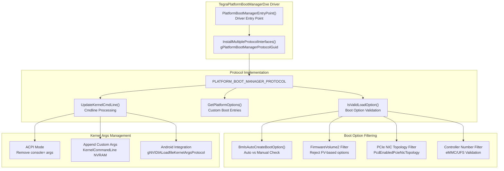
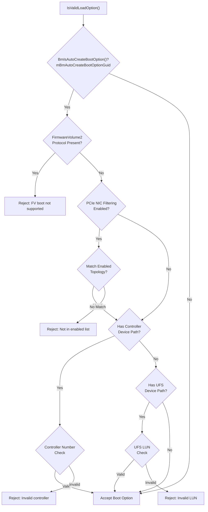
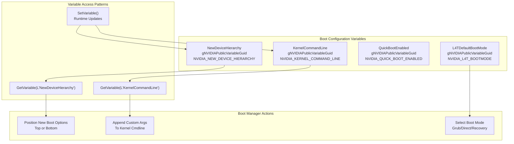
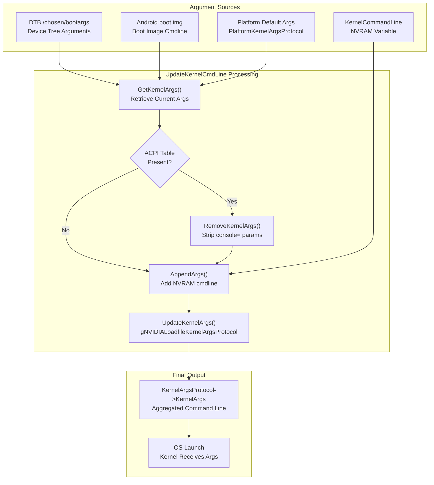
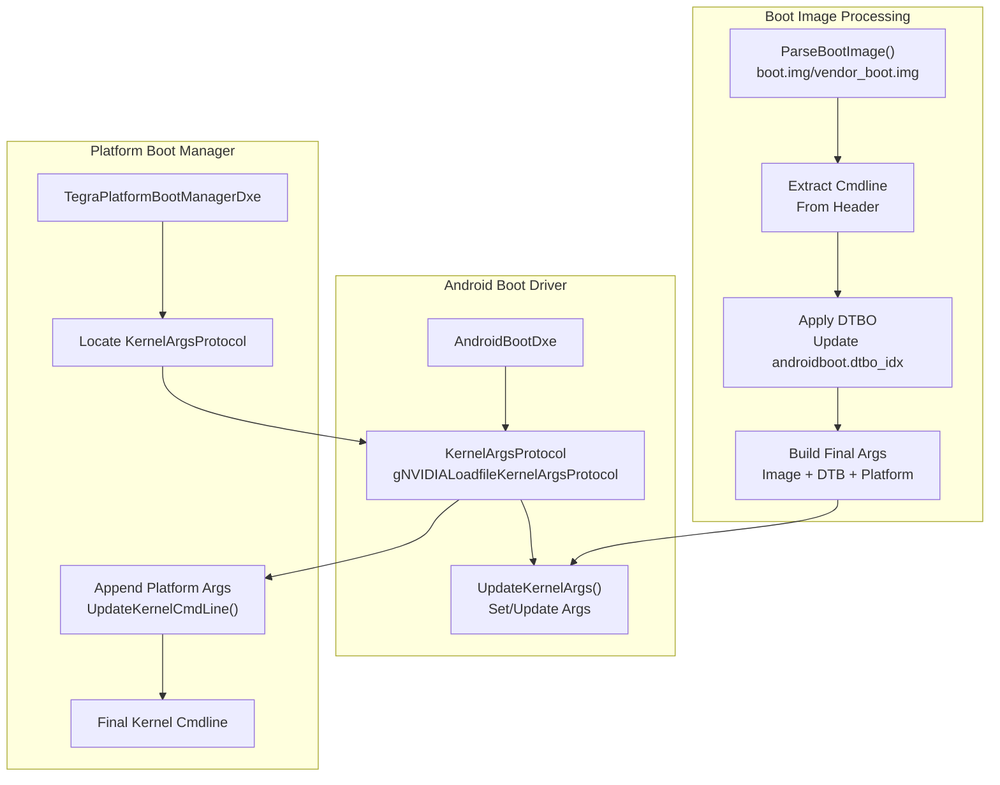
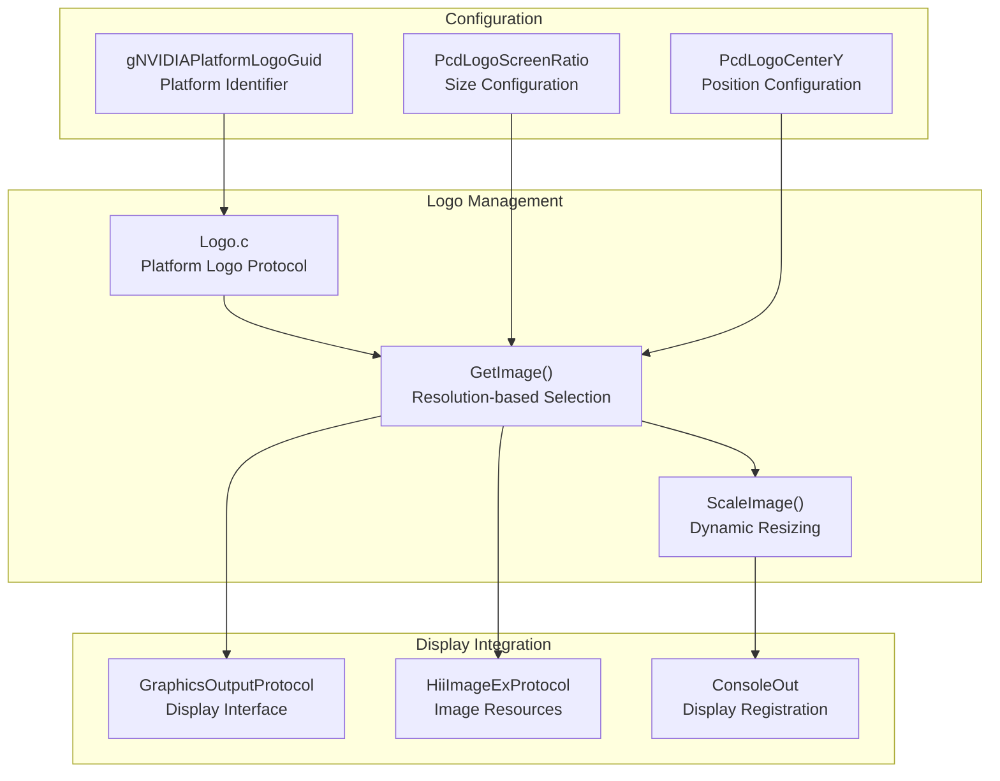

<!-- source: DeepWiki mcp.deepwiki.com · repo NVIDIA/edk2-nvidia · page 5.3 Boot Manager and Boot Options · fetched 2026-10-26 -->

# Boot Manager and Boot Options

<details>
<summary>Relevant source files</summary>

The following files were used as context for generating this wiki page:

- [Silicon/NVIDIA/Drivers/AndroidBootDxe/AndroidBootDxe.c](Silicon/NVIDIA/Drivers/AndroidBootDxe/AndroidBootDxe.c)
- [Silicon/NVIDIA/Drivers/AndroidBootDxe/AndroidBootDxe.h](Silicon/NVIDIA/Drivers/AndroidBootDxe/AndroidBootDxe.h)
- [Silicon/NVIDIA/Drivers/AndroidBootDxe/AndroidBootDxe.inf](Silicon/NVIDIA/Drivers/AndroidBootDxe/AndroidBootDxe.inf)
- [Silicon/NVIDIA/Drivers/AndroidBootDxe/UnitTest/AndroidBootDxeUnitTest.inf](Silicon/NVIDIA/Drivers/AndroidBootDxe/UnitTest/AndroidBootDxeUnitTest.inf)
- [Silicon/NVIDIA/Drivers/AndroidBootDxe/UnitTest/BootImgHeaderUnitTests.c](Silicon/NVIDIA/Drivers/AndroidBootDxe/UnitTest/BootImgHeaderUnitTests.c)
- [Silicon/NVIDIA/Drivers/NvidiaConfigDxe/NvidiaConfigDxe.c](Silicon/NVIDIA/Drivers/NvidiaConfigDxe/NvidiaConfigDxe.c)
- [Silicon/NVIDIA/Drivers/NvidiaConfigDxe/NvidiaConfigDxe.inf](Silicon/NVIDIA/Drivers/NvidiaConfigDxe/NvidiaConfigDxe.inf)
- [Silicon/NVIDIA/Drivers/NvidiaConfigDxe/NvidiaConfigHii.h](Silicon/NVIDIA/Drivers/NvidiaConfigDxe/NvidiaConfigHii.h)
- [Silicon/NVIDIA/Drivers/NvidiaConfigDxe/NvidiaConfigHii.uni](Silicon/NVIDIA/Drivers/NvidiaConfigDxe/NvidiaConfigHii.uni)
- [Silicon/NVIDIA/Drivers/NvidiaConfigDxe/NvidiaConfigHii.vfr](Silicon/NVIDIA/Drivers/NvidiaConfigDxe/NvidiaConfigHii.vfr)
- [Silicon/NVIDIA/Drivers/NvidiaConfigDxe/NvidiaConfigHiiMap.uni](Silicon/NVIDIA/Drivers/NvidiaConfigDxe/NvidiaConfigHiiMap.uni)
- [Silicon/NVIDIA/Drivers/TegraPlatformBootManager/TegraPlatformBootManagerDxe.c](Silicon/NVIDIA/Drivers/TegraPlatformBootManager/TegraPlatformBootManagerDxe.c)
- [Silicon/NVIDIA/Drivers/TegraPlatformBootManager/TegraPlatformBootManagerDxe.inf](Silicon/NVIDIA/Drivers/TegraPlatformBootManager/TegraPlatformBootManagerDxe.inf)
- [Silicon/NVIDIA/Include/AndroidBootImgHeader.h](Silicon/NVIDIA/Include/AndroidBootImgHeader.h)
- [Silicon/NVIDIA/Include/NVIDIAConfiguration.h](Silicon/NVIDIA/Include/NVIDIAConfiguration.h)
- [Silicon/NVIDIA/Include/Protocol/KernelArgsProtocol.h](Silicon/NVIDIA/Include/Protocol/KernelArgsProtocol.h)
- [Silicon/NVIDIA/Include/Server/TH500/TH500MB1Configuration.h](Silicon/NVIDIA/Include/Server/TH500/TH500MB1Configuration.h)
- [Silicon/NVIDIA/Library/PlatformBootManagerLib/PlatformBm.c](Silicon/NVIDIA/Library/PlatformBootManagerLib/PlatformBm.c)
- [Silicon/NVIDIA/Library/PlatformBootManagerLib/PlatformBm.h](Silicon/NVIDIA/Library/PlatformBootManagerLib/PlatformBm.h)
- [Silicon/NVIDIA/Library/PlatformBootManagerLib/PlatformBootManagerLib.inf](Silicon/NVIDIA/Library/PlatformBootManagerLib/PlatformBootManagerLib.inf)
- [Silicon/NVIDIA/NVIDIA.dec](Silicon/NVIDIA/NVIDIA.dec)

</details>


This document describes the boot manager and boot option management system in the edk2-nvidia repository. It details how `TegraPlatformBootManagerDxe` driver filters boot options, manages NVRAM boot configuration, processes kernel command-line arguments, and handles new devices. For the broader boot flow implementation, see page 5. For Android-specific boot support, see page 7.1.

## TegraPlatformBootManagerDxe Driver Architecture

The `TegraPlatformBootManagerDxe` driver implements platform-specific boot option filtering and kernel command-line management through the `PlatformBootManagerProtocol`. It integrates with UEFI boot services to validate, filter, and modify boot options before they are presented to the user or executed.

**TegraPlatformBootManagerDxe Driver Component Architecture**



Sources: [Silicon/NVIDIA/Drivers/TegraPlatformBootManager/TegraPlatformBootManagerDxe.c:1-400]()

## Boot Option Filtering Mechanisms

The boot manager implements multiple layers of filtering to determine which boot options are valid for the platform. The `IsValidLoadOption()` function serves as the central validation point.

**Boot Option Filtering Decision Tree**



Sources: [Silicon/NVIDIA/Drivers/TegraPlatformBootManager/TegraPlatformBootManagerDxe.c:70-180]()

### FirmwareVolume2 Protocol Filtering

The boot manager rejects boot options that use the `FirmwareVolume2` protocol, as these are not supported on NVIDIA platforms:

```c
// Locate device path and check for FirmwareVolume2 protocol
Status = gBS->LocateDevicePath (&gEfiFirmwareVolume2ProtocolGuid, &DevicePath, &Handle);
if (!EFI_ERROR (Status)) {
  return FALSE;  // Reject FV-based boot options
}
```

Sources: [Silicon/NVIDIA/Drivers/TegraPlatformBootManager/TegraPlatformBootManagerDxe.c:90-99]()

### PCIe NIC Topology Filtering

When PCIe NIC topology filtering is enabled via `PcdEnabledPcieNicTopology`, the boot manager validates that PCIe network devices match the configured topology:

| PCD Value | Behavior |
|-----------|----------|
| `ENABLED_PCIE_ALLOW_ALL` (0xFF) | Accept all PCIe NICs |
| Specific topology mask | Only accept NICs matching segment/bus/device/function |

The filtering logic extracts PCI location information and validates it against the enabled topology list:

```c
Status = PciIo->GetLocation (PciIo, &Segment, &Bus, &Device, &Function);
// Compare against EnabledPcieNicTopology->EnabledPcieNicList[]
```

Sources: [Silicon/NVIDIA/Drivers/TegraPlatformBootManager/TegraPlatformBootManagerDxe.c:100-145]()

### eMMC/UFS Controller Filtering

For eMMC and UFS devices, the boot manager validates controller numbers to ensure only supported storage controllers are used for boot:

```c
Controller = (CONTROLLER_DEVICE_PATH *)DevicePathNode;
if (Controller->ControllerNumber >= MAX_EMMC_DEVICES) {
  return FALSE;  // Reject invalid eMMC controller
}

Ufs = (UFS_DEVICE_PATH *)DevicePathNode;  
if (Ufs->Lun >= MAX_UFS_LUNS) {
  return FALSE;  // Reject invalid UFS LUN
}
```

Sources: [Silicon/NVIDIA/Drivers/TegraPlatformBootManager/TegraPlatformBootManagerDxe.c:146-180]()

## NVRAM Boot Configuration Management

The boot manager integrates with NVRAM variables to persist and retrieve boot configuration settings. These variables control boot option ordering, new device handling, and kernel command-line arguments.

**NVRAM Variable Management for Boot Configuration**



Sources: [Silicon/NVIDIA/Include/NVIDIAConfiguration.h:70-90](), [Silicon/NVIDIA/Drivers/NvidiaConfigDxe/NvidiaConfigHii.vfr:48-66]()

### NewDeviceHierarchy Variable

The `NewDeviceHierarchy` variable controls whether newly discovered boot devices are added to the top or bottom of the boot order list:

| Variable Name | GUID | Type | Values |
|---------------|------|------|--------|
| `NewDeviceHierarchy` | `gNVIDIAPublicVariableGuid` | `UINT8` | 0 = Bottom, 1 = Top |

This is managed through the HII configuration interface and persisted across reboots.

Sources: [Silicon/NVIDIA/Drivers/NvidiaConfigDxe/NvidiaConfigHii.vfr:48-51]()

### KernelCommandLine Variable  

The `KernelCommandLine` variable allows users to append custom arguments to the kernel command line:

| Variable Name | GUID | Type | Max Size |
|---------------|------|------|----------|
| `KernelCommandLine` | `gNVIDIAPublicVariableGuid` | `CHAR16[]` | 255 characters |

The boot manager reads this variable and appends its contents to the kernel arguments before OS handoff.

Sources: [Silicon/NVIDIA/Drivers/NvidiaConfigDxe/NvidiaConfigHii.vfr:63-66](), [Silicon/NVIDIA/Include/NVIDIAConfiguration.h:83-85]()

## Kernel Command-Line Argument Processing

The boot manager processes kernel command-line arguments through the `UpdateKernelCmdLine()` function, which integrates with multiple argument sources and applies platform-specific transformations.

**Kernel Command-Line Processing Pipeline**



Sources: [Silicon/NVIDIA/Drivers/TegraPlatformBootManager/TegraPlatformBootManagerDxe.c:182-300]()

### ACPI Mode Console Argument Removal

When ACPI tables are present, the boot manager removes `console=` arguments from the kernel command line, as console configuration is handled through ACPI SPCR tables:

```c
if (AcpiTablePresent) {
  // Remove console= arguments
  for (Count = 0; Count < ARRAY_SIZE(KernelCommandRemoveAcpi); Count++) {
    RemoveKernelArgs(KernelArgs, KernelCommandRemoveAcpi[Count]);
  }
}
```

Sources: [Silicon/NVIDIA/Drivers/TegraPlatformBootManager/TegraPlatformBootManagerDxe.c:33-35](), [Silicon/NVIDIA/Drivers/TegraPlatformBootManager/TegraPlatformBootManagerDxe.c:220-250]()

### Custom Argument Appending

The boot manager reads the `KernelCommandLine` NVRAM variable and appends its contents to the final kernel arguments:

```c
Status = GetVariable2(L"KernelCommandLine", &gNVIDIAPublicVariableGuid, 
                      &KernelCommandLine, NULL);
if (!EFI_ERROR(Status)) {
  AppendArgs(KernelArgs, KernelCommandLine);
}
```

This allows users to add custom kernel parameters that persist across reboots without modifying the DTB or boot images.

Sources: [Silicon/NVIDIA/Drivers/TegraPlatformBootManager/TegraPlatformBootManagerDxe.c:250-280]()

## New Device Handling

The boot manager handles newly discovered boot devices by adding them to the boot option list in a configurable position. The `NewDeviceHierarchy` variable controls this behavior.

**New Device Boot Option Insertion**

```mermaid
graph TB
    START["New Device Detected"]
    AUTO_CREATE["EfiBootManagerRefreshAllBootOption()<br/>Auto-create Boot Option"]
    
    READ_HIERARCHY["GetVariable()<br/>NewDeviceHierarchy"]
    
    CHECK_VALUE{"Hierarchy<br/>Value?"}
    
    INSERT_TOP["Insert at Top of List<br/>BootOrder[0]"]
    INSERT_BOTTOM["Append to End of List<br/>BootOrder[n]"]
    
    UPDATE_BOOT_ORDER["SetVariable()<br/>Update BootOrder"]
    
    NEXT_BOOT["Device Available<br/>for Next Boot"]
    
    START --> AUTO_CREATE
    AUTO_CREATE --> READ_HIERARCHY
    READ_HIERARCHY --> CHECK_VALUE
    
    CHECK_VALUE -->|Top (1)| INSERT_TOP
    CHECK_VALUE -->|Bottom (0)| INSERT_BOTTOM
    
    INSERT_TOP --> UPDATE_BOOT_ORDER
    INSERT_BOTTOM --> UPDATE_BOOT_ORDER
    
    UPDATE_BOOT_ORDER --> NEXT_BOOT
```

Sources: [Silicon/NVIDIA/Library/PlatformBootManagerLib/PlatformBm.c:690-850]()

### Auto-Created Boot Options

The boot manager distinguishes between manually created boot options and auto-created options using the `mBmAutoCreateBootOptionGuid`:

```c
BOOLEAN BmIsAutoCreateBootOption(EFI_BOOT_MANAGER_LOAD_OPTION *BootOption) {
  return CompareGuid((EFI_GUID *)BootOption->OptionalData, 
                     &mBmAutoCreateBootOptionGuid);
}
```

Only auto-created boot options are subject to validation through `IsValidLoadOption()`. Manual boot options bypass filtering to preserve user intent.

Sources: [Silicon/NVIDIA/Drivers/TegraPlatformBootManager/TegraPlatformBootManagerDxe.c:48-59](), [Silicon/NVIDIA/Drivers/TegraPlatformBootManager/TegraPlatformBootManagerDxe.c:90]()

## Android Boot Integration

The boot manager integrates with the Android boot system through kernel argument protocols that allow Android-specific boot images to provide command-line arguments.

**Android Boot Kernel Arguments Integration**



Sources: [Silicon/NVIDIA/Drivers/AndroidBootDxe/AndroidBootDxe.c:107-164](), [Silicon/NVIDIA/Drivers/TegraPlatformBootManager/TegraPlatformBootManagerDxe.c:280-320]()

### KernelArgsProtocol Interface

The `NVIDIA_KERNEL_ARGS_PROTOCOL` provides a standardized interface for passing kernel arguments between boot components:

```c
typedef struct {
  CHAR16 *KernelArgs;  // Pointer to kernel command line string
} NVIDIA_KERNEL_ARGS_PROTOCOL;
```

The `UpdateKernelArgs()` function manages the lifecycle of this string, allocating or reallocating memory as needed:

- Frees the old argument string if present
- Allocates new memory for updated arguments
- Copies the new argument string
- Returns `EFI_SUCCESS` or `EFI_OUT_OF_RESOURCES`

Sources: [Silicon/NVIDIA/Drivers/AndroidBootDxe/AndroidBootDxe.c:118-164]()

### Boot Image Command Line Extraction

Android boot images contain kernel command-line arguments in their headers. The Android boot driver extracts these and combines them with DTB arguments and platform defaults:

```c
// Extract from boot.img header
KernelArgs = Header->KernelArgs;

// Append androidboot.dtbo_idx if DTBOs were applied  
if (DtboCount > 0) {
  AppendFormat(KernelArgs, "androidboot.dtbo_idx=%a", DtboIdx);
}

// Update protocol
UpdateKernelArgs(KernelArgsProtocol, KernelArgs);
```

Sources: [Silicon/NVIDIA/Drivers/AndroidBootDxe/AndroidBootDxe.c:460-483]()

## Logo and Display Management

The boot manager integrates with the Logo driver to provide platform branding during boot. The logo system supports multiple resolution images and dynamic scaling:



The logo system automatically selects the most appropriate image size based on display resolution and applies scaling as needed to maintain visual consistency across different platforms.

Sources: [Silicon/NVIDIA/Drivers/Logo/Logo.c:200-368](), [Silicon/NVIDIA/NVIDIA.dec:125-127]()

---

