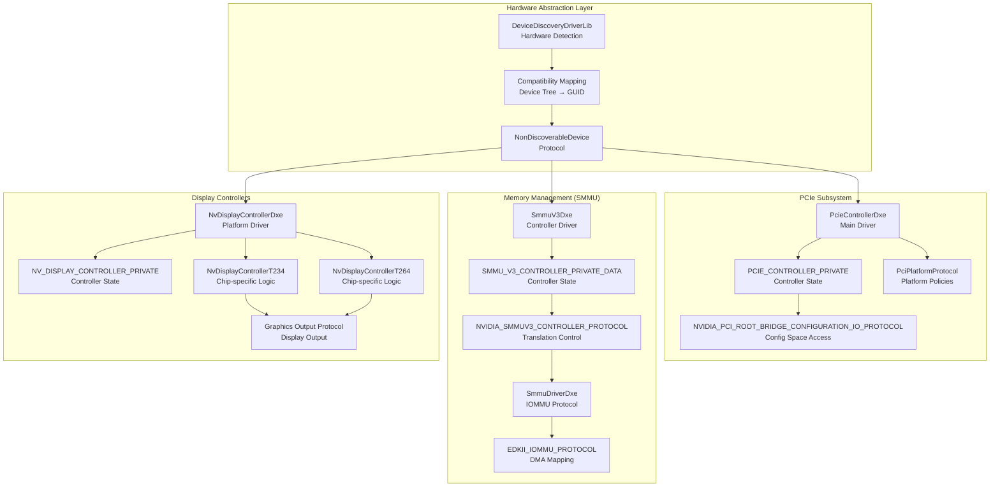
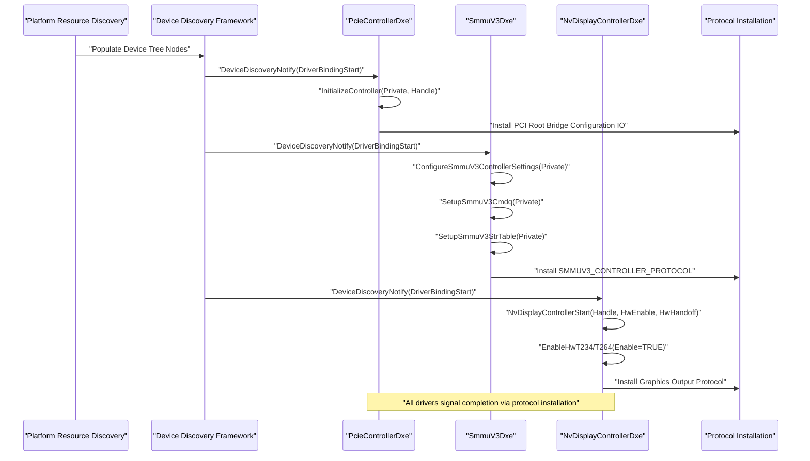
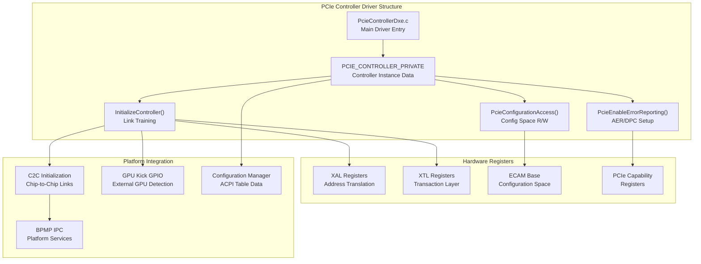
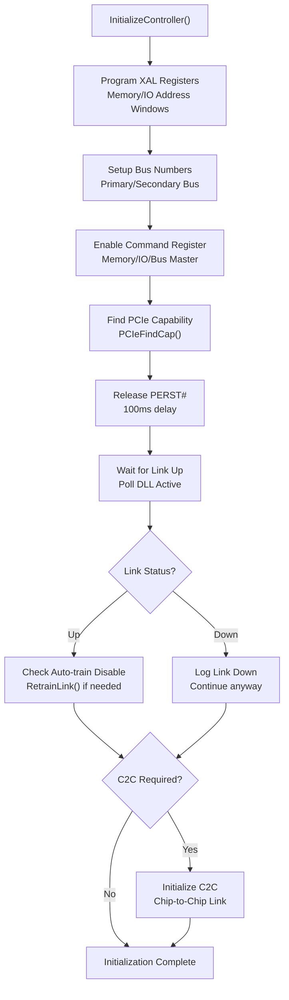
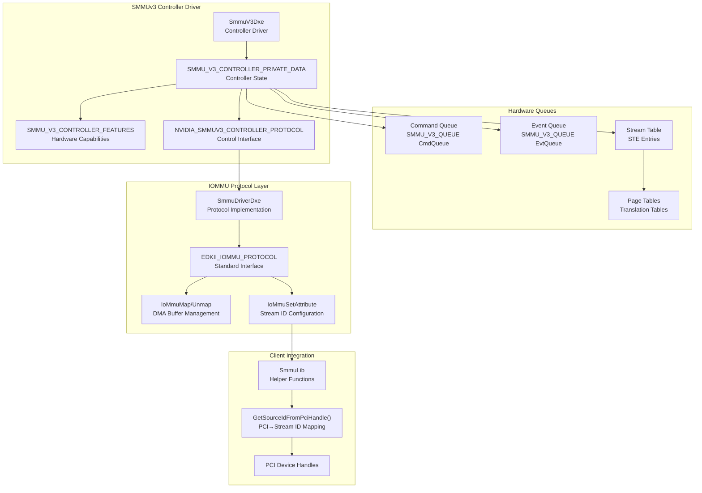
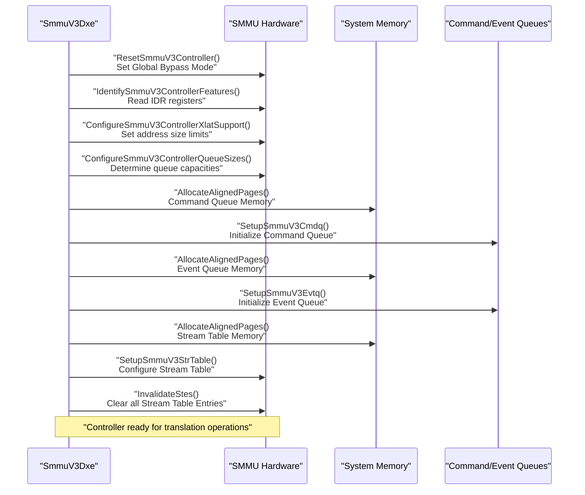
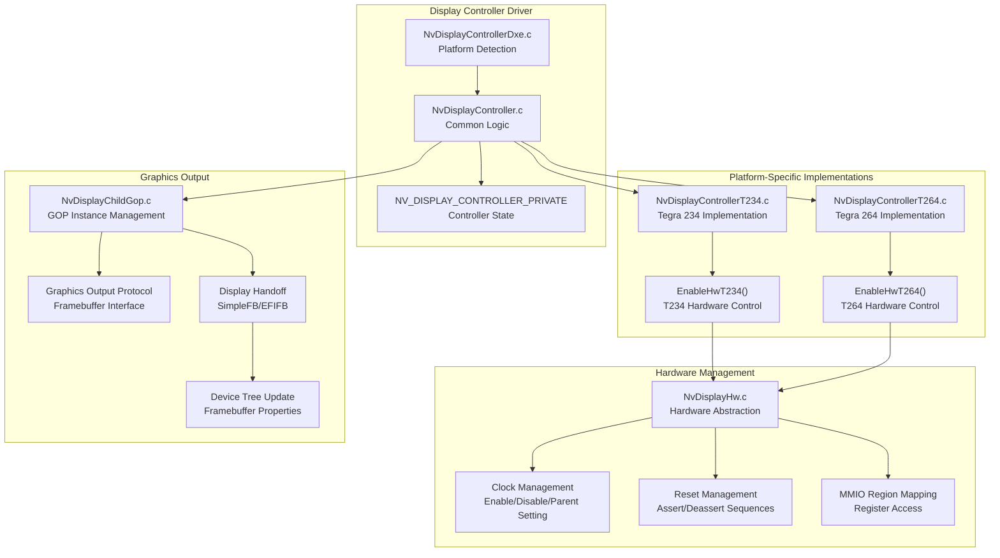
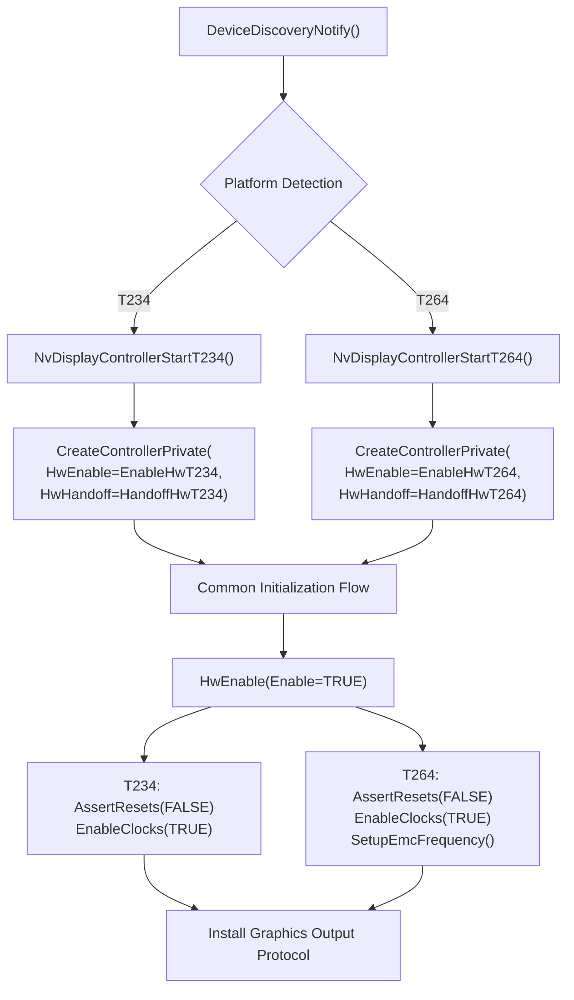
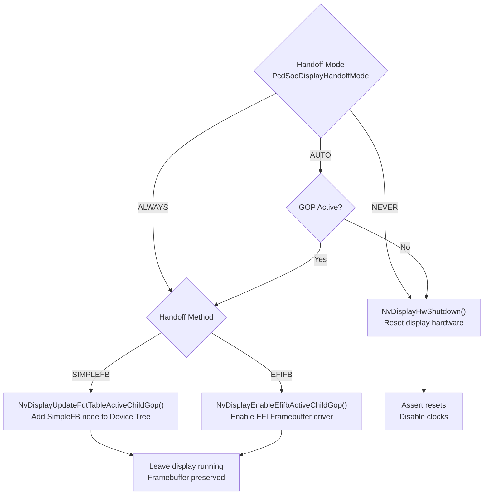

<!-- source: DeepWiki mcp.deepwiki.com · repo NVIDIA/edk2-nvidia · page 6 Hardware Drivers and Protocols · fetched 2026-10-26 -->

# Hardware Drivers

Relevant source files

The following files were used as context for generating this wiki page:

- [Silicon/NVIDIA/Drivers/PciGenericControllerDxe/PcieGenericControllerDxe.c](Silicon/NVIDIA/Drivers/PciGenericControllerDxe/PcieGenericControllerDxe.c)
- [Silicon/NVIDIA/Drivers/PciGenericControllerDxe/PcieGenericControllerDxe.inf](Silicon/NVIDIA/Drivers/PciGenericControllerDxe/PcieGenericControllerDxe.inf)
- [Silicon/NVIDIA/Drivers/PciGenericControllerDxe/PcieGenericControllerPrivate.h](Silicon/NVIDIA/Drivers/PciGenericControllerDxe/PcieGenericControllerPrivate.h)
- [Silicon/NVIDIA/Drivers/PcieControllerDxe/PciPlatformDxe.c](Silicon/NVIDIA/Drivers/PcieControllerDxe/PciPlatformDxe.c)
- [Silicon/NVIDIA/Drivers/PcieControllerDxe/PcieConfigDxe.c](Silicon/NVIDIA/Drivers/PcieControllerDxe/PcieConfigDxe.c)
- [Silicon/NVIDIA/Drivers/PcieControllerDxe/PcieControllerConfigGPU.c](Silicon/NVIDIA/Drivers/PcieControllerDxe/PcieControllerConfigGPU.c)
- [Silicon/NVIDIA/Drivers/PcieControllerDxe/PcieControllerConfigGPU.h](Silicon/NVIDIA/Drivers/PcieControllerDxe/PcieControllerConfigGPU.h)
- [Silicon/NVIDIA/Drivers/PcieControllerDxe/PcieControllerDxe.c](Silicon/NVIDIA/Drivers/PcieControllerDxe/PcieControllerDxe.c)
- [Silicon/NVIDIA/Drivers/PcieControllerDxe/PcieControllerDxe.inf](Silicon/NVIDIA/Drivers/PcieControllerDxe/PcieControllerDxe.inf)
- [Silicon/NVIDIA/Drivers/PcieControllerDxe/PcieControllerPrivate.h](Silicon/NVIDIA/Drivers/PcieControllerDxe/PcieControllerPrivate.h)
- [Silicon/NVIDIA/Include/AcpiPowerMeter.h](Silicon/NVIDIA/Include/AcpiPowerMeter.h)
- [Silicon/NVIDIA/Include/Protocol/BpmpIpc.h](Silicon/NVIDIA/Include/Protocol/BpmpIpc.h)
- [Silicon/NVIDIA/Include/Protocol/PciRootBridgeConfigurationIo.h](Silicon/NVIDIA/Include/Protocol/PciRootBridgeConfigurationIo.h)
- [Silicon/NVIDIA/Include/Server/TH500/TH500Definitions.h](Silicon/NVIDIA/Include/Server/TH500/TH500Definitions.h)
- [Silicon/NVIDIA/Library/DeviceDiscoveryLib/DeviceDiscoveryLibPrivate.h](Silicon/NVIDIA/Library/DeviceDiscoveryLib/DeviceDiscoveryLibPrivate.h)
- [Silicon/NVIDIA/Library/PciHostBridgeLib/PciHostBridgeLib.c](Silicon/NVIDIA/Library/PciHostBridgeLib/PciHostBridgeLib.c)
- [Silicon/NVIDIA/Library/PciHostBridgeLib/PciHostBridgeLib.inf](Silicon/NVIDIA/Library/PciHostBridgeLib/PciHostBridgeLib.inf)

This document covers the hardware-specific UEFI drivers that manage PCIe controllers, memory management units (SMMUs), display controllers, and other platform hardware in the edk2-nvidia firmware. These drivers provide the fundamental hardware abstraction layer that enables device discovery, memory translation, and graphics output for NVIDIA Tegra platforms.

For information about platform resource discovery and device tree management, see [Hardware Discovery and Device Tree](#3.3). For boot management and operating system handoff, see [Boot and Operating System Support](#5).

## Hardware Driver Architecture

The hardware drivers follow a layered architecture where device discovery drivers locate and initialize hardware components, which then expose standardized UEFI protocols for use by higher-level services.

### Driver Architecture Overview

Sources: [Silicon/NVIDIA/Drivers/PcieControllerDxe/PcieControllerDxe.c:61-88](), [Silicon/NVIDIA/Drivers/SmmuV3Dxe/SmmuV3Dxe.c:25-32](), [Silicon/NVIDIA/Drivers/NvDisplayControllerDxe/NvDisplayControllerDxe.c:22-33]()

### Driver Initialization Flow

Sources: [Silicon/NVIDIA/Drivers/PcieControllerDxe/PcieControllerDxe.c:574-723](), [Silicon/NVIDIA/Drivers/SmmuV3Dxe/SmmuV3Dxe.c:394-458](), [Silicon/NVIDIA/Drivers/NvDisplayControllerDxe/NvDisplayController.c:519-543]()

## PCIe Controllers and Interconnect

The PCIe controller driver (`PcieControllerDxe`) manages PCIe root complex controllers on NVIDIA Tegra platforms, providing configuration space access, link training, error handling, and power management.

### PCIe Controller Components

Sources: [Silicon/NVIDIA/Drivers/PcieControllerDxe/PcieControllerPrivate.h:50-98](), [Silicon/NVIDIA/Drivers/PcieControllerDxe/PcieControllerDxe.c:574-723]()

### PCIe Configuration Space Access

The driver implements custom configuration space access through the `NVIDIA_PCI_ROOT_BRIDGE_CONFIGURATION_IO_PROTOCOL`:

| Function | Purpose | Implementation |
|----------|---------|----------------|
| `PcieConfigurationRead` | Read config space | [Silicon/NVIDIA/Drivers/PcieControllerDxe/PcieControllerDxe.c:245-253]() |
| `PcieConfigurationWrite` | Write config space | [Silicon/NVIDIA/Drivers/PcieControllerDxe/PcieControllerDxe.c:270-278]() |
| `PcieConfigurationAccess` | Common access logic | [Silicon/NVIDIA/Drivers/PcieControllerDxe/PcieControllerDxe.c:111-228]() |

Key features:
- ECAM-based configuration access with offset calculation
- Option ROM disable for non-root bridge devices
- Bus number validation and device enumeration
- Support for 8, 16, and 32-bit access widths

Sources: [Silicon/NVIDIA/Drivers/PcieControllerDxe/PcieControllerDxe.c:111-278]()

### Link Training and Initialization

The `InitializeController` function manages the complete PCIe link bring-up sequence:

Sources: [Silicon/NVIDIA/Drivers/PcieControllerDxe/PcieControllerDxe.c:574-723]()

### Error Reporting and Recovery

The driver configures Advanced Error Reporting (AER) and Downstream Port Containment (DPC) for robust error handling:

- **AER Configuration**: Clears error status registers, configures severity levels, enables error forwarding
- **DPC Setup**: Enables DPC triggers for fatal/non-fatal errors with interrupt generation  
- **Root Port Controls**: Configures system error signaling for correctable/uncorrectable errors
- **ECRC Support**: Enables End-to-End CRC generation and checking when supported

Sources: [Silicon/NVIDIA/Drivers/PcieControllerDxe/PcieControllerDxe.c:968-1188]()

## Memory Management and SMMU

The System Memory Management Unit (SMMU) provides I/O memory management and translation services, implementing both SMMUv3 controller management and the UEFI IOMMU protocol for DMA operations.

### SMMU Controller Architecture

Sources: [Silicon/NVIDIA/Drivers/SmmuV3Dxe/SmmuV3DxePrivate.h:363-378](), [Silicon/NVIDIA/Drivers/SmmuDriverDxe/SmmuDriverDxe.c:23-29](), [Silicon/NVIDIA/Library/SmmuLib/SmmuLib.c:28-36]()

### SMMU Initialization Sequence

The SMMUv3 driver follows a structured initialization process to configure hardware features and establish translation services:

Sources: [Silicon/NVIDIA/Drivers/SmmuV3Dxe/SmmuV3Dxe.c:37-699]()

### Stream ID Management

The SMMU uses Stream IDs to identify DMA transactions from different devices. The `SmmuLib` provides functions to map PCI device handles to Stream IDs:

| Component | Function | Implementation |
|-----------|----------|----------------|
| **Stream ID Calculation** | `GetSourceIdFromPciHandle()` | [Silicon/NVIDIA/Library/SmmuLib/SmmuLib.c:176-318]() |
| **PCI Location Mapping** | Bus/Device/Function → RID | RID = (Bus << 8) \| (Device << 3) \| Function |
| **Root Bridge Lookup** | Segment → StreamIdBase | Search `NVIDIA_PCI_ROOT_BRIDGE_CONFIGURATION_IO_PROTOCOL` |
| **Final Stream ID** | RID + StreamIdBase | StreamId = StreamIdBase + RID |

### Translation Modes

The SMMU supports two primary translation modes:

- **SMMU_V3_BYPASS**: Direct memory access without translation
- **SMMU_V3_TRANSLATE**: Full address translation through page tables

Mode selection is based on device vendor ID matching against bypass lists stored in the device tree under `/firmware/uefi/skip-smmu-vid`.

Sources: [Silicon/NVIDIA/Library/SmmuLib/SmmuLib.c:40-169](), [Silicon/NVIDIA/Include/Protocol/SmmuV3Protocol.h:23-27]()

## Display and Graphics Controllers

The display controller driver (`NvDisplayControllerDxe`) manages display hardware initialization, clock/reset control, and graphics output protocol implementation across different NVIDIA Tegra platforms.

### Display Controller Architecture

Sources: [Silicon/NVIDIA/Drivers/NvDisplayControllerDxe/NvDisplayControllerDxe.c:51-108](), [Silicon/NVIDIA/Drivers/NvDisplayControllerDxe/NvDisplayController.c:28-43]()

### Platform-Specific Hardware Control

The display driver uses function pointers to abstract chip-specific hardware operations:

### T234 vs T264 Implementation Differences

| Aspect | T234 Implementation | T264 Implementation |
|--------|-------------------|-------------------|
| **Reset Signals** | `nvdisplay_reset`, `dpaux0_reset` | `dpaux0_reset` only |
| **Clock Parents** | `disp_root→disppll_clk` `nvdisplayhub_clk→sppll0_clkoutb_clk` | `disp_root→disppll_clk` `nvdisplayhub_clk→sppll0_clkoutb_clk` |  
| **Additional Clocks** | `dsi_core_clk`, `aza_bit_clk` | None |
| **Memory Bandwidth** | Not managed | BPMP BWMGR integration via `SetupEmcFrequency()` |
| **GPIO Configuration** | HDMI/DP mux control via TCA9539 | Not implemented |

Sources: [Silicon/NVIDIA/Drivers/NvDisplayControllerDxe/NvDisplayControllerT234.c:42-99](), [Silicon/NVIDIA/Drivers/NvDisplayControllerDxe/NvDisplayControllerT264.c:70-122]()

### Display Handoff Mechanisms

The display driver supports multiple handoff methods for seamless transition to the operating system:

The handoff process is triggered by `ReadyToBoot` and `FdtTable` events, ensuring display configuration is updated before OS boot.

Sources: [Silicon/NVIDIA/Drivers/NvDisplayControllerDxe/NvDisplayController.c:158-242](), [Silicon/NVIDIA/Drivers/NvDisplayControllerDxe/NvDisplayChildGop.c:154-271]()

---

