<!-- source: DeepWiki mcp.deepwiki.com · repo NVIDIA/edk2-nvidia · page 6.1 PCIe Controller Drivers · fetched 2026-10-26 -->

# PCIe Controller Drivers

<details>
<summary>Relevant source files</summary>

The following files were used as context for generating this wiki page:

- [Silicon/NVIDIA/Drivers/PciGenericControllerDxe/PcieGenericControllerDxe.c](Silicon/NVIDIA/Drivers/PciGenericControllerDxe/PcieGenericControllerDxe.c)
- [Silicon/NVIDIA/Drivers/PciGenericControllerDxe/PcieGenericControllerDxe.inf](Silicon/NVIDIA/Drivers/PciGenericControllerDxe/PcieGenericControllerDxe.inf)
- [Silicon/NVIDIA/Drivers/PciGenericControllerDxe/PcieGenericControllerPrivate.h](Silicon/NVIDIA/Drivers/PciGenericControllerDxe/PcieGenericControllerPrivate.h)
- [Silicon/NVIDIA/Drivers/PcieControllerDxe/PciPlatformDxe.c](Silicon/NVIDIA/Drivers/PcieControllerDxe/PciPlatformDxe.c)
- [Silicon/NVIDIA/Drivers/PcieControllerDxe/PcieConfigDxe.c](Silicon/NVIDIA/Drivers/PcieControllerDxe/PcieConfigDxe.c)
- [Silicon/NVIDIA/Drivers/PcieControllerDxe/PcieControllerConfigGPU.c](Silicon/NVIDIA/Drivers/PcieControllerDxe/PcieControllerConfigGPU.c)
- [Silicon/NVIDIA/Drivers/PcieControllerDxe/PcieControllerConfigGPU.h](Silicon/NVIDIA/Drivers/PcieControllerDxe/PcieControllerConfigGPU.h)
- [Silicon/NVIDIA/Drivers/PcieControllerDxe/PcieControllerDxe.c](Silicon/NVIDIA/Drivers/PcieControllerDxe/PcieControllerDxe.c)
- [Silicon/NVIDIA/Drivers/PcieControllerDxe/PcieControllerDxe.inf](Silicon/NVIDIA/Drivers/PcieControllerDxe/PcieControllerDxe.inf)
- [Silicon/NVIDIA/Drivers/PcieControllerDxe/PcieControllerPrivate.h](Silicon/NVIDIA/Drivers/PcieControllerDxe/PcieControllerPrivate.h)
- [Silicon/NVIDIA/Include/Protocol/PciRootBridgeConfigurationIo.h](Silicon/NVIDIA/Include/Protocol/PciRootBridgeConfigurationIo.h)
- [Silicon/NVIDIA/Library/PciHostBridgeLib/PciHostBridgeLib.c](Silicon/NVIDIA/Library/PciHostBridgeLib/PciHostBridgeLib.c)
- [Silicon/NVIDIA/Library/PciHostBridgeLib/PciHostBridgeLib.inf](Silicon/NVIDIA/Library/PciHostBridgeLib/PciHostBridgeLib.inf)

</details>


## Purpose and Scope

The PCIe Controller Drivers provide support for PCI Express root complex controllers on NVIDIA Tegra platforms. This documentation covers the two driver implementations and their associated functionality:

- **PcieControllerDxe**: NVIDIA-specific PCIe controller driver for TH500 and T264 platforms with advanced features including link training, C2C (Chip-to-Chip) initialization, GPU optimization, and error reporting
- **PcieGenericControllerDxe**: Generic ECAM-compliant PCIe controller driver for simpler platforms and virtualized environments

For information about BPMP (Boot and Power Management Processor) communication used by these drivers, see [BPMP IPC and System Management](#6.2). For BIOS configuration of PCIe settings, see [BIOS Setup and HII Interface](#5.1).

Sources: [Silicon/NVIDIA/Drivers/PcieControllerDxe/PcieControllerDxe.c:1-88](), [Silicon/NVIDIA/Drivers/PciGenericControllerDxe/PcieGenericControllerDxe.c:1-70]()

## Driver Architecture

The firmware provides two PCIe controller driver implementations that expose root bridges to the UEFI PCI bus driver through standard protocols.

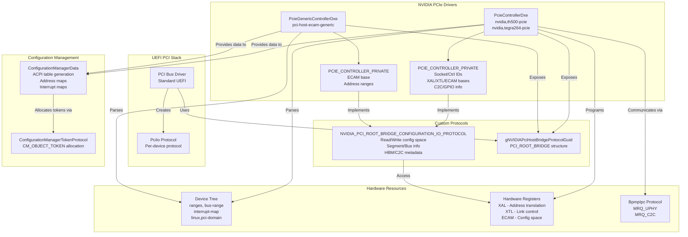

**Driver Selection and Compatibility**

The driver used for each PCIe controller is determined by device tree compatibility strings:

| Compatibility String | Driver | Platform Support |
|---------------------|---------|------------------|
| `nvidia,th500-pcie` | PcieControllerDxe | TH500 server platforms |
| `nvidia,tegra264-pcie` | PcieControllerDxe | T264 platforms |
| `pci-host-ecam-generic` | PcieGenericControllerDxe | TegraVirt, generic platforms |

Sources: [Silicon/NVIDIA/Drivers/PcieControllerDxe/PcieControllerDxe.c:61-65](), [Silicon/NVIDIA/Drivers/PciGenericControllerDxe/PcieGenericControllerDxe.c:44-47]()

## Private Data Structures

Both drivers maintain controller-specific state in `PCIE_CONTROLLER_PRIVATE` structures, though with different levels of complexity.

**NVIDIA-Specific Controller Private Data**

The NVIDIA controller driver maintains extensive state for advanced features:

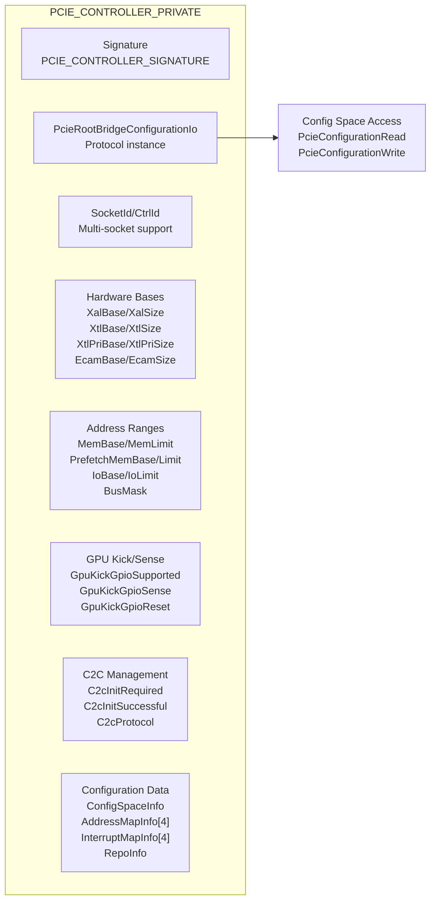

Sources: [Silicon/NVIDIA/Drivers/PcieControllerDxe/PcieControllerPrivate.h:51-99]()

**Generic Controller Private Data**

The generic controller has a simpler structure focused on ECAM access:

| Field | Purpose |
|-------|---------|
| `Signature` | `PCIE_CONTROLLER_SIGNATURE` (0x50434947) |
| `PcieRootBridgeConfigurationIo` | Protocol implementation |
| `CtrlId` / `SocketId` | Controller identification |
| `EcamBase` / `EcamSize` | ECAM region for config space |
| `MemBase` / `MemLimit` | 32-bit memory aperture |
| `PrefetchMemBase` / `PrefetchMemLimit` | 64-bit prefetchable aperture |
| `IoBase` / `IoLimit` | I/O aperture |
| `ConfigSpaceInfo` | ACPI configuration space descriptor |
| `AddressMapInfo[3]` | Address translation maps |
| `InterruptMapInfo[4]` | Interrupt routing maps |

Sources: [Silicon/NVIDIA/Drivers/PciGenericControllerDxe/PcieGenericControllerPrivate.h:30-60]()

## Controller Initialization

### Device Discovery and Binding

Both drivers use the Device Discovery Driver framework for initialization, but with different threading models:

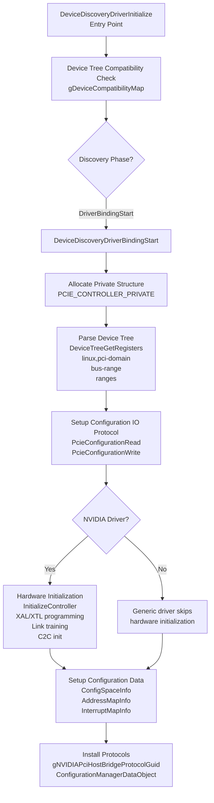

**Threading Configuration**

The drivers use different threading models defined in `NVIDIA_DEVICE_DISCOVERY_CONFIG`:

- **NVIDIA Controller**: `ThreadedDeviceStart = TRUE` - initialization runs in separate threads to handle potentially long link training
- **Generic Controller**: `ThreadedDeviceStart = FALSE` - simple synchronous initialization

Sources: [Silicon/NVIDIA/Drivers/PcieControllerDxe/PcieControllerDxe.c:80-87](), [Silicon/NVIDIA/Drivers/PciGenericControllerDxe/PcieGenericControllerDxe.c:62-69]()

### NVIDIA Controller Hardware Initialization

The `InitializeController` function performs comprehensive hardware setup for NVIDIA-specific controllers:

```mermaid
sequenceDiagram
    participant Ctrl as InitializeController
    participant XAL as XAL Registers
    participant ECAM as ECAM Space
    participant Link as Link Training
    participant C2C as C2C Protocol
    participant GPIO as GPIO Protocol
    
    Ctrl->>XAL: Program Address Translation
    Note over XAL: XAL_RC_MEM_32BIT_BASE/LIMIT<br/>XAL_RC_MEM_64BIT_BASE/LIMIT<br/>XAL_RC_IO_BASE/LIMIT<br/>XAL_RC_BAR_CNTL_STANDARD
    
    Ctrl->>ECAM: Setup Bus Numbers
    Note over ECAM: Primary=0, Secondary=1, Sub=0xFF
    
    Ctrl->>ECAM: Setup Command Register
    Note over ECAM: IO_SPACE | MEMORY_SPACE<br/>BUS_MASTER | SERR
    
    Ctrl->>ECAM: Find PCIe Capability
    Note over ECAM: PCIeFindCap(EFI_PCI_CAPABILITY_ID_PCIEXP)
    
    Ctrl->>Ctrl: Wait 100ms before PERST
    
    Ctrl->>XAL: Release PERST#
    Note over XAL: XTL_RC_MGMT_PERST_CONTROL<br/>Set PERST_O_N bit
    
    Ctrl->>Ctrl: CheckAndAddDelayAfterPERST
    Note over Ctrl: Optional user-configurable delay<br/>DelayAfterPERST variable
    
    Ctrl->>Link: Wait for Link Up
    Note over Link: WaitForBit16 on LinkStatus<br/>Data Link Layer Active bit
    
    alt Link Up
        Ctrl->>Ctrl: Wait 100ms post-training
        
        alt DisableLTSSMAutoTrain set
            Ctrl->>Link: RetrainLink
            Note over Link: Force retrain to max speed
        end
        
        alt C2C Required
            Ctrl->>GPIO: SenseGpu
            Note over GPIO: GPU kick/sense mechanism
            
            Ctrl->>C2C: Init(Partitions, &Status)
            Note over C2C: BPMP MRQ_C2C command
            
            alt C2C Success
                Ctrl->>Ctrl: C2cInitSuccessful = TRUE
            else C2C Failure
                Ctrl->>Ctrl: Report error code
            end
        end
    else Link Down
        Ctrl->>Ctrl: Log link failure
    end
```

Sources: [Silicon/NVIDIA/Drivers/PcieControllerDxe/PcieControllerDxe.c:651-809]()

**XAL Register Programming**

XAL (eXternal Address Logic) registers configure address translation between PCI address space and system memory:

| Register | Offset | Purpose |
|----------|--------|---------|
| `XAL_RC_MEM_32BIT_BASE_HI/LO` | 0x1C/0x20 | 32-bit memory base address |
| `XAL_RC_MEM_32BIT_LIMIT_HI/LO` | 0x24/0x28 | 32-bit memory limit |
| `XAL_RC_MEM_64BIT_BASE_HI/LO` | 0x2C/0x30 | 64-bit prefetchable base |
| `XAL_RC_MEM_64BIT_LIMIT_HI/LO` | 0x34/0x38 | 64-bit prefetchable limit |
| `XAL_RC_IO_BASE_HI/LO` | 0x0C/0x10 | I/O space base |
| `XAL_RC_IO_LIMIT_HI/LO` | 0x14/0x18 | I/O space limit |
| `XAL_RC_BAR_CNTL_STANDARD` | 0x40 | Enable IO/32B/64B BARs |

Sources: [Silicon/NVIDIA/Drivers/PcieControllerDxe/PcieControllerDxe.c:680-700](), [Silicon/NVIDIA/Drivers/PcieControllerDxe/PcieControllerPrivate.h:109-128]()

## Configuration Space Access

Both drivers implement the `NVIDIA_PCI_ROOT_BRIDGE_CONFIGURATION_IO_PROTOCOL` for PCI configuration space access.

### Configuration Space Protocol

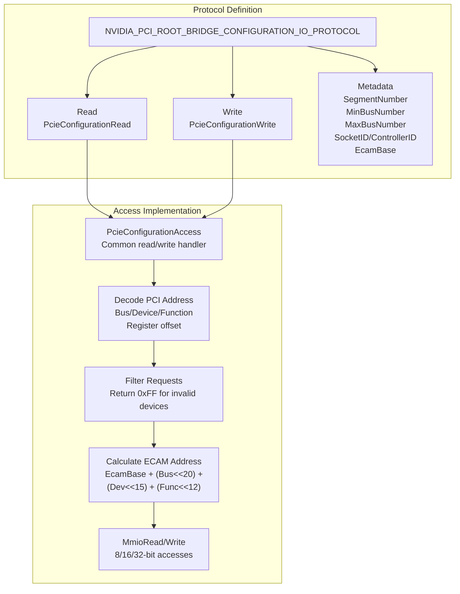

**Address Decoding**

The `PcieConfigurationAccess` function handles PCI configuration space addressing:

1. **Address structure**: Uses `EFI_PCI_ROOT_BRIDGE_IO_PROTOCOL_PCI_ADDRESS` with Bus, Device, Function, and Register/ExtendedRegister fields
2. **ECAM offset calculation**: `(Bus << 20) | (Device << 15) | (Function << 12)`
3. **Register access**: Supports standard (0-255) and extended (256-4095) configuration space

**Special Handling**

- **Root port filtering**: Devices other than 0:0.0 on the root bus return 0xFF (non-existent)
- **Byte/word writes**: For non-aligned or sub-DWORD writes, performs read-modify-write to maintain DWORD alignment required by hardware
- **Option ROM disable**: When `mPcieDisableOptionRom` is set, reads to `PCI_EXPANSION_ROM_BASE` return 0

Sources: [Silicon/NVIDIA/Drivers/PcieControllerDxe/PcieControllerDxe.c:115-232](), [Silicon/NVIDIA/Drivers/PciGenericControllerDxe/PcieGenericControllerDxe.c:87-194](), [Silicon/NVIDIA/Include/Protocol/PciRootBridgeConfigurationIo.h:1-118]()

## Link Training and Hardware Management

The NVIDIA controller driver manages PCIe link training and hardware state transitions.

### Link Training Sequence

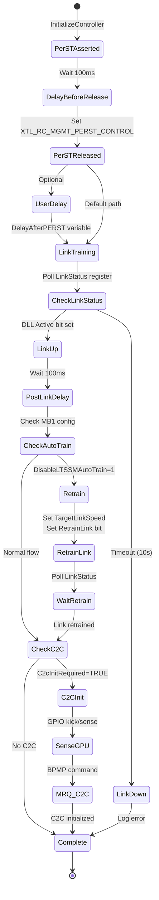

**Link Status Monitoring**

The `WaitForBit16` function polls PCIe capability registers with configurable timeout:

- **Default timeout**: 10,000 iterations × 100μs = 1 second per check
- **C2C mode**: Uses blocking `MicroSecondDelay` instead of `DeviceDiscoveryThreadMicroSecondDelay`
- **Monitored bits**:
  - Bit 11: Link Training (should clear)
  - Bit 13: Data Link Layer Active (should set)
  - Bit 14: Link Bandwidth Management (should set after retrain)

Sources: [Silicon/NVIDIA/Drivers/PcieControllerDxe/PcieControllerDxe.c:364-390](), [Silicon/NVIDIA/Drivers/PcieControllerDxe/PcieControllerDxe.c:394-441]()

### Link Retraining

The `RetrainLink` function forces link retraining to maximum speed:

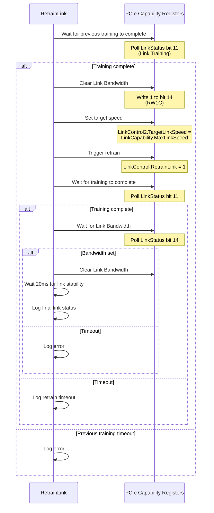

Sources: [Silicon/NVIDIA/Drivers/PcieControllerDxe/PcieControllerDxe.c:394-441]()

### GPU Kick and Sense Mechanism

For GPUs that require explicit wake signaling, the driver implements a kick/sense protocol using GPIO pins:

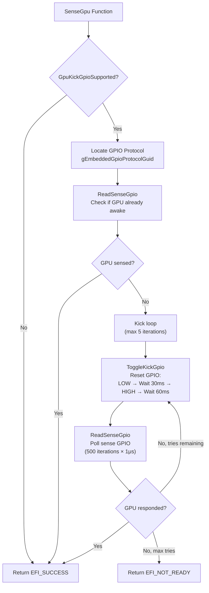

**GPIO Configuration**

- `GpuKickGpioReset`: Output GPIO for reset signal (kick)
- `GpuKickGpioSense`: Input GPIO for sensing GPU response
- Timing: 30ms reset assertion, 60ms total reset cycle, 500μs sense timeout

Sources: [Silicon/NVIDIA/Drivers/PcieControllerDxe/PcieControllerDxe.c:446-566](), [Silicon/NVIDIA/Drivers/PcieControllerDxe/PcieControllerPrivate.h:34-37]()

### User-Configurable Delays

The driver supports UEFI variables for debugging and compatibility:

**DelayAfterPERST Variable**

```c
// Variable name: L"DelayAfterPERST"
// GUID: gNVIDIAPublicVariableGuid
// Type: UINT8[TEGRABL_SOC_MAX_SOCKETS][TEGRABL_MAX_PCIE_PER_SOCKET]
// Purpose: Add delay in seconds after releasing PERST# for specific controllers
```

Example: Setting `gDelayAfterPERST[0][3] = 5` adds a 5-second delay after PERST# release for socket 0, controller 3.

Sources: [Silicon/NVIDIA/Drivers/PcieControllerDxe/PcieControllerDxe.c:570-605]()

## Advanced Error Reporting (AER) and DPC

The NVIDIA controller driver configures Advanced Error Reporting (AER) and Downstream Port Containment (DPC) for all PCIe devices.

### Error Reporting Configuration Flow

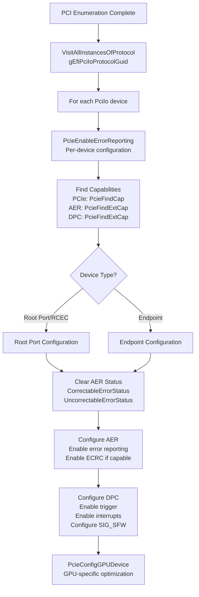

Sources: [Silicon/NVIDIA/Drivers/PcieControllerDxe/PcieControllerDxe.c:1084-1336]()

### AER (Advanced Error Reporting) Configuration

The driver configures AER on all capable devices:

**For Root Ports and Root Complex Event Collectors:**

| Register | Configuration |
|----------|--------------|
| CorrectableErrorStatus | Clear all (RW1C) |
| UncorrectableErrorStatus | Clear all (RW1C) |
| CorrectableErrorMask | Unmask all |
| UncorrectableErrorMask | Unmask all |
| UncorrectableErrorSeverity | Keep defaults |
| RootControl | Enable CORR/NONFATAL/FATAL reporting |
| RootStatus | Clear all (RW1C) |

**For All Devices:**

| Register | Configuration |
|----------|--------------|
| DeviceControl | Enable CorrErr, NonFatalErr, FatalErr, UnsuppReq reporting |
| AdvancedErrorCapabilities | Enable ECRC generation/checking if supported |

Sources: [Silicon/NVIDIA/Drivers/PcieControllerDxe/PcieControllerDxe.c:1140-1268]()

### DPC (Downstream Port Containment) Configuration

DPC provides hardware-based error containment for PCIe links:

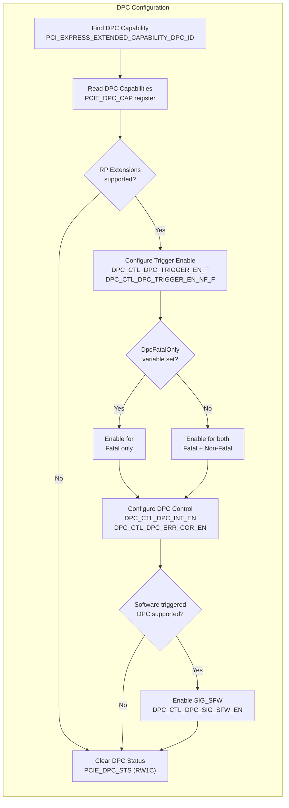

**DPC Trigger Configuration Variable**

```c
// Variable name: L"DpcFatalOnly"
// GUID: gNVIDIAPublicVariableGuid
// Type: UINT8[TEGRABL_SOC_MAX_SOCKETS][TEGRABL_MAX_PCIE_PER_SOCKET]
// Values: 0 = Fatal + Non-Fatal (default), 1 = Fatal only
```

Sources: [Silicon/NVIDIA/Drivers/PcieControllerDxe/PcieControllerDxe.c:609-646](), [Silicon/NVIDIA/Drivers/PcieControllerDxe/PcieControllerDxe.c:1270-1336]()

### Exit Boot Services Cleanup

For T264 platforms with `nvidia,uefi-exit-reset` property, the driver performs DPC cleanup before OS handoff:

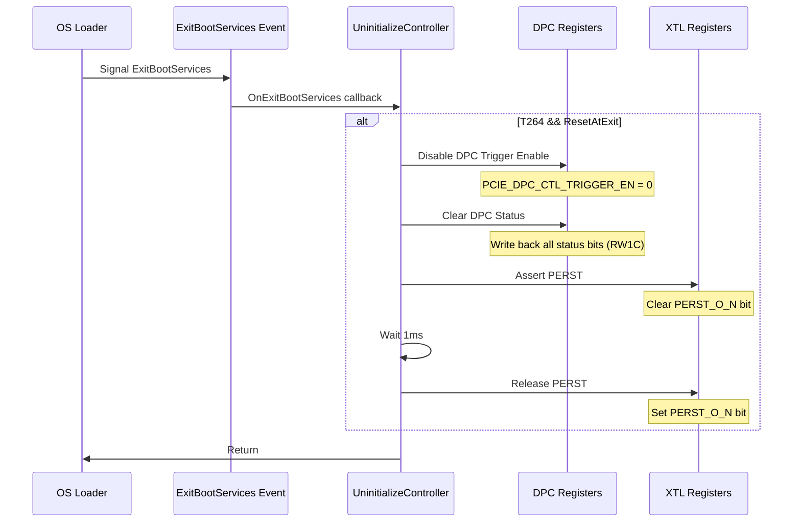

Sources: [Silicon/NVIDIA/Drivers/PcieControllerDxe/PcieControllerDxe.c:814-853](), [Silicon/NVIDIA/Drivers/PcieControllerDxe/PcieControllerDxe.c:866-872]()

## GPU-Specific Optimizations

The driver applies NVIDIA GPU-specific PCIe optimizations when GPUs are detected.

### GPU Detection and Configuration

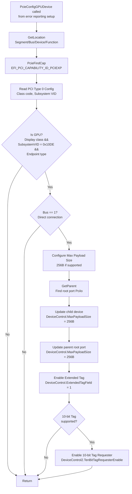

**GPU Detection Criteria**

A device is configured as an NVIDIA GPU if all conditions are met:

1. **Device type**: PCIe endpoint (types 0 or 4)
2. **Class code**: PCI_CLASS_DISPLAY (0x03)
3. **Subsystem Vendor ID**: 0x10DE (NVIDIA)
4. **Bus location**: Bus 1 (directly connected to root port)

Sources: [Silicon/NVIDIA/Drivers/PcieControllerDxe/PcieControllerConfigGPU.c:124-390]()

### GPU Optimization Details

**Max Payload Size (MPS) = 256B**

For GPUs supporting 256B or larger MPS:
- Sets both GPU endpoint and root port to 256B
- Ensures matching MPS across the link for optimal performance
- Required for GPU workloads with large DMA transfers

**Extended Tag Field**

Enables 8-bit tag field (256 tags) instead of 5-bit (32 tags):
- Allows more outstanding transactions
- Improves parallelism for GPU memory access patterns

**10-bit Tag Requester**

If supported by GPU (DeviceCapability2.TenBitTagRequesterSupported):
- Enables 10-bit tag field (1024 tags)
- Further increases transaction parallelism
- Critical for high-bandwidth GPU-to-GPU communication over C2C

Sources: [Silicon/NVIDIA/Drivers/PcieControllerDxe/PcieControllerConfigGPU.c:210-386]()

## Max Payload Size Optimization

The driver optimizes Max Payload Size (MPS) across the entire PCIe topology for non-GPU devices through the PCI Platform Protocol.

### Platform Protocol Integration

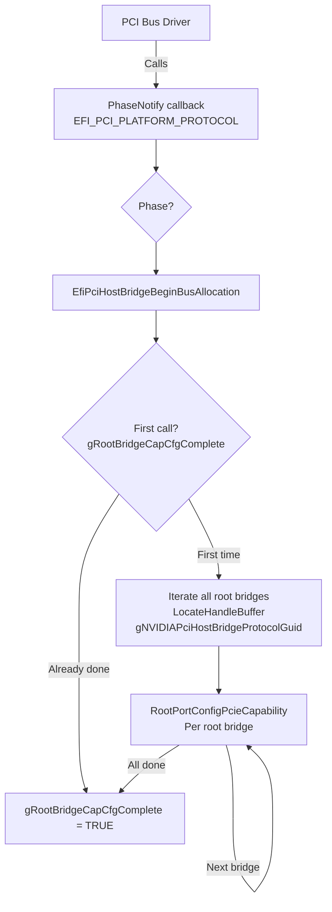

Sources: [Silicon/NVIDIA/Drivers/PcieControllerDxe/PciPlatformDxe.c:48-103]()

### MPS Optimization Algorithm

The optimization occurs in three phases:

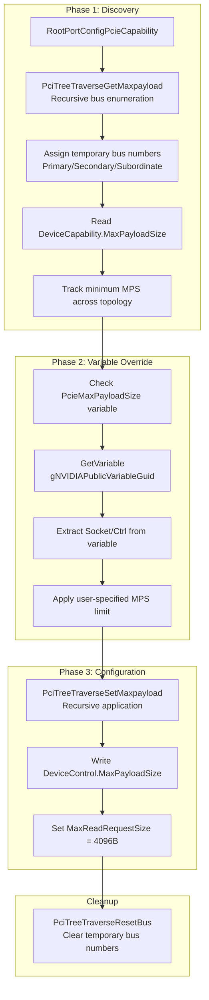

**Tree Traversal Implementation**

All three traversal functions (`PciTreeTraverseGetMaxpayload`, `PciTreeTraverseSetMaxpayload`, `PciTreeTraverseResetBus`) follow the same recursive pattern:

1. Check if device exists (DIDVID != 0/0xFFFFFFFF)
2. For bridges:
   - Assign/read temporary bus numbers
   - Enumerate secondary bus (devices 0-31, functions 0-7)
   - Recursively process child devices
   - Respect multi-function bit for function enumeration

Sources: [Silicon/NVIDIA/Drivers/PcieControllerDxe/PcieConfigDxe.c:44-461]()

### MPS Configuration Variable

```c
// Variable name: L"PcieMaxPayloadSize"
// GUID: gNVIDIAPublicVariableGuid
// Type: UINT32[PcdTegraMaxSockets]
// Encoding: 3 bits per controller (8 controllers per socket)
//
// Value mapping:
// 0 = Auto (use negotiated minimum)
// 1 = Limit to 128B
// 2 = Limit to 256B
// 3 = Limit to 512B
// 4 = Limit to 1024B
// 5 = Limit to 2048B
// 6 = Limit to 4096B
//
// Example: Socket 0, Controller 3, limit to 512B:
// MaxPayloadSize[0] |= (3 << (3 * 3))
```

**Max Read Request Size (MRRS)**

The driver unconditionally sets MRRS to 4096B (value 5) for all devices to maximize read performance. This is independent of MPS and affects only the size of read requests, not write payloads.

Sources: [Silicon/NVIDIA/Drivers/PcieControllerDxe/PcieConfigDxe.c:390-456]()

## C2C (Chip-to-Chip) Integration

For controllers with C2C (Chip-to-Chip) interconnect support, the driver coordinates initialization with BPMP firmware.

### C2C Initialization Flow

```mermaid
sequenceDiagram
    participant Init as InitializeController
    participant Link as Link Training
    participant GPIO as SenseGpu
    participant C2C as C2C Protocol
    participant BPMP as BPMP Firmware
    
    Init->>Link: Wait for PCIe link up
    Link-->>Init: Link active
    
    alt C2cInitRequired == TRUE
        Init->>GPIO: SenseGpu(ControllerHandle)
        Note over GPIO: Kick/sense GPIO sequence<br/>Wake GPU if needed
        GPIO-->>Init: GPU ready
        
        Init->>C2C: Init(Partitions, &C2cStatus)
        Note over C2C: Partitions from protocol
        
        C2C->>BPMP: MRQ_C2C command
        Note over BPMP: Initialize C2C link<br/>Configure partitions<br/>Train C2C PHY
        
        alt C2C Success
            BPMP-->>C2C: C2C_STATUS_C2C_LINK_TRAIN_PASS
            C2C-->>Init: EFI_SUCCESS
            Init->>Init: C2cInitSuccessful = TRUE
            Init->>Init: Set BpmpPhandle in protocol
        else C2C Failure
            BPMP-->>C2C: Error code
            C2C-->>Init: Status with error
            Init->>Init: Report error code
            Note over Init: REPORT_STATUS_CODE_WITH_EXTENDED_DATA<br/>EFI_NV_FW_UEFI_EC_C2C_INIT_FAILED
        end
    end
```

**C2C Protocol Interface**

The `NVIDIA_C2C_NODE_PROTOCOL` provides:

- `Partitions`: Number of C2C partitions to initialize
- `Init()`: Function to trigger C2C initialization via BPMP
- `BpmpPhandle`: Device tree phandle for associated BPMP

After successful initialization, the `BpmpPhandle` is stored in `PcieRootBridgeConfigurationIo.BpmpPhandle` for use by OS drivers.

Sources: [Silicon/NVIDIA/Drivers/PcieControllerDxe/PcieControllerDxe.c:766-796]()

### C2C Error Reporting

When C2C initialization fails, the driver reports detailed error information:

```c
// Error code structure
#define OEM_EC_DESC_C2C_INIT_FAILULE "C2C initialization failed for Socket-0x%x:Ctrl-0x%x with error code: 0x%x"

// Status code class
EFI_ERROR_CODE | EFI_ERROR_MAJOR
EFI_CLASS_NV_FIRMWARE | EFI_NV_FW_UEFI_EC_C2C_INIT_FAILED

// Includes: SocketId, CtrlId, C2cStatus
```

This error information is logged for diagnostics and can be retrieved through UEFI status code mechanisms.

Sources: [Silicon/NVIDIA/Drivers/PcieControllerDxe/PcieControllerDxe.c:777-791]()

## Configuration Manager Integration

Both drivers provide configuration data to the Configuration Manager for ACPI table generation.

### Configuration Data Structure

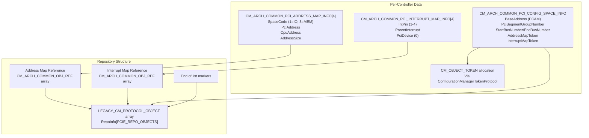

**Object Types and Counts**

| Driver | Address Maps | Interrupt Maps | Total Objects |
|--------|--------------|----------------|---------------|
| NVIDIA Controller | 4 (IO, MEM32, MEM64, PMEM64) | 4 (INTA-INTD) | 11 |
| Generic Controller | 3 (IO, MEM32/MEM64) | 4 (INTA-INTD) | 10 |

**Repository Layout**

```c
enum RepoObjectIndex {
    0: AddressMapRefInfo array (CM_ARCH_COMMON_OBJ_REF)
    1-N: AddressMapInfo objects (CM_ARCH_COMMON_PCI_ADDRESS_MAP_INFO)
    N+1: InterruptMapRefInfo array (CM_ARCH_COMMON_OBJ_REF)
    N+2 to N+5: InterruptMapInfo objects (CM_ARCH_COMMON_PCI_INTERRUPT_MAP_INFO)
    N+6: ConfigSpaceInfo (CM_ARCH_COMMON_PCI_CONFIG_SPACE_INFO)
    N+7: End of list
};
```

Sources: [Silicon/NVIDIA/Drivers/PcieControllerDxe/PcieControllerPrivate.h:26-32](), [Silicon/NVIDIA/Drivers/PciGenericControllerDxe/PcieGenericControllerPrivate.h:24-27]()

### Address Map Construction

Address maps translate between PCI address space and CPU physical addresses:

**NVIDIA Controller Address Spaces**

The NVIDIA controller can expose up to 4 address ranges:

1. **I/O Space** (SpaceCode = 1)
   - PCI I/O addresses
   - Typically unused on ARM64

2. **32-bit Memory** (SpaceCode = 3)
   - Non-prefetchable memory below 4GB
   - Used for device registers and control structures

3. **64-bit Memory** (SpaceCode = 3)
   - Non-prefetchable memory above 4GB
   - Translation offset applied

4. **64-bit Prefetchable** (SpaceCode = 3)
   - Prefetchable memory (typically framebuffers)
   - 1:1 mapping (no translation) required

**Generic Controller Address Spaces**

The generic controller typically exposes 3 ranges:
- I/O space
- 32-bit memory
- 64-bit memory or prefetchable (from device tree "ranges" property)

Sources: [Silicon/NVIDIA/Drivers/PciGenericControllerDxe/PcieGenericControllerDxe.c:405-512]()

### Interrupt Mapping

Both drivers create interrupt maps for legacy INTx interrupts:

```c
// Interrupt map structure
InterruptMapInfo[0-3].IntPin = 1-4;  // INTA, INTB, INTC, INTD
InterruptMapInfo[0-3].PciDevice = 0;  // Only device 0 on root bus
InterruptMapInfo[0-3].ParentInterrupt = <from device tree interrupt-map>
```

The `ParentInterrupt` field is populated from the device tree "interrupt-map" property using `DeviceTreeGetInterruptMap`.

Sources: [Silicon/NVIDIA/Drivers/PciGenericControllerDxe/PcieGenericControllerDxe.c:556-596]()

---

