<!-- source: DeepWiki mcp.deepwiki.com · repo NVIDIA/edk2-nvidia · page 6.2 BPMP IPC and System Management · fetched 2026-10-26 -->

# BPMP IPC and System Management

<details>
<summary>Relevant source files</summary>

The following files were used as context for generating this wiki page:

- [Silicon/NVIDIA/Include/AcpiPowerMeter.h](Silicon/NVIDIA/Include/AcpiPowerMeter.h)
- [Silicon/NVIDIA/Include/Protocol/BpmpIpc.h](Silicon/NVIDIA/Include/Protocol/BpmpIpc.h)
- [Silicon/NVIDIA/Include/Server/TH500/TH500Definitions.h](Silicon/NVIDIA/Include/Server/TH500/TH500Definitions.h)
- [Silicon/NVIDIA/Library/DeviceDiscoveryLib/DeviceDiscoveryLibPrivate.h](Silicon/NVIDIA/Library/DeviceDiscoveryLib/DeviceDiscoveryLibPrivate.h)

</details>


## Purpose and Scope

This document describes the BPMP (Boot and Power Management Processor) IPC protocol implementation in the NVIDIA UEFI firmware. The BPMP is a dedicated microcontroller responsible for managing critical system functions including device resets, power gating, PHY configuration, thermal monitoring, and inter-socket communication.

The BPMP IPC protocol provides a message-based communication channel between UEFI firmware drivers and the BPMP firmware through a mailbox/doorbell architecture. This enables UEFI drivers to request system management operations without direct hardware manipulation.

This page focuses on the IPC protocol architecture, MRQ (Message Request) command system, and the various system management functions accessible through BPMP. For PCIe-specific BPMP usage, see [PCIe Controller Drivers](#6.1). For platform resource management, see [Platform Resource Management](#3.2).

**Sources:** [Silicon/NVIDIA/Include/Protocol/BpmpIpc.h](), [Silicon/NVIDIA/Include/Server/TH500/TH500Definitions.h:234-248]()

---

## BPMP System Architecture

The Boot and Power Management Processor (BPMP) is an independent microcontroller that manages low-level system functions across all sockets in a multi-socket configuration. Each socket has its own BPMP instance with dedicated mailbox regions mapped into the CPU address space.

### Multi-Socket BPMP Layout

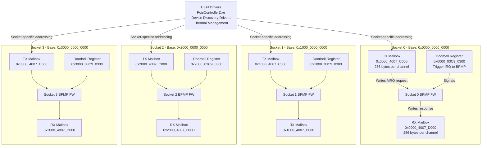

**Mailbox Address Layout (TH500)**

| Socket | TX Mailbox Base | RX Mailbox Base | Doorbell Base | Offset Pattern |
|--------|-----------------|-----------------|---------------|----------------|
| Socket 0 | `0x0000_4007_C000` | `0x0000_4007_D000` | `0x0000_03C9_0300` | Base + 0 |
| Socket 1 | `0x1000_4007_C000` | `0x1000_4007_D000` | `0x1000_03C9_0300` | Base + 256TB |
| Socket 2 | `0x2000_4007_C000` | `0x2000_4007_D000` | `0x2000_03C9_0300` | Base + 512TB |
| Socket 3 | `0x3000_4007_C000` | `0x3000_4007_D000` | `0x3000_03C9_0300` | Base + 768TB |

Each mailbox supports multiple channels, with each channel occupying `BPMP_CHANNEL_SIZE` (256 bytes) of the mailbox region.

**Sources:** [Silicon/NVIDIA/Include/Server/TH500/TH500Definitions.h:234-248]()

---

## IPC Protocol Structure

### NVIDIA_BPMP_IPC_PROTOCOL

The `NVIDIA_BPMP_IPC_PROTOCOL` is the primary interface for BPMP communication. It provides a single function for both synchronous (blocking) and asynchronous (non-blocking) IPC operations.

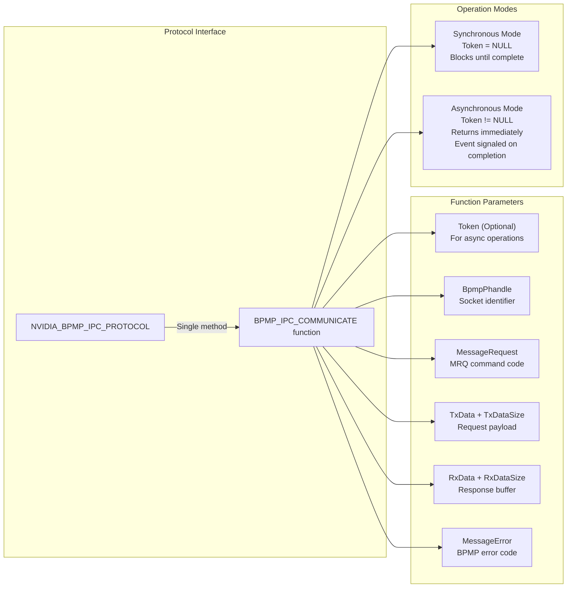

**Communication Function Signature:**

```c
EFI_STATUS
BPMP_IPC_COMMUNICATE (
  IN     NVIDIA_BPMP_IPC_PROTOCOL   *This,
  IN OUT NVIDIA_BPMP_IPC_TOKEN      *Token OPTIONAL,
  IN     UINT32                     BpmpPhandle,
  IN     UINT32                     MessageRequest,
  IN     VOID                       *TxData,
  IN     UINTN                      TxDataSize,
  OUT    VOID                       *RxData,
  IN     UINTN                      RxDataSize,
  OUT    INT32                      *MessageError OPTIONAL
)
```

**Key Parameters:**
- **Token**: When NULL, performs blocking IPC. When non-NULL, must contain a valid `Event` that will be signaled on completion
- **BpmpPhandle**: Identifies the target BPMP instance (socket-specific)
- **MessageRequest**: MRQ command code (see MRQ Command System below)
- **TxData/TxDataSize**: Command-specific request payload
- **RxData/RxDataSize**: Buffer for BPMP response data
- **MessageError**: Receives BPMP-specific error code on failure

**Return Values:**
- `EFI_SUCCESS`: IPC queued (async) or completed successfully (sync)
- `EFI_INVALID_PARAMETER`: Invalid token or data pointers
- `EFI_DEVICE_ERROR`: IPC transmission failure
- `EFI_UNSUPPORTED`: BPMP not available on this platform

**Sources:** [Silicon/NVIDIA/Include/Protocol/BpmpIpc.h:129-161]()

---

## IVC Channel States and Communication Flow

BPMP uses the Inter-VM Communication (IVC) protocol for managing channel state and ensuring reliable message delivery.

### IVC State Machine

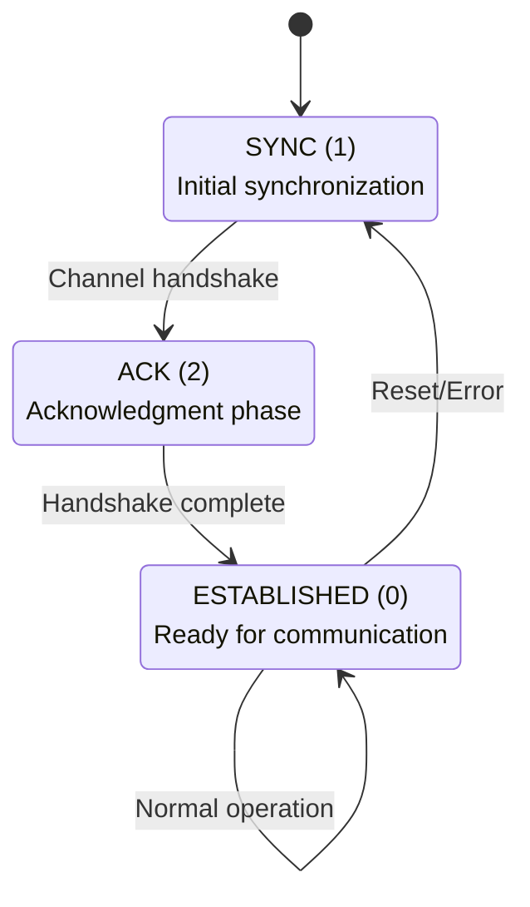

### Communication Sequence

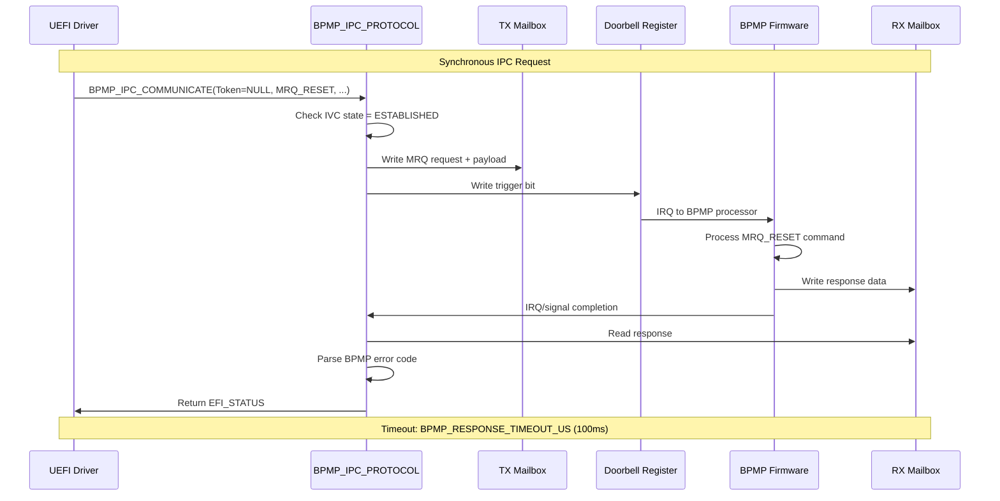

**Timeout Handling:**
- Maximum response time: `BPMP_RESPONSE_TIMEOUT_US` = 100,000 microseconds (100ms)
- Synchronous calls block for up to this duration
- Timeout results in `EFI_DEVICE_ERROR` or `EFI_TIMEOUT`

**Sources:** [Silicon/NVIDIA/Include/Protocol/BpmpIpc.h:20-31](), [Silicon/NVIDIA/Include/Protocol/BpmpIpc.h:129-161]()

---

## MRQ Command System

The Message Request (MRQ) system defines all commands that can be sent to BPMP. Each MRQ code represents a specific system management function.

### MRQ Command Categories

```mermaid
graph TB
    subgraph "Diagnostics & Debug"
        MRQ_PING["MRQ_PING (0)<br/>Connectivity test"]
        MRQ_QUERY_TAG["MRQ_QUERY_TAG (1)<br/>Firmware version"]
        MRQ_QUERY_ABI["MRQ_QUERY_ABI (23)<br/>ABI version check"]
        MRQ_DEBUGFS["MRQ_DEBUGFS (19)<br/>Debug filesystem"]
    end
    
    subgraph "Reset Management"
        MRQ_RESET["MRQ_RESET (20)<br/>Device reset control"]
        RESET_CMDS["Commands:<br/>CmdResetAssert (1)<br/>CmdResetDeassert (2)<br/>CmdResetModule (3)<br/>CmdResetGetMaxId (4)"]
        
        MRQ_RESET --> RESET_CMDS
    end
    
    subgraph "Power Management"
        MRQ_PG["MRQ_PG (66)<br/>Power gating"]
        MRQ_PG_READ["MRQ_PG_READ_STATE (25)"]
        MRQ_PG_UPDATE["MRQ_PG_UPDATE_STATE (26)"]
        MRQ_PWR_LIMIT["MRQ_PWR_LIMIT (81)<br/>Power limit control"]
        MRQ_PWR_CNTRL["MRQ_PWR_CNTRL (89)<br/>Power control"]
        
        PG_CMDS["Commands:<br/>CmdPgQueryAbi (0)<br/>CmdPgSetState (1)<br/>CmdPgGetState (2)"]
        
        MRQ_PG --> PG_CMDS
    end
    
    subgraph "PHY & Interconnect"
        MRQ_UPHY["MRQ_UPHY (69)<br/>Universal PHY config"]
        MRQ_C2C["MRQ_C2C (85)<br/>Chip-to-Chip control"]
        
        UPHY_CMDS["Commands:<br/>CmdUphyPcieLaneMarginCtl (1)<br/>CmdUphyPcieCtlrState (4)<br/>CmdUphyDisplayPortInit (6)<br/>CmdUphyXUsbDynLanesRestore (8)<br/>CmdUphyPcieConfigVdm (10)"]
        
        C2C_CMDS["Commands:<br/>CmdC2cQueryAbi (0)<br/>CmdC2cStartInitialization (1)<br/>CmdC2cGetStatus (2)<br/>CmdC2cHotresetPrep (3)<br/>CmdC2cStartHotreset (4)"]
        
        MRQ_UPHY --> UPHY_CMDS
        MRQ_C2C --> C2C_CMDS
    end
    
    subgraph "Thermal & Telemetry"
        MRQ_THERMAL["MRQ_THERMAL (27)<br/>Temperature monitoring"]
        MRQ_TELEMETRY["MRQ_TELEMETRY (80)<br/>System telemetry"]
        MRQ_BWMGR["MRQ_BWMGR_INT (83)<br/>Bandwidth management"]
    end
    
    subgraph "Clock & Voltage"
        MRQ_CLK["MRQ_CLK (22)<br/>Clock control"]
        MRQ_CPU_VHINT["MRQ_CPU_VHINT (28)<br/>CPU voltage hints"]
        MRQ_CPU_NDIV["MRQ_CPU_NDIV_LIMITS (67)<br/>CPU frequency limits"]
        MRQ_EMC_DVFS["MRQ_EMC_DVFS_LATENCY (31)<br/>Memory DVFS"]
    end
    
    subgraph "Module Management"
        MRQ_MODULE_LOAD["MRQ_MODULE_LOAD (4)"]
        MRQ_MODULE_UNLOAD["MRQ_MODULE_UNLOAD (5)"]
        MRQ_MODULE_MAIL["MRQ_MODULE_MAIL (11)"]
    end
```

**Complete MRQ Code Reference:**

| MRQ Code | Value | Purpose | Related Drivers |
|----------|-------|---------|-----------------|
| `MRQ_PING` | 0 | Connectivity test | All (diagnostic) |
| `MRQ_QUERY_TAG` | 1 | Get firmware version | Platform init |
| `MRQ_RESET` | 20 | Device reset control | PcieControllerDxe, DeviceDiscovery |
| `MRQ_CLK` | 22 | Clock configuration | Device drivers |
| `MRQ_QUERY_ABI` | 23 | ABI version check | Protocol initialization |
| `MRQ_THERMAL` | 27 | Thermal monitoring | Thermal management, ACPI |
| `MRQ_PG` | 66 | Power gating | Device drivers |
| `MRQ_UPHY` | 69 | PHY configuration | PCIe, USB, DisplayPort |
| `MRQ_TELEMETRY` | 80 | System telemetry data | Monitoring, ACPI |
| `MRQ_PWR_LIMIT` | 81 | Power limit control | Power management, ACPI |
| `MRQ_C2C` | 85 | Chip-to-Chip interconnect | Multi-GPU, socket interconnect |
| `MRQ_PWR_CNTRL` | 89 | Power control | Power management |

**Sources:** [Silicon/NVIDIA/Include/Protocol/BpmpIpc.h:38-66](), [Silicon/NVIDIA/Library/DeviceDiscoveryLib/DeviceDiscoveryLibPrivate.h:35-71]()

---

## Reset Management (MRQ_RESET)

Device reset control is one of the most commonly used BPMP functions. It allows drivers to assert, deassert, or pulse reset signals for hardware blocks without direct register manipulation.

### Reset Command Structure

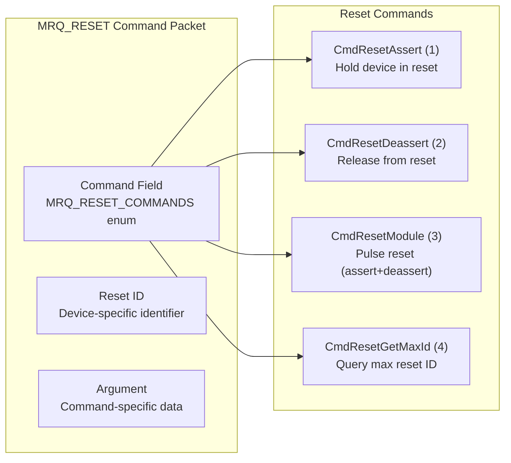

**Reset Command Flow:**

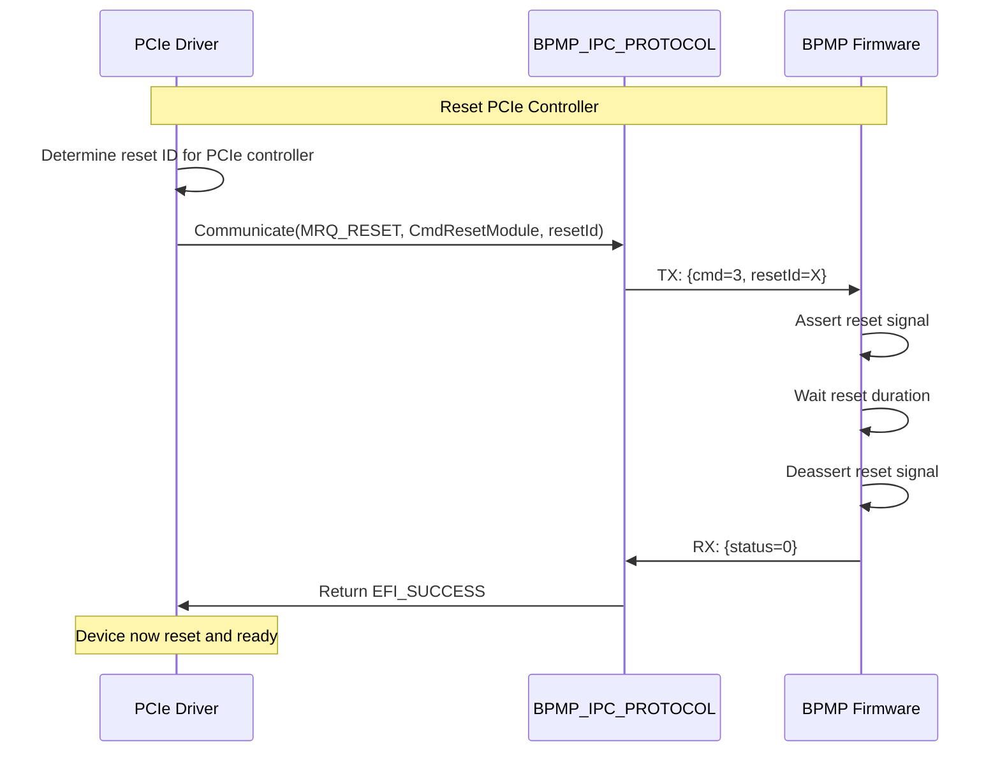

**Typical Usage Pattern:**

1. **Device Initialization**: Call `CmdResetModule` to ensure clean device state
2. **Error Recovery**: Call `CmdResetModule` to recover from hardware errors
3. **Power Management**: Use `CmdResetAssert` before power-down, `CmdResetDeassert` after power-up
4. **Enumeration**: Query `CmdResetGetMaxId` to determine available reset IDs

**Sources:** [Silicon/NVIDIA/Library/DeviceDiscoveryLib/DeviceDiscoveryLibPrivate.h:35-41]()

---

## Power Gating (MRQ_PG)

Power gating allows dynamic control of power domains to reduce system power consumption. The MRQ_PG command provides query, set, and get operations for power gate states.

### Power Gating Command Structure

```c
typedef struct {
  UINT32    Command;      // CmdPgQueryAbi, CmdPgSetState, CmdPgGetState
  UINT32    PgId;         // Power gate identifier
  UINT32    Argument;     // Command-specific argument
} MRQ_PG_COMMAND_PACKET;
```

**Power Gating States:**
- **ON**: Power domain active, clocks running
- **OFF**: Power domain disabled, clocks gated
- **RETENTION**: Low-power state with state retention (if supported)

**Common Power Gate Operations:**

| Operation | Command | PgId | Argument | Purpose |
|-----------|---------|------|----------|---------|
| Query ABI | `CmdPgQueryAbi` (0) | N/A | N/A | Check PG command support |
| Power On | `CmdPgSetState` (1) | Domain ID | 1 | Enable power domain |
| Power Off | `CmdPgSetState` (1) | Domain ID | 0 | Disable power domain |
| Get State | `CmdPgGetState` (2) | Domain ID | N/A | Read current state |

**Sources:** [Silicon/NVIDIA/Library/DeviceDiscoveryLib/DeviceDiscoveryLibPrivate.h:43-48](), [Silicon/NVIDIA/Library/DeviceDiscoveryLib/DeviceDiscoveryLibPrivate.h:74-78]()

---

## UPHY Configuration (MRQ_UPHY)

The Universal PHY (UPHY) MRQ commands configure high-speed serial interfaces including PCIe, USB, and DisplayPort. This is critical for link training, lane configuration, and error recovery.

### UPHY Command Structure

```c
typedef struct {
  UINT16    Lane;                  // PHY lane number
  UINT16    Command;               // MRQ_UPHY_COMMANDS
  UINT8     Controller;            // Controller instance
  UINT16    BusDeviceFunction;     // PCI BDF for PCIe
} MRQ_UPHY_COMMAND_PACKET;
```

### UPHY Command Categories

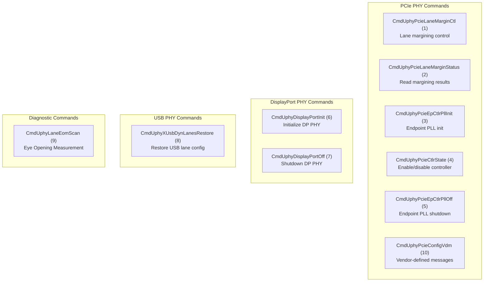

**PCIe Controller State Control:**

The `CmdUphyPcieCtlrState` command is frequently used by `PcieControllerDxe` to enable/disable PCIe controllers:

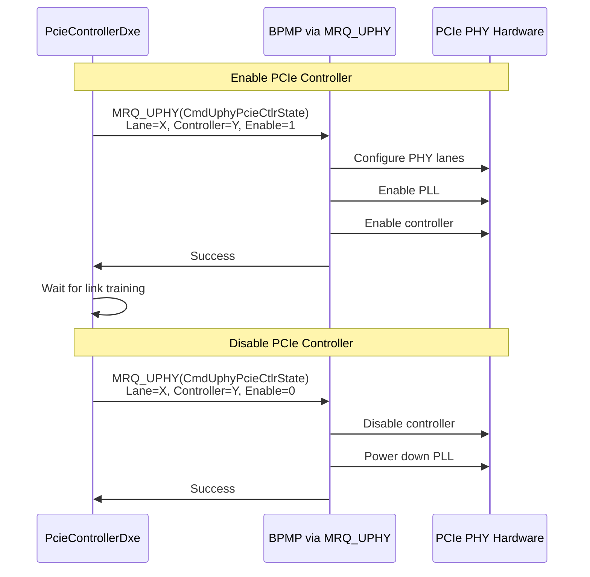

**Sources:** [Silicon/NVIDIA/Library/DeviceDiscoveryLib/DeviceDiscoveryLibPrivate.h:50-62](), [Silicon/NVIDIA/Library/DeviceDiscoveryLib/DeviceDiscoveryLibPrivate.h:81-86]()

---

## C2C Management (MRQ_C2C)

Chip-to-Chip (C2C) interconnect enables high-bandwidth communication between CPU and GPU or between multiple GPUs. The MRQ_C2C commands initialize, monitor, and reset C2C links.

### C2C Command Structure

```c
typedef struct {
  UINT32    Command;      // MRQ_C2C_COMMANDS
  UINT8     Partitions;   // C2C partition mask
} MRQ_C2C_COMMAND_PACKET;
```

### C2C Initialization Sequence

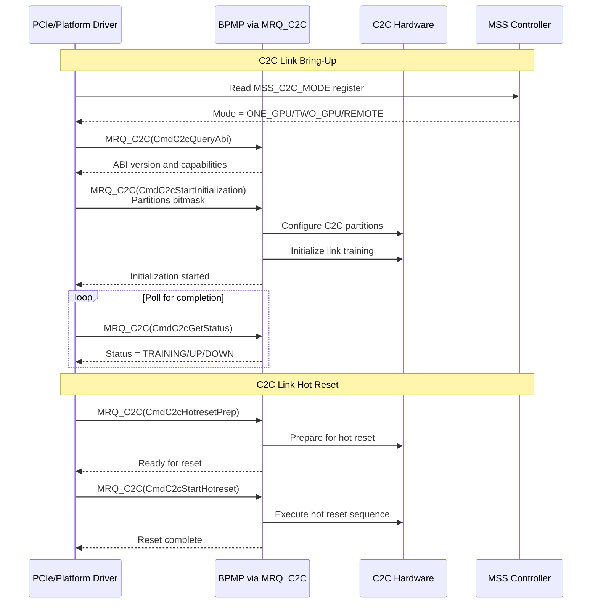

**C2C Modes (from MSS Controller):**

The MSS (Memory SubSystem) controller's C2C mode register determines the C2C configuration:

| Mode Value | Name | Description |
|------------|------|-------------|
| `TH500_MSS_C2C_MODE_ONE_GPU` (0) | Single GPU | One GPU connected via C2C |
| `TH500_MSS_C2C_MODE_TWO_GPU` (1) | Dual GPU | Two GPUs in SLI/NVLink configuration |
| `TH500_MSS_C2C_MODE_REMOTE` (2) | Remote Socket | C2C to remote socket CPU |

**Sources:** [Silicon/NVIDIA/Library/DeviceDiscoveryLib/DeviceDiscoveryLibPrivate.h:64-71](), [Silicon/NVIDIA/Library/DeviceDiscoveryLib/DeviceDiscoveryLibPrivate.h:87-91](), [Silicon/NVIDIA/Include/Server/TH500/TH500Definitions.h:210-213]()

---

## Thermal Management (MRQ_THERMAL)

BPMP provides thermal monitoring for CPU, SOC, and GPU thermal zones. The UEFI firmware uses `MRQ_THERMAL` to read temperature sensors and expose them through ACPI thermal zones.

### TH500 Thermal Zones

```mermaid
graph TB
    subgraph "CPU Thermal Zones"
        TZ_CPU0["TH500_THERMAL_ZONE_CPU0 (0)<br/>Socket 0 CPU temperature"]
        TZ_CPU1["TH500_THERMAL_ZONE_CPU1 (1)<br/>Socket 1 CPU temperature"]
        TZ_CPU2["TH500_THERMAL_ZONE_CPU2 (2)<br/>Socket 2 CPU temperature"]
        TZ_CPU3["TH500_THERMAL_ZONE_CPU3 (3)<br/>Socket 3 CPU temperature"]
    end
    
    subgraph "SOC Thermal Zones"
        TZ_SOC0["TH500_THERMAL_ZONE_SOC0 (4)<br/>Socket 0 SOC"]
        TZ_SOC1["TH500_THERMAL_ZONE_SOC1 (5)<br/>Socket 1 SOC"]
        TZ_SOC2["TH500_THERMAL_ZONE_SOC2 (6)<br/>Socket 2 SOC"]
        TZ_SOC3["TH500_THERMAL_ZONE_SOC3 (7)<br/>Socket 3 SOC"]
        TZ_SOC4["TH500_THERMAL_ZONE_SOC4 (8)<br/>Additional SOC zone"]
    end
    
    subgraph "Junction Temperature Aggregates"
        TZ_TJ_MAX["TH500_THERMAL_ZONE_TJ_MAX (9)<br/>Maximum junction temp"]
        TZ_TJ_MIN["TH500_THERMAL_ZONE_TJ_MIN (10)<br/>Minimum junction temp"]
        TZ_TJ_AVG["TH500_THERMAL_ZONE_TJ_AVG (11)<br/>Average junction temp"]
    end
    
    BPMP_THERMAL["MRQ_THERMAL Command<br/>Read thermal zone temperature"]
    ACPI_TZ["ACPI Thermal Zones<br/>Exposed to OS"]
    
    TZ_CPU0 --> BPMP_THERMAL
    TZ_CPU1 --> BPMP_THERMAL
    TZ_CPU2 --> BPMP_THERMAL
    TZ_CPU3 --> BPMP_THERMAL
    TZ_SOC0 --> BPMP_THERMAL
    TZ_SOC1 --> BPMP_THERMAL
    TZ_SOC2 --> BPMP_THERMAL
    TZ_SOC3 --> BPMP_THERMAL
    TZ_SOC4 --> BPMP_THERMAL
    TZ_TJ_MAX --> BPMP_THERMAL
    TZ_TJ_MIN --> BPMP_THERMAL
    TZ_TJ_AVG --> BPMP_THERMAL
    
    BPMP_THERMAL --> ACPI_TZ
```

**Thermal Zone Configuration:**

| Parameter | Value | Description |
|-----------|-------|-------------|
| `TH500_THERMAL_ZONE_PSV` | 1000 | Passive cooling threshold (100.0°C) |
| `TH500_THERMAL_ZONE_CRT` | 1045 | Critical temperature (104.5°C) |
| `TH500_THERMAL_ZONE_TC1` | 2 | Passive cooling constant 1 |
| `TH500_THERMAL_ZONE_TC2` | 8 | Passive cooling constant 2 |
| `TH500_THERMAL_ZONE_TSP` | 1 | Sampling period (100ms) |
| `TEMP_POLL_TIME_100MS` | 1 | Temperature polling interval |

**Temperature Reading Process:**

1. ACPI `_TMP` method invoked by OS
2. UEFI ASL method calls BPMP via operation region
3. `MRQ_THERMAL` command sent with zone ID
4. BPMP reads hardware sensor
5. Temperature returned in tenths of degrees Celsius
6. Value converted to ACPI Kelvin format (°C + 273.15) × 10

**Sources:** [Silicon/NVIDIA/Include/Server/TH500/TH500Definitions.h:250-276]()

---

## Power Limiting and Telemetry

### Power Limit Control (MRQ_PWR_LIMIT)

The `MRQ_PWR_LIMIT` command configures and queries power limits for different power domains. This is critical for platform power management and ACPI `_PMD` (Power Meter Device) support.

**Power Limit Commands:**

| Command | Value | Purpose |
|---------|-------|---------|
| `TH500_PWR_LIMIT_QUERY_ABI` | 0 | Query ABI version and capabilities |
| `TH500_PWR_LIMIT_SET` | 1 | Set power limit |
| `TH500_PWR_LIMIT_GET` | 2 | Get current power limit |
| `TH500_PWR_LIMIT_CURR_CAP` | 3 | Get current power capability |

**Power Limit IDs:**

| Limit ID | Name | Description |
|----------|------|-------------|
| `TH500_PWR_LIMIT_ID_TH500_INP_EDPC_MW` (0) | Input EDPC | Input power limit (milliwatts) |
| `TH500_PWR_LIMIT_ID_TH500_INP_EDPP_MW` (1) | Input EDPP | Peak power limit (milliwatts) |
| `TH500_PWR_LIMIT_ID_CPU_OUT_EDPC_MA` (2) | CPU Output | CPU power limit (milliamps) |

**Power Limit Sources:**

| Source | Name | Description |
|--------|------|-------------|
| `TH500_PWR_LIMIT_SRC_INB` (0) | In-Band | Set by UEFI/OS |
| `TH500_PWR_LIMIT_SRC_OOB` (1) | Out-of-Band | Set by BMC/management |
| `TH500_PWR_LIMIT_SRC_ODMCAL` (2) | ODM Calibration | OEM-specific calibration |
| `TH500_PWR_LIMIT_SRC_NVCAL` (3) | NVIDIA Calibration | Factory calibration |

### Telemetry (MRQ_TELEMETRY)

System telemetry data is accessed via `MRQ_TELEMETRY` for power monitoring, performance tracking, and ACPI power meter implementation.

**TH500 Power Meters:**

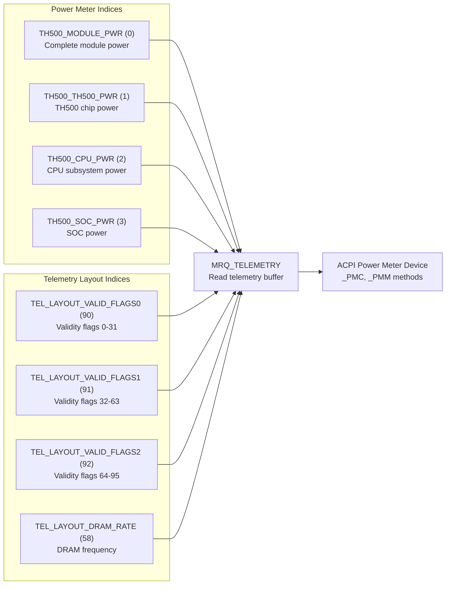

**Power Meter Valid Flags:**

| Flag | Name | Description |
|------|------|-------------|
| `TH500_MODULE_PWR_IDX_VALID_FLAG` | 0x00000010 | Module power valid (instantaneous) |
| `TH500_TH500_PWR_IDX_VALID_FLAG` | 0x00000020 | TH500 power valid (instantaneous) |
| `TH500_CPU_PWR_IDX_VALID_FLAG` | 0x00000040 | CPU power valid (instantaneous) |
| `TH500_SOC_PWR_IDX_VALID_FLAG` | 0x00000080 | SOC power valid (instantaneous) |
| `TH500_MODULE_PWR_1SEC_IDX_VALID_FLAG` | 0x00000100 | Module power valid (1-second average) |
| `TH500_TH500_PWR_1SEC_IDX_VALID_FLAG` | 0x00000200 | TH500 power valid (1-second average) |
| `TH500_CPU_PWR_1SEC_IDX_VALID_FLAG` | 0x00000400 | CPU power valid (1-second average) |
| `TH500_SOC_PWR_1SEC_IDX_VALID_FLAG` | 0x00000800 | SOC power valid (1-second average) |

**Telemetry Sampling:**
- Instantaneous power: Updated every 50ms (`TH500_BPMP_IPC_CALL_INTERVAL_50MS`)
- 1-second average: Rolling 1-second window
- ACPI sampling time: `PWR_METER_MEASUREMENT_SAMPLING_TIME_50MS` (50ms) or `PWR_METER_MEASUREMENT_SAMPLING_TIME_1SEC` (1 second)

**Sources:** [Silicon/NVIDIA/Include/Protocol/BpmpIpc.h:68-96](), [Silicon/NVIDIA/Include/Server/TH500/TH500Definitions.h:279-297](), [Silicon/NVIDIA/Include/AcpiPowerMeter.h:34-37]()

---

## BPMP Error Codes

BPMP commands return error codes that indicate failure reasons. These are distinct from EFI_STATUS codes and must be checked via the `MessageError` parameter.

**BPMP Error Code Reference:**

| Error Code | Name | Value | Description |
|------------|------|-------|-------------|
| Success | (implicit) | 0 | Operation completed successfully |
| `BPMP_ENOENT` | No Entry | -2 | No such file or directory |
| `BPMP_ENOHANDLER` | No Handler | -3 | MRQ command not supported |
| `BPMP_EIO` | I/O Error | -5 | Hardware I/O error |
| `BPMP_EBADCMD` | Bad Command | -6 | Invalid sub-command for MRQ |
| `BPMP_ENOMEM` | No Memory | -12 | Insufficient memory |
| `BPMP_EACCES` | Access Denied | -13 | Permission denied |
| `BPMP_EFAULT` | Bad Address | -14 | Invalid address |
| `BPMP_ENODEV` | No Device | -19 | Device not present |
| `BPMP_EISDIR` | Is Directory | -21 | Argument is a directory |
| `BPMP_EINVAL` | Invalid Argument | -22 | Invalid parameter |
| `BPMP_ETIMEDOUT` | Timeout | -23 | Operation timed out |
| `BPMP_ERANGE` | Out of Range | -34 | Value out of range |
| `BPMP_ENOSYS` | Not Implemented | -38 | Function not implemented |
| `BPMP_EBADSLT` | Bad Slot | -57 | Invalid slot number |

**Error Handling Pattern:**

```c
INT32       BpmpError;
EFI_STATUS  Status;

Status = BpmpIpcProtocol->Communicate (
           BpmpIpcProtocol,
           NULL,                    // Synchronous
           BpmpPhandle,
           MRQ_RESET,
           &TxData,
           sizeof(TxData),
           &RxData,
           sizeof(RxData),
           &BpmpError
           );

if (EFI_ERROR (Status)) {
  // IPC communication failure
  return Status;
}

if (BpmpError != 0) {
  // BPMP reported an error
  if (BpmpError == BPMP_ENOHANDLER) {
    // Command not supported on this BPMP version
    return EFI_UNSUPPORTED;
  } else if (BpmpError == BPMP_EINVAL) {
    return EFI_INVALID_PARAMETER;
  }
  return EFI_DEVICE_ERROR;
}

// Success - process RxData
```

**Sources:** [Silicon/NVIDIA/Include/Protocol/BpmpIpc.h:97-110]()

---

## Integration with Platform Drivers

### Driver Usage Patterns

Multiple platform drivers depend on BPMP IPC for hardware management:

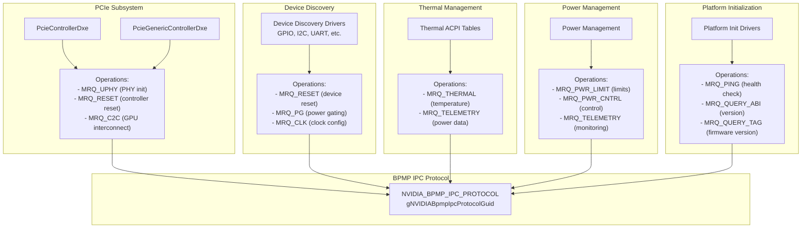

### Typical Driver Initialization Sequence

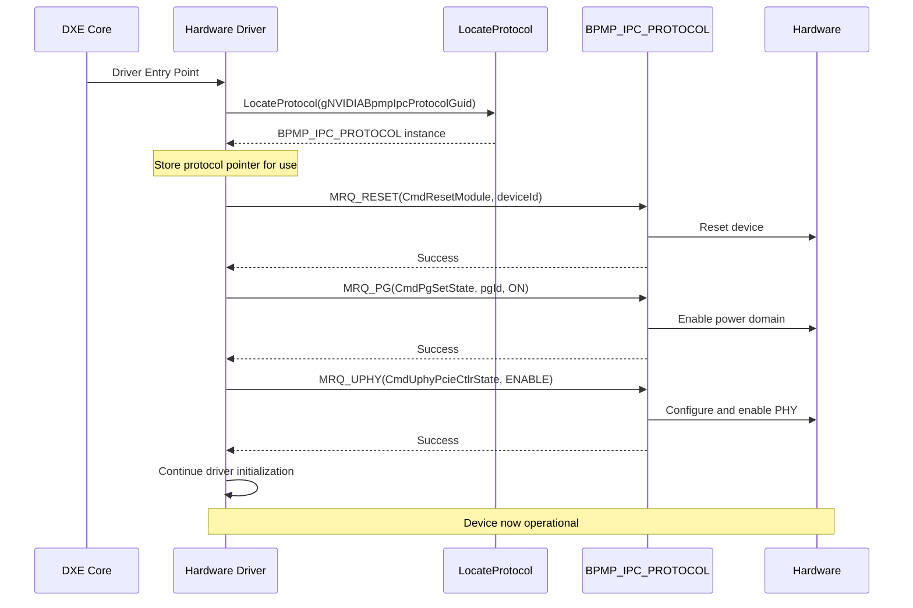

### Protocol Dependency Declaration

Drivers typically declare BPMP IPC as a protocol dependency in their `.inf` file:

```ini
[Protocols]
  gNVIDIABpmpIpcProtocolGuid    ## CONSUMES
```

For drivers that require BPMP to be available before they start:

```ini
[Depex]
  gNVIDIABpmpIpcProtocolGuid
```

**Sources:** [Silicon/NVIDIA/Include/Protocol/BpmpIpc.h:1-170](), [Silicon/NVIDIA/Library/DeviceDiscoveryLib/DeviceDiscoveryLibPrivate.h:1-94]()

---

## Socket-Specific BPMP Communication

In multi-socket TH500 systems, each socket has its own BPMP instance. Drivers must use the correct `BpmpPhandle` parameter to target the appropriate socket.

### Socket-to-BPMP Mapping

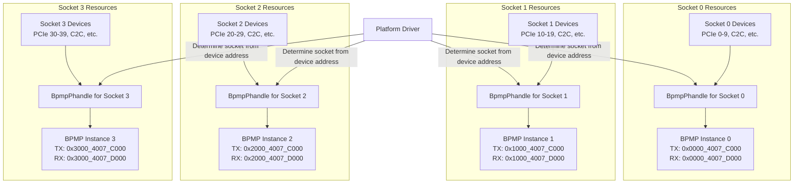

**Socket Determination:**

For TH500, the socket ID can be extracted from the device's base address using bits 44-45:

```c
#define TH500_AMAP_GET_SOCKET(addr) \
  (((UINT64)addr & TH500_AMAP_START_MASK) >> TH500_AMAP_START_SHFT)
```

Where:
- `TH500_AMAP_START_MASK` = `0x300000000000` (bits 44-45)
- `TH500_AMAP_START_SHFT` = 44

**Example:**
- Device at `0x0000_4007_C000`: Socket 0 (bits 44-45 = 00b)
- Device at `0x1000_4007_C000`: Socket 1 (bits 44-45 = 01b)
- Device at `0x2000_4007_C000`: Socket 2 (bits 44-45 = 10b)
- Device at `0x3000_4007_C000`: Socket 3 (bits 44-45 = 11b)

**Sources:** [Silicon/NVIDIA/Include/Server/TH500/TH500Definitions.h:215-223](), [Silicon/NVIDIA/Include/Server/TH500/TH500Definitions.h:234-248]()

---

## Summary

The BPMP IPC protocol is a foundational system management interface in NVIDIA UEFI firmware, providing:

1. **Unified Hardware Abstraction**: Single protocol for reset, power, PHY, and thermal control across all hardware blocks
2. **Multi-Socket Support**: Socket-specific BPMP instances with independent mailbox regions
3. **Comprehensive Command Set**: 20+ MRQ commands covering diagnostics, reset, power gating, UPHY, C2C, thermal, and telemetry
4. **Synchronous and Asynchronous Operation**: Flexible blocking/non-blocking communication modes
5. **Error Reporting**: Detailed BPMP error codes for robust error handling
6. **Wide Driver Integration**: Used by PCIe, device discovery, thermal management, and power management subsystems

The protocol's architecture enables platform drivers to manage hardware without direct register access, improving portability and maintainability across different Tegra SOC generations.

**Sources:** [Silicon/NVIDIA/Include/Protocol/BpmpIpc.h](), [Silicon/NVIDIA/Include/Server/TH500/TH500Definitions.h](), [Silicon/NVIDIA/Library/DeviceDiscoveryLib/DeviceDiscoveryLibPrivate.h]()

---

