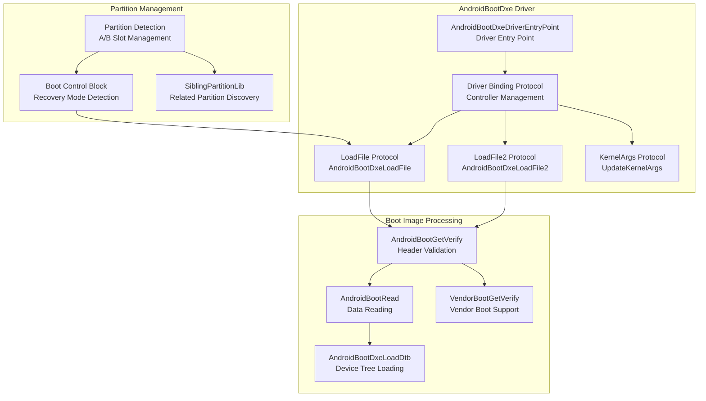
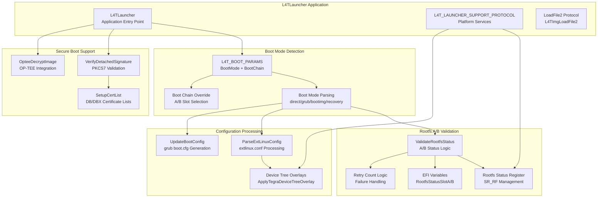
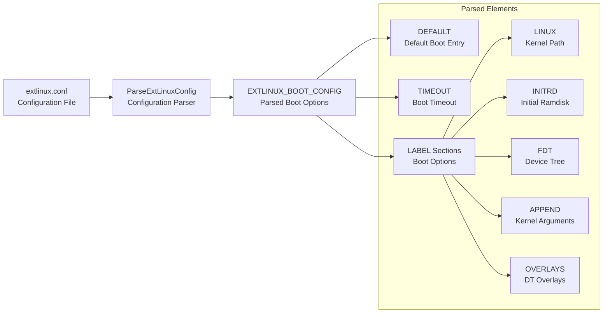
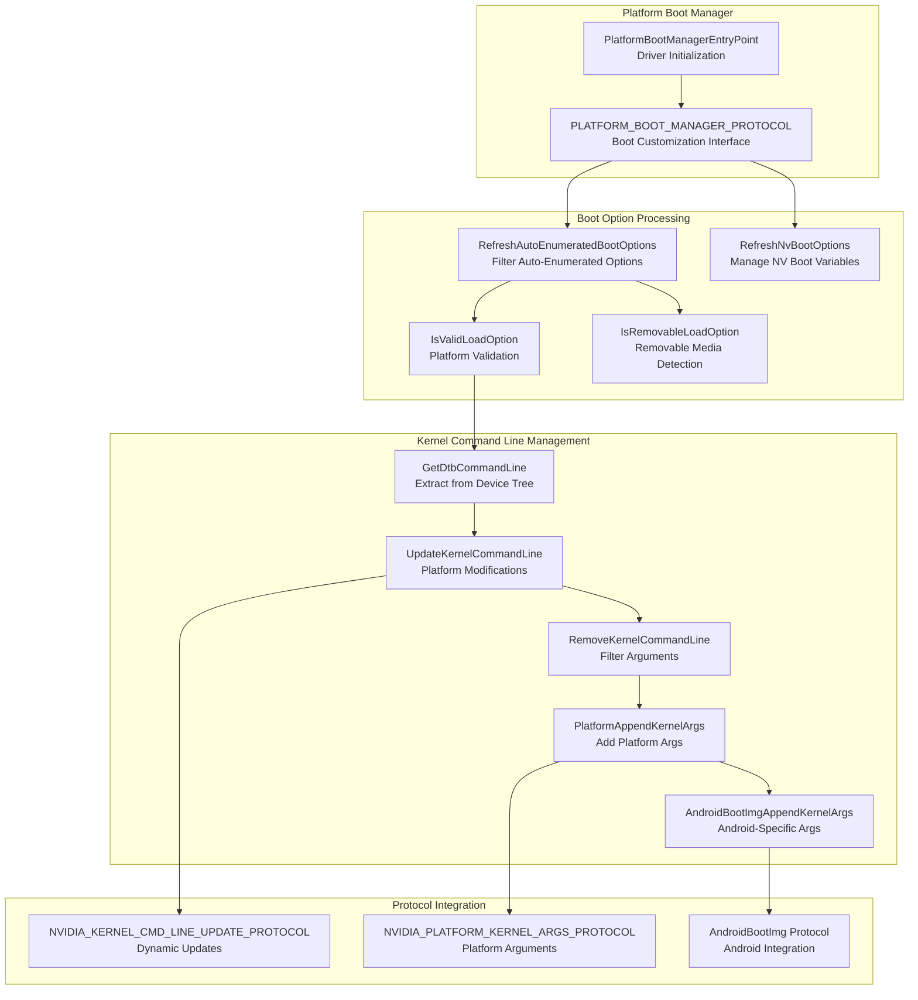
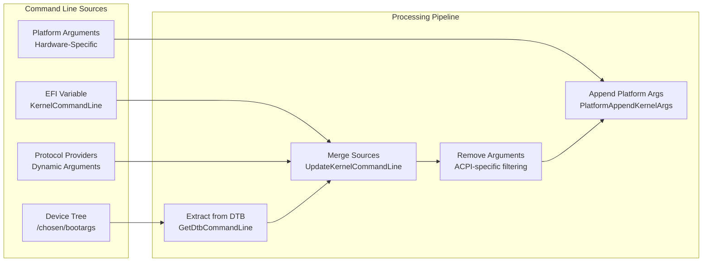
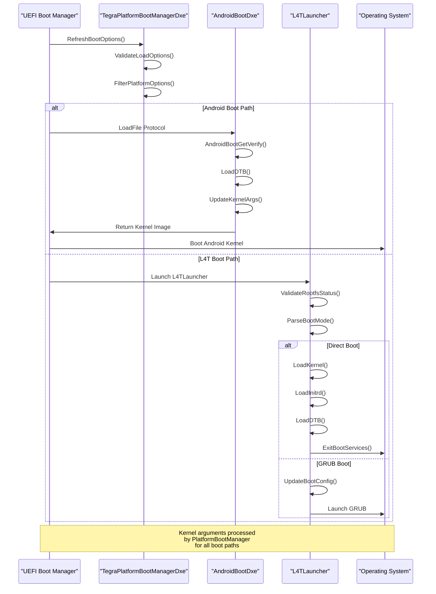

<!-- source: DeepWiki mcp.deepwiki.com · repo NVIDIA/edk2-nvidia · page 7 Operating System Boot Support · fetched 2026-10-26 -->

# Boot and Operating System Support

Relevant source files

The following files were used as context for generating this wiki page:

- [Silicon/NVIDIA/Drivers/AndroidBootDxe/AndroidBootDxe.c](Silicon/NVIDIA/Drivers/AndroidBootDxe/AndroidBootDxe.c)
- [Silicon/NVIDIA/Drivers/AndroidBootDxe/AndroidBootDxe.h](Silicon/NVIDIA/Drivers/AndroidBootDxe/AndroidBootDxe.h)
- [Silicon/NVIDIA/Drivers/AndroidBootDxe/AndroidBootDxe.inf](Silicon/NVIDIA/Drivers/AndroidBootDxe/AndroidBootDxe.inf)
- [Silicon/NVIDIA/Drivers/AndroidBootDxe/UnitTest/AndroidBootDxeUnitTest.inf](Silicon/NVIDIA/Drivers/AndroidBootDxe/UnitTest/AndroidBootDxeUnitTest.inf)
- [Silicon/NVIDIA/Drivers/AndroidBootDxe/UnitTest/BootImgHeaderUnitTests.c](Silicon/NVIDIA/Drivers/AndroidBootDxe/UnitTest/BootImgHeaderUnitTests.c)
- [Silicon/NVIDIA/Drivers/TegraPlatformBootManager/TegraPlatformBootManagerDxe.c](Silicon/NVIDIA/Drivers/TegraPlatformBootManager/TegraPlatformBootManagerDxe.c)
- [Silicon/NVIDIA/Drivers/TegraPlatformBootManager/TegraPlatformBootManagerDxe.inf](Silicon/NVIDIA/Drivers/TegraPlatformBootManager/TegraPlatformBootManagerDxe.inf)
- [Silicon/NVIDIA/Include/AndroidBootImgHeader.h](Silicon/NVIDIA/Include/AndroidBootImgHeader.h)
- [Silicon/NVIDIA/Include/Library/DeviceTreeHelperLib.h](Silicon/NVIDIA/Include/Library/DeviceTreeHelperLib.h)
- [Silicon/NVIDIA/Include/Protocol/KernelArgsProtocol.h](Silicon/NVIDIA/Include/Protocol/KernelArgsProtocol.h)
- [Silicon/NVIDIA/Library/DeviceTreeHelperLib/DeviceTreeHelperLib.inf](Silicon/NVIDIA/Library/DeviceTreeHelperLib/DeviceTreeHelperLib.inf)
- [Silicon/NVIDIA/Library/DeviceTreeHelperLib/DeviceTreeHelperLibCore.c](Silicon/NVIDIA/Library/DeviceTreeHelperLib/DeviceTreeHelperLibCore.c)
- [Silicon/NVIDIA/Library/DeviceTreeHelperLib/DeviceTreeHelperLibDeprecated.c](Silicon/NVIDIA/Library/DeviceTreeHelperLib/DeviceTreeHelperLibDeprecated.c)
- [Silicon/NVIDIA/Library/DeviceTreeHelperLib/DeviceTreeHelperLibParser.c](Silicon/NVIDIA/Library/DeviceTreeHelperLib/DeviceTreeHelperLibParser.c)
- [Silicon/NVIDIA/Library/DeviceTreeHelperLib/DeviceTreeHelperLibParserAArch64.c](Silicon/NVIDIA/Library/DeviceTreeHelperLib/DeviceTreeHelperLibParserAArch64.c)
- [Silicon/NVIDIA/Library/DeviceTreeHelperLib/DeviceTreeHelperLibParserX86.c](Silicon/NVIDIA/Library/DeviceTreeHelperLib/DeviceTreeHelperLibParserX86.c)
- [Silicon/NVIDIA/Library/DeviceTreeHelperLib/DeviceTreeHelperLibPointer.c](Silicon/NVIDIA/Library/DeviceTreeHelperLib/DeviceTreeHelperLibPointer.c)
- [Silicon/NVIDIA/Library/DeviceTreeHelperLib/DeviceTreeHelperLibPrivate.h](Silicon/NVIDIA/Library/DeviceTreeHelperLib/DeviceTreeHelperLibPrivate.h)
- [Silicon/NVIDIA/Library/DeviceTreeHelperLib/DeviceTreeHelperLibUtility.c](Silicon/NVIDIA/Library/DeviceTreeHelperLib/DeviceTreeHelperLibUtility.c)
- [Silicon/NVIDIA/Library/DeviceTreeHelperLib/UnitTest/DeviceTreeHelperLibGoogleTest.cpp](Silicon/NVIDIA/Library/DeviceTreeHelperLib/UnitTest/DeviceTreeHelperLibGoogleTest.cpp)
- [Silicon/NVIDIA/Library/DxeDtPlatformDtbLoaderLib/DxeDtPlatformDtbKernelLoaderLib.c](Silicon/NVIDIA/Library/DxeDtPlatformDtbLoaderLib/DxeDtPlatformDtbKernelLoaderLib.c)
- [Silicon/NVIDIA/Library/DxeDtPlatformDtbLoaderLib/DxeDtPlatformDtbKernelLoaderLib.inf](Silicon/NVIDIA/Library/DxeDtPlatformDtbLoaderLib/DxeDtPlatformDtbKernelLoaderLib.inf)

This document covers the boot management and operating system support infrastructure in the edk2-nvidia firmware. The system provides comprehensive support for booting Android, Linux for Tegra (L4T), and other operating systems on NVIDIA Tegra platforms. This includes Android boot image parsing, A/B partition management, secure boot validation, kernel argument handling, and device tree blob management.

For platform-specific hardware drivers, see [Hardware Drivers](#4). For security and isolation features, see [Security and Isolation](#7).

## Android Boot Support

The Android boot support is implemented through the `AndroidBootDxe` driver, which provides a UEFI LoadFile protocol implementation for parsing and loading Android boot images. This driver supports multiple Android boot image header versions and handles A/B partition schemes commonly used in Android devices.

**Android Boot Image Header Support**

The driver supports Android boot image headers from version 0 through 4, with each version having different layouts and capabilities:

| Header Version | Page Size | Key Features |
|----------------|-----------|--------------|
| Type 0 | Variable | Basic kernel/ramdisk support |
| Type 1 | Variable | Recovery overlay support |
| Type 2 | Variable | DTB support added |
| Type 3 | Fixed 4KB | Simplified header structure |
| Type 4 | Fixed 4KB | Signature support |

The header parsing is implemented in `AndroidBootGetVerify` which validates the boot magic, determines the header version, and extracts kernel size, ramdisk size, and other metadata.

**A/B Partition Management**

The driver implements A/B partition support through several mechanisms:

- **Partition Detection**: Maps kernel partitions to corresponding DTB partitions using predefined mapping tables in [AndroidBootDxe.c:54-85]()
- **Boot Control Block (BCB)**: Reads the misc partition to determine recovery mode using `GetCmdFromMiscPartition`
- **Active Slot Selection**: Uses `GetActivePartitionName` to determine which A or B slot should be booted

**Device Tree Blob Handling**

When loading Android images, the driver automatically loads corresponding device tree blobs:

1. **DTB Discovery**: Finds the appropriate DTB partition based on kernel partition name using mapping tables
2. **DTB Loading**: Reads the DTB from the partition and validates the FDT header  
3. **Configuration Table Update**: Installs the DTB as the system configuration table via `gBS->InstallConfigurationTable`
4. **Boot Configuration Injection**: Updates DTB with boot configuration parameters using the BootConfig protocol

Sources: [Silicon/NVIDIA/Drivers/AndroidBootDxe/AndroidBootDxe.c](), [Silicon/NVIDIA/Drivers/AndroidBootDxe/AndroidBootDxe.h](), [Silicon/NVIDIA/Include/AndroidBootImgHeader.h]()

## Linux for Tegra (L4T) Launcher

The L4T Launcher is implemented as a UEFI application that provides comprehensive boot management for Linux for Tegra systems. It handles A/B rootfs validation, secure boot verification, extlinux configuration parsing, and integration with OP-TEE for encrypted payload decryption.

**Boot Mode Support**

L4T Launcher supports multiple boot modes specified via kernel command line parameters:

- `bootmode=direct`: Direct kernel boot without bootloader
- `bootmode=grub`: Boot using GRUB bootloader with generated configuration  
- `bootmode=bootimg`: Boot using Android boot image format
- `bootmode=recovery`: Boot into recovery mode

**A/B Rootfs Validation**

The launcher implements sophisticated A/B rootfs validation logic:

1. **Status Register Management**: Uses scratch register `SR_RF` to track current slot and retry counts
2. **EFI Variable Synchronization**: Maintains rootfs status in EFI variables (`RootfsStatusSlotA`, `RootfsStatusSlotB`)
3. **Retry Logic**: Decrements retry count on boot failure and switches slots when count reaches zero
4. **Redundancy Levels**: Supports different redundancy configurations based on `RootfsRedundancyLevel` variable

The validation algorithm in `ValidateRootfsStatus` implements the following logic:
- If no rootfs B exists, boot rootfs A if retry count > 0, else recovery
- If rootfs B exists, boot current slot if retry count > 0
- Switch to alternate slot if current slot exhausted and alternate is bootable
- Boot recovery if both slots are unbootable

**Extlinux Configuration Processing**

The launcher parses extlinux configuration files to support traditional Linux boot workflows:

**Secure Boot Integration**

When UEFI Secure Boot is enabled, L4T Launcher provides comprehensive signature verification:

- **Certificate Management**: Loads DB and DBX certificate lists from UEFI variables
- **PKCS#7 Verification**: Uses `EFI_PKCS7_VERIFY_PROTOCOL` for detached signature validation
- **File Integrity**: Verifies `.sig` files for kernel, initrd, and DTB files
- **OP-TEE Decryption**: Integrates with OP-TEE for encrypted payload decryption when image encryption is enabled

Sources: [Silicon/NVIDIA/Application/L4TLauncher/L4TLauncher.c](), [Silicon/NVIDIA/Application/L4TLauncher/L4TRootfsValidation.c](), [Silicon/NVIDIA/Application/L4TLauncher/L4TOpteeDecrypt.c]()

## Platform Boot Management

The `TegraPlatformBootManagerDxe` driver provides platform-specific boot management services that integrate with the UEFI Boot Manager to customize boot behavior for NVIDIA Tegra platforms.

**Boot Option Validation**

The platform boot manager implements several validation mechanisms:

1. **Hardware Filtering**: Filters out invalid boot options based on platform configuration
   - eMMC partition validation (user partition only)
   - UFS device validation (excludes RPMB/boot partitions)
   - PCIe NIC filtering based on topology configuration

2. **Auto-Enumeration Control**: Manages automatically discovered boot options
   - Validates against platform constraints
   - Removes firmware volume boot options
   - Prioritizes removable and Android boot options

**Kernel Command Line Processing**

The driver provides sophisticated kernel command line management:

The processing pipeline:
1. **DTB Extraction**: Reads `bootargs` property from `/chosen` node in device tree
2. **Variable Integration**: Merges kernel command line from `KernelCommandLine` EFI variable
3. **Protocol Updates**: Collects arguments from `NVIDIA_KERNEL_CMD_LINE_UPDATE_PROTOCOL` providers
4. **ACPI Filtering**: Removes console arguments when ACPI tables are present (non-DTB boot)
5. **Platform Appending**: Adds platform-specific arguments via `NVIDIA_PLATFORM_KERNEL_ARGS_PROTOCOL`

**Android Integration**

For Android boot scenarios, the platform boot manager provides specialized handling:

- **DTB Command Line**: Uses device tree boot arguments instead of Android boot image args when `PcdBootAndroidImage` is TRUE
- **Boot Option Prioritization**: Automatically adds Android boot options to the top of boot order
- **A/B Slot Management**: Integrates with Android A/B partition logic

Sources: [Silicon/NVIDIA/Drivers/TegraPlatformBootManager/TegraPlatformBootManagerDxe.c]()

## Boot Flow Integration

The complete boot and OS support system integrates multiple components to provide a unified boot experience across different operating system types and boot methods.

**Protocol Interactions**

The system uses several key protocol interfaces for coordination:

| Protocol | Purpose | Implementer |
|----------|---------|-------------|
| `EFI_LOAD_FILE_PROTOCOL` | Android kernel loading | AndroidBootDxe |
| `EFI_LOAD_FILE2_PROTOCOL` | Initrd loading | AndroidBootDxe, L4TLauncher |
| `NVIDIA_KERNEL_ARGS_PROTOCOL` | Kernel argument management | AndroidBootDxe |
| `NVIDIA_PLATFORM_KERNEL_ARGS_PROTOCOL` | Platform-specific args | Platform drivers |
| `L4T_LAUNCHER_SUPPORT_PROTOCOL` | L4T platform services | L4TLauncherSupportDxe |
| `EDKII_PLATFORM_BOOT_MANAGER_PROTOCOL` | Boot option customization | TegraPlatformBootManagerDxe |

**Boot Chain Selection Logic**

The system implements a sophisticated boot chain selection mechanism:

1. **Boot Mode Detection**: Parses kernel command line for `bootmode=` parameter
2. **A/B Validation**: For Android and L4T, validates A/B partition status
3. **Fallback Logic**: Implements retry mechanisms with automatic slot switching
4. **Recovery Integration**: Falls back to recovery mode when primary boot paths fail

This integrated approach ensures robust boot behavior across diverse NVIDIA Tegra platform configurations and operating system requirements.

Sources: [Silicon/NVIDIA/Drivers/AndroidBootDxe/AndroidBootDxe.c](), [Silicon/NVIDIA/Application/L4TLauncher/L4TLauncher.c](), [Silicon/NVIDIA/Drivers/TegraPlatformBootManager/TegraPlatformBootManagerDxe.c](), [Silicon/NVIDIA/Include/Protocol/L4TLauncherSupportProtocol.h]()

---

