<!-- source: DeepWiki mcp.deepwiki.com · repo NVIDIA/edk2-nvidia · page 7.1 Android Boot Implementation · fetched 2026-10-26 -->

# Android Boot Implementation

Relevant source files

The following files were used as context for generating this wiki page:

- [Silicon/NVIDIA/Drivers/AndroidBootDxe/AndroidBootDxe.c](Silicon/NVIDIA/Drivers/AndroidBootDxe/AndroidBootDxe.c)
- [Silicon/NVIDIA/Drivers/AndroidBootDxe/AndroidBootDxe.h](Silicon/NVIDIA/Drivers/AndroidBootDxe/AndroidBootDxe.h)
- [Silicon/NVIDIA/Drivers/AndroidBootDxe/AndroidBootDxe.inf](Silicon/NVIDIA/Drivers/AndroidBootDxe/AndroidBootDxe.inf)
- [Silicon/NVIDIA/Drivers/AndroidBootDxe/UnitTest/AndroidBootDxeUnitTest.inf](Silicon/NVIDIA/Drivers/AndroidBootDxe/UnitTest/AndroidBootDxeUnitTest.inf)
- [Silicon/NVIDIA/Drivers/AndroidBootDxe/UnitTest/BootImgHeaderUnitTests.c](Silicon/NVIDIA/Drivers/AndroidBootDxe/UnitTest/BootImgHeaderUnitTests.c)
- [Silicon/NVIDIA/Drivers/TegraPlatformBootManager/TegraPlatformBootManagerDxe.c](Silicon/NVIDIA/Drivers/TegraPlatformBootManager/TegraPlatformBootManagerDxe.c)
- [Silicon/NVIDIA/Drivers/TegraPlatformBootManager/TegraPlatformBootManagerDxe.inf](Silicon/NVIDIA/Drivers/TegraPlatformBootManager/TegraPlatformBootManagerDxe.inf)
- [Silicon/NVIDIA/Include/AndroidBootImgHeader.h](Silicon/NVIDIA/Include/AndroidBootImgHeader.h)
- [Silicon/NVIDIA/Include/Protocol/KernelArgsProtocol.h](Silicon/NVIDIA/Include/Protocol/KernelArgsProtocol.h)

## Purpose and Scope

This document describes the Android boot implementation in the NVIDIA UEFI firmware, specifically the `AndroidBootDxe` driver and its integration with the platform boot manager. This system is responsible for parsing Android boot images (boot.img, vendor_boot.img), extracting kernel, ramdisk, and device tree components, applying DTB overlays, and preparing the system for Android OS handoff.

For information about the broader platform boot manager functionality and boot option management, see [Boot Manager and Boot Options](#5.3). For details on device tree processing outside of Android boot, see [Device Tree Loading and Preparation](#4.1). For kernel handoff mechanisms in general UEFI boot paths, see [Kernel and Device Tree Handoff](#7.2).

## Android Boot Image Format Support

The `AndroidBootDxe` driver supports multiple versions of the Android boot image format, from header version 0 through version 4. Each version has different structure layouts and capabilities.

### Boot Image Header Version Detection

The driver implements a two-stage header detection process to identify the boot image version and validate its format:

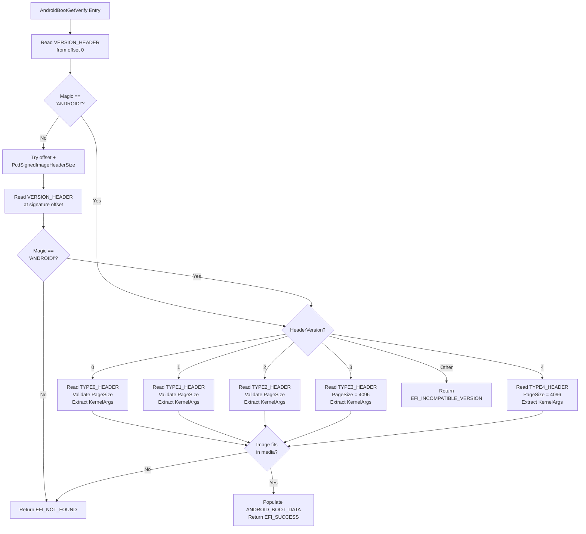

**Sources:** [Silicon/NVIDIA/Drivers/AndroidBootDxe/AndroidBootDxe.c:1213-1486](), [Silicon/NVIDIA/Include/AndroidBootImgHeader.h:30-154]()

### Header Type Structures

The driver defines distinct header structures for each version:

| Header Version | Structure | Key Features | Page Size |
|----------------|-----------|--------------|-----------|
| 0 | `ANDROID_BOOTIMG_TYPE0_HEADER` | Basic kernel, ramdisk, second-stage bootloader | User-defined |
| 1 | `ANDROID_BOOTIMG_TYPE1_HEADER` | Adds recovery overlay support | User-defined |
| 2 | `ANDROID_BOOTIMG_TYPE2_HEADER` | Adds DTB in boot.img | User-defined |
| 3 | `ANDROID_BOOTIMG_TYPE3_HEADER` | Removes unused fields, combined args | Fixed 4096 |
| 4 | `ANDROID_BOOTIMG_TYPE4_HEADER` | Adds signature field | Fixed 4096 |

**Sources:** [Silicon/NVIDIA/Include/AndroidBootImgHeader.h:39-154](), [Silicon/NVIDIA/Drivers/AndroidBootDxe/AndroidBootDxe.h:106-113]()

## Boot Image Discovery and Partition Management

### Partition Naming and A/B Slot Management

The driver implements Android A/B partition slot management with fallback partition naming schemes:

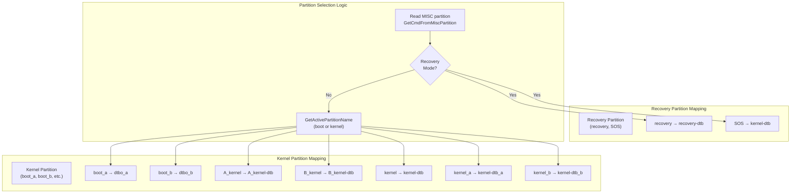

**Sources:** [Silicon/NVIDIA/Drivers/AndroidBootDxe/AndroidBootDxe.c:55-95](), [Silicon/NVIDIA/Drivers/AndroidBootDxe/AndroidBootDxe.c:258-336]()

### Driver Binding and Protocol Installation

The `AndroidBootDxe` driver follows a standard UEFI driver binding model:

```mermaid
graph LR
    Start["Driver Entry Point<br/>AndroidBootDxeDriverEntryPoint"] --> InstallBinding["Install EFI_DRIVER_BINDING_PROTOCOL"]
    
    InstallBinding --> WaitConnect["Wait for device connections"]
    
    WaitConnect --> Supported["DriverBindingSupported<br/>Check for BlockIo + PartitionInfo"]
    
    Supported --> BindStart["DriverBindingStart"]
    
    BindStart --> AllocPrivate["Allocate ANDROID_BOOT_PRIVATE_DATA"]
    AllocPrivate --> InitProtocols["Initialize:<br/>LoadFile Protocol<br/>KernelArgs Protocol<br/>DevicePath"]
    
    InitProtocols --> RegisterEvents["Register Events:<br/>ReadyToBoot<br/>ConnectComplete"]
    
    RegisterEvents --> InstallProtos["Install protocols on<br/>new handle"]
    
    InstallProtos --> Done["Boot option created"]
```

The private data structure maintains all state for each Android boot instance:

**Key Fields in `ANDROID_BOOT_PRIVATE_DATA`:**
- `PartitionName`: Name of the partition (e.g., "boot_a")
- `BlockIo`, `DiskIo`: Storage access protocols
- `LoadFile`: EFI_LOAD_FILE_PROTOCOL for kernel loading
- `KernelArgsProtocol`: NVIDIA_KERNEL_ARGS_PROTOCOL for command line
- `RecoveryMode`: Boolean indicating recovery boot
- `ControllerHandle`: Handle to the partition
- `AndroidBootHandle`: Handle where protocols are installed

**Sources:** [Silicon/NVIDIA/Drivers/AndroidBootDxe/AndroidBootDxe.c:1903-2213](), [Silicon/NVIDIA/Drivers/AndroidBootDxe/AndroidBootDxe.h:123-145]()

## Image Parsing and Component Extraction

### Boot Image Component Layout

Android boot images contain multiple components arranged according to the page-aligned layout:

```mermaid
graph TD
    subgraph "boot.img Structure (v0-v2)"
        BootHeader["Boot Header<br/>(1 page)"]
        Kernel["Kernel<br/>(N pages)"]
        Ramdisk["Ramdisk<br/>(M pages)"]
        SecondStage["Second Stage Bootloader<br/>(O pages, optional)"]
        DTB["DTB (v2 only)<br/>(P pages, optional)"]
        
        BootHeader --> Kernel
        Kernel --> Ramdisk
        Ramdisk --> SecondStage
        SecondStage --> DTB
    end
    
    subgraph "boot.img Structure (v3-v4)"
        BootHeaderV3["Boot Header<br/>(4096 bytes)"]
        KernelV3["Kernel<br/>(aligned to 4096)"]
        RamdiskV3["Ramdisk<br/>(aligned to 4096)"]
        SignatureV4["Signature (v4 only)<br/>(aligned to 4096)"]
        
        BootHeaderV3 --> KernelV3
        KernelV3 --> RamdiskV3
        RamdiskV3 --> SignatureV4
    end
    
    subgraph "vendor_boot.img (v3+)"
        VendorHeader["Vendor Boot Header<br/>(HeaderSize bytes)"]
        VendorRamdisk["Vendor Ramdisk<br/>(aligned to PageSize)"]
        VendorDTB["DTB<br/>(aligned to PageSize)"]
        VendorRamdiskTable["Ramdisk Table<br/>(optional)"]
        BootConfig["Boot Config<br/>(optional)"]
        
        VendorHeader --> VendorRamdisk
        VendorRamdisk --> VendorDTB
        VendorDTB --> VendorRamdiskTable
        VendorRamdiskTable --> BootConfig
    end
```

**Sources:** [Silicon/NVIDIA/Drivers/AndroidBootDxe/AndroidBootDxe.c:1488-1691](), [Silicon/NVIDIA/Drivers/AndroidBootDxe/AndroidBootDxe.h:55-104]()

### Vendor Boot Image Processing

For boot image header v3 and v4, vendor boot images contain additional ramdisk components and DTB data:

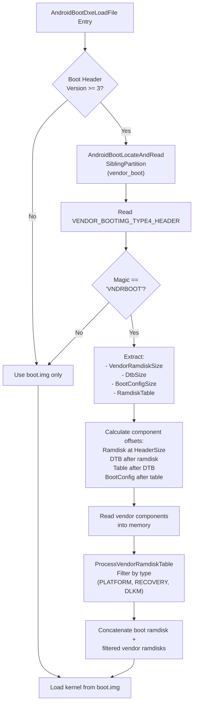

**Sources:** [Silicon/NVIDIA/Drivers/AndroidBootDxe/AndroidBootDxe.c:1693-1901](), [Silicon/NVIDIA/Drivers/AndroidBootDxe/AndroidBootDxe.h:55-104]()

## Device Tree and Overlay Management

### DTB and DTBO Loading

The driver implements a sophisticated DTB/DTBO loading and overlay application system:

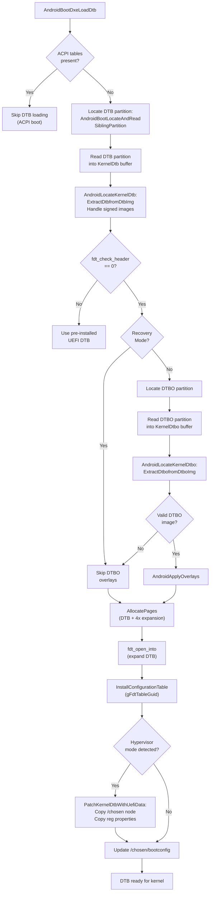

**Sources:** [Silicon/NVIDIA/Drivers/AndroidBootDxe/AndroidBootDxe.c:832-1029](), [Silicon/NVIDIA/Drivers/AndroidBootDxe/AndroidBootDxe.c:341-409]()

### DTBO Overlay Application Process

The overlay application iterates through multiple DTB overlays in the DTBO partition:

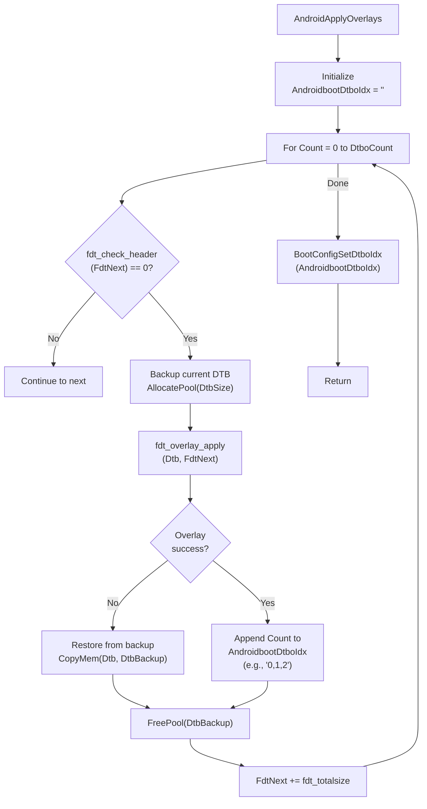

**Key Functions:**
- `AndroidApplyOverlays`: Main overlay application loop [Silicon/NVIDIA/Drivers/AndroidBootDxe/AndroidBootDxe.c:414-483]()
- `fdt_overlay_apply`: libfdt function to merge overlay into base DTB
- `BootConfigSetDtboIdx`: Sets `androidboot.dtbo_idx` in bootconfig

**Sources:** [Silicon/NVIDIA/Drivers/AndroidBootDxe/AndroidBootDxe.c:414-483]()

### Hypervisor Mode DTB Patching

When hypervisor mode is detected, the driver copies critical data from the UEFI DTB to the kernel DTB:

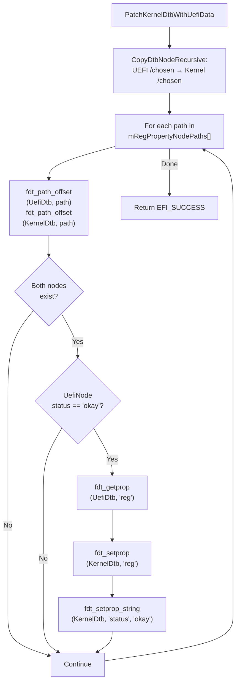

**Patched Node Paths:**
- `/reserved-memory/vpr-carveout` - VPR (Video Protection Region) carveout

**Sources:** [Silicon/NVIDIA/Drivers/AndroidBootDxe/AndroidBootDxe.c:790-820](), [Silicon/NVIDIA/Drivers/AndroidBootDxe/AndroidBootDxe.c:670-770](), [Silicon/NVIDIA/Drivers/AndroidBootDxe/AndroidBootDxe.c:102-105]()

## Kernel Command Line Construction

### Command Line Aggregation Flow

The kernel command line is constructed from multiple sources and updated by various platform components:

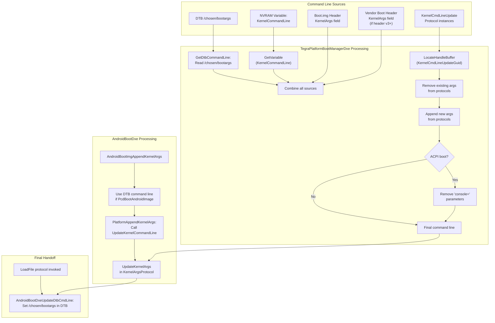

**Sources:** [Silicon/NVIDIA/Drivers/TegraPlatformBootManager/TegraPlatformBootManagerDxe.c:317-383](), [Silicon/NVIDIA/Drivers/TegraPlatformBootManager/TegraPlatformBootManagerDxe.c:464-581](), [Silicon/NVIDIA/Drivers/TegraPlatformBootManager/TegraPlatformBootManagerDxe.c:615-652](), [Silicon/NVIDIA/Drivers/AndroidBootDxe/AndroidBootDxe.c:496-553]()

### KernelArgs Protocol Implementation

The `NVIDIA_KERNEL_ARGS_PROTOCOL` provides dynamic kernel argument updates:

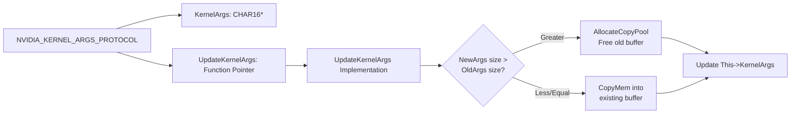

**Key Functions:**
- `UpdateKernelArgs`: Updates kernel arguments dynamically [Silicon/NVIDIA/Drivers/AndroidBootDxe/AndroidBootDxe.c:122-164]()
- Protocol installed on each Android boot handle [Silicon/NVIDIA/Drivers/AndroidBootDxe/AndroidBootDxe.c:236-244]()

**Sources:** [Silicon/NVIDIA/Drivers/AndroidBootDxe/AndroidBootDxe.c:122-164](), [Silicon/NVIDIA/Include/Protocol/KernelArgsProtocol.h:19-42]()

## LoadFile and LoadFile2 Protocol Implementation

### Protocol Architecture

The driver implements both EFI_LOAD_FILE_PROTOCOL and EFI_LOAD_FILE2_PROTOCOL to handle kernel and initrd loading:

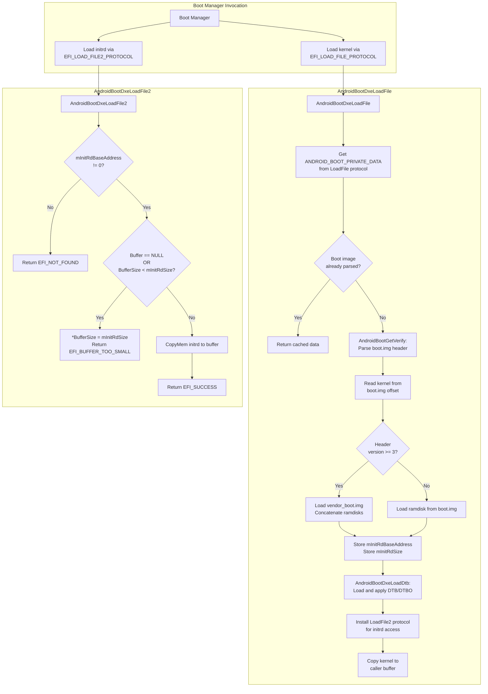

**Sources:** [Silicon/NVIDIA/Drivers/AndroidBootDxe/AndroidBootDxe.c:1488-1901](), [Silicon/NVIDIA/Drivers/AndroidBootDxe/AndroidBootDxe.c:1062-1097]()

### LoadFile2 Protocol Installation and Cleanup

The LoadFile2 protocol is installed dynamically when the kernel is loaded and uninstalled at ReadyToBoot:

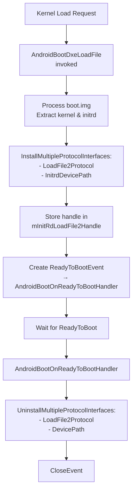

**Sources:** [Silicon/NVIDIA/Drivers/AndroidBootDxe/AndroidBootDxe.c:177-219](), [Silicon/NVIDIA/Drivers/AndroidBootDxe/AndroidBootDxe.c:1784-1808]()

## Recovery Mode Handling

### Recovery Detection and Partition Selection

Recovery mode is determined by reading the MISC partition and checking for specific commands:

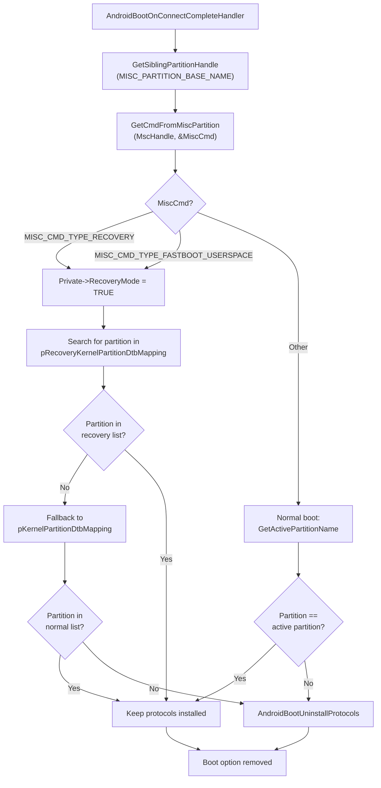

**Recovery Partition Mappings:**
- `recovery` → `recovery-dtb`
- `SOS` → `kernel-dtb`

**Sources:** [Silicon/NVIDIA/Drivers/AndroidBootDxe/AndroidBootDxe.c:258-336](), [Silicon/NVIDIA/Drivers/AndroidBootDxe/AndroidBootDxe.c:88-95]()

### Recovery vs Normal Boot Differences

| Aspect | Normal Boot | Recovery Boot |
|--------|-------------|---------------|
| Partition Selection | Active boot slot (boot_a/boot_b) | recovery or SOS partition |
| DTBO Overlays | Applied from dtbo_a/dtbo_b | Skipped (not supported) |
| DTB Source | kernel-dtb_a/kernel-dtb_b | recovery-dtb or kernel-dtb |
| Fallback | None | Falls back to normal boot partitions if recovery not found |

**Sources:** [Silicon/NVIDIA/Drivers/AndroidBootDxe/AndroidBootDxe.c:870-928]()

## Integration with Platform Boot Manager

### Boot Option Lifecycle

The platform boot manager (`TegraPlatformBootManagerDxe`) coordinates with `AndroidBootDxe` to manage boot options:

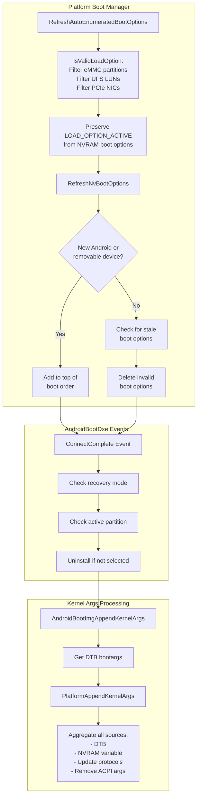

**Sources:** [Silicon/NVIDIA/Drivers/TegraPlatformBootManager/TegraPlatformBootManagerDxe.c:684-812](), [Silicon/NVIDIA/Drivers/TegraPlatformBootManager/TegraPlatformBootManagerDxe.c:833-911](), [Silicon/NVIDIA/Drivers/TegraPlatformBootManager/TegraPlatformBootManagerDxe.c:615-652]()

### Platform Boot Manager Protocol

The platform implements `EDKII_PLATFORM_BOOT_MANAGER_PROTOCOL` to provide Android-specific kernel argument handling:

**Protocol Functions:**
- `AndroidBootImgAppendKernelArgs`: Adds DTB bootargs and platform-specific arguments [Silicon/NVIDIA/Drivers/TegraPlatformBootManager/TegraPlatformBootManagerDxe.c:615-652]()
- `RefreshAllBootOptions`: Filters and validates Android boot options [Silicon/NVIDIA/Drivers/TegraPlatformBootManager/TegraPlatformBootManagerDxe.c:917-943]()

**Sources:** [Silicon/NVIDIA/Drivers/TegraPlatformBootManager/TegraPlatformBootManagerDxe.c:615-652](), [Silicon/NVIDIA/Drivers/TegraPlatformBootManager/TegraPlatformBootManagerDxe.c:917-943]()

## Code Organization

### Main Driver Files

| File | Purpose |
|------|---------|
| `AndroidBootDxe.c` | Main driver implementation, protocol handlers, image parsing |
| `AndroidBootDxe.h` | Data structures, private data definition, protocol definitions |
| `AndroidBootConfig.c` | Boot configuration string handling |
| `AndroidBootDtbImgParser.c` | DTB/DTBO image extraction from dtb.img/dtbo.img formats |
| `TegraPlatformBootManagerDxe.c` | Platform-level boot option management and kernel args |

**Sources:** [Silicon/NVIDIA/Drivers/AndroidBootDxe/AndroidBootDxe.inf:26-32](), [Silicon/NVIDIA/Drivers/TegraPlatformBootManager/TegraPlatformBootManagerDxe.inf:15-16]()

### Key Data Structures

**`ANDROID_BOOT_PRIVATE_DATA`** - Per-instance driver state:
- Partition information and storage protocols
- LoadFile and KernelArgs protocol instances  
- Recovery mode flag
- Handle tracking

**`ANDROID_BOOT_DATA`** - Parsed boot image metadata:
- Kernel and ramdisk sizes
- Page size and header version
- Image offset (accounting for signatures)

**`VENDOR_BOOT_DATA`** - Vendor boot image metadata:
- Vendor ramdisk and DTB sizes
- Ramdisk table information
- Boot configuration data size

**Sources:** [Silicon/NVIDIA/Drivers/AndroidBootDxe/AndroidBootDxe.h:106-145]()

---

