<!-- source: DeepWiki mcp.deepwiki.com · repo NVIDIA/edk2-nvidia · page 7.2 Kernel and Device Tree Handoff · fetched 2026-10-26 -->

# Kernel and Device Tree Handoff

<details>
<summary>Relevant source files</summary>

The following files were used as context for generating this wiki page:

- [Silicon/NVIDIA/Drivers/AndroidBootDxe/AndroidBootDxe.c](Silicon/NVIDIA/Drivers/AndroidBootDxe/AndroidBootDxe.c)
- [Silicon/NVIDIA/Drivers/AndroidBootDxe/AndroidBootDxe.h](Silicon/NVIDIA/Drivers/AndroidBootDxe/AndroidBootDxe.h)
- [Silicon/NVIDIA/Drivers/AndroidBootDxe/AndroidBootDxe.inf](Silicon/NVIDIA/Drivers/AndroidBootDxe/AndroidBootDxe.inf)
- [Silicon/NVIDIA/Drivers/AndroidBootDxe/UnitTest/AndroidBootDxeUnitTest.inf](Silicon/NVIDIA/Drivers/AndroidBootDxe/UnitTest/AndroidBootDxeUnitTest.inf)
- [Silicon/NVIDIA/Drivers/AndroidBootDxe/UnitTest/BootImgHeaderUnitTests.c](Silicon/NVIDIA/Drivers/AndroidBootDxe/UnitTest/BootImgHeaderUnitTests.c)
- [Silicon/NVIDIA/Drivers/TegraPlatformBootManager/TegraPlatformBootManagerDxe.c](Silicon/NVIDIA/Drivers/TegraPlatformBootManager/TegraPlatformBootManagerDxe.c)
- [Silicon/NVIDIA/Drivers/TegraPlatformBootManager/TegraPlatformBootManagerDxe.inf](Silicon/NVIDIA/Drivers/TegraPlatformBootManager/TegraPlatformBootManagerDxe.inf)
- [Silicon/NVIDIA/Include/AndroidBootImgHeader.h](Silicon/NVIDIA/Include/AndroidBootImgHeader.h)
- [Silicon/NVIDIA/Include/Library/DeviceTreeHelperLib.h](Silicon/NVIDIA/Include/Library/DeviceTreeHelperLib.h)
- [Silicon/NVIDIA/Include/Protocol/KernelArgsProtocol.h](Silicon/NVIDIA/Include/Protocol/KernelArgsProtocol.h)
- [Silicon/NVIDIA/Library/DeviceTreeHelperLib/DeviceTreeHelperLib.inf](Silicon/NVIDIA/Library/DeviceTreeHelperLib/DeviceTreeHelperLib.inf)
- [Silicon/NVIDIA/Library/DeviceTreeHelperLib/DeviceTreeHelperLibCore.c](Silicon/NVIDIA/Library/DeviceTreeHelperLib/DeviceTreeHelperLibCore.c)
- [Silicon/NVIDIA/Library/DeviceTreeHelperLib/DeviceTreeHelperLibDeprecated.c](Silicon/NVIDIA/Library/DeviceTreeHelperLib/DeviceTreeHelperLibDeprecated.c)
- [Silicon/NVIDIA/Library/DeviceTreeHelperLib/DeviceTreeHelperLibParser.c](Silicon/NVIDIA/Library/DeviceTreeHelperLib/DeviceTreeHelperLibParser.c)
- [Silicon/NVIDIA/Library/DeviceTreeHelperLib/DeviceTreeHelperLibParserAArch64.c](Silicon/NVIDIA/Library/DeviceTreeHelperLib/DeviceTreeHelperLibParserAArch64.c)
- [Silicon/NVIDIA/Library/DeviceTreeHelperLib/DeviceTreeHelperLibParserX86.c](Silicon/NVIDIA/Library/DeviceTreeHelperLib/DeviceTreeHelperLibParserX86.c)
- [Silicon/NVIDIA/Library/DeviceTreeHelperLib/DeviceTreeHelperLibPointer.c](Silicon/NVIDIA/Library/DeviceTreeHelperLib/DeviceTreeHelperLibPointer.c)
- [Silicon/NVIDIA/Library/DeviceTreeHelperLib/DeviceTreeHelperLibPrivate.h](Silicon/NVIDIA/Library/DeviceTreeHelperLib/DeviceTreeHelperLibPrivate.h)
- [Silicon/NVIDIA/Library/DeviceTreeHelperLib/DeviceTreeHelperLibUtility.c](Silicon/NVIDIA/Library/DeviceTreeHelperLib/DeviceTreeHelperLibUtility.c)
- [Silicon/NVIDIA/Library/DeviceTreeHelperLib/UnitTest/DeviceTreeHelperLibGoogleTest.cpp](Silicon/NVIDIA/Library/DeviceTreeHelperLib/UnitTest/DeviceTreeHelperLibGoogleTest.cpp)
- [Silicon/NVIDIA/Library/DxeDtPlatformDtbLoaderLib/DxeDtPlatformDtbKernelLoaderLib.c](Silicon/NVIDIA/Library/DxeDtPlatformDtbLoaderLib/DxeDtPlatformDtbKernelLoaderLib.c)
- [Silicon/NVIDIA/Library/DxeDtPlatformDtbLoaderLib/DxeDtPlatformDtbKernelLoaderLib.inf](Silicon/NVIDIA/Library/DxeDtPlatformDtbLoaderLib/DxeDtPlatformDtbKernelLoaderLib.inf)

</details>


## Purpose and Scope

This document describes the final stage of UEFI boot where the firmware prepares and hands off critical boot data to the Linux kernel, including the Device Tree Blob (DTB), initial ramdisk (InitRd), and kernel command line arguments. This handoff mechanism supports both Android boot paths (with boot.img parsing) and standard UEFI boot paths.

For information about Android boot image parsing and partition handling, see [Android Boot Implementation](#7.1). For details on boot manager boot option selection and filtering, see [Boot Manager and Boot Options](#5.3). For DTB overlay application from firmware media during DXE phase, see [Device Tree Loading and Preparation](#4.1).

## Handoff Architecture Overview

The kernel handoff process involves three primary data artifacts passed to the Linux kernel, coordinated across multiple drivers and libraries:

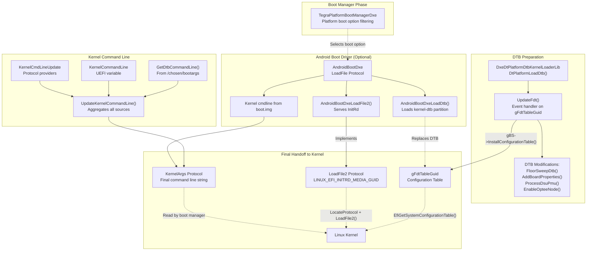

**Sources:**
- [Silicon/NVIDIA/Drivers/AndroidBootDxe/AndroidBootDxe.c:832-1029]()
- [Silicon/NVIDIA/Library/DxeDtPlatformDtbLoaderLib/DxeDtPlatformDtbKernelLoaderLib.c:526-632]()
- [Silicon/NVIDIA/Drivers/TegraPlatformBootManager/TegraPlatformBootManagerDxe.c:316-383]()
- [Silicon/NVIDIA/Drivers/TegraPlatformBootManager/TegraPlatformBootManagerDxe.c:464-576]()

## Device Tree Preparation

### Base DTB Loading

The DTB loading process begins during DXE phase through the `DtPlatformDtbLoaderLib` implementation. The `DtPlatformLoadDtb()` function is called once to establish the base DTB that will be modified throughout boot:

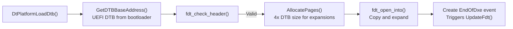

The library allocates 4x the original DTB size to accommodate runtime additions including overlays, new properties, and expanded nodes.

**Sources:**
- [Silicon/NVIDIA/Library/DxeDtPlatformDtbLoaderLib/DxeDtPlatformDtbKernelLoaderLib.c:667-726]()

### DTB Overlay Application

Overlays are applied from firmware media during the `UpdateFdt()` event handler. The system checks for a `firmware-media-overlays-applied` property to ensure overlays are only applied once:

| Overlay Source | Location | Application Function |
|----------------|----------|---------------------|
| Firmware Media | Aligned after UEFI DTB | `ApplyTegraDeviceTreeOverlay()` |
| Android DTBO Partition | dtbo_a / dtbo_b | `AndroidApplyOverlays()` |
| Kernel DTB Partition | kernel-dtb_a / kernel-dtb_b | `AndroidLocateKernelDtb()` |

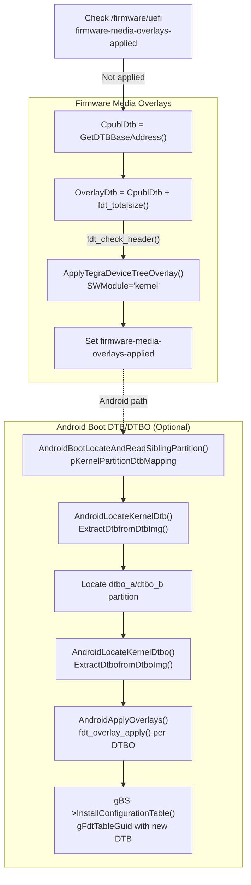

The Android boot path loads a completely separate DTB from the `kernel-dtb` partition and applies DTBOs from the `dtbo` partition. This replaces the UEFI DTB entirely.

**Sources:**
- [Silicon/NVIDIA/Library/DxeDtPlatformDtbLoaderLib/DxeDtPlatformDtbKernelLoaderLib.c:526-632]()
- [Silicon/NVIDIA/Drivers/AndroidBootDxe/AndroidBootDxe.c:832-1029]()
- [Silicon/NVIDIA/Drivers/AndroidBootDxe/AndroidBootDxe.c:339-373]()
- [Silicon/NVIDIA/Drivers/AndroidBootDxe/AndroidBootDxe.c:376-409]()
- [Silicon/NVIDIA/Drivers/AndroidBootDxe/AndroidBootDxe.c:411-483]()

### DTB Modification Pipeline

After overlay application, the DTB undergoes a series of platform-specific modifications through the `UpdateFdt()` function. These modifications prepare the DTB for kernel consumption:

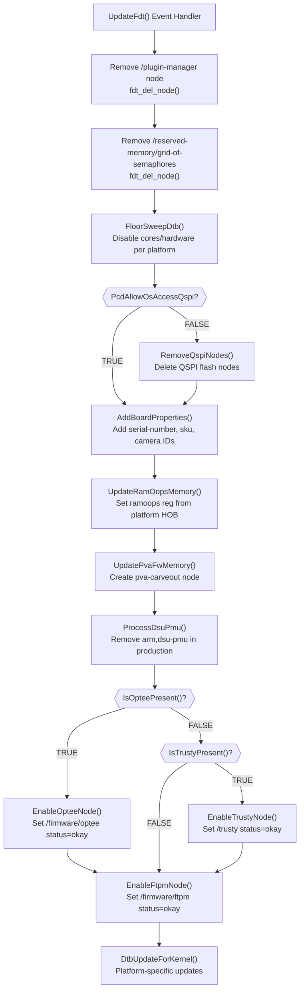

**Key Modification Functions:**

| Function | Purpose | DTB Nodes Affected |
|----------|---------|-------------------|
| `FloorSweepDtb()` | Disable floored hardware | Per-platform CPU/GPU/device nodes |
| `RemoveQspiNodes()` | Remove QSPI flash access | `/spi@*/flash@0`, `/spi@*/spiflash@0` |
| `AddBoardProperties()` | Add board identification | `/ serial-number`, `/chosen ids`, `/chosen nvidia,sku` |
| `UpdateRamOopsMemory()` | Set kernel crash log region | `/ramoops reg, status` |
| `ProcessDsuPmu()` | Security hardening | Remove `/arm,dsu-pmu` nodes if OEM production |
| `EnableOpteeNode()` | Enable OP-TEE | `/firmware/optee status` |
| `EnableTrustyNode()` | Enable Trusty OS | `/trusty status` |
| `EnableFtpmNode()` | Enable firmware TPM | `/firmware/ftpm status` |

**Sources:**
- [Silicon/NVIDIA/Library/DxeDtPlatformDtbLoaderLib/DxeDtPlatformDtbKernelLoaderLib.c:603-631]()
- [Silicon/NVIDIA/Library/DxeDtPlatformDtbLoaderLib/DxeDtPlatformDtbKernelLoaderLib.c:254-294]()
- [Silicon/NVIDIA/Library/DxeDtPlatformDtbLoaderLib/DxeDtPlatformDtbKernelLoaderLib.c:66-120]()
- [Silicon/NVIDIA/Library/DxeDtPlatformDtbLoaderLib/DxeDtPlatformDtbKernelLoaderLib.c:296-363]()
- [Silicon/NVIDIA/Library/DxeDtPlatformDtbLoaderLib/DxeDtPlatformDtbKernelLoaderLib.c:365-439]()
- [Silicon/NVIDIA/Library/DxeDtPlatformDtbLoaderLib/DxeDtPlatformDtbKernelLoaderLib.c:441-522]()

### Android Hypervisor Mode DTB Patching

When booting in hypervisor mode with an Android kernel DTB, the system copies critical data from the UEFI DTB's `/chosen` node to the kernel DTB:

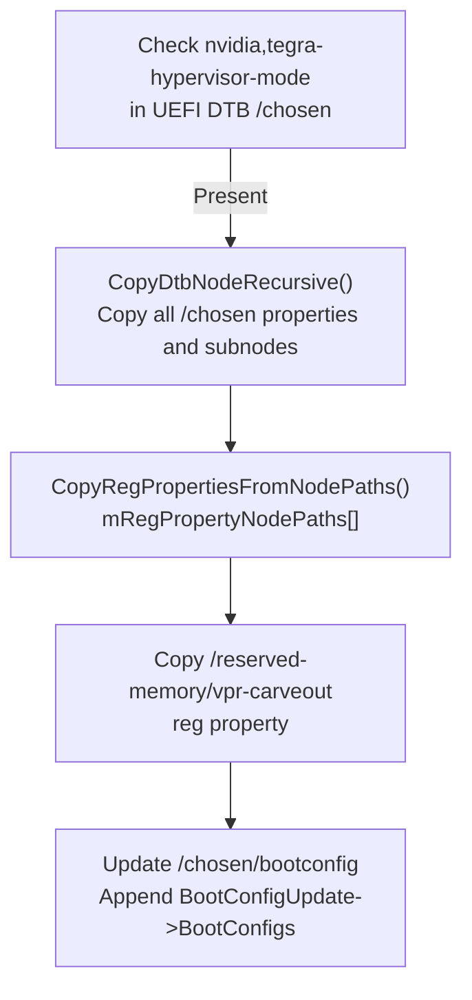

The `PatchKernelDtbWithUefiData()` function recursively copies nodes and specifically handles memory carveout regions that must match between UEFI and the kernel.

**Sources:**
- [Silicon/NVIDIA/Drivers/AndroidBootDxe/AndroidBootDxe.c:787-820]()
- [Silicon/NVIDIA/Drivers/AndroidBootDxe/AndroidBootDxe.c:567-638]()
- [Silicon/NVIDIA/Drivers/AndroidBootDxe/AndroidBootDxe.c:667-770]()
- [Silicon/NVIDIA/Drivers/AndroidBootDxe/AndroidBootDxe.c:956-1013]()

## InitRd Handoff via LoadFile2 Protocol

The initial ramdisk is provided to the kernel through the UEFI `LoadFile2` protocol with a device path containing `LINUX_EFI_INITRD_MEDIA_GUID`. This is the standard UEFI mechanism for Linux initrd loading.

### LoadFile2 Protocol Implementation

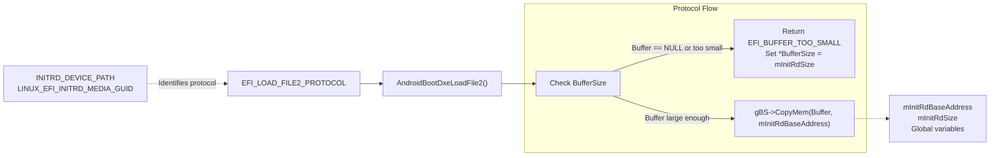

The `mInitRdBaseAddress` and `mInitRdSize` globals are set during Android boot image parsing when the ramdisk is extracted from either `boot.img` or `vendor_boot.img`.

**Sources:**
- [Silicon/NVIDIA/Drivers/AndroidBootDxe/AndroidBootDxe.c:1060-1097]()
- [Silicon/NVIDIA/Drivers/AndroidBootDxe/AndroidBootDxe.c:43-53]()
- [Silicon/NVIDIA/Drivers/AndroidBootDxe/AndroidBootDxe.c:28-29]()

### Ramdisk Loading and Concatenation

For Android boot version 4, ramdisks may be split across `boot.img` and `vendor_boot.img` with multiple vendor ramdisk fragments:

| Image Type | Ramdisk Components | Offset Calculation |
|------------|-------------------|-------------------|
| boot.img v0-v2 | Single ramdisk | `PageSize + ALIGN(KernelSize, PageSize)` |
| boot.img v3-v4 | Single ramdisk | `4096 + ALIGN(KernelSize, 4096)` |
| vendor_boot.img v4 | Vendor ramdisk + table entries | Header size + aligned offsets |

**Sources:**
- [Silicon/NVIDIA/Drivers/AndroidBootDxe/AndroidBootDxe.c:1660-2096]()
- [Silicon/NVIDIA/Include/AndroidBootImgHeader.h:51-154]()

## Kernel Command Line Aggregation

The final kernel command line is constructed by aggregating arguments from multiple sources with a defined precedence order:

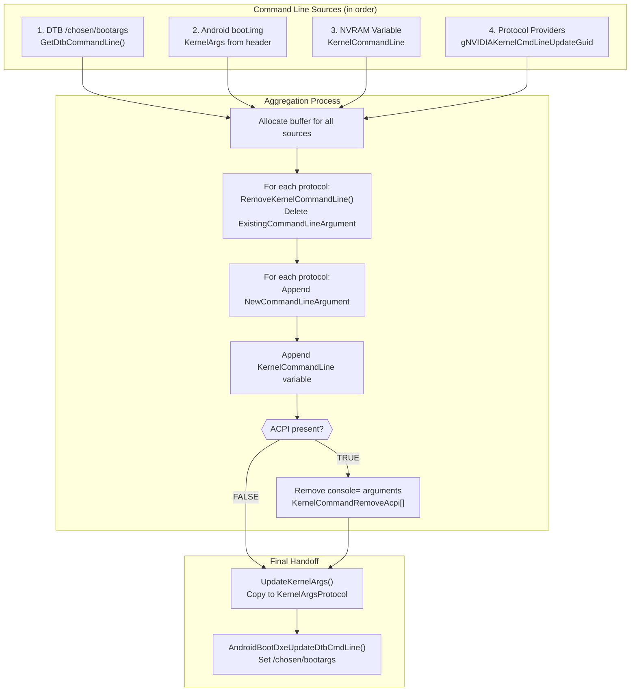

### Command Line Update Protocol

The `NVIDIA_KERNEL_CMD_LINE_UPDATE_PROTOCOL` allows multiple drivers to contribute kernel arguments:

```c
typedef struct {
  CHAR16  *ExistingCommandLineArgument;  // Arguments to remove
  CHAR16  *NewCommandLineArgument;       // Arguments to add
} NVIDIA_KERNEL_CMD_LINE_UPDATE_PROTOCOL;
```

The aggregation process:
1. Measures total length needed from all sources
2. Allocates combined buffer
3. Removes all `ExistingCommandLineArgument` strings from each protocol
4. Appends all `NewCommandLineArgument` strings from each protocol
5. Appends NVRAM `KernelCommandLine` variable
6. Removes ACPI-incompatible arguments if ACPI tables are present

**Sources:**
- [Silicon/NVIDIA/Drivers/TegraPlatformBootManager/TegraPlatformBootManagerDxe.c:464-576]()
- [Silicon/NVIDIA/Drivers/TegraPlatformBootManager/TegraPlatformBootManagerDxe.c:395-451]()
- [Silicon/NVIDIA/Drivers/TegraPlatformBootManager/TegraPlatformBootManagerDxe.c:316-383]()
- [Silicon/NVIDIA/Drivers/AndroidBootDxe/AndroidBootDxe.c:494-553]()

### Kernel Args Protocol

The final kernel arguments are stored in the `NVIDIA_KERNEL_ARGS_PROTOCOL`:

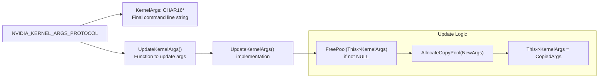

The protocol provides dynamic update capability, allowing the command line to be modified up until kernel launch.

**Sources:**
- [Silicon/NVIDIA/Drivers/AndroidBootDxe/AndroidBootDxe.c:107-164]()
- [Silicon/NVIDIA/Include/Protocol/KernelArgsProtocol.h:1-45]()

## Final DTB Installation

The prepared DTB is installed in the UEFI configuration table under `gFdtTableGuid`, making it available for kernel retrieval:

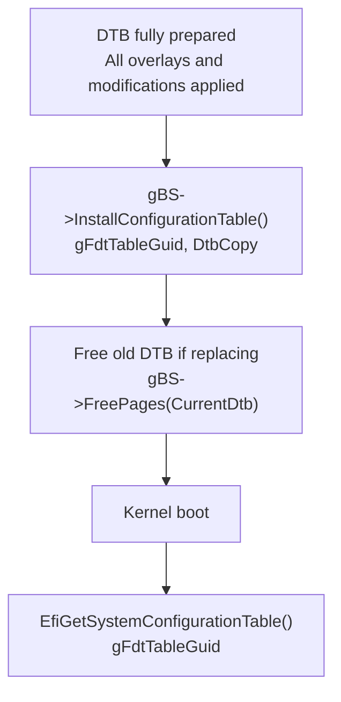

The DTB is installed in the configuration table at multiple points:
- After firmware media overlay application in `UpdateFdt()`
- After Android DTB replacement in `AndroidBootDxeLoadDtb()`

Each installation frees the previous DTB to avoid memory leaks.

**Sources:**
- [Silicon/NVIDIA/Library/DxeDtPlatformDtbLoaderLib/DxeDtPlatformDtbKernelLoaderLib.c:598-599]()
- [Silicon/NVIDIA/Drivers/AndroidBootDxe/AndroidBootDxe.c:951-1014]()

## Android Boot Path Special Handling

The Android boot path includes additional DTB and bootconfig handling specific to Android requirements:

### Boot Image DTB Replacement

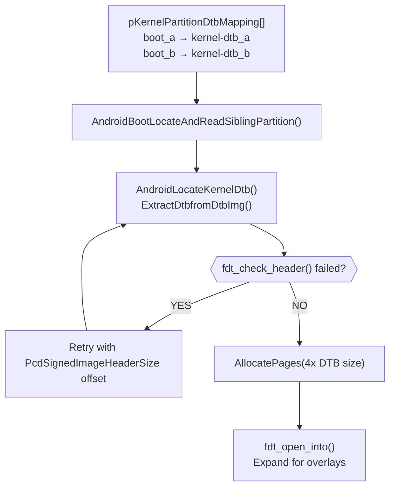

The Android DTB may be wrapped in a signed image header, so the code attempts to extract at offset 0 first, then retries with the signature header size if validation fails.

### Bootconfig Update

Android bootconfig data in `/chosen/bootconfig` is updated with dynamic values:

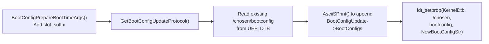

The `NVIDIA_BOOTCONFIG_UPDATE_PROTOCOL` allows dynamic bootconfig entries to be appended, similar to the kernel command line protocol.

**Sources:**
- [Silicon/NVIDIA/Drivers/AndroidBootDxe/AndroidBootDxe.c:868-902]()
- [Silicon/NVIDIA/Drivers/AndroidBootDxe/AndroidBootDxe.c:339-373]()
- [Silicon/NVIDIA/Drivers/AndroidBootDxe/AndroidBootDxe.c:973-1010]()

## Complete Handoff Flow

The following diagram shows the complete end-to-end flow from boot manager to kernel launch:

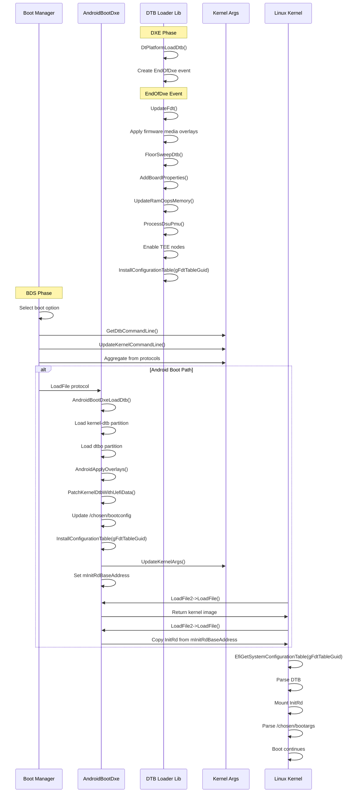

**Sources:**
- [Silicon/NVIDIA/Library/DxeDtPlatformDtbLoaderLib/DxeDtPlatformDtbKernelLoaderLib.c:667-726]()
- [Silicon/NVIDIA/Library/DxeDtPlatformDtbLoaderLib/DxeDtPlatformDtbKernelLoaderLib.c:526-632]()
- [Silicon/NVIDIA/Drivers/TegraPlatformBootManager/TegraPlatformBootManagerDxe.c:464-576]()
- [Silicon/NVIDIA/Drivers/AndroidBootDxe/AndroidBootDxe.c:832-1029]()
- [Silicon/NVIDIA/Drivers/AndroidBootDxe/AndroidBootDxe.c:1060-1097]()

---

