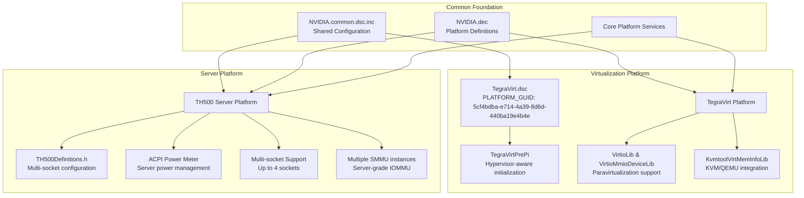
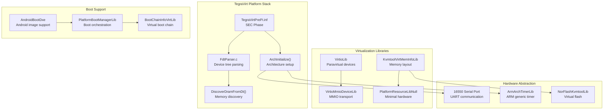
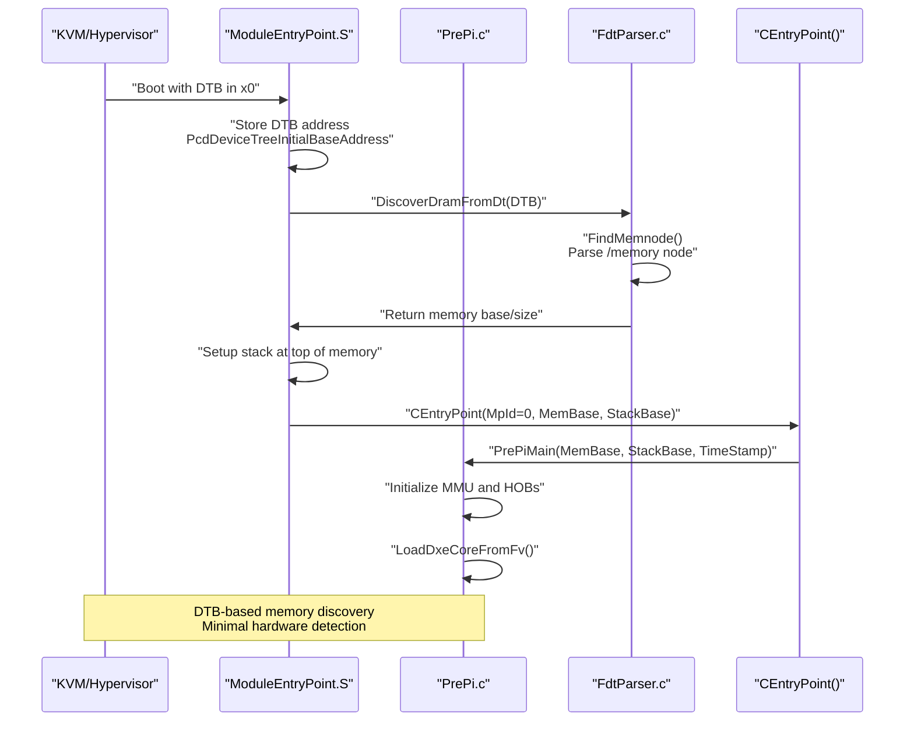
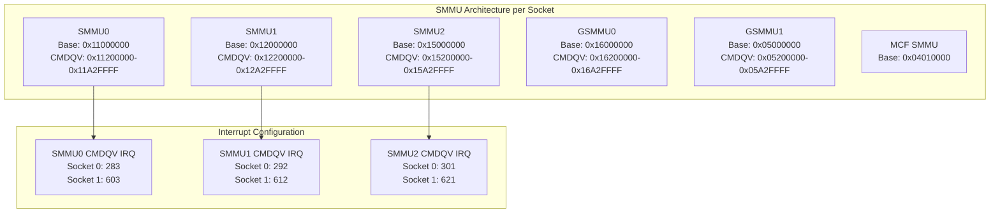
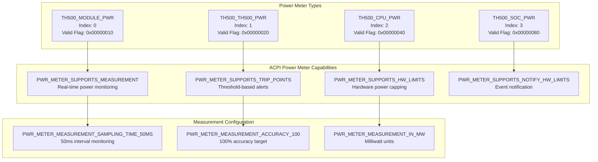

<!-- source: DeepWiki mcp.deepwiki.com · repo NVIDIA/edk2-nvidia · page 8 Platform Variants · fetched 2026-10-26 -->

# Platform Variants

Relevant source files

The following files were used as context for generating this wiki page:

- [Platform/NVIDIA/Kconfig](Platform/NVIDIA/Kconfig)
- [Platform/NVIDIA/NVIDIA.common.dsc.inc](Platform/NVIDIA/NVIDIA.common.dsc.inc)
- [Platform/NVIDIA/NVIDIA.fvmain.fdf.inc](Platform/NVIDIA/NVIDIA.fvmain.fdf.inc)
- [Platform/NVIDIA/TegraVirt/TegraVirt.dsc](Platform/NVIDIA/TegraVirt/TegraVirt.dsc)
- [Platform/NVIDIA/TegraVirt/TegraVirt.fdf](Platform/NVIDIA/TegraVirt/TegraVirt.fdf)
- [Silicon/NVIDIA/Drivers/ConfigurationManagerData/MpamParser/MpamParser.c](Silicon/NVIDIA/Drivers/ConfigurationManagerData/MpamParser/MpamParser.c)
- [Silicon/NVIDIA/Include/AcpiPowerMeter.h](Silicon/NVIDIA/Include/AcpiPowerMeter.h)
- [Silicon/NVIDIA/Include/Library/PlatformResourceLib.h](Silicon/NVIDIA/Include/Library/PlatformResourceLib.h)
- [Silicon/NVIDIA/Include/Protocol/BpmpIpc.h](Silicon/NVIDIA/Include/Protocol/BpmpIpc.h)
- [Silicon/NVIDIA/Include/Server/TH500/TH500Definitions.h](Silicon/NVIDIA/Include/Server/TH500/TH500Definitions.h)
- [Silicon/NVIDIA/Library/DeviceDiscoveryLib/DeviceDiscoveryLibPrivate.h](Silicon/NVIDIA/Library/DeviceDiscoveryLib/DeviceDiscoveryLibPrivate.h)
- [Silicon/NVIDIA/Library/PlatformResourceLib/PlatformResourceLib.c](Silicon/NVIDIA/Library/PlatformResourceLib/PlatformResourceLib.c)
- [Silicon/NVIDIA/Library/PlatformResourceLib/T234ResourceConfig.c](Silicon/NVIDIA/Library/PlatformResourceLib/T234ResourceConfig.c)
- [Silicon/NVIDIA/Library/PlatformResourceLib/TH500ResourceConfig.c](Silicon/NVIDIA/Library/PlatformResourceLib/TH500ResourceConfig.c)
- [Silicon/NVIDIA/Library/PlatformResourceLib/TH500ResourceConfigPrivate.h](Silicon/NVIDIA/Library/PlatformResourceLib/TH500ResourceConfigPrivate.h)
- [Silicon/NVIDIA/PrePi/AArch64/ArchPrePi.c](Silicon/NVIDIA/PrePi/AArch64/ArchPrePi.c)
- [Silicon/NVIDIA/PrePi/AArch64/ModuleEntryPoint.S](Silicon/NVIDIA/PrePi/AArch64/ModuleEntryPoint.S)
- [Silicon/NVIDIA/PrePi/PrePi.c](Silicon/NVIDIA/PrePi/PrePi.c)
- [Silicon/NVIDIA/PrePi/PrePi.h](Silicon/NVIDIA/PrePi/PrePi.h)
- [Silicon/NVIDIA/PrePi/PrePi.inf](Silicon/NVIDIA/PrePi/PrePi.inf)
- [Silicon/NVIDIA/PrePi/PrePiMemory.c](Silicon/NVIDIA/PrePi/PrePiMemory.c)
- [Silicon/NVIDIA/TegraVirt/PrePi/AArch64/ArchPrePi.c](Silicon/NVIDIA/TegraVirt/PrePi/AArch64/ArchPrePi.c)
- [Silicon/NVIDIA/TegraVirt/PrePi/AArch64/ModuleEntryPoint.S](Silicon/NVIDIA/TegraVirt/PrePi/AArch64/ModuleEntryPoint.S)
- [Silicon/NVIDIA/TegraVirt/PrePi/PrePi.c](Silicon/NVIDIA/TegraVirt/PrePi/PrePi.c)
- [Silicon/NVIDIA/TegraVirt/PrePi/PrePi.h](Silicon/NVIDIA/TegraVirt/PrePi/PrePi.h)
- [Silicon/NVIDIA/TegraVirt/PrePi/TegraVirtPrePi.inf](Silicon/NVIDIA/TegraVirt/PrePi/TegraVirtPrePi.inf)

This document covers the different platform configurations and variants supported by the NVIDIA UEFI firmware implementation. The edk2-nvidia repository supports multiple distinct platform types, each tailored for specific deployment scenarios ranging from virtualized environments to high-performance server systems.

For information about the common platform services that underpin all variants, see [Core Platform Services](#3). For details on the build system that configures these variants, see [Build System and Configuration](#2).

## Platform Variant Architecture

The NVIDIA UEFI firmware supports multiple platform variants, each with distinct characteristics and target use cases. The platform variants share common foundation components but differ in their hardware abstraction, resource management, and target environments.

Sources: [Platform/NVIDIA/TegraVirt/TegraVirt.dsc:16-25](), [Silicon/NVIDIA/Include/Server/TH500/TH500Definitions.h:14-19]()

## Platform Configuration Matrix

The following table summarizes the key characteristics of each platform variant:

| Feature | TegraVirt | TH500 Server |
|---------|-----------|--------------|
| **Target Environment** | Virtualized/KVM | Physical Server |
| **Socket Support** | Single | Up to 4 sockets |
| **Memory Management** | Virtualized MMU | Hardware SMMU |
| **Boot Support** | Android/L4T | Server OS |
| **Power Management** | Basic | ACPI Power Meter |
| **PCI Support** | Virtio PCI | Multi-socket PCIe |
| **Platform GUID** | `5cf4bdba-e714-4a39-8d6d-440ba19e4b4e` | TBD |

Sources: [Platform/NVIDIA/TegraVirt/TegraVirt.dsc:18](), [Silicon/NVIDIA/Include/Server/TH500/TH500Definitions.h:15-16]()

## Virtualization Platform (TegraVirt)

The TegraVirt platform variant is designed for virtualized environments, particularly targeting KVM hypervisors and paravirtualized scenarios. This platform provides minimal hardware abstraction while supporting essential virtualization features.

### TegraVirt Platform Architecture

Sources: [Silicon/NVIDIA/TegraVirt/PrePi/TegraVirtPrePi.inf:19-26](), [Platform/NVIDIA/TegraVirt/TegraVirt.dsc:48-56](), [Platform/NVIDIA/TegraVirt/TegraVirt.dsc:96]()

### TegraVirt Initialization Sequence

The TegraVirt platform follows a specialized initialization sequence optimized for virtualized environments:

Sources: [Silicon/NVIDIA/TegraVirt/PrePi/AArch64/ModuleEntryPoint.S:14-23](), [Silicon/NVIDIA/TegraVirt/PrePi/PrePi.c:244-266](), [Silicon/NVIDIA/TegraVirt/PrePi/FdtParser.c:11-75]()

The `TegraVirtPrePi` module implements key characteristics:

- **DTB-based Discovery**: Uses `FindMemnode()` to extract memory configuration from device tree at [Silicon/NVIDIA/TegraVirt/PrePi/FdtParser.c:11-75]()
- **Virtualized Memory Management**: Sets `PcdEmuVariableNvModeEnable|TRUE` for emulated variable storage at [Platform/NVIDIA/TegraVirt/TegraVirt.dsc:155]()  
- **Paravirtual Device Support**: Includes `VirtioLib` and `VirtioMmioDeviceLib` for efficient hypervisor communication at [Platform/NVIDIA/TegraVirt/TegraVirt.dsc:49-50]()
- **Minimal Platform Resources**: Uses `PlatformResourceLibNull` to avoid physical hardware detection at [Platform/NVIDIA/TegraVirt/TegraVirt.dsc:96]()

## Server Platform (TH500)

The TH500 server platform variant targets high-performance, multi-socket server deployments with enterprise-grade features including power management, multiple IOMMU instances, and thermal monitoring.

### TH500 Multi-Socket Architecture

The TH500 platform supports up to 4 sockets with sophisticated address mapping and resource management:

```mermaid
graph TB
    subgraph "Socket 0"
        Socket0["TH500_AMAP_START_SOCKET_0<br/>0x000000000000ULL"]
        SMMU0_S0["SMMU0: 0x000011000000ULL"]
        GIC_S0["GIC Redistributor<br/>0x000022080000ULL"]
        Scratch0["Scratch Registers<br/>0x00000C390000ULL"]
    end
    
    subgraph "Socket 1" 
        Socket1["TH500_AMAP_START_SOCKET_1<br/>0x100000000000ULL"]
        SMMU0_S1["SMMU0: 0x100011000000ULL"]
        GIC_S1["GIC Redistributor<br/>0x100022080000ULL"]
        Scratch1["Scratch Registers<br/>0x10000C390000ULL"]
    end
    
    subgraph "Socket 2"
        Socket2["TH500_AMAP_START_SOCKET_2<br/>0x200000000000ULL"]
        SMMU0_S2["SMMU0: 0x200011000000ULL"]
        GIC_S2["GIC Redistributor<br/>0x200022080000ULL"]
        Scratch2["Scratch Registers<br/>0x20000C390000ULL"]
    end
    
    subgraph "Socket 3"
        Socket3["TH500_AMAP_START_SOCKET_3<br/>0x300000000000ULL"]
        SMMU0_S3["SMMU0: 0x300011000000ULL"]
        GIC_S3["GIC Redistributor<br/>0x300022080000ULL"]
        Scratch3["Scratch Registers<br/>0x30000C390000ULL"]
    end
    
    subgraph "Address Translation"
        AMAPGet["TH500_AMAP_GET_SOCKET(addr)<br/>Extract socket from address"]
        AMAPAdd["TH500_AMAP_GET_ADD(addr, socid)<br/>Add socket to address"]
    end
    
    Socket0 --> AMAPGet
    Socket1 --> AMAPGet
    Socket2 --> AMAPGet
    Socket3 --> AMAPGet
    
    AMAPGet --> AMAPAdd
```

Sources: [Silicon/NVIDIA/Include/Server/TH500/TH500Definitions.h:216-223](), [Silicon/NVIDIA/Include/Server/TH500/TH500Definitions.h:76-80](), [Silicon/NVIDIA/Include/Server/TH500/TH500Definitions.h:93-96]()

### TH500 SMMU and IOMMU Configuration

The TH500 platform implements multiple SMMU instances per socket for comprehensive memory protection:

Sources: [Silicon/NVIDIA/Include/Server/TH500/TH500Definitions.h:301-318](), [Silicon/NVIDIA/Include/Server/TH500/TH500Definitions.h:319-336](), [Silicon/NVIDIA/Include/Server/TH500/TH500Definitions.h:392-397]()

### TH500 Power Management and Monitoring

The TH500 platform implements comprehensive power metering capabilities through ACPI power meter interfaces:

Sources: [Silicon/NVIDIA/Include/Server/TH500/TH500Definitions.h:280-297](), [Silicon/NVIDIA/Include/AcpiPowerMeter.h:17-21](), [Silicon/NVIDIA/Include/AcpiPowerMeter.h:34-37]()

The TH500 server platform provides:

- **Multi-socket Support**: Up to 4 sockets with address mapping macros `TH500_AMAP_GET_SOCKET()` and `TH500_AMAP_GET_ADD()` at [Silicon/NVIDIA/Include/Server/TH500/TH500Definitions.h:222-223]()
- **Advanced IOMMU**: Multiple SMMU instances per socket with command queue virtualization support at [Silicon/NVIDIA/Include/Server/TH500/TH500Definitions.h:301-390]()
- **Thermal Management**: Comprehensive thermal zone definitions with multiple temperature sensors at [Silicon/NVIDIA/Include/Server/TH500/TH500Definitions.h:251-278]()
- **Power Metering**: ACPI-compliant power meter interfaces supporting hardware limits and trip points at [Silicon/NVIDIA/Include/AcpiPowerMeter.h:17-59]()
- **Floorsweeping Support**: Dynamic hardware discovery and configuration through scratch register interfaces at [Silicon/NVIDIA/Include/Server/TH500/TH500Definitions.h:99-180]()

---

