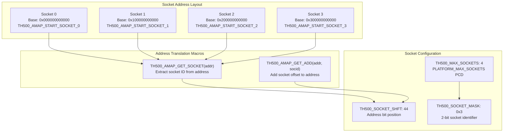
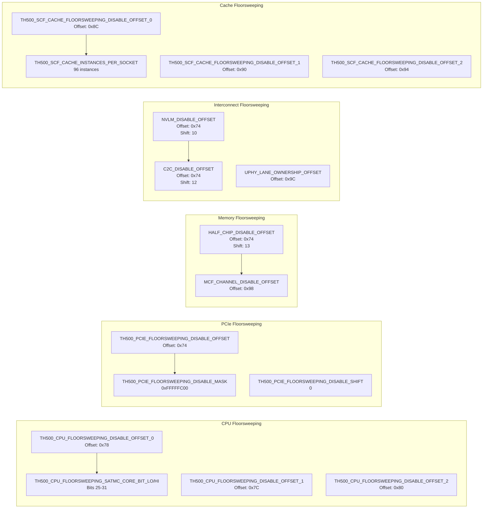
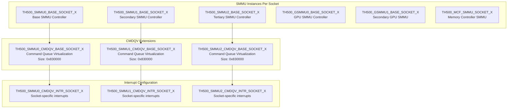
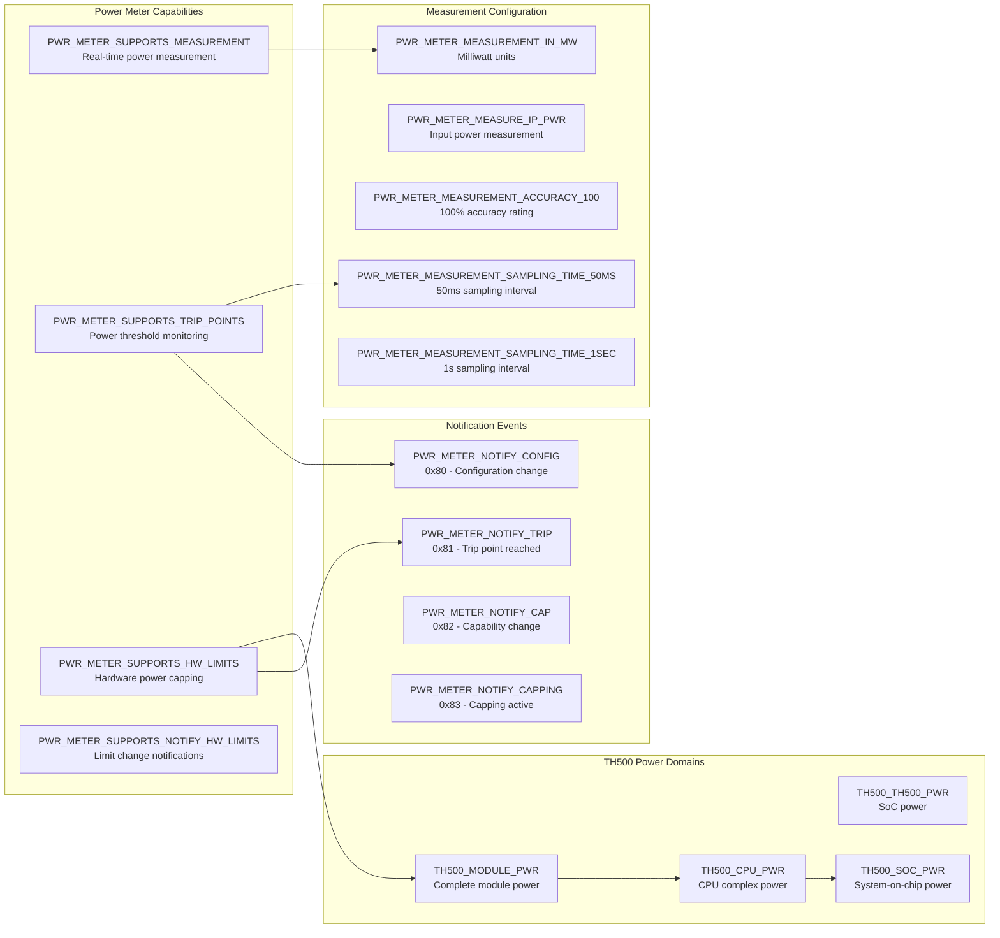

<!-- source: DeepWiki mcp.deepwiki.com · repo NVIDIA/edk2-nvidia · page 8.1 TH500 Server Platform · fetched 2026-10-26 -->

# Server Platforms (TH500)

Relevant source files

The following files were used as context for generating this wiki page:

- [Silicon/NVIDIA/Include/AcpiPowerMeter.h](Silicon/NVIDIA/Include/AcpiPowerMeter.h)
- [Silicon/NVIDIA/Include/Library/PlatformResourceLib.h](Silicon/NVIDIA/Include/Library/PlatformResourceLib.h)
- [Silicon/NVIDIA/Include/Protocol/BpmpIpc.h](Silicon/NVIDIA/Include/Protocol/BpmpIpc.h)
- [Silicon/NVIDIA/Include/Server/TH500/TH500Definitions.h](Silicon/NVIDIA/Include/Server/TH500/TH500Definitions.h)
- [Silicon/NVIDIA/Library/DeviceDiscoveryLib/DeviceDiscoveryLibPrivate.h](Silicon/NVIDIA/Library/DeviceDiscoveryLib/DeviceDiscoveryLibPrivate.h)
- [Silicon/NVIDIA/Library/PlatformResourceLib/PlatformResourceLib.c](Silicon/NVIDIA/Library/PlatformResourceLib/PlatformResourceLib.c)
- [Silicon/NVIDIA/Library/PlatformResourceLib/T234ResourceConfig.c](Silicon/NVIDIA/Library/PlatformResourceLib/T234ResourceConfig.c)
- [Silicon/NVIDIA/Library/PlatformResourceLib/TH500ResourceConfig.c](Silicon/NVIDIA/Library/PlatformResourceLib/TH500ResourceConfig.c)
- [Silicon/NVIDIA/Library/PlatformResourceLib/TH500ResourceConfigPrivate.h](Silicon/NVIDIA/Library/PlatformResourceLib/TH500ResourceConfigPrivate.h)

This document covers NVIDIA's TH500 server platform support within the edk2-nvidia firmware implementation. The TH500 represents NVIDIA's multi-socket server architecture, supporting up to 4 sockets with advanced power management, thermal control, and enterprise-grade hardware features.

The TH500 platform provides server-specific configurations including multi-socket memory mapping, ACPI power meter interfaces, hardware floorsweeping for fault tolerance, and enterprise thermal management. For information about other platform variants like Jetson platforms, see [Virtualization Platform](#8.2). For general platform resource management, see [Hardware Resource Management](#3.2).

## Multi-Socket Architecture

The TH500 server platform supports up to 4 sockets in a single system, with each socket having its own address space and hardware resources. The platform uses a 44-bit address mapping scheme to distinguish between sockets.

### Socket Address Mapping

Sources: [Silicon/NVIDIA/Include/Server/TH500/TH500Definitions.h:14-19](), [Silicon/NVIDIA/Include/Server/TH500/TH500Definitions.h:215-224](), [Silicon/NVIDIA/Include/Server/TH500/TH500Definitions.h:225]()

### Socket-Specific Hardware Resources

Each socket contains replicated hardware components with socket-specific base addresses. The platform defines separate base addresses for critical components across all 4 sockets.

| Component | Socket 0 | Socket 1 | Socket 2 | Socket 3 | Size |
|-----------|----------|----------|----------|----------|------|
| Scratch Registers | `TH500_SCRATCH_BASE_SOCKET_0` | `TH500_SCRATCH_BASE_SOCKET_1` | `TH500_SCRATCH_BASE_SOCKET_2` | `TH500_SCRATCH_BASE_SOCKET_3` | 64KB |
| GIC Redistributor | `TH500_GIC_REDISTRIBUTOR_BASE_SOCKET_0` | `TH500_GIC_REDISTRIBUTOR_BASE_SOCKET_1` | `TH500_GIC_REDISTRIBUTOR_BASE_SOCKET_2` | `TH500_GIC_REDISTRIBUTOR_BASE_SOCKET_3` | - |
| GIC ITS | `TH500_GIC_ITS_BASE_SOCKET_0` | `TH500_GIC_ITS_BASE_SOCKET_1` | `TH500_GIC_ITS_BASE_SOCKET_2` | `TH500_GIC_ITS_BASE_SOCKET_3` | - |
| BPMP TX Mailbox | `BPMP_TX_MAILBOX_SOCKET_0` | `BPMP_TX_MAILBOX_SOCKET_1` | `BPMP_TX_MAILBOX_SOCKET_2` | `BPMP_TX_MAILBOX_SOCKET_3` | 256B |
| BPMP RX Mailbox | `BPMP_RX_MAILBOX_SOCKET_0` | `BPMP_RX_MAILBOX_SOCKET_1` | `BPMP_RX_MAILBOX_SOCKET_2` | `BPMP_RX_MAILBOX_SOCKET_3` | 256B |

Sources: [Silicon/NVIDIA/Include/Server/TH500/TH500Definitions.h:93-97](), [Silicon/NVIDIA/Include/Server/TH500/TH500Definitions.h:76-86](), [Silicon/NVIDIA/Include/Server/TH500/TH500Definitions.h:234-248]()

## Hardware Floorsweeping and Resource Management

The TH500 platform implements extensive hardware floorsweeping capabilities to handle defective or disabled hardware components dynamically. This is critical for server reliability and yield optimization.

### Floorsweeping Components

Sources: [Silicon/NVIDIA/Include/Server/TH500/TH500Definitions.h:99-112](), [Silicon/NVIDIA/Include/Server/TH500/TH500Definitions.h:114-124](), [Silicon/NVIDIA/Include/Server/TH500/TH500Definitions.h:126-179](), [Silicon/NVIDIA/Include/Server/TH500/TH500Definitions.h:157-171]()

### SMMU Configuration for Multi-Socket

The TH500 platform includes multiple SMMU (System Memory Management Unit) instances per socket, providing IOMMU services for server workloads with hardware virtualization support.

Sources: [Silicon/NVIDIA/Include/Server/TH500/TH500Definitions.h:301-335](), [Silicon/NVIDIA/Include/Server/TH500/TH500Definitions.h:337-371](), [Silicon/NVIDIA/Include/Server/TH500/TH500Definitions.h:373-389](), [Silicon/NVIDIA/Include/Server/TH500/TH500Definitions.h:391-397]()

## Power Management and Thermal Control

The TH500 server platform implements comprehensive power management and thermal control systems suitable for enterprise server environments, including ACPI power meter interfaces and multi-zone thermal management.

### ACPI Power Meter Interface

Sources: [Silicon/NVIDIA/Include/AcpiPowerMeter.h:16-22](), [Silicon/NVIDIA/Include/AcpiPowerMeter.h:23-37](), [Silicon/NVIDIA/Include/Server/TH500/TH500Definitions.h:279-284](), [Silicon/NVIDIA/Include/AcpiPowerMeter.h:53-58]()

### Thermal Zone Management

The TH500 platform defines multiple thermal zones for comprehensive temperature monitoring across CPU and SoC domains, with configurable trip points and thermal control parameters.

| Thermal Zone | Constant | Description |
|--------------|----------|-------------|
| CPU Thermal Zones | `TH500_THERMAL_ZONE_CPU0-3` | Per-socket CPU thermal monitoring |
| SoC Thermal Zones | `TH500_THERMAL_ZONE_SOC0-4` | System-on-chip thermal zones |
| Junction Temperature | `TH500_THERMAL_ZONE_TJ_MAX/MIN/AVG` | Junction temperature limits |

**Thermal Control Parameters:**
- **Passive Trip Point**: `TH500_THERMAL_ZONE_PSV` (100.0°C)
- **Critical Trip Point**: `TH500_THERMAL_ZONE_CRT` (104.5°C) 
- **Thermal Coefficients**: `TH500_THERMAL_ZONE_TC1` (2), `TH500_THERMAL_ZONE_TC2` (8)
- **Sampling Period**: `TH500_THERMAL_ZONE_TSP` (100ms)

Sources: [Silicon/NVIDIA/Include/Server/TH500/TH500Definitions.h:250-278]()

## Server-Specific Hardware Components

### CBB Fabric and Memory Subsystem

The TH500 platform includes a coherent bus bridge (CBB) fabric for inter-socket communication and a memory subsystem controller (MSS) for memory management across sockets.

```mermaid
graph TB
    subgraph "CBB Fabric Configuration"
        CBBBase["TH500_CBB_FABRIC_BASE_SOCKET_X<br/>Per-socket fabric base"]
        CBB32BitLow["TH500_CBB_FABRIC_32BIT_LOW<br/>Offset: 0x0"]
        CBB32BitHigh["TH500_CBB_FABRIC_32BIT_HIGH<br/>Offset: 0x4"]
        CBB64BitLow["TH500_CBB_FABRIC_64BIT_LOW<br/>Offset: 0x10"]
        CBB64BitHigh["TH500_CBB_FABRIC_64BIT_HIGH<br/>Offset: 0x14"]
    end
    
    subgraph "Memory Subsystem (MSS)"
        MSSBase["TH500_MSS_BASE_SOCKET_X<br/>Per-socket MSS controller"]
        MSSC2CMode["TH500_MSS_C2C_MODE<br/>Offset: 0xC910"]
        C2COneGPU["TH500_MSS_C2C_MODE_ONE_GPU<br/>Single GPU mode"]
        C2CTwoGPU["TH500_MSS_C2C_MODE_TWO_GPU<br/>Dual GPU mode"]
        C2CRemote["TH500_MSS_C2C_MODE_REMOTE<br/>Remote GPU mode"]
    end
    
    subgraph "DIMM Configuration"
        MaxDIMMs["MAX_DIMMS_PER_SOCKET<br/>4 DIMMs per socket"]
        ProximityDomains["TH500_TOTAL_PROXIMITY_DOMAINS<br/>NUMA domain calculation"]
        GPUProximity["TH500_GPU_PXM_DOMAIN_START<br/>GPU proximity domains"]
        HBMProximity["TH500_GPU_HBM_PXM_DOMAIN_START<br/>HBM proximity domains"]
    end
    
    CBBBase --> CBB32BitLow
    CBB32BitLow --> CBB64BitLow
    
    MSSBase --> MSSC2CMode
    MSSC2CMode --> C2COneGPU
    C2COneGPU --> C2CTwoGPU
    C2CTwoGPU --> C2CRemote
    
    MaxDIMMs --> ProximityDomains
    ProximityDomains --> GPUProximity
    GPUProximity --> HBMProximity
```

Sources: [Silicon/NVIDIA/Include/Server/TH500/TH500Definitions.h:188-199](), [Silicon/NVIDIA/Include/Server/TH500/TH500Definitions.h:204-213](), [Silicon/NVIDIA/Include/Server/TH500/TH500Definitions.h:19](), [Silicon/NVIDIA/Include/Server/TH500/TH500Definitions.h:225-232]()

### Software IO Regions for ACPI Integration

The TH500 platform defines multiple software IO regions that provide interfaces for ACPI methods and hardware abstraction, essential for server platform management.

| SW IO Region | Base Address | Size | Purpose | Interrupt |
|--------------|--------------|------|---------|-----------|
| SW IO0 | `TH500_SW_IO0_BASE` | - | EINJ (Error Injection) | - |
| SW IO1 | `TH500_SW_IO1_BASE_SOCKET_X` | 4KB | GPU _RST method | - |
| SW IO2 | `TH500_SW_IO2_BASE` | 4KB | Generic Event Device (GED) | 0xE2 |
| SW IO3 | `TH500_SW_IO3_BASE_SOCKET_X` | 4KB | PCIe DPC (Downstream Port Containment) | Socket-specific |
| SW IO4 | `TH500_SW_IO4_BASE_SOCKET_X` | 4KB | PCIe _OST method | Socket-specific |
| SW IO6 | `TH500_SW_IO6_BASE` | - | ERST (Error Record Serialization) | - |
| SW IO7 | `TH500_SW_IO7_BASE` | 4KB | DRAM address translation _DSM | - |

Sources: [Silicon/NVIDIA/Include/Server/TH500/TH500Definitions.h:28-70]()

## ACPI Integration and Server Features

The TH500 platform provides extensive ACPI integration with server-specific timeouts and loop controls for reliable operation in enterprise environments.

**ACPI Operation Timeouts:**
- `TH500_ACPI_MAX_LOOP_TIMEOUT`: 30 seconds for general ACPI operations
- `TH500_ACPI_GPU_RST_MAX_LOOP_TIMEOUT`: 10 seconds for GPU reset operations

**Power Management Integration:**
- BPMP IPC call interval: `TH500_BPMP_IPC_CALL_INTERVAL_50MS` (500ms)
- Telemetry layout validation at specific indices: `TH500_TEL_LAYOUT_VALID_FLAGS0_IDX` (90-92)
- DRAM rate telemetry: `TH500_TEL_LAYOUT_DRAM_RATE_IDX` (58)

Sources: [Silicon/NVIDIA/Include/Server/TH500/TH500Definitions.h:399-403](), [Silicon/NVIDIA/Include/Server/TH500/TH500Definitions.h:293-297]()

---

