<!-- source: DeepWiki mcp.deepwiki.com · repo NVIDIA/edk2-nvidia · page 8.2 TegraVirt Virtualization Platform · fetched 2026-10-26 -->

# TegraVirt Virtualization Platform

<details>
<summary>Relevant source files</summary>

The following files were used as context for generating this wiki page:

- [Platform/NVIDIA/TegraVirt/TegraVirt.dsc](Platform/NVIDIA/TegraVirt/TegraVirt.dsc)
- [Platform/NVIDIA/TegraVirt/TegraVirt.fdf](Platform/NVIDIA/TegraVirt/TegraVirt.fdf)
- [Silicon/NVIDIA/Drivers/ConfigurationManagerData/MpamParser/MpamParser.c](Silicon/NVIDIA/Drivers/ConfigurationManagerData/MpamParser/MpamParser.c)
- [Silicon/NVIDIA/PrePi/AArch64/ArchPrePi.c](Silicon/NVIDIA/PrePi/AArch64/ArchPrePi.c)
- [Silicon/NVIDIA/PrePi/AArch64/ModuleEntryPoint.S](Silicon/NVIDIA/PrePi/AArch64/ModuleEntryPoint.S)
- [Silicon/NVIDIA/PrePi/PrePi.c](Silicon/NVIDIA/PrePi/PrePi.c)
- [Silicon/NVIDIA/PrePi/PrePi.h](Silicon/NVIDIA/PrePi/PrePi.h)
- [Silicon/NVIDIA/PrePi/PrePi.inf](Silicon/NVIDIA/PrePi/PrePi.inf)
- [Silicon/NVIDIA/PrePi/PrePiMemory.c](Silicon/NVIDIA/PrePi/PrePiMemory.c)
- [Silicon/NVIDIA/TegraVirt/PrePi/AArch64/ArchPrePi.c](Silicon/NVIDIA/TegraVirt/PrePi/AArch64/ArchPrePi.c)
- [Silicon/NVIDIA/TegraVirt/PrePi/AArch64/ModuleEntryPoint.S](Silicon/NVIDIA/TegraVirt/PrePi/AArch64/ModuleEntryPoint.S)
- [Silicon/NVIDIA/TegraVirt/PrePi/PrePi.c](Silicon/NVIDIA/TegraVirt/PrePi/PrePi.c)
- [Silicon/NVIDIA/TegraVirt/PrePi/PrePi.h](Silicon/NVIDIA/TegraVirt/PrePi/PrePi.h)
- [Silicon/NVIDIA/TegraVirt/PrePi/TegraVirtPrePi.inf](Silicon/NVIDIA/TegraVirt/PrePi/TegraVirtPrePi.inf)

</details>


## Purpose and Scope

The TegraVirt platform provides UEFI firmware support for NVIDIA Tegra SoCs running in virtualized environments such as KVM and QEMU. This platform variant differs fundamentally from physical Tegra platforms (covered in [#8.3](#8.3) for Jetson and [#8.1](#8.1) for TH500 Server) by discovering hardware resources dynamically from the hypervisor-provided Device Tree Blob (DTB) rather than from physical bootloader structures.

This document covers the TegraVirt-specific boot architecture, memory discovery mechanisms, and platform configuration. For general PrePi phase documentation applicable to all platforms, see [#3.1](#3.1). For device tree management common across platforms, see [#4](#4).

## Architecture Overview

TegraVirt is designed as a minimal UEFI implementation optimized for virtual machine environments where:
- The hypervisor (KVM/QEMU) provides system configuration via DTB
- Memory layout is discovered dynamically rather than from static carveouts
- Hardware virtualization layers (VirtIO) replace direct hardware drivers
- Platform resource management is simplified or nullified

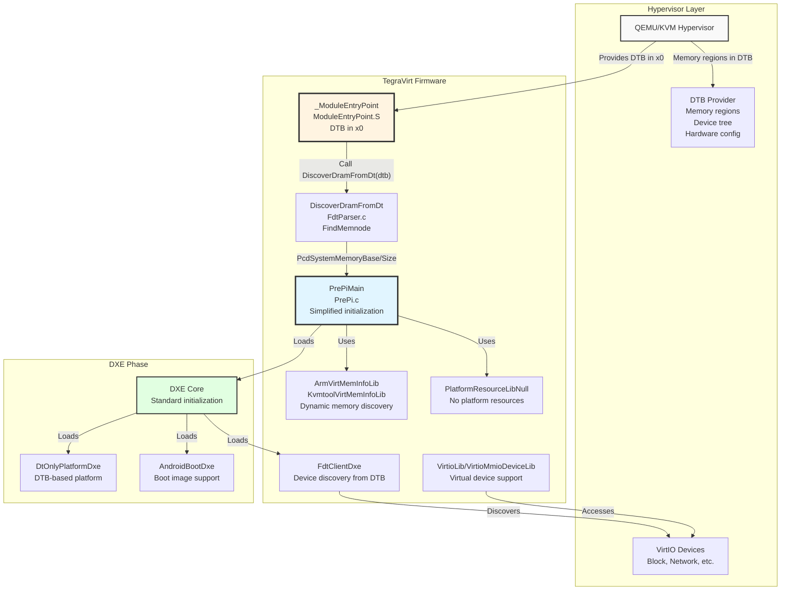

**Sources:**
- [Platform/NVIDIA/TegraVirt/TegraVirt.dsc:1-416]()
- [Silicon/NVIDIA/TegraVirt/PrePi/TegraVirtPrePi.inf:1-97]()
- [Silicon/NVIDIA/TegraVirt/PrePi/AArch64/ModuleEntryPoint.S:1-78]()

### Key Architectural Differences from Physical Platforms

| Aspect | Physical Platforms (TH500/Jetson) | TegraVirt Platform |
|--------|-----------------------------------|-------------------|
| Memory Discovery | Bootloader carveouts, golden registers | DTB `/memory` node parsing |
| Platform Resources | `TH500ResourceConfig`, `T234ResourceConfig` | `PlatformResourceLibNull` |
| Boot Information | CPUBL parameters, MB1 configuration | DTB properties only |
| Variable Storage | NOR flash, eMMC | Emulated in RAM |
| Hardware Drivers | BPMP IPC, PCIe controllers | VirtIO devices |
| Device Discovery | DTB with platform-specific overlays | FdtClient with hypervisor DTB |
| Entry Point | PIE relocation, carveout validation | Direct DTB-based initialization |

**Sources:**
- [Platform/NVIDIA/TegraVirt/TegraVirt.dsc:44-114]()
- [Silicon/NVIDIA/PrePi/PrePi.c:283-288]() (physical platform)
- [Silicon/NVIDIA/TegraVirt/PrePi/PrePi.c:24-241]() (TegraVirt)

## Boot Flow

### Entry Point and Memory Discovery

The TegraVirt boot process begins when the hypervisor loads the UEFI firmware image and jumps to `_ModuleEntryPoint` with the DTB address in register `x0`:

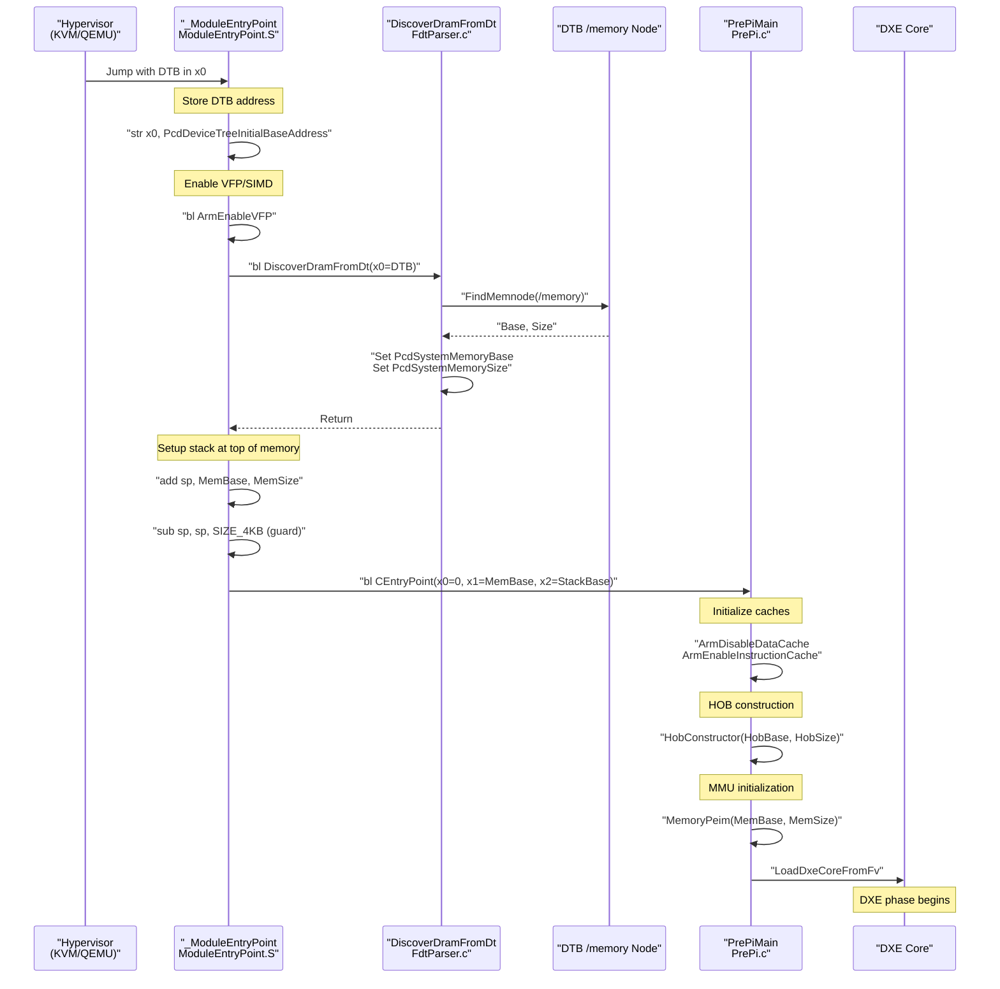

**Sources:**
- [Silicon/NVIDIA/TegraVirt/PrePi/AArch64/ModuleEntryPoint.S:12-78]()
- [Silicon/NVIDIA/TegraVirt/PrePi/PrePi.c:243-270]()

### PrePi Initialization Sequence

The `PrePiMain` function in TegraVirt is significantly simpler than physical platforms because it doesn't need to handle bootloader carveouts, golden register validation, or complex platform resource discovery:

```mermaid
graph TB
    START["CEntryPoint<br/>x0=MpId(0), x1=UefiMemoryBase<br/>x2=StacksBase"]
    
    ARCH["ArchInitialize<br/>ArchPrePi.c<br/>Trap exceptions to EL2"]
    
    SERIAL["SerialPortInitialize<br/>Print firmware version"]
    
    CALC["Calculate Memory Layout<br/>UefiMemorySize from PcdSystemMemorySize<br/>StacksSize from PcdCPUCorePrimaryStackSize"]
    
    FV_FIND["Find FV Header<br/>Scan 64KB boundaries<br/>Look for EFI_FVH_SIGNATURE"]
    
    DTB_SIZE["Calculate DTB Size<br/>PcdDeviceTreeInitialBaseAddress<br/>fdt_totalsize"]
    
    HOB_CALC["Calculate HOB Region<br/>HobBase = DtbBase + DtbSize<br/>HobSize = StacksBase - HobBase"]
    
    HOB_INIT["HobConstructor<br/>Initialize HOB list<br/>BuildStackHob<br/>BuildMemoryAllocationHob for DTB"]
    
    DTB_HOB["BuildGuidDataHob<br/>gFdtHobGuid with DTB address"]
    
    CPU_HOB["BuildCpuHob<br/>Physical address bits<br/>I/O size"]
    
    MMU["MemoryPeim<br/>Initialize MMU<br/>Create memory HOBs"]
    
    PLAT["PlatformPeim<br/>Platform-specific initialization"]
    
    DECOMPRESS["DecompressFirstFv<br/>Decompress FVMAIN"]
    
    LOAD_DXE["LoadDxeCoreFromFv<br/>Transfer control to DXE"]
    
    START --> ARCH
    ARCH --> SERIAL
    SERIAL --> CALC
    CALC --> FV_FIND
    FV_FIND --> DTB_SIZE
    DTB_SIZE --> HOB_CALC
    HOB_CALC --> HOB_INIT
    HOB_INIT --> DTB_HOB
    DTB_HOB --> CPU_HOB
    CPU_HOB --> MMU
    MMU --> PLAT
    PLAT --> DECOMPRESS
    DECOMPRESS --> LOAD_DXE
    
    style START fill:#fff4e1,stroke:#333,stroke-width:3px
    style HOB_INIT fill:#e1f5ff,stroke:#333,stroke-width:2px
    style MMU fill:#e1ffe1,stroke:#333,stroke-width:2px
    style LOAD_DXE fill:#ffe1ff,stroke:#333,stroke-width:2px
```

**Sources:**
- [Silicon/NVIDIA/TegraVirt/PrePi/PrePi.c:23-241]()
- [Silicon/NVIDIA/TegraVirt/PrePi/AArch64/ArchPrePi.c:14-23]()

## Memory Discovery and Management

### DTB-Based Memory Discovery

The core difference between TegraVirt and physical platforms is the dynamic memory discovery from the DTB's `/memory` node. The hypervisor constructs this node with the actual memory regions allocated to the VM:

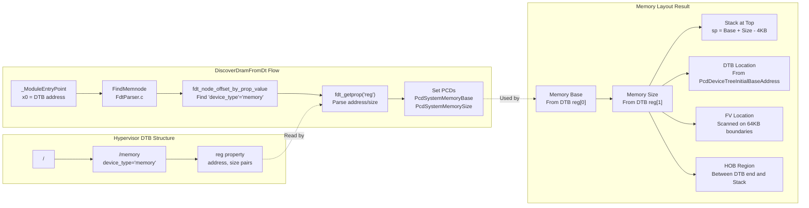

**Sources:**
- [Silicon/NVIDIA/TegraVirt/PrePi/AArch64/ModuleEntryPoint.S:61-77]()
- [Silicon/NVIDIA/TegraVirt/PrePi/PrePi.c:63-80]()

### Memory Layout in TegraVirt

Unlike physical platforms where memory layout is constrained by bootloader carveouts and pre-allocated regions, TegraVirt uses a simpler layout:

```mermaid
graph TB
    subgraph "Memory Region (from DTB)"
        LOW["Low Address<br/>(MemoryBase)"]
        
        FV_REGION["Firmware Volume<br/>Found on 64KB boundary<br/>EFI_FVH_SIGNATURE"]
        
        DTB_REGION["Device Tree Blob<br/>PcdDeviceTreeInitialBaseAddress<br/>fdt_totalsize() aligned to page"]
        
        HOB_REGION["HOB List<br/>DtbBase + DtbSize to StacksBase<br/>HobConstructor"]
        
        STACK_REGION["Stack<br/>PcdCPUCorePrimaryStackSize<br/>At top of memory"]
        
        GUARD["Stack Guard Page<br/>4KB<br/>Not mapped"]
        
        HIGH["High Address<br/>(MemoryBase + MemorySize)"]
    end
    
    LOW --> FV_REGION
    FV_REGION --> DTB_REGION
    DTB_REGION --> HOB_REGION
    HOB_REGION --> STACK_REGION
    STACK_REGION --> GUARD
    GUARD --> HIGH
    
    style FV_REGION fill:#fff4e1,stroke:#333,stroke-width:2px
    style DTB_REGION fill:#e1f5ff,stroke:#333,stroke-width:2px
    style HOB_REGION fill:#e1ffe1,stroke:#333,stroke-width:2px
    style STACK_REGION fill:#ffe1ff,stroke:#333,stroke-width:2px
```

**Memory Allocation Code:**
```
HobBase = DtbBase + DtbSize
HobSize = StacksBase - HobBase
```

**Sources:**
- [Silicon/NVIDIA/TegraVirt/PrePi/PrePi.c:139-177]()
- [Silicon/NVIDIA/TegraVirt/PrePi/AArch64/ModuleEntryPoint.S:34-42]()

## Platform Configuration

### Build Configuration (DSC)

The TegraVirt DSC file defines the platform's build-time configuration with virtualization-specific choices:

| Configuration | Value | Purpose |
|---------------|-------|---------|
| `PLATFORM_NAME` | `TegraVirt` | Platform identifier |
| `PcdPlatformFamilyName` | `L"TegraVirt"` | Display name |
| `PcdBootAndroidImage` | `TRUE` | Enable Android boot support |
| `PcdEmuVariableNvModeEnable` | `TRUE` | Emulated NVRAM (no persistent storage) |
| `PcdPciDisableBusEnumeration` | `TRUE` | Hypervisor pre-configures PCI |
| `PcdSerialUseMmio` | `TRUE` | MMIO-based UART access |

**Key Library Selections:**

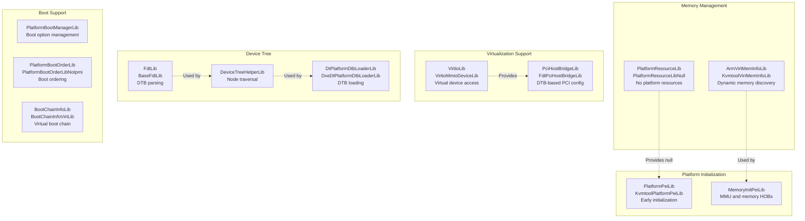

**Sources:**
- [Platform/NVIDIA/TegraVirt/TegraVirt.dsc:44-112]()
- [Platform/NVIDIA/TegraVirt/TegraVirt.dsc:138-195]()

### Firmware Layout (FDF)

The TegraVirt FDF defines a minimal firmware layout optimized for virtual environments:

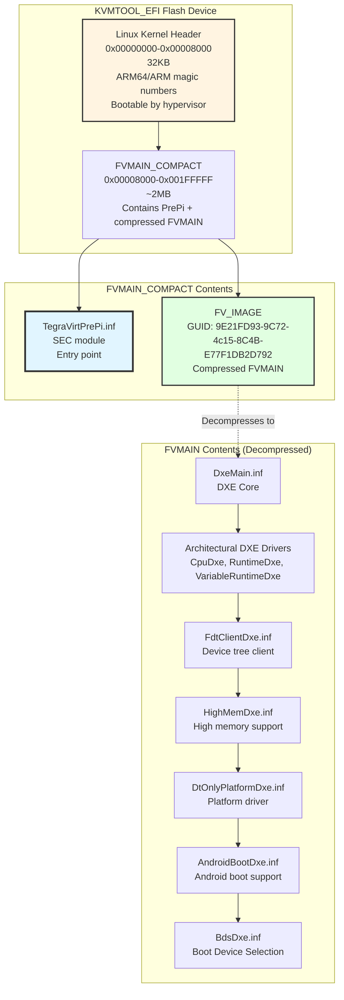

**Linux Kernel Header Format:**
The header allows hypervisors to recognize the firmware as bootable and execute it with the DTB pointer in the appropriate register (x0 for ARM64, r2 for ARM).

**Sources:**
- [Platform/NVIDIA/TegraVirt/TegraVirt.fdf:23-88]()
- [Platform/NVIDIA/TegraVirt/TegraVirt.fdf:100-211]()

## Device Support

### VirtIO Device Architecture

TegraVirt relies on VirtIO for virtualized hardware access rather than physical device drivers:

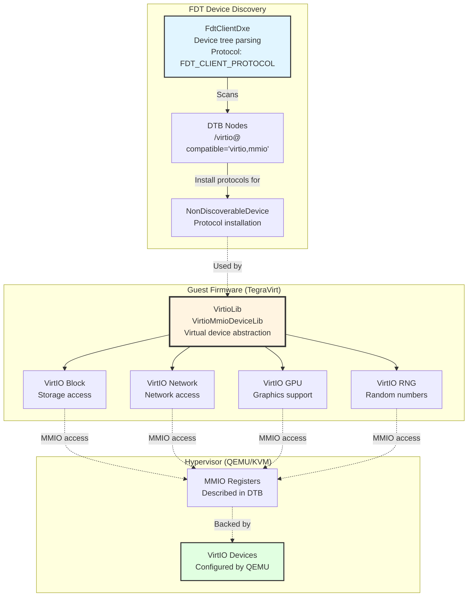

**Sources:**
- [Platform/NVIDIA/TegraVirt/TegraVirt.dsc:48-50]()
- [Platform/NVIDIA/TegraVirt/TegraVirt.dsc:71-74]()
- [Platform/NVIDIA/TegraVirt/TegraVirt.fdf:123-124]()

### PCI Host Bridge Configuration

The PCI subsystem in TegraVirt relies on hypervisor pre-configuration:

| PCD | Value | Purpose |
|-----|-------|---------|
| `PcdPciDisableBusEnumeration` | `TRUE` | Hypervisor already configured PCI |
| `PcdPciExpressBaseAddress` | `0xFFFFFFFFFFFFFFFF` | Marker for unassigned/DTB-based |

The `FdtPciHostBridgeLib` reads the DTB's `/pci` node to discover:
- PCI bus ranges
- MMIO windows
- I/O windows
- Interrupt mappings

**Sources:**
- [Platform/NVIDIA/TegraVirt/TegraVirt.dsc:254-260]()

## Variable Management

### Emulated Variable Store

TegraVirt uses emulated variables stored in RAM because virtualized environments typically don't have persistent storage accessible during early boot:

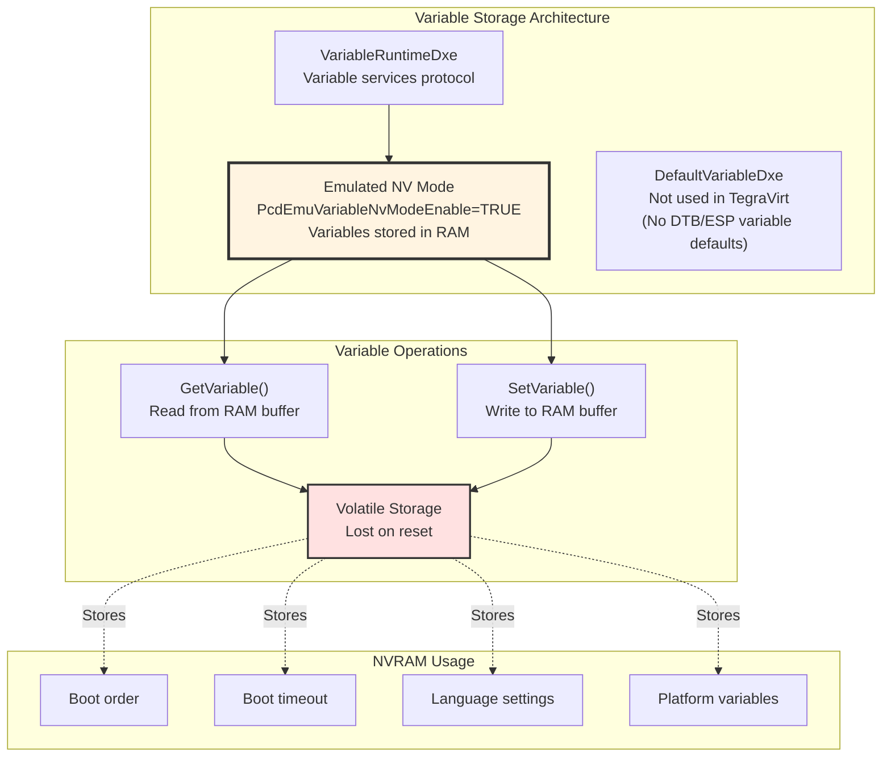

**Implications:**
- Variables are lost on each VM restart
- Default values are applied on every boot
- No persistent UEFI settings across reboots
- Suitable for ephemeral VM instances

**Sources:**
- [Platform/NVIDIA/TegraVirt/TegraVirt.dsc:154-155]()
- [Platform/NVIDIA/TegraVirt/TegraVirt.fdf:133]()

## Android Boot Support

TegraVirt includes Android boot support despite being a virtualized platform, enabling boot of Android images in VMs:

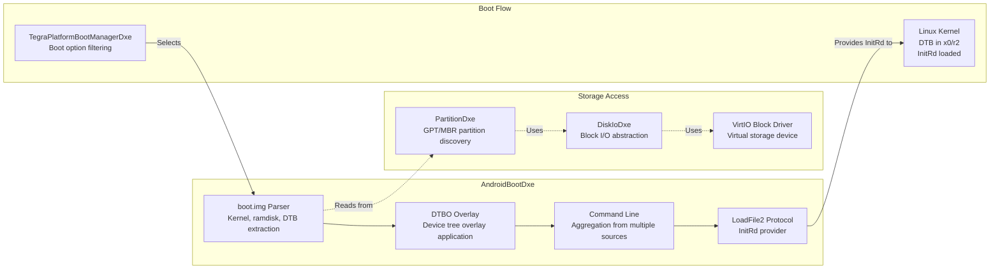

**Android Boot Features in TegraVirt:**
- Boot image parsing (v0-v4 headers)
- DTBO overlay support
- A/B slot support
- Recovery mode handling
- Kernel command-line construction

**Sources:**
- [Platform/NVIDIA/TegraVirt/TegraVirt.dsc:93-109]()
- [Platform/NVIDIA/TegraVirt/TegraVirt.dsc:366-369]()
- [Platform/NVIDIA/TegraVirt/TegraVirt.fdf:170]()

## Comparison with Physical Platforms

### PrePi Differences

| Feature | Physical Platform | TegraVirt |
|---------|------------------|-----------|
| Entry Point | `_ModuleEntryPoint` with PIE relocation | `_ModuleEntryPoint` without relocation |
| Memory Discovery | Bootloader carveout parsing | DTB `/memory` node parsing |
| DTB Source | Bootloader-provided, static location | Hypervisor-provided in x0 |
| Golden Registers | Validated | Not used |
| Platform Resources | `GetPlatformResourceInformation()` | Not used |
| BL Carveouts | Parsed and managed | Not applicable |
| Memory Update | `UpdateMemoryMap()` | `MemoryPeim()` |
| HOB Location | Complex calculation avoiding carveouts | Simple: between DTB and stack |

### Library Implementation Differences

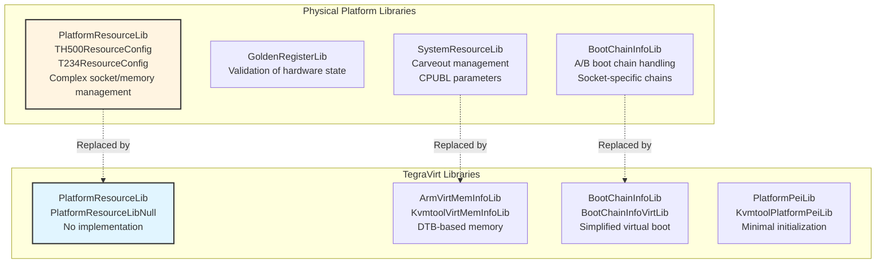

**Sources:**
- [Silicon/NVIDIA/PrePi/PrePi.c:1-575]() (physical)
- [Silicon/NVIDIA/TegraVirt/PrePi/PrePi.c:1-270]() (virtual)
- [Platform/NVIDIA/TegraVirt/TegraVirt.dsc:96]() (null resource lib)
- [Platform/NVIDIA/TegraVirt/TegraVirt.dsc:104]() (virtual boot chain)

## Integration with Build System

TegraVirt integrates with the Stuart build system (see [#2.1](#2.1)) through platform-specific configuration:

**Build Invocation:**
```
stuart_build -c Platform/NVIDIA/TegraVirt/TegraVirt.dsc
```

**Key Build Outputs:**
- `Build/TegraVirt/RELEASE_*/FV/KVMTOOL_EFI.fd` - Bootable firmware image
- Linux kernel header format for direct execution by hypervisor
- Compressed DXE firmware volume for space efficiency

**Firmware Deployment:**
```bash
# QEMU example
qemu-system-aarch64 \
  -M virt \
  -cpu cortex-a57 \
  -kernel Build/TegraVirt/RELEASE_GCC5/FV/KVMTOOL_EFI.fd \
  -append "..." \
  -dtb virt.dtb
```

**Sources:**
- [Platform/NVIDIA/TegraVirt/TegraVirt.dsc:16-25]()
- [Platform/NVIDIA/TegraVirt/TegraVirt.fdf:23-87]()

---

