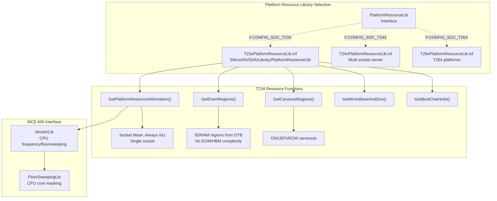
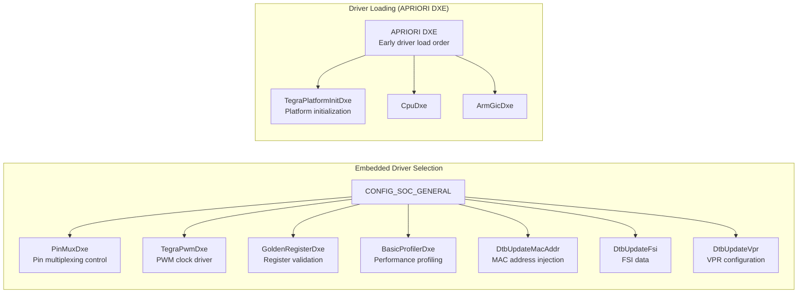
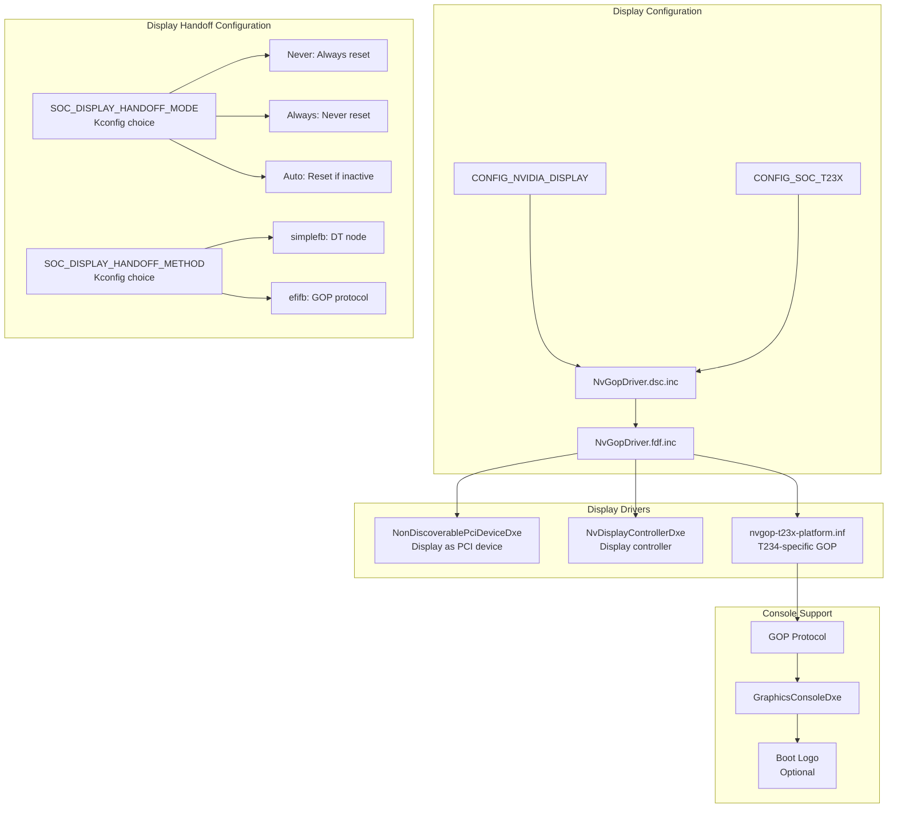
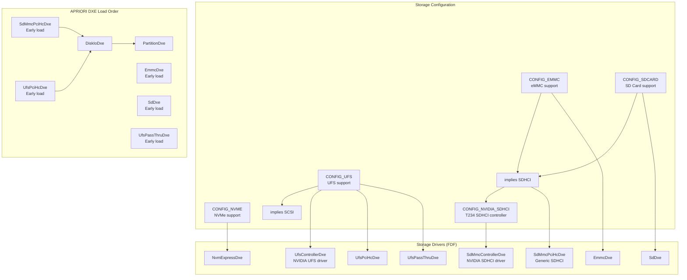
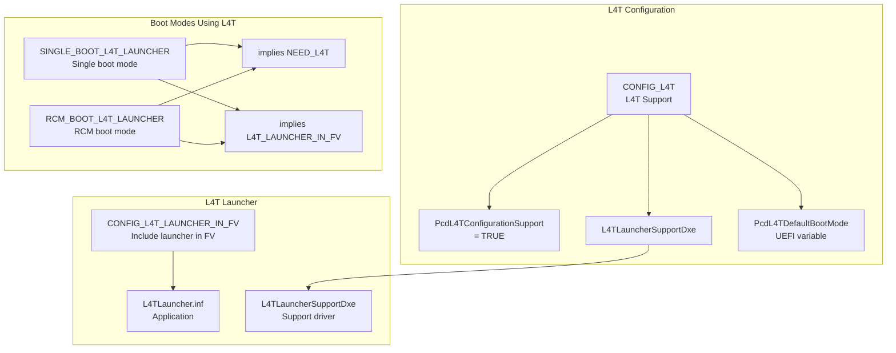
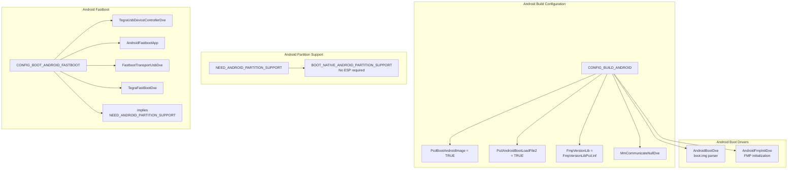
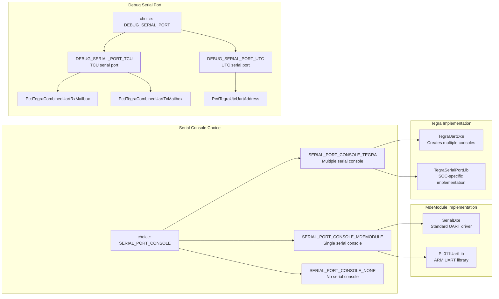
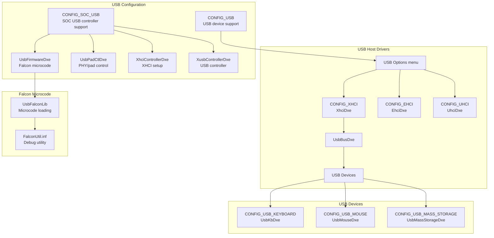
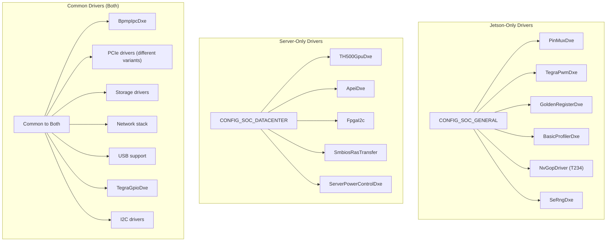

<!-- source: DeepWiki mcp.deepwiki.com · repo NVIDIA/edk2-nvidia · page 8.3 Jetson Embedded Platforms · fetched 2026-10-26 -->

# Jetson Embedded Platforms

<details>
<summary>Relevant source files</summary>

The following files were used as context for generating this wiki page:

- [Platform/NVIDIA/Kconfig](Platform/NVIDIA/Kconfig)
- [Platform/NVIDIA/NVIDIA.common.dsc.inc](Platform/NVIDIA/NVIDIA.common.dsc.inc)
- [Platform/NVIDIA/NVIDIA.fvmain.fdf.inc](Platform/NVIDIA/NVIDIA.fvmain.fdf.inc)

</details>


## Overview

This page documents the Jetson embedded platform variant support in the NVIDIA UEFI firmware, focusing on the T234 (Tegra234) system-on-chip. Jetson platforms are single-socket embedded systems designed for edge AI, robotics, and embedded computing applications, in contrast to the multi-socket datacenter TH500 server platforms (see [8.1](#8.1)) and virtualized TegraVirt environments (see [8.2](#8.2)).

Jetson platforms are identified by the `CONFIG_SOC_T23X` and `CONFIG_SOC_GENERAL` build configuration options and use specialized embedded drivers for pinmux, GPIO, display, and power management that are not present in server configurations.

**Sources:** [Platform/NVIDIA/Kconfig:63-79](), [Platform/NVIDIA/NVIDIA.common.dsc.inc:258-260]()

## SOC Configuration and Selection

### Kconfig SOC Selection

The Jetson platform is selected through the Kconfig build system using the `SOC_T23X` option. This configuration enables T234-specific hardware support and excludes datacenter-specific features.

```mermaid
graph TB
    subgraph "Kconfig SOC Choice"
        SOC_CHOICE["choice: SOC Support"]
        SOC_NONE["config SOC_NONE"]
        SOC_T23X["config SOC_T23X<br/>Jetson T234"]
        SOC_T24X["config SOC_T24X<br/>Server TH500"]
        SOC_T26X["config SOC_T26X<br/>T264"]
        
        SOC_CHOICE --> SOC_NONE
        SOC_CHOICE --> SOC_T23X
        SOC_CHOICE --> SOC_T24X
        SOC_CHOICE --> SOC_T26X
    end
    
    subgraph "T23X Enabled Features"
        SUPPORTS_GENERAL["CONFIG_SOC_GENERAL"]
        SUPPORTS_EMMC["SUPPORTS_EMMC"]
        SUPPORTS_NVIDIA_SDHCI["SUPPORTS_NVIDIA_SDHCI"]
        SUPPORTS_NVIDIA_DISPLAY["SUPPORTS_NVIDIA_DISPLAY"]
        SUPPORTS_SOC_USB["SUPPORTS_SOC_USB"]
        SUPPORTS_NETWORKING_NVIDIA["SUPPORTS_NETWORKING_DEVICE_NVIDIA"]
        SUPPORTS_TCU["SUPPORTS_TCU_DEBUG_SERIAL_PORT"]
        
        SOC_T23X --> SUPPORTS_GENERAL
        SOC_T23X --> SUPPORTS_EMMC
        SOC_T23X --> SUPPORTS_NVIDIA_SDHCI
        SOC_T23X --> SUPPORTS_NVIDIA_DISPLAY
        SOC_T23X --> SUPPORTS_SOC_USB
        SOC_T23X --> SUPPORTS_NETWORKING_NVIDIA
        SOC_T23X --> SUPPORTS_TCU
    end
    
    subgraph "DSC Platform Selection"
        SKUID_T234["SKUID: T234"]
        SKUID_T234SLT["SKUID: T234SLT"]
        SKUID_T234PRESIL["SKUID: T234Presil"]
        PLATFORM_RESOURCE_LIB["PlatformResourceLib =<br/>T23xPlatformResourceLib.inf"]
        
        SOC_T23X --> SKUID_T234
        SOC_T23X --> SKUID_T234SLT
        SOC_T23X --> SKUID_T234PRESIL
        SOC_T23X --> PLATFORM_RESOURCE_LIB
    end
```



**Sources:** [Platform/NVIDIA/Kconfig:93-102](), [Platform/NVIDIA/NVIDIA.common.dsc.inc:63-79](), [Platform/NVIDIA/NVIDIA.common.dsc.inc:258-260]()

### SKU Identification

The firmware supports multiple T234 SKU variants through the SKUID system, enabling silicon-specific and pre-silicon configurations:

| SKUID | Name | Purpose |
|-------|------|---------|
| 2 | T234 | Production silicon |
| 3 | T234SLT | System-level test variant (inherits from T234) |
| 255 | T234Presil | Pre-silicon/simulation platform (inherits from T234) |

**Sources:** [Platform/NVIDIA/NVIDIA.common.dsc.inc:63-79]()

## Platform Resource Management

### T234ResourceConfig Architecture

Jetson platforms use `T23xPlatformResourceLib` to provide platform-specific resource configuration, in contrast to the multi-socket aware `T24xPlatformResourceLib` used by TH500 servers.



**Sources:** [Platform/NVIDIA/NVIDIA.common.dsc.inc:258-260](), [Platform/NVIDIA/NVIDIA.common.dsc.inc:376-377]()

### Memory Architecture

Unlike TH500's complex multi-socket NUMA architecture with HBM and EGM support, T234 platforms use a simpler single-socket memory configuration:

| Feature | T234 (Jetson) | TH500 (Server) |
|---------|---------------|----------------|
| Socket Count | 1 (fixed) | 1-4 configurable |
| Memory Types | SDRAM only | SDRAM + HBM + EGM |
| NUMA Support | No | Yes (40 proximity domains) |
| Memory Modes | Standard | Normal, EGM, EGM+HV |
| Socket Base Address | 0x0 | 0x0, 0x100000000000, 0x200000000000, 0x300000000000 |
| Address Bits for Socket | N/A | Bits 44-45 |

**Sources:** Analysis based on high-level system architecture diagrams

## Embedded-Specific Hardware Drivers

### Driver Configuration

Jetson platforms include embedded-specific drivers controlled by the `CONFIG_SOC_GENERAL` conditional in the build files:



**Sources:** [Platform/NVIDIA/NVIDIA.fvmain.fdf.inc:424-444](), [Platform/NVIDIA/NVIDIA.common.dsc.inc:436-444]()

### PinMux and GPIO Support

T234 provides comprehensive pin control through dedicated drivers:

| Driver | INF Path | Purpose |
|--------|----------|---------|
| PinMuxDxe | Silicon/NVIDIA/Drivers/PinMuxDxe/PinMuxDxe.inf | Pin multiplexing configuration |
| TegraPinControlDxe | Silicon/NVIDIA/Drivers/TegraPinControlDxe/TegraPinControlDxe.inf | Pin control protocol |
| TegraGpioDxe | Silicon/NVIDIA/Drivers/TegraGpio/TegraGpioDxe.inf | GPIO controller |
| I2cExpanderGpio | Silicon/NVIDIA/Drivers/I2cExpanderGpio/I2cExpanderGpio.inf | I2C GPIO expander |
| GpioPowerOffDxe | Silicon/NVIDIA/Drivers/GpioPowerOffDxe/GpioPowerOffDxe.inf | GPIO-based power control |
| GpioBootCompleteDxe | Silicon/NVIDIA/Drivers/GpioBootCompleteDxe/GpioBootCompleteDxe.inf | Boot completion signaling |

**Sources:** [Platform/NVIDIA/NVIDIA.fvmain.fdf.inc:198-202](), [Platform/NVIDIA/NVIDIA.fvmain.fdf.inc:428](), [Platform/NVIDIA/NVIDIA.fvmain.fdf.inc:747](), [Platform/NVIDIA/NVIDIA.fvmain.fdf.inc:835-840]()

### Golden Register Validation

The `GoldenRegisterDxe` driver provides register state validation specific to embedded platforms, verifying that critical hardware registers match expected values during boot.

**Sources:** [Platform/NVIDIA/NVIDIA.fvmain.fdf.inc:438](), [Platform/NVIDIA/NVIDIA.common.dsc.inc:268]()

## Display and Graphics Support

### NvGop Driver Architecture

T234 Jetson platforms include integrated display support through the NVIDIA GOP (Graphics Output Protocol) driver, which is not present on headless server platforms:



**Sources:** [Platform/NVIDIA/NVIDIA.common.dsc.inc:98-102](), [Platform/NVIDIA/NVIDIA.fvmain.fdf.inc:398-407](), [Platform/NVIDIA/Kconfig:455-553]()

### Display Handoff Modes

Jetson platforms support configurable display handoff to the OS:

| Mode | PCD Variable | Behavior |
|------|--------------|----------|
| Never | `PcdSocDisplayHandoffMode = 0` | Always reset display on UEFI exit |
| Always | `PcdSocDisplayHandoffMode = 1` | Never reset display on UEFI exit |
| Auto | `PcdSocDisplayHandoffMode = 2` | Reset only if display inactive (requires kernel support) |

**Methods:**
- **simplefb**: Updates `simple-framebuffer` node in Device Tree
- **efifb**: Exposes framebuffer through EFI Graphics Output Protocol

**Sources:** [Platform/NVIDIA/Kconfig:469-524](), [Platform/NVIDIA/NVIDIA.common.dsc.inc:1264-1278]()

### Logo Support

Boot logo display is configurable with scaling options:

```c
// Kconfig configuration
CONFIG_LOGO                     // Enable boot logo
CONFIG_LOGO_SCALED_SCREEN_RATIO // 0-1000 (10ths of percent)
CONFIG_LOGO_SCALED_CENTER_Y     // Y position (10ths of percent)
CONFIG_LOGO_IMPLEMENTER         // Logo driver INF path
CONFIG_DISPLAY_BOOT_INFO        // Show firmware info overlay
```

**Sources:** [Platform/NVIDIA/Kconfig:556-615](), [Platform/NVIDIA/NVIDIA.fvmain.fdf.inc:231-237]()

## Storage and Boot Device Support

### Storage Controllers

Jetson platforms support multiple storage interfaces configured through Kconfig:



**Sources:** [Platform/NVIDIA/Kconfig:332-372](), [Platform/NVIDIA/NVIDIA.fvmain.fdf.inc:48-74](), [Platform/NVIDIA/NVIDIA.fvmain.fdf.inc:356-376]()

### PCIe Configuration

Unlike TH500 which has 9 PCIe interfaces with complex GPU configurations, T234 uses the DesignWare PCIe controller:

| Component | T234 (Jetson) | TH500 (Server) |
|-----------|---------------|----------------|
| PCIe Controller | DesignWare | NVIDIA native |
| Driver | PcieControllerDxe (DW variant) | PcieControllerDxe (NVIDIA variant) |
| Configuration | `CONFIG_DESIGNWARE_PCIE` | `CONFIG_NVIDIA_PCIE` |
| P2U Driver | TegraP2UDxe (PHY wrapper) | Not used |
| GPU Support | Standard PCIe endpoints | GPU kick/sense, MPS optimization |

**Sources:** [Platform/NVIDIA/Kconfig:297-312](), [Platform/NVIDIA/NVIDIA.fvmain.fdf.inc:332-344]()

## L4T Integration

### L4T Configuration Support

Linux for Tegra (L4T) is NVIDIA's Linux distribution for Jetson platforms. The firmware provides dedicated L4T configuration support:



**Sources:** [Platform/NVIDIA/Kconfig:1004-1013](), [Platform/NVIDIA/Kconfig:880-903](), [Platform/NVIDIA/Kconfig:985-992](), [Platform/NVIDIA/NVIDIA.common.dsc.inc:1041-1043](), [Platform/NVIDIA/NVIDIA.fvmain.fdf.inc:798-803]()

### L4T Boot Flow

The L4T Launcher application provides a specialized boot path for L4T installations:

1. **Driver Support**: `L4TLauncherSupportDxe` registers L4T-specific protocols
2. **Application Launch**: `L4TLauncher.inf` application executed based on boot mode
3. **Configuration**: L4T settings accessible through UEFI variable `L4TDefaultBootMode`
4. **Boot Options**: L4T partitions automatically detected and registered as boot options

**Sources:** [Platform/NVIDIA/NVIDIA.fvmain.fdf.inc:798-803]()

## Android Boot Support

### Android Configuration

Both Jetson and server platforms support Android boot, but Jetson is the primary Android target:



**Sources:** [Platform/NVIDIA/Kconfig:932-951](), [Platform/NVIDIA/NVIDIA.common.dsc.inc:943-945](), [Platform/NVIDIA/NVIDIA.fvmain.fdf.inc:812-830](), [Platform/NVIDIA/NVIDIA.common.dsc.inc:321-325]()

### Android Boot Image Handling

The `AndroidBootDxe` driver parses Android boot images and provides LoadFile2 protocol for kernel/ramdisk loading. See [7.1](#7.1) for detailed Android boot implementation.

**Sources:** [Platform/NVIDIA/NVIDIA.fvmain.fdf.inc:812]()

## Serial Console Configuration

### Multi-Console Support

Jetson platforms support multiple serial console configurations through Kconfig:



**Sources:** [Platform/NVIDIA/Kconfig:673-741](), [Platform/NVIDIA/NVIDIA.fvmain.fdf.inc:322-327](), [Platform/NVIDIA/NVIDIA.common.dsc.inc:364-374](), [Platform/NVIDIA/NVIDIA.common.dsc.inc:860-873]()

### TCU Serial Port

The Tegra Combined UART (TCU) provides debug serial access through mailbox registers:

| Configuration | Default Value | Purpose |
|---------------|---------------|---------|
| `CONFIG_DEBUG_SERIAL_PORT_TCU_RX_MAILBOX` | 0x03C10000 | RX mailbox address |
| `CONFIG_DEBUG_SERIAL_PORT_TCU_TX_MAILBOX` | 0x0C168000 | TX mailbox address |

**Sources:** [Platform/NVIDIA/Kconfig:729-741](), [Platform/NVIDIA/NVIDIA.common.dsc.inc:864-866]()

## RTC and Power Management

### Real-Time Clock Support

Jetson platforms support I2C-based RTC devices from multiple vendors:

```c
// Kconfig RTC selection
choice REAL_TIME_CLOCK
  config REAL_TIME_CLOCK_MAXIM     // Maxim PMIC-based clock
  config REAL_TIME_CLOCK_NUVOTON   // Nuvoton-based clock
endchoice

// Optional I2C exposure to OS
config RTC_I2C_OS_EXPOSURE         // Disables runtime clock support
```

When `RTC_I2C_OS_EXPOSURE` is enabled, the RTC I2C device is exposed to the OS instead of being used by UEFI runtime services, and `PcdVariableRtProperties` is modified to disable runtime time APIs.

**Sources:** [Platform/NVIDIA/Kconfig:743-769](), [Platform/NVIDIA/NVIDIA.common.dsc.inc:476-481](), [Platform/NVIDIA/NVIDIA.common.dsc.inc:1058-1062]()

### Regulator Support

The `RegulatorDxe` driver provides voltage regulator control for embedded platforms:

**Sources:** [Platform/NVIDIA/NVIDIA.fvmain.fdf.inc:711]()

## Security Configuration

### TPM Support

Jetson platforms support both discrete TPM (dTPM) and firmware TPM (fTPM):

| TPM Mode | Configuration | Driver |
|----------|---------------|--------|
| Discrete TPM | `SECURITY_TPM_DISCRETE` | Tpm2Dxe, discrete hardware |
| Firmware TPM | `SECURITY_TPM_FIRMWARE` | StandaloneMm TPM implementation |
| None | `SECURITY_TPM_NONE` | No TPM support |

**Sources:** [Platform/NVIDIA/Kconfig:138-173](), [Platform/NVIDIA/NVIDIA.fvmain.fdf.inc:925-932]()

### Standalone MM Support

Jetson can be configured with StandaloneMM for variable storage and TPM services:

```c
// Kconfig MM type selection
choice SECURITY_MM_TYPE
  config SECURITY_MM_FFA      // MM with FFA (Firmware Framework for Armv8-A)
  config SECURITY_MM_OPTEE    // MM with OP-TEE
  config SECURITY_MM_NONE     // No MM support
endchoice
```

When MM is not available, Jetson falls back to non-secure variable storage through `VARIABLE_NON_SECURE_SUPPORTED`.

**Sources:** [Platform/NVIDIA/Kconfig:186-219](), [Platform/NVIDIA/NVIDIA.fvmain.fdf.inc:99-104](), [Platform/NVIDIA/NVIDIA.fvmain.fdf.inc:912-920]()

## USB Support

### USB Controller Configuration

T234 has integrated USB support through multiple drivers:



**Sources:** [Platform/NVIDIA/Kconfig:394-452](), [Platform/NVIDIA/NVIDIA.fvmain.fdf.inc:272-298](), [Platform/NVIDIA/NVIDIA.common.dsc.inc:299]()

### USB Renesas Firmware

Optional support for Renesas USB controller firmware upload:

**Sources:** [Platform/NVIDIA/NVIDIA.fvmain.fdf.inc:299-312](), [Platform/NVIDIA/Kconfig:446-450]()

## Networking Support

### EQOS Network Controller

Jetson platforms include an on-SoC Ethernet controller (EQOS - Ethernet Quality of Service):

**Sources:** [Platform/NVIDIA/Kconfig:385-392](), [Platform/NVIDIA/NVIDIA.fvmain.fdf.inc:529-531]()

### Networking Configuration

Full networking stack is available with configurable protocols:

| Protocol | Kconfig Option | Default (if SELECT_ALL_NETWORKING_MODES) |
|----------|----------------|------------------------------------------|
| HTTP/HTTPS | `NETWORKING_HTTP` | Yes |
| PXE Boot | `NETWORKING_PXE` | Yes |
| iSCSI | `NETWORKING_ISCSI` | Yes |
| VLAN | `NETWORKING_VLAN` | Yes |
| IPv4 | `NETWORKING_IPV4` | Yes |
| IPv6 | `NETWORKING_IPV6` | Yes |

**Sources:** [Platform/NVIDIA/Kconfig:1315-1400]()

## Firmware Management

### Update Mechanisms

Jetson supports direct firmware update access (in contrast to TH500's eROT-based update):

```c
// Kconfig firmware management type
choice FIRMWARE_MANAGEMENT_TYPE
  config FIRMWARE_MANAGEMENT_DIRECT  // Direct flash modification (Jetson default)
  config FIRMWARE_MANAGEMENT_EROT    // eROT-based update (Server)
  config FIRMWARE_MANAGEMENT_BLOB    // Blob-based update
endchoice
```

**Direct mode features:**
- `FmpDeviceLib` = `FmpDeviceLib.inf` (direct implementation)
- `FmpVersionLib` = `FmpVersionLibPartition.inf` (version from partition)
- Direct NOR flash and block I/O access through `FwPartitionNorFlashDxe` and `FwPartitionBlockIoDxe`

**Sources:** [Platform/NVIDIA/Kconfig:1169-1208](), [Platform/NVIDIA/NVIDIA.common.dsc.inc:319-325](), [Platform/NVIDIA/NVIDIA.fvmain.fdf.inc:108-117]()

### Per-Boot-Chain GPT Support

T234 platforms support per-boot-chain GPT (GUID Partition Table) for A/B redundancy:

```c
#ifdef CONFIG_SOC_T23X
  #ifndef CONFIG_BUILD_ANDROID
    gNVIDIATokenSpaceGuid.PcdGptIsPerBootChain|TRUE
  #endif
#endif
```

This enables separate GPT tables for boot chain A and boot chain B, excluding Android builds which use a different partition scheme.

**Sources:** [Platform/NVIDIA/NVIDIA.common.dsc.inc:1070-1079]()

## Boot Chain and Redundancy

### Boot Chain Protocol

Jetson platforms use A/B boot redundancy through the `BootChainDxe` driver:

**Sources:** [Platform/NVIDIA/NVIDIA.fvmain.fdf.inc:752](), [Platform/NVIDIA/NVIDIA.common.dsc.inc:271]()

### Boot Chain Status Variables

UEFI variables track boot chain health:

| Variable | GUID | Attributes | Purpose |
|----------|------|------------|---------|
| `RootfsStatusSlotA` | gNVIDIAPublicVariableGuid | BS,NV,RT | Slot A rootfs status |
| `RootfsStatusSlotB` | gNVIDIAPublicVariableGuid | BS,NV,RT | Slot B rootfs status |
| `NewDeviceHierarchy` | gNVIDIAPublicVariableGuid | BS,NV,RT | Device hierarchy changes |

**Sources:** [Platform/NVIDIA/NVIDIA.common.dsc.inc:1253-1256]()

## Shell and Utilities

### Jetson Shell Applications

Embedded platforms include debug utilities:

| Application | INF Path | Purpose |
|-------------|----------|---------|
| RegulatorUtil | Silicon/NVIDIA/Application/RegulatorUtil/RegulatorUtil.inf | Voltage regulator control |
| ClockUtil | Silicon/NVIDIA/Application/ClockUtil/ClockUtil.inf | Clock configuration |
| GpioUtil | Silicon/NVIDIA/Application/GpioUtil/GpioUtil.inf | GPIO manipulation |
| PcieUtil | Silicon/NVIDIA/Application/PcieUtil/PcieUtil.inf | PCIe diagnostics |
| TimerUtil | Silicon/NVIDIA/Application/TimerUtil/TimerUtil.inf | Timer testing |
| MmioUtil | Silicon/NVIDIA/Application/MmioUtil/MmioUtil.inf | MMIO register access |
| FalconUtil | Silicon/NVIDIA/Application/FalconUtil/FalconUtil.inf | USB Falcon microcode utility |

**Sources:** [Platform/NVIDIA/NVIDIA.fvmain.fdf.inc:604-613]()

## Key Differences from Server Platforms

### Architectural Comparison

| Feature | T234 (Jetson) | TH500 (Server) |
|---------|---------------|----------------|
| **Socket Architecture** | Single socket | Multi-socket (1-4) |
| **Socket Base Address** | 0x0 | Per-socket 256TB offsets |
| **Memory Types** | SDRAM only | SDRAM + HBM + EGM |
| **NUMA Support** | No | Yes (40 proximity domains) |
| **PlatformResourceLib** | T23xPlatformResourceLib | T24xPlatformResourceLib |
| **PCIe Controller** | DesignWare | NVIDIA native |
| **PCIe Interfaces** | Limited | 9 controllers |
| **GPU Support** | Standard PCIe | Dedicated GPU kick/sense, C2C |
| **Display Support** | Integrated (NvGop) | External (AST2600) |
| **PinMux/GPIO** | Full support | Not used |
| **PWM Support** | Yes | No |
| **Golden Register** | Yes | No |
| **CPU Frequency** | MceAriLib | Different implementation |
| **RAS/APEI** | No | Full RAS support |
| **MPAM** | No | Memory partitioning support |
| **GIC Configuration** | Standard | Complex multi-socket |
| **SMMU** | Optional SMMUv3 | Required SMMUv3 |
| **BPMP Usage** | Standard MRQ | Extensive MRQ (C2C, GPU, power) |
| **ACPI Tables** | Basic | Complex (SRAT, PPTT, MPAM, HMAT) |
| **L4T Support** | Primary target | Not applicable |
| **Android Support** | Primary target | Secondary |
| **Firmware Update** | Direct | eROT-based |
| **Boot Modes** | L4T, Android, Standard | Standard, RCM |
| **IPMI/BMC** | Optional | Primary management |
| **Redfish** | Optional | Primary configuration |

**Sources:** Analysis based on comprehensive review of configuration files and high-level architecture diagrams

### Driver Inclusion Matrix



**Sources:** [Platform/NVIDIA/NVIDIA.fvmain.fdf.inc:424-444](), [Platform/NVIDIA/NVIDIA.fvmain.fdf.inc:461-479]()

### Configuration Manager Differences

While both platforms can use `ConfigurationManagerData` for ACPI table generation, T234 uses it primarily for basic platform description, while TH500 generates complex NUMA-aware tables:

**T234 ACPI Tables:**
- Basic MADT (GIC configuration)
- Simple PPTT (CPU topology)
- SPCR (serial port)
- SSDT (device descriptions)

**TH500 ACPI Tables:**
- SRAT (NUMA affinity for CPU/GPU/HBM)
- Complex PPTT (96 SCF slices per socket)
- MPAM (memory partitioning)
- HMAT (bandwidth/latency tables)
- Multiple SSDT with PCIe support

**Sources:** High-level architecture diagram analysis