# Page: Overview

# Overview

<details>
<summary>Relevant source files</summary>

The following files were used as context for generating this wiki page:

- [.github/release-drafter.yml](.github/release-drafter.yml)
- [.github/workflows/build.yml](.github/workflows/build.yml)
- [Platform/NVIDIA/Kconfig](Platform/NVIDIA/Kconfig)
- [Platform/NVIDIA/L4TLauncher/PlatformBuild.py](Platform/NVIDIA/L4TLauncher/PlatformBuild.py)
- [Platform/NVIDIA/L4TLauncher/build.sh](Platform/NVIDIA/L4TLauncher/build.sh)
- [Platform/NVIDIA/NVIDIA.common.dsc.inc](Platform/NVIDIA/NVIDIA.common.dsc.inc)
- [Platform/NVIDIA/NVIDIA.defconfig](Platform/NVIDIA/NVIDIA.defconfig)
- [Platform/NVIDIA/NVIDIA.fvmain.fdf.inc](Platform/NVIDIA/NVIDIA.fvmain.fdf.inc)
- [Silicon/NVIDIA/Drivers/NvidiaConfigDxe/NvidiaConfigDxe.c](Silicon/NVIDIA/Drivers/NvidiaConfigDxe/NvidiaConfigDxe.c)
- [Silicon/NVIDIA/Drivers/NvidiaConfigDxe/NvidiaConfigDxe.inf](Silicon/NVIDIA/Drivers/NvidiaConfigDxe/NvidiaConfigDxe.inf)
- [Silicon/NVIDIA/Drivers/NvidiaConfigDxe/NvidiaConfigHii.h](Silicon/NVIDIA/Drivers/NvidiaConfigDxe/NvidiaConfigHii.h)
- [Silicon/NVIDIA/Drivers/NvidiaConfigDxe/NvidiaConfigHii.uni](Silicon/NVIDIA/Drivers/NvidiaConfigDxe/NvidiaConfigHii.uni)
- [Silicon/NVIDIA/Drivers/NvidiaConfigDxe/NvidiaConfigHii.vfr](Silicon/NVIDIA/Drivers/NvidiaConfigDxe/NvidiaConfigHii.vfr)
- [Silicon/NVIDIA/Drivers/NvidiaConfigDxe/NvidiaConfigHiiMap.uni](Silicon/NVIDIA/Drivers/NvidiaConfigDxe/NvidiaConfigHiiMap.uni)
- [Silicon/NVIDIA/Include/NVIDIAConfiguration.h](Silicon/NVIDIA/Include/NVIDIAConfiguration.h)
- [Silicon/NVIDIA/Include/Server/TH500/TH500MB1Configuration.h](Silicon/NVIDIA/Include/Server/TH500/TH500MB1Configuration.h)
- [Silicon/NVIDIA/Library/PlatformBootManagerLib/PlatformBm.c](Silicon/NVIDIA/Library/PlatformBootManagerLib/PlatformBm.c)
- [Silicon/NVIDIA/Library/PlatformBootManagerLib/PlatformBm.h](Silicon/NVIDIA/Library/PlatformBootManagerLib/PlatformBm.h)
- [Silicon/NVIDIA/Library/PlatformBootManagerLib/PlatformBootManagerLib.inf](Silicon/NVIDIA/Library/PlatformBootManagerLib/PlatformBootManagerLib.inf)
- [Silicon/NVIDIA/NVIDIA.dec](Silicon/NVIDIA/NVIDIA.dec)
- [Silicon/NVIDIA/edk2nv/stuart/builder.py](Silicon/NVIDIA/edk2nv/stuart/builder.py)
- [Silicon/NVIDIA/edk2nv/stuart/settings.py](Silicon/NVIDIA/edk2nv/stuart/settings.py)

</details>


The **edk2-nvidia** repository contains NVIDIA's implementation of UEFI (Unified Extensible Firmware Interface) firmware for Tegra system-on-chip (SoC) platforms. This firmware provides the platform initialization layer, hardware abstraction, boot services, and operating system loader functionality for NVIDIA's embedded, workstation, and datacenter server products.

This page provides a high-level introduction to the repository's architecture, supported platforms, and major subsystems. For detailed information about specific subsystems, refer to the specialized pages:
- Build system and configuration: [Build System and Configuration](#2)
- Early boot and initialization: [Firmware Initialization Phases](#3)
- Device tree handling: [Device Tree System](#4)
- Runtime configuration: [Platform Configuration Services](#5)
- Hardware drivers: [Hardware Drivers and Protocols](#6)
- OS boot support: [Operating System Boot Support](#7)
- Platform-specific details: [Platform Variants](#8)

## Repository Purpose and Scope

This repository implements the platform-specific UEFI firmware layer for NVIDIA Tegra SoCs, built on top of the TianoCore EDK2 framework. The firmware:

1. **Initializes hardware** - Configures CPUs, memory controllers, PCIe, GPUs, and peripherals
2. **Provides boot services** - Implements UEFI protocols for device access, memory management, and configuration
3. **Loads operating systems** - Supports standard UEFI boot, Android boot images, and direct kernel loading
4. **Exposes hardware to OS** - Generates ACPI tables or provides device tree to Linux/Android
5. **Manages configuration** - Provides BIOS setup menus and persistent NVRAM storage

The implementation supports both embedded systems (Jetson platforms) and enterprise servers (TH500 multi-socket systems), with a common core and platform-specific extensions.

**Sources:** [NVIDIA.common.dsc.inc:1-50](), [Silicon/NVIDIA/NVIDIA.dec:1-30]()

## Supported Platform Families

### Hardware Platforms

The firmware supports three primary deployment targets:

| Platform Type | SOC Family | Representative Products | Configuration |
|--------------|------------|------------------------|---------------|
| **Jetson Embedded** | T234 (Tegra234), T264 (Tegra264) | Jetson AGX Orin, Jetson Orin NX | Single-socket, PCIe Gen4, embedded storage (eMMC/SD/NVMe) |
| **Server Datacenter** | TH500 (Grace Hopper) | Grace Hopper Superchip, Grace CPU Superchip | Multi-socket (up to 4), PCIe Gen5, extensive NUMA, MPAM, RAS features |
| **Virtualized** | TegraVirt | KVM/QEMU virtual machines | Dynamic resource discovery, virtio devices |

**Sources:** [Platform/NVIDIA/Kconfig:93-112](), [Silicon/NVIDIA/NVIDIA.dec:63-79]()

### SOC Selection

The build system uses Kconfig to select the target SOC family, which determines available features and drivers:

```
CONFIG_SOC_T23X  - Tegra234 (Jetson platforms)
CONFIG_SOC_T24X  - TH500 (Server platforms) 
CONFIG_SOC_T26X  - Tegra264 (Next-gen Jetson)
CONFIG_SOC_GENERAL - General embedded platforms
CONFIG_SOC_DATACENTER - Server-specific features
```

Platform SKU detection at runtime uses the `TegraPlatformInfoLib` to identify the specific chip variant (silicon vs pre-silicon, fused vs unfused) and configure accordingly.

**Sources:** [Platform/NVIDIA/Kconfig:93-102](), [Platform/NVIDIA/NVIDIA.common.dsc.inc:61-79]()

## Firmware Boot Flow

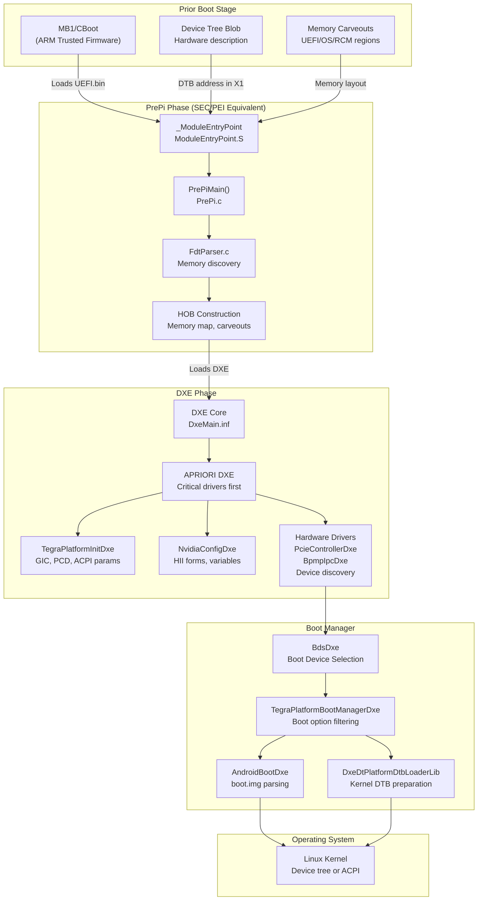

**Firmware Boot Sequence**

The boot process follows the standard UEFI architecture with NVIDIA-specific adaptations:

1. **Pre-UEFI Boot Loader**: ARM Trusted Firmware (MB1/CBoot) initializes basic hardware, sets up memory controllers, loads the UEFI binary into DRAM, and passes a device tree blob describing the hardware configuration.

2. **PrePi Phase** ([Silicon/NVIDIA/PrePi/]()): The `_ModuleEntryPoint` assembly entry point receives the DTB address from the bootloader, performs position-independent code relocation for physical platforms, and invokes `PrePiMain()` which parses the DTB to discover DRAM regions and carveouts, constructs Hand-Off Blocks (HOBs) describing the memory map, and loads the DXE Core.

3. **DXE Phase** ([Platform/NVIDIA/NVIDIA.fvmain.fdf.inc:39-74]()): The `APRIORI DXE` section ensures critical drivers load first, including `TegraPlatformInitDxe` which configures platform-specific PCDs, GIC base addresses, and NUMA parameters. Hardware drivers (`PcieControllerDxe`, `BpmpIpcDxe`, storage, and network) are loaded based on the platform DSC configuration. `NvidiaConfigDxe` initializes HII forms for BIOS setup and manages persistent NVRAM variables.

4. **Boot Device Selection** ([Silicon/NVIDIA/Library/PlatformBootManagerLib/PlatformBm.c]()): `TegraPlatformBootManagerDxe` filters and prioritizes boot options (eMMC, UFS, NVMe, network). Platform-specific boot order can be controlled via IPMI on server platforms. Kernel command line arguments are aggregated from multiple sources (DTB, variables, boot image).

5. **OS Handoff**: For Android, `AndroidBootDxe` parses boot.img/vendor_boot.img format (v0-v4), extracts kernel/ramdisk, applies DTB overlays, and launches via LoadImage protocol. For standard UEFI boot, the system provides ACPI tables via ConfigurationManagerData or passes a prepared device tree with board-specific overlays applied.

**Sources:** [Platform/NVIDIA/NVIDIA.fvmain.fdf.inc:18-74](), [Silicon/NVIDIA/Library/PlatformBootManagerLib/PlatformBm.c:1-100]()

## Build System Architecture

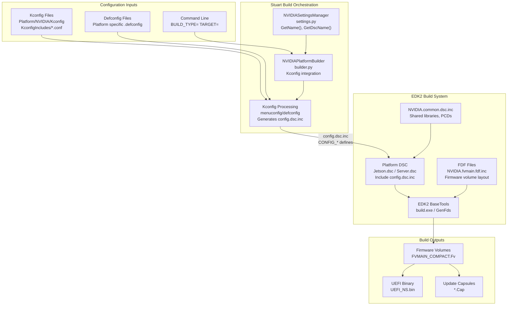

**Multi-Layered Build Configuration**

The build system combines three layers of configuration:

1. **Stuart Build Framework** ([Silicon/NVIDIA/edk2nv/stuart/]()): Python-based build orchestration using `NVIDIASettingsManager` and `NVIDIAPlatformBuilder`. Platform-specific subclasses define `GetName()` (e.g., "Jetson"), `GetDscName()` (path to platform DSC), and `GetPackagesPath()`. Stuart manages workspace setup, dependency installation (stuart_setup), configuration (stuart_update), and build invocation.

2. **Kconfig Configuration System** ([Platform/NVIDIA/Kconfig]()): Linux-style configuration with SOC selection (SOC_T23X, SOC_T24X, SOC_T26X), build type recipes (BUILD_T234_JETSON, BUILD_TH500_SERVER), and feature enables (CONFIG_PCIE, CONFIG_NETWORKING, CONFIG_ACPI). The `builder.py` processes Kconfig files and generates `config.dsc.inc` with `CONFIG_*` defines that control conditional compilation in DSC files.

3. **EDK2 DSC/FDF Files**: `NVIDIA.common.dsc.inc` provides shared configuration including library class mappings (PlatformResourceLib, DeviceTreeHelperLib), PCD defaults, and build options. Platform-specific DSC files include `config.dsc.inc` and use conditional directives like `!ifdef CONFIG_PCIE` to include/exclude components. FDF files define firmware volume layout and driver load order via `APRIORI DXE` sections.

**Sources:** [Silicon/NVIDIA/edk2nv/stuart/settings.py:35-180](), [Silicon/NVIDIA/edk2nv/stuart/builder.py:1-50](), [Platform/NVIDIA/Kconfig:1-90](), [Platform/NVIDIA/NVIDIA.common.dsc.inc:1-50]()

## Major Subsystem Components

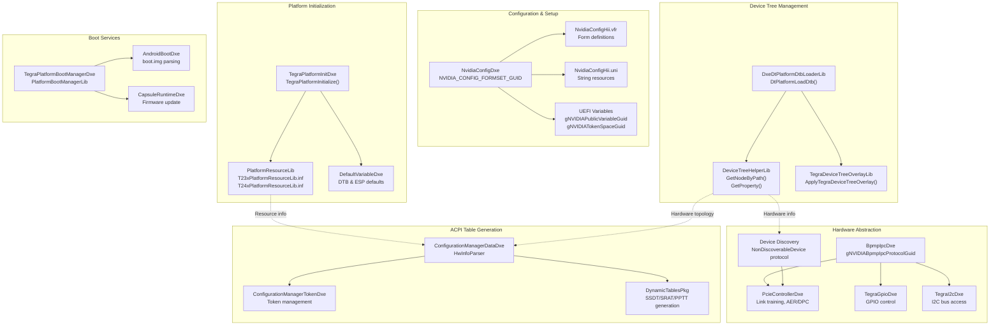

**Key Subsystem Responsibilities**

| Subsystem | Primary Components | Key Functions |
|-----------|-------------------|---------------|
| **Configuration & Setup** | `NvidiaConfigDxe`, HII forms (.vfr/.uni) | BIOS setup menu with PCIe config, boot options, TH500 MB1 settings, L4T config, debug options. Managed via HII protocols and UEFI variables with Redfish integration. |
| **Platform Initialization** | `TegraPlatformInitDxe`, `PlatformResourceLib` | SOC-specific initialization, PCD configuration (GIC bases, NUMA distances), resource info (socket mask, boot chain, memory regions, floorsweeping data). |
| **Device Tree** | `DxeDtPlatformDtbLoaderLib`, `DeviceTreeHelperLib`, overlay libraries | Load and modify kernel DTB, apply overlays from firmware media, inject board properties, floorsweeping, security hardening (remove DSU PMU nodes). |
| **Hardware Abstraction** | `BpmpIpcDxe`, `PcieControllerDxe`, GPIO/I2C drivers | BPMP IPC for firmware services (MRQ_RESET, MRQ_PG, MRQ_UPHY, MRQ_C2C), PCIe controller configuration and link training, device discovery via DTB parsing. |
| **Boot Services** | `TegraPlatformBootManagerDxe`, `AndroidBootDxe` | Boot option management (eMMC, UFS, PCIe NIC filtering), Android boot image parsing (v0-v4 headers), kernel command line aggregation, IPMI boot order control. |
| **ACPI Generation** | `ConfigurationManagerDataDxe`, Dynamic Tables | Generate ACPI tables (SRAT, PPTT, MPAM, HMAT) from platform resource data and DTB hardware topology for server platforms. |

**Sources:** [Silicon/NVIDIA/Drivers/NvidiaConfigDxe/NvidiaConfigDxe.c:1-100](), [Silicon/NVIDIA/Drivers/TegraPlatformInit/](), [Silicon/NVIDIA/Library/PlatformBootManagerLib/PlatformBm.c:1-100](), [Platform/NVIDIA/NVIDIA.fvmain.fdf.inc:130-175]()

## Platform Specialization Approach

The firmware uses a common core with platform-specific extensions to support diverse hardware:

**Common Core Components:**
- Standard UEFI services (memory, variables, boot manager, capsule update)
- EDK2 standard drivers (USB, network stack, filesystem, shell)
- NVIDIA base libraries (DeviceTreeHelperLib, BPMP IPC, configuration management)

**Platform-Specific Implementations:**

1. **PlatformResourceLib** ([Platform/NVIDIA/NVIDIA.common.dsc.inc:257-266]()): SOC-specific resource configuration:
   - `T23xPlatformResourceLib.inf` - Jetson platforms (single socket, MCE ARI interface)
   - `T24xPlatformResourceLib.inf` - TH500 servers (multi-socket, memory modes, MPAM)
   - `T26xPlatformResourceLib.inf` - Next-generation Tegra platforms

2. **Build Configuration** ([Platform/NVIDIA/Kconfig:93-113]()): Kconfig-based feature selection:
   - SOC choice: `CONFIG_SOC_T23X`, `CONFIG_SOC_T24X`, `CONFIG_SOC_T26X`
   - Build type recipes that imply appropriate features for target platform
   - Conditional driver inclusion based on hardware capabilities (supports PCIe Gen5, MPAM, etc.)

3. **HII Configuration Forms** ([Silicon/NVIDIA/Drivers/NvidiaConfigDxe/NvidiaConfigHii.vfr]()): Platform-specific setup options:
   - TH500-specific: Socket configuration (0-3), UPHY bifurcation, MPAM partitioning, EGM memory modes
   - Jetson-specific: L4T boot mode, display handoff, GPIO configuration
   - Common: PCIe max speed/width, boot order, kernel command line

4. **MB1 Configuration Data** ([Silicon/NVIDIA/Include/Server/TH500/TH500MB1Configuration.h]()): Platform-specific early boot data passed from bootloader, includes UPHY configuration, PCIe settings, feature flags (EGM, TPM, spread spectrum), MPAM partition IDs, floorsweeping data.

**Sources:** [Platform/NVIDIA/NVIDIA.common.dsc.inc:257-266](), [Platform/NVIDIA/Kconfig:93-113](), [Silicon/NVIDIA/Drivers/NvidiaConfigDxe/NvidiaConfigHii.vfr:1-100](), [Silicon/NVIDIA/Include/Server/TH500/TH500MB1Configuration.h:1-100]()

## Key Protocols and GUIDs

The firmware defines custom NVIDIA protocols and GUIDs for platform-specific functionality:

**Hardware Management Protocols:**
- `gNVIDIABpmpIpcProtocolGuid` - BPMP IPC communication for firmware services
- `gNVIDIAPciHostBridgeProtocolGuid` - PCIe host bridge configuration
- `gNVIDIADeviceTreeNodeProtocolGuid` - Device tree node access
- `gNVIDIANonDiscoverableDeviceProtocolGuid` - Non-standard device registration

**Configuration Protocols:**
- `gNVIDIAConfigurationManagerDataProtocolGuid` - ACPI configuration data provider
- `gNVIDIAConfigurationManagerTokenProtocolGuid` - Configuration object token management
- `gNVIDIAPciConfigurationDataProtocolGuid` - PCIe configuration data

**Boot and Update Protocols:**
- `gNVIDIABootChainProtocolGuid` - Boot chain (A/B) management
- `gNVIDIAFwPartitionProtocolGuid` - Firmware partition access
- `gNVIDIABrBctUpdateProtocolGuid` - Boot configuration table updates

**Variable GUIDs:**
- `gNVIDIAPublicVariableGuid` - User-accessible configuration variables
- `gNVIDIATokenSpaceGuid` - Platform-specific PCD namespace

**Sources:** [Silicon/NVIDIA/NVIDIA.dec:226-322]()

---

# Page: Build System and Configuration

# Build System and Configuration

<details>
<summary>Relevant source files</summary>

The following files were used as context for generating this wiki page:

- [.github/release-drafter.yml](.github/release-drafter.yml)
- [.github/workflows/build.yml](.github/workflows/build.yml)
- [Platform/NVIDIA/Kconfig](Platform/NVIDIA/Kconfig)
- [Platform/NVIDIA/L4TLauncher/PlatformBuild.py](Platform/NVIDIA/L4TLauncher/PlatformBuild.py)
- [Platform/NVIDIA/L4TLauncher/build.sh](Platform/NVIDIA/L4TLauncher/build.sh)
- [Platform/NVIDIA/NVIDIA.common.dsc.inc](Platform/NVIDIA/NVIDIA.common.dsc.inc)
- [Platform/NVIDIA/NVIDIA.defconfig](Platform/NVIDIA/NVIDIA.defconfig)
- [Platform/NVIDIA/NVIDIA.fvmain.fdf.inc](Platform/NVIDIA/NVIDIA.fvmain.fdf.inc)
- [Silicon/NVIDIA/edk2nv/stuart/builder.py](Silicon/NVIDIA/edk2nv/stuart/builder.py)
- [Silicon/NVIDIA/edk2nv/stuart/settings.py](Silicon/NVIDIA/edk2nv/stuart/settings.py)

</details>


This document covers the build system architecture used to construct NVIDIA UEFI firmware images, including the Stuart build framework, platform configuration files, and Kconfig-based configuration management. The build system orchestrates compilation, linking, and firmware image generation across multiple platforms and build variants.

For information about platform-specific boot management, see [Platform Definitions and Boot Management](#3.1). For details about hardware-specific drivers built by this system, see [Hardware Drivers](#4).

## Build System Architecture

The NVIDIA UEFI build system consists of three main components that work together to produce firmware images:

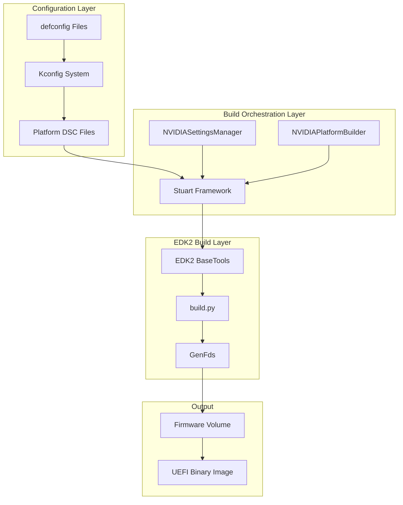

Sources: [Platform/NVIDIA/NVIDIA.common.dsc.inc:1-50](), [Silicon/NVIDIA/edk2nv/stuart/settings.py:35-85](), [Silicon/NVIDIA/edk2nv/stuart/builder.py:34-51]()

## Stuart Build Framework

The Stuart framework provides the foundation for NVIDIA's build system, handling workspace management, dependency resolution, and build orchestration through two key classes:

### Core Stuart Components

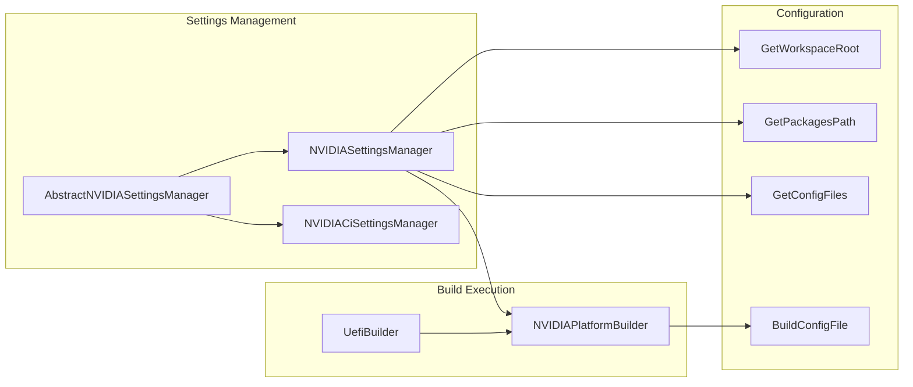

The `NVIDIASettingsManager` class extends Stuart's base settings interfaces to provide platform-specific configuration:

| Method | Purpose | Implementation |
|--------|---------|----------------|
| `GetWorkspaceRoot()` | Workspace location | Uses `WORKSPACE` environment variable |
| `GetPackagesPath()` | Package search paths | Includes edk2, edk2-platforms, edk2-nvidia |  
| `GetConfigFiles()` | Kconfig files list | Platform-specific defconfig files |
| `GetDscName()` | Main DSC file | Returns `NVIDIA.common.dsc` path |

Sources: [Silicon/NVIDIA/edk2nv/stuart/settings.py:57-131](), [Silicon/NVIDIA/edk2nv/stuart/builder.py:34-51]()

### Build Process Flow

The `NVIDIAPlatformBuilder` orchestrates the complete build process:

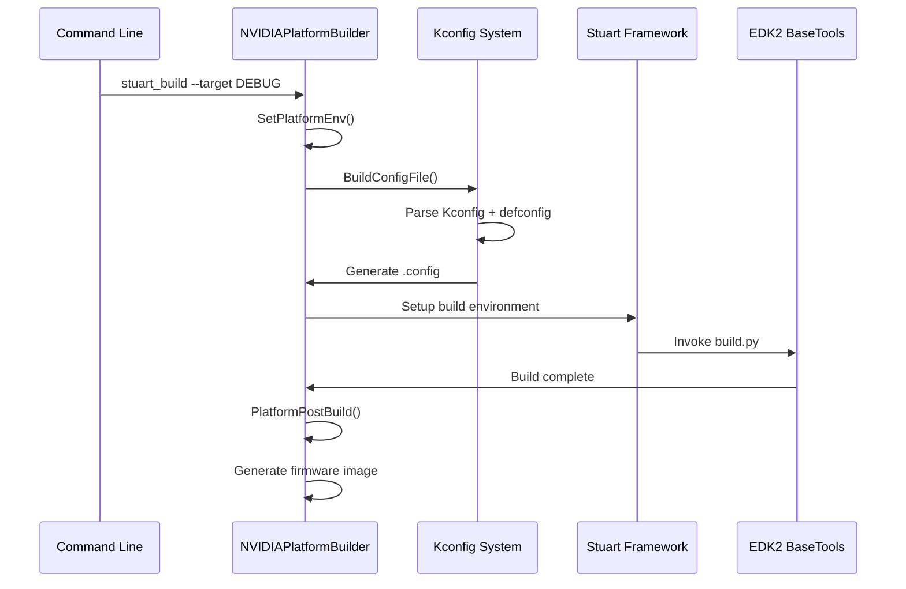

Sources: [Silicon/NVIDIA/edk2nv/stuart/builder.py:290-331](), [Silicon/NVIDIA/edk2nv/stuart/builder.py:435-499]()

## Platform Configuration Files

Platform configuration is managed through a hierarchy of DSC (Description) and FDF (Flash Description File) includes that define build settings, library mappings, and firmware layout.

### DSC Configuration Hierarchy

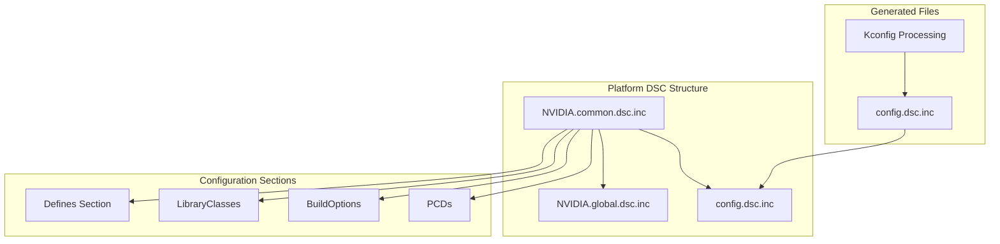

The main platform configuration is defined in `NVIDIA.common.dsc.inc`, which includes:

| Section | Purpose | Key Settings |
|---------|---------|--------------|
| `[Defines]` | Platform metadata | `PLATFORM_NAME`, `BUILD_TARGETS`, `OUTPUT_DIRECTORY` |
| `[LibraryClasses]` | Library mappings | Debug, crypto, platform-specific libraries |
| `[BuildOptions]` | Compiler flags | GCC flags, ASL options, security options |
| `[PcdsFeatureFlag]` | Feature toggles | Secure boot, TPM, network features |

Sources: [Platform/NVIDIA/NVIDIA.common.dsc.inc:9-50](), [Platform/NVIDIA/NVIDIA.common.dsc.inc:98-250]()

### Firmware Volume Definition

The `NVIDIA.fvmain.fdf.inc` file defines how firmware components are packaged:

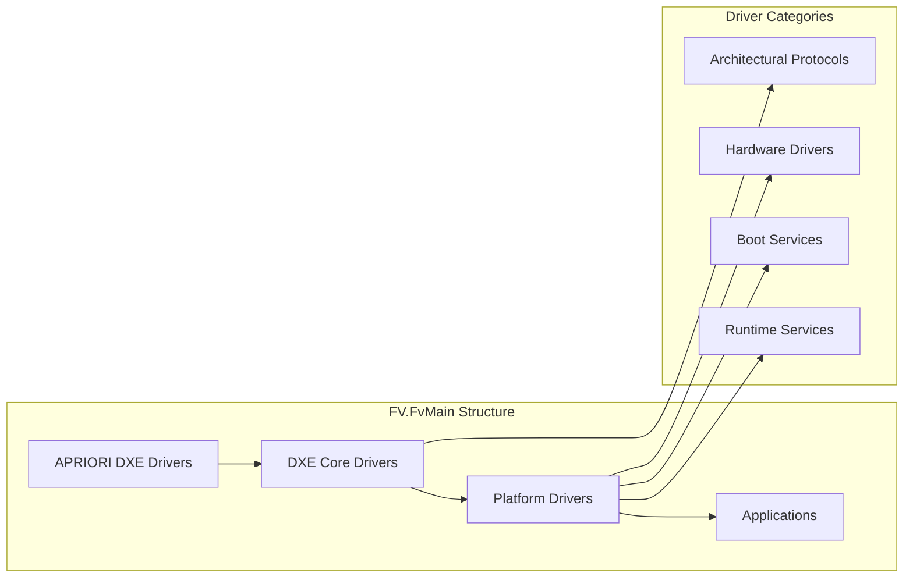

The APRIORI section ensures critical drivers load first:

- PCD services (`MdeModulePkg/Universal/PCD/Dxe/Pcd.inf`)
- Status code routing (`ReportStatusCodeRouterRuntimeDxe`)
- Platform initialization (`TegraPlatformInitDxe`)
- Interrupt controller (`ArmGicDxe`)

Sources: [Platform/NVIDIA/NVIDIA.fvmain.fdf.inc:39-73](), [Platform/NVIDIA/NVIDIA.fvmain.fdf.inc:75-120]()

## Kconfig System

The Kconfig system provides build-time configuration through a hierarchical menu system that generates configuration files consumed by the EDK2 build.

### Kconfig Structure

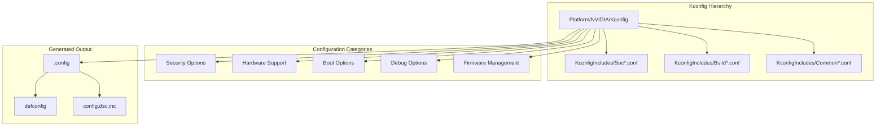

Key configuration categories include:

| Category | Configuration Options | Impact |
|----------|----------------------|--------|
| Security | TPM type, Secure Boot, MM type | Security drivers, authentication |
| Hardware | PCIe, USB, networking, display | Hardware driver inclusion |
| Boot Options | Android, L4T, RCM boot | Boot flow and applications |
| Debug | Print levels, memory tests | Debug capabilities |

Sources: [Platform/NVIDIA/Kconfig:93-270](), [Platform/NVIDIA/Kconfig:824-986]()

### Configuration Processing

The `BuildConfigFile()` method in `NVIDIAPlatformBuilder` processes Kconfig:

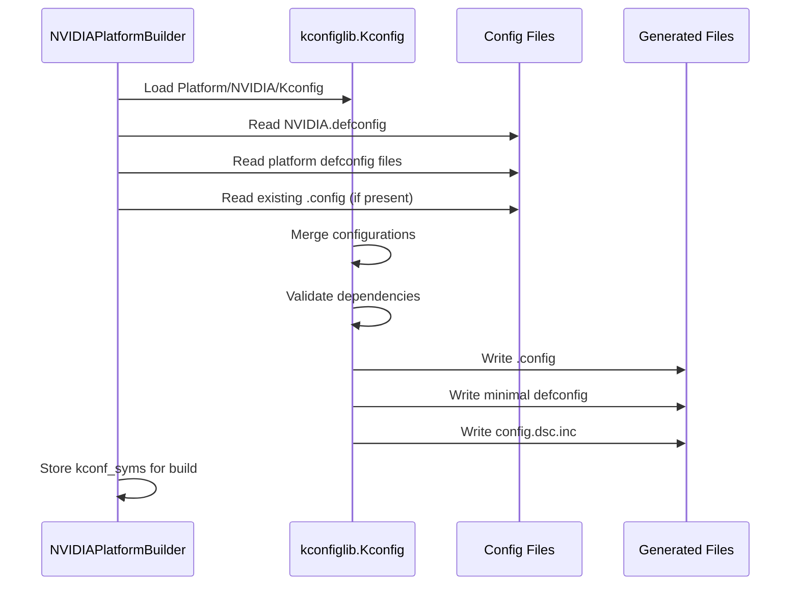

The generated `config.dsc.inc` translates Kconfig symbols to EDK2 DEFINE statements:
- `CONFIG_VARIABLE=value` becomes `DEFINE VARIABLE value`
- Empty values are commented out as EDK2 cannot define empty values
- String values have quotes stripped for EDK2 compatibility

Sources: [Silicon/NVIDIA/edk2nv/stuart/builder.py:193-288]()

## Build Environment Setup

The build system establishes the compilation environment through environment variables and build settings managed by the Stuart framework.

### Environment Configuration

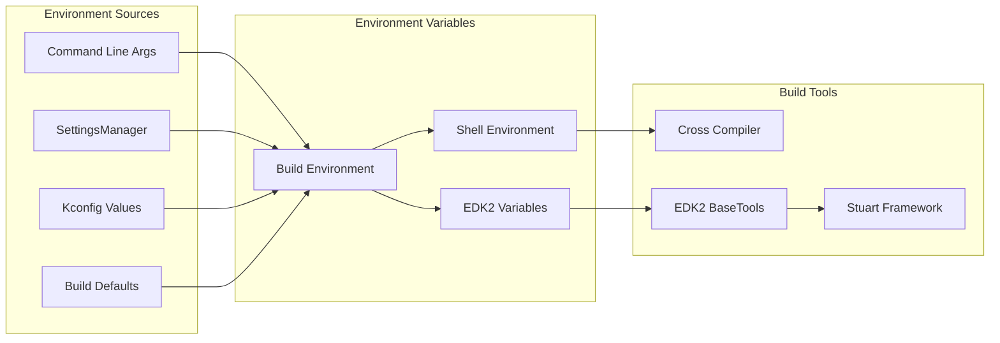

Key environment variables set by `SetPlatformEnv()`:

| Variable | Source | Purpose |
|----------|---------|---------|
| `ACTIVE_PLATFORM` | `GetDscName()` | Main platform DSC file |
| `TARGET` | `--target` argument | Build target (DEBUG/RELEASE) |
| `TARGET_ARCH` | Fixed | Always AARCH64 for NVIDIA |
| `TOOL_CHAIN_TAG` | `GetToolchainTag()` | Toolchain identifier (GCC) |
| `BLD_*_BUILD_NAME` | `GetName()` | Platform name |
| `BLD_*_BUILD_GUID` | Kconfig/`GetGuid()` | Platform GUID |

Sources: [Silicon/NVIDIA/edk2nv/stuart/builder.py:349-430](), [Silicon/NVIDIA/edk2nv/stuart/settings.py:239-251]()

---

# Page: Stuart Build Orchestration

# Stuart Build Orchestration

<details>
<summary>Relevant source files</summary>

The following files were used as context for generating this wiki page:

- [.github/release-drafter.yml](.github/release-drafter.yml)
- [.github/workflows/build.yml](.github/workflows/build.yml)
- [Platform/NVIDIA/L4TLauncher/PlatformBuild.py](Platform/NVIDIA/L4TLauncher/PlatformBuild.py)
- [Platform/NVIDIA/L4TLauncher/build.sh](Platform/NVIDIA/L4TLauncher/build.sh)
- [Platform/NVIDIA/NVIDIA.defconfig](Platform/NVIDIA/NVIDIA.defconfig)
- [Silicon/NVIDIA/edk2nv/stuart/builder.py](Silicon/NVIDIA/edk2nv/stuart/builder.py)
- [Silicon/NVIDIA/edk2nv/stuart/settings.py](Silicon/NVIDIA/edk2nv/stuart/settings.py)

</details>


## Purpose and Scope

This document describes the Stuart build framework integration used to build NVIDIA UEFI firmware images. Stuart is a build orchestration tool from TianoCore that wraps the EDK2 build system with dependency management, configuration processing, and CI/CD support. The NVIDIA implementation extends Stuart with Kconfig integration, platform-specific configuration management, and automated image generation.

For details on the platform configuration files (DSC/FDF) that Stuart processes, see [Platform Configuration Files (DSC/FDF)](#2.2). For information on the Kconfig system that Stuart integrates with, see [Kconfig Configuration System](#2.3).

## Architecture Overview

The Stuart build orchestration consists of two primary class hierarchies: **Settings Managers** and **Platform Builders**. Settings managers provide platform metadata and configuration, while platform builders execute the build workflow and post-processing steps.

### Component Architecture

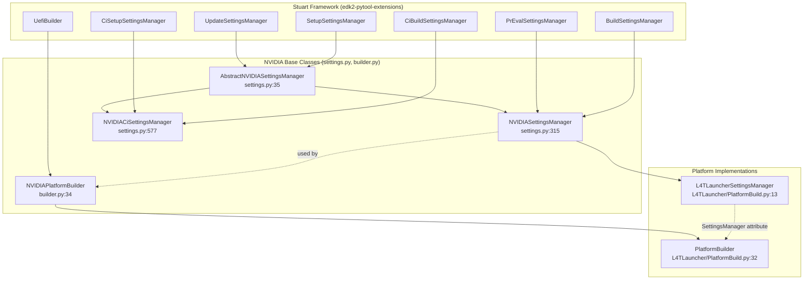

Sources: [Silicon/NVIDIA/edk2nv/stuart/settings.py:35-323](), [Silicon/NVIDIA/edk2nv/stuart/builder.py:34-519](), [Platform/NVIDIA/L4TLauncher/PlatformBuild.py:13-36]()

## Settings Manager Classes

Settings managers implement the interface between Stuart and platform-specific build requirements. They provide methods that return platform metadata, file paths, build options, and configuration.

### AbstractNVIDIASettingsManager

The base settings manager provides common functionality for all NVIDIA platforms.

| Method | Purpose | Default Implementation |
|--------|---------|----------------------|
| `GetName()` | Platform identifier | Must be overridden |
| `GetGuid()` | Platform GUID | Returns `None`, can be overridden |
| `GetWorkspaceRoot()` | Workspace directory | Returns `WORKSPACE` environment variable |
| `GetEdk2NvidiaDir()` | edk2-nvidia path | Auto-discovered relative to settings.py |
| `GetNvidiaConfigDir()` | Config storage path | `nvidia-config/<name>` |
| `GetSourcePackagesPath()` | Package source paths | List of edk2 package directories |
| `GetPackagesPath()` | Resolved package paths | Combines workspace and UEFI_SOURCE paths |
| `GetActiveScopes()` | Build scopes | `['edk2-build', 'nvidia']` + additional |
| `GetConfigFiles()` | Kconfig files | Returns `None` by default |
| `GetConfDirName()` | Conf directory name | Returns `None` by default |
| `GetToolchainTag()` | Toolchain identifier | `GCC` or `TOOL_CHAIN_TAG` environment variable |

**Command Line Options:**

The settings manager adds custom command-line arguments via `AddCommandLineOptions()`:

- `--insert-packages-path`: Insert additional package paths
- `--insert-skipped-dir`: Skip directories during processing
- `--require-submodule`: Add required submodules
- `--skip-verify`: Skip dependency verification
- `--uefi-source-dir`: Specify UEFI source directory outside workspace

Sources: [Silicon/NVIDIA/edk2nv/stuart/settings.py:35-313]()

### NVIDIASettingsManager

The main settings manager for production builds extends `AbstractNVIDIASettingsManager` with build-specific functionality.

**Build Configuration Methods:**

| Method | Purpose | Default Value |
|--------|---------|---------------|
| `GetDscName()` | Platform DSC file | `Silicon/NVIDIA/Platform/NVIDIA/NVIDIA.common.dsc` |
| `GetFirmwareVolume()` | Firmware volume path | `FV/UEFI_NS.Fv` |
| `GetFirmwareImageFile()` | Output image path | `images/uefi_{platform}_{target}.bin` |
| `GetReportFile()` | Build report path | `reports/{platform}_{target}.report` |
| `GetBootAppName()` | Boot application | Returns `None` |
| `GetBootAppFile()` | Boot app output | `images/BOOTAA64_{platform}_{target}.efi` |
| `GetDtbPath()` | DTB build directory | Returns `None` |
| `GetDtbFile(stem)` | DTB output path | `images/{stem}_{platform}_{target}.dtbo` |
| `GetBuildDirFile()` | Build directory file | `images/builddir_{platform}_{target}.txt` |
| `GetBuildIdFile()` | Build ID file | `images/buildid_{platform}_{target}.txt` |
| `GetKConfigFile()` | Main Kconfig file | `Silicon/NVIDIA/Platform/NVIDIA/Kconfig` |

**Firmware Versioning:**

The firmware version is constructed by `GetFirmwareVersion()` using:
1. Base version from `GetFirmwareVersionBase()` - derives from git tag via `git describe --tags --abbrev=0`
2. Suffix from `GIT_SYNC_REVISION` environment variable or `git rev-parse --short HEAD`

Format: `{base}-{suffix}` (e.g., `r35.5.0-abc1234`)

Sources: [Silicon/NVIDIA/edk2nv/stuart/settings.py:315-575]()

### NVIDIACiSettingsManager

The CI settings manager provides defaults for continuous integration builds. Key differences from `NVIDIASettingsManager`:

- Simplified architecture support: returns `("X64",)` for host-based testing
- Single target: `("NOOPT",)` for debug builds
- Additional scopes: `["cibuild", "host-based-test"]` to enable unit test plugins
- Initializes build environment in `__init__()` rather than relying on callbacks

Sources: [Silicon/NVIDIA/edk2nv/stuart/settings.py:577-644]()

## Platform Builder Class

The `NVIDIAPlatformBuilder` extends `UefiBuilder` to implement the NVIDIA-specific build workflow, including Kconfig processing, environment setup, and post-build artifact generation.

### Build Workflow Sequence

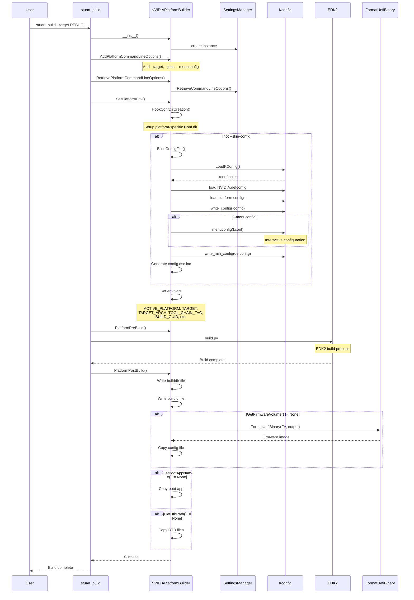

Sources: [Silicon/NVIDIA/edk2nv/stuart/builder.py:34-519]()

### Key Builder Methods

**Environment Setup (`SetPlatformEnv()`):**

This method is called before the build to configure the environment. It:

1. Hooks the Conf directory creation via `HookConfDirCreation()`
2. Generates Kconfig configuration via `BuildConfigFile()` if not skipped
3. Sets build environment variables that override `target.txt`:
   - `ACTIVE_PLATFORM`: Platform DSC file from `GetDscName()`
   - `TARGET`: Build target (DEBUG/RELEASE) from `--target` argument
   - `TARGET_ARCH`: Always `AARCH64` for NVIDIA platforms
   - `TOOL_CHAIN_TAG`: Toolchain identifier from `GetToolchainTag()`
   - `MAX_CONCURRENT_THREAD_NUMBER`: From `--jobs` if specified
4. Sets build metadata variables:
   - `BLD_*_BUILD_NAME`: Platform name
   - `BLD_*_BUILD_GUID`: Platform GUID
   - `BLD_*_BUILD_DATE_TIME`: ISO timestamp
   - `BLD_*_BUILD_EPOCH`: Unix epoch time
   - `BLD_*_BUILDID_STRING`: Firmware version
5. Configures build reporting:
   - `BUILDREPORTING`: `TRUE`
   - `BUILDREPORT_TYPES`: `PCD LIBRARY FLASH DEPEX BUILD_FLAGS FIXED_ADDRESS HASH COMPILE_INFO`
   - `BUILDREPORT_FILE`: Report output path
6. Sets shell environment variables:
   - `{TOOL_CHAIN_TAG}_AARCH64_PREFIX`: Cross-compiler prefix
   - `DTCPP_PREFIX`: Device tree compiler prefix
   - `CONF_PATH`: Conf directory path

Sources: [Silicon/NVIDIA/edk2nv/stuart/builder.py:305-445]()

**Conf Directory Customization (`HookConfDirCreation()`):**

NVIDIA platforms use target-specific Conf directories (e.g., `Conf/{platform}/{target}`) to:
- Enable parallel builds of different targets
- Allow platform-specific Conf customization
- Avoid race conditions

The hook:
1. Determines the Conf directory path from `GetConfDirName()`
2. Monkey-patches `ConfMgmt.populate_conf_dir()` to use the custom path
3. Modifies `tools_def.txt` to include `Silicon/NVIDIA/tools_def.inc` via `AddToolsDefInclude()`
4. Creates a `Conf/Conf` symlink for Stuart compatibility

Sources: [Silicon/NVIDIA/edk2nv/stuart/builder.py:72-122]()

**Post-Build Processing (`PlatformPostBuild()`):**

After the EDK2 build completes, this method:

1. **Writes build metadata:**
   - `builddir_{platform}_{target}.txt`: Full path to build output directory
   - `buildid_{platform}_{target}.txt`: Firmware version string

2. **Generates firmware image (if `GetFirmwareVolume()` returns a path):**
   - Calls `FormatUefiBinary()` to convert the firmware volume to a bootable image
   - Copies the `.config` file alongside the image for build reproducibility

3. **Copies boot application (if `GetBootAppName()` returns a path):**
   - Copies the built EFI application to the workspace images directory

4. **Copies DTB files (if `GetDtbPath()` returns a path):**
   - Finds all `.dtb` files in the build directory
   - Copies each to the workspace images directory with platform suffix

5. **Cleanup:**
   - Removes the `Conf/Conf` symlink to avoid confusing filesystem tools

Sources: [Silicon/NVIDIA/edk2nv/stuart/builder.py:450-514]()

## Kconfig Integration

The Stuart build system integrates Kconfig for flexible platform configuration. Kconfig files define configuration options, and defconfig files provide platform-specific defaults.

### Kconfig Processing Flow

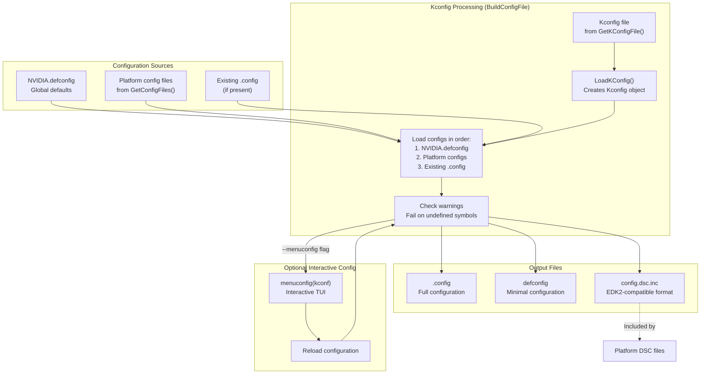

Sources: [Silicon/NVIDIA/edk2nv/stuart/builder.py:193-303]()

### Configuration File Formats

**`.config` Format:**

Full configuration with all symbols explicitly set:
```
CONFIG_PLATFORM_GUID="xyz"
CONFIG_SOME_FEATURE=y
CONFIG_SOME_VALUE=42
# CONFIG_DISABLED_FEATURE is not set
```

**`defconfig` Format:**

Minimal configuration with only non-default values:
```
CONFIG_PLATFORM_GUID="xyz"
CONFIG_SOME_FEATURE=y
```

**`config.dsc.inc` Format:**

EDK2-compatible format (quotes and empty values removed):
```
CONFIG_PLATFORM_GUID=xyz
CONFIG_SOME_FEATURE=y
CONFIG_SOME_VALUE=42
# Undefining empty: CONFIG_EMPTY_VAR=
# CONFIG_DISABLED_FEATURE is not set
```

The `config.dsc.inc` file is included by the platform DSC file to access Kconfig values during the build.

Sources: [Silicon/NVIDIA/edk2nv/stuart/builder.py:238-303]()

### LoadKConfig() Implementation

The `LoadKConfig()` method creates and configures a `kconfiglib.Kconfig` object:

1. Creates `Kconfig` object with the main Kconfig file from `GetKConfigFile()`
2. Enables warning for undefined symbol assignments (`warn_assign_undef = True`)
3. Disables warnings for overrides and redundant assignments
4. Loads configuration files in order:
   - Global defaults: `Platform/NVIDIA/NVIDIA.defconfig`
   - Platform configs: from `GetConfigFiles()` list
   - Existing config: `.config` file if present
5. Uses `replace=False` for merging (later files override earlier ones)
6. Stores symbol values in `self.kconf_syms` for later use (e.g., `PLATFORM_GUID`)

Sources: [Silicon/NVIDIA/edk2nv/stuart/builder.py:193-236]()

## CI/CD Integration

The GitHub Actions workflow demonstrates the Stuart build system in a CI/CD context.

### CI Workflow Overview

```mermaid
graph LR
    subgraph "Preparation Steps"
        INSTALL["Install packages<br/>apt-get install"]
        EDKREPO_INSTALL["Install edkrepo<br/>wget + install.py"]
        EDKREPO_CONFIG["Configure edkrepo<br/>add nvidia manifest repo"]
        CLONE["Clone workspace<br/>edkrepo clone NVIDIA-Platforms"]
        CHECKOUT["Checkout PR ref<br/>git checkout FETCH_HEAD"]
    end
    
    subgraph "Build Steps"
        TEST["Run unit tests<br/>HostBasedTests/test.sh"]
        BUILD_LOOP["Build all defconfigs<br/>for defconfig in DefConfigs/*.defconfig"]
        BUILD_NOCONF["Build non-Kconfig images<br/>StandaloneMm, DeviceTree, L4TLauncher"]
    end
    
    subgraph "Artifact Steps"
        PACKAGE["Package artifacts<br/>Extract buildid, copy images"]
        UPLOAD["Upload artifact<br/>actions/upload-artifact"]
        RELEASE["Create draft release<br/>release-drafter"]
    end
    
    INSTALL --> EDKREPO_INSTALL
    EDKREPO_INSTALL --> EDKREPO_CONFIG
    EDKREPO_CONFIG --> CLONE
    CLONE --> CHECKOUT
    CHECKOUT --> TEST
    TEST --> BUILD_LOOP
    BUILD_LOOP --> BUILD_NOCONF
    BUILD_NOCONF --> PACKAGE
    PACKAGE --> UPLOAD
    UPLOAD --> RELEASE
```

Sources: [.github/workflows/build.yml:1-170]()

### Build Script Pattern

NVIDIA platforms provide a three-script pattern for Stuart builds:

1. **`build.sh`**: Top-level script that orchestrates the build
   - Sets script directory and workspace root
   - Calls `prepare_stuart.sh` to setup dependencies
   - Calls `build_stuart.sh` with platform-specific `PlatformBuild.py`

2. **`prepare_stuart.sh`**: Handles Stuart setup and dependency updates
   - Runs `stuart_setup` to verify tools and dependencies
   - Runs `stuart_update` to fetch/update git submodules

3. **`build_stuart.sh`**: Executes the Stuart build
   - Runs `stuart_build` with the platform's `PlatformBuild.py`
   - Passes through command-line arguments (e.g., `--target RELEASE`)

Sources: [Platform/NVIDIA/L4TLauncher/build.sh:1-27]()

## Platform Specialization

Each platform provides a `PlatformBuild.py` that defines two classes:

### Platform Settings Manager

Specializes `NVIDIASettingsManager` to provide platform-specific configuration:

```python
class L4TLauncherSettingsManager(NVIDIASettingsManager):
    def GetName(self):
        return "L4TLauncher"
    
    def GetGuid(self):
        return "be4936a8-d418-405c-9f5c-a61723884a40"
    
    def GetDscName(self):
        return self.GetEdk2NvidiaDir() + "Platform/NVIDIA/L4TLauncher/L4TLauncher.dsc"
    
    def GetBootAppName(self):
        return "AARCH64/L4TLauncher.efi"
    
    def GetFirmwareVolume(self):
        return None  # This platform doesn't generate a firmware volume
```

**Common Customizations:**

| Platform Type | Typical Overrides |
|---------------|-------------------|
| Firmware Image | `GetName()`, `GetGuid()`, `GetDscName()`, `GetConfigFiles()` |
| Boot Application | `GetName()`, `GetGuid()`, `GetDscName()`, `GetBootAppName()`, `GetFirmwareVolume() = None` |
| Device Tree | `GetName()`, `GetGuid()`, `GetDscName()`, `GetDtbPath()`, `GetFirmwareVolume() = None` |

Sources: [Platform/NVIDIA/L4TLauncher/PlatformBuild.py:13-30]()

### Platform Builder

Specializes `NVIDIAPlatformBuilder` and associates it with the platform's settings manager:

```python
class PlatformBuilder(NVIDIAPlatformBuilder):
    SettingsManager = L4TLauncherSettingsManager
```

The platform builder typically doesn't need customization unless the platform requires special build logic beyond what the base `NVIDIAPlatformBuilder` provides.

Sources: [Platform/NVIDIA/L4TLauncher/PlatformBuild.py:32-36]()

## Command Line Interface

### Common Stuart Commands

| Command | Purpose | Key Arguments |
|---------|---------|---------------|
| `stuart_setup` | Install build dependencies | `--skip-verify` |
| `stuart_update` | Update git submodules | `--skip-verify` |
| `stuart_build` | Build the platform | `--target`, `--jobs`, `--menuconfig`, `--skip-config` |
| `stuart_ci_setup` | Setup CI environment | N/A |
| `stuart_ci_build` | Run CI build and tests | N/A |

### Build Command Examples

**Standard DEBUG build:**
```bash
stuart_build -c PlatformBuild.py --target DEBUG
```

**RELEASE build with parallel jobs:**
```bash
stuart_build -c PlatformBuild.py --target RELEASE --jobs 8
```

**Interactive configuration before build:**
```bash
stuart_build -c PlatformBuild.py --target DEBUG --menuconfig
```

**Skip configuration (use existing .config):**
```bash
stuart_build -c PlatformBuild.py --target DEBUG --skip-config
```

**Skip all build steps (useful for testing configuration):**
```bash
stuart_build -c PlatformBuild.py --target DEBUG --skipallbuild
```

Sources: [Silicon/NVIDIA/edk2nv/stuart/builder.py:139-173]()

## Build Artifacts

The build process generates several categories of artifacts:

### Primary Artifacts

| Artifact | Path Pattern | Generated By | Condition |
|----------|--------------|--------------|-----------|
| Firmware Image | `images/uefi_{platform}_{target}.bin` | `FormatUefiBinary()` | `GetFirmwareVolume() != None` |
| Boot Application | `images/BOOTAA64_{platform}_{target}.efi` | Direct copy | `GetBootAppName() != None` |
| Device Tree Blob | `images/{stem}_{platform}_{target}.dtbo` | Direct copy | `GetDtbPath() != None` |

### Metadata Artifacts

| Artifact | Path Pattern | Content | Purpose |
|----------|--------------|---------|---------|
| Build Directory | `images/builddir_{platform}_{target}.txt` | Full path to build output | Upstream build system integration |
| Build ID | `images/buildid_{platform}_{target}.txt` | Firmware version string | Version tracking |
| Configuration | `config_uefi_{platform}_{target}` | Copy of `.config` | Build reproducibility |
| Build Report | `reports/{platform}_{target}.report` | Detailed build report | Build analysis |

### Intermediate Artifacts

| Artifact | Location | Purpose |
|----------|----------|---------|
| `.config` | `nvidia-config/{platform}/.config` | Full Kconfig configuration |
| `defconfig` | `nvidia-config/{platform}/defconfig` | Minimal Kconfig configuration |
| `config.dsc.inc` | `nvidia-config/{platform}/config.dsc.inc` | EDK2-compatible configuration |

Sources: [Silicon/NVIDIA/edk2nv/stuart/builder.py:450-513](), [Silicon/NVIDIA/edk2nv/stuart/settings.py:397-553]()

---

# Page: Platform Configuration Files (DSC/FDF)

# Platform Configuration Files (DSC/FDF)

<details>
<summary>Relevant source files</summary>

The following files were used as context for generating this wiki page:

- [Platform/NVIDIA/Kconfig](Platform/NVIDIA/Kconfig)
- [Platform/NVIDIA/NVIDIA.common.dsc.inc](Platform/NVIDIA/NVIDIA.common.dsc.inc)
- [Platform/NVIDIA/NVIDIA.fvmain.fdf.inc](Platform/NVIDIA/NVIDIA.fvmain.fdf.inc)

</details>


This document describes the EDK2 Platform Configuration Files used in the NVIDIA UEFI firmware: DSC (Driver Specification) and FDF (Flash Description) files. These files define what components to build and how they are organized into firmware volumes. For information about the Stuart build orchestration that processes these files, see [Stuart Build Orchestration](#2.1). For information about Kconfig configuration that generates platform-specific values, see [Kconfig Configuration System](#2.3).

## Purpose and Scope

DSC and FDF files are core EDK2 build system components that control firmware composition:
- **DSC files** specify which drivers, libraries, and applications to build, along with their library dependencies and Platform Configuration Database (PCD) values
- **FDF files** define the firmware volume layout and determine the order in which DXE drivers are loaded

The NVIDIA implementation uses include files (`NVIDIA.common.dsc.inc` and `NVIDIA.fvmain.fdf.inc`) that are shared across multiple platform-specific DSC/FDF files.

## File Organization and Relationships

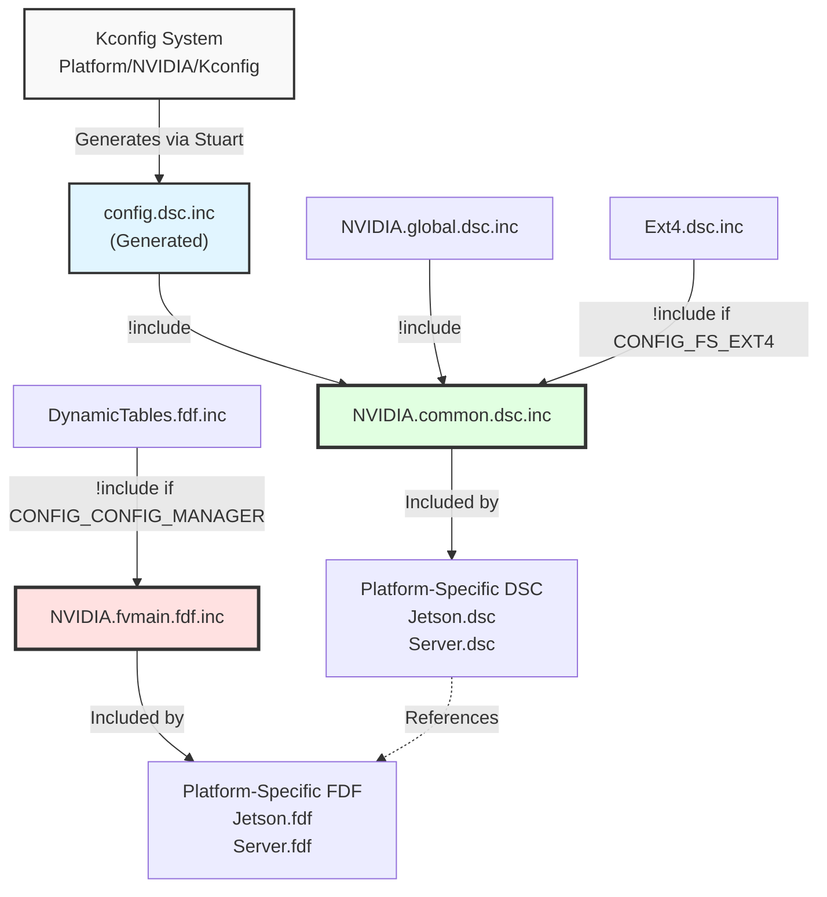

**Sources:** [Platform/NVIDIA/NVIDIA.common.dsc.inc:1-11](), [Platform/NVIDIA/NVIDIA.fvmain.fdf.inc:1-987]()

## DSC File Structure: NVIDIA.common.dsc.inc

### [Defines] Section

The `[Defines]` section establishes platform identity and build parameters:

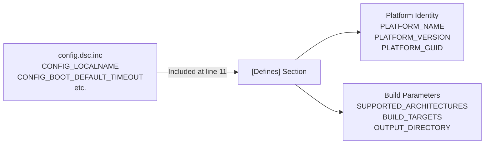

Key definitions at [Platform/NVIDIA/NVIDIA.common.dsc.inc:9-24]():
- `PLATFORM_NAME`: Derived from `BUILD_NAME` plus optional `CONFIG_LOCALNAME`
- `SUPPORTED_ARCHITECTURES`: `AARCH64` only
- `OUTPUT_DIRECTORY`: `Build/$(BUILD_NAME)`

**Sources:** [Platform/NVIDIA/NVIDIA.common.dsc.inc:9-60]()

### [SkuIds] Section - Platform Variants

The SKU system allows conditional component inclusion based on SOC type:

| SKU ID | SKU Name | Parent | SOC Type |
|--------|----------|--------|----------|
| 0 | DEFAULT | - | All platforms |
| 2 | T234 | - | Tegra234 (Jetson) |
| 3 | T234SLT | T234 | Tegra234 SLT variant |
| 4 | T264 | - | Tegra264 |
| 5 | TH500 | - | TH500 Server |
| 253 | TH500Presil | TH500 | Pre-silicon TH500 |
| 254 | T264Presil | T264 | Pre-silicon T264 |
| 255 | T234Presil | T234 | Pre-silicon T234 |

Defined by Kconfig conditionals at [Platform/NVIDIA/NVIDIA.common.dsc.inc:61-79]().

**Sources:** [Platform/NVIDIA/NVIDIA.common.dsc.inc:61-79]()

### [BuildOptions] Section

Build options control compiler and linker flags:

```
[BuildOptions.common.EDKII.DXE_CORE,BuildOptions.common.EDKII.DXE_DRIVER,...]
  GCC:*_*_*_DLINK_FLAGS = -Wl,-z,common-page-size=0x1000

[BuildOptions.common]
  GCC:*_*_*_PLATFORM_FLAGS = -fstack-protector-strong
```

Key security features enabled:
- Stack protection (`-fstack-protector-strong`)
- Page size alignment for DXE modules
- MD5 deprecated interfaces defined

**Sources:** [Platform/NVIDIA/NVIDIA.common.dsc.inc:81-94]()

### [LibraryClasses] Section - Library Dependency Resolution

The library classes section maps abstract library interfaces to concrete implementations. This is organized by module type:

```mermaid
graph TB
    subgraph "Common Libraries (All Module Types)"
        DEBUG["DebugLib<br/>PeiDxeDebugLibReportStatusCode"]
        BASE["BaseLib<br/>BaseMemoryLib<br/>PrintLib"]
        UEFI["UefiLib<br/>UefiBootServicesTableLib<br/>UefiRuntimeServicesTableLib"]
    end
    
    subgraph "ARM Architecture Libraries"
        ARM_ARCH["ArmLib<br/>ArmMmuLib<br/>ArmGenericTimerCounterLib"]
        ARM_CACHE["CacheMaintenanceLib<br/>ArmCacheMaintenanceLib"]
        ARM_EXCEPT["CpuExceptionHandlerLib<br/>ArmExceptionLib"]
    end
    
    subgraph "NVIDIA Platform Libraries"
        PLAT_RES["PlatformResourceLib<br/>T23xPlatformResourceLib<br/>T24xPlatformResourceLib<br/>T26xPlatformResourceLib"]
        TEGRA["TegraPlatformInfoLib<br/>SystemResourceLib<br/>BootChainInfoLib"]
        DTB["DtPlatformDtbLoaderLib<br/>DeviceTreeHelperLib<br/>TegraDeviceTreeOverlayLib"]
    end
    
    subgraph "Module Type Specific"
        SEC["SEC<br/>PrePiLib<br/>PrePiHobLib"]
        DXE_CORE["DXE_CORE<br/>DxeCoreMemoryAllocationLib"]
        DXE_DRIVER["DXE_DRIVER<br/>SecurityManagementLib"]
        RUNTIME["DXE_RUNTIME_DRIVER<br/>RuntimeCryptLib<br/>VariablePolicyLib"]
    end
    
    COMMON["[LibraryClasses.common]<br/>Lines 104-516"] --> DEBUG
    COMMON --> BASE
    COMMON --> UEFI
    COMMON --> ARM_ARCH
    COMMON --> ARM_CACHE
    COMMON --> ARM_EXCEPT
    COMMON --> PLAT_RES
    COMMON --> TEGRA
    COMMON --> DTB
    
    TYPE_SPECIFIC["Type-Specific Classes"] --> SEC
    TYPE_SPECIFIC --> DXE_CORE
    TYPE_SPECIFIC --> DXE_DRIVER
    TYPE_SPECIFIC --> RUNTIME
```

**SOC-Specific Library Resolution**

Platform resource libraries are conditionally selected based on SOC type at [Platform/NVIDIA/NVIDIA.common.dsc.inc:258-266]():

```
!ifdef CONFIG_SOC_T23X
  PlatformResourceLib|Silicon/NVIDIA/Library/PlatformResourceLib/T23xPlatformResourceLib.inf
!endif
!ifdef CONFIG_SOC_T24X
  PlatformResourceLib|Silicon/NVIDIA/Library/PlatformResourceLib/T24xPlatformResourceLib.inf
!endif
!ifdef CONFIG_SOC_T26X
  PlatformResourceLib|Silicon/NVIDIA/Library/PlatformResourceLib/T26xPlatformResourceLib.inf
!endif
```

**Sources:** [Platform/NVIDIA/NVIDIA.common.dsc.inc:104-654]()

### [PcdsFeatureFlag] and [PcdsFixedAtBuild] - Platform Configuration Database

PCDs provide compile-time and runtime configuration values:

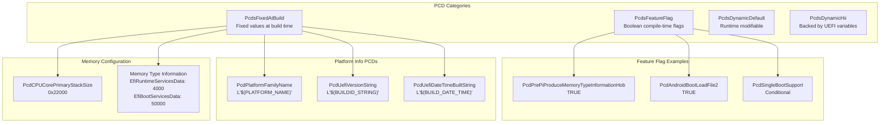

**Critical PCDs for Platform Initialization:**

At [Platform/NVIDIA/NVIDIA.common.dsc.inc:666-894]():
- `PcdPrePiProduceMemoryTypeInformationHob|TRUE`: Enables memory type optimization
- `PcdCpuStackGuard|TRUE`: Stack overflow protection
- `PcdImageProtectionPolicy|0x3`: Strict image memory protections
- `PcdDxeNxMemoryProtectionPolicy|0xC000000000007FD1`: NX memory protection for non-code regions

**Kconfig-Derived PCDs:**

The document shows extensive use of conditional compilation based on Kconfig symbols:

```
!ifdef CONFIG_BOOT_ANDROID_IMAGE
  gNVIDIATokenSpaceGuid.PcdBootAndroidImage|TRUE
!endif

!ifdef CONFIG_FIRMWARE_MANAGEMENT
  gFmpDevicePkgTokenSpaceGuid.PcdFmpDeviceImageIdName|L"NVIDIA System Firmware"
!endif
```

**Sources:** [Platform/NVIDIA/NVIDIA.common.dsc.inc:666-1343]()

### Dynamic PCDs and UEFI Variables

The `[PcdsDynamicHii]` section at [Platform/NVIDIA/NVIDIA.common.dsc.inc:1236-1334]() maps PCDs to UEFI variables for runtime modification:

| PCD | Variable Name | GUID | Default | Attributes |
|-----|---------------|------|---------|------------|
| `PcdPlatformBootTimeOut` | `Timeout` | `gEfiGlobalVariableGuid` | `CONFIG_BOOT_DEFAULT_TIMEOUT` | Global |
| `PcdPcieResourceConfigNeeded` | `PCIeResourceConfig` | `gNVIDIATokenSpaceGuid` | 0 | BS |
| `PcdQuickBootEnabled` | `QuickBootEnabled` | `gNVIDIAPublicVariableGuid` | 0/1 | BS,NV |
| `PcdUefiShellEnabled` | `UefiShellEnabled` | `gNVIDIAPublicVariableGuid` | 0x01 | BS,NV |

**Sources:** [Platform/NVIDIA/NVIDIA.common.dsc.inc:1236-1334]()

## FDF File Structure: NVIDIA.fvmain.fdf.inc

### Firmware Volume Definition

The main firmware volume `[FV.FvMain]` is defined at [Platform/NVIDIA/NVIDIA.fvmain.fdf.inc:18-987]():

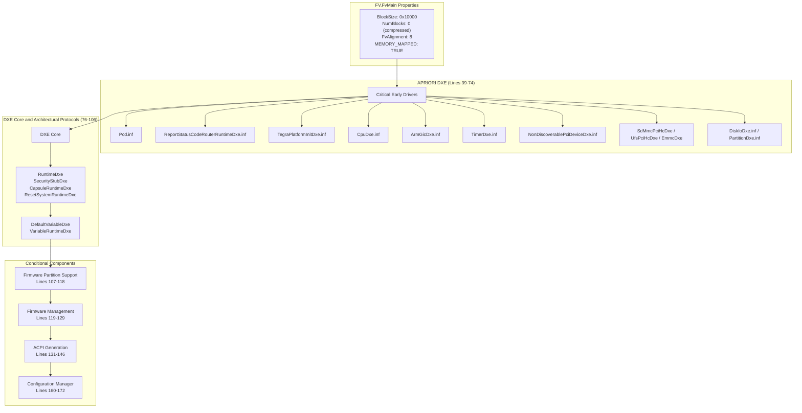

**Sources:** [Platform/NVIDIA/NVIDIA.fvmain.fdf.inc:18-172]()

### APRIORI DXE - Driver Load Ordering

The `APRIORI DXE` section at [Platform/NVIDIA/NVIDIA.fvmain.fdf.inc:39-74]() specifies drivers that must load before general DXE dispatch:

1. **Core Services**: PCD, ReportStatusCode
2. **Platform Initialization**: `TegraPlatformInitDxe.inf` - critical for SOC-specific setup
3. **CPU/Interrupt**: `CpuDxe.inf`, `ArmGicDxe.inf`, `TimerDxe.inf`
4. **Storage Stack**: Required for variable access from storage
   - `NonDiscoverablePciDeviceDxe.inf`
   - Storage controllers (SDHCI, UFS)
   - Disk I/O and partitioning

**Sources:** [Platform/NVIDIA/NVIDIA.fvmain.fdf.inc:39-74]()

### Component Organization by Function

```mermaid
graph TB
    subgraph "Hardware Drivers (Lines 191-444)"
        BPMP["BPMP IPC<br/>BpmpIpcDxe.inf<br/>BpmpScmiDxe.inf<br/>BpmpI2cDxe.inf"]
        GPIO["GPIO Support<br/>TegraGpioDxe.inf<br/>I2cExpanderGpio.inf"]
        PCIE["PCIe Controllers<br/>PcieControllerDxe.inf<br/>PcieGenericControllerDxe.inf"]
        STORAGE_HW["Storage Controllers<br/>SdMmcControllerDxe<br/>UfsControllerDxe<br/>NorFlashDxe"]
        USB_HW["USB Support<br/>UsbFirmwareDxe<br/>XhciControllerDxe<br/>XusbControllerDxe"]
        DISPLAY["Display<br/>NvDisplayControllerDxe<br/>NvGopDriver"]
    end
    
    subgraph "Network Stack (Lines 489-561)"
        NET_CORE["Network Core<br/>DpcDxe / ArpDxe / MnpDxe<br/>TcpDxe / DnsDxe"]
        NET_IP["IP Stack<br/>Dhcp4Dxe / Ip4Dxe (IPv4)<br/>Dhcp6Dxe / Ip6Dxe (IPv6)"]
        NET_BOOT["Network Boot<br/>PxeBcDxe / HttpBootDxe<br/>IScsiDxe"]
        NET_DEV["NIC Drivers<br/>EqosDeviceDxe<br/>Intel/Realtek/ASIX"]
    end
    
    subgraph "Boot Manager (Lines 641-661)"
        BDS["BdsDxe.inf<br/>Boot Device Selection"]
        PLATFORM_BM["TegraPlatformBootManagerDxe.inf"]
        UI["SetupBrowserDxe<br/>UiApp.inf<br/>BootManagerMenuApp.inf"]
        CONFIG_UI["NvidiaConfigDxe.inf<br/>HII Configuration"]
    end
    
    subgraph "Security (Lines 673-936)"
        SECURE_BOOT["SecureBootConfigDxe.inf<br/>Hash2DxeCrypto.inf<br/>Pkcs7VerifyDxe.inf"]
        TPM["Tpm2Dxe.inf<br/>Tcg2Dxe.inf"]
        RNG["RngDxe.inf"]
        MM_COMM["MmCommunicateFfaDxe.inf<br/>MmCommunicationOptee.inf"]
    end
    
    BPMP --> PCIE
    GPIO --> STORAGE_HW
    STORAGE_HW --> NET_CORE
    USB_HW --> NET_DEV
    DISPLAY --> BDS
    
    NET_CORE --> NET_IP
    NET_IP --> NET_BOOT
    NET_DEV --> NET_BOOT
    
    BDS --> PLATFORM_BM
    PLATFORM_BM --> UI
    UI --> CONFIG_UI
    
    SECURE_BOOT --> TPM
    TPM --> RNG
    RNG --> MM_COMM
```

**Sources:** [Platform/NVIDIA/NVIDIA.fvmain.fdf.inc:191-936]()

### Conditional Component Inclusion

Components are conditionally included based on Kconfig symbols. Key examples:

**Firmware Management** at [Platform/NVIDIA/NVIDIA.fvmain.fdf.inc:119-129]():
```
!ifdef CONFIG_FIRMWARE_MANAGEMENT
  INF MdeModulePkg/Universal/EsrtFmpDxe/EsrtFmpDxe.inf
  INF FILE_GUID = $(FMP_SYSTEM_IMAGE_TYPE_ID) FmpDevicePkg/FmpDxe/FmpDxe.inf
!endif
```

**ACPI Support** at [Platform/NVIDIA/NVIDIA.fvmain.fdf.inc:131-146]():
```
!ifdef CONFIG_ACPI
  INF Silicon/NVIDIA/Drivers/AmlGenerationDxe/AmlGenerationDxe.inf
  INF Silicon/NVIDIA/Drivers/AmlPatchDxe/AmlPatchDxe.inf
  INF MdeModulePkg/Universal/Acpi/AcpiTableDxe/AcpiTableDxe.inf
!endif
```

**Configuration Manager** at [Platform/NVIDIA/NVIDIA.fvmain.fdf.inc:160-172]():
```
!ifdef CONFIG_CONFIG_MANAGER
  INF Silicon/NVIDIA/Drivers/ConfigurationManagerTokenDxe/ConfigurationManagerTokenDxe.inf
  INF Silicon/NVIDIA/Drivers/ConfigurationManagerData/ConfigurationManagerDataDxe.inf
  INF Silicon/NVIDIA/Drivers/ConfigurationManager/ConfigurationManagerDxe.inf
  !include DynamicTablesPkg/DynamicTables.fdf.inc
!endif
```

**PCIe Support** at [Platform/NVIDIA/NVIDIA.fvmain.fdf.inc:332-344]():
```
!ifdef CONFIG_PCIE
  INF MdeModulePkg/Bus/Pci/PciBusDxe/PciBusDxe.inf
  INF MdeModulePkg/Bus/Pci/PciHostBridgeDxe/PciHostBridgeDxe.inf
!endif
!ifdef CONFIG_DESIGNWARE_PCIE
  INF Silicon/NVIDIA/Drivers/PcieDWControllerDxe/PcieControllerDxe.inf
!endif
!ifdef CONFIG_NVIDIA_PCIE
  INF Silicon/NVIDIA/Drivers/PcieControllerDxe/PcieControllerDxe.inf
!endif
```

**Sources:** [Platform/NVIDIA/NVIDIA.fvmain.fdf.inc:119-444]()

## Kconfig Integration

The build system integrates Kconfig configuration through `config.dsc.inc`:

```mermaid
graph LR
    USER["User edits .defconfig<br/>or runs menuconfig"]
    KCONFIG["Kconfig Processing<br/>Platform/NVIDIA/Kconfig"]
    CONFIG_H[".config file<br/>CONFIG_SOC_T24X=y<br/>CONFIG_PCIE=y<br/>etc."]
    CONFIG_DSC["config.dsc.inc<br/>Generated DSC syntax"]
    DSC["NVIDIA.common.dsc.inc<br/>!include config.dsc.inc"]
    CONDITIONAL["Conditional compilation<br/>!ifdef CONFIG_PCIE<br/>!ifdef CONFIG_SOC_T24X"]
    
    USER --> KCONFIG
    KCONFIG --> CONFIG_H
    CONFIG_H -->|"Stuart translates"| CONFIG_DSC
    CONFIG_DSC -->|"Line 11"| DSC
    DSC --> CONDITIONAL
    
    style CONFIG_DSC fill:#e1f5ff,stroke:#333,stroke-width:2px
    style CONDITIONAL fill:#ffe1e1,stroke:#333,stroke-width:2px
```

**Example Kconfig-to-DSC Flow:**

1. User sets `CONFIG_PCIE=y` in defconfig
2. Kconfig generates `CONFIG_PCIE=y` in `.config`
3. Stuart translates to `config.dsc.inc`
4. DSC includes at [Platform/NVIDIA/NVIDIA.common.dsc.inc:11]()
5. Conditional sections activate:
   ```
   !ifdef CONFIG_PCIE
     PciHostBridgeLib|Silicon/NVIDIA/Library/PciHostBridgeLib/PciHostBridgeLib.inf
   !endif
   ```

**SOC Selection Example:**

From [Platform/NVIDIA/Kconfig:93-102]():
```
choice
  prompt "SOC Support"
  
  config SOC_NONE
    bool "None - no hardware dependent features supported"
  
  # Include Kconfig files for different SOC families
  orsource "KconfigIncludes/Soc*.conf"
endchoice
```

This drives library selection at [Platform/NVIDIA/NVIDIA.common.dsc.inc:258-266]():
```
!ifdef CONFIG_SOC_T23X
  PlatformResourceLib|Silicon/NVIDIA/Library/PlatformResourceLib/T23xPlatformResourceLib.inf
!endif
!ifdef CONFIG_SOC_T24X
  PlatformResourceLib|Silicon/NVIDIA/Library/PlatformResourceLib/T24xPlatformResourceLib.inf
!endif
```

**Sources:** [Platform/NVIDIA/NVIDIA.common.dsc.inc:11](), [Platform/NVIDIA/Kconfig:93-102]()

## Platform-Specific DSC/FDF Files

While `NVIDIA.common.dsc.inc` and `NVIDIA.fvmain.fdf.inc` provide shared definitions, platform-specific files extend them:

```mermaid
graph TB
    subgraph "Common Include Files"
        COMMON_DSC["NVIDIA.common.dsc.inc<br/>Shared library classes<br/>Shared PCDs<br/>Common build options"]
        COMMON_FDF["NVIDIA.fvmain.fdf.inc<br/>Shared FV layout<br/>Common components"]
    end
    
    subgraph "Platform-Specific Files"
        JETSON_DSC["Jetson.dsc<br/>T234-specific PCDs<br/>Embedded features"]
        SERVER_DSC["Server.dsc<br/>TH500-specific PCDs<br/>Server features"]
        
        JETSON_FDF["Jetson.fdf<br/>Additional components<br/>Platform firmware layout"]
        SERVER_FDF["Server.fdf<br/>Additional components<br/>Platform firmware layout"]
    end
    
    COMMON_DSC -->|"!include"| JETSON_DSC
    COMMON_DSC -->|"!include"| SERVER_DSC
    
    COMMON_FDF -->|"!include"| JETSON_FDF
    COMMON_FDF -->|"!include"| SERVER_FDF
    
    JETSON_DSC -.->|"References"| JETSON_FDF
    SERVER_DSC -.->|"References"| SERVER_FDF
    
    style COMMON_DSC fill:#e1ffe1,stroke:#333,stroke-width:3px
    style COMMON_FDF fill:#ffe1e1,stroke:#333,stroke-width:3px
```

Platform-specific files can:
- Override PCD values
- Add platform-specific components
- Define additional firmware volumes
- Customize library class mappings

**Sources:** [Platform/NVIDIA/NVIDIA.common.dsc.inc:7]()

## Build System Processing Flow

```mermaid
graph TB
    START["Build Start"]
    STUART["Stuart Builder<br/>settings.py<br/>builder.py"]
    KCONFIG_PROC["Kconfig Processing<br/>Generate config.dsc.inc"]
    
    DSC_PARSE["EDK2 Build Tool<br/>Parse DSC files"]
    RESOLVE["Resolve Dependencies<br/>Library classes<br/>PCDs"]
    
    COMPILE["Compile Components<br/>Generate .efi files"]
    
    FDF_PARSE["Parse FDF Files<br/>Determine FV layout"]
    FV_GEN["Generate Firmware Volumes<br/>Apply compression<br/>APRIORI ordering"]
    
    OUTPUT["Output Files<br/>Build/$(BUILD_NAME)/<br/>FV/FV_MAIN.fv"]
    
    START --> STUART
    STUART --> KCONFIG_PROC
    KCONFIG_PROC --> DSC_PARSE
    
    DSC_PARSE --> RESOLVE
    RESOLVE --> COMPILE
    
    COMPILE --> FDF_PARSE
    FDF_PARSE --> FV_GEN
    FV_GEN --> OUTPUT
    
    style KCONFIG_PROC fill:#e1f5ff,stroke:#333,stroke-width:2px
    style DSC_PARSE fill:#e1ffe1,stroke:#333,stroke-width:2px
    style FDF_PARSE fill:#ffe1e1,stroke:#333,stroke-width:2px
```

**Processing Steps:**

1. **Stuart Orchestration**: Invokes Kconfig to generate `config.dsc.inc`
2. **DSC Parsing**: EDK2 build tool parses `NVIDIA.common.dsc.inc` and platform-specific DSC
3. **Dependency Resolution**: Resolves library dependencies and PCD values
4. **Component Compilation**: Builds all INF files specified in DSC
5. **FDF Processing**: Parses `NVIDIA.fvmain.fdf.inc` and platform FDF
6. **Firmware Volume Generation**: Creates compressed firmware volumes with components in specified order

**Sources:** [Platform/NVIDIA/NVIDIA.common.dsc.inc:1-1343](), [Platform/NVIDIA/NVIDIA.fvmain.fdf.inc:1-987]()

## Key Component Categories in FDF

### Storage and File System Components

Located at [Platform/NVIDIA/NVIDIA.fvmain.fdf.inc:252-267]():

```
INF MdeModulePkg/Universal/Disk/DiskIoDxe/DiskIoDxe.inf
INF MdeModulePkg/Universal/Disk/PartitionDxe/PartitionDxe.inf
INF MdeModulePkg/Universal/Disk/UnicodeCollation/EnglishDxe/EnglishDxe.inf

!ifdef CONFIG_FS_FAT
  INF FatPkg/EnhancedFatDxe/Fat.inf
!endif
!ifdef CONFIG_FS_EXT4
  !include Features/Ext4Pkg/Ext4.fdf.inc
!endif
```

### Network Stack Components

Located at [Platform/NVIDIA/NVIDIA.fvmain.fdf.inc:489-524]():

```
!ifdef CONFIG_NETWORKING
  INF NetworkPkg/DpcDxe/DpcDxe.inf
  INF NetworkPkg/ArpDxe/ArpDxe.inf
  INF NetworkPkg/MnpDxe/MnpDxe.inf
  INF NetworkPkg/TcpDxe/TcpDxe.inf
  !ifdef CONFIG_NETWORKING_HTTP
    INF NetworkPkg/HttpBootDxe/HttpBootDxe.inf
  !endif
!endif
```

### Platform-Specific Drivers

TH500 server components at [Platform/NVIDIA/NVIDIA.fvmain.fdf.inc:461-472]():

```
!ifdef CONFIG_SOC_T24X
  INF Silicon/NVIDIA/Server/TH500/Drivers/TH500GpuDxe/TH500GpuDxe.inf
!endif

!ifdef CONFIG_SOC_DATACENTER
  INF Silicon/NVIDIA/Drivers/FpgaI2c/FpgaI2c.inf
!endif
```

**Sources:** [Platform/NVIDIA/NVIDIA.fvmain.fdf.inc:252-472]()

## Summary

The DSC and FDF file system provides flexible, platform-configurable firmware composition:

- **DSC files** define what to build: components, libraries, and configuration values
- **FDF files** define how to organize components into firmware volumes
- **Kconfig integration** allows user-configurable builds through `config.dsc.inc`
- **APRIORI DXE** ensures critical drivers load in correct order
- **Conditional compilation** supports multiple SOC families and feature sets from a single codebase

The system balances common infrastructure in `NVIDIA.common.dsc.inc` and `NVIDIA.fvmain.fdf.inc` with platform-specific customization in per-platform DSC/FDF files.

**Sources:** [Platform/NVIDIA/NVIDIA.common.dsc.inc:1-1343](), [Platform/NVIDIA/NVIDIA.fvmain.fdf.inc:1-987](), [Platform/NVIDIA/Kconfig:1-1555]()

---

# Page: Kconfig Configuration System

# Kconfig Configuration System

<details>
<summary>Relevant source files</summary>

The following files were used as context for generating this wiki page:

- [Platform/NVIDIA/Kconfig](Platform/NVIDIA/Kconfig)
- [Platform/NVIDIA/NVIDIA.common.dsc.inc](Platform/NVIDIA/NVIDIA.common.dsc.inc)
- [Platform/NVIDIA/NVIDIA.fvmain.fdf.inc](Platform/NVIDIA/NVIDIA.fvmain.fdf.inc)

</details>


## Purpose and Scope

The Kconfig Configuration System provides flexible, build-time customization of NVIDIA UEFI firmware images. It enables platform-specific feature selection, hardware support configuration, and build variant management through a hierarchical menu-driven interface. This system bridges user-friendly configuration options with the EDK2 build infrastructure.

For information about the Stuart build orchestration layer that processes Kconfig, see [Stuart Build Orchestration](#2.1). For details on how generated configuration is consumed by platform files, see [Platform Configuration Files (DSC/FDF)](#2.2).

## System Overview

The Kconfig system serves as a front-end configuration layer that translates user choices into EDK2-compatible build directives. It generates a `config.dsc.inc` file containing preprocessor symbols (`CONFIG_*`) that control conditional compilation throughout DSC and FDF files.

```mermaid
graph TB
    subgraph "Configuration Input"
        KCONFIG["Platform/NVIDIA/Kconfig<br/>Main configuration file"]
        KCONFIG_INCLUDES["KconfigIncludes/*.conf<br/>SOC and Build-specific configs"]
        DEFCONFIG["*.defconfig<br/>Platform defaults"]
    end
    
    subgraph "Kconfig Processing"
        STUART["Stuart Build System<br/>settings.py / builder.py"]
        KCONFIG_TOOL["Kconfig Tool<br/>Processes choices and dependencies"]
        DOT_CONFIG[".config<br/>Resolved configuration"]
    end
    
    subgraph "Generated Output"
        CONFIG_DSC["config.dsc.inc<br/>CONFIG_* symbols for EDK2"]
        CONFIG_H["config.h<br/>C preprocessor defines"]
    end
    
    subgraph "Consumption"
        COMMON_DSC["NVIDIA.common.dsc.inc<br/>!ifdef CONFIG_* blocks"]
        FDF["NVIDIA.fvmain.fdf.inc<br/>!ifdef CONFIG_* blocks"]
        C_CODE["C Source Files<br/>#ifdef CONFIG_*"]
    end
    
    KCONFIG --> KCONFIG_TOOL
    KCONFIG_INCLUDES --> KCONFIG_TOOL
    DEFCONFIG --> KCONFIG_TOOL
    STUART --> KCONFIG_TOOL
    KCONFIG_TOOL --> DOT_CONFIG
    DOT_CONFIG --> CONFIG_DSC
    DOT_CONFIG --> CONFIG_H
    CONFIG_DSC --> COMMON_DSC
    CONFIG_DSC --> FDF
    CONFIG_H --> C_CODE
```

Sources: [Platform/NVIDIA/Kconfig:1-1555](), [Platform/NVIDIA/NVIDIA.common.dsc.inc:1-1343]()

## Configuration File Structure

### Main Kconfig File

The primary configuration file is `Platform/NVIDIA/Kconfig`, which defines the top-level structure:

```mermaid
graph TB
    MAIN["Platform/NVIDIA/Kconfig"]
    
    SOC_CHOICE["choice: SOC Support<br/>Lines 93-102"]
    BUILD_CHOICE["choice: Build Type<br/>Lines 104-113"]
    COMMON["Common Hardware Features<br/>Line 116"]
    MENUS["Configuration Menus<br/>Lines 119-1538"]
    
    MAIN --> SOC_CHOICE
    MAIN --> BUILD_CHOICE
    MAIN --> COMMON
    MAIN --> MENUS
    
    SOC_CHOICE --> SOC_INCLUDES["orsource KconfigIncludes/Soc*.conf<br/>Line 100"]
    BUILD_CHOICE --> BUILD_INCLUDES["orsource KconfigIncludes/Build*.conf<br/>Line 111"]
    COMMON --> COMMON_INCLUDES["orsource KconfigIncludes/Common*.conf<br/>Line 116"]
    
    SOC_INCLUDES --> SOC_T23X["SocT23x.conf<br/>T234/Tegra234 options"]
    SOC_INCLUDES --> SOC_T24X["SocT24x.conf<br/>TH500 server options"]
    SOC_INCLUDES --> SOC_T26X["SocT26x.conf<br/>T264 options"]
    
    BUILD_INCLUDES --> BUILD_GENERAL["BuildGeneral.conf<br/>Jetson/L4T builds"]
    BUILD_INCLUDES --> BUILD_DATACENTER["BuildDatacenter.conf<br/>Server builds"]
    BUILD_INCLUDES --> BUILD_ANDROID["BuildAndroid.conf<br/>Android builds"]
```

Sources: [Platform/NVIDIA/Kconfig:93-116]()

### Configuration Categories

The main Kconfig file organizes configuration into hierarchical menus:

| Menu | Purpose | Key Options | Line Range |
|------|---------|-------------|------------|
| General | Platform identification | `LOCALNAME`, `PLATFORM_GUID` | 121-134 |
| Security options | TPM, Secure Boot, MM, RNG | `SECURITY_TPM_*`, `SECURITY_UEFI_SECURE_BOOT`, `SECURITY_MM_*` | 136-269 |
| Variable options | UEFI variable storage | `VARIABLE_EMULATED`, `VARIABLE_NON_SECURE_SUPPORTED` | 271-289 |
| Hardware support | PCIe, USB, storage, networking | `PCIE`, `USB`, `EMMC`, `NETWORKING` | 291-799 |
| OS Hardware description | ACPI, DeviceTree, SMBIOS | `ACPI`, `DEVICETREE`, `SMBIOS` | 801-851 |
| Boot Options | Boot modes and timeout | `RCM_BOOT`, `BOOT_QUICK_BOOT`, `SINGLE_BOOT_*` | 853-1015 |
| Debug Options | Print levels, memory test | `DEBUG_DYNAMIC_PRINT_LEVEL`, `MEMORY_TEST` | 1017-1167 |
| Firmware Management | Capsule update configuration | `FIRMWARE_MANAGEMENT_*`, `FIRMWARE_CAPSULE_SUPPORTED` | 1169-1292 |
| Networking Options | Protocol and device support | `NETWORKING_HTTP`, `NETWORKING_IPV4`, `NETWORKING_DEVICE_*` | 1330-1400 |

Sources: [Platform/NVIDIA/Kconfig:119-1538]()

## Symbol Types and Naming Conventions

The Kconfig system distinguishes between user-visible symbols (saveable in defconfig) and internal helper symbols (not saveable):

### User Symbols (Saveable in Defconfig)

```mermaid
graph LR
    subgraph "User Symbols - Appear in .defconfig"
        SOC["SOC_*<br/>SOC family selection<br/>e.g., SOC_T23X, SOC_T24X"]
        BUILD["BUILD_*<br/>Build type/recipe<br/>e.g., BUILD_GENERAL, BUILD_DATACENTER"]
        FEATURE["Feature configs<br/>e.g., PCIE, USB, NETWORKING"]
    end
    
    subgraph "Purpose"
        SOC_DESC["Indicates selected SOC:<br/>T234, TH500, T264"]
        BUILD_DESC["Indicates build variant:<br/>Jetson, Server, Android"]
        FEATURE_DESC["Direct hardware/feature<br/>enable/disable"]
    end
    
    SOC --> SOC_DESC
    BUILD --> BUILD_DESC
    FEATURE --> FEATURE_DESC
```

Sources: [Platform/NVIDIA/Kconfig:11-92]()

### Helper Symbols (Internal Only)

The Kconfig file defines several categories of helper symbols that should NOT appear in defconfig files:

| Prefix | Purpose | Example | Description |
|--------|---------|---------|-------------|
| `SUPPORTS_*` | HW capability indicator | `SUPPORTS_DESIGNWARE_PCIE` | Indicates SOC has hardware feature |
| `NEED_*` | Dependency tracker | `NEED_USB`, `NEED_NETWORKING` | Indicates another config needs this |
| `DEFAULT_*` | Choice defaults | `DEFAULT_SECURITY_TPM_DISCRETE` | Sets default for choice statements |
| `SELECT_ALL_*` | Bulk enablement | `SELECT_ALL_USB_DEVICES` | Enables all sub-features |
| `USE_*` | Numeric defaults | `USE_40_PERCENT_LOGO_SCALING` | Selects specific numeric value |

Sources: [Platform/NVIDIA/Kconfig:75-91]()

### Symbol Relationship Example

```mermaid
graph TB
    BUILD_GENERAL["User Symbol:<br/>BUILD_GENERAL<br/>Jetson build type"]
    
    SUPPORTS["Helper: SUPPORTS_EMMC<br/>T234 has eMMC controller"]
    NEED["Helper: NEED_USB<br/>Some feature requires USB"]
    DEFAULT["Helper: DEFAULT_SECURITY_TPM_FIRMWARE<br/>Default TPM type for build"]
    
    EMMC["User Symbol: EMMC<br/>Enable eMMC support<br/>Lines 343-352"]
    USB["User Symbol: USB<br/>Enable USB stack<br/>Lines 411-418"]
    TPM_CHOICE["User Symbol: SECURITY_TPM_FIRMWARE<br/>Selected via choice<br/>Lines 159-162"]
    
    BUILD_GENERAL -.->|imply| SUPPORTS
    BUILD_GENERAL -.->|imply| DEFAULT
    SOME_FEATURE -.->|imply| NEED
    
    SUPPORTS -.->|depends on| EMMC
    NEED -.->|default y if| USB
    DEFAULT -.->|default if| TPM_CHOICE
    
    EMMC --> CONFIG_EMMC["CONFIG_EMMC=y<br/>in config.dsc.inc"]
    USB --> CONFIG_USB["CONFIG_USB=y<br/>in config.dsc.inc"]
    TPM_CHOICE --> CONFIG_TPM["CONFIG_SECURITY_TPM_FIRMWARE=y<br/>in config.dsc.inc"]
    
    style SUPPORTS fill:#f0f0f0
    style NEED fill:#f0f0f0
    style DEFAULT fill:#f0f0f0
```

Sources: [Platform/NVIDIA/Kconfig:343-352,411-418]()

## Dependency Management Mechanisms

Kconfig provides several mechanisms for managing dependencies between configuration options:

### Dependency Directives

```mermaid
graph TB
    subgraph "depends on"
        DEPENDS_DESC["Hides option if dependency not met<br/>Hard requirement"]
        DEPENDS_EX["config PCIE_IGNORE_IO_BAR<br/>  depends on NVIDIA_PCIE<br/>Lines 319-323"]
    end
    
    subgraph "imply"
        IMPLY_DESC["Suggests enabling if dependencies allow<br/>Soft requirement, can be overridden"]
        IMPLY_EX["config EMMC<br/>  imply SDHCI<br/>Lines 347-352"]
    end
    
    subgraph "select"
        SELECT_DESC["Forces enable, ignores dependencies<br/>Use sparingly, only for helpers"]
        SELECT_EX["config SUPPORTS_DESIGNWARE_PCIE<br/>  bool<br/>Used by BUILD_* to mark capability"]
    end
    
    subgraph "default"
        DEFAULT_DESC["Sets value if no other default applies<br/>Conditional defaults allowed"]
        DEFAULT_EX["config VARIABLE_NON_SECURE_SUPPORTED<br/>  default y if NEED_VARIABLE_NON_SECURE_SUPPORTED<br/>Lines 280-282"]
    end
```

Sources: [Platform/NVIDIA/Kconfig:19-46]()

### Dependency Pattern: Feature Requirements

A common pattern uses `NEED_*` helper symbols to track dependencies:

```mermaid
graph TB
    NETWORKING_DEVICE_ASIX["config NETWORKING_DEVICE_ASIX<br/>bool 'ASIX USB NIC'<br/>imply NEED_USB<br/>Lines 1382-1386"]
    
    NEED_USB["config NEED_USB<br/>bool<br/>Helper symbol<br/>Line 408"]
    
    USB["config USB<br/>bool 'USB Support'<br/>default y if NEED_USB<br/>Lines 411-418"]
    
    COMMENT["comment 'INVALID CONFIG...'<br/>depends on !USB && NEED_USB<br/>Lines 417-418"]
    
    NETWORKING_DEVICE_ASIX -->|imply| NEED_USB
    NEED_USB -->|enables| USB
    NEED_USB -->|triggers warning if| COMMENT
    
    USB --> CONFIG_USB_OUT["!ifdef CONFIG_USB<br/>in DSC/FDF files"]
```

This pattern allows:
1. Feature A implies it needs USB (`imply NEED_USB`)
2. USB defaults to enabled if needed (`default y if NEED_USB`)
3. Warning appears if USB disabled but needed (`comment` with dependency)

Sources: [Platform/NVIDIA/Kconfig:408-418,1382-1386]()

### Choice Statement Defaults

Choice statements cannot be directly implied/selected, so a helper pattern is used:

```mermaid
graph TB
    BUILD["BUILD_GENERAL<br/>Build type selection"]
    
    DEFAULT_HELPER["config DEFAULT_SECURITY_TPM_FIRMWARE<br/>bool<br/>Helper symbol<br/>Line 138"]
    
    CHOICE["choice SECURITY_TPM_MODE<br/>Lines 145-168"]
    
    TPM_FW["config SECURITY_TPM_FIRMWARE<br/>bool 'fTPM'<br/>Choice option"]
    
    DEFAULT_STMT["default SECURITY_TPM_FIRMWARE<br/>  if DEFAULT_SECURITY_TPM_FIRMWARE<br/>Line 151"]
    
    BUILD -.->|imply| DEFAULT_HELPER
    DEFAULT_HELPER -.->|sets| DEFAULT_STMT
    CHOICE --> TPM_FW
    DEFAULT_STMT -.-> TPM_FW
```

Sources: [Platform/NVIDIA/Kconfig:138-168]()

## Build Integration

### Generation of config.dsc.inc

The Stuart build system processes Kconfig and generates `config.dsc.inc`, which is included by the main DSC file:

```mermaid
graph LR
    subgraph "Input"
        DEFCONFIG[".defconfig file<br/>User selections"]
        KCONFIG_FILES["Kconfig + includes<br/>Option definitions"]
    end
    
    subgraph "Processing"
        STUART["Stuart build.py<br/>Invokes Kconfig"]
        KCONFIG_ENGINE["Kconfig engine<br/>Resolves dependencies<br/>Applies defaults"]
    end
    
    subgraph "Output"
        DOT_CONFIG[".config<br/>All resolved symbols"]
        CONFIG_DSC["config.dsc.inc<br/>DEFINE CONFIG_* statements"]
    end
    
    DEFCONFIG --> STUART
    KCONFIG_FILES --> STUART
    STUART --> KCONFIG_ENGINE
    KCONFIG_ENGINE --> DOT_CONFIG
    DOT_CONFIG --> CONFIG_DSC
```

Sources: Based on system design from Diagram 1 overview

### Consumption in DSC Files

The generated `config.dsc.inc` is included at the start of `NVIDIA.common.dsc.inc`:

**Include statement:**
```
!include config.dsc.inc
```
[Platform/NVIDIA/NVIDIA.common.dsc.inc:11]()

**Default value handling for undefined symbols:**
```
!ifndef CONFIG_BOOT_DEFAULT_TIMEOUT
CONFIG_BOOT_DEFAULT_TIMEOUT=0
!endif
```
[Platform/NVIDIA/NVIDIA.common.dsc.inc:26-28]()

**Conditional sections based on Kconfig:**

```mermaid
graph TB
    subgraph "DSC Conditional Compilation"
        SOC_CHECK["!ifdef CONFIG_SOC_T23X<br/>Line 63"]
        SOC_CONTENT["  SKUID: T234<br/>  PlatformResourceLib: T23xPlatformResourceLib<br/>  Lines 64-65, 258-260"]
        
        FEATURE_CHECK["!ifdef CONFIG_FS_EXT4<br/>Line 95"]
        FEATURE_CONTENT["  !include Features/Ext4Pkg/Ext4.dsc.inc<br/>Line 96"]
        
        SECURITY_CHECK["!ifdef CONFIG_SECURITY_UEFI_SECURE_BOOT<br/>Line 229"]
        SECURITY_CONTENT["  AuthVariableLib|SecurityPkg/...<br/>Line 230"]
    end
    
    CONFIG_DSC["config.dsc.inc<br/>DEFINE CONFIG_SOC_T23X<br/>DEFINE CONFIG_FS_EXT4<br/>DEFINE CONFIG_SECURITY_UEFI_SECURE_BOOT"]
    
    CONFIG_DSC --> SOC_CHECK
    CONFIG_DSC --> FEATURE_CHECK
    CONFIG_DSC --> SECURITY_CHECK
    
    SOC_CHECK --> SOC_CONTENT
    FEATURE_CHECK --> FEATURE_CONTENT
    SECURITY_CHECK --> SECURITY_CONTENT
```

Sources: [Platform/NVIDIA/NVIDIA.common.dsc.inc:63-65,95-96,229-233,258-266]()

### Consumption in FDF Files

Firmware volume definitions use CONFIG symbols to conditionally include drivers:

**APRIORI DXE ordering:**
```
APRIORI DXE {
  !ifdef CONFIG_SDHCI
    INF MdeModulePkg/Bus/Pci/SdMmcPciHcDxe/SdMmcPciHcDxe.inf
  !endif
  !ifdef CONFIG_UFS
    INF MdeModulePkg/Bus/Pci/UfsPciHcDxe/UfsPciHcDxe.inf
  !endif
}
```
[Platform/NVIDIA/NVIDIA.fvmain.fdf.inc:48-53]()

**Driver inclusion:**
```
!ifdef CONFIG_PCIE
  INF MdeModulePkg/Bus/Pci/PciBusDxe/PciBusDxe.inf
  INF MdeModulePkg/Bus/Pci/PciHostBridgeDxe/PciHostBridgeDxe.inf
!endif
```
[Platform/NVIDIA/NVIDIA.fvmain.fdf.inc:332-335]()

Sources: [Platform/NVIDIA/NVIDIA.fvmain.fdf.inc:39-74,332-344]()

## SOC and Build Type Selection

The Kconfig system uses two primary choice statements to define the build configuration:

### SOC Selection

```mermaid
graph TB
    SOC_CHOICE["choice: SOC Support<br/>Line 93"]
    
    SOC_NONE["config SOC_NONE<br/>No hardware features<br/>Lines 96-97"]
    SOC_INCLUDES["orsource KconfigIncludes/Soc*.conf<br/>Line 100"]
    
    SOC_T23X["config SOC_T23X<br/>Tegra234/Jetson<br/>From SocT23x.conf"]
    SOC_T24X["config SOC_T24X<br/>TH500 Server<br/>From SocT24x.conf"]
    SOC_T26X["config SOC_T26X<br/>T264 Next-gen<br/>From SocT26x.conf"]
    
    SOC_CHOICE --> SOC_NONE
    SOC_CHOICE --> SOC_INCLUDES
    SOC_INCLUDES --> SOC_T23X
    SOC_INCLUDES --> SOC_T24X
    SOC_INCLUDES --> SOC_T26X
    
    SOC_T23X --> SUPPORTS_T23X["Sets SUPPORTS_* helpers:<br/>SUPPORTS_TCU_DEBUG_SERIAL_PORT<br/>SUPPORTS_NVIDIA_DISPLAY<br/>SUPPORTS_EMMC"]
    
    SOC_T24X --> SUPPORTS_T24X["Sets SUPPORTS_* helpers:<br/>SUPPORTS_UTC_DEBUG_SERIAL_PORT<br/>SUPPORTS_RAS<br/>SUPPORTS_SERVER_POWER_CONTROLLERS"]
```

Each SOC configuration file defines hardware capabilities through `SUPPORTS_*` helper symbols that gate hardware-specific features.

Sources: [Platform/NVIDIA/Kconfig:93-102]()

### Build Type Selection

```mermaid
graph TB
    BUILD_CHOICE["choice: Build Type<br/>Line 104"]
    
    BUILD_NONE["config BUILD_NONE<br/>Reset to defaults<br/>Lines 107-108"]
    BUILD_INCLUDES["orsource KconfigIncludes/Build*.conf<br/>Line 111"]
    
    BUILD_GENERAL["config BUILD_GENERAL<br/>Jetson/L4T platforms<br/>From BuildGeneral.conf"]
    BUILD_DATACENTER["config BUILD_DATACENTER<br/>Server platforms<br/>From BuildDatacenter.conf"]
    BUILD_ANDROID["config BUILD_ANDROID<br/>Android builds<br/>From BuildAndroid.conf"]
    
    BUILD_CHOICE --> BUILD_NONE
    BUILD_CHOICE --> BUILD_INCLUDES
    BUILD_INCLUDES --> BUILD_GENERAL
    BUILD_INCLUDES --> BUILD_DATACENTER
    BUILD_INCLUDES --> BUILD_ANDROID
    
    BUILD_GENERAL --> GENERAL_IMPLIES["Implies:<br/>L4T, DEVICETREE<br/>DEFAULT_SECURITY_HW_RNG<br/>DEFAULT_REAL_TIME_CLOCK_MAXIM"]
    
    BUILD_DATACENTER --> DATACENTER_IMPLIES["Implies:<br/>ACPI, CONFIG_MANAGER<br/>NETWORKING, REDFISH<br/>SMMU_V3, RAS"]
    
    BUILD_ANDROID --> ANDROID_IMPLIES["Implies:<br/>NEED_ANDROID_PARTITION_SUPPORT<br/>NEED_ANDROID_FASTBOOT<br/>DEFAULT_SECURITY_MM_NONE"]
```

Build type configurations set platform-specific defaults and feature sets appropriate for the target use case.

Sources: [Platform/NVIDIA/Kconfig:104-113]()

## Configuration Workflow

### Interactive Configuration

Users can configure builds using menuconfig-style interface:

```mermaid
graph TB
    START["Start Configuration"]
    
    LOAD["Load base defconfig<br/>e.g., NVIDIA.defconfig"]
    
    MENUCONFIG["Run menuconfig<br/>Interactive menu navigation"]
    
    SELECTIONS["Make selections:<br/>- SOC type (T234/TH500/T264)<br/>- Build type (General/Datacenter/Android)<br/>- Feature enables/disables<br/>- Debug options"]
    
    RESOLVE["Kconfig resolves:<br/>- Applies dependencies<br/>- Sets defaults<br/>- Validates constraints"]
    
    SAVE["Save to .defconfig<br/>Only changed user symbols"]
    
    BUILD["Stuart build uses .config<br/>Generates config.dsc.inc"]
    
    START --> LOAD
    LOAD --> MENUCONFIG
    MENUCONFIG --> SELECTIONS
    SELECTIONS --> RESOLVE
    RESOLVE --> SAVE
    SAVE --> BUILD
```

### Defconfig File Management

Platform-specific defconfig files store minimal configuration (only non-default values):

```mermaid
graph LR
    subgraph "Platform Defconfigs"
        NVIDIA_DEF["NVIDIA.defconfig<br/>Common base configuration"]
        T234_DEF["T234.defconfig<br/>Jetson-specific overrides"]
        TH500_DEF["TH500.defconfig<br/>Server-specific overrides"]
    end
    
    subgraph "Processing"
        MERGE["Merge defconfig + defaults<br/>Apply Kconfig rules"]
    end
    
    subgraph "Generated"
        FULL_CONFIG[".config<br/>Complete configuration<br/>All symbols resolved"]
    end
    
    NVIDIA_DEF --> MERGE
    T234_DEF --> MERGE
    TH500_DEF --> MERGE
    MERGE --> FULL_CONFIG
```

Sources: Inferred from system design

## Example: Hardware Feature Configuration

This example demonstrates how a hardware feature flows through the Kconfig system:

### PCIe Support Configuration

```mermaid
graph TB
    subgraph "1. User Configuration"
        USER_PCIE["config PCIE<br/>bool 'PCIe Support'<br/>Line 293"]
    end
    
    subgraph "2. SOC Capabilities"
        SOC_T23X["SOC_T23X selected"]
        SOC_T24X["SOC_T24X selected"]
        
        SUPPORTS_DW["config SUPPORTS_DESIGNWARE_PCIE<br/>bool<br/>Set by T23X<br/>Line 297"]
        
        SUPPORTS_NV["config SUPPORTS_NVIDIA_PCIE<br/>bool<br/>Set by T24X<br/>Line 300"]
    end
    
    subgraph "3. Driver Selection"
        DW_PCIE["config DESIGNWARE_PCIE<br/>bool<br/>depends on SUPPORTS_DESIGNWARE_PCIE<br/>default y<br/>Lines 304-307"]
        
        NV_PCIE["config NVIDIA_PCIE<br/>bool<br/>depends on SUPPORTS_NVIDIA_PCIE<br/>default y<br/>Lines 309-312"]
    end
    
    subgraph "4. Sub-features"
        NVME["config NVME<br/>bool 'NVMe support'<br/>Lines 314-317"]
        
        IGNORE_IO["config PCIE_IGNORE_IO_BAR<br/>bool 'Ignore PCIe EP IO BAR Request'<br/>depends on NVIDIA_PCIE<br/>Lines 319-323"]
    end
    
    subgraph "5. DSC/FDF Output"
        DSC_DW["!ifdef CONFIG_DESIGNWARE_PCIE<br/>  INF PcieDWControllerDxe<br/>DSC line 339-340"]
        
        DSC_NV["!ifdef CONFIG_NVIDIA_PCIE<br/>  INF PcieControllerDxe<br/>DSC line 342-343"]
        
        FDF_NVME["!ifdef CONFIG_NVME<br/>  INF NvmExpressDxe<br/>FDF line 349-351"]
    end
    
    USER_PCIE -->|if enabled| DW_PCIE
    USER_PCIE -->|if enabled| NV_PCIE
    
    SOC_T23X -->|sets| SUPPORTS_DW
    SOC_T24X -->|sets| SUPPORTS_NV
    
    SUPPORTS_DW -->|gates| DW_PCIE
    SUPPORTS_NV -->|gates| NV_PCIE
    
    USER_PCIE -->|if enabled| NVME
    NV_PCIE -->|gates| IGNORE_IO
    
    DW_PCIE --> DSC_DW
    NV_PCIE --> DSC_NV
    NVME --> FDF_NVME
```

**Configuration symbols generated:**
- If `PCIE=y` and `SOC_T23X=y`: `CONFIG_PCIE=y`, `CONFIG_DESIGNWARE_PCIE=y`
- If `PCIE=y` and `SOC_T24X=y`: `CONFIG_PCIE=y`, `CONFIG_NVIDIA_PCIE=y`
- If `NVME=y`: `CONFIG_NVME=y`

**DSC/FDF conditional compilation:**
- `CONFIG_DESIGNWARE_PCIE` includes `PcieDWControllerDxe`
- `CONFIG_NVIDIA_PCIE` includes `PcieControllerDxe`
- `CONFIG_NVME` includes `NvmExpressDxe` in firmware volume

Sources: [Platform/NVIDIA/Kconfig:291-324](), [Platform/NVIDIA/NVIDIA.fvmain.fdf.inc:332-351]()

## Advanced Features

### Comment Warnings for Invalid Configurations

Kconfig can display warnings when configurations are invalid:

```
config NEED_USB
bool

config USB
bool "USB Support"
default y if NEED_USB

comment "INVALID CONFIG - a selected config requires USB, but USB has been disabled"
depends on !USB && NEED_USB
```

The comment appears in menuconfig when USB is disabled but something requires it (`NEED_USB` is set).

Sources: [Platform/NVIDIA/Kconfig:408-418]()

### Numeric Configuration

Integer and hex values can be configured with ranges:

```
config LOGO_SCALED_SCREEN_RATIO
int "Logo Screen Ratio"
depends on LOGO
range 0 1000
default 1000 if USE_FULL_SCREEN_LOGO_SCALING
default 400 if USE_40_PERCENT_LOGO_SCALING
default 0 if USE_NO_LOGO_SCALING
default 400
```

This is consumed in DSC as:
```
gNVIDIATokenSpaceGuid.PcdLogoScreenRatio|$(CONFIG_LOGO_SCALED_SCREEN_RATIO)
```

Sources: [Platform/NVIDIA/Kconfig:573-582](), [Platform/NVIDIA/NVIDIA.common.dsc.inc:923]()

### String Configuration

String options for GUIDs and file paths:

```
config FMP_SYSTEM_IMAGE_TYPE_ID
string "Platform ESRT System FW GUID"
help
  System FW GUID for ESRT table and capsules.
  Must be unique for each platform.
```

Consumed as:
```
!ifdef CONFIG_FIRMWARE_MANAGEMENT
  DEFINE FMP_SYSTEM_IMAGE_TYPE_ID = $(CONFIG_FMP_SYSTEM_IMAGE_TYPE_ID)
!endif
```

Sources: [Platform/NVIDIA/Kconfig:1235-1239](), [Platform/NVIDIA/NVIDIA.common.dsc.inc:57-59]()

## Best Practices Summary

Based on the extensive guidance in the Kconfig file header:

1. **Use `imply` instead of `select`** for user symbols to respect dependencies
2. **Use helper symbols** (`SUPPORTS_*`, `NEED_*`, `DEFAULT_*`) to manage complex logic
3. **Avoid `menuconfig`** as it blocks access to implying/selecting sub-options
4. **Use `depends on` sparingly** as it hides options; prefer `imply` with validation comments
5. **For choice defaults**, create `DEFAULT_*` helper symbols and imply them
6. **Document invalid configurations** with comment warnings
7. **Only put user symbols in defconfig** files; helper symbols are ignored

Sources: [Platform/NVIDIA/Kconfig:11-92]()

---

# Page: Firmware Initialization Phases

# Firmware Initialization Phases

<details>
<summary>Relevant source files</summary>

The following files were used as context for generating this wiki page:

- [Platform/NVIDIA/NVIDIA.common.fdf](Platform/NVIDIA/NVIDIA.common.fdf)
- [Platform/NVIDIA/NVIDIA.common.fdf.inc](Platform/NVIDIA/NVIDIA.common.fdf.inc)
- [Platform/NVIDIA/TegraVirt/TegraVirt.dsc](Platform/NVIDIA/TegraVirt/TegraVirt.dsc)
- [Platform/NVIDIA/TegraVirt/TegraVirt.fdf](Platform/NVIDIA/TegraVirt/TegraVirt.fdf)
- [Silicon/NVIDIA/Drivers/ConfigurationManagerData/MpamParser/MpamParser.c](Silicon/NVIDIA/Drivers/ConfigurationManagerData/MpamParser/MpamParser.c)
- [Silicon/NVIDIA/Drivers/DefaultVariableDxe/DefaultVariableDxe.c](Silicon/NVIDIA/Drivers/DefaultVariableDxe/DefaultVariableDxe.c)
- [Silicon/NVIDIA/Drivers/DefaultVariableDxe/DefaultVariableDxe.inf](Silicon/NVIDIA/Drivers/DefaultVariableDxe/DefaultVariableDxe.inf)
- [Silicon/NVIDIA/Drivers/FvbDxe/FvbDxe.inf](Silicon/NVIDIA/Drivers/FvbDxe/FvbDxe.inf)
- [Silicon/NVIDIA/Drivers/TegraPlatformInit/TegraPlatformInitDxe.c](Silicon/NVIDIA/Drivers/TegraPlatformInit/TegraPlatformInitDxe.c)
- [Silicon/NVIDIA/Drivers/TegraPlatformInit/TegraPlatformInitDxe.inf](Silicon/NVIDIA/Drivers/TegraPlatformInit/TegraPlatformInitDxe.inf)
- [Silicon/NVIDIA/Include/Library/PlatformResourceLib.h](Silicon/NVIDIA/Include/Library/PlatformResourceLib.h)
- [Silicon/NVIDIA/Library/PlatformResourceLib/PlatformResourceLib.c](Silicon/NVIDIA/Library/PlatformResourceLib/PlatformResourceLib.c)
- [Silicon/NVIDIA/Library/PlatformResourceLib/T234ResourceConfig.c](Silicon/NVIDIA/Library/PlatformResourceLib/T234ResourceConfig.c)
- [Silicon/NVIDIA/Library/PlatformResourceLib/TH500ResourceConfig.c](Silicon/NVIDIA/Library/PlatformResourceLib/TH500ResourceConfig.c)
- [Silicon/NVIDIA/Library/PlatformResourceLib/TH500ResourceConfigPrivate.h](Silicon/NVIDIA/Library/PlatformResourceLib/TH500ResourceConfigPrivate.h)
- [Silicon/NVIDIA/PrePi/AArch64/ArchPrePi.c](Silicon/NVIDIA/PrePi/AArch64/ArchPrePi.c)
- [Silicon/NVIDIA/PrePi/AArch64/ModuleEntryPoint.S](Silicon/NVIDIA/PrePi/AArch64/ModuleEntryPoint.S)
- [Silicon/NVIDIA/PrePi/PrePi.c](Silicon/NVIDIA/PrePi/PrePi.c)
- [Silicon/NVIDIA/PrePi/PrePi.h](Silicon/NVIDIA/PrePi/PrePi.h)
- [Silicon/NVIDIA/PrePi/PrePi.inf](Silicon/NVIDIA/PrePi/PrePi.inf)
- [Silicon/NVIDIA/PrePi/PrePiMemory.c](Silicon/NVIDIA/PrePi/PrePiMemory.c)
- [Silicon/NVIDIA/TegraVirt/PrePi/AArch64/ArchPrePi.c](Silicon/NVIDIA/TegraVirt/PrePi/AArch64/ArchPrePi.c)
- [Silicon/NVIDIA/TegraVirt/PrePi/AArch64/ModuleEntryPoint.S](Silicon/NVIDIA/TegraVirt/PrePi/AArch64/ModuleEntryPoint.S)
- [Silicon/NVIDIA/TegraVirt/PrePi/PrePi.c](Silicon/NVIDIA/TegraVirt/PrePi/PrePi.c)
- [Silicon/NVIDIA/TegraVirt/PrePi/PrePi.h](Silicon/NVIDIA/TegraVirt/PrePi/PrePi.h)
- [Silicon/NVIDIA/TegraVirt/PrePi/TegraVirtPrePi.inf](Silicon/NVIDIA/TegraVirt/PrePi/TegraVirtPrePi.inf)

</details>


## Purpose and Scope

This page documents the complete firmware initialization sequence from hardware reset through DXE platform setup. It covers the PrePi phase (equivalent to SEC/PEI in traditional UEFI), platform resource discovery, memory initialization, HOB construction, and the transition to DXE execution.

For information about:
- Build system configuration that produces these firmware components, see [Build System and Configuration](#2)
- Specific PrePi implementation details and memory management, see [Pre-EFI Initialization (PrePi)](#3.1)
- Platform resource abstraction architecture, see [Platform Resource Management](#3.2)
- DXE-phase platform configuration, see [DXE Platform Initialization](#3.3)

## Firmware Boot Sequence Overview

The NVIDIA Tegra firmware follows a non-traditional UEFI boot flow where the PrePi phase combines functionality typically split across SEC and PEI phases. The sequence progresses through distinct phases with different responsibilities.

```mermaid
graph TB
    RESET["Hardware Reset / Bootloader Handoff"]
    
    subgraph "PrePi Phase (SEC/PEI Equivalent)"
        ASM_ENTRY["_ModuleEntryPoint (Assembly)<br/>ModuleEntryPoint.S"]
        
        PLATFORM_DETECT{"Platform Type?"}
        
        PHYSICAL_PATH["Physical Platform Path<br/>- Bootloader carveout validation<br/>- PIE relocation<br/>- Golden register checks"]
        
        VIRTUAL_PATH["Virtual Platform Path<br/>- DiscoverDramFromDt<br/>- Dynamic memory discovery"]
        
        C_ENTRY["CEntryPoint / PrePiMain<br/>PrePi.c"]
        
        INIT_SEQUENCE["Initialization Sequence<br/>- Create HOB list<br/>- Build memory descriptors<br/>- Configure MMU<br/>- Setup serial output<br/>- Install exception handlers"]
    end
    
    subgraph "Resource Configuration"
        RESOURCE_LIB["PlatformResourceLib<br/>GetPlatformResourceInformation"]
        
        SOC_CONFIG{"SOC Type?"}
        
        TH500_CONFIG["TH500ResourceConfig<br/>- Multi-socket setup<br/>- Memory mode detection<br/>- EGM/HV handling"]
        
        T234_CONFIG["T234ResourceConfig<br/>- Single socket<br/>- DRAM encryption check<br/>- Blanket NSDRAM handling"]
        
        RESOURCE_INFO["TEGRA_PLATFORM_RESOURCE_INFO<br/>- DramRegions<br/>- CarveoutRegions<br/>- MmioInfo<br/>- BoardInfo"]
    end
    
    subgraph "Memory Finalization"
        BUILD_HOBS["Build Resource HOBs<br/>- System memory<br/>- MMIO regions<br/>- Carveouts<br/>- FV location"]
        
        REGISTER_FV["RegisterFirmwareVolume<br/>- Split memory HOB<br/>- Mark FV as allocated"]
        
        MMU_INIT["InitMmu<br/>- Configure page tables<br/>- Enable MMU"]
    end
    
    subgraph "DXE Transition"
        LOAD_DXE["LoadDxeCoreFromFv<br/>Find and decompress DXE Core"]
        
        DXE_ENTRY["DXE Core Entry Point<br/>DxeMain"]
    end
    
    subgraph "DXE Platform Initialization"
        ARCH_PROTO["Architectural Protocols<br/>- CPU, Timer, Metronome<br/>- Variable services<br/>- Security"]
        
        PLATFORM_DXE["TegraPlatformInitDxe<br/>TegraPlatformInitialize"]
        
        CONFIG_PCDS["Configure Platform PCDs<br/>- GIC base addresses<br/>- NUMA distances<br/>- Latency/bandwidth info"]
        
        DEFAULT_VAR["DefaultVariableDxe<br/>- Parse DTB variables<br/>- Process ESP variables<br/>- Lock policies"]
    end
    
    RESET --> ASM_ENTRY
    ASM_ENTRY --> PLATFORM_DETECT
    PLATFORM_DETECT -->|"Physical SOC"| PHYSICAL_PATH
    PLATFORM_DETECT -->|"TegraVirt (KVM/QEMU)"| VIRTUAL_PATH
    PHYSICAL_PATH --> C_ENTRY
    VIRTUAL_PATH --> C_ENTRY
    C_ENTRY --> INIT_SEQUENCE
    
    INIT_SEQUENCE --> RESOURCE_LIB
    RESOURCE_LIB --> SOC_CONFIG
    SOC_CONFIG -->|"TH500"| TH500_CONFIG
    SOC_CONFIG -->|"T234/Tegra234"| T234_CONFIG
    TH500_CONFIG --> RESOURCE_INFO
    T234_CONFIG --> RESOURCE_INFO
    
    RESOURCE_INFO --> BUILD_HOBS
    BUILD_HOBS --> REGISTER_FV
    REGISTER_FV --> MMU_INIT
    
    MMU_INIT --> LOAD_DXE
    LOAD_DXE --> DXE_ENTRY
    
    DXE_ENTRY --> ARCH_PROTO
    ARCH_PROTO --> PLATFORM_DXE
    PLATFORM_DXE --> CONFIG_PCDS
    PLATFORM_DXE --> DEFAULT_VAR
```

**Sources:**
- [Silicon/NVIDIA/PrePi/PrePi.c:228-547]()
- [Silicon/NVIDIA/PrePi/AArch64/ModuleEntryPoint.S:10-120]()
- [Silicon/NVIDIA/TegraVirt/PrePi/PrePi.c:23-195]()
- [Silicon/NVIDIA/Drivers/TegraPlatformInit/TegraPlatformInitDxe.c:1-548]()

## Assembly Entry Point and Early Initialization

The firmware's very first code executes in `_ModuleEntryPoint`, which differs between physical and virtual platforms.

### Physical Platform Entry (_ModuleEntryPoint)

The physical platform entry point handles Position Independent Executable (PIE) relocation before any C code can execute.

```mermaid
graph TB
    ENTRY["_ModuleEntryPoint"]
    
    DTB_STORE["Store DTB Address<br/>adr x8, gDtbBase<br/>str x0, [x8]"]
    
    PIE_RELOC["PIE Relocation Loop<br/>__reloc_base, __reloc_start, __reloc_end"]
    
    RELOC_CHECK{"Entry type ==<br/>R_AARCH64_RELATIVE?"}
    
    APPLY_RELOC["Apply Relocation<br/>str x12, [x11, x8]"]
    
    NEXT_RELOC["Next relocation entry"]
    
    VALIDATE_GR["Validate Golden Registers<br/>ValidateGoldenRegisters"]
    
    CARVEOUT["Read Bootloader Carveout<br/>Get UEFI carveout info<br/>Calculate Memory/Stack"]
    
    ENABLE_FPU["Enable VFP<br/>ArmEnableVFP"]
    
    SETUP_STACK["Setup Stack Pointer<br/>sp = MemoryBase + MemorySize - StackSize"]
    
    C_ENTRY["Jump to CEntryPoint<br/>x0=MemoryBase, x1=MemorySize<br/>x2=StackBase, x3=StackSize"]
    
    ENTRY --> DTB_STORE
    DTB_STORE --> PIE_RELOC
    PIE_RELOC --> RELOC_CHECK
    RELOC_CHECK -->|"Yes (0x403)"| APPLY_RELOC
    RELOC_CHECK -->|"No"| NEXT_RELOC
    APPLY_RELOC --> NEXT_RELOC
    NEXT_RELOC --> RELOC_CHECK
    RELOC_CHECK -->|"Done"| VALIDATE_GR
    VALIDATE_GR --> CARVEOUT
    CARVEOUT --> ENABLE_FPU
    ENABLE_FPU --> SETUP_STACK
    SETUP_STACK --> C_ENTRY
```

**Key Implementation Details:**

| Aspect | Implementation |
|--------|----------------|
| DTB Storage | DTB pointer from bootloader (x0) stored in `gDtbBase` for later access |
| PIE Relocation | Processes ELF64 RELA relocations for `R_AARCH64_RELATIVE` (type 0x403) |
| Golden Register | Validates platform state via `ValidateGoldenRegisters()` |
| Memory Layout | Retrieved from bootloader carveout (`CARVEOUT_UEFI`) via `TEGRA_CPUBL_PARAMS` |
| Stack Placement | Top of UEFI carveout minus `PcdCPUCorePrimaryStackSize` |

**Sources:**
- [Silicon/NVIDIA/PrePi/AArch64/ModuleEntryPoint.S:10-120]()
- [Silicon/NVIDIA/PrePi/PrePi.c:228-265]()

### Virtual Platform Entry (TegraVirt)

The virtual platform (KVM/QEMU) follows a simpler path with dynamic memory discovery from the device tree.

```mermaid
graph TB
    VIRT_ENTRY["_ModuleEntryPoint (TegraVirt)"]
    
    STORE_DTB["Store DTB Address<br/>PcdDeviceTreeInitialBaseAddress = x0"]
    
    ENABLE_FPU_V["Enable VFP<br/>ArmEnableVFP"]
    
    DISCOVER_MEM["DiscoverDramFromDt<br/>Parse /memory nodes from DTB"]
    
    FIND_MEMORY{"Find memory@*<br/>nodes?"}
    
    PARSE_REG["Parse reg property<br/>Extract base and size"]
    
    SET_PCDS["Set Memory PCDs<br/>PcdSystemMemoryBase<br/>PcdSystemMemorySize"]
    
    SETUP_STACK_V["Setup Stack<br/>sp = MemoryBase + MemorySize - 4KB"]
    
    CALC_STACK_BASE["Calculate StackBase<br/>StackBase = sp - PcdCPUCorePrimaryStackSize"]
    
    JUMP_PREPI["Jump to PrePiCore<br/>x0=MpId(0), x1=UefiMemoryBase, x2=StacksBase"]
    
    VIRT_ENTRY --> STORE_DTB
    STORE_DTB --> ENABLE_FPU_V
    ENABLE_FPU_V --> DISCOVER_MEM
    DISCOVER_MEM --> FIND_MEMORY
    FIND_MEMORY -->|"Found"| PARSE_REG
    PARSE_REG --> SET_PCDS
    SET_PCDS --> SETUP_STACK_V
    SETUP_STACK_V --> CALC_STACK_BASE
    CALC_STACK_BASE --> JUMP_PREPI
```

**Sources:**
- [Silicon/NVIDIA/TegraVirt/PrePi/AArch64/ModuleEntryPoint.S:12-68]()
- [Silicon/NVIDIA/TegraVirt/PrePi/FdtParser.c:1-120]()

## C Entry Point and HOB Construction

The `CEntryPoint` function in PrePi.c initializes the firmware environment and builds the Hand-Off Block (HOB) list that describes the platform to DXE.

### HOB List Initialization Sequence

```mermaid
graph TB
    C_ENTRY["CEntryPoint<br/>PrePi.c:228"]
    
    PERF_START["Record Performance Timestamp<br/>GetPerformanceCounter"]
    
    FIND_FV["Locate Firmware Volume<br/>Search for EFI_FVH_SIGNATURE<br/>Scan in 64KB increments"]
    
    FV_FOUND["FvHeader located<br/>Calculate FvSize (aligned to 64KB)"]
    
    GR_CHECK{"Golden Register<br/>blob present?"}
    
    ADD_GR_SIZE["Add GrBlobBinarySize to FvSize"]
    
    LOCATE_DTB["Locate DTB<br/>GetDTBBaseAddress"]
    
    FIND_OVERLAYS["Find DTB Overlay Region<br/>Scan 4KB-aligned DTBs<br/>until invalid header"]
    
    CALC_DTB_SIZE["Calculate Total DTB Size<br/>Align to page boundary"]
    
    DETERMINE_HOB["Determine HOB Location<br/>Choose largest gap:<br/>- Before FV<br/>- Between FV and DTB<br/>- After DTB"]
    
    CREATE_HOB["CreateHobList<br/>BuildCpuHob<br/>BuildStackHob"]
    
    BUILD_FDT_HOB["BuildFdtHob<br/>Copy DTB to HOB region"]
    
    GET_RESOURCES["GetPlatformResourceInformation<br/>Call PlatformResourceLib"]
    
    BUILD_RESOURCE_HOBS["Build Resource HOBs<br/>- DRAM regions<br/>- Carveout regions<br/>- MMIO regions"]
    
    UPDATE_PLAT_INFO["UpdatePlatformResourceInformation<br/>- Parse DTB for CPU topology<br/>- Get enabled cores bitmap<br/>- Build ARM_CORE_INFO HOB"]
    
    REGISTER_FV["RegisterFirmwareVolume<br/>Split HOB, mark as allocated"]
    
    INIT_MMU["InitMmu<br/>ArmConfigureMmu"]
    
    INSTALL_FV_HOB["BuildFvHob for main FV"]
    
    LOAD_DXE["LoadDxeCoreFromFv"]
    
    C_ENTRY --> PERF_START
    PERF_START --> FIND_FV
    FIND_FV --> FV_FOUND
    FV_FOUND --> GR_CHECK
    GR_CHECK -->|"Yes"| ADD_GR_SIZE
    GR_CHECK -->|"No"| LOCATE_DTB
    ADD_GR_SIZE --> LOCATE_DTB
    LOCATE_DTB --> FIND_OVERLAYS
    FIND_OVERLAYS --> CALC_DTB_SIZE
    CALC_DTB_SIZE --> DETERMINE_HOB
    DETERMINE_HOB --> CREATE_HOB
    CREATE_HOB --> BUILD_FDT_HOB
    BUILD_FDT_HOB --> GET_RESOURCES
    GET_RESOURCES --> BUILD_RESOURCE_HOBS
    BUILD_RESOURCE_HOBS --> UPDATE_PLAT_INFO
    UPDATE_PLAT_INFO --> REGISTER_FV
    REGISTER_FV --> INIT_MMU
    INIT_MMU --> INSTALL_FV_HOB
    INSTALL_FV_HOB --> LOAD_DXE
```

**Memory Layout Calculation:**

The firmware must carefully position the HOB list, FV, and DTB within the available UEFI carveout. The algorithm finds the largest available gap:

```
Memory Layout Example (Physical Platform):
┌─────────────────────────────────┐ ← MemoryBase + MemorySize
│          Stack                  │
├─────────────────────────────────┤ ← StackBase
│                                 │
│      Available Memory           │
│                                 │
├─────────────────────────────────┤ ← DTB End (if DTB after FV)
│      DTB + Overlays             │
├─────────────────────────────────┤ ← DTB Base
│      (gap - potential HOB)      │
├─────────────────────────────────┤ ← FV End
│    Firmware Volume (FV)         │
├─────────────────────────────────┤ ← FV Base (MemoryBase + FvOffset)
│      (gap - potential HOB)      │
├─────────────────────────────────┤
│      (reserved/unusable)        │
└─────────────────────────────────┘ ← MemoryBase
```

**Sources:**
- [Silicon/NVIDIA/PrePi/PrePi.c:228-547]()
- [Silicon/NVIDIA/PrePi/PrePiMemory.c:66-206]()

## Platform Resource Information Gathering

The `PlatformResourceLib` provides SOC-specific implementations that gather platform configuration data into the `TEGRA_PLATFORM_RESOURCE_INFO` structure.

### Resource Information Structure

```mermaid
graph LR
    PLAT_INFO["TEGRA_PLATFORM_RESOURCE_INFO"]
    
    subgraph "Core Platform Data"
        SOCKET_MASK["SocketMask<br/>Enabled socket bitmap"]
        MAX_SOCKETS["MaxPossibleSockets"]
        BOOT_CHAIN["ActiveBootChain<br/>Chain A/B indicator"]
    end
    
    subgraph "Memory Resources"
        RESOURCE_INFO["ResourceInfo*<br/>TEGRA_RESOURCE_INFO"]
        DRAM_REGIONS["DramRegions[]<br/>Usable system memory"]
        CARVEOUT_REGIONS["CarveoutRegions[]<br/>Reserved regions"]
        USABLE_CARVEOUTS["UsableCarveoutRegions[]<br/>Bootloader carveouts"]
    end
    
    subgraph "MMIO Mapping"
        MMIO_INFO["MmioInfo[]<br/>TEGRA_MMIO_INFO"]
        GIC_DIST["GIC Distributor"]
        GIC_REDIST["GIC Redistributors<br/>Per-socket"]
        UART["UART base"]
        SCRATCH["Scratch registers<br/>Per-socket"]
    end
    
    subgraph "Board Information"
        BOARD_INFO["BoardInfo*<br/>TEGRA_BOARD_INFO"]
        EEPROM_DATA["EepromData*<br/>CVM/CVB EEPROM"]
        FUSE_INFO["FuseList[]<br/>Floorsweeping fuses"]
    end
    
    subgraph "SOC-Specific Data"
        EGM_MEMORY["EgmMemoryInfo[]<br/>Extended GPU memory"]
        DRAM_DEVICE["DramDeviceInfo[]<br/>DIMM details"]
        C2C_MODE["C2cMode[]<br/>Chip-to-chip config"]
        FLOOR_SWEEP["FloorSweepingInfo*<br/>Disabled IPs"]
    end
    
    PLAT_INFO --> SOCKET_MASK
    PLAT_INFO --> MAX_SOCKETS
    PLAT_INFO --> BOOT_CHAIN
    PLAT_INFO --> RESOURCE_INFO
    PLAT_INFO --> MMIO_INFO
    PLAT_INFO --> BOARD_INFO
    PLAT_INFO --> EGM_MEMORY
    PLAT_INFO --> DRAM_DEVICE
    PLAT_INFO --> C2C_MODE
    PLAT_INFO --> FLOOR_SWEEP
    
    RESOURCE_INFO --> DRAM_REGIONS
    RESOURCE_INFO --> CARVEOUT_REGIONS
    RESOURCE_INFO --> USABLE_CARVEOUTS
    
    MMIO_INFO --> GIC_DIST
    MMIO_INFO --> GIC_REDIST
    MMIO_INFO --> UART
    MMIO_INFO --> SCRATCH
    
    BOARD_INFO --> EEPROM_DATA
    BOARD_INFO --> FUSE_INFO
```

**Sources:**
- [Silicon/NVIDIA/Include/Library/PlatformResourceLib.h:164-196]()
- [Silicon/NVIDIA/Library/PlatformResourceLib/PlatformResourceLib.c:306-327]()

### SOC-Specific Resource Configuration: TH500

The TH500 server platform supports up to 4 sockets with sophisticated memory modes and Extended GPU Memory (EGM).

```mermaid
graph TB
    GET_INFO["SocGetPlatformResourceInformation<br/>TH500ResourceConfig.c"]
    
    GET_SOCKET_MASK["SocGetSocketMask<br/>Read CPUBL_PARAMS.SocketMask<br/>Bits indicate active sockets"]
    
    GET_BOOT_CHAIN["TH500GetActiveBootChain<br/>Read scratch register<br/>BOOT_CHAIN_BIT_FIELD"]
    
    GET_RESOURCE["TH500GetResourceConfig"]
    
    DETECT_MEM_MODE["TH500GetMemoryMode<br/>Check EGM and HV carveouts"]
    
    MEM_MODE{"Memory Mode?"}
    
    MODE_NORMAL["Th500MemoryModeNormal<br/>Use SdramInfo directly"]
    
    MODE_EGM_NO_HV["Th500MemoryModeEgmNoHv<br/>Use EGM carveout<br/>Add RCM/OS/UEFI carveouts"]
    
    MODE_EGM_HV["Th500MemoryModeEgmWithHv<br/>Use SDRAM - EGM size<br/>HV manages EGM"]
    
    BUILD_DRAM["TH500BuildDramRegions<br/>For each enabled socket:<br/>Add memory region"]
    
    BUILD_CARVEOUTS["TH500BuildCarveoutRegions<br/>TH500AddBootloaderCarveouts<br/>Per-socket carveouts"]
    
    HANDLE_CARVEOUT{"Carveout Type?"}
    
    CO_UEFI["CARVEOUT_UEFI<br/>Add to usable list"]
    
    CO_OS["CARVEOUT_OS/RCM_BLOB<br/>Mark as EfiReservedMemoryType<br/>Add to usable list"]
    
    CO_EGM["CARVEOUT_EGM<br/>Skip if EgmNoHv mode"]
    
    CO_CCPLEX["CARVEOUT_CCPLEX_INTERWORLD_SHMEM<br/>Add to MMIO list (socket 0)<br/>Add to carveout regions"]
    
    GET_MMIO["TH500GetMmioBaseAndSize<br/>Build per-socket MMIO array"]
    
    MMIO_ARRAY["For each enabled socket:<br/>- GIC Redistributor<br/>- GIC ITS<br/>- Scratch registers<br/>- CBB fabric<br/>- MSS<br/>- MCF SMMU"]
    
    EEPROM_INFO["Parse EEPROM Data<br/>TEGRABL_FRU_EEPROM_DATA<br/>CVM/CVB per socket"]
    
    DRAM_INFO{"CPUBL Version?"}
    
    DRAM_V0["V0: One entry per socket<br/>TEGRABL_DRAM_INFO_V0"]
    
    DRAM_V1["V1: Detailed DIMM info<br/>TEGRABL_DRAM_INFO_V1<br/>Multiple DIMMs per socket"]
    
    RESULT["TEGRA_PLATFORM_RESOURCE_INFO<br/>populated"]
    
    GET_INFO --> GET_SOCKET_MASK
    GET_SOCKET_MASK --> GET_BOOT_CHAIN
    GET_BOOT_CHAIN --> GET_RESOURCE
    GET_RESOURCE --> DETECT_MEM_MODE
    DETECT_MEM_MODE --> MEM_MODE
    MEM_MODE -->|"EGM=0"| MODE_NORMAL
    MEM_MODE -->|"EGM!=0, HV=0"| MODE_EGM_NO_HV
    MEM_MODE -->|"EGM!=0, HV!=0"| MODE_EGM_HV
    MODE_NORMAL --> BUILD_DRAM
    MODE_EGM_NO_HV --> BUILD_DRAM
    MODE_EGM_HV --> BUILD_DRAM
    BUILD_DRAM --> BUILD_CARVEOUTS
    BUILD_CARVEOUTS --> HANDLE_CARVEOUT
    HANDLE_CARVEOUT -->|"UEFI"| CO_UEFI
    HANDLE_CARVEOUT -->|"OS/RCM"| CO_OS
    HANDLE_CARVEOUT -->|"EGM"| CO_EGM
    HANDLE_CARVEOUT -->|"CCPLEX_SHMEM"| CO_CCPLEX
    CO_UEFI --> GET_MMIO
    CO_OS --> GET_MMIO
    CO_EGM --> GET_MMIO
    CO_CCPLEX --> GET_MMIO
    GET_MMIO --> MMIO_ARRAY
    MMIO_ARRAY --> EEPROM_INFO
    EEPROM_INFO --> DRAM_INFO
    DRAM_INFO -->|"Version 0"| DRAM_V0
    DRAM_INFO -->|"Version 1"| DRAM_V1
    DRAM_V0 --> RESULT
    DRAM_V1 --> RESULT
```

**TH500 Memory Modes:**

| Mode | EGM Carveout | HV Carveout | Memory Used | Use Case |
|------|--------------|-------------|-------------|----------|
| `Th500MemoryModeNormal` | Not present | N/A | `SdramInfo[socket]` | Standard server configuration |
| `Th500MemoryModeEgmNoHv` | Present | Not present | `EGM carveout` | GPU-accelerated with EGM, no hypervisor |
| `Th500MemoryModeEgmWithHv` | Present | Present | `SDRAM - EGM size` | GPU-accelerated with hypervisor managing EGM |

**TH500 Carveout Types (CARVEOUT_* constants):**

The TH500 bootloader communicates carveout information through the `TEGRA_CPUBL_PARAMS` structure, with carveouts numbered 0-50. Key carveouts handled specially:

- **CARVEOUT_UEFI (37)**: UEFI firmware location, added to usable list
- **CARVEOUT_RCM_BLOB (36)**: RCM boot blob, marked reserved, usable in EgmNoHv mode
- **CARVEOUT_OS (39)**: OS carveout, marked reserved, usable in EgmNoHv mode  
- **CARVEOUT_EGM (1)**: Extended GPU memory, handling depends on memory mode
- **CARVEOUT_HV (40)**: Hypervisor memory, existence determines memory mode
- **CARVEOUT_CCPLEX_INTERWORLD_SHMEM (4)**: Inter-world shared memory, added to MMIO map on socket 0

**Sources:**
- [Silicon/NVIDIA/Library/PlatformResourceLib/TH500ResourceConfig.c:263-289]()
- [Silicon/NVIDIA/Library/PlatformResourceLib/TH500ResourceConfig.c:299-376]()
- [Silicon/NVIDIA/Library/PlatformResourceLib/TH500ResourceConfig.c:390-475]()
- [Silicon/NVIDIA/Library/PlatformResourceLib/TH500ResourceConfig.c:580-666]()
- [Silicon/NVIDIA/Library/PlatformResourceLib/TH500ResourceConfig.c:681-723]()
- [Silicon/NVIDIA/Library/PlatformResourceLib/TH500ResourceConfig.c:1101-1282]()
- [Silicon/NVIDIA/Library/PlatformResourceLib/TH500ResourceConfigPrivate.h:34-86]()

### SOC-Specific Resource Configuration: T234

The T234 (Tegra234/Jetson) platform is a single-socket embedded design with optional DRAM encryption support.

```mermaid
graph TB
    T234_GET["SocGetPlatformResourceInformation<br/>T234ResourceConfig.c"]
    
    SOCKET_SET["SocketMask = 0x1<br/>Single socket only"]
    
    BRBCT_FLAG["T234GetUpdateBrBct<br/>Check SR_BL_MAGIC<br/>BL_UPDATE_BR_BCT bit"]
    
    BOOT_CHAIN["T234GetActiveBootChain<br/>Read BootChainRegisterBaseAddressT234<br/>BOOT_CHAIN_BIT_FIELD"]
    
    T234_RESOURCE["T234GetResourceConfig"]
    
    CHECK_BLANKET{"BlanketDram<br/>Enabled?"}
    
    BLANKET_YES["DramRegionCount = 2<br/>Regions:<br/>1. CARVEOUT_BLANKET_NSDRAM<br/>2. CARVEOUT_CCPLEX_INTERWORLD_SHMEM"]
    
    BLANKET_NO["DramRegionCount = 1<br/>Region:<br/>TegraGetSystemMemoryBaseAddress<br/>+ SdramSize"]
    
    BUILD_CO["T234BuildCarveoutRegions"]
    
    ADD_CO["T234AddBootloaderCarveouts<br/>For each carveout"]
    
    CO_TYPE{"Carveout?"}
    
    CO_SHMEM["CARVEOUT_CCPLEX_INTERWORLD_SHMEM<br/>if PcdExposeCcplexInterworldShmem:<br/>  EfiBootServicesData<br/>else:<br/>  EfiReservedMemoryType"]
    
    CO_RCM["CARVEOUT_RCM_BLOB<br/>EfiBootServicesData"]
    
    CO_GR["CARVEOUT_GR/OS/PROFILING<br/>EfiReservedMemoryType"]
    
    CO_UEFI["CARVEOUT_UEFI<br/>Add to usable list only"]
    
    CO_BLANKET["CARVEOUT_BLANKET_NSDRAM<br/>Skip if BlanketDram enabled"]
    
    CO_FB["CARVEOUT_DISP_EARLY_BOOT_FB<br/>Add to MMIO map"]
    
    RETIREMENT{"DRAM Page<br/>Retirement?"}
    
    ADD_RETIRED["PlatformResourceAddRetiredDramPageIndices<br/>DramPageRetirementInfoAddress<br/>Max 4096 pages"]
    
    GET_MMIO_T234["T234GetMmioBaseAndSize<br/>Static array"]
    
    MMIO_LIST["TH500MmioInfo[]:<br/>- GIC Distributor<br/>- TCU UART mailbox<br/>- Memory controller<br/>- GIC Redistributor<br/>- MCE ARI aperture<br/>- Fuse base<br/>- Scratch registers<br/>- Early boot FB (placeholder)"]
    
    EEPROM_T234["T234GetEepromData<br/>From CPUBL_PARAMS"]
    
    BOARD_T234["T234GetBoardInfo<br/>T234_EEPROM_DATA<br/>Parse CVM/CVB"]
    
    OTHER_CO["Populate other carveouts:<br/>- RamOopsRegion<br/>- GrOutputInfo<br/>- FsiNsInfo<br/>- RcmBlobInfo<br/>- PvaFwInfo<br/>- FrameBufferInfo<br/>- ProfilerInfo<br/>- XusbRegion"]
    
    BOOT_TYPE["BootType from CPUBL_PARAMS"]
    
    RESULT_T234["TEGRA_PLATFORM_RESOURCE_INFO"]
    
    T234_GET --> SOCKET_SET
    SOCKET_SET --> BRBCT_FLAG
    BRBCT_FLAG --> BOOT_CHAIN
    BOOT_CHAIN --> T234_RESOURCE
    T234_RESOURCE --> CHECK_BLANKET
    CHECK_BLANKET -->|"True"| BLANKET_YES
    CHECK_BLANKET -->|"False"| BLANKET_NO
    BLANKET_YES --> BUILD_CO
    BLANKET_NO --> BUILD_CO
    BUILD_CO --> ADD_CO
    ADD_CO --> CO_TYPE
    CO_TYPE -->|"SHMEM"| CO_SHMEM
    CO_TYPE -->|"RCM"| CO_RCM
    CO_TYPE -->|"GR/OS/PROF"| CO_GR
    CO_TYPE -->|"UEFI"| CO_UEFI
    CO_TYPE -->|"BLANKET"| CO_BLANKET
    CO_TYPE -->|"FB"| CO_FB
    CO_SHMEM --> RETIREMENT
    CO_RCM --> RETIREMENT
    CO_GR --> RETIREMENT
    CO_UEFI --> RETIREMENT
    CO_BLANKET --> RETIREMENT
    CO_FB --> RETIREMENT
    RETIREMENT -->|"Enabled"| ADD_RETIRED
    RETIREMENT -->|"Disabled"| GET_MMIO_T234
    ADD_RETIRED --> GET_MMIO_T234
    GET_MMIO_T234 --> MMIO_LIST
    MMIO_LIST --> EEPROM_T234
    EEPROM_T234 --> BOARD_T234
    BOARD_T234 --> OTHER_CO
    OTHER_CO --> BOOT_TYPE
    BOOT_TYPE --> RESULT_T234
```

**T234 Blanket DRAM Encryption:**

When `FeatureFlagData.EnableBlanketNsdramCarveout` is set in the bootloader parameters, the T234 platform uses encrypted DRAM. In this mode, UEFI can only access memory within specific carveouts:

1. **CARVEOUT_BLANKET_NSDRAM**: Encrypted main memory region for UEFI
2. **CARVEOUT_CCPLEX_INTERWORLD_SHMEM**: Inter-world shared memory

The normal system memory (`SdramSize`) is not directly accessible. This is used for security-sensitive deployments.

**Sources:**
- [Silicon/NVIDIA/Library/PlatformResourceLib/T234ResourceConfig.c:352-394]()
- [Silicon/NVIDIA/Library/PlatformResourceLib/T234ResourceConfig.c:112-156]()
- [Silicon/NVIDIA/Library/PlatformResourceLib/T234ResourceConfig.c:268-336]()
- [Silicon/NVIDIA/Library/PlatformResourceLib/T234ResourceConfig.c:664-738]()

## CPU Core Topology Discovery

After platform resources are gathered, the firmware must determine which CPU cores are enabled. This information is used to build the `ARM_CORE_INFO` HOB for DXE and to configure ACPI tables.

```mermaid
graph TB
    UPDATE_INFO["UpdatePlatformResourceInformation<br/>PlatformResourceLib.c:335"]
    
    DTB_PARSE["UpdateCoreInfoFromDtb<br/>Parse /cpus/cpu-map"]
    
    NUMA_CHECK{"Has numa-node-id<br/>properties?"}
    
    NUMA_COUNT["Count max numa-node-id<br/>Set MaxPossibleSockets"]
    
    SOCKET_CHECK{"Has /socket@*<br/>nodes?"}
    
    SOCKET_COUNT["Count /socket@* nodes<br/>Set MaxPossibleSockets"]
    
    DEFAULT_SOCKET["MaxPossibleSockets = 1"]
    
    FIND_CPUMAP["Find cpu-map path<br/>/cpus/cpu-map or<br/>/socket@*/cpus/cpu-map"]
    
    COUNT_CLUSTERS["Count cluster* nodes<br/>across all sockets"]
    
    COUNT_CORES["In cluster0, count core* nodes<br/>MaxPossibleCoresPerCluster"]
    
    CALC_TOTAL["MaxPossibleCoresPerSystem =<br/>CoresPerCluster * Clusters"]
    
    SOC_BITMAP["SocGetEnabledCoresBitMap<br/>SOC-specific implementation"]
    
    TH500_BITMAP["TH500: Read scratch registers<br/>CPU_FLOORSWEEPING_DISABLE_OFFSET<br/>Apply masks, check SatMC core"]
    
    T234_BITMAP["T234: MceAriGetEnabledCoresBitMap<br/>MCE ARI interface"]
    
    COUNT_ENABLED["Count enabled bits<br/>NumberOfEnabledCores"]
    
    ZERO_CHECK{"NumberOfEnabledCores<br/>== 0?"}
    
    DEFAULT_CORE["EnabledCoresBitMap[0] = 1<br/>NumberOfEnabledCores = 1"]
    
    BUILD_ARMCORE["Build ARM_CORE_INFO HOB<br/>For each enabled core/thread"]
    
    CALC_MPIDR["GetMpidrFromCoreIndex<br/>Socket = CpuIndex / CoresPerSocket<br/>Cluster = SocketCoreId / CoresPerCluster<br/>Core = SocketCoreId % CoresPerCluster<br/>MPIDR = (Socket << 32) | (Cluster << 16) | (Core << 8) | Thread"]
    
    UPDATE_INFO --> DTB_PARSE
    DTB_PARSE --> NUMA_CHECK
    NUMA_CHECK -->|"Yes"| NUMA_COUNT
    NUMA_CHECK -->|"No"| SOCKET_CHECK
    NUMA_COUNT --> FIND_CPUMAP
    SOCKET_CHECK -->|"Yes"| SOCKET_COUNT
    SOCKET_CHECK -->|"No"| DEFAULT_SOCKET
    SOCKET_COUNT --> FIND_CPUMAP
    DEFAULT_SOCKET --> FIND_CPUMAP
    FIND_CPUMAP --> COUNT_CLUSTERS
    COUNT_CLUSTERS --> COUNT_CORES
    COUNT_CORES --> CALC_TOTAL
    CALC_TOTAL --> SOC_BITMAP
    SOC_BITMAP --> TH500_BITMAP
    SOC_BITMAP --> T234_BITMAP
    TH500_BITMAP --> COUNT_ENABLED
    T234_BITMAP --> COUNT_ENABLED
    COUNT_ENABLED --> ZERO_CHECK
    ZERO_CHECK -->|"Yes (pre-silicon)"| DEFAULT_CORE
    ZERO_CHECK -->|"No"| BUILD_ARMCORE
    DEFAULT_CORE --> BUILD_ARMCORE
    BUILD_ARMCORE --> CALC_MPIDR
```

**MPIDR Construction:**

The Multi-Processor ID Register (MPIDR) value is constructed from the CPU topology:

```
MPIDR_EL1 Format (AArch64):
┌─────────────┬──────────┬──────────┬──────────┬──────────┐
│   Aff3      │   Aff2   │   Aff1   │   Aff0   │  Other   │
│  [39:32]    │ [23:16]  │ [15:8]   │  [7:0]   │          │
├─────────────┼──────────┼──────────┼──────────┼──────────┤
│   Socket    │ Cluster  │   Core   │  Thread  │          │
└─────────────┴──────────┴──────────┴──────────┴──────────┘
```

For example, on a 4-socket TH500 system with 12 clusters per socket and 4 cores per cluster:
- Core 0 of cluster 0 of socket 0: `MPIDR = 0x0000_0000_0000_0000`
- Core 2 of cluster 5 of socket 1: `MPIDR = 0x0001_0005_0002_0000`
- Core 3 of cluster 11 of socket 3: `MPIDR = 0x0003_000B_0003_0000`

**Sources:**
- [Silicon/NVIDIA/Library/PlatformResourceLib/PlatformResourceLib.c:335-434]()
- [Silicon/NVIDIA/Library/PlatformResourceLib/PlatformResourceLib.c:70-226]()
- [Silicon/NVIDIA/Library/PlatformResourceLib/PlatformResourceLib.c:251-299]()
- [Silicon/NVIDIA/Library/PlatformResourceLib/TH500ResourceConfig.c:987-1015]()

## DXE Phase Platform Initialization

Once the DXE core is loaded and begins executing, platform-specific initialization occurs through the `TegraPlatformInitDxe` driver.

### TegraPlatformInitialize Entry Point

```mermaid
graph TB
    DXE_ENTRY["TegraPlatformInitialize<br/>TegraPlatformInitDxe.c"]
    
    GET_HOB["Get PlatformResourceInfo HOB<br/>gNVIDIAPlatformResourceDataGuid"]
    
    CHIPID["TegraGetChipID"]
    
    CHIP_SWITCH{"ChipID?"}
    
    T234_INIT["T234 Initialization"]
    TH500_INIT["TH500 Initialization"]
    T264_INIT["T264 Initialization"]
    
    LOAD_DTB["DtPlatformLoadDtb<br/>Get UEFI DTB"]
    
    INSTALL_FDT["Install FdtClientProtocol"]
    
    GIC_CONFIG["Configure GIC PCDs<br/>Parse /interrupt-controller"]
    
    READ_COMPAT["Read compatible property"]
    
    COMPAT_CHECK{"GIC version?"}
    
    GICV3["GICv3 Configuration<br/>PcdGicDistributorBase<br/>PcdGicRedistributorsBase"]
    
    GICV2["GICv2 Configuration<br/>PcdGicDistributorBase<br/>PcdGicInterruptInterfaceBase"]
    
    ACPI_NODE["Find /firmware/acpi node"]
    
    ACPI_EXISTS{"Node exists?"}
    
    NUMA_CONFIG["SetBandwidthLatencyInfoPcdsFromdtb<br/>Read latency/bandwidth properties:<br/>- cpu-localcpu-*<br/>- cpu-remotecpu-*<br/>- cpu-localhbm-*<br/>- gpu-localhbm-*<br/>etc."]
    
    DISTANCE_CALC["Calculate NUMA distances<br/>PcdCpuToRemoteCpuDistance<br/>PcdGpuToRemoteGpuDistance<br/>etc."]
    
    TH500_SPECIFIC{"ChipID ==<br/>TH500?"}
    
    OEM_TABLE_ID["SetOemTableIdPcdForTh500<br/>Detect GPU presence<br/>Count sockets<br/>Set PcdAcpiDefaultOemTableId"]
    
    PRESIL_CHECK["Check if pre-silicon<br/>TEGRA_PLATFORM_VDK/SYSTEM_FPGA"]
    
    PRESIL_PROTO{"Pre-silicon?"}
    
    INSTALL_PRESIL["Install gNVIDIAIsPresiliconDeviceGuid"]
    
    INSTALL_SILICON["Install gNVIDIAIsSiliconDeviceGuid"]
    
    EMULATED_VAR{"Needs emulated<br/>variable store?"}
    
    USE_EMU_VAR["UseEmulatedVariableStore<br/>PcdEmuVariableNvModeEnable = TRUE<br/>Install EdkiiNvVarStoreFormattedGuid<br/>Install RT Properties Table"]
    
    DONE["Return EFI_SUCCESS"]
    
    DXE_ENTRY --> GET_HOB
    GET_HOB --> CHIPID
    CHIPID --> CHIP_SWITCH
    CHIP_SWITCH -->|"T234"| T234_INIT
    CHIP_SWITCH -->|"TH500"| TH500_INIT
    CHIP_SWITCH -->|"T264"| T264_INIT
    T234_INIT --> LOAD_DTB
    TH500_INIT --> LOAD_DTB
    T264_INIT --> LOAD_DTB
    LOAD_DTB --> INSTALL_FDT
    INSTALL_FDT --> GIC_CONFIG
    GIC_CONFIG --> READ_COMPAT
    READ_COMPAT --> COMPAT_CHECK
    COMPAT_CHECK -->|"arm,gic-v3"| GICV3
    COMPAT_CHECK -->|"arm,cortex-a15-gic"| GICV2
    GICV3 --> ACPI_NODE
    GICV2 --> ACPI_NODE
    ACPI_NODE --> ACPI_EXISTS
    ACPI_EXISTS -->|"Yes"| NUMA_CONFIG
    ACPI_EXISTS -->|"No"| TH500_SPECIFIC
    NUMA_CONFIG --> DISTANCE_CALC
    DISTANCE_CALC --> TH500_SPECIFIC
    TH500_SPECIFIC -->|"Yes"| OEM_TABLE_ID
    TH500_SPECIFIC -->|"No"| PRESIL_CHECK
    OEM_TABLE_ID --> PRESIL_CHECK
    PRESIL_CHECK --> PRESIL_PROTO
    PRESIL_PROTO -->|"Yes"| INSTALL_PRESIL
    PRESIL_PROTO -->|"No"| INSTALL_SILICON
    INSTALL_PRESIL --> EMULATED_VAR
    INSTALL_SILICON --> EMULATED_VAR
    EMULATED_VAR -->|"Yes"| USE_EMU_VAR
    EMULATED_VAR -->|"No"| DONE
    USE_EMU_VAR --> DONE
```

**NUMA Configuration from Device Tree:**

For TH500 systems, the `/firmware/acpi` node in the device tree contains properties that describe memory access latencies and bandwidths between different initiators (CPU, GPU) and targets (local/remote CPU DRAM, local/remote HBM). These values are read and set into PCDs that are later used to generate HMAT (Heterogeneous Memory Attribute Table) and SRAT (System Resource Affinity Table) in ACPI.

**Example /firmware/acpi properties:**
- `cpu-localcpu-read-latency`: Latency for CPU reading from local socket's DRAM
- `cpu-remotecpu-read-latency`: Latency for CPU reading from remote socket's DRAM  
- `cpu-localhbm-accessbandwidth`: Bandwidth for CPU accessing local GPU's HBM
- `gpu-remotehbm-write-latency`: Latency for GPU writing to remote GPU's HBM

These properties populate 24 different PCDs covering all combinations of initiator/target/operation.

**Sources:**
- [Silicon/NVIDIA/Drivers/TegraPlatformInit/TegraPlatformInitDxe.c:429-548]()
- [Silicon/NVIDIA/Drivers/TegraPlatformInit/TegraPlatformInitDxe.c:148-427]()
- [Silicon/NVIDIA/Drivers/TegraPlatformInit/TegraPlatformInitDxe.c:77-143]()
- [Silicon/NVIDIA/Drivers/TegraPlatformInit/TegraPlatformInitDxe.c:40-71]()

## Default Variable Initialization

The `DefaultVariableDxe` driver runs early in DXE to populate default UEFI variables from two sources: the device tree and files on the ESP (EFI System Partition).

### Variable Processing Flow

```mermaid
graph TB
    VAR_ENTRY["DefaultVariableEntry<br/>DefaultVariableDxe.c"]
    
    CHECK_VAR_STORE["CheckVarStoreState<br/>Check VarIntCheckFailed<br/>Reboot if tampered"]
    
    SET_SEC_PCD["SetSecurityPcd<br/>if SecureBoot + PcdDisablePhysicalPresence:<br/>  PcdUserPhysicalPresence = FALSE"]
    
    WAIT_VAR_ARCH["Wait for gEfiVariableWriteArchProtocolGuid"]
    
    VAR_ARCH_NOTIFY["OnVariableArchProtocolNotification"]
    
    ALREADY_PARSED{"VariablesParsed<br/>flag set?"}
    
    DTB_LOAD["DtPlatformLoadDtb"]
    
    DTB_VARS["Process DTB Variables"]
    
    FIND_VAR_NODE["Find /firmware/uefi/variables node"]
    
    VAR_NODE_EXISTS{"Node exists?"}
    
    GUID_BASED_CHECK{"Has guid-based<br/>property?"}
    
    PARSE_GUID_VARS["Parse GUID-based variables<br/>For each subnode with guid property"]
    
    EXTRACT_GUID["Extract GUID from guid property"]
    
    GET_VAR_NAME["Get variable name from node name<br/>Remove @unit-address if present"]
    
    READ_PROPS["Read properties:<br/>- runtime (EFI_VARIABLE_RUNTIME_ACCESS)<br/>- non-volatile (EFI_VARIABLE_NON_VOLATILE)<br/>- locked (lock via VariablePolicy)<br/>- data (variable content)"]
    
    VAR_EXISTS{"Variable<br/>already exists?"}
    
    SET_VAR["gRT->SetVariable<br/>Create/update variable"]
    
    LOCK_VAR{"locked property<br/>present?"}
    
    APPLY_LOCK["LockVariable<br/>RegisterBasicVariablePolicy"]
    
    NEXT_VAR["Next variable in DTB"]
    
    PARSE_NAME_VARS["Parse name-based variables<br/>(legacy format)"]
    
    ESP_VARS["Process ESP Variables"]
    
    LOCATE_ESP["Locate ESP partition<br/>gEfiPartTypeSystemPartGuid"]
    
    ESP_FOUND{"ESP found?"}
    
    OPEN_VAR_DIR["Open EFI/NVDA/Variables directory"]
    
    DIR_EXISTS{"Directory<br/>exists?"}
    
    READ_FILES["For each file in directory"]
    
    PARSE_FILENAME["Parse filename<br/>Format: VarName_Guid.var"]
    
    READ_FILE_DATA["Read file content<br/>First 4 bytes = attributes<br/>Rest = variable data"]
    
    VERIFY_ATTR["Verify attributes ==<br/>EFI_VARIABLE_NON_VOLATILE |<br/>EFI_VARIABLE_BOOTSERVICE_ACCESS |<br/>EFI_VARIABLE_RUNTIME_ACCESS"]
    
    ESP_VAR_EXISTS{"Variable<br/>exists?"}
    
    SET_ESP_VAR["gRT->SetVariable<br/>from ESP file"]
    
    NEXT_FILE["Next file"]
    
    WAIT_POLICY["Wait for gEdkiiVariablePolicyProtocolGuid"]
    
    POLICY_NOTIFY["OnVariablePolicyProtocolNotification"]
    
    INSTALL_DONE["Install gNVIDIADefaultVarDoneGuid"]
    
    VAR_ENTRY --> CHECK_VAR_STORE
    CHECK_VAR_STORE --> SET_SEC_PCD
    SET_SEC_PCD --> WAIT_VAR_ARCH
    WAIT_VAR_ARCH --> VAR_ARCH_NOTIFY
    VAR_ARCH_NOTIFY --> ALREADY_PARSED
    ALREADY_PARSED -->|"Yes"| WAIT_POLICY
    ALREADY_PARSED -->|"No"| DTB_LOAD
    DTB_LOAD --> DTB_VARS
    DTB_VARS --> FIND_VAR_NODE
    FIND_VAR_NODE --> VAR_NODE_EXISTS
    VAR_NODE_EXISTS -->|"Yes"| GUID_BASED_CHECK
    VAR_NODE_EXISTS -->|"No"| ESP_VARS
    GUID_BASED_CHECK -->|"Yes"| PARSE_GUID_VARS
    GUID_BASED_CHECK -->|"No"| PARSE_NAME_VARS
    PARSE_GUID_VARS --> EXTRACT_GUID
    EXTRACT_GUID --> GET_VAR_NAME
    GET_VAR_NAME --> READ_PROPS
    READ_PROPS --> VAR_EXISTS
    VAR_EXISTS -->|"No"| SET_VAR
    VAR_EXISTS -->|"Yes"| LOCK_VAR
    SET_VAR --> LOCK_VAR
    LOCK_VAR -->|"Yes"| APPLY_LOCK
    LOCK_VAR -->|"No"| NEXT_VAR
    APPLY_LOCK --> NEXT_VAR
    NEXT_VAR --> PARSE_GUID_VARS
    PARSE_NAME_VARS --> ESP_VARS
    ESP_VARS --> LOCATE_ESP
    LOCATE_ESP --> ESP_FOUND
    ESP_FOUND -->|"Yes"| OPEN_VAR_DIR
    ESP_FOUND -->|"No"| WAIT_POLICY
    OPEN_VAR_DIR --> DIR_EXISTS
    DIR_EXISTS -->|"Yes"| READ_FILES
    DIR_EXISTS -->|"No"| WAIT_POLICY
    READ_FILES --> PARSE_FILENAME
    PARSE_FILENAME --> READ_FILE_DATA
    READ_FILE_DATA --> VERIFY_ATTR
    VERIFY_ATTR --> ESP_VAR_EXISTS
    ESP_VAR_EXISTS -->|"No"| SET_ESP_VAR
    ESP_VAR_EXISTS -->|"Yes"| NEXT_FILE
    SET_ESP_VAR --> NEXT_FILE
    NEXT_FILE --> READ_FILES
    READ_FILES --> WAIT_POLICY
    WAIT_POLICY --> POLICY_NOTIFY
    POLICY_NOTIFY --> INSTALL_DONE
```

**DTB Variable Format Example:**

```dts
/firmware/uefi/variables {
    guid-based;
    
    SerialNumber@0 {
        guid = <0xb5970dfd 0x4acd 0x492a 0xab 0x87 0x05 0xd8 0x90 0x13 0xe6 0xc7>;
        non-volatile;
        runtime;
        locked;
        data = [48 65 6c 6c 6f];  // "Hello"
    };
    
    BootOrder@1 {
        guid = <0x8be4df61 0x93ca 0x11d2 0xaa 0x0d 0x00 0xe0 0x98 0x03 0x2b 0x8c>;
        non-volatile;
        runtime;
        data = [00 00 01 00];
    };
};
```

**ESP Variable File Format:**

Files in `EFI/NVDA/Variables/` on the ESP partition use the naming convention `VariableName_VariableGuid.var`. The file content is:
- Bytes 0-3: Attributes (little-endian UINT32), must be `0x00000007` (BS|RT|NV)
- Bytes 4+: Variable data

Example: `SerialNumber_b5970dfd-4acd-492a-ab87-05d89013e6c7.var`
```
Offset  0  1  2  3  4  5  6  7  8  9
     0  07 00 00 00 48 65 6c 6c 6f
        [attributes]  H  e  l  l  o
```

**Sources:**
- [Silicon/NVIDIA/Drivers/DefaultVariableDxe/DefaultVariableDxe.c:465-719]()
- [Silicon/NVIDIA/Drivers/DefaultVariableDxe/DefaultVariableDxe.c:166-252]()
- [Silicon/NVIDIA/Drivers/DefaultVariableDxe/DefaultVariableDxe.c:254-459]()
- [Silicon/NVIDIA/Drivers/DefaultVariableDxe/DefaultVariableDxe.c:54-93]()
- [Silicon/NVIDIA/Drivers/DefaultVariableDxe/DefaultVariableDxe.c:100-119]()

## Platform-Specific Initialization Paths

The following table summarizes the key differences in initialization between platform variants:

| Aspect | Physical (TH500/T234) | TegraVirt (Virtual) |
|--------|----------------------|---------------------|
| **Entry Point** | `_ModuleEntryPoint` with PIE relocation | `_ModuleEntryPoint` without PIE |
| **Memory Discovery** | From bootloader carveout (`TEGRA_CPUBL_PARAMS`) | Dynamic from DTB `/memory@*` nodes via `DiscoverDramFromDt` |
| **Golden Register** | Validated via `ValidateGoldenRegisters()` | Not performed |
| **DTB Source** | Bootloader appends to UEFI carveout | Passed in x0 by hypervisor/QEMU |
| **Socket Support** | TH500: 1-4 sockets<br/>T234: 1 socket | Single socket (virtual) |
| **Resource Lib** | `TH500ResourceConfig.c` or `T234ResourceConfig.c` | `PlatformResourceLibNull` |
| **MMIO Discovery** | SOC-specific arrays with per-socket regions | From FDT nodes |
| **Boot Chain** | A/B redundancy with scratch register validation | Not applicable |
| **Memory Modes** | TH500: Normal/EGM/EGM+HV<br/>T234: Normal/Blanket DRAM | Normal only |

**Sources:**
- [Silicon/NVIDIA/PrePi/AArch64/ModuleEntryPoint.S:10-120]()
- [Silicon/NVIDIA/TegraVirt/PrePi/AArch64/ModuleEntryPoint.S:12-68]()
- [Silicon/NVIDIA/Library/PlatformResourceLib/TH500ResourceConfig.c:681-723]()
- [Silicon/NVIDIA/Library/PlatformResourceLib/T234ResourceConfig.c:664-738]()
- [Platform/NVIDIA/TegraVirt/TegraVirt.dsc:96-97]()

## Summary of Initialization Phase Transitions

The firmware progresses through distinct phases with well-defined handoff points:

1. **Hardware Reset → Assembly Entry** 
   - Bootloader hands off to `_ModuleEntryPoint` with DTB in x0
   - Physical: PIE relocation, golden register validation, carveout lookup
   - Virtual: Dynamic memory discovery from DTB

2. **Assembly Entry → C Entry (PrePi)**
   - Stack established at top of memory
   - Control transfers to `CEntryPoint` with memory parameters
   - Serial port initialized for debug output

3. **PrePi → Resource Configuration**
   - `GetPlatformResourceInformation` called
   - SOC-specific `TH500ResourceConfig` or `T234ResourceConfig` executes
   - `TEGRA_PLATFORM_RESOURCE_INFO` structure populated
   - Memory regions (DRAM, carveouts, MMIO) identified

4. **Resource Configuration → HOB Construction**
   - System memory HOBs built from DRAM regions
   - Carveout regions marked as allocated/reserved
   - MMIO regions defined for GIC, UARTs, etc.
   - FV location registered and split from system memory

5. **HOB Construction → MMU Initialization**
   - Memory map finalized
   - `InitMmu` / `ArmConfigureMmu` called
   - Page tables configured and MMU enabled

6. **MMU Enabled → DXE Core Load**
   - `LoadDxeCoreFromFv` decompresses and loads DXE
   - Control transfers to DXE Core entry point
   - PrePi phase complete

7. **DXE Core → Platform Initialization**
   - Architectural protocols installed (CPU, Timer, Variable, etc.)
   - `TegraPlatformInitDxe` executes
   - GIC base addresses configured from DTB
   - NUMA latency/bandwidth PCDs set (TH500)
   - Variable store initialized via `DefaultVariableDxe`

8. **Platform Initialization → BDS**
   - Platform fully configured
   - Boot Device Selection phase begins
   - See [Boot Manager and Boot Options](#5.3) for continuation

**Sources:**
- [Silicon/NVIDIA/PrePi/PrePi.c:228-547]()
- [Silicon/NVIDIA/Library/PlatformResourceLib/PlatformResourceLib.c:306-434]()
- [Silicon/NVIDIA/Drivers/TegraPlatformInit/TegraPlatformInitDxe.c:429-548]()

---

# Page: Pre-EFI Initialization (PrePi)

# Pre-EFI Initialization (PrePi)

<details>
<summary>Relevant source files</summary>

The following files were used as context for generating this wiki page:

- [Platform/NVIDIA/TegraVirt/TegraVirt.dsc](Platform/NVIDIA/TegraVirt/TegraVirt.dsc)
- [Platform/NVIDIA/TegraVirt/TegraVirt.fdf](Platform/NVIDIA/TegraVirt/TegraVirt.fdf)
- [Silicon/NVIDIA/Drivers/ConfigurationManagerData/MpamParser/MpamParser.c](Silicon/NVIDIA/Drivers/ConfigurationManagerData/MpamParser/MpamParser.c)
- [Silicon/NVIDIA/PrePi/AArch64/ArchPrePi.c](Silicon/NVIDIA/PrePi/AArch64/ArchPrePi.c)
- [Silicon/NVIDIA/PrePi/AArch64/ModuleEntryPoint.S](Silicon/NVIDIA/PrePi/AArch64/ModuleEntryPoint.S)
- [Silicon/NVIDIA/PrePi/PrePi.c](Silicon/NVIDIA/PrePi/PrePi.c)
- [Silicon/NVIDIA/PrePi/PrePi.h](Silicon/NVIDIA/PrePi/PrePi.h)
- [Silicon/NVIDIA/PrePi/PrePi.inf](Silicon/NVIDIA/PrePi/PrePi.inf)
- [Silicon/NVIDIA/PrePi/PrePiMemory.c](Silicon/NVIDIA/PrePi/PrePiMemory.c)
- [Silicon/NVIDIA/TegraVirt/PrePi/AArch64/ArchPrePi.c](Silicon/NVIDIA/TegraVirt/PrePi/AArch64/ArchPrePi.c)
- [Silicon/NVIDIA/TegraVirt/PrePi/AArch64/ModuleEntryPoint.S](Silicon/NVIDIA/TegraVirt/PrePi/AArch64/ModuleEntryPoint.S)
- [Silicon/NVIDIA/TegraVirt/PrePi/PrePi.c](Silicon/NVIDIA/TegraVirt/PrePi/PrePi.c)
- [Silicon/NVIDIA/TegraVirt/PrePi/PrePi.h](Silicon/NVIDIA/TegraVirt/PrePi/PrePi.h)
- [Silicon/NVIDIA/TegraVirt/PrePi/TegraVirtPrePi.inf](Silicon/NVIDIA/TegraVirt/PrePi/TegraVirtPrePi.inf)

</details>


## Purpose and Scope

This document describes the Pre-EFI Initialization (PrePi) phase, which is the first UEFI firmware code that executes after the bootloader or hypervisor hands control to UEFI. PrePi is responsible for:

- Performing early architecture initialization (FPU, exception vectors)
- Discovering available memory regions
- Setting up the initial stack and HOB (Hand-Off Block) list
- Configuring the MMU (Memory Management Unit)
- Collecting platform resource information
- Loading and transferring control to the DXE (Driver Execution Environment) Core

This phase is equivalent to the SEC (Security) and PEI (Pre-EFI Initialization) phases in traditional EDK2, but is implemented as a single unified module. For information about the subsequent DXE phase platform initialization, see [DXE Platform Initialization](#3.3). For platform resource management details, see [Platform Resource Management](#3.2).

## Overview

PrePi executes in the following sequence:

1. **Assembly Entry Point**: Platform-specific entry code in `ModuleEntryPoint.S` that handles relocation (physical platforms) or memory discovery from DTB (virtual platforms)
2. **C Entry Point (`CEntryPoint`)**: Architecture initialization, cache configuration, initial memory setup
3. **Main Initialization (`PrePiMain` or `CEntryPoint`)**: HOB construction, MMU initialization, platform resource gathering
4. **DXE Core Loading**: Decompression of firmware volume and transfer to DXE

```mermaid
graph TD
    BL["Bootloader/Hypervisor"] --> ENTRY["_ModuleEntryPoint<br/>(Assembly)"]
    ENTRY --> CHECK{Platform Type?}
    
    CHECK -->|Physical| PHYS["Physical Platform Path<br/>- PIE Relocation<br/>- Read BL Carveout<br/>- Golden Register Validation"]
    CHECK -->|Virtual| VIRT["Virtual Platform Path<br/>- DiscoverDramFromDt()<br/>- Parse DTB /memory node"]
    
    PHYS --> CENTRY["CEntryPoint()<br/>PrePi.c:228"]
    VIRT --> CENTRY
    
    CENTRY --> ARCH["ArchInitialize()<br/>- Enable FPU/VFP<br/>- Configure Exception Routing"]
    ARCH --> MMU_DISABLE["Disable Data Cache<br/>Enable Instruction Cache"]
    MMU_DISABLE --> HOB_INIT["HOB Initialization<br/>HobConstructor()"]
    HOB_INIT --> INIT_MMU["InitMmu()<br/>ArmConfigureMmu()"]
    INIT_MMU --> SERIAL["Serial Port Initialize<br/>Print Version Banner"]
    SERIAL --> EXCEPT["Enable Exception Handlers<br/>InitializeCpuExceptionHandlers()"]
    EXCEPT --> PLAT_RES["Platform Resource Info<br/>GetPlatformResourceInformation()"]
    PLAT_RES --> UPDATE_MEM["UpdateMemoryMap()<br/>- InstallSystemResources()<br/>- Migrate HOB if needed"]
    UPDATE_MEM --> REG_FV["Register Firmware Volumes<br/>RegisterFirmwareVolume()"]
    REG_FV --> DECOMP["Decompress First FV<br/>DecompressFirstFv()"]
    DECOMP --> LOAD_DXE["Load DXE Core<br/>LoadDxeCoreFromFv()"]
    LOAD_DXE --> DXE["DXE Core Execution"]
    
    style ENTRY fill:#f9f9f9
    style CENTRY fill:#f9f9f9
    style DXE fill:#e1f5ff
```

**Diagram: PrePi Boot Flow**

Sources: 
- [Silicon/NVIDIA/PrePi/PrePi.c:228-575]()
- [Silicon/NVIDIA/TegraVirt/PrePi/PrePi.c:23-241]()
- [Silicon/NVIDIA/PrePi/AArch64/ModuleEntryPoint.S:10-77]()
- [Silicon/NVIDIA/TegraVirt/PrePi/AArch64/ModuleEntryPoint.S:12-78]()

## Platform Entry Points

### Physical Platform Entry (_ModuleEntryPoint)

Physical platforms (Jetson, Server) execute position-independent code (PIE) that must self-relocate before executing any C code. The entry point performs:

**Key Functions:**
- **PIE Relocation** [Silicon/NVIDIA/PrePi/AArch64/ModuleEntryPoint.S:17-43](): Processes ELF64 RELA relocations to adjust all address references based on the actual load address
- **FPU Enablement** [Silicon/NVIDIA/PrePi/AArch64/ModuleEntryPoint.S:46-47](): Calls `ArmEnableVFP()` to enable floating-point/SIMD before C code
- **Memory Discovery** [Silicon/NVIDIA/PrePi/AArch64/ModuleEntryPoint.S:49-66](): Reads memory base and size from bootloader carveout information via `TegraGetBLCarveoutInfoLocationAddress()`
- **Stack Setup** [Silicon/NVIDIA/PrePi/AArch64/ModuleEntryPoint.S:60-66](): Positions stack at top of memory minus guard page

```mermaid
graph LR
    START["_ModuleEntryPoint"] --> RELOC["PIE Relocation Loop<br/>__reloc_start to __reloc_end<br/>R_AARCH64_RELATIVE processing"]
    RELOC --> VFP["ArmEnableVFP()"]
    VFP --> CHIP["TegraGetChipID()"]
    CHIP --> CARVE["TegraGetBLCarveoutInfoLocationAddress()<br/>Read MemoryBase, MemorySize"]
    CARVE --> STACK["Setup Stack<br/>sp = MemoryBase + MemorySize - 4KB"]
    STACK --> CENTRY["CEntryPoint(MemoryBase, MemorySize,<br/>StackBase, StackSize)"]
```

**Diagram: Physical Platform Assembly Entry**

The PIE relocation loop processes each entry in the `.rela.dyn` section, adjusting addresses by adding the relocation base (`__reloc_base`) to the addend value for each `R_AARCH64_RELATIVE` entry.

Sources:
- [Silicon/NVIDIA/PrePi/AArch64/ModuleEntryPoint.S:10-77]()
- [Silicon/NVIDIA/PrePi/PrePi.inf:22-24]()

### Virtual Platform Entry (TegraVirt)

Virtual platforms (QEMU, KVM) receive the device tree base address in `x0` from the bootloader/hypervisor and must parse it to discover memory layout.

**Key Functions:**
- **DTB Storage** [Silicon/NVIDIA/TegraVirt/PrePi/AArch64/ModuleEntryPoint.S:18-19](): Saves DTB pointer to `PcdDeviceTreeInitialBaseAddress`
- **Memory Discovery** [Silicon/NVIDIA/TegraVirt/PrePi/AArch64/ModuleEntryPoint.S:25-28](): Calls `DiscoverDramFromDt()` which parses the DTB `/memory` node via `FindMemnode()`
- **Stack Positioning** [Silicon/NVIDIA/TegraVirt/PrePi/AArch64/ModuleEntryPoint.S:34-42](): Uses top of discovered memory for stack
- **Simplified Entry** [Silicon/NVIDIA/TegraVirt/PrePi/AArch64/ModuleEntryPoint.S:44-51](): No PIE relocation needed; jumps directly to `CEntryPoint()`

```mermaid
graph LR
    START["_ModuleEntryPoint<br/>x0 = DTB Address"] --> STORE["Store DTB Address<br/>PcdDeviceTreeInitialBaseAddress"]
    STORE --> VFP["ArmEnableVFP()"]
    VFP --> DISC["DiscoverDramFromDt(DTB)<br/>Calls FindMemnode()<br/>Parse /memory node"]
    DISC --> PCD["Update PCDs<br/>PcdSystemMemoryBase<br/>PcdSystemMemorySize"]
    PCD --> STACK["Setup Stack<br/>sp = MemoryBase + MemorySize - 4KB"]
    STACK --> CENTRY["CEntryPoint(MpId=0, MemoryBase, StackBase)"]
```

**Diagram: Virtual Platform Assembly Entry**

Sources:
- [Silicon/NVIDIA/TegraVirt/PrePi/AArch64/ModuleEntryPoint.S:12-78]()
- [Silicon/NVIDIA/TegraVirt/PrePi/FdtParser.c]()

## Memory Layout Discovery

PrePi must determine the layout of firmware components in memory to properly allocate the HOB region without overlapping with the firmware volume, DTB, or stack.

### Physical Platform Memory Layout

Physical platforms receive a contiguous memory region from the bootloader containing:
- **Firmware Volume (FV)**: Compressed UEFI DXE drivers and applications
- **Device Tree Blob (DTB)**: Platform hardware description and overlays
- **Stack**: Top of memory reserved for stack (with guard page)
- **HOB Region**: Allocated in the largest free area

The FV is located by scanning for the EFI firmware volume header signature (`EFI_FVH_SIGNATURE`) on 64KB boundaries [Silicon/NVIDIA/PrePi/PrePi.c:268-275](). DTB location is obtained from `GetDTBBaseAddress()` and overlay DTBs are detected by scanning 4KB-aligned regions [Silicon/NVIDIA/PrePi/PrePi.c:292-308]().

```mermaid
graph TB
    subgraph "Physical Platform Memory Layout"
        MB["MemoryBase<br/>(from BL Carveout)"]
        
        MB --> REGION1["Possible HOB Location 1"]
        REGION1 --> FV["Firmware Volume<br/>Found by scanning for<br/>EFI_FVH_SIGNATURE<br/>64KB aligned"]
        FV --> REGION2["Possible HOB Location 2"]
        REGION2 --> DTB["DTB + Overlays<br/>GetDTBBaseAddress()<br/>4KB aligned overlays"]
        DTB --> REGION3["Possible HOB Location 3"]
        REGION3 --> GUARD["Guard Page<br/>4KB Read-Only"]
        GUARD --> STACK["Stack<br/>PcdCPUCorePrimaryStackSize"]
        STACK --> MTOP["MemoryTop"]
    end
    
    LOGIC["HOB Placement Logic<br/>Selects largest region among:<br/>1. Before FV<br/>2. Between FV and DTB<br/>3. After DTB (before Stack)"]
    LOGIC -.-> REGION1
    LOGIC -.-> REGION2
    LOGIC -.-> REGION3
```

**Diagram: Physical Platform Memory Layout**

The HOB placement algorithm [Silicon/NVIDIA/PrePi/PrePi.c:318-394]() compares the sizes of available regions and selects the largest to maximize HOB space for memory allocation during DXE phase.

Sources:
- [Silicon/NVIDIA/PrePi/PrePi.c:268-394]()

### Virtual Platform Memory Layout

Virtual platforms have a simpler, predetermined layout:
- **DTB**: At `PcdDeviceTreeInitialBaseAddress` (passed by hypervisor)
- **FV**: Located by scanning for signature, typically at fixed offset
- **HOB**: Between DTB and Stack
- **Stack**: At top of memory

```mermaid
graph TB
    subgraph "Virtual Platform Memory Layout"
        MB["MemoryBase<br/>(from DTB /memory node)"]
        
        MB --> FV["Firmware Volume<br/>Scanned from MemoryBase<br/>64KB boundaries"]
        FV --> DTB["Device Tree Blob<br/>PcdDeviceTreeInitialBaseAddress"]
        DTB --> HOB["HOB Region<br/>Fixed: DTB + DtbSize to StackBase"]
        HOB --> STACK["Stack<br/>PcdCPUCorePrimaryStackSize"]
        STACK --> MTOP["MemoryTop"]
    end
```

**Diagram: Virtual Platform Memory Layout**

Sources:
- [Silicon/NVIDIA/TegraVirt/PrePi/PrePi.c:99-177]()

## HOB List Initialization

The Hand-Off Block (HOB) list is the primary mechanism for passing information from PrePi to the DXE phase. PrePi constructs the initial HOB list and populates it with critical data structures.

### Initial HOB Construction

Physical Platform [Silicon/NVIDIA/PrePi/PrePi.c:408-414]():
```
HobList = HobConstructor(
    (VOID *)HobBase,
    HobSize,
    (VOID *)HobBase,
    (VOID *)HobFree
);
```

Virtual Platform [Silicon/NVIDIA/TegraVirt/PrePi/PrePi.c:184-190]():
```
HobList = HobConstructor(
    (VOID *)HobBase,
    HobSize,
    (VOID *)HobBase,
    (VOID *)HobBase + HobSize
);
```

### Key HOBs Created

| HOB Type | Created By | Purpose |
|----------|-----------|---------|
| **CPU HOB** | `BuildCpuHob()` | Physical address bits for memory management |
| **Stack HOB** | `BuildStackHob()` | Stack location reservation |
| **DTB Allocation HOB** | `BuildMemoryAllocationHob()` | DTB memory reservation |
| **FV HOB** | `BuildFvHob()` | Firmware volume location |
| **FDT HOB** | `BuildGuidDataHob(&gFdtHobGuid)` | DTB pointer for DXE drivers (TegraVirt only) |
| **Platform Resource HOB** | `BuildGuidHob(&gNVIDIAPlatformResourceDataGuid)` | Platform-specific resource data |
| **MMU Function HOB** | `BuildGuidDataHob(&gArmMmuReplaceLiveTranslationEntryFuncGuid)` | Pointer to PrePi MMU function |
| **SEC Performance HOB** | `BuildGuidDataHob(&gEfiFirmwarePerformanceGuid)` | Boot performance timing |

Sources:
- [Silicon/NVIDIA/PrePi/PrePi.c:408-548]()
- [Silicon/NVIDIA/TegraVirt/PrePi/PrePi.c:184-202]()

## MMU and Cache Configuration

### Initial Cache State

PrePi begins with minimal cache configuration [Silicon/NVIDIA/PrePi/PrePi.c:396-401]():
1. Disable data cache
2. Invalidate instruction cache
3. Enable instruction cache

This ensures instruction fetches are cached while data accesses remain uncached until the MMU is configured.

### MMU Initialization

The `InitMmu()` function [Silicon/NVIDIA/PrePi/PrePi.c:38-53]() configures the MMU with an initial memory map marking the main memory region as write-back cacheable:

```
InitialMemory[0].PhysicalBase = MemoryBase;
InitialMemory[0].VirtualBase  = MemoryBase;
InitialMemory[0].Length       = MemorySize;
InitialMemory[0].Attributes   = ARM_MEMORY_REGION_ATTRIBUTE_WRITE_BACK;
```

For virtual platforms, this is handled by `MemoryPeim()` which creates more granular memory HOBs based on the DTB.

### Platform-Specific Memory Mapping

After basic MMU setup, `MapCorePlatformMemory()` [Silicon/NVIDIA/PrePi/PrePiMemory.c:188-224]() adds platform-specific mappings:

| Region | Attributes | Purpose |
|--------|-----------|---------|
| Misc Registers (`PcdMiscRegBaseAddress`) | `EFI_MEMORY_UC` | Uncached MMIO |
| BL Info Location | `EFI_MEMORY_UC` | Bootloader data structure |
| CPUBL Base | `EFI_MEMORY_WB` | CPU bootloader parameters |
| DTB Base | `EFI_MEMORY_WB` | Device tree access |
| Serial Registers | `EFI_MEMORY_UC` | UART MMIO |
| DRAM Blacklist Pages | `EFI_MEMORY_WB` | Retired memory pages |

Sources:
- [Silicon/NVIDIA/PrePi/PrePi.c:38-53, 396-425]()
- [Silicon/NVIDIA/PrePi/PrePiMemory.c:188-224]()

## Platform Resource Information

Physical platforms collect extensive platform resource data in the `TEGRA_PLATFORM_RESOURCE_INFO` structure via `GetPlatformResourceInformation()` [Silicon/NVIDIA/PrePi/PrePi.c:490-495](). This HOB is created with the GUID `gNVIDIAPlatformResourceDataGuid` and later updated by `UpdatePlatformResourceInformation()` [Silicon/NVIDIA/PrePi/PrePi.c:512-513]().

The platform resource information includes:
- **Socket Configuration**: Active sockets, socket mask, boot chain status
- **Memory Regions**: DRAM regions, carveout regions, EGM configuration
- **MMIO Mappings**: GIC, SMMU, PCIe controller base addresses
- **Floorsweeping Data**: Disabled CPU cores, cache slice configuration
- **Boot Chain Info**: Active/inactive chain selection

This information is consumed by:
- DXE platform initialization drivers [TegraPlatformInitDxe](#3.3)
- Platform resource libraries [PlatformResourceLib](#3.2)
- Configuration Manager for ACPI table generation

Sources:
- [Silicon/NVIDIA/PrePi/PrePi.c:490-513]()

## Memory Map Updates and HOB Migration

### System Resource Installation

The `UpdateMemoryMap()` function [Silicon/NVIDIA/PrePi/PrePiMemory.c:231-275]() performs critical memory management:

1. **Install System Resources** via `InstallSystemResources()`: Adds all DRAM regions and carveouts as resource descriptor HOBs
2. **Configure MMU Attributes**: Maps each resource with appropriate caching (`EFI_MEMORY_WB` for DRAM, `EFI_MEMORY_UC` for MMIO)
3. **Identify Largest Region**: Tracks the largest contiguous memory region for HOB migration

### HOB List Migration

If a larger memory region is available than the initial HOB location, `MigrateHobList()` [Silicon/NVIDIA/PrePi/PrePiMemory.c:107-180]() relocates the HOB list to maximize available memory:

```mermaid
graph TD
    START["UpdateMemoryMap()"] --> INSTALL["InstallSystemResources()<br/>Add all DRAM/Carveout HOBs<br/>Find MaxRegionStart/Size"]
    INSTALL --> LOOP["For each Resource HOB"]
    LOOP --> MMU["ArmSetMemoryAttributes()<br/>EFI_MEMORY_WB or UC"]
    MMU --> CHECK{Need HOB Migration?}
    
    CHECK -->|Yes| SPLIT["Split Region<br/>Mark tested memory size<br/>PcdExpectedPeiMemoryUsage"]
    SPLIT --> COPY["Copy HOB List to New Region<br/>CopyMem(NewHob, OldHob)"]
    COPY --> UPDATE["Update HOB Pointers<br/>EfiMemoryBottom/Top<br/>EfiFreeMemoryBottom/Top"]
    UPDATE --> PROTECT["Mark Old HOB as Allocated<br/>BuildMemoryAllocationHob()"]
    
    CHECK -->|No| DONE["Complete"]
    PROTECT --> DONE
```

**Diagram: HOB List Migration Flow**

The migration ensures that the HOB free space can grow into the largest available memory region, preventing fragmentation during DXE phase memory allocations.

Sources:
- [Silicon/NVIDIA/PrePi/PrePiMemory.c:107-275]()

## Firmware Volume Registration

Before loading the DXE Core, PrePi must register the firmware volume containing the compressed DXE drivers.

### FV HOB Creation

The firmware volume is first registered as a HOB [Silicon/NVIDIA/PrePi/PrePi.c:488]():
```
BuildFvHob((EFI_PHYSICAL_ADDRESS)FvHeader, FvSize);
```

### FV Memory Protection

`RegisterFirmwareVolume()` [Silicon/NVIDIA/PrePi/PrePi.c:74-156]() performs additional steps:

1. **Split Resource Descriptor**: If the FV is within a larger DRAM region, split the resource HOB to create a dedicated descriptor for the FV
2. **Create Memory Allocation HOB**: Mark the FV region as `EfiBootServicesCode` to prevent DXE from overwriting it
3. **Validate Location**: Assert that the FV is contained within an existing system memory HOB

This three-step process ensures the DXE Core won't allocate memory that overlaps with the firmware volume during boot.

Sources:
- [Silicon/NVIDIA/PrePi/PrePi.c:74-156, 488, 554-555]()

## Architecture-Specific Initialization

### Exception Routing Configuration

`ArchInitialize()` configures exception routing based on the current exception level:

Physical Platform [Silicon/NVIDIA/PrePi/AArch64/ArchPrePi.c:14-30]():
```c
if (ArmReadCurrentEL() == AARCH64_EL2) {
    // Trap General Exceptions to EL2
    ArmWriteHcr(ARM_HCR_TGE);
    
    // Enable Timer access for non-secure EL1 and EL0
    ArmWriteCntHctl(CNTHCTL_EL2_EL1PCTEN | CNTHCTL_EL2_EL1PCEN);
}
```

Virtual Platform [Silicon/NVIDIA/TegraVirt/PrePi/AArch64/ArchPrePi.c:14-23]():
```c
if (ArmReadCurrentEL() == AARCH64_EL2) {
    // Trap General Exceptions to EL2
    ArmWriteHcr(ARM_HCR_TGE);
}
```

The physical platform additionally enables timer access for EL1, which is necessary for bare-metal execution where UEFI manages the timer directly.

Sources:
- [Silicon/NVIDIA/PrePi/AArch64/ArchPrePi.c:14-30]()
- [Silicon/NVIDIA/TegraVirt/PrePi/AArch64/ArchPrePi.c:14-23]()

## DXE Core Handoff

The final steps of PrePi prepare for and execute the handoff to DXE:

### Performance Measurement

If enabled, PrePi records timing information in a SEC Performance HOB [Silicon/NVIDIA/PrePi/PrePi.c:544-548]():
```c
Performance.ResetEnd = GetTimeInNanoSecond(StartTimeStamp);
BuildGuidDataHob(&gEfiFirmwarePerformanceGuid, &Performance, sizeof(Performance));
```

### Boot Mode Selection

PrePi sets the boot mode to full configuration [Silicon/NVIDIA/PrePi/PrePi.c:551]():
```c
SetBootMode(BOOT_WITH_FULL_CONFIGURATION);
```

### Library Constructor Execution

Process library constructors manually since there's no PEI dispatcher [Silicon/NVIDIA/PrePi/PrePi.c:561]():
```c
ProcessLibraryConstructorList();
```

### FV Decompression and DXE Loading

The final operations load the DXE Core:

1. **Decompress FV** [Silicon/NVIDIA/PrePi/PrePi.c:566-567](): `DecompressFirstFv()` extracts the compressed firmware volume containing DXE drivers
2. **Load DXE Core** [Silicon/NVIDIA/PrePi/PrePi.c:569-571](): `LoadDxeCoreFromFv()` locates the DXE Core PE32 image and transfers control to it
3. **Never Return**: If control returns from DXE, PrePi enters an infinite loop with `ASSERT(FALSE)`

At this point, the DXE dispatcher takes over and begins loading DXE drivers based on dependency expressions.

Sources:
- [Silicon/NVIDIA/PrePi/PrePi.c:544-574]()
- [Silicon/NVIDIA/TegraVirt/PrePi/PrePi.c:224-240]()

## Key Differences: Physical vs Virtual Platforms

| Aspect | Physical Platform | Virtual Platform | 
|--------|------------------|------------------|
| **Entry Code** | PIE relocation required | No relocation |
| **Memory Discovery** | Bootloader carveout (`TegraGetBLCarveoutInfoLocationAddress()`) | DTB `/memory` node (`FindMemnode()`) |
| **DTB Location** | `GetDTBBaseAddress()` | `PcdDeviceTreeInitialBaseAddress` (from hypervisor) |
| **Golden Registers** | Validated via `ValidateGrBlobHeader()` | Not applicable |
| **Platform Resources** | Extensive `TEGRA_PLATFORM_RESOURCE_INFO` structure | Minimal, from DTB only |
| **Timer Configuration** | Explicit `CNTHCTL_EL2` setup | Hypervisor configured |
| **HOB Placement** | Complex algorithm based on FV/DTB locations | Simple: between DTB and stack |
| **MMU Complexity** | Platform-specific MMIO mappings | Basic memory regions |

Sources:
- [Silicon/NVIDIA/PrePi/PrePi.c]()
- [Silicon/NVIDIA/TegraVirt/PrePi/PrePi.c]()
- [Silicon/NVIDIA/PrePi/AArch64/ModuleEntryPoint.S]()
- [Silicon/NVIDIA/TegraVirt/PrePi/AArch64/ModuleEntryPoint.S]()

## Module Configuration

### Physical Platform Module

INF File: [Silicon/NVIDIA/PrePi/PrePi.inf]()

**Key Library Dependencies:**
- `PlatformResourceLib`: Platform-specific resource information
- `GoldenRegisterLib`: Register validation for physical hardware
- `SystemResourceLib`: Memory and resource management
- `DtPlatformDtbLoaderLib`: DTB loading and parsing
- `StatusRegLib`: Boot status register access

**Build Options:**
- PIE linker script: `PrePi-PIE.lds` or `PrePi-PIE-clang.lds`
- Stack protection enabled

### Virtual Platform Module  

INF File: [Silicon/NVIDIA/TegraVirt/PrePi/TegraVirtPrePi.inf]()

**Key Library Dependencies:**
- `PlatformPeiLib`: KVM-specific platform initialization
- `MemoryInitPeiLib`: Virtual memory initialization
- `FdtLib`: Flattened device tree parsing

**Differences from Physical:**
- Uses `KvmtoolVirtMemInfoLib` for memory discovery
- No `GoldenRegisterLib` or `StatusRegLib` dependencies
- Simpler memory initialization path

Sources:
- [Silicon/NVIDIA/PrePi/PrePi.inf]()
- [Silicon/NVIDIA/TegraVirt/PrePi/TegraVirtPrePi.inf]()
- [Platform/NVIDIA/TegraVirt/TegraVirt.dsc:288-297]()

---

# Page: Platform Resource Management

# Platform Resource Management

<details>
<summary>Relevant source files</summary>

The following files were used as context for generating this wiki page:

- [Silicon/NVIDIA/Include/Library/PlatformResourceLib.h](Silicon/NVIDIA/Include/Library/PlatformResourceLib.h)
- [Silicon/NVIDIA/Library/PlatformResourceLib/PlatformResourceLib.c](Silicon/NVIDIA/Library/PlatformResourceLib/PlatformResourceLib.c)
- [Silicon/NVIDIA/Library/PlatformResourceLib/T234ResourceConfig.c](Silicon/NVIDIA/Library/PlatformResourceLib/T234ResourceConfig.c)
- [Silicon/NVIDIA/Library/PlatformResourceLib/TH500ResourceConfig.c](Silicon/NVIDIA/Library/PlatformResourceLib/TH500ResourceConfig.c)
- [Silicon/NVIDIA/Library/PlatformResourceLib/TH500ResourceConfigPrivate.h](Silicon/NVIDIA/Library/PlatformResourceLib/TH500ResourceConfigPrivate.h)

</details>


The Platform Resource Management system provides SOC-specific discovery, configuration, and management of hardware resources across NVIDIA Tegra platforms through the `PlatformResourceLib` library. This library implements a layered architecture with SOC-specific implementations (TH500ResourceConfig, T234ResourceConfig) that handle multi-socket memory management, DRAM region building, carveout management, and boot chain handling.

For information about early boot initialization, see [Pre-EFI Initialization (PrePi)](#3.1). For platform-specific DXE initialization, see [DXE Platform Initialization](#3.3).

## PlatformResourceLib Architecture

The `PlatformResourceLib` provides a layered architecture with a common interface and SOC-specific implementations that handle platform resource discovery and configuration.

### Library Structure

**PlatformResourceLib Layering**
```mermaid
graph TB
    subgraph "Public Interface Layer"
        GPRI["GetPlatformResourceInformation()<br/>PlatformResourceLib.c:308"]
        UPRI["UpdatePlatformResourceInformation()<br/>PlatformResourceLib.c:335"]
        GCPUBL["GetCPUBLBaseAddress()<br/>PlatformResourceLib.c:47"]
    end
    
    subgraph "SOC Abstraction Layer"
        SGPRI["SocGetPlatformResourceInformation()"]
        SGECBM["SocGetEnabledCoresBitMap()"]
        SGSM["SocGetSocketMask()"]
        SUPRI["SocUpdatePlatformResourceInformation()"]
    end
    
    subgraph "TH500 Implementation"
        TH500_SGPRI["TH500: SocGetPlatformResourceInformation()<br/>TH500ResourceConfig.c:1103"]
        TH500_GRC["TH500GetResourceConfig()<br/>TH500ResourceConfig.c:681"]
        TH500_GDRAM["TH500BuildDramRegions()<br/>TH500ResourceConfig.c:390"]
        TH500_GCARVE["TH500BuildCarveoutRegions()<br/>TH500ResourceConfig.c:581"]
        TH500_GSM["SocGetSocketMask()<br/>TH500ResourceConfig.c:275"]
    end
    
    subgraph "T234 Implementation"
        T234_SGPRI["T234: SocGetPlatformResourceInformation()<br/>T234ResourceConfig.c:666"]
        T234_GRC["T234GetResourceConfig()<br/>T234ResourceConfig.c:352"]
        T234_GDRAM["T234BuildDramRegions()<br/>T234ResourceConfig.c:112"]
        T234_GCARVE["T234BuildCarveoutRegions()<br/>T234ResourceConfig.c:268"]
    end
    
    GPRI --> SGPRI
    UPRI --> SGECBM
    SGPRI --> TH500_SGPRI
    SGPRI --> T234_SGPRI
    SGSM --> TH500_GSM
    TH500_SGPRI --> TH500_GRC
    TH500_GRC --> TH500_GDRAM
    TH500_GRC --> TH500_GCARVE
    T234_SGPRI --> T234_GRC
    T234_GRC --> T234_GDRAM
    T234_GRC --> T234_GCARVE
```

**Sources:** [Silicon/NVIDIA/Library/PlatformResourceLib/PlatformResourceLib.c:306-327](), [Silicon/NVIDIA/Library/PlatformResourceLib/TH500ResourceConfig.c:681-723](), [Silicon/NVIDIA/Library/PlatformResourceLib/TH500ResourceConfig.c:1103-1223](), [Silicon/NVIDIA/Library/PlatformResourceLib/T234ResourceConfig.c:352-394](), [Silicon/NVIDIA/Library/PlatformResourceLib/T234ResourceConfig.c:666-738]()

### Resource Discovery Flow

**TH500 Resource Initialization Sequence**
```mermaid
sequenceDiagram
    participant PrePi as "PrePi/DXE"
    participant PRL as "PlatformResourceLib"
    participant TH500 as "TH500ResourceConfig"
    participant CPUBL as "TEGRA_CPUBL_PARAMS"
    
    PrePi->>PRL: GetPlatformResourceInformation()
    PRL->>PRL: GetCPUBLBaseAddress()
    PRL->>TH500: SocGetPlatformResourceInformation()
    TH500->>CPUBL: SocGetSocketMask()
    TH500->>TH500: TH500GetResourceConfig()
    TH500->>TH500: TH500BuildDramRegions()
    TH500->>CPUBL: Read SdramInfo, CarveoutInfo
    TH500->>TH500: TH500GetMemoryMode()
    TH500->>TH500: TH500GetMemoryInfo()
    TH500->>TH500: TH500BuildCarveoutRegions()
    TH500->>TH500: TH500AddBootloaderCarveouts()
    TH500->>TH500: GetDTBBaseAddress()
    TH500->>TH500: TH500GetMmioBaseAndSize()
    TH500->>TH500: TH500GetActiveBootChain()
    TH500->>PRL: Return TEGRA_PLATFORM_RESOURCE_INFO
    PRL->>PrePi: Return platform resources
    
    PrePi->>PRL: UpdatePlatformResourceInformation()
    PRL->>PRL: UpdateCoreInfoFromDtb()
    PRL->>TH500: SocGetEnabledCoresBitMap()
    PRL->>PRL: BuildGuidHob(ARM_CORE_INFO)
```

**Sources:** [Silicon/NVIDIA/Library/PlatformResourceLib/PlatformResourceLib.c:306-327](), [Silicon/NVIDIA/Library/PlatformResourceLib/PlatformResourceLib.c:335-434](), [Silicon/NVIDIA/Library/PlatformResourceLib/TH500ResourceConfig.c:1103-1223](), [Silicon/NVIDIA/Library/PlatformResourceLib/TH500ResourceConfig.c:681-723]()

## Multi-Socket Memory Management

The TH500 platform supports up to 4 CPU sockets, each with independent DRAM and carveout configurations. The memory management system handles three distinct memory modes based on Extended GPU Memory (EGM) configuration.

### TH500 Memory Modes

The `TH500GetMemoryMode()` function determines the system memory configuration:

| Mode | Enum Value | EGM Carveout | HV Carveout | Memory Layout |
|------|-----------|--------------|-------------|---------------|
| Normal | `Th500MemoryModeNormal` | None | None | Standard SDRAM only |
| EGM No HV | `Th500MemoryModeEgmNoHv` | Present | None | EGM replaces SDRAM |
| EGM With HV | `Th500MemoryModeEgmWithHv` | Present | Present | SDRAM reduced by EGM size |

**Sources:** [Silicon/NVIDIA/Library/PlatformResourceLib/TH500ResourceConfig.c:299-328](), [Silicon/NVIDIA/Library/PlatformResourceLib/TH500ResourceConfigPrivate.h:93-98]()

### DRAM Region Building

**TH500BuildDramRegions() Process**
```mermaid
graph TB
    subgraph "Input"
        CPUBL["TEGRA_CPUBL_PARAMS<br/>Bootloader Parameters"]
        SM["SocketMask<br/>Active sockets bitmask"]
    end
    
    subgraph "Memory Mode Detection"
        GMM["TH500GetMemoryMode()"]
        EGM_BASE["CarveoutInfo[socket][CARVEOUT_EGM].Base"]
        HV_BASE["CarveoutInfo[socket][CARVEOUT_HV].Base"]
        MODE_NORMAL["Th500MemoryModeNormal"]
        MODE_EGM_NO_HV["Th500MemoryModeEgmNoHv"]
        MODE_EGM_WITH_HV["Th500MemoryModeEgmWithHv"]
    end
    
    subgraph "Per-Socket Memory Info"
        GMI["TH500GetMemoryInfo()<br/>per socket"]
        NORMAL_MEM["MemoryBase = SdramInfo[socket].Base<br/>MemorySize = SdramInfo[socket].Size"]
        EGM_NO_HV_MEM["MemoryBase = EgmBase<br/>MemorySize = EgmSize"]
        EGM_WITH_HV_MEM["MemoryBase = SdramBase + EgmSize<br/>MemorySize = SdramSize - EgmSize"]
    end
    
    subgraph "Additional Regions (EGM No HV)"
        RCM["CARVEOUT_RCM_BLOB"]
        OS["CARVEOUT_OS"]
        UEFI["CARVEOUT_UEFI"]
    end
    
    subgraph "Output"
        DRAM_REGIONS["NVDA_MEMORY_REGION array<br/>DramRegions"]
    end
    
    CPUBL --> SM
    CPUBL --> GMM
    EGM_BASE --> GMM
    HV_BASE --> GMM
    GMM --> MODE_NORMAL
    GMM --> MODE_EGM_NO_HV
    GMM --> MODE_EGM_WITH_HV
    MODE_NORMAL --> GMI
    MODE_EGM_NO_HV --> GMI
    MODE_EGM_WITH_HV --> GMI
    GMI --> NORMAL_MEM
    GMI --> EGM_NO_HV_MEM
    GMI --> EGM_WITH_HV_MEM
    NORMAL_MEM --> DRAM_REGIONS
    EGM_NO_HV_MEM --> DRAM_REGIONS
    EGM_WITH_HV_MEM --> DRAM_REGIONS
    MODE_EGM_NO_HV --> RCM
    MODE_EGM_NO_HV --> OS
    MODE_EGM_NO_HV --> UEFI
    RCM --> DRAM_REGIONS
    OS --> DRAM_REGIONS
    UEFI --> DRAM_REGIONS
```

**Sources:** [Silicon/NVIDIA/Library/PlatformResourceLib/TH500ResourceConfig.c:390-475](), [Silicon/NVIDIA/Library/PlatformResourceLib/TH500ResourceConfig.c:299-328](), [Silicon/NVIDIA/Library/PlatformResourceLib/TH500ResourceConfig.c:341-376]()

### Socket Mask and Addressing

The `SocGetSocketMask()` function retrieves the active socket configuration from `CPUBL_PARAMS`:

```c
// Socket mask extraction from TH500ResourceConfig.c:275-289
UINT32 SocketMask = CPUBL_PARAMS(CpuBootloaderParams, SocketMask);
```

Socket addressing uses bits 44-45 of the physical address to determine the target socket, with each socket at a 256TB offset (defined as `TH500_SOCKET_SHFT` and `TH500_SOCKET_MASK`).

**Sources:** [Silicon/NVIDIA/Library/PlatformResourceLib/TH500ResourceConfig.c:274-289](), [Silicon/NVIDIA/Library/PlatformResourceLib/TH500ResourceConfig.c:1085-1086]()

## Carveout Management

The system manages per-socket carveout regions through `TH500BuildCarveoutRegions()` and `TH500AddBootloaderCarveouts()`. Carveouts are specialized memory regions reserved by the bootloader for specific purposes.

### Carveout Types

The system defines 51 carveout types in `TH500ResourceConfigPrivate.h`:

| Carveout Index | Name | Purpose | Special Handling |
|----------------|------|---------|------------------|
| 1 | `CARVEOUT_EGM` | Extended GPU Memory | Skipped in EGM No HV mode |
| 4 | `CARVEOUT_CCPLEX_INTERWORLD_SHMEM` | Inter-world shared memory | Mapped as MMIO for primary socket |
| 36 | `CARVEOUT_RCM_BLOB` | Recovery mode blob | Added as usable in EGM No HV |
| 37 | `CARVEOUT_UEFI` | UEFI firmware | Added as usable in all modes |
| 39 | `CARVEOUT_OS` | Operating system | Added as usable in EGM No HV |
| 40 | `CARVEOUT_HV` | Hypervisor | Skipped (not added to regions) |

**Sources:** [Silicon/NVIDIA/Library/PlatformResourceLib/TH500ResourceConfigPrivate.h:34-86]()

### Carveout Processing Flow

**TH500AddBootloaderCarveouts() Logic**
```mermaid
graph TB
    subgraph "Input Parameters"
        REGIONS["Regions array"]
        USABLE["UsableRegions array"]
        MODE["MemoryMode"]
        SOCKET["Socket index"]
        CARVEOUTS["Carveouts[CARVEOUT_OEM_COUNT]"]
    end
    
    subgraph "Per-Carveout Processing"
        LOOP["For each carveout"]
        CHECK_EMPTY["Base == 0 || Size == 0?"]
        SWITCH["Switch on carveout index"]
    end
    
    subgraph "Special Cases"
        RCM_UEFI_OS["CARVEOUT_RCM_BLOB<br/>CARVEOUT_UEFI<br/>CARVEOUT_OS"]
        PRIMARY_CHECK["Socket == TH500_PRIMARY_SOCKET?"]
        BUILD_HOB["BuildMemoryAllocationHob()<br/>EfiReservedMemoryType"]
        ADD_USABLE["PlatformResourceAddMemoryRegion()<br/>to UsableRegions"]
        
        HV["CARVEOUT_HV"]
        CONTINUE["continue (skip)"]
        
        EGM["CARVEOUT_EGM"]
        MODE_CHECK["MemoryMode == EgmNoHv?"]
        
        SHMEM["CARVEOUT_CCPLEX_INTERWORLD_SHMEM"]
        MMIO_UPDATE["Update TH500MmioInfo<br/>for MMIO mapping"]
    end
    
    subgraph "Output"
        ADD_REGION["PlatformResourceAddMemoryRegion()<br/>to Regions"]
    end
    
    CARVEOUTS --> LOOP
    LOOP --> CHECK_EMPTY
    CHECK_EMPTY -->|No| SWITCH
    SWITCH --> RCM_UEFI_OS
    SWITCH --> HV
    SWITCH --> EGM
    SWITCH --> SHMEM
    RCM_UEFI_OS --> PRIMARY_CHECK
    PRIMARY_CHECK -->|Yes| BUILD_HOB
    BUILD_HOB --> ADD_USABLE
    HV --> CONTINUE
    EGM --> MODE_CHECK
    MODE_CHECK -->|Yes| CONTINUE
    MODE_CHECK -->|No| ADD_REGION
    SHMEM --> MMIO_UPDATE
    MMIO_UPDATE --> ADD_REGION
    ADD_USABLE --> ADD_REGION
```

**Sources:** [Silicon/NVIDIA/Library/PlatformResourceLib/TH500ResourceConfig.c:491-565]()

### Retired DRAM Pages

The system tracks retired (bad) DRAM pages using `PlatformResourceAddRetiredDramPages()`:

```c
// TH500ResourceConfig.c:645-659
for (Socket = TH500_PRIMARY_SOCKET; Socket < TH500_MAX_SOCKETS; Socket++) {
  if ((SocketMask & (1 << Socket)) != 0) {
    RetiredDramPageList = (EFI_PHYSICAL_ADDRESS *)CPUBL_PARAMS(CpuBootloaderParams, RetiredDramPageListAddr[Socket]);
    if (RetiredDramPageList != NULL) {
      PlatformResourceAddRetiredDramPages(
        Regions, &RegionCount,
        RetiredDramPageList,
        MAX_RETIRED_DRAM_PAGES,
        SIZE_64KB
      );
    }
  }
}
```

**Sources:** [Silicon/NVIDIA/Library/PlatformResourceLib/TH500ResourceConfig.c:645-659](), [Silicon/NVIDIA/Library/PlatformResourceLib/TH500ResourceConfigPrivate.h:20]()

## MMIO and Per-Socket Resources

The TH500 platform maintains separate MMIO regions for each socket, including GIC redistributors, scratch registers, and system controllers.

### Socket-Specific MMIO Arrays

The implementation uses parallel arrays indexed by socket number:

| Array | Definition | Size | Purpose |
|-------|-----------|------|---------|
| `TH500SocketScratchBaseAddr` | Line 32-37 | 4 entries | Scratch register bases for floorsweeping and boot chain |
| `TH500GicRedistributorMmioInfo` | Line 121-138 | 4 entries | GIC redistributor regions (84 instances per socket) |
| `TH500GicItsMmioInfo` | Line 140-157 | 4 entries | GIC ITS controller regions |
| `TH500SocketScratchMmioInfo` | Line 159-176 | 4 entries | Scratch register spaces |
| `TH500SocketCbbMmioInfo` | Line 178-195 | 4 entries | CBB fabric regions |
| `TH500SocketMssMmioInfo` | Line 198-214 | 4 entries | Memory subsystem controllers |
| `TH500SocketMcfSmmuMmioInfo` | Line 216-233 | 4 entries | MCF SMMU regions |

**Sources:** [Silicon/NVIDIA/Library/PlatformResourceLib/TH500ResourceConfig.c:32-37](), [Silicon/NVIDIA/Library/PlatformResourceLib/TH500ResourceConfig.c:121-233]()

### MMIO Region Building

**TH500GetMmioBaseAndSize() Implementation**
```mermaid
graph TB
    subgraph "Input"
        SM["SocketMask<br/>Active socket bitmask"]
    end
    
    subgraph "Base MMIO Info"
        BASE["TH500MmioInfo[]<br/>Common MMIO regions"]
        GIC_DIST["GIC_DISTRIBUTOR_BASE"]
        WDT["WDT_CTRL_BASE, WDT_RFRSH_BASE"]
        UART["SBSA_UART_BASE"]
        SHMEM_PLACEHOLDER["CCPLEX_INTERWORLD_SHMEM<br/>placeholder"]
    end
    
    subgraph "Per-Socket MMIO"
        LOOP["For each enabled socket"]
        GIC_REDIS["TH500GicRedistributorMmioInfo[socket]"]
        GIC_ITS["TH500GicItsMmioInfo[socket]"]
        SCRATCH["TH500SocketScratchMmioInfo[socket]"]
        CBB["TH500SocketCbbMmioInfo[socket]"]
        MSS["TH500SocketMssMmioInfo[socket]"]
        MCF["TH500SocketMcfSmmuMmioInfo[socket]"]
    end
    
    subgraph "Output"
        COMBINED["Combined TEGRA_MMIO_INFO array"]
    end
    
    SM --> LOOP
    BASE --> COMBINED
    LOOP --> GIC_REDIS
    LOOP --> GIC_ITS
    LOOP --> SCRATCH
    LOOP --> CBB
    LOOP --> MSS
    LOOP --> MCF
    GIC_REDIS --> COMBINED
    GIC_ITS --> COMBINED
    SCRATCH --> COMBINED
    CBB --> COMBINED
    MSS --> COMBINED
    MCF --> COMBINED
```

**Sources:** [Silicon/NVIDIA/Library/PlatformResourceLib/TH500ResourceConfig.c:810-841](), [Silicon/NVIDIA/Library/PlatformResourceLib/TH500ResourceConfig.c:90-117]()

### C2C Mode Detection

The system reads C2C (Chip-to-Chip) mode from MSS registers for each enabled socket:

```c
// TH500ResourceConfig.c:1025-1045
STATIC EFI_STATUS EFIAPI Th500CpuC2cMode(
  IN TEGRA_PLATFORM_RESOURCE_INFO *PlatformResourceInfo
) {
  PlatformResourceInfo->C2cMode = TH500C2cMode;
  for (Socket = 0; Socket < TH500_MAX_SOCKETS; Socket++) {
    if ((PlatformResourceInfo->SocketMask & (1UL << Socket)) == 0) {
      continue;
    }
    TH500C2cMode[Socket] = MmioRead32(
      TH500SocketMssMmioInfo[Socket].Base + TH500_MSS_C2C_MODE
    ) & 0x03;
  }
}
```

**Sources:** [Silicon/NVIDIA/Library/PlatformResourceLib/TH500ResourceConfig.c:1025-1045]()

## Boot Chain Handling

The system manages A/B boot chain configuration and validation through scratch registers on each socket.

### Boot Chain Detection

**TH500GetActiveBootChain() Implementation**
```mermaid
graph LR
    subgraph "Input"
        SOCKET["Socket index"]
    end
    
    subgraph "Register Access"
        BASE["TH500SocketScratchMmioInfo[socket].Base"]
        OFFSET["TH500_BOOT_CHAIN_SCRATCH_OFFSET<br/>0x3cc (SCRATCH_SECURE_RSV109)"]
        ADDR["ScratchAddr = Base + Offset"]
    end
    
    subgraph "Bit Field Read"
        READ["MmioBitFieldRead32()"]
        LO["BOOT_CHAIN_BIT_FIELD_LO = 4"]
        HI["BOOT_CHAIN_BIT_FIELD_HI = 5"]
    end
    
    subgraph "Output"
        BC["BootChain<br/>0 = Chain A<br/>1 = Chain B"]
        VALIDATE["Check < BOOT_CHAIN_MAX (2)"]
    end
    
    SOCKET --> BASE
    BASE --> OFFSET
    OFFSET --> ADDR
    ADDR --> READ
    READ --> LO
    READ --> HI
    LO --> BC
    HI --> BC
    BC --> VALIDATE
```

**Sources:** [Silicon/NVIDIA/Library/PlatformResourceLib/TH500ResourceConfig.c:849-870](), [Silicon/NVIDIA/Library/PlatformResourceLib/TH500ResourceConfigPrivate.h:25-28]()

### Boot Chain Validation Flow

**ValidateActiveBootChain() Process**
```mermaid
sequenceDiagram
    participant Caller
    participant VAB as ValidateActiveBootChain()
    participant SBCS as TH500SetBootChainState()
    participant EROT as ErotLib
    
    Caller->>VAB: ValidateActiveBootChain()
    VAB->>SBCS: TH500SetBootChainState(BOOT_CHAIN_GOOD)
    
    loop For each enabled socket
        SBCS->>SBCS: TH500GetActiveBootChain(socket)
        SBCS->>SBCS: MmioBitFieldWrite32()<br/>Set status bit to GOOD (0)
    end
    
    VAB->>VAB: TH500GetActiveBootChain(PRIMARY_SOCKET)
    VAB->>EROT: ErotLibInit()
    
    loop For each enabled socket
        VAB->>EROT: ErotSendBootComplete(socket, bootchain)
    end
    
    VAB->>Caller: Return EFI_SUCCESS
```

**Sources:** [Silicon/NVIDIA/Library/PlatformResourceLib/TH500ResourceConfig.c:920-964](), [Silicon/NVIDIA/Library/PlatformResourceLib/TH500ResourceConfig.c:878-912]()

### Boot Chain Scratch Register Layout

The scratch register at offset 0x3cc contains:

| Bits | Field | Values |
|------|-------|--------|
| 5:4 | Boot Chain Select | 0 = Chain A, 1 = Chain B |
| 0 | Chain A Status | 0 = Good, 1 = Bad |
| 1 | Chain B Status | 0 = Good, 1 = Bad |
| 3:2 | Reserved | - |

**Sources:** [Silicon/NVIDIA/Library/PlatformResourceLib/TH500ResourceConfigPrivate.h:25-32]()

## SOC-Specific Implementations

### TH500ResourceConfig.c

The TH500 implementation handles server platforms with multi-socket configurations:

**Key TH500 Functions:**

| Function | Line | Purpose |
|----------|------|---------|
| `SocGetSocketMask()` | 275-289 | Extract socket mask from CPUBL params |
| `TH500GetMemoryMode()` | 299-328 | Determine Normal/EGM/HV memory mode |
| `TH500GetMemoryInfo()` | 341-376 | Get memory base/size per socket |
| `TH500BuildDramRegions()` | 390-475 | Build DRAM region list |
| `TH500BuildCarveoutRegions()` | 581-666 | Build carveout region list |
| `TH500GetMmioBaseAndSize()` | 810-841 | Build MMIO info for all sockets |
| `TH500GetActiveBootChain()` | 849-870 | Read boot chain from scratch register |
| `ValidateActiveBootChain()` | 920-964 | Mark boot chain good and notify EROT |
| `SocGetEnabledCoresBitMap()` | 989-1015 | Get enabled cores with SatMC handling |
| `TH500InitFloorSweepingInfo()` | 1053-1095 | Initialize PCIe/SCF floorsweeping |

**TH500-Specific Features:**
- Multi-socket support (up to 4 sockets via `TH500_MAX_SOCKETS`)
- Three memory modes: Normal, EGM No HV, EGM With HV
- Per-socket DRAM, carveout, and MMIO management
- SatMC (Satellite MCU) core reservation on socket 0
- SCF cache floorsweeping (96 slices per socket)

**Sources:** [Silicon/NVIDIA/Library/PlatformResourceLib/TH500ResourceConfig.c:1-1438]()

### T234ResourceConfig.c

The T234 implementation supports Jetson embedded platforms:

**Key T234 Functions:**

| Function | Line | Purpose |
|----------|------|---------|
| `T234BuildDramRegions()` | 112-156 | Build DRAM with blanket encryption support |
| `T234BuildCarveoutRegions()` | 268-336 | Build carveout regions with retirement |
| `T234GetMmioBaseAndSize()` | 488-493 | Return T234 MMIO info array |
| `T234GetActiveBootChain()` | 558-574 | Read boot chain from scratch register |
| `ValidateActiveBootChain()` | 581-604 | Mark boot chain good |
| `T234GetUpdateBrBct()` | 612-643 | Check BR-BCT update flag |
| `SocGetPlatformResourceInformation()` | 666-738 | Main platform resource function |

**T234-Specific Features:**
- Single socket design (SocketMask = 0x1)
- Blanket DRAM encryption support via `CARVEOUT_BLANKET_NSDRAM`
- VPR (Video Protected Region) management
- DRAM page retirement (up to `NUM_DRAM_BAD_PAGES`)
- Frame buffer carveout as MMIO region
- MCE ARI interface for core bitmap

**Sources:** [Silicon/NVIDIA/Library/PlatformResourceLib/T234ResourceConfig.c:1-992]()

## Core Data Structures

### TEGRA_PLATFORM_RESOURCE_INFO

The primary container for all platform resource information:

| Field | Type | Purpose |
|-------|------|---------|
| `SocketMask` | `UINT32` | Bitmask of enabled CPU sockets |
| `MaxPossibleSockets` | `UINT32` | Maximum socket count (4 for TH500, 1 for T234) |
| `ActiveBootChain` | `UINT32` | Currently active boot chain (0=A, 1=B) |
| `ResourceInfo` | `TEGRA_RESOURCE_INFO*` | DRAM regions, carveouts, DTB location |
| `MmioInfo` | `TEGRA_MMIO_INFO*` | MMIO region array |
| `BoardInfo` | `TEGRA_BOARD_INFO*` | Board identification, fuses, MAC addresses |
| `DramDeviceInfo` | `TEGRA_DRAM_DEVICE_INFO*` | DRAM module details per socket |
| `EgmMemoryInfo` | `TEGRA_BASE_AND_SIZE_INFO*` | Extended GPU memory per socket |
| `FloorSweepingInfo` | `TEGRA_FLOOR_SWEEPING_INFO*` | Hardware disable configuration |
| `HypervisorMode` | `BOOLEAN` | TRUE if HV carveout present |
| `C2cMode` | `UINT8*` | C2C mode per socket |

**Sources:** [Silicon/NVIDIA/Include/Library/PlatformResourceLib.h:163-196]()

### TEGRA_RESOURCE_INFO

Memory region information returned by SOC implementations:

| Field | Type | Purpose |
|-------|------|---------|
| `DramRegions` | `NVDA_MEMORY_REGION*` | Array of DRAM regions |
| `DramRegionsCount` | `UINTN` | Number of DRAM regions |
| `CarveoutRegions` | `NVDA_MEMORY_REGION*` | Array of carveout regions |
| `CarveoutRegionsCount` | `UINTN` | Number of carveouts |
| `UsableCarveoutRegions` | `NVDA_MEMORY_REGION*` | Usable carveout subset |
| `UsableCarveoutRegionsCount` | `UINTN` | Number of usable carveouts |
| `DtbLoadAddress` | `UINTN` | Device tree blob address |

**Sources:** [Silicon/NVIDIA/Include/Library/PlatformResourceLib.h:52-65]()

### TEGRA_CPUBL_PARAMS

Versioned bootloader parameter structure with union-based access:

```c
// TH500ResourceConfigPrivate.h:342-367
typedef struct {
  union {
    TEGRA_CPUBL_PARAMS_V0 v0;
    TEGRA_CPUBL_PARAMS_V1 v1;
    struct {
      UEFI_DECLARE_ALIGNED(UINT32 Version, 4);
    } common;
  };
} TEGRA_CPUBL_PARAMS;

// Access macros
#define CPUBL_VERSION(PARAMS) (((TEGRA_CPUBL_PARAMS*)PARAMS)->common.Version)
#define CPUBL_PARAMS(PARAMS, FIELD) ((CPUBL_VERSION(PARAMS) == 0) ? \
  ((TEGRA_CPUBL_PARAMS*)PARAMS)->v0.FIELD : \
  ((TEGRA_CPUBL_PARAMS*)PARAMS)->v1.FIELD)
```

**Key Fields:**
- `SocketMask`: Enabled socket bitmask
- `SdramInfo[TH500_MAX_SOCKETS]`: Base and size per socket
- `CarveoutInfo[TH500_MAX_SOCKETS][CARVEOUT_OEM_COUNT]`: Per-socket carveouts
- `RetiredDramPageListAddr[TH500_MAX_SOCKETS]`: Retired page addresses
- `DramInfo[]`: DRAM device information (v0 vs v1 layouts)
- `EarlyBootVariables[TH500_MAX_SOCKETS]`: MB1 configuration data

**Sources:** [Silicon/NVIDIA/Library/PlatformResourceLib/TH500ResourceConfigPrivate.h:196-367]()

## Resource Data Structures

### Primary Resource Container

The `TEGRA_PLATFORM_RESOURCE_INFO` structure serves as the primary container for all platform resource information:

| Field | Type | Purpose |
|-------|------|---------|
| `SocketMask` | `UINT32` | Bitmask of enabled CPU sockets |
| `ResourceInfo` | `TEGRA_RESOURCE_INFO*` | Memory regions and carveouts |
| `MmioInfo` | `TEGRA_MMIO_INFO*` | MMIO region mappings |
| `BoardInfo` | `TEGRA_BOARD_INFO*` | Board identification and fusing |
| `DramDeviceInfo` | `TEGRA_DRAM_DEVICE_INFO*` | DRAM module information |
| `FloorSweepingInfo` | `TEGRA_FLOOR_SWEEPING_INFO*` | Hardware disable configuration |

**Sources:** [Silicon/NVIDIA/Include/Library/PlatformResourceLib.h:163-195]()

### CPU Bootloader Parameters

The system parses bootloader parameters through versioned structures supporting backward compatibility:

```mermaid
graph LR
    subgraph "CPUBL Parameter Versions"
        V0["TEGRA_CPUBL_PARAMS_V0<br/>Original Structure"]
        V1["TEGRA_CPUBL_PARAMS_V1<br/>Extended DRAM Info"]
        UNION["TEGRA_CPUBL_PARAMS<br/>Union Structure"]
    end
    
    subgraph "Access Macros"
        VERSION["CPUBL_VERSION(PARAMS)"]
        PARAMS_MACRO["CPUBL_PARAMS(PARAMS, FIELD)"]
        ADDR_MACRO["ADDR_OF_CPUBL_PARAMS(PARAMS, FIELD)"]
    end
    
    V0 --> UNION
    V1 --> UNION
    UNION --> VERSION
    VERSION --> PARAMS_MACRO
    VERSION --> ADDR_MACRO
```

**Sources:** [Silicon/NVIDIA/Library/PlatformResourceLib/TH500ResourceConfigPrivate.h:342-367]()

---

# Page: DXE Platform Initialization

# DXE Platform Initialization

<details>
<summary>Relevant source files</summary>

The following files were used as context for generating this wiki page:

- [Platform/NVIDIA/NVIDIA.common.fdf](Platform/NVIDIA/NVIDIA.common.fdf)
- [Platform/NVIDIA/NVIDIA.common.fdf.inc](Platform/NVIDIA/NVIDIA.common.fdf.inc)
- [Silicon/NVIDIA/Drivers/DefaultVariableDxe/DefaultVariableDxe.c](Silicon/NVIDIA/Drivers/DefaultVariableDxe/DefaultVariableDxe.c)
- [Silicon/NVIDIA/Drivers/DefaultVariableDxe/DefaultVariableDxe.inf](Silicon/NVIDIA/Drivers/DefaultVariableDxe/DefaultVariableDxe.inf)
- [Silicon/NVIDIA/Drivers/FvbDxe/FvbDxe.inf](Silicon/NVIDIA/Drivers/FvbDxe/FvbDxe.inf)
- [Silicon/NVIDIA/Drivers/TegraPlatformInit/TegraPlatformInitDxe.c](Silicon/NVIDIA/Drivers/TegraPlatformInit/TegraPlatformInitDxe.c)
- [Silicon/NVIDIA/Drivers/TegraPlatformInit/TegraPlatformInitDxe.inf](Silicon/NVIDIA/Drivers/TegraPlatformInit/TegraPlatformInitDxe.inf)

</details>


## Purpose and Scope

This document covers the DXE (Driver Execution Environment) platform initialization phase, which occurs after the PrePi phase completes and hands control to the DXE Core. The focus is on platform-specific configuration performed by two key drivers: **TegraPlatformInitDxe** and **DefaultVariableDxe**.

TegraPlatformInitDxe performs hardware-specific initialization including chip/SKU detection, GIC configuration, NUMA topology setup, and DTB floorsweeping. DefaultVariableDxe establishes default UEFI variables from DTB definitions and ESP partition files.

For information about the earlier PrePi phase that precedes DXE initialization, see [Pre-EFI Initialization](#3.1). For platform resource discovery and HOB construction that feeds into DXE initialization, see [Platform Resource Management](#3.2).

---

## DXE Platform Initialization Overview

The DXE phase begins when the PrePi phase loads and transfers control to the DXE Core. During early DXE initialization, platform-specific drivers execute to configure the system based on hardware detection and device tree information. The two primary platform initialization drivers are:

1. **TegraPlatformInitDxe** - Performs chip detection, SKU configuration, GIC setup, NUMA topology configuration, and DTB modifications
2. **DefaultVariableDxe** - Creates default UEFI variables from DTB and ESP partition sources

These drivers execute early in the DXE phase (typically with no explicit dependencies or `TRUE` depex) and configure Platform Configuration Database (PCD) values that subsequent drivers consume.

```mermaid
graph TB
    PrePi["PrePi Phase<br/>Memory discovery<br/>HOB construction"]
    DXECore["DXE Core<br/>Driver dispatcher"]
    
    TegraPlatInit["TegraPlatformInitDxe<br/>Entry: TegraPlatformInitialize"]
    DefaultVar["DefaultVariableDxe<br/>Entry: InitializeDefaultVariable"]
    
    ChipDetect["Chip Detection<br/>TegraGetChipID()<br/>TegraGetPlatform()"]
    DTBLoad["DTB Loading<br/>DtPlatformLoadDtb()"]
    SKUSet["SKU Configuration<br/>LibPcdSetSku()"]
    
    GICConfig["GIC Configuration<br/>SetGicInfoPcdsFromDtb()"]
    NUMAConfig["NUMA Configuration<br/>SetCpuGpuDistanceInfoPcdsFromDtb()<br/>SetBandwidthLatencyInfoPcdsFromdtb()"]
    Floorsweep["DTB Floorsweeping<br/>FloorSweepDtb()"]
    EmuVar["Emulated Variable Setup<br/>UseEmulatedVariableStore()"]
    
    VarProtocol["Variable Protocol Ready<br/>gEfiVariableWriteArchProtocolGuid<br/>gEdkiiVariablePolicyProtocolGuid"]
    DTBVars["Process DTB Variables<br/>/firmware/uefi/variables"]
    ESPVars["Process ESP Variables<br/>EFI/NVDA/Variables"]
    LockVars["Lock Variables<br/>RegisterBasicVariablePolicy()"]
    
    PrePi --> DXECore
    DXECore --> TegraPlatInit
    DXECore --> DefaultVar
    
    TegraPlatInit --> ChipDetect
    TegraPlatInit --> DTBLoad
    ChipDetect --> SKUSet
    DTBLoad --> GICConfig
    DTBLoad --> NUMAConfig
    DTBLoad --> Floorsweep
    SKUSet --> EmuVar
    
    DefaultVar --> VarProtocol
    VarProtocol --> DTBVars
    VarProtocol --> ESPVars
    DTBVars --> LockVars
    ESPVars --> LockVars
    
    GICConfig -.->|PcdGicDistributorBase<br/>PcdGicRedistributorsBase| SubsequentDrvrs["Subsequent DXE Drivers"]
    NUMAConfig -.->|NUMA/bandwidth PCDs| SubsequentDrvrs
    LockVars -.->|Default variables| SubsequentDrvrs
```

**Diagram: DXE Platform Initialization Flow**

Sources: [Silicon/NVIDIA/Drivers/TegraPlatformInit/TegraPlatformInitDxe.c:645-789](), [Silicon/NVIDIA/Drivers/DefaultVariableDxe/DefaultVariableDxe.c:825-859]()

---

## TegraPlatformInitDxe Driver

### Driver Entry Point and Initialization Sequence

The `TegraPlatformInitDxe` driver is the primary platform initialization driver that configures PCDs and performs DTB modifications based on hardware detection. Its entry point is `TegraPlatformInitialize()`.

**Key Operations:**
1. Detect chip ID and platform type (silicon vs. pre-silicon)
2. Load the platform DTB
3. Set dynamic SKU based on chip ID and platform type
4. Configure emulated variable store if required
5. Extract GIC configuration from DTB and set PCDs
6. Perform DTB floorsweeping
7. Set NUMA distance and bandwidth/latency PCDs from DTB
8. Set OEM table ID for TH500 platforms

```mermaid
flowchart TD
    Entry["TegraPlatformInitialize()<br/>Entry Point"]
    
    GetChip["TegraGetChipID()<br/>Returns: T234, TH500, T264"]
    GetPlat["TegraGetPlatform()<br/>Returns: SILICON or other"]
    LoadDTB["DtPlatformLoadDtb(&DtbBase, &DtbSize)<br/>Load platform DTB"]
    
    CheckSilicon{"Platform Type<br/>SILICON?"}
    
    SetSKU_Silicon["Set SKU based on ChipID:<br/>T234_SKU/T234SLT_SKU<br/>TH500_SKU<br/>T264_SKU"]
    SetSKU_Presil["Set Pre-Silicon SKU:<br/>T234_PRESIL_SKU<br/>TH500_PRESIL_SKU<br/>T264_PRESIL_SKU"]
    
    InstallProto_Silicon["Install Protocol:<br/>gNVIDIAIsSiliconDeviceGuid"]
    InstallProto_Presil["Install Protocol:<br/>gNVIDIAIsPresiliconDeviceGuid"]
    
    CheckEmuVar{"Emulated Variables<br/>Required?<br/>(RCM boot or DTB flag)"}
    
    EmuVarSetup["UseEmulatedVariableStore()<br/>Set PcdEmuVariableNvModeEnable<br/>Install gEdkiiNvVarStoreFormattedGuid<br/>Install RT properties table"]
    
    SetMaxSockets["PcdSet32S(PcdTegraMaxSockets)"]
    SetGIC["SetGicInfoPcdsFromDtb()<br/>PcdGicDistributorBase<br/>PcdGicRedistributorsBase"]
    
    Floorsweep["FloorSweepDtb(DtbBase)<br/>Remove disabled hardware from DTB"]
    DTBUpdate["DtbUpdateForUefi(DtbBase)<br/>Apply UEFI-specific DTB updates"]
    
    SetNUMA["SetCpuGpuDistanceInfoPcdsFromDtb()<br/>Set NUMA distance PCDs"]
    SetBandwidth["SetBandwidthLatencyInfoPcdsFromdtb()<br/>Set bandwidth/latency PCDs"]
    
    CheckTH500{"ChipID ==<br/>TH500?"}
    SetOEM["SetOemTableIdPcdForTh500()<br/>Detect GPU presence<br/>Set PcdAcpiDefaultOemTableId"]
    
    Done["Return EFI_SUCCESS"]
    
    Entry --> GetChip
    GetChip --> GetPlat
    GetPlat --> LoadDTB
    LoadDTB --> CheckSilicon
    
    CheckSilicon -->|Yes| SetSKU_Silicon
    CheckSilicon -->|No| SetSKU_Presil
    
    SetSKU_Silicon --> InstallProto_Silicon
    SetSKU_Presil --> InstallProto_Presil
    
    InstallProto_Silicon --> CheckEmuVar
    InstallProto_Presil --> CheckEmuVar
    
    CheckEmuVar -->|Yes| EmuVarSetup
    CheckEmuVar -->|No| SetMaxSockets
    EmuVarSetup --> SetMaxSockets
    
    SetMaxSockets --> SetGIC
    SetGIC --> Floorsweep
    Floorsweep --> DTBUpdate
    DTBUpdate --> SetNUMA
    SetNUMA --> SetBandwidth
    SetBandwidth --> CheckTH500
    
    CheckTH500 -->|Yes| SetOEM
    CheckTH500 -->|No| Done
    SetOEM --> Done
```

**Diagram: TegraPlatformInitialize() Execution Flow**

Sources: [Silicon/NVIDIA/Drivers/TegraPlatformInit/TegraPlatformInitDxe.c:645-789]()

### Platform and Chip Detection

The driver uses `TegraPlatformInfoLib` to detect the hardware platform:

| Function | Return Value | Usage |
|----------|--------------|-------|
| `TegraGetChipID()` | `T234_CHIP_ID`, `TH500_CHIP_ID`, `T264_CHIP_ID` | Identifies the SoC type |
| `TegraGetPlatform()` | `TEGRA_PLATFORM_SILICON`, `TEGRA_PLATFORM_*` | Distinguishes silicon from pre-silicon (simulation/emulation) |

Sources: [Silicon/NVIDIA/Drivers/TegraPlatformInit/TegraPlatformInitDxe.c:665-668]()

### SKU Configuration

Based on chip detection, the driver sets the dynamic SKU using `LibPcdSetSku()`, which affects PCD values throughout the system. SKU selection follows this logic:

**For Silicon Platforms:**
- **T234**: Check DTB `/model` property for "SLT" string
  - If found: `T234SLT_SKU`
  - Otherwise: `T234_SKU`
- **TH500**: `TH500_SKU`
- **T264**: `T264_SKU`

**For Pre-Silicon Platforms:**
- **T234**: `T234_PRESIL_SKU`
- **TH500**: `TH500_PRESIL_SKU`
- **T264**: `T264_PRESIL_SKU`

After setting the SKU, the driver installs a protocol GUID (`gNVIDIAIsSiliconDeviceGuid` or `gNVIDIAIsPresiliconDeviceGuid`) that other drivers can use to determine the platform type.

Sources: [Silicon/NVIDIA/Drivers/TegraPlatformInit/TegraPlatformInitDxe.c:675-722]()

### GIC Configuration from Device Tree

The `SetGicInfoPcdsFromDtb()` function extracts GIC (Generic Interrupt Controller) configuration from the DTB and configures PCDs that architectural drivers consume.

**Process:**
1. Allocate and populate `TEGRA_GIC_INFO` structure using `GetGicInfo()`
2. Use `GetMatchingEnabledDeviceTreeNodes()` with the GIC compatibility string
3. Extract register information using `GetDeviceTreeRegisters()`
4. Set PCDs from register data:
   - `PcdGicDistributorBase` = RegisterData[0].BaseAddress
   - `PcdGicRedistributorsBase` = RegisterData[1].BaseAddress

```mermaid
graph LR
    DTB["Device Tree Blob<br/>/interrupt-controller@..."]
    GetGicInfo["GetGicInfo()<br/>Populate TEGRA_GIC_INFO<br/>with compatibility string"]
    
    GetNodes["GetMatchingEnabledDeviceTreeNodes()<br/>Find GIC controller node"]
    GetRegs["GetDeviceTreeRegisters()<br/>Extract register ranges"]
    
    RegData["RegisterData Array:<br/>[0] = GIC Distributor<br/>[1] = GIC Redistributor<br/>[2] = GicH<br/>[3] = GicV"]
    
    SetPCDs["Set PCDs:<br/>PcdGicDistributorBase<br/>PcdGicRedistributorsBase"]
    
    DTB --> GetGicInfo
    GetGicInfo --> GetNodes
    GetNodes --> GetRegs
    GetRegs --> RegData
    RegData --> SetPCDs
```

**Diagram: GIC Configuration Process**

Sources: [Silicon/NVIDIA/Drivers/TegraPlatformInit/TegraPlatformInitDxe.c:544-638]()

### NUMA Configuration from Device Tree

For multi-socket server platforms (particularly TH500), the driver reads NUMA (Non-Uniform Memory Access) topology information from the DTB `/firmware/acpi` node and configures PCDs that the ConfigurationManager uses to generate ACPI SRAT and HMAT tables.

**NUMA Distance PCDs:**
- `PcdCpuToRemoteCpuDistance`
- `PcdGpuToRemoteGpuDistance`
- `PcdCpuToLocalHbmDistance` / `PcdCpuToRemoteHbmDistance`
- `PcdGpuToLocalHbmDistance` / `PcdGpuToRemoteHbmDistance`
- `PcdHbmToLocalCpuDistance` / `PcdHbmToRemoteCpuDistance`
- `PcdHbmToLocalGpuDistance` / `PcdHbmToRemoteGpuDistance`

**Bandwidth and Latency PCDs (16 total):**
- CPU-to-local/remote-CPU read/write latency and bandwidth
- CPU-to-local/remote-HBM read/write latency and bandwidth
- GPU-to-local/remote-HBM read/write latency and bandwidth
- GPU-to-local/remote-CPU read/write latency and bandwidth

Each PCD is read from a corresponding DTB property (e.g., `cpu-remotecpu-read-latency`) in the `/firmware/acpi` node. If a property is missing, the code logs a debug message and uses the default PCD value.

Sources: [Silicon/NVIDIA/Drivers/TegraPlatformInit/TegraPlatformInitDxe.c:148-400](), [Silicon/NVIDIA/Drivers/TegraPlatformInit/TegraPlatformInitDxe.c:408-536]()

### DTB Floorsweeping

The driver calls `FloorSweepDtb()` to remove hardware components from the DTB that have been disabled or are not present due to manufacturing defects or configuration. This ensures the OS receives accurate hardware topology.

Following floorsweeping, `DtbUpdateForUefi()` applies additional UEFI-specific modifications to the DTB.

Sources: [Silicon/NVIDIA/Drivers/TegraPlatformInit/TegraPlatformInitDxe.c:772-779]()

### TH500-Specific OEM Table ID Configuration

For TH500 platforms, the driver determines whether GPUs are present in the system and sets the ACPI OEM Table ID accordingly. This identification appears in all ACPI tables and helps distinguish different platform configurations.

**Process:**
1. Search for PCIe nodes with compatibility string `"nvidia,th500-pcie"`
2. Check each PCIe node for GPU indicators:
   - Presence of `c2c-partitions` property (C2C GPU interconnect)
   - Presence of `hbm-ranges` property (GPU HBM memory)
3. Count the number of active sockets using `MPCORE_FOR_EACH_ENABLED_SOCKET()`
4. Set `PcdAcpiDefaultOemTableId`:
   - With GPU: `"T241x<N>"` where N = socket count
   - Without GPU: `"T241c<N>"` where N = socket count

**Example OEM Table IDs:**
- `T241x1` = 1-socket system with GPU
- `T241x4` = 4-socket system with GPU
- `T241c2` = 2-socket system without GPU

Sources: [Silicon/NVIDIA/Drivers/TegraPlatformInit/TegraPlatformInitDxe.c:80-143]()

### Emulated Variable Store Setup

When non-volatile storage is unavailable (RCM boot, pre-silicon platforms, or DTB flag), the driver configures an emulated variable store that keeps variables in RAM:

**Conditions for Emulated Variables:**
1. Boot type is `TegrablBootRcm` (from `TEGRA_PLATFORM_RESOURCE_INFO` HOB)
2. `PcdEmuVariableNvModeEnable` is already `TRUE`
3. DTB contains `/firmware/uefi/use-emulated-variables` property

**Setup Actions:**
1. Set `PcdEmuVariableNvModeEnable = TRUE`
2. Install `gEdkiiNvVarStoreFormattedGuid` protocol
3. Allocate and install `EFI_RT_PROPERTIES_TABLE` with limited runtime services support
4. For silicon platforms: Disable STMM (`PcdTegraStmmEnabled = FALSE`)

Sources: [Silicon/NVIDIA/Drivers/TegraPlatformInit/TegraPlatformInitDxe.c:40-71](), [Silicon/NVIDIA/Drivers/TegraPlatformInit/TegraPlatformInitDxe.c:748-766]()

---

## DefaultVariableDxe Driver

### Driver Purpose and Initialization

The `DefaultVariableDxe` driver populates default UEFI variables from two sources:
1. **DTB-based variables** - Defined in the device tree at `/firmware/uefi/variables`
2. **ESP-based variables** - Files in the EFI System Partition at `EFI\NVDA\Variables`

The driver registers callbacks for variable protocol availability and processes variables once the variable write and policy protocols are ready.

**Entry Point:** `InitializeDefaultVariable()`
- Creates two protocol notification events:
  - `gEfiVariableWriteArchProtocolGuid`
  - `gEdkiiVariablePolicyProtocolGuid`
- Callback: `VariableReady()`

Sources: [Silicon/NVIDIA/Drivers/DefaultVariableDxe/DefaultVariableDxe.c:825-859]()

### DTB-Based Variable Creation

The DTB can define default variables under `/firmware/uefi/variables` with a hierarchical structure:

```
/firmware/uefi/variables/
  ├── gNVIDIAPublicVariableGuid/
  │   ├── VariableName1@0
  │   └── VariableName2@0
  ├── gEfiGlobalVariableGuid/
  │   └── VariableName3@0
  └── guid-based/
      └── VariableName4@0
```

**Supported GUID Nodes:**
- `gNVIDIAPublicVariableGuid`
- `gEfiGlobalVariableGuid`
- `gDtPlatformFormSetGuid`
- `gNVIDIATokenSpaceGuid`
- `gEfiImageSecurityDatabaseGuid`
- `guid-based` - For arbitrary GUIDs specified in the variable node

**Variable Properties:**
| DTB Property | Effect |
|--------------|--------|
| `data` | Variable data (required) |
| `runtime` | Add `EFI_VARIABLE_RUNTIME_ACCESS` attribute |
| `non-volatile` | Add `EFI_VARIABLE_NON_VOLATILE` attribute |
| `locked` | Lock variable with variable policy after creation |
| `guid` | (guid-based nodes only) Specify the variable GUID |

**Processing Logic:**
1. If variable already exists with matching attributes: skip or lock
2. If variable exists with mismatched attributes and `locked` is set: delete and recreate
3. If variable exists with mismatched attributes and `locked` is not set: skip
4. If variable doesn't exist: create with specified attributes
5. If `locked` property exists: apply `VARIABLE_POLICY_TYPE_LOCK_NOW` policy

```mermaid
graph TB
    DTBVars["DTB /firmware/uefi/variables"]
    
    GuidNode["GUID Node:<br/>gNVIDIAPublicVariableGuid<br/>gEfiGlobalVariableGuid<br/>gDtPlatformFormSetGuid<br/>etc."]
    
    VarNode["Variable Node:<br/>VariableName@0"]
    
    GetProps["Extract Properties:<br/>data (required)<br/>runtime (optional)<br/>non-volatile (optional)<br/>locked (optional)"]
    
    CheckExists{"Variable<br/>Exists?"}
    
    CheckAttrs{"Attributes<br/>Match?"}
    
    CheckLocked{"Locked<br/>Property?"}
    
    Skip["Skip - already configured"]
    Delete["Delete existing variable"]
    Create["SetVariable() with data"]
    Lock["LockVariable()<br/>VARIABLE_POLICY_TYPE_LOCK_NOW"]
    
    DTBVars --> GuidNode
    GuidNode --> VarNode
    VarNode --> GetProps
    GetProps --> CheckExists
    
    CheckExists -->|Yes| CheckAttrs
    CheckExists -->|No| Create
    
    CheckAttrs -->|Yes| CheckLocked
    CheckAttrs -->|No| CheckLocked
    
    CheckLocked -->|Yes, Attrs Match| Lock
    CheckLocked -->|Yes, Attrs Mismatch| Delete
    CheckLocked -->|No, Attrs Match| Skip
    CheckLocked -->|No, Attrs Mismatch| Skip
    
    Delete --> Create
    Create --> Lock
```

**Diagram: DTB Variable Processing Logic**

Sources: [Silicon/NVIDIA/Drivers/DefaultVariableDxe/DefaultVariableDxe.c:176-271](), [Silicon/NVIDIA/Drivers/DefaultVariableDxe/DefaultVariableDxe.c:724-782]()

### ESP-Based Variable Creation

Variables can also be provisioned by placing files in the ESP partition at `EFI\NVDA\Variables\`. This mechanism supports dynamic variable creation without modifying the DTB.

**File Naming Convention:**
```
VariableName-VariableGuid
```
Example: `BootOrder-8be4df61-93ca-11d2-aa0d-00e098032b8c`

**File Format:**
```
[4 bytes] Variable Attributes (UINT32)
[N bytes] Variable Data
```

**Expected Attributes:**
```c
EFI_VARIABLE_NON_VOLATILE | 
EFI_VARIABLE_BOOTSERVICE_ACCESS | 
EFI_VARIABLE_RUNTIME_ACCESS
```

**Processing:**
1. Locate ESP using `gEfiPartTypeSystemPartGuid`
2. Open directory `EFI\NVDA\Variables`
3. For each file:
   - Parse filename to extract variable name and GUID
   - Read first 4 bytes as attributes
   - Read remaining bytes as variable data
   - Validate attributes match expected value
   - Call `SetVariable()` to create the variable
   - Delete the file from ESP

This mechanism is particularly useful for one-time variable provisioning during manufacturing or system setup.

Sources: [Silicon/NVIDIA/Drivers/DefaultVariableDxe/DefaultVariableDxe.c:283-332](), [Silicon/NVIDIA/Drivers/DefaultVariableDxe/DefaultVariableDxe.c:348-404](), [Silicon/NVIDIA/Drivers/DefaultVariableDxe/DefaultVariableDxe.c:415-553](), [Silicon/NVIDIA/Drivers/DefaultVariableDxe/DefaultVariableDxe.c:561-649]()

### Variable Locking and Policy Management

The driver uses the EDKII Variable Policy Protocol to lock critical variables and prevent unauthorized modification.

**Lock Types:**
- `VARIABLE_POLICY_TYPE_LOCK_NOW` - Immediate lock, cannot be modified
- `VARIABLE_POLICY_TYPE_LOCK_ON_CREATE` - Lock after first creation
- `VARIABLE_POLICY_TYPE_NO_LOCK` - No locking policy

**Special Variables:**
| Variable Name | GUID | Lock Policy | Purpose |
|---------------|------|-------------|---------|
| `TegraPlatformSpec` | `gNVIDIAPublicVariableGuid` | `LOCK_ON_CREATE` | Platform specification identifier |
| `TegraPlatformCompatSpec` | `gNVIDIAPublicVariableGuid` | `NO_LOCK` | Compatibility specification |

The `LockVariable()` function uses `RegisterBasicVariablePolicy()` to apply policies through the `gEdkiiVariablePolicyProtocolGuid`.

Sources: [Silicon/NVIDIA/Drivers/DefaultVariableDxe/DefaultVariableDxe.c:131-164](), [Silicon/NVIDIA/Drivers/DefaultVariableDxe/DefaultVariableDxe.c:657-671]()

### Security and Variable Store Integrity

The driver implements several security mechanisms:

**Physical Presence Management:**
If Secure Boot is enabled and `PcdDisablePhysicalPresence` is `TRUE`, the driver sets `PcdUserPhysicalPresence` to `FALSE`, which affects variable authentication policies.

**Variable Store Integrity Check:**
The driver checks for the `VarIntCheckFailed` variable (set by STMM when detecting variable store tampering). If found with value `1`, the driver:
1. Deletes the `VarIntCheckFailed` variable
2. Triggers a cold reset via `ResetCold()`

This ensures a corrupted variable store is re-initialized on the next boot.

Sources: [Silicon/NVIDIA/Drivers/DefaultVariableDxe/DefaultVariableDxe.c:57-93](), [Silicon/NVIDIA/Drivers/DefaultVariableDxe/DefaultVariableDxe.c:102-119]()

---

## Platform Configuration Database (PCD) Management

The DXE platform initialization drivers configure numerous PCDs that subsequent drivers and ACPI table generators consume. PCDs are set dynamically based on hardware detection and DTB content.

### Key PCDs Set by TegraPlatformInitDxe

| PCD Category | PCDs | Source |
|--------------|------|--------|
| **GIC Configuration** | `PcdGicDistributorBase`<br/>`PcdGicRedistributorsBase` | DTB GIC node registers |
| **Socket Configuration** | `PcdTegraMaxSockets` | `TEGRA_PLATFORM_RESOURCE_INFO` HOB |
| **NUMA Distances** | `PcdCpuToRemoteCpuDistance`<br/>`PcdGpuToRemoteGpuDistance`<br/>`PcdCpuToLocalHbmDistance`<br/>etc. (10 total) | DTB `/firmware/acpi` properties |
| **Bandwidth/Latency** | `PcdCpuToLocalCpuReadLatency`<br/>`PcdCpuToLocalCpuWriteLatency`<br/>`PcdCpuToLocalCpuAccessBandwidth`<br/>etc. (24 total) | DTB `/firmware/acpi` properties |
| **ACPI Configuration** | `PcdAcpiDefaultOemTableId` | Computed from GPU presence and socket count |
| **Variable Store** | `PcdEmuVariableNvModeEnable`<br/>`PcdTegraStmmEnabled` | Boot type and DTB flags |
| **Security** | `PcdUserPhysicalPresence` | Secure Boot status and config |

Sources: [Silicon/NVIDIA/Drivers/TegraPlatformInit/TegraPlatformInitDxe.inf:59-108]()

---

## Integration with Other DXE Components

The platform initialization drivers integrate with other DXE components through protocols, PCDs, and HOBs:

```mermaid
graph TB
    subgraph "PrePi/PEI Phase"
        PlatformResourceLib["PlatformResourceLib<br/>Creates TEGRA_PLATFORM_RESOURCE_INFO HOB"]
    end
    
    subgraph "DXE Platform Initialization"
        TegraPlatInit["TegraPlatformInitDxe"]
        DefaultVar["DefaultVariableDxe"]
    end
    
    subgraph "DXE Architectural Protocols"
        VarWriteArch["Variable Write Arch Protocol"]
        VarPolicyArch["Variable Policy Protocol"]
    end
    
    subgraph "Platform Configuration Consumers"
        ConfigMgr["ConfigurationManagerData<br/>ACPI table generation"]
        GICDriver["GIC Driver<br/>Interrupt controller init"]
        PcieDriver["PCIe Controller Drivers"]
        BootMgr["Platform Boot Manager"]
    end
    
    PlatformResourceLib -->|HOB| TegraPlatInit
    TegraPlatInit -->|PCDs| ConfigMgr
    TegraPlatInit -->|PCDs| GICDriver
    TegraPlatInit -->|PCDs| PcieDriver
    
    VarWriteArch -->|Notify| DefaultVar
    VarPolicyArch -->|Notify| DefaultVar
    DefaultVar -->|Variables| BootMgr
    
    TegraPlatInit -.->|Installs| SiliconProto["gNVIDIAIsSiliconDeviceGuid<br/>or<br/>gNVIDIAIsPresiliconDeviceGuid"]
    DefaultVar -.->|Installs| VarDoneProto["gNVIDIADefaultVarDoneGuid"]
```

**Diagram: DXE Platform Initialization Integration**

**HOB Dependencies:**
- Reads `gNVIDIAPlatformResourceDataGuid` HOB created by PlatformResourceLib
- Contains boot type, socket mask, memory regions, etc.

**Protocol Dependencies:**
- TegraPlatformInitDxe: No explicit dependencies (`DEPEX = TRUE`)
- DefaultVariableDxe: No explicit dependencies (`DEPEX = TRUE`)
- Both execute early in DXE phase

**Protocol Installations:**
- `gNVIDIAIsSiliconDeviceGuid` or `gNVIDIAIsPresiliconDeviceGuid` - Platform type indicator
- `gNVIDIADefaultVarDoneGuid` - Signals completion of default variable setup
- `gEdkiiNvVarStoreFormattedGuid` - Signals emulated variable store is ready

**PCD Consumers:**
- ConfigurationManagerData uses NUMA/bandwidth PCDs for ACPI SRAT/HMAT/PPTT generation
- GIC driver uses `PcdGicDistributorBase` and `PcdGicRedistributorsBase`
- Boot manager uses variables created by DefaultVariableDxe

Sources: [Silicon/NVIDIA/Drivers/TegraPlatformInit/TegraPlatformInitDxe.inf:50-58](), [Silicon/NVIDIA/Drivers/DefaultVariableDxe/DefaultVariableDxe.inf:56-69]()

---

## Firmware Volume Layout

The platform initialization drivers are included in the main DXE firmware volume defined in the FDF files:

**FVMAIN Volume** (compressed):
- Contains all DXE drivers including TegraPlatformInitDxe and DefaultVariableDxe
- Compressed using LZMA compression (`GUIDED EE4E5898-3914-4259-9D6E-DC7BD79403CF`)

**UEFI_NS Volume**:
- Contains PrePi and the compressed FVMAIN image
- First volume loaded after bootloader handoff

The DXE Core extracts FVMAIN and dispatches drivers based on their dependency expressions. Both platform initialization drivers have `TRUE` depex, ensuring they execute early before most other drivers.

Sources: [Platform/NVIDIA/NVIDIA.common.fdf.inc:7-34](), [Platform/NVIDIA/NVIDIA.common.fdf:1-9]()

---

# Page: Device Tree System

# Device Tree System

<details>
<summary>Relevant source files</summary>

The following files were used as context for generating this wiki page:

- [Silicon/NVIDIA/Include/Library/DeviceTreeHelperLib.h](Silicon/NVIDIA/Include/Library/DeviceTreeHelperLib.h)
- [Silicon/NVIDIA/Library/DeviceTreeHelperLib/DeviceTreeHelperLib.inf](Silicon/NVIDIA/Library/DeviceTreeHelperLib/DeviceTreeHelperLib.inf)
- [Silicon/NVIDIA/Library/DeviceTreeHelperLib/DeviceTreeHelperLibCore.c](Silicon/NVIDIA/Library/DeviceTreeHelperLib/DeviceTreeHelperLibCore.c)
- [Silicon/NVIDIA/Library/DeviceTreeHelperLib/DeviceTreeHelperLibDeprecated.c](Silicon/NVIDIA/Library/DeviceTreeHelperLib/DeviceTreeHelperLibDeprecated.c)
- [Silicon/NVIDIA/Library/DeviceTreeHelperLib/DeviceTreeHelperLibParser.c](Silicon/NVIDIA/Library/DeviceTreeHelperLib/DeviceTreeHelperLibParser.c)
- [Silicon/NVIDIA/Library/DeviceTreeHelperLib/DeviceTreeHelperLibParserAArch64.c](Silicon/NVIDIA/Library/DeviceTreeHelperLib/DeviceTreeHelperLibParserAArch64.c)
- [Silicon/NVIDIA/Library/DeviceTreeHelperLib/DeviceTreeHelperLibParserX86.c](Silicon/NVIDIA/Library/DeviceTreeHelperLib/DeviceTreeHelperLibParserX86.c)
- [Silicon/NVIDIA/Library/DeviceTreeHelperLib/DeviceTreeHelperLibPointer.c](Silicon/NVIDIA/Library/DeviceTreeHelperLib/DeviceTreeHelperLibPointer.c)
- [Silicon/NVIDIA/Library/DeviceTreeHelperLib/DeviceTreeHelperLibPrivate.h](Silicon/NVIDIA/Library/DeviceTreeHelperLib/DeviceTreeHelperLibPrivate.h)
- [Silicon/NVIDIA/Library/DeviceTreeHelperLib/DeviceTreeHelperLibUtility.c](Silicon/NVIDIA/Library/DeviceTreeHelperLib/DeviceTreeHelperLibUtility.c)
- [Silicon/NVIDIA/Library/DeviceTreeHelperLib/UnitTest/DeviceTreeHelperLibGoogleTest.cpp](Silicon/NVIDIA/Library/DeviceTreeHelperLib/UnitTest/DeviceTreeHelperLibGoogleTest.cpp)
- [Silicon/NVIDIA/Library/DxeDtPlatformDtbLoaderLib/DxeDtPlatformDtbKernelLoaderLib.c](Silicon/NVIDIA/Library/DxeDtPlatformDtbLoaderLib/DxeDtPlatformDtbKernelLoaderLib.c)
- [Silicon/NVIDIA/Library/DxeDtPlatformDtbLoaderLib/DxeDtPlatformDtbKernelLoaderLib.inf](Silicon/NVIDIA/Library/DxeDtPlatformDtbLoaderLib/DxeDtPlatformDtbKernelLoaderLib.inf)

</details>


The Device Tree System manages the hardware description data structure (Device Tree Blob/DTB) that flows from the bootloader through UEFI to the operating system. This system is responsible for loading the initial UEFI DTB, applying platform-specific overlays and modifications, and preparing the final kernel DTB for OS handoff.

For information about early DTB parsing during PrePi phase, see [Pre-EFI Initialization (PrePi)](#3.1). For DTB-based ACPI table generation, see [TH500 Server Platform](#8.1).

## Device Tree Flow Through Boot Phases

The device tree passes through multiple transformation stages as firmware progresses from early boot to OS handoff:

```mermaid
graph TB
    subgraph "Bootloader/Hypervisor"
        BL_DTB["Bootloader Provides DTB<br/>GetDTBBaseAddress()"]
    end
    
    subgraph "DXE Phase - DTB Loading"
        DTB_LOAD["DtPlatformLoadDtb()<br/>DxeDtPlatformDtbKernelLoaderLib"]
        DTB_COPY["Allocate 4x size<br/>fdt_open_into()"]
        DTB_TABLE["Install to System Table<br/>gFdtTableGuid"]
        
        DTB_LOAD -->|"Read UEFI DTB"| DTB_COPY
        DTB_COPY -->|"Allocate working buffer"| DTB_TABLE
    end
    
    subgraph "DXE Phase - DTB Modification"
        END_OF_DXE["End of DXE Event<br/>OnEndOfDxe()"]
        UPDATE_FDT["UpdateFdt()<br/>Modification Pipeline"]
        OVERLAY["ApplyTegraDeviceTreeOverlay()<br/>Firmware media overlays"]
        MODIFY["Platform Modifications<br/>FloorSweepDtb()<br/>AddBoardProperties()<br/>ProcessDsuPmu()"]
        FIRMWARE_FLAG["firmware-media-overlays-applied<br/>Property added"]
        
        END_OF_DXE --> UPDATE_FDT
        UPDATE_FDT --> OVERLAY
        OVERLAY --> FIRMWARE_FLAG
        FIRMWARE_FLAG --> MODIFY
    end
    
    subgraph "Boot Manager Phase"
        DTB_FINAL["Final Kernel DTB<br/>EfiGetSystemConfigurationTable<br/>gFdtTableGuid"]
        ANDROID["AndroidBootDxe<br/>Apply DTBOs from boot.img"]
        
        DTB_FINAL -->|"Android boot"| ANDROID
    end
    
    subgraph "OS Handoff"
        KERNEL["Linux Kernel<br/>Receives DTB pointer"]
    end
    
    BL_DTB -.->|"DTB address in HOB"| DTB_LOAD
    DTB_TABLE -->|"Triggers event"| END_OF_DXE
    MODIFY -->|"Re-install to table"| DTB_FINAL
    ANDROID --> KERNEL
    DTB_FINAL -->|"Direct UEFI boot"| KERNEL
    
    style DTB_LOAD fill:#e1f5ff
    style UPDATE_FDT fill:#fff4e1
    style DTB_FINAL fill:#e1ffe1
```

**Sources:** [Silicon/NVIDIA/Library/DxeDtPlatformDtbLoaderLib/DxeDtPlatformDtbKernelLoaderLib.c:669-726]()

## DtPlatformLoadDtb - Initial DTB Loading

The `DtPlatformLoadDtb()` function in `DxeDtPlatformDtbKernelLoaderLib` is the entry point for loading the device tree during DXE initialization. This function is called by the DXE platform initialization infrastructure.

### Loading Process

```mermaid
graph LR
    subgraph "DtPlatformLoadDtb Execution"
        ENTRY["DtPlatformLoadDtb()"]
        GET_ADDR["GetDTBBaseAddress()<br/>From platform HOB"]
        VALIDATE["fdt_check_header()<br/>Validate DTB structure"]
        ALLOCATE["AllocatePages()<br/>4x DTB size"]
        EXPAND["fdt_open_into()<br/>Expand DTB buffer"]
        REGISTER["CreateEventEx()<br/>gEfiEndOfDxeEventGroupGuid<br/>→ OnEndOfDxe"]
        
        ENTRY --> GET_ADDR
        GET_ADDR --> VALIDATE
        VALIDATE -->|"Valid"| ALLOCATE
        ALLOCATE --> EXPAND
        EXPAND --> REGISTER
        VALIDATE -->|"Corrupted"| ERROR["Return EFI_NOT_FOUND"]
    end
    
    style ENTRY fill:#e1f5ff
    style REGISTER fill:#fff4e1
```

The DTB buffer is allocated at **4x the original size** to accommodate runtime additions including overlays, board properties, and reserved memory regions.

**Sources:** [Silicon/NVIDIA/Library/DxeDtPlatformDtbLoaderLib/DxeDtPlatformDtbKernelLoaderLib.c:667-726]()

## UpdateFdt - DTB Modification Pipeline

The `UpdateFdt()` function orchestrates all device tree modifications. It is triggered by an event registered on `gFdtTableGuid` and executes during the End of DXE phase.

### Modification Pipeline

```mermaid
graph TB
    subgraph "UpdateFdt Pipeline"
        START["UpdateFdt()"]
        CHECK_ACPI["Check ACPI Table<br/>gEfiAcpiTableGuid"]
        GET_DTB["Get DTB from Config Table<br/>gFdtTableGuid"]
        RESET_PTR["SetDeviceTreePointer()<br/>Update global pointer"]
        
        CHECK_OVERLAY["Check overlay flag<br/>firmware-media-overlays-applied"]
        
        APPLY_OVERLAY["Apply Firmware Overlays<br/>ApplyTegraDeviceTreeOverlay()"]
        SET_FLAG["Set overlay flag<br/>firmware-media-overlays-applied"]
        REINSTALL1["gBS→InstallConfigurationTable<br/>Trigger re-processing"]
        
        REMOVE_PM["Remove /plugin-manager"]
        REMOVE_GOS["Remove grid-of-semaphores"]
        FLOORSWEEP["FloorSweepDtb()<br/>Disable unused hardware"]
        REMOVE_QSPI["RemoveQspiNodes()<br/>Conditional on PcdAllowOsAccessQspi"]
        
        ADD_BOARD["AddBoardProperties()<br/>Serial, SKU, IDs"]
        UPDATE_RAMOOPS["UpdateRamOopsMemory()"]
        UPDATE_PVA["UpdatePvaFwMemory()"]
        PROCESS_DSU["ProcessDsuPmu()<br/>Security: Remove DSU PMU"]
        
        ENABLE_OPTEE["EnableOpteeNode()/EnableTrustyNode()<br/>Conditional on presence"]
        ENABLE_FTPM["EnableFtpmNode()"]
        DTB_UPDATE["DtbUpdateForKernel()<br/>Platform-specific updates"]
        
        START --> CHECK_ACPI
        CHECK_ACPI -->|"ACPI present"| RETURN["Return early<br/>ACPI boot"]
        CHECK_ACPI -->|"No ACPI"| GET_DTB
        GET_DTB --> RESET_PTR
        RESET_PTR --> CHECK_OVERLAY
        
        CHECK_OVERLAY -->|"Not applied"| APPLY_OVERLAY
        APPLY_OVERLAY --> SET_FLAG
        SET_FLAG --> REINSTALL1
        REINSTALL1 --> RETURN
        
        CHECK_OVERLAY -->|"Already applied"| REMOVE_PM
        REMOVE_PM --> REMOVE_GOS
        REMOVE_GOS --> FLOORSWEEP
        FLOORSWEEP --> REMOVE_QSPI
        REMOVE_QSPI --> ADD_BOARD
        
        ADD_BOARD --> UPDATE_RAMOOPS
        UPDATE_RAMOOPS --> UPDATE_PVA
        UPDATE_PVA --> PROCESS_DSU
        
        PROCESS_DSU --> ENABLE_OPTEE
        ENABLE_OPTEE --> ENABLE_FTPM
        ENABLE_FTPM --> DTB_UPDATE
    end
    
    style START fill:#e1f5ff
    style APPLY_OVERLAY fill:#fff4e1
    style FLOORSWEEP fill:#ffe1e1
```

**Sources:** [Silicon/NVIDIA/Library/DxeDtPlatformDtbLoaderLib/DxeDtPlatformDtbKernelLoaderLib.c:524-632]()

### Key Modification Operations

| Operation | Function | Purpose |
|-----------|----------|---------|
| **Overlay Application** | `ApplyTegraDeviceTreeOverlay()` | Apply DTB overlays from firmware media (aligned after UEFI DTB) |
| **Plugin Manager Removal** | `fdt_del_node()` on `/plugin-manager` | Remove L4T plugin manager metadata |
| **Floorsweeping** | `FloorSweepDtb()` | Disable hardware based on fuse/strapping info |
| **QSPI Removal** | `RemoveQspiNodes()` | Conditionally remove QSPI flash nodes for security |
| **Board Properties** | `AddBoardProperties()` | Inject serial number, SKU, camera IDs from EEPROM |
| **RamOops Configuration** | `UpdateRamOopsMemory()` | Setup kernel crash dump region |
| **PVA Carveout** | `UpdatePvaFwMemory()` | Reserve memory for PVA firmware |
| **DSU PMU Security** | `ProcessDsuPmu()` | Remove DSU PMU nodes in production mode |
| **TEE Enablement** | `EnableOpteeNode()`/`EnableTrustyNode()` | Enable OP-TEE or Trusty node based on SMC detection |
| **fTPM Enablement** | `EnableFtpmNode()` | Enable firmware TPM node if protocol present |

**Sources:** [Silicon/NVIDIA/Library/DxeDtPlatformDtbLoaderLib/DxeDtPlatformDtbKernelLoaderLib.c:68-632]()

### Security: DSU PMU Removal

The `ProcessDsuPmu()` function removes ARM DSU (DynamoIQ Shared Unit) PMU nodes from the device tree in production/secure mode to prevent exposure of performance monitoring capabilities:

```mermaid
graph LR
    PROCESS["ProcessDsuPmu()"]
    READ_FUSE["Read EFuse registers<br/>T234_FUSE_BOOT_SECURITY_INFO<br/>T234_FUSE_PRODUCTION_MODE<br/>T234_FUSE_SECURITY_MODE"]
    CHECK_MODE["Check OEM production mode<br/>OemKeyValidFuse OR<br/>(ProductionMode AND SecurityMode)"]
    DELETE["fdt_del_node()<br/>compatible = arm,dsu-pmu"]
    
    PROCESS --> READ_FUSE
    READ_FUSE --> CHECK_MODE
    CHECK_MODE -->|"Production"| DELETE
    CHECK_MODE -->|"Development"| SKIP["Keep DSU PMU nodes"]
```

**Sources:** [Silicon/NVIDIA/Library/DxeDtPlatformDtbLoaderLib/DxeDtPlatformDtbKernelLoaderLib.c:441-522]()

### Memory Region Updates

Device tree modifications include updating reserved memory regions based on runtime platform information:

**RamOops (Kernel Crash Dump):**
- Reads `RamOopsRegion` from `TEGRA_PLATFORM_RESOURCE_INFO` HOB
- Updates `/ramoops` node with correct base address and size
- Handles variable `#address-cells` and `#size-cells` from parent node

**PVA Firmware Carveout:**
- Reads `PvaFwInfo` from `TEGRA_PLATFORM_RESOURCE_INFO` HOB
- Creates `/reserved-memory/pva-carveout` subnode
- Sets `compatible = "nvidia,pva-carveout"` and `nomap` properties

**Sources:** [Silicon/NVIDIA/Library/DxeDtPlatformDtbLoaderLib/DxeDtPlatformDtbKernelLoaderLib.c:296-439]()

## DeviceTreeHelperLib - DTB Access APIs

The `DeviceTreeHelperLib` provides a comprehensive API for traversing and querying device tree data. This library abstracts the underlying `libfdt` operations and provides NVIDIA-specific extensions.

### Library Architecture

```mermaid
graph TB
    subgraph "DeviceTreeHelperLib API Layers"
        subgraph "Pointer Management"
            SET_PTR["SetDeviceTreePointer()"]
            GET_PTR["GetDeviceTreePointer()"]
            DTB_LOADER["DtPlatformLoadDtb()"]
        end
        
        subgraph "Node Traversal"
            GET_COMPAT["DeviceTreeGetNextCompatibleNode()"]
            GET_CPU["DeviceTreeGetNextCpuNode()"]
            GET_MEM["DeviceTreeGetNextMemoryNode()"]
            GET_SUBNODE["DeviceTreeGetNamedSubnode()"]
            COUNT_NODES["DeviceTreeGetCompatibleNodeCount()"]
        end
        
        subgraph "Node Lookup"
            BY_PATH["DeviceTreeGetNodeByPath()"]
            BY_PHANDLE["DeviceTreeGetNodeByPHandle()"]
            GET_PHANDLE["DeviceTreeGetNodePHandle()"]
            GET_PATH["DeviceTreeGetNodePath()"]
            GET_PARENT["DeviceTreeGetParentOffset()"]
        end
        
        subgraph "Property Access"
            GET_PROP["DeviceTreeGetNodeProperty()"]
            GET_VAL64["DeviceTreeGetNodePropertyValue64()"]
            GET_VAL32["DeviceTreeGetNodePropertyValue32()"]
            LOCATE_STR["DeviceTreeLocateStringIndex()"]
        end
        
        subgraph "Hardware Descriptor Parsing"
            GET_REGS["DeviceTreeGetRegisters()"]
            GET_RANGES["DeviceTreeGetRanges()"]
            GET_INT["DeviceTreeGetInterrupts()"]
            GET_INT_MAP["DeviceTreeGetInterruptMap()"]
            GET_MSI_MAP["DeviceTreeGetMsiIommuMap()"]
            GET_IOMMUS["DeviceTreeGetIommus()"]
            GET_CACHE["DeviceTreeGetCacheData()"]
        end
        
        GET_PTR -.->|"Loads if not set"| DTB_LOADER
        
        GET_COMPAT --> GET_PTR
        BY_PATH --> GET_PTR
        GET_PROP --> GET_PTR
        GET_REGS --> GET_PTR
    end
    
    subgraph "Underlying FDT Library"
        LIBFDT["libfdt APIs<br/>fdt_next_node()<br/>fdt_get_property()<br/>etc."]
    end
    
    GET_PTR --> LIBFDT
    
    style GET_PTR fill:#e1f5ff
    style GET_REGS fill:#fff4e1
```

**Sources:** [Silicon/NVIDIA/Include/Library/DeviceTreeHelperLib.h:1-1101](), [Silicon/NVIDIA/Library/DeviceTreeHelperLib/DeviceTreeHelperLibCore.c:1-1316]()

### Device Tree Pointer Management

The library maintains a global device tree pointer that can be explicitly set or lazily loaded:

```c
// Explicit setting (used by DtPlatformLoadDtb)
SetDeviceTreePointer(Dtb, fdt_totalsize(Dtb));

// Getting pointer (auto-loads if not set)
VOID *DeviceTree;
UINTN Size;
Status = GetDeviceTreePointer(&DeviceTree, &Size);
```

The pointer is initially NULL and will call `DtPlatformLoadDtb()` on first access if not explicitly set.

**Sources:** [Silicon/NVIDIA/Library/DeviceTreeHelperLib/DeviceTreeHelperLibPointer.c:1-88]()

### Node Traversal and Search

The library provides multiple methods for finding nodes:

**By Compatibility String:**
```c
CONST CHAR8 *CompatStrings[] = { "nvidia,tegra234-qspi", NULL };
INT32 NodeOffset = -1;

// Find first matching node
Status = DeviceTreeGetNextCompatibleNode(CompatStrings, &NodeOffset);

// Count all matching nodes
UINT32 Count;
Status = DeviceTreeGetCompatibleNodeCount(CompatStrings, &Count);
```

**By Device Type:**
```c
INT32 NodeOffset = -1;

// Find CPU nodes (device_type = "cpu")
Status = DeviceTreeGetNextCpuNode(&NodeOffset);

// Find memory nodes (device_type = "memory")  
Status = DeviceTreeGetNextMemoryNode(&NodeOffset);
```

**By Path:**
```c
INT32 NodeOffset;
Status = DeviceTreeGetNodeByPath("/firmware/acpi", &NodeOffset);

// Path can use aliases
Status = DeviceTreeGetNodeByPath("serial0", &NodeOffset);
```

**By Phandle:**
```c
UINT32 Phandle = 0x123;
INT32 NodeOffset;
Status = DeviceTreeGetNodeByPHandle(Phandle, &NodeOffset);
```

All traversal functions check the `status` property and only return nodes with `status = "okay"` or missing status.

**Sources:** [Silicon/NVIDIA/Library/DeviceTreeHelperLib/DeviceTreeHelperLibCore.c:69-637]()

### Hardware Descriptor Parsing

The library provides specialized parsers for common device tree descriptor formats:

#### Register Parsing

```c
NVIDIA_DEVICE_TREE_REGISTER_DATA RegisterArray[10];
UINT32 NumberOfRegisters = 10;

Status = DeviceTreeGetRegisters(NodeOffset, RegisterArray, &NumberOfRegisters);

// RegisterArray[i].BaseAddress - Physical address
// RegisterArray[i].Size        - Region size  
// RegisterArray[i].Name        - Name from "reg-names" (or NULL)
```

The parser handles variable `#address-cells` and `#size-cells` from the parent node (1 or 2 cells each).

**Sources:** [Silicon/NVIDIA/Library/DeviceTreeHelperLib/DeviceTreeHelperLibParser.c:90-206]()

#### Interrupt Parsing

```c
NVIDIA_DEVICE_TREE_INTERRUPT_DATA InterruptArray[5];
UINT32 NumberOfInterrupts = 5;

Status = DeviceTreeGetInterrupts(NodeOffset, InterruptArray, &NumberOfInterrupts);

// InterruptArray[i].Type              - INTERRUPT_SPI_TYPE or INTERRUPT_PPI_TYPE
// InterruptArray[i].Interrupt         - Interrupt number
// InterruptArray[i].Flag              - Trigger type (edge/level)
// InterruptArray[i].Name              - Name from "interrupt-names"
// InterruptArray[i].ControllerCompatible - Parent controller compatible string
```

Supports both `interrupts` and `interrupts-extended` properties. Automatically resolves interrupt parent controllers and reads `#interrupt-cells`.

**Sources:** [Silicon/NVIDIA/Library/DeviceTreeHelperLib/DeviceTreeHelperLibParser.c:542-688]()

#### Ranges Parsing

```c
NVIDIA_DEVICE_TREE_RANGES_DATA RangesArray[10];
UINT32 NumberOfRanges = 10;

Status = DeviceTreeGetRanges(NodeOffset, "ranges", RangesArray, &NumberOfRanges);
// Also supports "dma-ranges", "hbm-ranges", etc.

// RangesArray[i].ChildAddressHigh - High 32-bits (for PCIe)
// RangesArray[i].ChildAddress     - Child address space
// RangesArray[i].ParentAddress    - Parent address space
// RangesArray[i].Size            - Region size
// RangesArray[i].Name            - Name from range-names property
```

Handles 1-3 address cells for child, 1-2 for parent, and 1-2 size cells. Special handling for `hbm-ranges` which omits child address field.

**Sources:** [Silicon/NVIDIA/Library/DeviceTreeHelperLib/DeviceTreeHelperLibParser.c:224-404]()

### Advanced Parsing: Interrupt Maps and IOMMU Maps

For complex routing scenarios:

```c
// Interrupt map (e.g., PCIe legacy interrupts)
NVIDIA_DEVICE_TREE_INTERRUPT_MAP_DATA InterruptMapArray[100];
UINT32 NumberOfMaps = 100;
Status = DeviceTreeGetInterruptMap(NodeOffset, InterruptMapArray, &NumberOfMaps);

// IOMMU map (stream ID to SMMU mapping)
NVIDIA_DEVICE_TREE_IOMMUS_DATA IommusArray[10];
UINT32 NumberOfIommus = 10;
Status = DeviceTreeGetIommus(NodeOffset, IommusArray, &NumberOfIommus);

// MSI/IOMMU map (RID to MSI parent/IOMMU mapping)
NVIDIA_DEVICE_TREE_MSI_IOMMU_MAP_DATA MapArray[50];
UINT32 NumberOfMaps = 50;
Status = DeviceTreeGetMsiIommuMap(NodeOffset, "msi-map", MapArray, &NumberOfMaps);
```

These parsers handle complex multi-level mappings with variable cell counts determined by `#address-cells`, `#interrupt-cells`, `#msi-cells`, and `#iommu-cells` properties.

**Sources:** [Silicon/NVIDIA/Library/DeviceTreeHelperLib/DeviceTreeHelperLibParser.c:757-1125]()

## Device Tree Usage Patterns

### Pattern 1: Platform Resource Discovery

Hardware drivers use the device tree to discover platform resources during DXE initialization:

```c
// Example: Finding PCIe controller nodes
CONST CHAR8 *PcieCompatible[] = { 
    "nvidia,tegra234-pcie",
    "nvidia,th500-pcie",
    NULL 
};

INT32 NodeOffset = -1;
while (!EFI_ERROR(DeviceTreeGetNextCompatibleNode(PcieCompatible, &NodeOffset))) {
    // Get register regions
    NVIDIA_DEVICE_TREE_REGISTER_DATA Registers[5];
    UINT32 NumRegs = 5;
    DeviceTreeGetRegisters(NodeOffset, Registers, &NumRegs);
    
    // Get interrupts
    NVIDIA_DEVICE_TREE_INTERRUPT_DATA Interrupts[10];
    UINT32 NumInts = 10;
    DeviceTreeGetInterrupts(NodeOffset, Interrupts, &NumInts);
    
    // Install driver on this controller
    InstallPcieController(Registers, Interrupts);
}
```

**Sources:** [Silicon/NVIDIA/Library/DeviceTreeHelperLib/DeviceTreeHelperLibCore.c:91-127]()

### Pattern 2: ACPI Table Generation from DTB

The ConfigurationManager uses device tree data to generate ACPI tables on platforms that support ACPI boot:

```c
// Read GIC distributor base from DTB
Status = DeviceTreeGetNodeByPath("/interrupt-controller", &GicNode);
DeviceTreeGetRegisters(GicNode, &GicRegisters, &NumGicRegs);
PcdSet64(PcdGicDistributorBase, GicRegisters[0].BaseAddress);

// Read memory regions from DTB
INT32 MemNode = -1;
while (!EFI_ERROR(DeviceTreeGetNextMemoryNode(&MemNode))) {
    DeviceTreeGetRegisters(MemNode, &MemRegs, &NumMemRegs);
    // Build SRAT memory affinity entries
}
```

This pattern allows the same DTB to drive both device tree boot (Linux) and ACPI boot paths.

**Sources:** Referenced in [Diagram 2: Platform Resource and Configuration Management]()

### Pattern 3: Overlay Application

The overlay application mechanism allows board-specific customizations:

```c
// DTB layout in memory:
// [UEFI DTB][4KB aligned][Overlay DTB]

VOID *CpublDtb = (VOID *)(UINTN)GetDTBBaseAddress();
VOID *OverlayDtb = (VOID *)ALIGN_VALUE((UINTN)CpublDtb + fdt_totalsize(CpublDtb), SIZE_4KB);

if (fdt_check_header(OverlayDtb) == 0) {
    Status = ApplyTegraDeviceTreeOverlay(Dtb, OverlayDtb, "kernel");
}
```

Overlays are applied once and marked with the `firmware-media-overlays-applied` property to prevent re-application.

**Sources:** [Silicon/NVIDIA/Library/DxeDtPlatformDtbLoaderLib/DxeDtPlatformDtbKernelLoaderLib.c:554-601]()

### Pattern 4: Node Status Control

The firmware controls which hardware is visible to the OS by manipulating the `status` property:

```c
// Disable QSPI access from OS
INT32 QspiNode;
while (fdt_node_offset_by_compatible(Dtb, 0, "nvidia,tegra234-qspi") >= 0) {
    if (NodeHasSubnode(QspiNode, "flash@0")) {
        fdt_del_node(Dtb, QspiNode);  // Remove entirely
    }
}

// Enable Trusty node
INT32 TrustyNode = fdt_path_offset(Dtb, "/trusty");
fdt_setprop(Dtb, TrustyNode, "status", "okay", sizeof("okay"));
```

**Sources:** [Silicon/NVIDIA/Library/DxeDtPlatformDtbLoaderLib/DxeDtPlatformDtbKernelLoaderLib.c:254-294](), [Silicon/NVIDIA/Library/DxeDtPlatformDtbLoaderLib/DxeDtPlatformDtbKernelLoaderLib.c:146-176]()

## Summary

The Device Tree System provides a complete pipeline for managing hardware description data from bootloader through UEFI to OS. Key capabilities include:

- **Loading and Validation**: `DtPlatformLoadDtb()` loads the UEFI DTB and allocates expansion space
- **Overlay Support**: Firmware media overlays are applied via `ApplyTegraDeviceTreeOverlay()`
- **Platform Customization**: Board properties, memory regions, and hardware configuration injected via `UpdateFdt()`
- **Security Hardening**: Production mode disables debug features (DSU PMU) and QSPI access
- **API Abstraction**: `DeviceTreeHelperLib` provides type-safe APIs for DTB access across all DXE drivers
- **Dual Boot Support**: Same DTB can drive device tree boot (Linux) or ACPI table generation

The system ensures that the OS receives a complete, accurate, and secure hardware description tailored to the specific platform configuration and boot mode.

---

# Page: Device Tree Loading and Preparation

# Device Tree Loading and Preparation

<details>
<summary>Relevant source files</summary>

The following files were used as context for generating this wiki page:

- [Silicon/NVIDIA/Include/Library/DeviceTreeHelperLib.h](Silicon/NVIDIA/Include/Library/DeviceTreeHelperLib.h)
- [Silicon/NVIDIA/Library/DeviceTreeHelperLib/DeviceTreeHelperLib.inf](Silicon/NVIDIA/Library/DeviceTreeHelperLib/DeviceTreeHelperLib.inf)
- [Silicon/NVIDIA/Library/DeviceTreeHelperLib/DeviceTreeHelperLibCore.c](Silicon/NVIDIA/Library/DeviceTreeHelperLib/DeviceTreeHelperLibCore.c)
- [Silicon/NVIDIA/Library/DeviceTreeHelperLib/DeviceTreeHelperLibDeprecated.c](Silicon/NVIDIA/Library/DeviceTreeHelperLib/DeviceTreeHelperLibDeprecated.c)
- [Silicon/NVIDIA/Library/DeviceTreeHelperLib/DeviceTreeHelperLibParser.c](Silicon/NVIDIA/Library/DeviceTreeHelperLib/DeviceTreeHelperLibParser.c)
- [Silicon/NVIDIA/Library/DeviceTreeHelperLib/DeviceTreeHelperLibParserAArch64.c](Silicon/NVIDIA/Library/DeviceTreeHelperLib/DeviceTreeHelperLibParserAArch64.c)
- [Silicon/NVIDIA/Library/DeviceTreeHelperLib/DeviceTreeHelperLibParserX86.c](Silicon/NVIDIA/Library/DeviceTreeHelperLib/DeviceTreeHelperLibParserX86.c)
- [Silicon/NVIDIA/Library/DeviceTreeHelperLib/DeviceTreeHelperLibPointer.c](Silicon/NVIDIA/Library/DeviceTreeHelperLib/DeviceTreeHelperLibPointer.c)
- [Silicon/NVIDIA/Library/DeviceTreeHelperLib/DeviceTreeHelperLibPrivate.h](Silicon/NVIDIA/Library/DeviceTreeHelperLib/DeviceTreeHelperLibPrivate.h)
- [Silicon/NVIDIA/Library/DeviceTreeHelperLib/DeviceTreeHelperLibUtility.c](Silicon/NVIDIA/Library/DeviceTreeHelperLib/DeviceTreeHelperLibUtility.c)
- [Silicon/NVIDIA/Library/DeviceTreeHelperLib/UnitTest/DeviceTreeHelperLibGoogleTest.cpp](Silicon/NVIDIA/Library/DeviceTreeHelperLib/UnitTest/DeviceTreeHelperLibGoogleTest.cpp)
- [Silicon/NVIDIA/Library/DxeDtPlatformDtbLoaderLib/DxeDtPlatformDtbKernelLoaderLib.c](Silicon/NVIDIA/Library/DxeDtPlatformDtbLoaderLib/DxeDtPlatformDtbKernelLoaderLib.c)
- [Silicon/NVIDIA/Library/DxeDtPlatformDtbLoaderLib/DxeDtPlatformDtbKernelLoaderLib.inf](Silicon/NVIDIA/Library/DxeDtPlatformDtbLoaderLib/DxeDtPlatformDtbKernelLoaderLib.inf)

</details>


## Purpose and Scope

This document describes the device tree loading and preparation system that prepares the kernel device tree blob (DTB) for OS handoff during the DXE phase. The system loads the base DTB provided by the bootloader, applies overlays from firmware media, performs platform-specific modifications, injects board properties, and enforces security policies before installing the final DTB for kernel boot.

For information about device tree parsing and property access APIs, see [Device Tree Helper Library](#4.2). For early boot DTB usage during PrePi, see [Pre-EFI Initialization](#3.1). For Android-specific DTB overlay application during boot image parsing, see [Android Boot Implementation](#7.1).

## System Architecture

The device tree preparation system is implemented in the `DxeDtPlatformDtbKernelLoaderLib` library, which provides the `DtPlatformLoadDtb` interface required by the EDK2 platform infrastructure. The system operates in two phases: initial loading during DXE driver initialization, and final modification at the end of DXE phase.

```mermaid
graph TB
    subgraph "Bootloader/Hypervisor"
        BL_DTB["UEFI DTB<br/>(from bootloader)"]
    end
    
    subgraph "DXE Phase - Early"
        LOAD["DtPlatformLoadDtb()<br/>DxeDtPlatformDtbKernelLoaderLib.c:669"]
        COPY["Allocate 4x size<br/>fdt_open_into()"]
        EVENT["CreateEventEx()<br/>EndOfDxe handler"]
    end
    
    subgraph "DXE Phase - End of DXE"
        ENDOFDXE["OnEndOfDxe()<br/>Line 636"]
        INSTALL_EVT["Create FDT table<br/>install event"]
        UPDATE["UpdateFdt()<br/>Line 526"]
    end
    
    subgraph "DTB Modification Pipeline"
        CHECK_ACPI["Check ACPI present?"]
        OVERLAYS["Apply firmware media overlays<br/>ApplyTegraDeviceTreeOverlay()"]
        PLUGIN["Remove /plugin-manager"]
        SWEEP["FloorSweepDtb()"]
        QSPI["RemoveQspiNodes()<br/>Line 255"]
        BOARD["AddBoardProperties()<br/>Line 68"]
        RAMOOPS["UpdateRamOopsMemory()<br/>Line 298"]
        PVA["UpdatePvaFwMemory()<br/>Line 367"]
        DSU["ProcessDsuPmu()<br/>Line 443"]
        TEE["Enable TEE nodes<br/>Trusty/OP-TEE/fTPM"]
        PLATFORM["DtbUpdateForKernel()"]
    end
    
    subgraph "Final Output"
        FDT_TABLE["gFdtTableGuid<br/>Configuration Table"]
        KERNEL["Kernel DTB<br/>for OS handoff"]
    end
    
    BL_DTB --> LOAD
    LOAD --> COPY
    COPY --> EVENT
    EVENT --> ENDOFDXE
    ENDOFDXE --> INSTALL_EVT
    INSTALL_EVT --> UPDATE
    
    UPDATE --> CHECK_ACPI
    CHECK_ACPI -->|"No ACPI"| OVERLAYS
    CHECK_ACPI -->|"ACPI present"| FDT_TABLE
    OVERLAYS --> PLUGIN
    PLUGIN --> SWEEP
    SWEEP --> QSPI
    QSPI --> BOARD
    BOARD --> RAMOOPS
    RAMOOPS --> PVA
    PVA --> DSU
    DSU --> TEE
    TEE --> PLATFORM
    PLATFORM --> FDT_TABLE
    FDT_TABLE --> KERNEL
```

**Sources:** [Silicon/NVIDIA/Library/DxeDtPlatformDtbLoaderLib/DxeDtPlatformDtbKernelLoaderLib.c:526-726]()

## Initial DTB Loading

The `DtPlatformLoadDtb` function serves as the library's main entry point, called during DXE phase initialization to load the device tree. This function runs only once and loads the UEFI DTB provided by the bootloader.

### Loading Sequence

```mermaid
sequenceDiagram
    participant Caller as "DXE Core"
    participant Load as "DtPlatformLoadDtb"
    participant GetDTB as "GetDTBBaseAddress()"
    participant FDT as "fdt_check_header()"
    participant Alloc as "AllocatePages()"
    participant Open as "fdt_open_into()"
    participant Event as "CreateEventEx()"
    
    Caller->>Load: DtPlatformLoadDtb(&Dtb, &DtbSize)
    Load->>Load: Check RanOnce flag
    Load->>GetDTB: Get DTB base address
    GetDTB-->>Load: DTB pointer
    Load->>FDT: fdt_check_header(UefiDtb)
    FDT-->>Load: Valid
    Load->>Alloc: AllocatePages(4 * totalsize)
    Alloc-->>Load: DtbCopy buffer
    Load->>Open: fdt_open_into(UefiDtb, DtbCopy, 4x size)
    Note over Load: Allocate 4x size for runtime<br/>additions and overlays
    Load->>Event: CreateEventEx(EndOfDxe, OnEndOfDxe)
    Load-->>Caller: Return DtbCopy and size
```

**Key Implementation Details:**

| Aspect | Implementation |
|--------|----------------|
| Size Allocation | 4x the original DTB size to accommodate overlays and modifications |
| Run Once Protection | Static `RanOnce` flag prevents multiple loads |
| Error Handling | Returns `EFI_NOT_FOUND` if header check fails |
| Event Registration | Registers `OnEndOfDxe` callback for final modifications |
| Memory Type | Uses `AllocatePages` for page-aligned allocation |

**Sources:** [Silicon/NVIDIA/Library/DxeDtPlatformDtbLoaderLib/DxeDtPlatformDtbKernelLoaderLib.c:667-726]()

## Firmware Media Overlay Application

After the initial DTB is loaded, the system can apply overlays from firmware media. These overlays are kernel-specific device tree modifications stored adjacent to the DTB on the boot media.

### Overlay Detection and Application

The system checks for the presence of overlays by:
1. Looking for a marker property `/firmware/uefi/firmware-media-overlays-applied`
2. If not present, loading the overlay DTB from adjacent memory region
3. Applying overlays using `ApplyTegraDeviceTreeOverlay`
4. Setting the marker to prevent re-application

```mermaid
graph LR
    subgraph "Firmware Media Layout"
        CPUBL["CPUBL DTB<br/>(Base DTB)"]
        OVERLAY["Overlay DTB<br/>(4KB aligned after base)"]
    end
    
    subgraph "Overlay Application"
        CHECK["Check marker property"]
        CALC["OverlayDtb = ALIGN(CpublDtb + size, 4KB)"]
        VALID["fdt_check_header(OverlayDtb)"]
        APPLY["ApplyTegraDeviceTreeOverlay()<br/>SWModule = 'kernel'"]
        MARK["Set firmware-media-overlays-applied"]
        REINSTALL["gBS->InstallConfigurationTable()"]
    end
    
    CPUBL --> CHECK
    CHECK -->|"Not applied"| CALC
    CALC --> OVERLAY
    OVERLAY --> VALID
    VALID -->|"Valid header"| APPLY
    APPLY --> MARK
    MARK --> REINSTALL
    
    CHECK -->|"Already applied"| SKIP["Skip overlay step"]
```

**Sources:** [Silicon/NVIDIA/Library/DxeDtPlatformDtbLoaderLib/DxeDtPlatformDtbKernelLoaderLib.c:554-601]()

## DTB Modification Pipeline

The `UpdateFdt` function implements the main modification pipeline, orchestrating a series of transformations on the device tree. This function is triggered by the `gFdtTableGuid` configuration table installation event.

### Modification Stages

| Stage | Function | Purpose | Conditional |
|-------|----------|---------|-------------|
| ACPI Check | `EfiGetSystemConfigurationTable` | Skip DTB prep if ACPI is present | Always |
| Overlay Application | `ApplyTegraDeviceTreeOverlay` | Apply kernel-dtb overlays from firmware | If not already applied |
| Plugin Manager Removal | `fdt_del_node` | Remove `/plugin-manager` node | Always |
| Grid of Semaphores Removal | `fdt_del_node` | Remove `/reserved-memory/grid-of-semaphores` | Always |
| Floorsweeping | `FloorSweepDtb` | Disable hardware based on configuration | Always |
| QSPI Removal | `RemoveQspiNodes` | Remove QSPI flash access | If `!PcdAllowOsAccessQspi` |
| Board Properties | `AddBoardProperties` | Inject EEPROM data | Always |
| RamOops | `UpdateRamOopsMemory` | Configure kernel crash logging region | If configured |
| PVA Firmware | `UpdatePvaFwMemory` | Configure PVA firmware carveout | If configured |
| DSU PMU Security | `ProcessDsuPmu` | Remove DSU PMU in production | If production fuses set |
| TEE Enablement | `EnableOpteeNode` / `EnableTrustyNode` | Enable secure OS node | If TEE present |
| fTPM Enablement | `EnableFtpmNode` | Enable firmware TPM | If fTPM available |
| Platform Updates | `DtbUpdateForKernel` | Platform-specific modifications | Always |

**Sources:** [Silicon/NVIDIA/Library/DxeDtPlatformDtbLoaderLib/DxeDtPlatformDtbKernelLoaderLib.c:526-632]()

## Board Property Injection

The `AddBoardProperties` function enriches the device tree with board-specific identification data read from EEPROM protocols. This data includes serial numbers, SKU information, and camera module identifiers.

### Property Sources and Targets

```mermaid
graph TB
    subgraph "EEPROM Sources"
        CVM["gNVIDIACvmEepromProtocolGuid<br/>CVM EEPROM"]
        MODULE["gNVIDIAEepromProtocolGuid<br/>Module EEPROMs"]
    end
    
    subgraph "Board Properties Pipeline"
        LOCATE_CVM["LocateProtocol(CvmEeprom)"]
        SET_SERIAL["fdt_setprop(/,'serial-number')"]
        SET_SKU["fdt_setprop(/chosen,'nvidia,sku')"]
        
        LOCATE_MOD["LocateHandleBuffer(Eeprom)"]
        LOOP["For each EEPROM"]
        CHECK_CAM["Check if camera EEPROM"]
        APPEND_ID["fdt_appendprop(/chosen,'ids')"]
    end
    
    subgraph "DTB Output"
        ROOT_SERIAL["/ serial-number property"]
        CHOSEN_SKU["/chosen nvidia,sku property"]
        CHOSEN_IDS["/chosen ids property<br/>(space-separated list)"]
    end
    
    CVM --> LOCATE_CVM
    LOCATE_CVM --> SET_SERIAL
    LOCATE_CVM --> SET_SKU
    SET_SERIAL --> ROOT_SERIAL
    SET_SKU --> CHOSEN_SKU
    
    MODULE --> LOCATE_MOD
    LOCATE_MOD --> LOOP
    LOOP --> CHECK_CAM
    CHECK_CAM -->|"Camera"| APPEND_ID
    CHECK_CAM -->|"Board"| APPEND_ID
    APPEND_ID --> CHOSEN_IDS
```

**Key Properties Set:**

| Property Path | Source | Format | Example |
|---------------|--------|--------|---------|
| `/serial-number` | CVM EEPROM `SerialNumber` | Binary blob | Board serial |
| `/chosen/nvidia,sku` | CVM EEPROM `ProductId` | Binary blob | Product ID |
| `/chosen/ids` | Module EEPROM `BoardId` | Space-separated ASCII | "Board1 Board2 Camera1 " |

**Sources:** [Silicon/NVIDIA/Library/DxeDtPlatformDtbLoaderLib/DxeDtPlatformDtbKernelLoaderLib.c:68-120]()

## Security-Related Modifications

Several modifications enforce security policies by removing or disabling device tree nodes that could expose sensitive hardware or debugging interfaces.

### QSPI Flash Node Removal

The `RemoveQspiNodes` function removes QSPI flash controller nodes from the kernel DTB to prevent OS access to the boot flash device, except in RCM (Recovery Mode) boot.

```mermaid
graph TB
    GET_HOB["Get PlatformResourceInfo HOB"]
    CHECK_BOOT["Check BootType"]
    CHECK_BOOT -->|"TegrablBootRcm"| SKIP["Skip removal<br/>(RCM allows access)"]
    CHECK_BOOT -->|"Normal boot"| ITERATE["Iterate QSPI compatible strings"]
    
    ITERATE --> COMPAT1["nvidia,tegra186-qspi"]
    ITERATE --> COMPAT2["nvidia,tegra194-qspi"]
    ITERATE --> COMPAT3["nvidia,tegra234-qspi"]
    ITERATE --> COMPAT4["nvidia,tegra23x-qspi"]
    
    COMPAT1 --> FIND["fdt_node_offset_by_compatible()"]
    COMPAT2 --> FIND
    COMPAT3 --> FIND
    COMPAT4 --> FIND
    
    FIND --> CHECK_SUB["Check for flash@0 or<br/>spiflash@0 subnode"]
    CHECK_SUB -->|"Found"| DELETE["fdt_del_node()"]
```

**Sources:** [Silicon/NVIDIA/Library/DxeDtPlatformDtbLoaderLib/DxeDtPlatformDtbKernelLoaderLib.c:255-294]()

### DSU PMU Removal in Production Mode

The `ProcessDsuPmu` function removes ARM DSU (DynamIQ Shared Unit) Performance Monitor Unit nodes on production devices to prevent performance counter access that could be used for side-channel attacks.

**Production Detection Logic (T234):**

| Fuse Register | Offset | Bit | Meaning |
|---------------|--------|-----|---------|
| `BOOT_SECURITY_INFO` | 0x268 | 9 | OEM Key Valid |
| `PRODUCTION_MODE` | 0x100 | 0 | Production Mode |
| `PRODUCTION_MODE_SHADOW` | 0x7ac | 0 | Production Mode Shadow |
| `SECURITY_MODE` | 0x1a0 | 0 | Security Mode |
| `SECURITY_MODE_SHADOW` | 0x7b0 | 0 | Security Mode Shadow |

**Production Determination:**
- `OdmProductionMode = (ProductionMode || ProductionModeShadow) && (SecurityMode || SecurityModeShadow)`
- `OemProduction = OemKeyValid || OdmProductionMode`

If `OemProduction` is true, all `compatible = "arm,dsu-pmu"` nodes are deleted.

**Sources:** [Silicon/NVIDIA/Library/DxeDtPlatformDtbLoaderLib/DxeDtPlatformDtbKernelLoaderLib.c:443-522]()

## Memory Region Configuration

The system updates device tree memory regions for kernel subsystems including crash logging and accelerator firmware.

### RamOops Memory Region

The `UpdateRamOopsMemory` function configures the `ramoops` node for persistent kernel crash logging (pstore/ramoops subsystem).

**Configuration Process:**

```mermaid
graph LR
    HOB["PlatformResourceInfo HOB<br/>RamOopsRegion"]
    CHECK["Check RamOopsBase != 0<br/>and RamOopsSize != 0"]
    FIND["fdt_node_offset_by_compatible<br/>('ramoops')"]
    CELLS["Get #address-cells and<br/>#size-cells from parent"]
    ENCODE["Encode reg property<br/>(big-endian)"]
    SET["fdt_setprop('reg')<br/>fdt_setprop('status', 'okay')"]
    
    HOB --> CHECK
    CHECK --> FIND
    FIND --> CELLS
    CELLS --> ENCODE
    ENCODE --> SET
```

**Sources:** [Silicon/NVIDIA/Library/DxeDtPlatformDtbLoaderLib/DxeDtPlatformDtbKernelLoaderLib.c:298-363]()

### PVA Firmware Carveout

The `UpdatePvaFwMemory` function creates a reserved memory node for the PVA (Programmable Vision Accelerator) firmware carveout.

**Node Creation:**
1. Reads PVA firmware base/size from `PlatformResourceInfo->PvaFwInfo`
2. Creates `/reserved-memory/pva-carveout` node
3. Sets properties:
   - `compatible = "nvidia,pva-carveout"`
   - `reg = <address size>` (encoded per parent's cell sizes)
   - `status = "okay"`
   - `nomap` (empty property indicating non-mappable)

**Sources:** [Silicon/NVIDIA/Library/DxeDtPlatformDtbLoaderLib/DxeDtPlatformDtbKernelLoaderLib.c:367-439]()

## Trusted Execution Environment Enablement

The system enables device tree nodes for Trusted Execution Environment (TEE) components based on runtime detection.

### TEE Detection and Enablement

```mermaid
graph TB
    subgraph "TEE Detection"
        OPTEE_CHECK["IsOpteePresent()"]
        TRUSTY_CHECK["IsTrustyPresent()<br/>ARM_SMC_ID_TOS_UID"]
        FTPM_CHECK["LocateProtocol<br/>(FtpmPresentProtocol)"]
    end
    
    subgraph "Node Enablement"
        OPTEE_NODE["EnableOpteeNode()<br/>/firmware/optee"]
        TRUSTY_NODE["EnableTrustyNode()<br/>/trusty"]
        FTPM_NODE["EnableFtpmNode()<br/>/firmware/ftpm"]
    end
    
    OPTEE_CHECK -->|"Present"| OPTEE_NODE
    TRUSTY_CHECK -->|"Present"| TRUSTY_NODE
    FTPM_CHECK -->|"Present"| FTPM_NODE
    
    OPTEE_NODE --> SET_OPTEE["fdt_setprop('status', 'okay')"]
    TRUSTY_NODE --> SET_TRUSTY["fdt_setprop('status', 'okay')"]
    FTPM_NODE --> SET_FTPM["fdt_setprop('status', 'okay')"]
```

**Trusty OS Detection:**

The `IsTrustyPresent` function uses ARM SMC calls to detect the Trusty OS:
- Calls `ARM_SMC_ID_TOS_UID` (0xbf00ff01)
- Checks return values against Trusty UID constants:
  - `TRUSTY_OS_UID0 = 0xf025ee40`
  - `TRUSTY_OS_UID1 = 0x4c30bca2`
  - `TRUSTY_OS_UID2 = 0x73a14c8c`
  - `TRUSTY_OS_UID3 = 0xf18a7dc5`

**Sources:** [Silicon/NVIDIA/Library/DxeDtPlatformDtbLoaderLib/DxeDtPlatformDtbKernelLoaderLib.c:124-251](), [Silicon/NVIDIA/Library/DxeDtPlatformDtbLoaderLib/DxeDtPlatformDtbKernelLoaderLib.c:624-630]()

## Event-Driven Modification Timing

The DTB modification pipeline uses EDK2 event notifications to ensure modifications occur at the correct phase of boot.

### Event Flow

```mermaid
sequenceDiagram
    participant Load as "DtPlatformLoadDtb"
    participant DXE as "DXE Phase"
    participant EndDxe as "OnEndOfDxe Handler"
    participant Update as "UpdateFdt Handler"
    participant Table as "Configuration Table"
    
    Load->>DXE: CreateEventEx(EndOfDxe)
    Note over Load,DXE: DTB loaded, awaiting end of DXE
    
    DXE->>EndDxe: Signal EndOfDxe event
    EndDxe->>EndDxe: Close EndOfDxe event
    EndDxe->>DXE: CreateEventEx(FdtTableGuid)
    Note over EndDxe,DXE: Register for FDT table install
    EndDxe->>Update: Call UpdateFdt() directly
    
    Update->>Update: Apply overlays
    Update->>Update: Run modification pipeline
    Update->>Table: InstallConfigurationTable(FdtTableGuid)
    
    Table->>Update: Signal FdtTableGuid event
    Note over Table,Update: May trigger additional<br/>DTB updates from other drivers
```

**Event Registration Strategy:**
1. **EndOfDxe Event**: Created in `DtPlatformLoadDtb`, signals when DXE drivers are loaded
2. **FdtTableGuid Event**: Created in `OnEndOfDxe`, signals when FDT table is installed/updated
3. **Direct Call**: `UpdateFdt` called immediately in `OnEndOfDxe` to perform initial modifications
4. **Re-entry Support**: FdtTableGuid event allows re-triggering if DTB is updated by other drivers

**Sources:** [Silicon/NVIDIA/Library/DxeDtPlatformDtbLoaderLib/DxeDtPlatformDtbKernelLoaderLib.c:636-653](), [Silicon/NVIDIA/Library/DxeDtPlatformDtbLoaderLib/DxeDtPlatformDtbKernelLoaderLib.c:701-708]()

## Device Tree Pointer Management

The system uses `DeviceTreeHelperLib` to manage the device tree pointer globally, allowing other components to access the prepared DTB.

### Pointer Update Flow

```mermaid
graph LR
    INITIAL["SetDeviceTreePointer(0, 0)<br/>Reset pointer"]
    INSTALL["gBS->InstallConfigurationTable<br/>(gFdtTableGuid, Dtb)"]
    UPDATE_PTR["SetDeviceTreePointer<br/>(Dtb, totalsize)"]
    HELPERS["DeviceTreeHelperLib APIs<br/>can now access DTB"]
    
    INITIAL --> INSTALL
    INSTALL --> UPDATE_PTR
    UPDATE_PTR --> HELPERS
```

**Key Operations:**

| Operation | Location | Purpose |
|-----------|----------|---------|
| Reset pointer | UpdateFdt:551 | Clear before overlay application |
| Set pointer | UpdateFdt:552 | Update after modifications |
| Install table | UpdateFdt:598 | Publish DTB for other drivers |

**Sources:** [Silicon/NVIDIA/Library/DxeDtPlatformDtbLoaderLib/DxeDtPlatformDtbKernelLoaderLib.c:551-552](), [Silicon/NVIDIA/Library/DxeDtPlatformDtbLoaderLib/DxeDtPlatformDtbKernelLoaderLib.c:598]()

## Integration with Platform-Specific Updates

The final stage of the modification pipeline calls `DtbUpdateForKernel`, a platform-specific hook that allows additional customizations.

**Hook Invocation:**

The `DtbUpdateLib` provides the `DtbUpdateForKernel` function, which is implemented differently for each platform (Jetson, Server, etc.) to apply platform-specific device tree modifications.

```mermaid
graph LR
    GENERIC["Generic modifications<br/>(UpdateFdt)"]
    HOOK["DtbUpdateForKernel(Dtb)"]
    PLATFORM["Platform-specific library<br/>implementation"]
    CUSTOM["Custom modifications<br/>(platform-dependent)"]
    
    GENERIC --> HOOK
    HOOK --> PLATFORM
    PLATFORM --> CUSTOM
```

**Sources:** [Silicon/NVIDIA/Library/DxeDtPlatformDtbLoaderLib/DxeDtPlatformDtbKernelLoaderLib.c:631](), [Silicon/NVIDIA/Library/DxeDtPlatformDtbLoaderLib/DxeDtPlatformDtbKernelLoaderLib.inf:42]()

## Summary

The Device Tree Loading and Preparation system transforms the bootloader-provided DTB into a kernel-ready configuration through a multi-stage pipeline:

1. **Load**: Copies base DTB with 4x size allocation
2. **Overlay**: Applies kernel-dtb overlays from firmware media  
3. **Clean**: Removes plugin-manager and reserved regions
4. **Floorsweep**: Disables hardware per configuration
5. **Secure**: Removes QSPI and DSU PMU access
6. **Enrich**: Adds board properties from EEPROM
7. **Configure**: Updates memory regions (RamOops, PVA)
8. **Enable**: Activates TEE nodes (OP-TEE/Trusty/fTPM)
9. **Customize**: Applies platform-specific modifications
10. **Publish**: Installs final DTB via configuration table

This prepared DTB is then consumed by the boot manager and passed to the kernel during OS handoff, providing complete hardware description and configuration data.

---

# Page: Device Tree Helper Library

# Device Tree Helper Library

<details>
<summary>Relevant source files</summary>

The following files were used as context for generating this wiki page:

- [Silicon/NVIDIA/Include/Library/DeviceTreeHelperLib.h](Silicon/NVIDIA/Include/Library/DeviceTreeHelperLib.h)
- [Silicon/NVIDIA/Library/DeviceTreeHelperLib/DeviceTreeHelperLib.inf](Silicon/NVIDIA/Library/DeviceTreeHelperLib/DeviceTreeHelperLib.inf)
- [Silicon/NVIDIA/Library/DeviceTreeHelperLib/DeviceTreeHelperLibCore.c](Silicon/NVIDIA/Library/DeviceTreeHelperLib/DeviceTreeHelperLibCore.c)
- [Silicon/NVIDIA/Library/DeviceTreeHelperLib/DeviceTreeHelperLibDeprecated.c](Silicon/NVIDIA/Library/DeviceTreeHelperLib/DeviceTreeHelperLibDeprecated.c)
- [Silicon/NVIDIA/Library/DeviceTreeHelperLib/DeviceTreeHelperLibParser.c](Silicon/NVIDIA/Library/DeviceTreeHelperLib/DeviceTreeHelperLibParser.c)
- [Silicon/NVIDIA/Library/DeviceTreeHelperLib/DeviceTreeHelperLibParserAArch64.c](Silicon/NVIDIA/Library/DeviceTreeHelperLib/DeviceTreeHelperLibParserAArch64.c)
- [Silicon/NVIDIA/Library/DeviceTreeHelperLib/DeviceTreeHelperLibParserX86.c](Silicon/NVIDIA/Library/DeviceTreeHelperLib/DeviceTreeHelperLibParserX86.c)
- [Silicon/NVIDIA/Library/DeviceTreeHelperLib/DeviceTreeHelperLibPointer.c](Silicon/NVIDIA/Library/DeviceTreeHelperLib/DeviceTreeHelperLibPointer.c)
- [Silicon/NVIDIA/Library/DeviceTreeHelperLib/DeviceTreeHelperLibPrivate.h](Silicon/NVIDIA/Library/DeviceTreeHelperLib/DeviceTreeHelperLibPrivate.h)
- [Silicon/NVIDIA/Library/DeviceTreeHelperLib/DeviceTreeHelperLibUtility.c](Silicon/NVIDIA/Library/DeviceTreeHelperLib/DeviceTreeHelperLibUtility.c)
- [Silicon/NVIDIA/Library/DeviceTreeHelperLib/UnitTest/DeviceTreeHelperLibGoogleTest.cpp](Silicon/NVIDIA/Library/DeviceTreeHelperLib/UnitTest/DeviceTreeHelperLibGoogleTest.cpp)
- [Silicon/NVIDIA/Library/DxeDtPlatformDtbLoaderLib/DxeDtPlatformDtbKernelLoaderLib.c](Silicon/NVIDIA/Library/DxeDtPlatformDtbLoaderLib/DxeDtPlatformDtbKernelLoaderLib.c)
- [Silicon/NVIDIA/Library/DxeDtPlatformDtbLoaderLib/DxeDtPlatformDtbKernelLoaderLib.inf](Silicon/NVIDIA/Library/DxeDtPlatformDtbLoaderLib/DxeDtPlatformDtbKernelLoaderLib.inf)

</details>


## Purpose and Scope

The Device Tree Helper Library (`DeviceTreeHelperLib`) provides a high-level abstraction layer for parsing and querying UEFI Device Tree Blob (DTB) data structures throughout the NVIDIA EDK2 firmware. This library wraps the low-level `libfdt` library with UEFI-idiomatic interfaces, offering type-safe parsing functions for common device tree patterns such as registers, interrupts, ranges, and compatibility-based device enumeration.

This document covers the library's API, internal architecture, and usage patterns. For information about how the device tree is loaded and prepared for kernel handoff, see [Device Tree Loading and Preparation](#4.1). For broader device tree system architecture, see [Device Tree System](#4).

**Sources:** [Silicon/NVIDIA/Include/Library/DeviceTreeHelperLib.h:1-21]()

---

## Library Architecture

The Device Tree Helper Library is organized into several functional modules, each implemented in separate compilation units:

```mermaid
graph TB
    subgraph "Client Code"
        PLATFORM_INIT["TegraPlatformInitDxe<br/>Platform Initialization"]
        DTB_LOADER["DxeDtPlatformDtbKernelLoaderLib<br/>DTB Loading and Modifications"]
        CONFIG_MGR["ConfigurationManagerData<br/>ACPI Table Generation"]
        DEVICE_DRIVERS["Device Discovery Drivers<br/>GPIO, I2C, PCIe, etc."]
    end
    
    subgraph "DeviceTreeHelperLib API Layers"
        POINTER["DeviceTreeHelperLibPointer.c<br/>SetDeviceTreePointer()<br/>GetDeviceTreePointer()"]
        
        CORE["DeviceTreeHelperLibCore.c<br/>DeviceTreeGetNextCompatibleNode()<br/>DeviceTreeGetNodeByPath()<br/>DeviceTreeGetNodeByPHandle()"]
        
        PARSER["DeviceTreeHelperLibParser.c<br/>DeviceTreeGetRegisters()<br/>DeviceTreeGetInterrupts()<br/>DeviceTreeGetRanges()"]
        
        UTILITY["DeviceTreeHelperLibUtility.c<br/>GetNodeHierarchyInfo()"]
        
        PROPERTY["Property Access Functions<br/>DeviceTreeGetNodeProperty()<br/>DeviceTreeGetNodePropertyValue64/32()"]
    end
    
    subgraph "Underlying Libraries"
        LIBFDT["libfdt<br/>fdt_next_node()<br/>fdt_get_property()<br/>fdt_path_offset()"]
        
        DT_PLATFORM["DtPlatformDtbLoaderLib<br/>DtPlatformLoadDtb()"]
    end
    
    PLATFORM_INIT --> CORE
    PLATFORM_INIT --> PARSER
    DTB_LOADER --> CORE
    DTB_LOADER --> PROPERTY
    CONFIG_MGR --> CORE
    CONFIG_MGR --> PARSER
    DEVICE_DRIVERS --> CORE
    DEVICE_DRIVERS --> PARSER
    
    CORE --> POINTER
    PARSER --> POINTER
    CORE --> PROPERTY
    PARSER --> PROPERTY
    
    POINTER --> DT_PLATFORM
    CORE --> LIBFDT
    PARSER --> LIBFDT
    PROPERTY --> LIBFDT
    PARSER --> UTILITY
```

**Key Module Responsibilities:**

| Module | File | Primary Functions |
|--------|------|------------------|
| Pointer Management | `DeviceTreeHelperLibPointer.c` | Manages global DTB pointer, loads from platform if needed |
| Core Navigation | `DeviceTreeHelperLibCore.c` | Node traversal by compatibility, path, phandle, device_type |
| Property Parser | `DeviceTreeHelperLibParser.c` | Parses complex properties: registers, interrupts, ranges, MSI/IOMMU maps |
| Utilities | `DeviceTreeHelperLibUtility.c` | Helper functions like node hierarchy computation |
| Deprecated APIs | `DeviceTreeHelperLibDeprecated.c` | Legacy handle-based APIs for backward compatibility |

**Sources:** [Silicon/NVIDIA/Library/DeviceTreeHelperLib/DeviceTreeHelperLib.inf:17-22](), [Silicon/NVIDIA/Library/DeviceTreeHelperLib/DeviceTreeHelperLibCore.c:1-20](), [Silicon/NVIDIA/Library/DeviceTreeHelperLib/DeviceTreeHelperLibParser.c:1-20]()

---

## Device Tree Pointer Management

The library maintains a singleton pointer to the active device tree, accessible throughout the DXE phase. This pointer can be explicitly set or automatically loaded from the platform's DTB loader.

### Pointer Management API

```mermaid
graph LR
    subgraph "Initialization Paths"
        EXPLICIT["Explicit Setup<br/>SetDeviceTreePointer()"]
        AUTO["Automatic Loading<br/>DtPlatformLoadDtb()"]
    end
    
    subgraph "Global State"
        LOCAL_PTR["LocalDeviceTree<br/>LocalDeviceTreeSize<br/>(static variables)"]
    end
    
    subgraph "Client Access"
        GET_PTR["GetDeviceTreePointer()<br/>Returns DTB pointer"]
    end
    
    EXPLICIT --> LOCAL_PTR
    AUTO --> LOCAL_PTR
    LOCAL_PTR --> GET_PTR
    
    GET_PTR -.->|"If NULL"| AUTO
```

**Core Functions:**

| Function | Purpose | Location |
|----------|---------|----------|
| `SetDeviceTreePointer()` | Explicitly sets the DTB pointer and size | [DeviceTreeHelperLibPointer.c:30-47]() |
| `GetDeviceTreePointer()` | Retrieves DTB pointer, loading from platform if unset | [DeviceTreeHelperLibPointer.c:61-87]() |

**Usage Pattern:**

```c
// Explicit initialization (e.g., in DxeDtPlatformDtbKernelLoaderLib)
VOID *DtbCopy = AllocatePages(...);
fdt_open_into(UefiDtb, DtbCopy, ...);
SetDeviceTreePointer(DtbCopy, fdt_totalsize(DtbCopy));

// Automatic loading (first access triggers DtPlatformLoadDtb)
VOID *DeviceTree;
Status = GetDeviceTreePointer(&DeviceTree, NULL);
```

**Sources:** [Silicon/NVIDIA/Library/DeviceTreeHelperLib/DeviceTreeHelperLibPointer.c:19-87](), [Silicon/NVIDIA/Include/Library/DeviceTreeHelperLib.h:113-144]()

---

## Node Traversal and Search

The library provides multiple mechanisms for locating device tree nodes based on different criteria:

### Node Search Methods

```mermaid
graph TB
    subgraph "Search Entry Points"
        BY_COMPAT["DeviceTreeGetNextCompatibleNode()<br/>Search by compatibility string"]
        BY_PATH["DeviceTreeGetNodeByPath()<br/>Direct path lookup"]
        BY_PHANDLE["DeviceTreeGetNodeByPHandle()<br/>Phandle resolution"]
        BY_DTYPE["DeviceTreeGetNextCpuNode()<br/>DeviceTreeGetNextMemoryNode()<br/>device_type property"]
    end
    
    subgraph "Internal Helpers"
        CHECK_COMPAT["DeviceTreeCheckNodeCompatibility()<br/>Verify compatible property"]
        CHECK_ENABLED["DeviceTreeNodeIsEnabled()<br/>Check status property"]
        FDT_TRAVERSE["FdtNextNode()<br/>libfdt traversal"]
    end
    
    subgraph "Node Location"
        NODE_OFFSET["Returns INT32 NodeOffset<br/>Used in subsequent queries"]
    end
    
    BY_COMPAT --> CHECK_COMPAT
    BY_COMPAT --> CHECK_ENABLED
    BY_COMPAT --> FDT_TRAVERSE
    BY_DTYPE --> CHECK_ENABLED
    BY_DTYPE --> FDT_TRAVERSE
    BY_PATH --> FDT_TRAVERSE
    BY_PHANDLE --> FDT_TRAVERSE
    
    CHECK_COMPAT --> NODE_OFFSET
    BY_PATH --> NODE_OFFSET
    BY_PHANDLE --> NODE_OFFSET
    BY_DTYPE --> NODE_OFFSET
```

### Compatibility-Based Search

The most common search pattern uses compatibility strings to find devices:

| Function | Purpose | Location |
|----------|---------|----------|
| `DeviceTreeGetNextCompatibleNode()` | Find next node matching compatibility | [DeviceTreeHelperLibCore.c:93-127]() |
| `DeviceTreeGetNextCompatibleSubnode()` | Find matching child nodes only | [DeviceTreeHelperLibCore.c:154-191]() |
| `DeviceTreeGetCompatibleNodeCount()` | Count matching nodes | [DeviceTreeHelperLibCore.c:209-240]() |

**Example Usage (from PcieControllerDxe):**

```c
CONST CHAR8 *CompatibleInfo[] = {"nvidia,tegra234-pcie", NULL};
INT32 NodeOffset = -1;

while (!EFI_ERROR(DeviceTreeGetNextCompatibleNode(CompatibleInfo, &NodeOffset))) {
    // Process each PCIe controller node
    DeviceTreeGetRegisters(NodeOffset, RegisterArray, &NumRegisters);
    DeviceTreeGetInterrupts(NodeOffset, InterruptArray, &NumInterrupts);
}
```

**Status Property Filtering:**

All compatibility searches automatically check the `status` property and only return nodes that are:
- Missing the `status` property (assumed enabled)
- Have `status = "okay"`

Nodes with `status = "disabled"` are automatically skipped.

**Sources:** [Silicon/NVIDIA/Library/DeviceTreeHelperLib/DeviceTreeHelperLibCore.c:69-240](), [Silicon/NVIDIA/Include/Library/DeviceTreeHelperLib.h:172-251]()

### Path and Phandle Lookups

| Function | Purpose | Location |
|----------|---------|----------|
| `DeviceTreeGetNodeByPath()` | Lookup by absolute or alias path | [DeviceTreeHelperLibCore.c:562-637]() |
| `DeviceTreeGetNodePath()` | Get full path from node offset | [DeviceTreeHelperLibCore.c:658-755]() |
| `DeviceTreeGetNodeByPHandle()` | Resolve phandle to node offset | [DeviceTreeHelperLibCore.c:476-512]() |
| `DeviceTreeGetNodePHandle()` | Get node's phandle value | [DeviceTreeHelperLibCore.c:528-545]() |

**Alias Resolution Example:**

```c
// Lookup by alias (e.g., "serial0" -> "/serial@3100000")
INT32 NodeOffset;
DeviceTreeGetNodeByPath("serial0", &NodeOffset);

// Direct path lookup
DeviceTreeGetNodeByPath("/firmware/optee", &NodeOffset);
```

**Sources:** [Silicon/NVIDIA/Library/DeviceTreeHelperLib/DeviceTreeHelperLibCore.c:462-755](), [Silicon/NVIDIA/Include/Library/DeviceTreeHelperLib.h:368-450]()

---

## Property Access APIs

The library provides type-safe accessors for device tree properties:

### Generic Property Access

```mermaid
graph LR
    subgraph "Property Access Layers"
        GENERIC["DeviceTreeGetNodeProperty()<br/>Returns raw property data"]
        VALUE64["DeviceTreeGetNodePropertyValue64()<br/>Parses as UINT64"]
        VALUE32["DeviceTreeGetNodePropertyValue32()<br/>Parses as UINT32"]
        STRING_INDEX["DeviceTreeLocateStringIndex()<br/>Find string in string list"]
    end
    
    subgraph "Endianness Handling"
        FDT_CONV["Fdt32ToCpu() / Fdt64ToCpu()<br/>Big-endian conversion"]
    end
    
    GENERIC -.->|"Used by"| VALUE64
    GENERIC -.->|"Used by"| VALUE32
    GENERIC -.->|"Used by"| STRING_INDEX
    
    VALUE64 --> FDT_CONV
    VALUE32 --> FDT_CONV
```

### Core Property Functions

| Function | Return Type | Endian Conversion | Location |
|----------|-------------|-------------------|----------|
| `DeviceTreeGetNodeProperty()` | `CONST VOID *` | None (raw) | [DeviceTreeHelperLibCore.c:758-795]() |
| `DeviceTreeGetNodePropertyValue64()` | `UINT64` | Yes | [DeviceTreeHelperLibCore.c:798-854]() |
| `DeviceTreeGetNodePropertyValue32()` | `UINT32` | Yes | [DeviceTreeHelperLibCore.c:857-919]() |
| `DeviceTreeLocateStringIndex()` | `UINT32` (index) | N/A | [DeviceTreeHelperLibCore.c:922-974]() |

**Example Usage:**

```c
// Read numeric property
UINT32 AddressCells;
DeviceTreeGetNodePropertyValue32(NodeOffset, "#address-cells", &AddressCells);

// Read raw property
CONST VOID *CompatibleData;
UINT32 CompatibleSize;
DeviceTreeGetNodeProperty(NodeOffset, "compatible", &CompatibleData, &CompatibleSize);

// Find string in list property
UINT32 ClockIndex;
DeviceTreeLocateStringIndex(NodeOffset, "clock-names", "pclk", &ClockIndex);
```

**Sources:** [Silicon/NVIDIA/Library/DeviceTreeHelperLib/DeviceTreeHelperLibCore.c:758-974](), [Silicon/NVIDIA/Include/Library/DeviceTreeHelperLib.h:469-573]()

---

## Specialized Property Parsers

The library includes sophisticated parsers for standard device tree property formats:

### Register Property Parser

Parses the `reg` property into address/size pairs, accounting for parent node's `#address-cells` and `#size-cells`:

```mermaid
graph TB
    subgraph "Input Properties"
        REG["reg property<br/>(array of cells)"]
        REG_NAMES["reg-names property<br/>(optional string list)"]
        PARENT["Parent #address-cells<br/>Parent #size-cells"]
    end
    
    subgraph "DeviceTreeGetRegisters()"
        PARSE_CELLS["Calculate entry size:<br/>EntrySize = (#address-cells + #size-cells) * 4"]
        EXTRACT["Extract each entry:<br/>BaseAddress, Size"]
        CONVERT["Fdt32ToCpu() / Fdt64ToCpu()<br/>Endian conversion"]
        MATCH_NAMES["Match with reg-names<br/>if present"]
    end
    
    subgraph "Output"
        REG_ARRAY["NVIDIA_DEVICE_TREE_REGISTER_DATA[]<br/>BaseAddress, Size, Name"]
    end
    
    REG --> PARSE_CELLS
    PARENT --> PARSE_CELLS
    PARSE_CELLS --> EXTRACT
    EXTRACT --> CONVERT
    REG_NAMES --> MATCH_NAMES
    CONVERT --> MATCH_NAMES
    MATCH_NAMES --> REG_ARRAY
```

**Data Structure:**

```c
typedef struct {
  EFI_PHYSICAL_ADDRESS    BaseAddress;
  UINTN                   Size;
  CONST CHAR8             *Name;  // From reg-names if present
} NVIDIA_DEVICE_TREE_REGISTER_DATA;
```

**Usage Example:**

```c
NVIDIA_DEVICE_TREE_REGISTER_DATA RegisterArray[10];
UINT32 NumberOfRegisters = 10;

Status = DeviceTreeGetRegisters(NodeOffset, RegisterArray, &NumberOfRegisters);
if (Status == EFI_BUFFER_TOO_SMALL) {
    // Resize array and retry
}

for (UINT32 i = 0; i < NumberOfRegisters; i++) {
    DEBUG((DEBUG_INFO, "Register[%u] %a: Base=0x%lx Size=0x%lx\n",
           i, RegisterArray[i].Name, RegisterArray[i].BaseAddress, 
           RegisterArray[i].Size));
}
```

**Sources:** [Silicon/NVIDIA/Library/DeviceTreeHelperLib/DeviceTreeHelperLibParser.c:92-206](), [Silicon/NVIDIA/Include/Library/DeviceTreeHelperLib.h:39-43](), [Silicon/NVIDIA/Include/Library/DeviceTreeHelperLib.h:666-672]()

### Interrupt Property Parser

Parses both `interrupts` and `interrupts-extended` properties, handling variable interrupt cell counts:

```mermaid
graph TB
    subgraph "Interrupt Property Formats"
        INT_STD["interrupts property<br/>Uses interrupt-parent"]
        INT_EXT["interrupts-extended property<br/>Each entry has phandle"]
    end
    
    subgraph "Parsing Logic"
        GET_PARENT["Resolve interrupt-parent<br/>or use phandles"]
        GET_CELLS["Read #interrupt-cells<br/>from parent controller"]
        PARSE_ENTRY["Parse interrupt entry:<br/>Type (SPI/PPI)<br/>Interrupt Number<br/>Flags"]
        MATCH_NAMES["Match interrupt-names"]
    end
    
    subgraph "Output"
        INT_ARRAY["NVIDIA_DEVICE_TREE_INTERRUPT_DATA[]<br/>Type, Interrupt, Flag, Name"]
    end
    
    INT_STD --> GET_PARENT
    INT_EXT --> GET_PARENT
    GET_PARENT --> GET_CELLS
    GET_CELLS --> PARSE_ENTRY
    PARSE_ENTRY --> MATCH_NAMES
    MATCH_NAMES --> INT_ARRAY
```

**Data Structure:**

```c
typedef struct {
  NVIDIA_DEVICE_TREE_INTERRUPT_TYPE    Type;        // SPI or PPI
  HARDWARE_INTERRUPT_SOURCE            Interrupt;   // IRQ number
  NVIDIA_DEVICE_TREE_INTERRUPT_FLAG    Flag;        // Edge/Level trigger
  CONST CHAR8                          *Name;       // From interrupt-names
  CONST CHAR8                          *ControllerCompatible;
} NVIDIA_DEVICE_TREE_INTERRUPT_DATA;
```

**Standard GIC Interrupt Format (3 cells):**
- Cell 0: Type (0 = SPI, 1 = PPI)
- Cell 1: Interrupt number
- Cell 2: Flags (trigger type)

**Usage Example:**

```c
NVIDIA_DEVICE_TREE_INTERRUPT_DATA InterruptArray[5];
UINT32 NumberOfInterrupts = 5;

DeviceTreeGetInterrupts(NodeOffset, InterruptArray, &NumberOfInterrupts);

for (UINT32 i = 0; i < NumberOfInterrupts; i++) {
    UINT32 AcpiIrq = DEVICETREE_TO_ACPI_INTERRUPT_NUM(InterruptArray[i]);
    // Configure interrupt controller
}
```

**Sources:** [Silicon/NVIDIA/Library/DeviceTreeHelperLib/DeviceTreeHelperLibParser.c:544-688](), [Silicon/NVIDIA/Include/Library/DeviceTreeHelperLib.h:26-59](), [Silicon/NVIDIA/Include/Library/DeviceTreeHelperLib.h:744-750]()

### Ranges Property Parser

Parses `ranges`, `dma-ranges`, and `hbm-ranges` properties for address translation:

```mermaid
graph TB
    subgraph "Range Types"
        RANGES["ranges<br/>Child-to-parent address map"]
        DMA_RANGES["dma-ranges<br/>DMA address windows"]
        HBM_RANGES["hbm-ranges<br/>HBM memory regions<br/>(no child address)"]
    end
    
    subgraph "Cell Configuration"
        CHILD_CELLS["#address-cells<br/>(of this node)"]
        PARENT_CELLS["#address-cells<br/>(of parent)"]
        SIZE_CELLS["#size-cells"]
    end
    
    subgraph "Entry Format"
        ENTRY["Each entry:<br/>Child Address High (optional)<br/>Child Address<br/>Parent Address<br/>Size"]
    end
    
    subgraph "Output"
        RANGES_ARRAY["NVIDIA_DEVICE_TREE_RANGES_DATA[]<br/>ChildAddressHigh, ChildAddress<br/>ParentAddress, Size, Name"]
    end
    
    RANGES --> CHILD_CELLS
    DMA_RANGES --> CHILD_CELLS
    HBM_RANGES -.->|"No child address"| PARENT_CELLS
    
    CHILD_CELLS --> ENTRY
    PARENT_CELLS --> ENTRY
    SIZE_CELLS --> ENTRY
    
    ENTRY --> RANGES_ARRAY
```

**Data Structure:**

```c
typedef struct {
  EFI_PHYSICAL_ADDRESS    ChildAddressHigh;  // High 32-bits for 3-cell addresses
  EFI_PHYSICAL_ADDRESS    ChildAddress;
  EFI_PHYSICAL_ADDRESS    ParentAddress;
  UINTN                   Size;
  CONST CHAR8             *Name;  // From ranges-names if present
} NVIDIA_DEVICE_TREE_RANGES_DATA;
```

**Special Handling:**
- **PCIe ranges**: 3-cell child addresses (flags, high, low)
- **hbm-ranges**: No child address field (ChildAddressCells = 0)
- **Memory ranges**: 2-cell addresses

**Sources:** [Silicon/NVIDIA/Library/DeviceTreeHelperLib/DeviceTreeHelperLibParser.c:226-404](), [Silicon/NVIDIA/Include/Library/DeviceTreeHelperLib.h:45-51](), [Silicon/NVIDIA/Include/Library/DeviceTreeHelperLib.h:690-697]()

---

## Advanced Property Parsers

### Interrupt Map Parser

Parses complex `interrupt-map` properties for interrupt routing (e.g., in PCIe bridges):

```mermaid
graph LR
    subgraph "Input Properties"
        INT_MAP["interrupt-map<br/>(routing entries)"]
        INT_MASK["interrupt-map-mask<br/>(address/interrupt mask)"]
    end
    
    subgraph "Entry Components"
        CHILD["Child Address<br/>(masked)"]
        CHILD_INT["Child Interrupt"]
        PARENT_PH["Parent Phandle"]
        PARENT_ADDR["Parent Address"]
        PARENT_INT["Parent Interrupt"]
    end
    
    subgraph "Output"
        MAP_DATA["NVIDIA_DEVICE_TREE_INTERRUPT_MAP_DATA"]
    end
    
    INT_MAP --> CHILD
    INT_MASK --> CHILD
    CHILD --> CHILD_INT
    CHILD_INT --> PARENT_PH
    PARENT_PH --> PARENT_ADDR
    PARENT_ADDR --> PARENT_INT
    PARENT_INT --> MAP_DATA
```

**Function:** `DeviceTreeGetInterruptMap()`

**Sources:** [Silicon/NVIDIA/Library/DeviceTreeHelperLib/DeviceTreeHelperLibParser.c:759-912](), [Silicon/NVIDIA/Include/Library/DeviceTreeHelperLib.h:61-69]()

### MSI and IOMMU Map Parsers

Parse `msi-map` and `iommu-map` properties for device ID to controller mappings:

| Function | Property Parsed | Output Structure |
|----------|----------------|------------------|
| `DeviceTreeGetMsiIommuMap()` | `msi-map` or `iommu-map` | `NVIDIA_DEVICE_TREE_MSI_IOMMU_MAP_DATA` |
| `DeviceTreeGetMsiParent()` | `msi-parent` | `NVIDIA_DEVICE_TREE_CONTROLLER_DATA` |
| `DeviceTreeGetIommus()` | `iommus` | `NVIDIA_DEVICE_TREE_IOMMUS_DATA` |

**MSI/IOMMU Map Data Structure:**

```c
typedef struct {
  UINT32                                RidBase;      // Device ID base
  NVIDIA_DEVICE_TREE_CONTROLLER_DATA    Controller;  // Phandle + Base
  UINT32                                Length;       // Number of IDs
} NVIDIA_DEVICE_TREE_MSI_IOMMU_MAP_DATA;
```

**Sources:** [Silicon/NVIDIA/Library/DeviceTreeHelperLib/DeviceTreeHelperLibParser.c:914-1085](), [Silicon/NVIDIA/Include/Library/DeviceTreeHelperLib.h:76-112]()

---

## Cache Topology Parser

The library includes specialized support for parsing cache hierarchy information:

```mermaid
graph TB
    subgraph "Cache Properties"
        CACHE_SIZE["cache-size"]
        CACHE_SETS["cache-sets"]
        CACHE_BLOCK["cache-block-size"]
        CACHE_LINE["cache-line-size"]
        CACHE_LEVEL["cache-level"]
        NEXT_LEVEL["next-level-cache<br/>(phandle)"]
    end
    
    subgraph "Parser Function"
        GET_CACHE["DeviceTreeGetCacheData()"]
    end
    
    subgraph "Output"
        CACHE_DATA["NVIDIA_DEVICE_TREE_CACHE_DATA<br/>Type, CacheId (phandle)<br/>CacheLevel, CacheSize<br/>CacheSets, CacheBlockSize<br/>CacheLineSize<br/>NextLevelCache (phandle)"]
    end
    
    CACHE_SIZE --> GET_CACHE
    CACHE_SETS --> GET_CACHE
    CACHE_BLOCK --> GET_CACHE
    CACHE_LINE --> GET_CACHE
    CACHE_LEVEL --> GET_CACHE
    NEXT_LEVEL --> GET_CACHE
    
    GET_CACHE --> CACHE_DATA
```

**Cache Type Enumeration:**

```c
typedef enum {
  CACHE_TYPE_UNIFIED = 0,  // L3 caches (MPAM wants Type=0 for L3)
  CACHE_TYPE_ICACHE,
  CACHE_TYPE_DCACHE
} NVIDIA_DEVICE_TREE_CACHE_TYPE;
```

**Usage (from ConfigurationManagerData):**
The cache parser is used to build ACPI PPTT (Processor Properties Topology Table) entries for multi-level cache hierarchies in TH500 server platforms.

**Sources:** [Silicon/NVIDIA/Include/Library/DeviceTreeHelperLib.h:82-104](), [Silicon/NVIDIA/Library/DeviceTreeHelperLib/DeviceTreeHelperLibParser.c]()

---

## Integration with Firmware Components

### Usage in Platform Initialization

```mermaid
graph TB
    subgraph "Early Boot - PrePi"
        DTB_HOB["DTB from Bootloader<br/>Stored in HOB"]
    end
    
    subgraph "DXE Phase - DTB Loading"
        DTB_LOADER["DxeDtPlatformDtbKernelLoaderLib<br/>DtPlatformLoadDtb()"]
        DTB_EXPAND["Expand DTB (4x size)<br/>fdt_open_into()"]
        SET_PTR["SetDeviceTreePointer()"]
    end
    
    subgraph "Platform Configuration"
        PLATFORM_INIT["TegraPlatformInitDxe<br/>Read GIC config from DTB<br/>Read NUMA config from /firmware/acpi"]
        RESOURCE_LIB["PlatformResourceLib<br/>Parse memory nodes<br/>Parse carveout nodes"]
    end
    
    subgraph "Device Enumeration"
        DEVICE_DISC["Device Discovery Drivers<br/>Find compatible nodes<br/>Parse registers/interrupts"]
        PCIE["PcieControllerDxe<br/>Find nvidia,tegra234-pcie<br/>Configure controllers"]
    end
    
    subgraph "DTB Modification"
        UPDATE_FDT["UpdateFdt()<br/>Apply overlays<br/>FloorSweepDtb()<br/>Add board properties<br/>Remove /plugin-manager"]
    end
    
    subgraph "OS Handoff"
        INSTALL_DTB["gBS->InstallConfigurationTable<br/>(&gFdtTableGuid, Dtb)"]
    end
    
    DTB_HOB --> DTB_LOADER
    DTB_LOADER --> DTB_EXPAND
    DTB_EXPAND --> SET_PTR
    
    SET_PTR --> PLATFORM_INIT
    SET_PTR --> RESOURCE_LIB
    SET_PTR --> DEVICE_DISC
    SET_PTR --> PCIE
    
    SET_PTR --> UPDATE_FDT
    UPDATE_FDT --> INSTALL_DTB
```

**Key Integration Points:**

1. **TegraPlatformInitDxe** [line reference needed]:
   - Reads GIC base addresses from `/interrupt-controller@*` nodes
   - Parses `/firmware/acpi` node for NUMA configuration
   - Configures PCDs based on DTB content

2. **Device Discovery** (GPIO, I2C, UART, etc.):
   - Use `DeviceTreeGetNextCompatibleNode()` to find devices
   - Parse registers with `DeviceTreeGetRegisters()`
   - Parse interrupts with `DeviceTreeGetInterrupts()`
   - Install `EFI_DEVICE_PATH_PROTOCOL` and device-specific protocols

3. **ConfigurationManagerData**:
   - Parses cache topology for PPTT table generation
   - Reads NUMA domains from DTB
   - Generates SRAT, HMAT tables from memory node information

4. **DTB Modification Pipeline** [DxeDtPlatformDtbKernelLoaderLib.c:526-632]():
   - Applies kernel overlays from firmware partition
   - Removes `/plugin-manager` node
   - Calls `FloorSweepDtb()` to disable unavailable hardware
   - Adds board properties (serial number, SKU)
   - Updates memory carveouts (RamOops, PVA firmware)
   - Enables secure firmware nodes (Trusty, OP-TEE, fTPM)

**Sources:** [Silicon/NVIDIA/Library/DxeDtPlatformDtbLoaderLib/DxeDtPlatformDtbKernelLoaderLib.c:526-726]()

---

## Error Handling and Validation

The library follows consistent error handling patterns:

### Status Code Semantics

| Status Code | Meaning | Typical Cause |
|-------------|---------|---------------|
| `EFI_SUCCESS` | Operation completed successfully | - |
| `EFI_INVALID_PARAMETER` | NULL pointer or invalid input | Missing required parameters |
| `EFI_NOT_FOUND` | Requested item not found | Property/node doesn't exist |
| `EFI_BUFFER_TOO_SMALL` | Output buffer insufficient | Caller should resize and retry |
| `EFI_DEVICE_ERROR` | DTB access or libfdt error | Corrupted DTB, internal error |
| `EFI_BAD_BUFFER_SIZE` | Property size mismatch | Property not correct cell count |
| `EFI_NO_MAPPING` | Value out of range | 64-bit value exceeds 32-bit limit |
| `EFI_UNSUPPORTED` | Unsupported configuration | Unusual cell counts, unknown formats |

### Buffer Size Pattern

Many functions use the standard EDK2 pattern for variable-sized output:

```c
// First call to get size
UINT32 NumberOfRegisters = 0;
Status = DeviceTreeGetRegisters(NodeOffset, NULL, &NumberOfRegisters);
// Status == EFI_BUFFER_TOO_SMALL, NumberOfRegisters = actual count

// Allocate buffer
RegisterArray = AllocatePool(sizeof(NVIDIA_DEVICE_TREE_REGISTER_DATA) * NumberOfRegisters);

// Second call to get data
Status = DeviceTreeGetRegisters(NodeOffset, RegisterArray, &NumberOfRegisters);
// Status == EFI_SUCCESS
```

**Sources:** [Silicon/NVIDIA/Library/DeviceTreeHelperLib/DeviceTreeHelperLibParser.c:92-206]()

---

## Testing and Validation

The library includes comprehensive unit tests using Google Test framework:

### Test Coverage Areas

| Test Suite | Coverage | File |
|------------|----------|------|
| Pointer Management | Set/Get pointer, platform loading, error cases | [DeviceTreeHelperLibGoogleTest.cpp:208-348]() |
| Node Enumeration | Compatible/CPU/Memory node iteration | [DeviceTreeHelperLibGoogleTest.cpp:509-689]() |
| Property Parsing | Registers, interrupts, ranges with various cell counts | [DeviceTreeHelperLibGoogleTest.cpp]() |
| Error Cases | NULL parameters, missing DTB, invalid offsets | [DeviceTreeHelperLibGoogleTest.cpp:259-316]() |

**Mock Dependencies:**
- `MockFdtLib`: Mocks libfdt functions for controlled testing
- `MockDtPlatformDtbLoaderLib`: Mocks platform DTB loading

**Test Pattern Example:**

```cpp
TEST_F(DeviceEnumerationCompatible, FindCompatibleNodes) {
  CONST CHAR8 *CompatibleInfo[] = {"device1", NULL};
  INT32 NodeOffset = -1;
  
  // Should find nodes at specific offsets
  EXPECT_EQ(EFI_SUCCESS, DeviceTreeGetNextCompatibleNode(CompatibleInfo, &NodeOffset));
  EXPECT_EQ(SINGLE_COMPAT + (STATUS_OKAY * NUMBER_OF_COMPATIBLE_TYPES), NodeOffset);
}
```

**Sources:** [Silicon/NVIDIA/Library/DeviceTreeHelperLib/UnitTest/DeviceTreeHelperLibGoogleTest.cpp:1-1500]()

---

## Deprecated APIs

For backward compatibility, the library maintains deprecated handle-based APIs:

| Deprecated Function | Modern Equivalent | Location |
|---------------------|-------------------|----------|
| `GetMatchingEnabledDeviceTreeNodes()` | `DeviceTreeGetNextCompatibleNode()` | [DeviceTreeHelperLibDeprecated.c:35-90]() |
| `GetKernelAddress()` | Direct property access on `/chosen` | [DeviceTreeHelperLibDeprecated.c:110-142]() |
| `GetDeviceTreeNode()` | Direct offset usage | [DeviceTreeHelperLibDeprecated.c:160-188]() |
| `GetDeviceTreeHandle()` | Direct offset usage | [DeviceTreeHelperLibDeprecated.c:205-236]() |
| `GetDeviceTreeRegisters()` | `DeviceTreeGetRegisters()` | [DeviceTreeHelperLibDeprecated.c:255-272]() |

These APIs can be disabled at compile time by defining `DISABLE_DEVICETREE_HELPER_DEPRECATED_APIS`.

**Sources:** [Silicon/NVIDIA/Library/DeviceTreeHelperLib/DeviceTreeHelperLibDeprecated.c:1-309](), [Silicon/NVIDIA/Include/Library/DeviceTreeHelperLib.h:336-854]()

---

## Summary

The Device Tree Helper Library serves as the central abstraction layer for all device tree operations in NVIDIA UEFI firmware. It provides:

- **Type-safe parsing** of standard properties (registers, interrupts, ranges)
- **Automatic endianness conversion** from big-endian DTB format
- **Status filtering** to respect device enable/disable state
- **Multiple search methods** (compatibility, path, phandle, device_type)
- **Buffer management patterns** following EDK2 conventions
- **Comprehensive test coverage** for reliability

The library is used extensively throughout platform initialization, device enumeration, ACPI table generation, and kernel handoff preparation, making it a foundational component of the firmware's device configuration infrastructure.

**Sources:** [Silicon/NVIDIA/Include/Library/DeviceTreeHelperLib.h:1-1200](), [Silicon/NVIDIA/Library/DeviceTreeHelperLib/DeviceTreeHelperLib.inf:1-43]()

---

# Page: Platform Configuration Services

# Platform Configuration Services

<details>
<summary>Relevant source files</summary>

The following files were used as context for generating this wiki page:

- [Silicon/NVIDIA/Drivers/AndroidBootDxe/AndroidBootDxe.c](Silicon/NVIDIA/Drivers/AndroidBootDxe/AndroidBootDxe.c)
- [Silicon/NVIDIA/Drivers/AndroidBootDxe/AndroidBootDxe.h](Silicon/NVIDIA/Drivers/AndroidBootDxe/AndroidBootDxe.h)
- [Silicon/NVIDIA/Drivers/AndroidBootDxe/AndroidBootDxe.inf](Silicon/NVIDIA/Drivers/AndroidBootDxe/AndroidBootDxe.inf)
- [Silicon/NVIDIA/Drivers/AndroidBootDxe/UnitTest/AndroidBootDxeUnitTest.inf](Silicon/NVIDIA/Drivers/AndroidBootDxe/UnitTest/AndroidBootDxeUnitTest.inf)
- [Silicon/NVIDIA/Drivers/AndroidBootDxe/UnitTest/BootImgHeaderUnitTests.c](Silicon/NVIDIA/Drivers/AndroidBootDxe/UnitTest/BootImgHeaderUnitTests.c)
- [Silicon/NVIDIA/Drivers/NvidiaConfigDxe/NvidiaConfigDxe.c](Silicon/NVIDIA/Drivers/NvidiaConfigDxe/NvidiaConfigDxe.c)
- [Silicon/NVIDIA/Drivers/NvidiaConfigDxe/NvidiaConfigDxe.inf](Silicon/NVIDIA/Drivers/NvidiaConfigDxe/NvidiaConfigDxe.inf)
- [Silicon/NVIDIA/Drivers/NvidiaConfigDxe/NvidiaConfigHii.h](Silicon/NVIDIA/Drivers/NvidiaConfigDxe/NvidiaConfigHii.h)
- [Silicon/NVIDIA/Drivers/NvidiaConfigDxe/NvidiaConfigHii.uni](Silicon/NVIDIA/Drivers/NvidiaConfigDxe/NvidiaConfigHii.uni)
- [Silicon/NVIDIA/Drivers/NvidiaConfigDxe/NvidiaConfigHii.vfr](Silicon/NVIDIA/Drivers/NvidiaConfigDxe/NvidiaConfigHii.vfr)
- [Silicon/NVIDIA/Drivers/NvidiaConfigDxe/NvidiaConfigHiiMap.uni](Silicon/NVIDIA/Drivers/NvidiaConfigDxe/NvidiaConfigHiiMap.uni)
- [Silicon/NVIDIA/Drivers/TegraPlatformBootManager/TegraPlatformBootManagerDxe.c](Silicon/NVIDIA/Drivers/TegraPlatformBootManager/TegraPlatformBootManagerDxe.c)
- [Silicon/NVIDIA/Drivers/TegraPlatformBootManager/TegraPlatformBootManagerDxe.inf](Silicon/NVIDIA/Drivers/TegraPlatformBootManager/TegraPlatformBootManagerDxe.inf)
- [Silicon/NVIDIA/Include/AndroidBootImgHeader.h](Silicon/NVIDIA/Include/AndroidBootImgHeader.h)
- [Silicon/NVIDIA/Include/NVIDIAConfiguration.h](Silicon/NVIDIA/Include/NVIDIAConfiguration.h)
- [Silicon/NVIDIA/Include/Protocol/KernelArgsProtocol.h](Silicon/NVIDIA/Include/Protocol/KernelArgsProtocol.h)
- [Silicon/NVIDIA/Include/Server/TH500/TH500MB1Configuration.h](Silicon/NVIDIA/Include/Server/TH500/TH500MB1Configuration.h)
- [Silicon/NVIDIA/Library/PlatformBootManagerLib/PlatformBm.c](Silicon/NVIDIA/Library/PlatformBootManagerLib/PlatformBm.c)
- [Silicon/NVIDIA/Library/PlatformBootManagerLib/PlatformBm.h](Silicon/NVIDIA/Library/PlatformBootManagerLib/PlatformBm.h)
- [Silicon/NVIDIA/Library/PlatformBootManagerLib/PlatformBootManagerLib.inf](Silicon/NVIDIA/Library/PlatformBootManagerLib/PlatformBootManagerLib.inf)
- [Silicon/NVIDIA/NVIDIA.dec](Silicon/NVIDIA/NVIDIA.dec)

</details>


## Purpose and Scope

Platform Configuration Services provide user-facing interfaces for configuring NVIDIA Tegra UEFI firmware behavior. This includes the BIOS Setup menu (HII interface), UEFI variable storage and management, boot option control, and kernel command-line argument processing. The configuration system supports multiple platform variants (Jetson embedded platforms, TH500 server platforms, TegraVirt virtualization) and integrates with Redfish for remote management on server platforms.

For detailed information on specific subsystems:
- BIOS Setup and HII Interface implementation: see [5.1](#5.1)
- UEFI Variable Management architecture: see [5.2](#5.2)
- Boot Manager and Boot Options: see [5.3](#5.3)
- Boot path architecture including Android boot: see [Diagram 4](#) in the Overview
- Hardware driver configuration: see [6](#6)

## Configuration System Architecture

The platform configuration system consists of three main layers:

```mermaid
graph TB
    subgraph "User Interface Layer"
        HII["HII Forms<br/>NvidiaConfigDxe<br/>Forms: PCIe, Boot, TH500, L4T, Debug"]
        REDFISH["Redfish Interface<br/>x-UEFI-redfish-Bios.v1_2_0<br/>Remote management"]
    end
    
    subgraph "Configuration Management Layer"
        CONFIG_DXE["NvidiaConfigDxe Driver<br/>NVIDIA_CONFIG_FORMSET_GUID<br/>EFI_HII_CONFIG_ACCESS_PROTOCOL"]
        BOOT_MGR["TegraPlatformBootManagerDxe<br/>PLATFORM_BOOT_MANAGER_PROTOCOL<br/>Boot option filtering"]
        KERNEL_ARGS["Kernel Args Management<br/>NVIDIA_KERNEL_ARGS_PROTOCOL<br/>UpdateKernelArgs()"]
        
        CONFIG_DXE -->|"Processes user input"| BOOT_MGR
        CONFIG_DXE -->|"Updates"| KERNEL_ARGS
    end
    
    subgraph "Storage Layer"
        NVRAM["UEFI Variables<br/>gNVIDIAPublicVariableGuid<br/>gNVIDIATokenSpaceGuid"]
        MB1_CONFIG["TH500 MB1 Configuration<br/>TH500_MB1_CONFIGURATION<br/>TEGRABL_EARLY_BOOT_VARS"]
        PCD["Platform Configuration Database<br/>PCDs<br/>Build-time defaults"]
        
        CONFIG_DXE -->|"SetVariable()"| NVRAM
        CONFIG_DXE -->|"MM Communication"| MB1_CONFIG
        BOOT_MGR -->|"GetVariable()"| NVRAM
    end
    
    subgraph "Platform Services"
        ANDROID["AndroidBootDxe<br/>ANDROID_BOOT_PRIVATE_DATA<br/>LoadFile protocol"]
        PLATFORM_LIB["PlatformBootManagerLib<br/>Platform-specific boot logic<br/>Device enumeration"]
    end
    
    HII -->|"User changes"| CONFIG_DXE
    REDFISH -->|"REST API"| CONFIG_DXE
    
    BOOT_MGR --> ANDROID
    BOOT_MGR --> PLATFORM_LIB
    KERNEL_ARGS --> ANDROID
    
    NVRAM -.->|"Persistent storage"| PLATFORM_LIB
    
    style CONFIG_DXE fill:#f9f9f9,stroke:#333,stroke-width:2px
    style BOOT_MGR fill:#f9f9f9,stroke:#333,stroke-width:2px
    style NVRAM fill:#e8e8e8,stroke:#333,stroke-width:2px
```

**Configuration System Architecture**

The system is organized into three distinct layers:

1. **User Interface Layer**: Provides HII forms (BIOS Setup menu) and Redfish REST API for remote management
2. **Configuration Management Layer**: Processes configuration changes and manages boot behavior
3. **Storage Layer**: Persists configuration data in UEFI variables, MB1 configuration structures, and PCDs

Sources: [Silicon/NVIDIA/Drivers/NvidiaConfigDxe/NvidiaConfigDxe.c:1-100](), [Silicon/NVIDIA/Drivers/TegraPlatformBootManager/TegraPlatformBootManagerDxe.c:1-50](), [Silicon/NVIDIA/Drivers/NvidiaConfigDxe/NvidiaConfigHii.h:1-82]()

## Configuration Categories

The BIOS Setup interface organizes configuration options into multiple categories:

| Form ID | Category | Purpose | Key Variables |
|---------|----------|---------|---------------|
| `NVIDIA_CONFIG_FORM_ID` (0x0001) | Main Configuration | Entry point, serial port config, quick boot | `SerialPortConfig`, `QuickBootEnabled` |
| `PCIE_CONFIGURATION_FORM_ID` (0x0002) | PCIe Configuration | PCIe enablement, ACPI table control | `EnablePcieInOS`, `PCIeResourceConfig` |
| `BOOT_CONFIGURATION_FORM_ID` (0x0003) | Boot Configuration | Boot hierarchy, IPMI network boot, UEFI shell | `NewDeviceHierarchy`, `IpmiNetworkBootMode` |
| `L4T_CONFIGURATION_FORM_ID` (0x0004) | L4T Configuration | Linux for Tegra boot modes | `L4TDefaultBootMode`, `BoardRecoveryBoot` |
| `TH500_CONFIGURATION_FORM_ID` (0x0005) | SoC Configuration | TH500 server-specific settings | Socket configs, UPHY, MPAM |
| `DEBUG_CONFIGURATION_FORM_ID` (0x0032) | Debug Configuration | Debug output, UART baud rate | `UefiDebugLogLevel`, `UartBaudRate` |
| `MEMORY_TEST_FORM_ID` (0x0034) | Memory Test | Memory testing configuration | `MemoryTestControl` |
| `BMC_CONFIGURATION_FORM_ID` (0x003B) | BMC Configuration | Baseboard Management Controller | BMC credentials, factory reset |

Each form ID corresponds to a specific VFR form definition and set of configuration variables.

Sources: [Silicon/NVIDIA/Drivers/NvidiaConfigDxe/NvidiaConfigHii.h:23-81](), [Silicon/NVIDIA/Drivers/NvidiaConfigDxe/NvidiaConfigHii.vfr:152-200]()

## Configuration Data Flow

```mermaid
graph LR
    subgraph "User Input"
        USER["User<br/>BIOS Setup Menu"]
        REDFISH_CLIENT["Redfish Client<br/>Remote Management"]
    end
    
    subgraph "HII Processing"
        CALLBACK["RouteConfig()<br/>ExtractConfig()<br/>Callback()"]
        VALIDATION["Validate Input<br/>Check ranges<br/>Platform constraints"]
    end
    
    subgraph "Variable Update"
        SET_VAR["SetVariable()<br/>OS_CONFIG_VAR_ATTRIBUTES<br/>UEFI_CONFIG_VAR_ATTRIBUTES"]
        MM_COMM["MM Communication<br/>Update MB1 config<br/>gEfiMmCommunication2ProtocolGuid"]
    end
    
    subgraph "Platform Action"
        RESET["System Reset<br/>RESET_REQUIRED flag<br/>Apply changes"]
        RUNTIME["Runtime Update<br/>No reset needed<br/>Immediate effect"]
    end
    
    USER --> CALLBACK
    REDFISH_CLIENT --> CALLBACK
    
    CALLBACK --> VALIDATION
    VALIDATION -->|"Valid"| SET_VAR
    VALIDATION -->|"Invalid"| USER
    
    SET_VAR -->|"TH500 MB1 config"| MM_COMM
    SET_VAR -->|"NVRAM variables"| RUNTIME
    
    MM_COMM --> RESET
    
    style CALLBACK fill:#f9f9f9,stroke:#333,stroke-width:2px
    style SET_VAR fill:#f9f9f9,stroke:#333,stroke-width:2px
```

**Configuration Data Flow**

The configuration data flows from user input through HII processing to variable storage and platform actions:

1. **User Input**: Changes from BIOS Setup menu or Redfish API
2. **HII Processing**: `RouteConfig()` and `Callback()` functions in `NvidiaConfigDxe` validate and process changes
3. **Variable Update**: Variables are stored with appropriate attributes (`EFI_VARIABLE_NON_VOLATILE`, `EFI_VARIABLE_RUNTIME_ACCESS`)
4. **Platform Action**: Some changes require system reset, others take effect immediately

Sources: [Silicon/NVIDIA/Drivers/NvidiaConfigDxe/NvidiaConfigDxe.c:800-1200](), [Silicon/NVIDIA/Include/NVIDIAConfiguration.h:1-100]()

## UEFI Variable Organization

Configuration data is stored in UEFI variables organized by GUID namespace:

```mermaid
graph TB
    subgraph "gNVIDIAPublicVariableGuid"
        PUBLIC["Public Variables<br/>0x781e084c-a330-417c-b678-38e696380cb9"]
        
        QUICK_BOOT["QuickBootEnabled<br/>NVIDIA_QUICK_BOOT_ENABLED<br/>Enable/disable full enumeration"]
        NEW_DEV["NewDeviceHierarchy<br/>NVIDIA_NEW_DEVICE_HIERARCHY<br/>Top or bottom of boot order"]
        KERNEL_CMD["KernelCommandLine<br/>NVIDIA_KERNEL_COMMAND_LINE<br/>Append to kernel args"]
        OS_STATUS_A["RootfsStatusSlotA<br/>NVIDIA_OS_STATUS_A<br/>Chain A boot status"]
        OS_STATUS_B["RootfsStatusSlotB<br/>NVIDIA_OS_STATUS_B<br/>Chain B boot status"]
        L4T_BOOT["L4TDefaultBootMode<br/>NVIDIA_L4T_BOOT_MODE<br/>Grub/Direct/BootImg/Recovery"]
        
        PUBLIC --> QUICK_BOOT
        PUBLIC --> NEW_DEV
        PUBLIC --> KERNEL_CMD
        PUBLIC --> OS_STATUS_A
        PUBLIC --> OS_STATUS_B
        PUBLIC --> L4T_BOOT
    end
    
    subgraph "gNVIDIATokenSpaceGuid"
        TOKEN["Token Space Variables<br/>0xed3374ef-767b-42fa-af70-db520a392822"]
        
        PCIE_EN["EnablePcieInOS<br/>NvidiaPcieEnableVariable<br/>PCIe ACPI exposure"]
        SERIAL["SerialPortConfig<br/>NVIDIA_SERIAL_PORT_CONFIG<br/>SPCR/DBG2/Disabled"]
        REDFISH["RedfishHostInterface<br/>NVIDIA_REDFISH_HOST_INTERFACE_ENABLED<br/>Enable Redfish"]
        
        TOKEN --> PCIE_EN
        TOKEN --> SERIAL
        TOKEN --> REDFISH
    end
    
    subgraph "Variable Attributes"
        PERSISTENT["Non-Volatile<br/>EFI_VARIABLE_NON_VOLATILE<br/>Survives reset"]
        BOOTSERVICE["Boot Service Access<br/>EFI_VARIABLE_BOOTSERVICE_ACCESS<br/>DXE phase only"]
        RUNTIME["Runtime Access<br/>EFI_VARIABLE_RUNTIME_ACCESS<br/>OS can access"]
    end
    
    QUICK_BOOT -.->|"Attributes"| PERSISTENT
    QUICK_BOOT -.->|"Attributes"| BOOTSERVICE
    
    OS_STATUS_A -.->|"Attributes"| PERSISTENT
    OS_STATUS_A -.->|"Attributes"| BOOTSERVICE
    OS_STATUS_A -.->|"Attributes"| RUNTIME
    
    style PUBLIC fill:#e8e8e8,stroke:#333,stroke-width:2px
    style TOKEN fill:#e8e8e8,stroke:#333,stroke-width:2px
```

**UEFI Variable Organization**

Variables are organized by GUID namespace with appropriate access attributes:

- **gNVIDIAPublicVariableGuid**: User-facing configuration (boot mode, kernel args, OS status)
- **gNVIDIATokenSpaceGuid**: Platform-specific settings (PCIe, serial port, Redfish)

Variable attributes control persistence and access:
- **Non-Volatile**: Survives resets and power cycles
- **Boot Service Access**: Accessible during DXE phase
- **Runtime Access**: OS can read/write after ExitBootServices

Sources: [Silicon/NVIDIA/NVIDIA.dec:36-37](), [Silicon/NVIDIA/Drivers/NvidiaConfigDxe/NvidiaConfigHii.vfr:28-146](), [Silicon/NVIDIA/Drivers/NvidiaConfigDxe/NvidiaConfigDxe.c:59-60]()

## Boot Manager Integration

The boot manager integrates configuration services with boot option processing:

```mermaid
graph TB
    subgraph "Boot Manager Protocol"
        BM_PROTO["PLATFORM_BOOT_MANAGER_PROTOCOL<br/>TegraPlatformBootManagerDxe"]
        FILTER["FilterBootOptions()<br/>IsValidLoadOption()<br/>Boot option filtering"]
        KERNEL_UPDATE["UpdateKernelArgs()<br/>Aggregate kernel cmdline<br/>From multiple sources"]
    end
    
    subgraph "Boot Option Sources"
        NVRAM_OPTS["NVRAM Boot Options<br/>BootXXXX variables<br/>Auto-enumerated devices"]
        ACTIVE_PART["Active Partition<br/>GetActivePartitionName()<br/>A/B slot selection"]
        RECOVERY["Recovery Mode<br/>MISC_CMD_TYPE_RECOVERY<br/>From misc partition"]
    end
    
    subgraph "Kernel Args Aggregation"
        PLATFORM_ARGS["Platform Args<br/>NVIDIA_PLATFORM_KERNEL_ARGS_PROTOCOL<br/>Platform-specific defaults"]
        USER_ARGS["User Args<br/>KernelCommandLine variable<br/>User append string"]
        DTB_ARGS["DTB Args<br/>chosen/bootargs<br/>From device tree"]
        BOOTIMG_ARGS["Boot.img Args<br/>ANDROID_BOOTIMG_KERNEL_ARGS<br/>From Android boot image"]
        
        FINAL_ARGS["Final Kernel Args<br/>Concatenated string<br/>Passed to LoadFile protocol"]
        
        PLATFORM_ARGS --> FINAL_ARGS
        USER_ARGS --> FINAL_ARGS
        DTB_ARGS --> FINAL_ARGS
        BOOTIMG_ARGS --> FINAL_ARGS
    end
    
    subgraph "LoadFile Protocol"
        ANDROID_BOOT["AndroidBootDxe<br/>ANDROID_BOOT_PRIVATE_DATA<br/>gEfiLoadFileProtocolGuid"]
        KERNEL_ARGS_PROTO["NVIDIA_KERNEL_ARGS_PROTOCOL<br/>UpdateKernelArgs()<br/>gNVIDIALoadfileKernelArgsProtocol"]
        
        ANDROID_BOOT -->|"Implements"| KERNEL_ARGS_PROTO
    end
    
    BM_PROTO --> FILTER
    BM_PROTO --> KERNEL_UPDATE
    
    NVRAM_OPTS --> FILTER
    ACTIVE_PART --> FILTER
    RECOVERY --> FILTER
    
    FILTER -->|"Valid options"| ANDROID_BOOT
    
    KERNEL_UPDATE --> PLATFORM_ARGS
    KERNEL_UPDATE --> USER_ARGS
    
    FINAL_ARGS --> KERNEL_ARGS_PROTO
    
    style BM_PROTO fill:#f9f9f9,stroke:#333,stroke-width:2px
    style FINAL_ARGS fill:#f9f9f9,stroke:#333,stroke-width:2px
    style ANDROID_BOOT fill:#f9f9f9,stroke:#333,stroke-width:2px
```

**Boot Manager Integration**

The boot manager coordinates multiple configuration sources:

1. **Boot Option Filtering**: `IsValidLoadOption()` filters boot options based on device type (eMMC, UFS, PCIe NIC) and configuration
2. **Active Partition Selection**: Determines which partition (A/B slot) to boot based on `GetActivePartitionName()`
3. **Kernel Args Aggregation**: Combines args from platform defaults, user configuration, DTB, and boot.img
4. **LoadFile Protocol**: `AndroidBootDxe` implements `NVIDIA_KERNEL_ARGS_PROTOCOL` to provide final kernel command line

Sources: [Silicon/NVIDIA/Drivers/TegraPlatformBootManager/TegraPlatformBootManagerDxe.c:70-150](), [Silicon/NVIDIA/Drivers/AndroidBootDxe/AndroidBootDxe.c:108-165](), [Silicon/NVIDIA/Library/PlatformBootManagerLib/PlatformBm.c:1-100]()

## TH500 Server Configuration

TH500 server platforms have additional configuration stored in MB1 early boot variables:

```mermaid
graph TB
    subgraph "TH500_MB1_CONFIGURATION Structure"
        HEADER["TEGRABL_EARLY_BOOT_VARS_HEADER<br/>MajorVersion, MinorVersion<br/>0.22"]
        
        FEATURES["TEGRABL_FEATURE_DATA<br/>64-bit feature flags<br/>EgmEnable, SpreadSpecEnable, etc."]
        
        HV_MEM["Hypervisor Memory<br/>HvRsvdMemSize<br/>HvMinEgmSize<br/>HvVirtUefiSize"]
        
        UPHY["TEGRABL_MB1BCT_UPHY_CONFIG<br/>UphyConfig[4][6]<br/>Per-socket UPHY lane config"]
        
        PCIE["TEGRABL_MB1BCT_PCIE_CONFIG<br/>PcieConfig[4][10]<br/>MaxSpeed, MaxWidth, ASPM"]
        
        CORES["Active Cores<br/>ActiveCores[4]<br/>Per-socket core count"]
        
        MPAM["TEGRABL_MPAM_PARTID_CONFIG<br/>MpamConfig[5]<br/>MPAM partition IDs"]
    end
    
    subgraph "MM Communication"
        MM_COMM["MM Communication<br/>gEfiMmCommunication2ProtocolGuid"]
        MM_HANDLER["MM Handler<br/>gNVIDIAMmMb1RecordGuid<br/>Update MB1 record"]
    end
    
    subgraph "NvidiaConfigDxe Updates"
        SOCKET_FORMS["Socket Config Forms<br/>TH500_SOCKET0_CONFIGURATION_FORM_ID<br/>UPHY, PCIe settings"]
        MPAM_FORMS["MPAM Config Forms<br/>TH500_MPAM_CONFIGURATION_FORM_ID<br/>MPAM40-44 partitions"]
        FEATURE_TOGGLES["Feature Toggles<br/>EGM, TPM, GPU SMMU bypass<br/>Channel sparing, ECC algorithm"]
    end
    
    SOCKET_FORMS --> UPHY
    SOCKET_FORMS --> PCIE
    MPAM_FORMS --> MPAM
    FEATURE_TOGGLES --> FEATURES
    FEATURE_TOGGLES --> HV_MEM
    FEATURE_TOGGLES --> CORES
    
    UPHY --> MM_COMM
    PCIE --> MM_COMM
    MPAM --> MM_COMM
    FEATURES --> MM_COMM
    
    MM_COMM --> MM_HANDLER
    
    style FEATURES fill:#f9f9f9,stroke:#333,stroke-width:2px
    style MM_COMM fill:#f9f9f9,stroke:#333,stroke-width:2px
```

**TH500 Server Configuration**

TH500 platforms store extensive configuration in the `TH500_MB1_CONFIGURATION` structure:

- **Feature Flags**: EGM, spread spectrum, TPM, GPU SMMU bypass, UART baud rate, ECC algorithm
- **UPHY Configuration**: PCIe lane bifurcation for 4 sockets × 6 UPHY blocks
- **PCIe Configuration**: Speed, width, ASPM settings for 4 sockets × 10 controllers
- **MPAM Configuration**: Memory partitioning and allocation for 5 partition IDs
- **Core Configuration**: Active core count per socket for power/performance tuning

Configuration updates are sent to MM (Management Mode) via `gEfiMmCommunication2ProtocolGuid` and handled by the MM MB1 record handler.

Sources: [Silicon/NVIDIA/Include/Server/TH500/TH500MB1Configuration.h:9-150](), [Silicon/NVIDIA/Drivers/NvidiaConfigDxe/NvidiaConfigDxe.c:2000-2500](), [Silicon/NVIDIA/Drivers/NvidiaConfigDxe/NvidiaConfigHii.h:27-80]()

## Key Code Components

| Component | File Path | Primary Functions |
|-----------|-----------|-------------------|
| **NvidiaConfigDxe** | [Silicon/NVIDIA/Drivers/NvidiaConfigDxe/NvidiaConfigDxe.c]() | `NvidiaConfigDxeInitialize()`, `RouteConfig()`, `Callback()` |
| **HII Forms** | [Silicon/NVIDIA/Drivers/NvidiaConfigDxe/NvidiaConfigHii.vfr]() | VFR form definitions for all configuration categories |
| **TegraPlatformBootManager** | [Silicon/NVIDIA/Drivers/TegraPlatformBootManager/TegraPlatformBootManagerDxe.c]() | `PlatformBootManagerEntryPoint()`, `FilterBootOptions()`, `IsValidLoadOption()` |
| **AndroidBootDxe** | [Silicon/NVIDIA/Drivers/AndroidBootDxe/AndroidBootDxe.c]() | `AndroidBootDxeDriverEntryPoint()`, `UpdateKernelArgs()`, `AndroidBootLoadFile()` |
| **PlatformBootManagerLib** | [Silicon/NVIDIA/Library/PlatformBootManagerLib/PlatformBm.c]() | `PlatformBootManagerBeforeConsole()`, `PlatformBootManagerAfterConsole()` |
| **Configuration Headers** | [Silicon/NVIDIA/Include/NVIDIAConfiguration.h]() | Configuration data structure definitions |
| **TH500 MB1 Config** | [Silicon/NVIDIA/Include/Server/TH500/TH500MB1Configuration.h]() | `TH500_MB1_CONFIGURATION`, `TEGRABL_FEATURE_DATA` |

Sources: All file paths listed in the table

## Configuration Variable Attributes

Variable attributes control persistence, access, and security:

```c
// Non-volatile variables that persist across resets
#define OS_CONFIG_VAR_ATTRIBUTES (EFI_VARIABLE_BOOTSERVICE_ACCESS | \
                                  EFI_VARIABLE_NON_VOLATILE | \
                                  EFI_VARIABLE_RUNTIME_ACCESS)

// Volatile variables that reset to defaults
#define UEFI_CONFIG_VAR_ATTRIBUTES (EFI_VARIABLE_BOOTSERVICE_ACCESS | \
                                    EFI_VARIABLE_RUNTIME_ACCESS)
```

Common attribute combinations:
- **Boot Service + Non-Volatile**: Configuration that persists but OS cannot modify
- **Boot Service + Non-Volatile + Runtime**: Configuration accessible to OS at runtime
- **Boot Service only**: Volatile configuration for current boot

Sources: [Silicon/NVIDIA/Drivers/NvidiaConfigDxe/NvidiaConfigDxe.c:59-60]()

---

# Page: BIOS Setup and HII Interface

# BIOS Setup and HII Interface

<details>
<summary>Relevant source files</summary>

The following files were used as context for generating this wiki page:

- [Silicon/NVIDIA/Drivers/NvidiaConfigDxe/NvidiaConfigDxe.c](Silicon/NVIDIA/Drivers/NvidiaConfigDxe/NvidiaConfigDxe.c)
- [Silicon/NVIDIA/Drivers/NvidiaConfigDxe/NvidiaConfigDxe.inf](Silicon/NVIDIA/Drivers/NvidiaConfigDxe/NvidiaConfigDxe.inf)
- [Silicon/NVIDIA/Drivers/NvidiaConfigDxe/NvidiaConfigHii.h](Silicon/NVIDIA/Drivers/NvidiaConfigDxe/NvidiaConfigHii.h)
- [Silicon/NVIDIA/Drivers/NvidiaConfigDxe/NvidiaConfigHii.uni](Silicon/NVIDIA/Drivers/NvidiaConfigDxe/NvidiaConfigHii.uni)
- [Silicon/NVIDIA/Drivers/NvidiaConfigDxe/NvidiaConfigHii.vfr](Silicon/NVIDIA/Drivers/NvidiaConfigDxe/NvidiaConfigHii.vfr)
- [Silicon/NVIDIA/Drivers/NvidiaConfigDxe/NvidiaConfigHiiMap.uni](Silicon/NVIDIA/Drivers/NvidiaConfigDxe/NvidiaConfigHiiMap.uni)
- [Silicon/NVIDIA/Include/NVIDIAConfiguration.h](Silicon/NVIDIA/Include/NVIDIAConfiguration.h)
- [Silicon/NVIDIA/Include/Server/TH500/TH500MB1Configuration.h](Silicon/NVIDIA/Include/Server/TH500/TH500MB1Configuration.h)
- [Silicon/NVIDIA/Library/PlatformBootManagerLib/PlatformBm.c](Silicon/NVIDIA/Library/PlatformBootManagerLib/PlatformBm.c)
- [Silicon/NVIDIA/Library/PlatformBootManagerLib/PlatformBm.h](Silicon/NVIDIA/Library/PlatformBootManagerLib/PlatformBm.h)
- [Silicon/NVIDIA/Library/PlatformBootManagerLib/PlatformBootManagerLib.inf](Silicon/NVIDIA/Library/PlatformBootManagerLib/PlatformBootManagerLib.inf)
- [Silicon/NVIDIA/NVIDIA.dec](Silicon/NVIDIA/NVIDIA.dec)

</details>


## Purpose and Scope

The BIOS Setup system provides a user-facing configuration interface for NVIDIA Tegra platforms through the UEFI Human Interface Infrastructure (HII) framework. Implemented by the `NvidiaConfigDxe` driver, this system presents structured forms for configuring PCIe controllers, boot options, serial ports, memory testing, and platform-specific features. The interface supports both local setup menu access and remote management via Redfish APIs.

Configuration categories include:
- **PCIe Configuration**: Controller settings, UPHY lane assignments, link speed/width limits, ASPM settings
- **Boot Configuration**: Quick boot, new device hierarchy, boot order management
- **TH500 Configuration**: Multi-socket server settings, EGM memory modes, MPAM partitioning
- **L4T Configuration**: Linux for Tegra boot modes and kernel command line options
- **Debug Configuration**: UART baud rates, debug log levels, error injection

For build-time configuration, see [Platform Configuration Files](#2.2). For variable management details, see [UEFI Variable Management](#5.2).

## NvidiaConfigDxe Driver Architecture

The `NvidiaConfigDxe` driver implements the BIOS Setup interface using the UEFI HII framework. The driver registers HII packages containing form definitions (VFR), string databases (UNI), and implements the `EFI_HII_CONFIG_ACCESS_PROTOCOL` for configuration routing.

**NvidiaConfigDxe Driver Architecture**
```mermaid
graph TB
    subgraph "HII Package Registration"
        VfrBinary["NvidiaConfigHiiBin<br/>(Compiled VFR)"]
        UniBinary["NvidiaConfigDxeStrings<br/>(String Database)"]
        HiiHandle["HII Package Handle"]
    end
    
    subgraph "Protocol Implementation"
        ConfigAccess["EFI_HII_CONFIG_ACCESS_PROTOCOL"]
        ExtractConfig["ExtractConfig()"]
        RouteConfig["RouteConfig()"]
        Callback["Callback()"]
    end
    
    subgraph "Callback Handlers"
        SerialHandler["SerialPortConfigHandler()"]
        PcieHandler["PCIe Config Handlers"]
        TH500Handler["TH500 MB1 Handlers"]
        BootHandler["Boot Option Handlers"]
    end
    
    subgraph "Variable Storage"
        NvVars["gNVIDIAPublicVariableGuid<br/>Variables"]
        TokenVars["gNVIDIATokenSpaceGuid<br/>Variables"]
        MB1Data["TH500 MB1 Configuration<br/>HOB + MM Communication"]
    end
    
    VfrBinary --> HiiHandle
    UniBinary --> HiiHandle
    HiiHandle --> ConfigAccess
    
    ConfigAccess --> ExtractConfig
    ConfigAccess --> RouteConfig
    ConfigAccess --> Callback
    
    Callback --> SerialHandler
    Callback --> PcieHandler
    Callback --> TH500Handler
    Callback --> BootHandler
    
    SerialHandler --> NvVars
    PcieHandler --> TokenVars
    TH500Handler --> MB1Data
    BootHandler --> NvVars
```

The driver entry point `NvidiaConfigDxeInitialize()` performs:
1. HII package installation via `HiiAddPackages()` [NvidiaConfigDxe.c:3180-3200]()
2. Protocol installation for `EFI_HII_CONFIG_ACCESS_PROTOCOL` [NvidiaConfigDxe.c:3200-3220]()
3. Variable policy registration for security [NvidiaConfigDxe.c:3220-3250]()
4. Default value initialization from DTB and MB1 data [NvidiaConfigDxe.c:3250-3300]()

Sources: [Silicon/NVIDIA/Drivers/NvidiaConfigDxe/NvidiaConfigDxe.c:3150-3350](), [Silicon/NVIDIA/Drivers/NvidiaConfigDxe/NvidiaConfigDxe.inf:15-70]()

## HII Form Structure

Configuration forms are defined in VFR (Visual Forms Representation) format [NvidiaConfigHii.vfr](), compiled into binary IFR (Internal Forms Representation), and presented through the UEFI setup browser.

### Form Hierarchy

**BIOS Setup Form Organization**
```mermaid
graph TD
    MainForm["NVIDIA_CONFIG_FORM_ID<br/>0x0001<br/>Main Menu"]
    
    PcieForm["PCIE_CONFIGURATION_FORM_ID<br/>0x0002<br/>PCIe Configuration"]
    BootForm["BOOT_CONFIGURATION_FORM_ID<br/>0x0003<br/>Boot Configuration"]
    L4TForm["L4T_CONFIGURATION_FORM_ID<br/>0x0004<br/>L4T Configuration"]
    TH500Form["TH500_CONFIGURATION_FORM_ID<br/>0x0005<br/>SoC Configuration"]
    DebugForm["DEBUG_CONFIGURATION_FORM_ID<br/>0x0032<br/>Debug Configuration"]
    MemTestForm["MEMORY_TEST_FORM_ID<br/>0x0034<br/>Memory Test"]
    ProductForm["NVIDIA_PRODUCT_INFO_FORM_ID<br/>0x0033<br/>Product Information"]
    BmcForm["BMC_CONFIGURATION_FORM_ID<br/>0x003B<br/>BMC Settings"]
    
    MainForm --> PcieForm
    MainForm --> BootForm
    MainForm --> L4TForm
    MainForm --> TH500Form
    MainForm --> DebugForm
    MainForm --> MemTestForm
    MainForm --> ProductForm
    MainForm --> BmcForm
    
    TH500Form --> Socket0["TH500_SOCKET0_CONFIGURATION_FORM_ID<br/>0x0006"]
    TH500Form --> Socket1["TH500_SOCKET1_CONFIGURATION_FORM_ID<br/>0x0007"]
    TH500Form --> Socket2["TH500_SOCKET2_CONFIGURATION_FORM_ID<br/>0x0008"]
    TH500Form --> Socket3["TH500_SOCKET3_CONFIGURATION_FORM_ID<br/>0x0009"]
    
    Socket0 --> Pcie0["PCIe C0-C9 Forms<br/>0x000A-0x0013"]
```

Each socket form branches to 10 individual PCIe controller configuration forms (C0-C9), totaling 40 PCIe configuration forms for a 4-socket TH500 system (form IDs 0x000A through 0x0031).

### VFR Form Definition Structure

Forms are declared using VFR syntax with associated variable stores:

```
formset
  guid = NVIDIA_CONFIG_FORMSET_GUID
  title = STRING_TOKEN(STR_NVIDIA_CONFIG_TITLE)
  
  varstore NVIDIA_CONFIG_HII_CONTROL
  efivarstore NvidiaPcieEnableVariable, name = EnablePcieInOS
  efivarstore NVIDIA_SERIAL_PORT_CONFIG, name = SerialPortConfig
  
  form formid = NVIDIA_CONFIG_FORM_ID
    goto PCIE_CONFIGURATION_FORM_ID, key = KEY_ENABLE_PCIE_CONFIG
    goto BOOT_CONFIGURATION_FORM_ID, key = KEY_BOOT_CONFIG
    oneof varid = SerialPortConfig.Configuration
      option text = STR_SP_DISABLED, value = NVIDIA_SERIAL_PORT_DISABLED
      option text = STR_SP_ENABLED_SPCR_SBSA, value = NVIDIA_SERIAL_PORT_SPCR_SBSA
    endoneof
  endform
endformset
```

Sources: [Silicon/NVIDIA/Drivers/NvidiaConfigDxe/NvidiaConfigHii.vfr:18-231](), [Silicon/NVIDIA/Drivers/NvidiaConfigDxe/NvidiaConfigHii.h:23-82]()

### Question Keys and Callback Routing

Each interactive form element has a unique `questionid` (key) that routes to the appropriate callback handler:

| Key Range | Purpose | Example Keys |
|-----------|---------|--------------|
| `0x1000-0x102F` | Basic configuration | `KEY_ENABLE_PCIE_CONFIG`, `KEY_SERIAL_PORT_CONFIG`, `KEY_QUICK_BOOT` |
| `0x1100-0x1117` | UPHY lane configuration | `KEY_UPHY0_SOCKET0_CONFIG`, `KEY_UPHY5_SOCKET3_CONFIG` |
| `0x1201-0x1228` | PCIe max speed settings | `KEY_SOCKET0_PCIE0_MAX_SPEED` through `KEY_SOCKET3_PCIE9_MAX_SPEED` |
| `0x1301-0x1328` | PCIe max width settings | `KEY_SOCKET0_PCIE0_MAX_WIDTH` through `KEY_SOCKET3_PCIE9_MAX_WIDTH` |
| `0x1401-0x1428` | PCIe ASPM L1 advertise | `KEY_SOCKET0_PCIE0_ADVERTISE_ASPML1` through socket/controller variants |

The callback function `NvidiaConfigCallback()` [NvidiaConfigDxe.c:2500-2900]() uses a switch statement on the `QuestionId` parameter to dispatch to specialized handlers.

Sources: [Silicon/NVIDIA/Drivers/NvidiaConfigDxe/NvidiaConfigHii.h:83-667](), [Silicon/NVIDIA/Drivers/NvidiaConfigDxe/NvidiaConfigDxe.c:2500-2900]()

## Configuration Categories

The BIOS Setup menu organizes platform settings into distinct categories, each mapped to specific form definitions and variable stores.

### PCIe Configuration

PCIe settings control physical layer parameters, power management, and error handling for up to 40 PCIe controllers (10 per socket on 4-socket TH500 systems).

**PCIe Configuration Options per Controller**
```mermaid
graph TB
    Controller["Per-Controller Settings"]
    
    Speed["Max Link Speed<br/>TEGRABL_MB1BCT_PCIE_CONFIG.MaxSpeed"]
    Width["Max Link Width<br/>TEGRABL_MB1BCT_PCIE_CONFIG.MaxWidth"]
    ASPM["ASPM Settings<br/>AdvertiseAspmL1/L1_1/L1_2"]
    PCIPM["PCI-PM L1.2<br/>AdvertisePciPmL1_2"]
    ClkReq["Clock Request<br/>SupportsClkReq"]
    DLFE["DLFE Control<br/>DisableDLFE"]
    ECRC["Error Checking<br/>EnableECRC"]
    DPC["DPC Settings<br/>DisableDPCAtRP/DisableDPC"]
    
    Controller --> Speed
    Controller --> Width
    Controller --> ASPM
    Controller --> PCIPM
    Controller --> ClkReq
    Controller --> DLFE
    Controller --> ECRC
    Controller --> DPC
```

PCIe configuration is stored in both UEFI variables and the TH500 MB1 configuration structure [TH500MB1Configuration.h:67-116](). Changes require system reset to take effect.

**UPHY Lane Assignment**: UPHY (Universal PHY) blocks control PCIe lane bifurcation. For example, UPHY0 can configure PCIe C0 as x16 or split C0/C1 as x8/x8 [NvidiaConfigHii.uni:115-121]().

### Boot Configuration

Boot settings control device enumeration, boot option management, and boot menu behavior.

| Setting | Variable | Description |
|---------|----------|-------------|
| Quick Boot | `QuickBootEnabled` | Skip full device enumeration for faster boot |
| New Device Hierarchy | `NewDeviceHierarchy` | Add new devices to top/bottom of boot order |
| Serial Port Config | `SerialPortConfig` | Enable/disable serial console and debug output |
| ACPI Timer | `AcpiTimerEnabled` | Enable legacy ACPI timer for OS compatibility |
| UEFI Shell | `UefiShellEnabled` | Enable embedded UEFI Shell in boot options |

Sources: [Silicon/NVIDIA/Drivers/NvidiaConfigDxe/NvidiaConfigHii.vfr:43-101](), [Silicon/NVIDIA/Include/NVIDIAConfiguration.h:56-177]()

### TH500 Server Configuration

TH500-specific settings manage multi-socket server features including EGM (Extended GPU Memory), MPAM (Memory Partitioning and Monitoring), and core configuration.

**TH500 MB1 Configuration Structure**
```mermaid
graph LR
    MB1Config["TH500_MB1_CONFIGURATION"]
    
    Features["FeatureData<br/>TEGRABL_FEATURE_DATA<br/>EGM, TPM, ModsSP, UART"]
    UphyConfig["UphyConfig<br/>6 UPHYs × 4 sockets"]
    PcieConfig["PcieConfig<br/>10 controllers × 4 sockets"]
    MpamConfig["MpamConfig<br/>5 partition IDs"]
    CoreConfig["ActiveCores<br/>Per-socket core limits"]
    MemConfig["HvRsvdMemSize<br/>HvMinEgmSize<br/>HvVirtUefiSize"]
    
    MB1Config --> Features
    MB1Config --> UphyConfig
    MB1Config --> PcieConfig
    MB1Config --> MpamConfig
    MB1Config --> CoreConfig
    MB1Config --> MemConfig
```

The MB1 configuration is read from HOBs during initialization [NvidiaConfigDxe.c:3100-3150]() and written back to Standalonmm via MM communication protocol when modified [NvidiaConfigDxe.c:1800-1900]().

**EGM Configuration**: EGM enables GPU HBM (High Bandwidth Memory) to be used as system memory. Settings include:
- `EgmEnable`: Enable/disable EGM mode
- `HvRsvdMemSize`: Hypervisor reserved memory per socket (MB)
- `HvMinEgmSize`: Minimum EGM memory per socket (MB)
- `HvVirtUefiSize`: Virtual UEFI memory per socket (MB)

**MPAM Partitioning**: Memory Partitioning and Monitoring controls cache and bandwidth allocation [TH500MB1Configuration.h:118-127]():
- `CporWayMask`: 12-bit cache way mask for partition isolation
- `MinBw`: Minimum guaranteed bandwidth (7-bit value)
- `MaxBw`: Maximum allowed bandwidth (7-bit value)

Sources: [Silicon/NVIDIA/Include/Server/TH500/TH500MB1Configuration.h:131-147](), [Silicon/NVIDIA/Drivers/NvidiaConfigDxe/NvidiaConfigHii.uni:59-114]()

### L4T Configuration

Linux for Tegra configuration controls kernel boot modes and command-line parameters for embedded platforms.

**L4T Boot Modes**:
| Mode | Value | Description |
|------|-------|-------------|
| GRUB | `0x0` | Boot via GRUB bootloader |
| ExtLinux | `0x1` | Direct kernel boot via extlinux.conf |
| Kernel Partition | `0x2` | Boot from boot.img partition (Android format) |
| Recovery | `0x3` | Boot recovery partition |
| Default | `0xFF` | Use application-determined default |

**Kernel Command Line**: The `KernelCommandLine` variable [NVIDIAConfiguration.h:83-85]() stores additional kernel parameters appended to the default command line. Maximum length is 255 characters.

Sources: [Silicon/NVIDIA/Drivers/NvidiaConfigDxe/NvidiaConfigHii.uni:20-56](), [Silicon/NVIDIA/Include/NVIDIAConfiguration.h:25-85]()

### Debug Configuration

Debug settings control logging, error injection, and diagnostic features.

| Setting | Variable | Purpose |
|---------|----------|---------|
| UART Baud Rate | `UartBaudRate` (in FeatureData) | Serial port speed: 9600, 19200, 38400, 57600, 115200 |
| UEFI Debug Level | `UefiDebugLevel` | Controls DEBUG() macro output verbosity |
| Error Injection | `EInjEnable` | Enable ACPI EINJ table for error injection testing |
| DBG2 Network Device | `Dbg2NetworkDevice` | Select PCIe NIC for network kernel debugging |

Debug level values correspond to standard UEFI debug masks defined in `DebugLib.h`.

Sources: [Silicon/NVIDIA/Drivers/NvidiaConfigDxe/NvidiaConfigHii.uni:73-92](), [Silicon/NVIDIA/Include/Server/TH500/TH500MB1Configuration.h:42-61]()

## Variable Storage and Persistence

Configuration data is stored in UEFI variables with attributes controlling persistence and access timing.

### Variable Storage Mechanisms

**UEFI Variable Attributes and Usage**
```mermaid
graph TB
    subgraph "Variable Attribute Types"
        BS["EFI_VARIABLE_BOOTSERVICE_ACCESS<br/>Accessible during boot only"]
        NV["EFI_VARIABLE_NON_VOLATILE<br/>Persists across resets"]
        RT["EFI_VARIABLE_RUNTIME_ACCESS<br/>Accessible after ExitBootServices()"]
    end
    
    subgraph "Configuration Variables"
        Config1["SerialPortConfig<br/>BS + NV"]
        Config2["QuickBootEnabled<br/>BS + NV"]
        Config3["KernelCommandLine<br/>BS + NV"]
        Config4["L4TDefaultBootMode<br/>BS + NV + RT"]
        Config5["RootfsStatusSlotA/B<br/>BS + NV + RT"]
        Config6["ServerPowerControlSetting<br/>BS + NV + RT"]
    end
    
    BS --> Config1
    NV --> Config1
    
    BS --> Config2
    NV --> Config2
    
    BS --> Config3
    NV --> Config3
    
    BS --> Config4
    NV --> Config4
    RT --> Config4
    
    BS --> Config5
    NV --> Config5
    RT --> Config5
    
    BS --> Config6
    NV --> Config6
    RT --> Config6
```

Most configuration variables use `gNVIDIAPublicVariableGuid` [NVIDIA.dec:37](), while some internal settings use `gNVIDIATokenSpaceGuid` [NVIDIA.dec:35](). Variables with runtime access (RT) can be modified by the OS after boot.

### Variable Definitions

Variables are declared in VFR as `efivarstore` entries that map to C structures:

```
efivarstore NVIDIA_SERIAL_PORT_CONFIG,
  attribute = EFI_VARIABLE_BOOTSERVICE_ACCESS | EFI_VARIABLE_NON_VOLATILE,
  name = SerialPortConfig,
  guid = NVIDIA_TOKEN_SPACE_GUID;

efivarstore NVIDIA_KERNEL_COMMAND_LINE,
  attribute = EFI_VARIABLE_BOOTSERVICE_ACCESS | EFI_VARIABLE_NON_VOLATILE,
  name = KernelCommandLine,
  guid = NVIDIA_PUBLIC_VARIABLE_GUID;
```

The C structure definitions are in [NVIDIAConfiguration.h:78-177]():

```c
typedef struct {
  UINT8 Configuration;
} NVIDIA_SERIAL_PORT_CONFIG;

typedef struct {
  CHAR16 KernelCommand[KERNEL_CMD_STR_MAX_SIZE];
} NVIDIA_KERNEL_COMMAND_LINE;
```

### TH500 MB1 Configuration Storage

TH500 server platforms store additional configuration in the MB1 early boot structure, which is read from HOBs and synchronized with Standalone MM firmware.

**TH500 MB1 Data Flow**
```mermaid
graph LR
    MB1Bct["MB1 BCT<br/>(Boot Configuration Table)"]
    Hob["TEGRABL_EARLY_BOOT_VARIABLES<br/>HOB from PrePi"]
    NvConfigDxe["NvidiaConfigDxe<br/>Driver"]
    MmComm["MM Communication<br/>Protocol"]
    StMmFw["Standalone MM<br/>Firmware"]
    
    MB1Bct -->|Read by MB1| Hob
    Hob -->|gNVIDIATH500MB1DataGuid| NvConfigDxe
    NvConfigDxe -->|Write updates| MmComm
    MmComm -->|gNVIDIAMmMb1RecordGuid| StMmFw
    StMmFw -->|Persist to flash| MB1Bct
```

The MB1 configuration structure [TH500MB1Configuration.h:131-147]() contains:
- `TEGRABL_EARLY_BOOT_VARS_HEADER`: Version information (Major.Minor)
- `TEGRABL_FEATURE_DATA`: Bitfield of feature enables
- `TEGRABL_MB1BCT_UPHY_CONFIG`: UPHY lane assignments [6 UPHYs × 4 sockets]
- `TEGRABL_MB1BCT_PCIE_CONFIG`: PCIe controller settings [10 controllers × 4 sockets]
- `TEGRABL_MPAM_PARTID_CONFIG`: MPAM partition configurations [5 partitions]
- Per-socket settings: `ActiveCores`, `HvRsvdMemSize`, etc.

Sources: [Silicon/NVIDIA/Drivers/NvidiaConfigDxe/NvidiaConfigHii.vfr:28-146](), [Silicon/NVIDIA/Include/Server/TH500/TH500MB1Configuration.h:131-161](), [Silicon/NVIDIA/Drivers/NvidiaConfigDxe/NvidiaConfigDxe.c:1800-1900]()

## Redfish Integration

The HII configuration system supports remote management through Redfish BIOS attribute schema mappings defined in `NvidiaConfigHiiMap.uni`.

### Redfish Attribute Path Mapping

String tokens in the `x-UEFI-redfish-Bios.v1_2_0` language map HII form elements to Redfish JSON paths:

**Sample Redfish Attribute Mappings**
```mermaid
graph LR
    subgraph "HII Form Elements"
        Serial["SerialPortConfig<br/>oneof element"]
        QuickBoot["QuickBootEnabled<br/>checkbox"]
        L4TMode["L4TDefaultBootMode<br/>oneof element"]
        EgmEnable["EgmEnable<br/>checkbox"]
    end
    
    subgraph "Redfish Attribute Paths"
        SerialPath["/Bios/Attributes/<br/>SerialPortConfiguration"]
        QuickPath["/Bios/Attributes/<br/>EnableUefiQuickBoot"]
        L4TPath["/Bios/Attributes/<br/>L4tBootMode"]
        EgmPath["/Bios/Attributes/<br/>EGM"]
    end
    
    Serial --> SerialPath
    QuickBoot --> QuickPath
    L4TMode --> L4TPath
    EgmEnable --> EgmPath
```

Mapping entries in [NvidiaConfigHiiMap.uni]():
```
#string STR_SERIAL_PORT_CONFIG_PROMPT 
  #language x-UEFI-redfish-Bios.v1_2_0 "/Bios/Attributes/SerialPortConfiguration"
#string STR_QUICK_BOOT_ENABLED_PROMPT
  #language x-UEFI-redfish-Bios.v1_2_0 "/Bios/Attributes/EnableUefiQuickBoot"
#string STR_L4T_BOOTMODE_PROMPT
  #language x-UEFI-redfish-Bios.v1_2_0 "/Bios/Attributes/L4tBootMode"
```

### Enumeration Value Translation

Option text strings also map to Redfish enumeration values:

| Configuration | HII Display Value | Redfish Enumeration Value |
|---------------|-------------------|---------------------------|
| Serial Port | "Port Disabled" | `"PortDisabled"` |
| Serial Port | "Console Enabled SBSA" | `"ConsoleEnabledSbsa"` |
| Serial Port | "Serial Debug Enabled SBSA" | `"SerialDebugEnabledSbsa"` |
| L4T Boot Mode | "Grub" | `"Grub"` |
| L4T Boot Mode | "ExtLinux" | `"ExtLinux"` |
| L4T Boot Mode | "Kernel Partition" | `"KernelPartition"` |
| OS Chain Status | "Normal" | `"Normal"` |
| OS Chain Status | "Unbootable" | `"Unbootable"` |
| UPHY Config | "PCIe C0 - x16" | `"PCIeC0x16"` |
| UPHY Config | "PCIe C0 x8 - C1 x8" | `"PCIeC0x8C1x8"` |

This allows Redfish clients to query and modify BIOS settings using standard JSON PATCH operations:
```json
PATCH /redfish/v1/Systems/1/Bios/Settings
{
  "Attributes": {
    "SerialPortConfiguration": "ConsoleEnabledSbsa",
    "EnableUefiQuickBoot": "Enabled",
    "L4tBootMode": "Grub"
  }
}
```

Sources: [Silicon/NVIDIA/Drivers/NvidiaConfigDxe/NvidiaConfigHiiMap.uni:11-456]()

## Platform-Specific Features

The configuration system adapts to different platform capabilities through feature detection and conditional form rendering.

### Feature Detection

```mermaid
graph TD
    subgraph "Platform Capability Detection"
        ControlStruct["NVIDIA_CONFIG_HII_CONTROL"]
        QuickBootCheck["QuickBootSupported"]
        L4TCheck["L4TSupported"] 
        TH500Check["TH500Config"]
        DebugCheck["DebugMenuSupported"]
        MemTestCheck["MemoryTestsSupported"]
        TpmCheck["TpmPresent"]
        RedfishCheck["RedfishSupported"]
    end
    
    ControlStruct --> QuickBootCheck
    ControlStruct --> L4TCheck
    ControlStruct --> TH500Check
    ControlStruct --> DebugCheck
    ControlStruct --> MemTestCheck
    ControlStruct --> TpmCheck
    ControlStruct --> RedfishCheck
    
    subgraph "Conditional Forms"
        QuickBootCheck --> QuickBootForm["Quick Boot Configuration"]
        L4TCheck --> L4TForm["L4T Configuration"]
        TH500Check --> TH500Form["SoC Configuration"]
        TmpCheck --> TpmForm["TPM Configuration"]
    end
```

### TH500 Server Configuration

For TH500 server platforms, the system provides extensive multi-socket configuration capabilities:

```mermaid
graph LR
    subgraph "TH500 Multi-Socket Config"
        Socket0["Socket 0 Configuration<br/>0x0006"]
        Socket1["Socket 1 Configuration<br/>0x0007"]
        Socket2["Socket 2 Configuration<br/>0x0008"] 
        Socket3["Socket 3 Configuration<br/>0x0009"]
    end
    
    subgraph "Per-Socket PCIe Config"
        Pcie0_9["PCIe Controllers 0-9<br/>0x000A-0x0031"]
        UphyConfig["UPHY 0-5 Configuration<br/>0x1100-0x1117"]
        PcieFeatures["PCIe Feature Control<br/>ASPM, ECRC, DPC"]
    end
    
    Socket0 --> Pcie0_9
    Socket1 --> Pcie0_9
    Socket2 --> Pcie0_9
    Socket3 --> Pcie0_9
    
    Pcie0_9 --> UphyConfig
    UphyConfig --> PcieFeatures
```

Sources: [Silicon/NVIDIA/Drivers/NvidiaConfigDxe/NvidiaConfigHii.vfr:201-207](), [Silicon/NVIDIA/Drivers/NvidiaConfigDxe/NvidiaConfigHii.h:28-81]()

## Configuration Forms and Data Flow

The system implements a comprehensive callback mechanism to handle configuration changes and maintain consistency across different storage backends.

### Callback Processing

```mermaid
graph TD
    subgraph "HII Callback Flow"
        UserAction["User Configuration Change"]
        CallbackEntry["NvidiaConfigCallback()"]
        ActionCheck["Action Type Check"]
        RetrieveAction["EFI_BROWSER_ACTION_RETRIEVE"]
        ChangingAction["EFI_BROWSER_ACTION_CHANGING"] 
        ChangedAction["EFI_BROWSER_ACTION_CHANGED"]
    end
    
    subgraph "Data Processing"
        VariableUpdate["Update UEFI Variables"]
        MB1Update["Update MB1 Configuration"] 
        ValidationCheck["Validate Configuration"]
        PlatformNotify["Notify Platform Services"]
    end
    
    UserAction --> CallbackEntry
    CallbackEntry --> ActionCheck
    ActionCheck --> RetrieveAction
    ActionCheck --> ChangingAction
    ActionCheck --> ChangedAction
    
    ChangingAction --> ValidationCheck
    ChangedAction --> VariableUpdate
    VariableUpdate --> MB1Update
    MB1Update --> PlatformNotify
```

### Configuration Persistence

The system ensures configuration changes are properly persisted across system resets and power cycles:

| Configuration Type | Storage Location | Persistence | Access |
|-------------------|------------------|-------------|---------|
| Boot Settings | UEFI Variables | Non-volatile | Boot + Runtime |
| PCIe Configuration | UEFI Variables + MB1 | Non-volatile | Boot Service |
| Serial Port Config | UEFI Variables | Non-volatile | Boot Service |
| Debug Settings | UEFI Variables | Volatile | Boot Service |
| Memory Test | UEFI Variables | Non-volatile | Runtime |

Sources: [Silicon/NVIDIA/Drivers/NvidiaConfigDxe/NvidiaConfigDxe.c:2500-2800](), [Silicon/NVIDIA/Drivers/NvidiaConfigDxe/NvidiaConfigHii.vfr:43-141]()

---

# Page: UEFI Variable Management

# UEFI Variable Management

<details>
<summary>Relevant source files</summary>

The following files were used as context for generating this wiki page:

- [Platform/NVIDIA/NVIDIA.common.fdf](Platform/NVIDIA/NVIDIA.common.fdf)
- [Platform/NVIDIA/NVIDIA.common.fdf.inc](Platform/NVIDIA/NVIDIA.common.fdf.inc)
- [Silicon/NVIDIA/Drivers/DefaultVariableDxe/DefaultVariableDxe.c](Silicon/NVIDIA/Drivers/DefaultVariableDxe/DefaultVariableDxe.c)
- [Silicon/NVIDIA/Drivers/DefaultVariableDxe/DefaultVariableDxe.inf](Silicon/NVIDIA/Drivers/DefaultVariableDxe/DefaultVariableDxe.inf)
- [Silicon/NVIDIA/Drivers/FvbDxe/FvbDxe.inf](Silicon/NVIDIA/Drivers/FvbDxe/FvbDxe.inf)
- [Silicon/NVIDIA/Drivers/TegraPlatformInit/TegraPlatformInitDxe.c](Silicon/NVIDIA/Drivers/TegraPlatformInit/TegraPlatformInitDxe.c)
- [Silicon/NVIDIA/Drivers/TegraPlatformInit/TegraPlatformInitDxe.inf](Silicon/NVIDIA/Drivers/TegraPlatformInit/TegraPlatformInitDxe.inf)

</details>


This document describes the UEFI variable management system in the NVIDIA EDK2 firmware, including variable storage backends, default variable initialization from multiple sources, variable policies, and security mechanisms. For information about the BIOS setup interface for configuring variables, see [BIOS Setup and HII Interface](#5.1). For boot option management that uses variables, see [Boot Manager and Boot Options](#5.3).

## Overview

The NVIDIA firmware implements a flexible variable management system that supports multiple storage backends and initialization sources. Variables can be stored persistently via Firmware Volume Block (FVB) storage, through Standalone MM (STMM) for secure variables, or in an emulated in-memory store for recovery scenarios. Default variables are automatically created from Device Tree definitions and files on the EFI System Partition (ESP).

## Variable Storage Architecture

The firmware supports three variable storage backends, selected at runtime based on platform configuration and boot conditions:

| Storage Backend | Persistence | Use Case | Configuration |
|----------------|-------------|----------|---------------|
| **FVB Storage** | Persistent on flash/eMMC | Normal boot with dedicated UEFI variable partition | Default when `PcdEmuVariableNvModeEnable = FALSE` |
| **STMM Storage** | Persistent, secure | Silicon platforms with Standalone MM support | Enabled via `PcdTegraStmmEnabled = TRUE` |
| **Emulated Store** | Non-persistent (RAM) | Recovery mode, RCM boot, pre-silicon platforms | Enabled via `PcdEmuVariableNvModeEnable = TRUE` |

```mermaid
graph TB
    subgraph "Variable Service Layer"
        VAR_ARCH["gEfiVariableWriteArchProtocol<br/>Runtime Services: GetVariable/SetVariable"]
        VAR_POLICY["gEdkiiVariablePolicyProtocol<br/>Variable lock enforcement"]
    end
    
    subgraph "Storage Backend Selection"
        BOOT_CHECK{"Boot Type &<br/>Platform Config"}
        BOOT_CHECK -->|"RCM boot OR<br/>DTB 'use-emulated-variables'"| EMU_PATH["Enable Emulated Store"]
        BOOT_CHECK -->|"Normal boot"| STORAGE_CHECK{"Storage Available?"}
        STORAGE_CHECK -->|"STMM available<br/>& Silicon"| STMM_PATH["Use STMM Storage"]
        STORAGE_CHECK -->|"FVB available"| FVB_PATH["Use FVB Storage"]
    end
    
    subgraph "Emulated Variable Store"
        EMU_DRIVER["EmuVariableRuntimeDxe<br/>In-memory storage"]
        EMU_ENABLE["PcdEmuVariableNvModeEnable = TRUE"]
        RT_PROPS["EFI_RT_PROPERTIES_TABLE<br/>PcdNoVariableRtProperties<br/>Advertise limited RT services"]
        EMU_GUID["gEdkiiNvVarStoreFormattedGuid<br/>Signals formatted store"]
        
        EMU_PATH --> EMU_ENABLE
        EMU_ENABLE --> EMU_DRIVER
        EMU_ENABLE --> RT_PROPS
        EMU_ENABLE --> EMU_GUID
    end
    
    subgraph "FVB Variable Storage"
        FVB_DRIVER["FvbDxe<br/>gEfiFirmwareVolumeBlockProtocol"]
        FVB_PARTITION["UEFI Variable Partition<br/>PcdUEFIVariablesPartitionName"]
        FTW_PROTO["gEfiFaultTolerantWriteProtocol<br/>Wear leveling support"]
        
        FVB_PATH --> FVB_DRIVER
        FVB_DRIVER --> FVB_PARTITION
        FVB_DRIVER --> FTW_PROTO
    end
    
    subgraph "STMM Secure Storage"
        STMM_ENABLED["PcdTegraStmmEnabled = TRUE"]
        STMM_MM["Standalone MM Variable Service<br/>Secure World execution"]
        
        STMM_PATH --> STMM_ENABLED
        STMM_ENABLED --> STMM_MM
    end
    
    EMU_DRIVER -.->|"Provides"| VAR_ARCH
    FVB_DRIVER -.->|"Provides"| VAR_ARCH
    STMM_MM -.->|"Provides"| VAR_ARCH
    
    VAR_ARCH -.->|"Enforced by"| VAR_POLICY
    
    style EMU_ENABLE fill:#f9f,stroke:#333,stroke-width:2px
    style FVB_DRIVER fill:#bbf,stroke:#333,stroke-width:2px
    style STMM_MM fill:#bfb,stroke:#333,stroke-width:2px
```

**Sources:** [Silicon/NVIDIA/Drivers/TegraPlatformInit/TegraPlatformInitDxe.c:40-71](), [Silicon/NVIDIA/Drivers/FvbDxe/FvbDxe.inf:38-50]()

### Emulated Variable Store Configuration

The emulated variable store is enabled under specific conditions, configured by the `UseEmulatedVariableStore()` function:

**Activation Conditions:**
- Boot type is RCM recovery mode (`PlatformResourceInfo->BootType == TegrablBootRcm`)
- Platform explicitly requests via DTB property `/firmware/uefi/use-emulated-variables`
- Pre-silicon platforms (presil SKU detected)

**Side Effects:**
- Sets `PcdEmuVariableNvModeEnable = TRUE`
- Installs `gEdkiiNvVarStoreFormattedGuid` protocol to signal formatted store
- Configures `EFI_RT_PROPERTIES_TABLE` with `PcdNoVariableRtProperties` to advertise limited runtime service support
- Disables STMM on silicon platforms (`PcdTegraStmmEnabled = FALSE`)

**Sources:** [Silicon/NVIDIA/Drivers/TegraPlatformInit/TegraPlatformInitDxe.c:40-71](), [Silicon/NVIDIA/Drivers/TegraPlatformInit/TegraPlatformInitDxe.c:724-766]()

## Default Variable Initialization Flow

The `DefaultVariableDxe` driver orchestrates default variable creation from multiple sources. It registers callbacks for the Variable Write Arch Protocol and Variable Policy Protocol, then processes variables from DTB and ESP when both protocols become available.

```mermaid
graph TB
    ENTRY["InitializeDefaultVariable()<br/>Entry Point"]
    
    subgraph "Protocol Registration"
        REG1["EfiCreateProtocolNotifyEvent<br/>gEfiVariableWriteArchProtocolGuid"]
        REG2["EfiCreateProtocolNotifyEvent<br/>gEdkiiVariablePolicyProtocolGuid"]
    end
    
    CALLBACK["VariableReady() Callback<br/>Triggered when both protocols available"]
    
    WAIT{"Both Protocols<br/>Available?"}
    
    SPECIAL["UpdateSpecialVariables()<br/>Lock TegraPlatformSpec<br/>Set TegraPlatformCompatSpec policy"]
    
    subgraph "DTB Variable Processing"
        DTB_LOAD["DtPlatformLoadDtb()<br/>Get firmware DTB"]
        DTB_PATH["fdt_path_offset('/firmware/uefi/variables')"]
        DTB_ITER["fdt_for_each_subnode<br/>Iterate GUID namespaces"]
        DTB_PROCESS["ProcessVariable()<br/>For each variable node"]
    end
    
    subgraph "ESP Variable Processing"
        ESP_LOCATE["Locate gEfiPartTypeSystemPartGuid<br/>Find ESP partition"]
        ESP_OPEN["Open EFI/NVDA/Variables directory"]
        ESP_ITER["FileHandleFindFirstFile/NextFile<br/>Iterate variable files"]
        ESP_PROCESS["ProcessEspVariable()<br/>For each file"]
        ESP_DELETE["FileHandleDelete()<br/>Remove file after loading"]
    end
    
    SECURITY["SetSecurityPcd()<br/>Configure PcdUserPhysicalPresence<br/>based on Secure Boot state"]
    
    CHECK_VAR["CheckVarStoreState()<br/>Check VarIntCheckFailed<br/>Reboot if tampered"]
    
    COMPLETE["Install gNVIDIADefaultVarDoneGuid<br/>Signal completion"]
    
    ENTRY --> REG1
    ENTRY --> REG2
    REG1 --> CALLBACK
    REG2 --> CALLBACK
    
    CALLBACK --> WAIT
    WAIT -->|"No"| CALLBACK
    WAIT -->|"Yes"| SPECIAL
    
    SPECIAL --> DTB_LOAD
    DTB_LOAD --> DTB_PATH
    DTB_PATH --> DTB_ITER
    DTB_ITER --> DTB_PROCESS
    
    DTB_PROCESS --> ESP_LOCATE
    ESP_LOCATE --> ESP_OPEN
    ESP_OPEN --> ESP_ITER
    ESP_ITER --> ESP_PROCESS
    ESP_PROCESS --> ESP_DELETE
    
    ESP_DELETE --> SECURITY
    SECURITY --> CHECK_VAR
    CHECK_VAR --> COMPLETE
```

**Sources:** [Silicon/NVIDIA/Drivers/DefaultVariableDxe/DefaultVariableDxe.c:825-859](), [Silicon/NVIDIA/Drivers/DefaultVariableDxe/DefaultVariableDxe.c:682-809]()

### Variable Processing Workflow

Each variable source follows a specific processing workflow:

**DTB Variable Processing (`ProcessVariable`):**
1. Extract variable name from DTB node name (strip `@unit-address` if present)
2. Parse properties: `runtime`, `non-volatile`, `locked`, `data`
3. Build attribute bitmask (`EFI_VARIABLE_BOOTSERVICE_ACCESS | EFI_VARIABLE_RUNTIME_ACCESS | EFI_VARIABLE_NON_VOLATILE`)
4. Check if variable already exists via `gRT->GetVariable()`
5. If exists with matching attributes, optionally lock and skip
6. If exists with mismatched attributes on locked variable, delete and recreate
7. Create variable via `gRT->SetVariable()`
8. Apply lock policy if requested

**ESP Variable Processing (`ProcessEspVariable`):**
1. Parse filename format: `VariableName-GUID` (e.g., `MyVar-12345678-1234-1234-1234-123456789ABC`)
2. Open file and read contents
3. Extract first 4 bytes as variable attributes
4. Remaining bytes are variable data
5. Validate attributes match expected pattern (`ESP_VAR_ATTR_EXP = NON_VOLATILE | BOOTSERVICE_ACCESS | RUNTIME_ACCESS`)
6. Create variable via `gRT->SetVariable()`
7. Delete file after successful creation

**Sources:** [Silicon/NVIDIA/Drivers/DefaultVariableDxe/DefaultVariableDxe.c:176-271](), [Silicon/NVIDIA/Drivers/DefaultVariableDxe/DefaultVariableDxe.c:414-553]()

## DTB-Based Variable Definitions

Device Tree variables are defined under `/firmware/uefi/variables` with organization by GUID namespace. The driver recognizes several well-known GUID namespaces and also supports arbitrary GUIDs via the `guid-based` mechanism.

### DTB Variable Node Structure

```
/firmware/uefi/variables {
    gNVIDIAPublicVariableGuid {
        variable-name@0 {
            data = [binary data];
            runtime;          // Optional: EFI_VARIABLE_RUNTIME_ACCESS
            non-volatile;     // Optional: EFI_VARIABLE_NON_VOLATILE
            locked;          // Optional: Apply lock policy
        };
    };
    
    gEfiGlobalVariableGuid {
        // Variables in gEfiGlobalVariableGuid namespace
    };
    
    guid-based {
        variable-name@0 {
            guid = "12345678-1234-1234-1234-123456789ABC";
            data = [binary data];
        };
    };
};
```

### Recognized GUID Namespaces

| DTB Node Name | GUID Constant | Usage |
|--------------|---------------|-------|
| `gNVIDIAPublicVariableGuid` | `gNVIDIAPublicVariableGuid` | NVIDIA platform-specific public variables |
| `gEfiGlobalVariableGuid` | `gEfiGlobalVariableGuid` | Standard UEFI global variables |
| `gDtPlatformFormSetGuid` | `gDtPlatformFormSetGuid` | Device tree platform form settings |
| `gNVIDIATokenSpaceGuid` | `gNVIDIATokenSpaceGuid` | NVIDIA token space variables |
| `gEfiImageSecurityDatabaseGuid` | `gEfiImageSecurityDatabaseGuid` | Secure Boot databases (PK, KEK, db, dbx) |
| `guid-based` | *Variable-specific GUID property* | Arbitrary GUIDs specified per variable |

**Sources:** [Silicon/NVIDIA/Drivers/DefaultVariableDxe/DefaultVariableDxe.c:32-45](), [Silicon/NVIDIA/Drivers/DefaultVariableDxe/DefaultVariableDxe.c:737-781]()

### Variable Attribute Properties

| DTB Property | EFI Attribute Flag | Description |
|-------------|-------------------|-------------|
| `runtime` | `EFI_VARIABLE_RUNTIME_ACCESS` | Variable accessible after ExitBootServices() |
| `non-volatile` | `EFI_VARIABLE_NON_VOLATILE` | Variable persists across reboots |
| `locked` | *Lock policy applied* | Variable locked via `gEdkiiVariablePolicyProtocol` |
| `data` | *Variable payload* | Binary data for variable value |

**Sources:** [Silicon/NVIDIA/Drivers/DefaultVariableDxe/DefaultVariableDxe.c:213-229]()

## ESP-Based Variable Provisioning

Variables stored on the EFI System Partition provide an alternative initialization mechanism, useful for manufacturing provisioning or configuration deployment. Files are stored in `EFI\NVDA\Variables` with a specific naming convention and binary format.

### ESP Variable File Format

**File Naming Convention:**
```
<VariableName>-<GUID>
```

Example: `SecureBootMode-8BE4DF61-93CA-11D2-AA0D-00E098032B8C`

**File Binary Layout:**
```
Offset | Size | Description
-------|------|------------
0x00   | 4    | Variable attributes (UINT32, little-endian)
0x04   | N    | Variable data (binary payload)
```

**Attribute Validation:**
The driver validates that attributes equal `ESP_VAR_ATTR_EXP`:
- `EFI_VARIABLE_NON_VOLATILE (0x01)`
- `EFI_VARIABLE_BOOTSERVICE_ACCESS (0x02)`
- `EFI_VARIABLE_RUNTIME_ACCESS (0x04)`
- Combined value: `0x07`

**File Size Constraints:**
- Minimum: 4 bytes (attributes only, for deletion)
- Maximum: `PcdMaxVariableSize + 4`

**Processing Behavior:**
- Files are processed sequentially during `VariableReady()` callback
- Successfully loaded files are **deleted** to prevent reprocessing
- Failed files remain on disk and generate error messages

**Sources:** [Silicon/NVIDIA/Drivers/DefaultVariableDxe/DefaultVariableDxe.c:40-44](), [Silicon/NVIDIA/Drivers/DefaultVariableDxe/DefaultVariableDxe.c:283-404](), [Silicon/NVIDIA/Drivers/DefaultVariableDxe/DefaultVariableDxe.c:560-649]()

## Variable Policy and Security

The firmware implements comprehensive variable protection using the EDK II Variable Policy infrastructure and platform-specific security controls.

### Variable Lock Mechanisms

```mermaid
graph LR
    subgraph "Lock Types"
        LOCK_NOW["VARIABLE_POLICY_TYPE_LOCK_NOW<br/>Immediate lock<br/>No further modifications"]
        LOCK_CREATE["VARIABLE_POLICY_TYPE_LOCK_ON_CREATE<br/>Lock when created<br/>Allows initial creation"]
        NO_LOCK["VARIABLE_POLICY_TYPE_NO_LOCK<br/>Unlocked<br/>Freely modifiable"]
    end
    
    subgraph "Policy Application"
        FUNC["LockVariable(Guid, Name, LockType)"]
        LOCATE["gBS->LocateProtocol<br/>gEdkiiVariablePolicyProtocolGuid"]
        REGISTER["RegisterBasicVariablePolicy()<br/>Install policy entry"]
    end
    
    subgraph "Special Variable Policies"
        PLATFORM_SPEC["TegraPlatformSpec<br/>LOCK_ON_CREATE<br/>gNVIDIAPublicVariableGuid"]
        PLATFORM_COMPAT["TegraPlatformCompatSpec<br/>NO_LOCK<br/>gNVIDIAPublicVariableGuid"]
        DTB_LOCKED["DTB locked variables<br/>LOCK_NOW<br/>Various GUIDs"]
    end
    
    FUNC --> LOCATE
    LOCATE --> REGISTER
    
    REGISTER -.->|"Protects"| PLATFORM_SPEC
    REGISTER -.->|"Protects"| PLATFORM_COMPAT
    REGISTER -.->|"Protects"| DTB_LOCKED
```

**Sources:** [Silicon/NVIDIA/Drivers/DefaultVariableDxe/DefaultVariableDxe.c:131-164](), [Silicon/NVIDIA/Drivers/DefaultVariableDxe/DefaultVariableDxe.c:656-671]()

### Security Features

**Physical Presence Control:**
The `SetSecurityPcd()` function dynamically configures physical presence requirements:
- Checks if Secure Boot is enabled via `IsSecureBootEnabled()`
- Checks if `PcdDisablePhysicalPresence == TRUE`
- If both conditions met: Sets `PcdUserPhysicalPresence = FALSE`
- This prevents physical presence bypass of security operations when Secure Boot is active

**Variable Store Integrity Check:**
The `CheckVarStoreState()` function monitors for tampered variable storage:
- Checks for existence of `VarIntCheckFailed` variable in `gEfiGlobalVariableGuid`
- If variable exists with value `1`: STMM detected corruption
- Action: Delete the flag variable and trigger cold reset via `ResetCold()`
- This forces reinitialization of the variable store

**STMM Interaction:**
When STMM (Standalone MM) is enabled:
- Variable services execute in a secure execution environment
- STMM can set `VarIntCheckFailed` to signal integrity violations
- Emulated variable mode disables STMM (`PcdTegraStmmEnabled = FALSE`)

**Sources:** [Silicon/NVIDIA/Drivers/DefaultVariableDxe/DefaultVariableDxe.c:52-93](), [Silicon/NVIDIA/Drivers/DefaultVariableDxe/DefaultVariableDxe.c:100-119](), [Silicon/NVIDIA/Drivers/TegraPlatformInit/TegraPlatformInitDxe.c:762-765]()

## Runtime Variable Services Configuration

When using the emulated variable store, the firmware configures the EFI Runtime Properties Table to indicate limited runtime service support. This allows the OS to understand which runtime services remain available after ExitBootServices().

**Runtime Properties Table Setup:**
1. Allocate `EFI_RT_PROPERTIES_TABLE` from runtime memory
2. Set `Version = EFI_RT_PROPERTIES_TABLE_VERSION`
3. Set `RuntimeServicesSupported = PcdNoVariableRtProperties`
4. Install via `gBS->InstallConfigurationTable(&gEfiRtPropertiesTableGuid, ...)`

**Purpose:**
- Communicates to OS which runtime services are supported
- Typically restricts `SetVariable()` and `GetNextVariableName()` at runtime
- Allows OS to use alternative storage mechanisms if needed

**Sources:** [Silicon/NVIDIA/Drivers/TegraPlatformInit/TegraPlatformInitDxe.c:58-69]()

## Variable Management Code Entities

### Key Drivers and Modules

| Module | Entry Point | Purpose |
|--------|-------------|---------|
| `DefaultVariableDxe` | `InitializeDefaultVariable()` | Create default variables from DTB and ESP |
| `FvbDxe` | `FVBInitialize()` | Provide FVB protocol for persistent variable storage |
| `TegraPlatformInitDxe` | `TegraPlatformInitialize()` | Configure variable storage backend based on platform |

### Critical Functions

**DefaultVariableDxe:**
- `VariableReady()` - Main callback when variable services available
- `ProcessVariable()` - Process single DTB variable node
- `ProcessEspVariable()` - Process single ESP variable file
- `LockVariable()` - Apply variable policy lock
- `GetEspVarNameAndGuid()` - Parse ESP filename to extract name and GUID
- `GetEspVarDataAndAttr()` - Extract attributes and data from ESP file
- `UpdateSpecialVariables()` - Configure platform-specific variable policies
- `SetSecurityPcd()` - Configure physical presence based on Secure Boot
- `CheckVarStoreState()` - Monitor for variable store corruption

**TegraPlatformInitDxe:**
- `UseEmulatedVariableStore()` - Enable emulated variable storage
- `TegraPlatformInitialize()` - Main platform initialization including variable backend selection

**Sources:** [Silicon/NVIDIA/Drivers/DefaultVariableDxe/DefaultVariableDxe.c](), [Silicon/NVIDIA/Drivers/TegraPlatformInit/TegraPlatformInitDxe.c]()

### Important PCDs

| PCD | Type | Purpose |
|-----|------|---------|
| `PcdEmuVariableNvModeEnable` | Boolean | Enable/disable emulated variable store |
| `PcdNoVariableRtProperties` | UINT32 | Runtime service capabilities mask |
| `PcdTegraStmmEnabled` | Boolean | Enable/disable Standalone MM for variables |
| `PcdUEFIVariablesPartitionName` | String | Name of variable storage partition |
| `PcdFlashNvStorageVariableBase64` | UINT64 | Base address for variable storage |
| `PcdFlashNvStorageVariableSize` | UINT32 | Size of variable storage region |
| `PcdMaxVariableSize` | UINT32 | Maximum individual variable size |
| `PcdUserPhysicalPresence` | Boolean | Physical presence availability |
| `PcdDisablePhysicalPresence` | Boolean | Configuration to disable physical presence |
| `PcdPartitionNamesHaveSuffixes` | Boolean | Whether partition names include boot slot suffixes |

**Sources:** [Silicon/NVIDIA/Drivers/TegraPlatformInit/TegraPlatformInitDxe.inf:59-108](), [Silicon/NVIDIA/Drivers/DefaultVariableDxe/DefaultVariableDxe.inf:51-55](), [Silicon/NVIDIA/Drivers/FvbDxe/FvbDxe.inf:45-50]()

### Important GUIDs

| GUID | Usage |
|------|-------|
| `gEdkiiNvVarStoreFormattedGuid` | Protocol GUID signaling formatted variable store |
| `gEfiRtPropertiesTableGuid` | Configuration table for runtime properties |
| `gNVIDIAPlatformResourceDataGuid` | HOB GUID for platform resource information |
| `gEfiVariableWriteArchProtocolGuid` | Variable write architecture protocol |
| `gEdkiiVariablePolicyProtocolGuid` | Variable policy enforcement protocol |
| `gNVIDIAPublicVariableGuid` | NVIDIA public variable namespace |
| `gEfiGlobalVariableGuid` | Standard UEFI global variable namespace |
| `gDtPlatformFormSetGuid` | Device tree platform configuration variables |
| `gEfiPartTypeSystemPartGuid` | ESP partition type GUID |
| `gEfiImageSecurityDatabaseGuid` | Secure Boot database namespace |
| `gNVIDIADefaultVarDoneGuid` | Protocol signaling default variable initialization complete |
| `gNVIDIAStandaloneMmUnavailableGuid` | Dependency indicating STMM unavailable |

**Sources:** [Silicon/NVIDIA/Drivers/DefaultVariableDxe/DefaultVariableDxe.inf:56-65](), [Silicon/NVIDIA/Drivers/TegraPlatformInit/TegraPlatformInitDxe.inf:50-53](), [Silicon/NVIDIA/Drivers/FvbDxe/FvbDxe.inf:52-58]()

---

# Page: Boot Manager and Boot Options

# Boot Manager and Boot Options

<details>
<summary>Relevant source files</summary>

The following files were used as context for generating this wiki page:

- [Silicon/NVIDIA/Drivers/AndroidBootDxe/AndroidBootDxe.c](Silicon/NVIDIA/Drivers/AndroidBootDxe/AndroidBootDxe.c)
- [Silicon/NVIDIA/Drivers/AndroidBootDxe/AndroidBootDxe.h](Silicon/NVIDIA/Drivers/AndroidBootDxe/AndroidBootDxe.h)
- [Silicon/NVIDIA/Drivers/AndroidBootDxe/AndroidBootDxe.inf](Silicon/NVIDIA/Drivers/AndroidBootDxe/AndroidBootDxe.inf)
- [Silicon/NVIDIA/Drivers/AndroidBootDxe/UnitTest/AndroidBootDxeUnitTest.inf](Silicon/NVIDIA/Drivers/AndroidBootDxe/UnitTest/AndroidBootDxeUnitTest.inf)
- [Silicon/NVIDIA/Drivers/AndroidBootDxe/UnitTest/BootImgHeaderUnitTests.c](Silicon/NVIDIA/Drivers/AndroidBootDxe/UnitTest/BootImgHeaderUnitTests.c)
- [Silicon/NVIDIA/Drivers/NvidiaConfigDxe/NvidiaConfigDxe.c](Silicon/NVIDIA/Drivers/NvidiaConfigDxe/NvidiaConfigDxe.c)
- [Silicon/NVIDIA/Drivers/NvidiaConfigDxe/NvidiaConfigDxe.inf](Silicon/NVIDIA/Drivers/NvidiaConfigDxe/NvidiaConfigDxe.inf)
- [Silicon/NVIDIA/Drivers/NvidiaConfigDxe/NvidiaConfigHii.h](Silicon/NVIDIA/Drivers/NvidiaConfigDxe/NvidiaConfigHii.h)
- [Silicon/NVIDIA/Drivers/NvidiaConfigDxe/NvidiaConfigHii.uni](Silicon/NVIDIA/Drivers/NvidiaConfigDxe/NvidiaConfigHii.uni)
- [Silicon/NVIDIA/Drivers/NvidiaConfigDxe/NvidiaConfigHii.vfr](Silicon/NVIDIA/Drivers/NvidiaConfigDxe/NvidiaConfigHii.vfr)
- [Silicon/NVIDIA/Drivers/NvidiaConfigDxe/NvidiaConfigHiiMap.uni](Silicon/NVIDIA/Drivers/NvidiaConfigDxe/NvidiaConfigHiiMap.uni)
- [Silicon/NVIDIA/Drivers/TegraPlatformBootManager/TegraPlatformBootManagerDxe.c](Silicon/NVIDIA/Drivers/TegraPlatformBootManager/TegraPlatformBootManagerDxe.c)
- [Silicon/NVIDIA/Drivers/TegraPlatformBootManager/TegraPlatformBootManagerDxe.inf](Silicon/NVIDIA/Drivers/TegraPlatformBootManager/TegraPlatformBootManagerDxe.inf)
- [Silicon/NVIDIA/Include/AndroidBootImgHeader.h](Silicon/NVIDIA/Include/AndroidBootImgHeader.h)
- [Silicon/NVIDIA/Include/NVIDIAConfiguration.h](Silicon/NVIDIA/Include/NVIDIAConfiguration.h)
- [Silicon/NVIDIA/Include/Protocol/KernelArgsProtocol.h](Silicon/NVIDIA/Include/Protocol/KernelArgsProtocol.h)
- [Silicon/NVIDIA/Include/Server/TH500/TH500MB1Configuration.h](Silicon/NVIDIA/Include/Server/TH500/TH500MB1Configuration.h)
- [Silicon/NVIDIA/Library/PlatformBootManagerLib/PlatformBm.c](Silicon/NVIDIA/Library/PlatformBootManagerLib/PlatformBm.c)
- [Silicon/NVIDIA/Library/PlatformBootManagerLib/PlatformBm.h](Silicon/NVIDIA/Library/PlatformBootManagerLib/PlatformBm.h)
- [Silicon/NVIDIA/Library/PlatformBootManagerLib/PlatformBootManagerLib.inf](Silicon/NVIDIA/Library/PlatformBootManagerLib/PlatformBootManagerLib.inf)
- [Silicon/NVIDIA/NVIDIA.dec](Silicon/NVIDIA/NVIDIA.dec)

</details>


This document describes the boot manager and boot option management system in the edk2-nvidia repository. It details how `TegraPlatformBootManagerDxe` driver filters boot options, manages NVRAM boot configuration, processes kernel command-line arguments, and handles new devices. For the broader boot flow implementation, see page 5. For Android-specific boot support, see page 7.1.

## TegraPlatformBootManagerDxe Driver Architecture

The `TegraPlatformBootManagerDxe` driver implements platform-specific boot option filtering and kernel command-line management through the `PlatformBootManagerProtocol`. It integrates with UEFI boot services to validate, filter, and modify boot options before they are presented to the user or executed.

**TegraPlatformBootManagerDxe Driver Component Architecture**

```mermaid
graph TB
    subgraph "TegraPlatformBootManagerDxe Driver"
        ENTRY["PlatformBootManagerEntryPoint()<br/>Driver Entry Point"]
        INSTALL_PROTO["InstallMultipleProtocolInterfaces()<br/>gPlatformBootManagerProtocolGuid"]
    end
    
    subgraph "Protocol Implementation"
        PROTO_STRUCT["PLATFORM_BOOT_MANAGER_PROTOCOL"]
        IS_VALID["IsValidLoadOption()<br/>Boot Option Validation"]
        GET_PLATFORM_OPTIONS["GetPlatformOptions()<br/>Custom Boot Entries"]
        UPDATE_KERNEL_ARGS["UpdateKernelCmdLine()<br/>Cmdline Processing"]
    end
    
    subgraph "Boot Option Filtering"
        CHECK_AUTO["BmIsAutoCreateBootOption()<br/>Auto vs Manual Check"]
        FIRMWARE_CHECK["FirmwareVolume2 Filter<br/>Reject FV-based options"]
        PCIE_NIC_FILTER["PCIe NIC Topology Filter<br/>PcdEnabledPcieNicTopology"]
        CONTROLLER_FILTER["Controller Number Filter<br/>eMMC/UFS Validation"]
    end
    
    subgraph "Kernel Args Management"
        ACPI_MODE["ACPI Mode<br/>Remove console= args"]
        APPEND_VARS["Append Custom Args<br/>KernelCommandLine NVRAM"]
        ANDROID_ARGS["Android Integration<br/>gNVIDIALoadfileKernelArgsProtocol"]
    end
    
    ENTRY --> INSTALL_PROTO
    INSTALL_PROTO --> PROTO_STRUCT
    
    PROTO_STRUCT --> IS_VALID
    PROTO_STRUCT --> GET_PLATFORM_OPTIONS
    PROTO_STRUCT --> UPDATE_KERNEL_ARGS
    
    IS_VALID --> CHECK_AUTO
    IS_VALID --> FIRMWARE_CHECK
    IS_VALID --> PCIE_NIC_FILTER
    IS_VALID --> CONTROLLER_FILTER
    
    UPDATE_KERNEL_ARGS --> ACPI_MODE
    UPDATE_KERNEL_ARGS --> APPEND_VARS
    UPDATE_KERNEL_ARGS --> ANDROID_ARGS
```

Sources: [Silicon/NVIDIA/Drivers/TegraPlatformBootManager/TegraPlatformBootManagerDxe.c:1-400]()

## Boot Option Filtering Mechanisms

The boot manager implements multiple layers of filtering to determine which boot options are valid for the platform. The `IsValidLoadOption()` function serves as the central validation point.

**Boot Option Filtering Decision Tree**

```mermaid
graph TB
    START["IsValidLoadOption()"]
    AUTO_CHECK{"BmIsAutoCreateBootOption()?<br/>mBmAutoCreateBootOptionGuid"}
    
    FV_CHECK{"FirmwareVolume2<br/>Protocol Present?"}
    FV_REJECT["Reject: FV boot not supported"]
    
    NIC_ENABLED{"PCIe NIC Filtering<br/>Enabled?"}
    NIC_TOPOLOGY{"Match Enabled<br/>Topology?"}
    NIC_REJECT["Reject: Not in enabled list"]
    
    CONTROLLER_CHECK{"Has Controller<br/>Device Path?"}
    CONTROLLER_NUM{"Controller Number<br/>Check"}
    CONTROLLER_REJECT["Reject: Invalid controller"]
    
    UFS_CHECK{"Has UFS<br/>Device Path?"}
    UFS_NUM{"UFS LUN<br/>Check"}
    UFS_REJECT["Reject: Invalid LUN"]
    
    ACCEPT["Accept Boot Option"]
    
    START --> AUTO_CHECK
    AUTO_CHECK -->|Yes| FV_CHECK
    AUTO_CHECK -->|No| ACCEPT
    
    FV_CHECK -->|Yes| FV_REJECT
    FV_CHECK -->|No| NIC_ENABLED
    
    NIC_ENABLED -->|Yes| NIC_TOPOLOGY
    NIC_ENABLED -->|No| CONTROLLER_CHECK
    
    NIC_TOPOLOGY -->|Match| CONTROLLER_CHECK
    NIC_TOPOLOGY -->|No Match| NIC_REJECT
    
    CONTROLLER_CHECK -->|Yes| CONTROLLER_NUM
    CONTROLLER_CHECK -->|No| UFS_CHECK
    
    CONTROLLER_NUM -->|Valid| ACCEPT
    CONTROLLER_NUM -->|Invalid| CONTROLLER_REJECT
    
    UFS_CHECK -->|Yes| UFS_NUM
    UFS_CHECK -->|No| ACCEPT
    
    UFS_NUM -->|Valid| ACCEPT
    UFS_NUM -->|Invalid| UFS_REJECT
```

Sources: [Silicon/NVIDIA/Drivers/TegraPlatformBootManager/TegraPlatformBootManagerDxe.c:70-180]()

### FirmwareVolume2 Protocol Filtering

The boot manager rejects boot options that use the `FirmwareVolume2` protocol, as these are not supported on NVIDIA platforms:

```c
// Locate device path and check for FirmwareVolume2 protocol
Status = gBS->LocateDevicePath (&gEfiFirmwareVolume2ProtocolGuid, &DevicePath, &Handle);
if (!EFI_ERROR (Status)) {
  return FALSE;  // Reject FV-based boot options
}
```

Sources: [Silicon/NVIDIA/Drivers/TegraPlatformBootManager/TegraPlatformBootManagerDxe.c:90-99]()

### PCIe NIC Topology Filtering

When PCIe NIC topology filtering is enabled via `PcdEnabledPcieNicTopology`, the boot manager validates that PCIe network devices match the configured topology:

| PCD Value | Behavior |
|-----------|----------|
| `ENABLED_PCIE_ALLOW_ALL` (0xFF) | Accept all PCIe NICs |
| Specific topology mask | Only accept NICs matching segment/bus/device/function |

The filtering logic extracts PCI location information and validates it against the enabled topology list:

```c
Status = PciIo->GetLocation (PciIo, &Segment, &Bus, &Device, &Function);
// Compare against EnabledPcieNicTopology->EnabledPcieNicList[]
```

Sources: [Silicon/NVIDIA/Drivers/TegraPlatformBootManager/TegraPlatformBootManagerDxe.c:100-145]()

### eMMC/UFS Controller Filtering

For eMMC and UFS devices, the boot manager validates controller numbers to ensure only supported storage controllers are used for boot:

```c
Controller = (CONTROLLER_DEVICE_PATH *)DevicePathNode;
if (Controller->ControllerNumber >= MAX_EMMC_DEVICES) {
  return FALSE;  // Reject invalid eMMC controller
}

Ufs = (UFS_DEVICE_PATH *)DevicePathNode;  
if (Ufs->Lun >= MAX_UFS_LUNS) {
  return FALSE;  // Reject invalid UFS LUN
}
```

Sources: [Silicon/NVIDIA/Drivers/TegraPlatformBootManager/TegraPlatformBootManagerDxe.c:146-180]()

## NVRAM Boot Configuration Management

The boot manager integrates with NVRAM variables to persist and retrieve boot configuration settings. These variables control boot option ordering, new device handling, and kernel command-line arguments.

**NVRAM Variable Management for Boot Configuration**

```mermaid
graph TB
    subgraph "Boot Configuration Variables"
        NEW_DEVICE["NewDeviceHierarchy<br/>gNVIDIAPublicVariableGuid<br/>NVIDIA_NEW_DEVICE_HIERARCHY"]
        KERNEL_CMD["KernelCommandLine<br/>gNVIDIAPublicVariableGuid<br/>NVIDIA_KERNEL_COMMAND_LINE"]
        QUICK_BOOT["QuickBootEnabled<br/>gNVIDIAPublicVariableGuid<br/>NVIDIA_QUICK_BOOT_ENABLED"]
        L4T_MODE["L4TDefaultBootMode<br/>gNVIDIAPublicVariableGuid<br/>NVIDIA_L4T_BOOTMODE"]
    end
    
    subgraph "Variable Access Patterns"
        READ_HIERARCHY["GetVariable(L'NewDeviceHierarchy')"]
        READ_CMDLINE["GetVariable(L'KernelCommandLine')"]
        UPDATE_NVRAM["SetVariable()<br/>Runtime Updates"]
    end
    
    subgraph "Boot Manager Actions"
        POSITION_NEW["Position New Boot Options<br/>Top or Bottom"]
        APPEND_ARGS["Append Custom Args<br/>To Kernel Cmdline"]
        BOOT_MODE["Select Boot Mode<br/>Grub/Direct/Recovery"]
    end
    
    NEW_DEVICE --> READ_HIERARCHY
    KERNEL_CMD --> READ_CMDLINE
    
    READ_HIERARCHY --> POSITION_NEW
    READ_CMDLINE --> APPEND_ARGS
    L4T_MODE --> BOOT_MODE
    
    UPDATE_NVRAM --> NEW_DEVICE
    UPDATE_NVRAM --> KERNEL_CMD
```

Sources: [Silicon/NVIDIA/Include/NVIDIAConfiguration.h:70-90](), [Silicon/NVIDIA/Drivers/NvidiaConfigDxe/NvidiaConfigHii.vfr:48-66]()

### NewDeviceHierarchy Variable

The `NewDeviceHierarchy` variable controls whether newly discovered boot devices are added to the top or bottom of the boot order list:

| Variable Name | GUID | Type | Values |
|---------------|------|------|--------|
| `NewDeviceHierarchy` | `gNVIDIAPublicVariableGuid` | `UINT8` | 0 = Bottom, 1 = Top |

This is managed through the HII configuration interface and persisted across reboots.

Sources: [Silicon/NVIDIA/Drivers/NvidiaConfigDxe/NvidiaConfigHii.vfr:48-51]()

### KernelCommandLine Variable  

The `KernelCommandLine` variable allows users to append custom arguments to the kernel command line:

| Variable Name | GUID | Type | Max Size |
|---------------|------|------|----------|
| `KernelCommandLine` | `gNVIDIAPublicVariableGuid` | `CHAR16[]` | 255 characters |

The boot manager reads this variable and appends its contents to the kernel arguments before OS handoff.

Sources: [Silicon/NVIDIA/Drivers/NvidiaConfigDxe/NvidiaConfigHii.vfr:63-66](), [Silicon/NVIDIA/Include/NVIDIAConfiguration.h:83-85]()

## Kernel Command-Line Argument Processing

The boot manager processes kernel command-line arguments through the `UpdateKernelCmdLine()` function, which integrates with multiple argument sources and applies platform-specific transformations.

**Kernel Command-Line Processing Pipeline**

```mermaid
graph TB
    subgraph "Argument Sources"
        DTB_ARGS["DTB /chosen/bootargs<br/>Device Tree Arguments"]
        ANDROID_ARGS["Android boot.img<br/>Boot Image Cmdline"]
        NVRAM_ARGS["KernelCommandLine<br/>NVRAM Variable"]
        PLATFORM_ARGS["Platform Default Args<br/>PlatformKernelArgsProtocol"]
    end
    
    subgraph "UpdateKernelCmdLine Processing"
        GET_KERNEL_ARGS["GetKernelArgs()<br/>Retrieve Current Args"]
        ACPI_CHECK{"ACPI Table<br/>Present?"}
        REMOVE_CONSOLE["RemoveKernelArgs()<br/>Strip console= params"]
        APPEND_CUSTOM["AppendArgs()<br/>Add NVRAM cmdline"]
        UPDATE_PROTOCOL["UpdateKernelArgs()<br/>gNVIDIALoadfileKernelArgsProtocol"]
    end
    
    subgraph "Final Output"
        KERNEL_PROTO["KernelArgsProtocol->KernelArgs<br/>Aggregated Command Line"]
        OS_HANDOFF["OS Launch<br/>Kernel Receives Args"]
    end
    
    DTB_ARGS --> GET_KERNEL_ARGS
    ANDROID_ARGS --> GET_KERNEL_ARGS
    PLATFORM_ARGS --> GET_KERNEL_ARGS
    
    GET_KERNEL_ARGS --> ACPI_CHECK
    ACPI_CHECK -->|Yes| REMOVE_CONSOLE
    ACPI_CHECK -->|No| APPEND_CUSTOM
    REMOVE_CONSOLE --> APPEND_CUSTOM
    
    NVRAM_ARGS --> APPEND_CUSTOM
    APPEND_CUSTOM --> UPDATE_PROTOCOL
    UPDATE_PROTOCOL --> KERNEL_PROTO
    KERNEL_PROTO --> OS_HANDOFF
```

Sources: [Silicon/NVIDIA/Drivers/TegraPlatformBootManager/TegraPlatformBootManagerDxe.c:182-300]()

### ACPI Mode Console Argument Removal

When ACPI tables are present, the boot manager removes `console=` arguments from the kernel command line, as console configuration is handled through ACPI SPCR tables:

```c
if (AcpiTablePresent) {
  // Remove console= arguments
  for (Count = 0; Count < ARRAY_SIZE(KernelCommandRemoveAcpi); Count++) {
    RemoveKernelArgs(KernelArgs, KernelCommandRemoveAcpi[Count]);
  }
}
```

Sources: [Silicon/NVIDIA/Drivers/TegraPlatformBootManager/TegraPlatformBootManagerDxe.c:33-35](), [Silicon/NVIDIA/Drivers/TegraPlatformBootManager/TegraPlatformBootManagerDxe.c:220-250]()

### Custom Argument Appending

The boot manager reads the `KernelCommandLine` NVRAM variable and appends its contents to the final kernel arguments:

```c
Status = GetVariable2(L"KernelCommandLine", &gNVIDIAPublicVariableGuid, 
                      &KernelCommandLine, NULL);
if (!EFI_ERROR(Status)) {
  AppendArgs(KernelArgs, KernelCommandLine);
}
```

This allows users to add custom kernel parameters that persist across reboots without modifying the DTB or boot images.

Sources: [Silicon/NVIDIA/Drivers/TegraPlatformBootManager/TegraPlatformBootManagerDxe.c:250-280]()

## New Device Handling

The boot manager handles newly discovered boot devices by adding them to the boot option list in a configurable position. The `NewDeviceHierarchy` variable controls this behavior.

**New Device Boot Option Insertion**

```mermaid
graph TB
    START["New Device Detected"]
    AUTO_CREATE["EfiBootManagerRefreshAllBootOption()<br/>Auto-create Boot Option"]
    
    READ_HIERARCHY["GetVariable()<br/>NewDeviceHierarchy"]
    
    CHECK_VALUE{"Hierarchy<br/>Value?"}
    
    INSERT_TOP["Insert at Top of List<br/>BootOrder[0]"]
    INSERT_BOTTOM["Append to End of List<br/>BootOrder[n]"]
    
    UPDATE_BOOT_ORDER["SetVariable()<br/>Update BootOrder"]
    
    NEXT_BOOT["Device Available<br/>for Next Boot"]
    
    START --> AUTO_CREATE
    AUTO_CREATE --> READ_HIERARCHY
    READ_HIERARCHY --> CHECK_VALUE
    
    CHECK_VALUE -->|Top (1)| INSERT_TOP
    CHECK_VALUE -->|Bottom (0)| INSERT_BOTTOM
    
    INSERT_TOP --> UPDATE_BOOT_ORDER
    INSERT_BOTTOM --> UPDATE_BOOT_ORDER
    
    UPDATE_BOOT_ORDER --> NEXT_BOOT
```

Sources: [Silicon/NVIDIA/Library/PlatformBootManagerLib/PlatformBm.c:690-850]()

### Auto-Created Boot Options

The boot manager distinguishes between manually created boot options and auto-created options using the `mBmAutoCreateBootOptionGuid`:

```c
BOOLEAN BmIsAutoCreateBootOption(EFI_BOOT_MANAGER_LOAD_OPTION *BootOption) {
  return CompareGuid((EFI_GUID *)BootOption->OptionalData, 
                     &mBmAutoCreateBootOptionGuid);
}
```

Only auto-created boot options are subject to validation through `IsValidLoadOption()`. Manual boot options bypass filtering to preserve user intent.

Sources: [Silicon/NVIDIA/Drivers/TegraPlatformBootManager/TegraPlatformBootManagerDxe.c:48-59](), [Silicon/NVIDIA/Drivers/TegraPlatformBootManager/TegraPlatformBootManagerDxe.c:90]()

## Android Boot Integration

The boot manager integrates with the Android boot system through kernel argument protocols that allow Android-specific boot images to provide command-line arguments.

**Android Boot Kernel Arguments Integration**

```mermaid
graph TB
    subgraph "Android Boot Driver"
        ANDROID_DXE["AndroidBootDxe"]
        KERNEL_ARGS_PROTO["KernelArgsProtocol<br/>gNVIDIALoadfileKernelArgsProtocol"]
        UPDATE_ARGS["UpdateKernelArgs()<br/>Set/Update Args"]
    end
    
    subgraph "Boot Image Processing"
        PARSE_IMG["ParseBootImage()<br/>boot.img/vendor_boot.img"]
        EXTRACT_CMDLINE["Extract Cmdline<br/>From Header"]
        APPLY_DTBO["Apply DTBO<br/>Update androidboot.dtbo_idx"]
        BUILD_ARGS["Build Final Args<br/>Image + DTB + Platform"]
    end
    
    subgraph "Platform Boot Manager"
        TEGRA_MGR["TegraPlatformBootManagerDxe"]
        GET_ARGS["Locate KernelArgsProtocol"]
        APPEND_PLATFORM["Append Platform Args<br/>UpdateKernelCmdLine()"]
        FINAL_CMDLINE["Final Kernel Cmdline"]
    end
    
    ANDROID_DXE --> KERNEL_ARGS_PROTO
    KERNEL_ARGS_PROTO --> UPDATE_ARGS
    
    PARSE_IMG --> EXTRACT_CMDLINE
    EXTRACT_CMDLINE --> APPLY_DTBO
    APPLY_DTBO --> BUILD_ARGS
    BUILD_ARGS --> UPDATE_ARGS
    
    TEGRA_MGR --> GET_ARGS
    GET_ARGS --> KERNEL_ARGS_PROTO
    KERNEL_ARGS_PROTO --> APPEND_PLATFORM
    APPEND_PLATFORM --> FINAL_CMDLINE
```

Sources: [Silicon/NVIDIA/Drivers/AndroidBootDxe/AndroidBootDxe.c:107-164](), [Silicon/NVIDIA/Drivers/TegraPlatformBootManager/TegraPlatformBootManagerDxe.c:280-320]()

### KernelArgsProtocol Interface

The `NVIDIA_KERNEL_ARGS_PROTOCOL` provides a standardized interface for passing kernel arguments between boot components:

```c
typedef struct {
  CHAR16 *KernelArgs;  // Pointer to kernel command line string
} NVIDIA_KERNEL_ARGS_PROTOCOL;
```

The `UpdateKernelArgs()` function manages the lifecycle of this string, allocating or reallocating memory as needed:

- Frees the old argument string if present
- Allocates new memory for updated arguments
- Copies the new argument string
- Returns `EFI_SUCCESS` or `EFI_OUT_OF_RESOURCES`

Sources: [Silicon/NVIDIA/Drivers/AndroidBootDxe/AndroidBootDxe.c:118-164]()

### Boot Image Command Line Extraction

Android boot images contain kernel command-line arguments in their headers. The Android boot driver extracts these and combines them with DTB arguments and platform defaults:

```c
// Extract from boot.img header
KernelArgs = Header->KernelArgs;

// Append androidboot.dtbo_idx if DTBOs were applied  
if (DtboCount > 0) {
  AppendFormat(KernelArgs, "androidboot.dtbo_idx=%a", DtboIdx);
}

// Update protocol
UpdateKernelArgs(KernelArgsProtocol, KernelArgs);
```

Sources: [Silicon/NVIDIA/Drivers/AndroidBootDxe/AndroidBootDxe.c:460-483]()

## Logo and Display Management

The boot manager integrates with the Logo driver to provide platform branding during boot. The logo system supports multiple resolution images and dynamic scaling:

```mermaid
graph TB
    subgraph "Logo Management"
        LOGO_DRIVER["Logo.c<br/>Platform Logo Protocol"]
        IMAGE_SELECTION["GetImage()<br/>Resolution-based Selection"]
        SCALING["ScaleImage()<br/>Dynamic Resizing"]
    end
    
    subgraph "Display Integration"
        GOP["GraphicsOutputProtocol<br/>Display Interface"]
        HII_IMAGE["HiiImageExProtocol<br/>Image Resources"]
        CONSOLE_OUT["ConsoleOut<br/>Display Registration"]
    end
    
    subgraph "Configuration"
        LOGO_RATIO["PcdLogoScreenRatio<br/>Size Configuration"]
        LOGO_CENTER["PcdLogoCenterY<br/>Position Configuration"]
        LOGO_GUID["gNVIDIAPlatformLogoGuid<br/>Platform Identifier"]
    end
    
    LOGO_DRIVER --> IMAGE_SELECTION
    IMAGE_SELECTION --> SCALING
    
    IMAGE_SELECTION --> GOP
    IMAGE_SELECTION --> HII_IMAGE
    SCALING --> CONSOLE_OUT
    
    LOGO_RATIO --> IMAGE_SELECTION
    LOGO_CENTER --> IMAGE_SELECTION
    LOGO_GUID --> LOGO_DRIVER
```

The logo system automatically selects the most appropriate image size based on display resolution and applies scaling as needed to maintain visual consistency across different platforms.

Sources: [Silicon/NVIDIA/Drivers/Logo/Logo.c:200-368](), [Silicon/NVIDIA/NVIDIA.dec:125-127]()

---

# Page: Hardware Drivers and Protocols

# Hardware Drivers

<details>
<summary>Relevant source files</summary>

The following files were used as context for generating this wiki page:

- [Silicon/NVIDIA/Drivers/PciGenericControllerDxe/PcieGenericControllerDxe.c](Silicon/NVIDIA/Drivers/PciGenericControllerDxe/PcieGenericControllerDxe.c)
- [Silicon/NVIDIA/Drivers/PciGenericControllerDxe/PcieGenericControllerDxe.inf](Silicon/NVIDIA/Drivers/PciGenericControllerDxe/PcieGenericControllerDxe.inf)
- [Silicon/NVIDIA/Drivers/PciGenericControllerDxe/PcieGenericControllerPrivate.h](Silicon/NVIDIA/Drivers/PciGenericControllerDxe/PcieGenericControllerPrivate.h)
- [Silicon/NVIDIA/Drivers/PcieControllerDxe/PciPlatformDxe.c](Silicon/NVIDIA/Drivers/PcieControllerDxe/PciPlatformDxe.c)
- [Silicon/NVIDIA/Drivers/PcieControllerDxe/PcieConfigDxe.c](Silicon/NVIDIA/Drivers/PcieControllerDxe/PcieConfigDxe.c)
- [Silicon/NVIDIA/Drivers/PcieControllerDxe/PcieControllerConfigGPU.c](Silicon/NVIDIA/Drivers/PcieControllerDxe/PcieControllerConfigGPU.c)
- [Silicon/NVIDIA/Drivers/PcieControllerDxe/PcieControllerConfigGPU.h](Silicon/NVIDIA/Drivers/PcieControllerDxe/PcieControllerConfigGPU.h)
- [Silicon/NVIDIA/Drivers/PcieControllerDxe/PcieControllerDxe.c](Silicon/NVIDIA/Drivers/PcieControllerDxe/PcieControllerDxe.c)
- [Silicon/NVIDIA/Drivers/PcieControllerDxe/PcieControllerDxe.inf](Silicon/NVIDIA/Drivers/PcieControllerDxe/PcieControllerDxe.inf)
- [Silicon/NVIDIA/Drivers/PcieControllerDxe/PcieControllerPrivate.h](Silicon/NVIDIA/Drivers/PcieControllerDxe/PcieControllerPrivate.h)
- [Silicon/NVIDIA/Include/AcpiPowerMeter.h](Silicon/NVIDIA/Include/AcpiPowerMeter.h)
- [Silicon/NVIDIA/Include/Protocol/BpmpIpc.h](Silicon/NVIDIA/Include/Protocol/BpmpIpc.h)
- [Silicon/NVIDIA/Include/Protocol/PciRootBridgeConfigurationIo.h](Silicon/NVIDIA/Include/Protocol/PciRootBridgeConfigurationIo.h)
- [Silicon/NVIDIA/Include/Server/TH500/TH500Definitions.h](Silicon/NVIDIA/Include/Server/TH500/TH500Definitions.h)
- [Silicon/NVIDIA/Library/DeviceDiscoveryLib/DeviceDiscoveryLibPrivate.h](Silicon/NVIDIA/Library/DeviceDiscoveryLib/DeviceDiscoveryLibPrivate.h)
- [Silicon/NVIDIA/Library/PciHostBridgeLib/PciHostBridgeLib.c](Silicon/NVIDIA/Library/PciHostBridgeLib/PciHostBridgeLib.c)
- [Silicon/NVIDIA/Library/PciHostBridgeLib/PciHostBridgeLib.inf](Silicon/NVIDIA/Library/PciHostBridgeLib/PciHostBridgeLib.inf)

</details>


This document covers the hardware-specific UEFI drivers that manage PCIe controllers, memory management units (SMMUs), display controllers, and other platform hardware in the edk2-nvidia firmware. These drivers provide the fundamental hardware abstraction layer that enables device discovery, memory translation, and graphics output for NVIDIA Tegra platforms.

For information about platform resource discovery and device tree management, see [Hardware Discovery and Device Tree](#3.3). For boot management and operating system handoff, see [Boot and Operating System Support](#5).

## Hardware Driver Architecture

The hardware drivers follow a layered architecture where device discovery drivers locate and initialize hardware components, which then expose standardized UEFI protocols for use by higher-level services.

### Driver Architecture Overview

```mermaid
graph TB
    subgraph "Hardware Abstraction Layer"
        DeviceDiscovery["DeviceDiscoveryDriverLib<br/>Hardware Detection"]
        CompatMap["Compatibility Mapping<br/>Device Tree → GUID"]
        NonDiscov["NonDiscoverableDevice<br/>Protocol"]
    end
    
    subgraph "PCIe Subsystem"
        PcieDriver["PcieControllerDxe<br/>Main Driver"]
        PciePrivate["PCIE_CONTROLLER_PRIVATE<br/>Controller State"]
        PcieProtocol["NVIDIA_PCI_ROOT_BRIDGE_CONFIGURATION_IO_PROTOCOL<br/>Config Space Access"]
        PciPlatform["PciPlatformProtocol<br/>Platform Policies"]
    end
    
    subgraph "Memory Management (SMMU)"
        SmmuDriver["SmmuV3Dxe<br/>Controller Driver"]
        SmmuPrivate["SMMU_V3_CONTROLLER_PRIVATE_DATA<br/>Controller State"]
        SmmuProtocol["NVIDIA_SMMUV3_CONTROLLER_PROTOCOL<br/>Translation Control"]
        IoMmuDriver["SmmuDriverDxe<br/>IOMMU Protocol"]
        IoMmuProtocol["EDKII_IOMMU_PROTOCOL<br/>DMA Mapping"]
    end
    
    subgraph "Display Controllers"
        DisplayDriver["NvDisplayControllerDxe<br/>Platform Driver"]
        DisplayPrivate["NV_DISPLAY_CONTROLLER_PRIVATE<br/>Controller State"]
        DisplayT234["NvDisplayControllerT234<br/>Chip-specific Logic"]
        DisplayT264["NvDisplayControllerT264<br/>Chip-specific Logic"]
        GOP["Graphics Output Protocol<br/>Display Output"]
    end
    
    DeviceDiscovery --> CompatMap
    CompatMap --> NonDiscov
    
    NonDiscov --> PcieDriver
    PcieDriver --> PciePrivate
    PciePrivate --> PcieProtocol
    PcieDriver --> PciPlatform
    
    NonDiscov --> SmmuDriver
    SmmuDriver --> SmmuPrivate
    SmmuPrivate --> SmmuProtocol
    SmmuProtocol --> IoMmuDriver
    IoMmuDriver --> IoMmuProtocol
    
    NonDiscov --> DisplayDriver
    DisplayDriver --> DisplayPrivate
    DisplayDriver --> DisplayT234
    DisplayDriver --> DisplayT264
    DisplayT234 --> GOP
    DisplayT264 --> GOP
```

Sources: [Silicon/NVIDIA/Drivers/PcieControllerDxe/PcieControllerDxe.c:61-88](), [Silicon/NVIDIA/Drivers/SmmuV3Dxe/SmmuV3Dxe.c:25-32](), [Silicon/NVIDIA/Drivers/NvDisplayControllerDxe/NvDisplayControllerDxe.c:22-33]()

### Driver Initialization Flow

```mermaid
sequenceDiagram
    participant Platform as "Platform Resource Discovery"
    participant DevDisc as "Device Discovery Framework"
    participant PCIe as "PcieControllerDxe"
    participant SMMU as "SmmuV3Dxe"
    participant Display as "NvDisplayControllerDxe"
    participant Protocols as "Protocol Installation"
    
    Platform->>DevDisc: "Populate Device Tree Nodes"
    DevDisc->>PCIe: "DeviceDiscoveryNotify(DriverBindingStart)"
    PCIe->>PCIe: "InitializeController(Private, Handle)"
    PCIe->>Protocols: "Install PCI Root Bridge Configuration IO"
    
    DevDisc->>SMMU: "DeviceDiscoveryNotify(DriverBindingStart)"
    SMMU->>SMMU: "ConfigureSmmuV3ControllerSettings(Private)"
    SMMU->>SMMU: "SetupSmmuV3Cmdq(Private)"
    SMMU->>SMMU: "SetupSmmuV3StrTable(Private)"
    SMMU->>Protocols: "Install SMMUV3_CONTROLLER_PROTOCOL"
    
    DevDisc->>Display: "DeviceDiscoveryNotify(DriverBindingStart)"
    Display->>Display: "NvDisplayControllerStart(Handle, HwEnable, HwHandoff)"
    Display->>Display: "EnableHwT234/T264(Enable=TRUE)"
    Display->>Protocols: "Install Graphics Output Protocol"
    
    Note over PCIe,Display: "All drivers signal completion via protocol installation"
```

Sources: [Silicon/NVIDIA/Drivers/PcieControllerDxe/PcieControllerDxe.c:574-723](), [Silicon/NVIDIA/Drivers/SmmuV3Dxe/SmmuV3Dxe.c:394-458](), [Silicon/NVIDIA/Drivers/NvDisplayControllerDxe/NvDisplayController.c:519-543]()

## PCIe Controllers and Interconnect

The PCIe controller driver (`PcieControllerDxe`) manages PCIe root complex controllers on NVIDIA Tegra platforms, providing configuration space access, link training, error handling, and power management.

### PCIe Controller Components

```mermaid
graph TB
    subgraph "PCIe Controller Driver Structure"
        PcieMain["PcieControllerDxe.c<br/>Main Driver Entry"]
        PciePrivate["PCIE_CONTROLLER_PRIVATE<br/>Controller Instance Data"]
        PcieConfig["PcieConfigurationAccess()<br/>Config Space R/W"]
        LinkTrain["InitializeController()<br/>Link Training"]
        ErrorHandle["PcieEnableErrorReporting()<br/>AER/DPC Setup"]
    end
    
    subgraph "Hardware Registers"
        XAL["XAL Registers<br/>Address Translation"]
        XTL["XTL Registers<br/>Transaction Layer"]
        ECAM["ECAM Base<br/>Configuration Space"]
        CapRegs["PCIe Capability<br/>Registers"]
    end
    
    subgraph "Platform Integration"
        C2CInit["C2C Initialization<br/>Chip-to-Chip Links"]
        GPUKick["GPU Kick GPIO<br/>External GPU Detection"]
        ConfigMgr["Configuration Manager<br/>ACPI Table Data"]
        BPMP["BPMP IPC<br/>Platform Services"]
    end
    
    PcieMain --> PciePrivate
    PciePrivate --> PcieConfig
    PciePrivate --> LinkTrain
    PciePrivate --> ErrorHandle
    
    PcieConfig --> ECAM
    LinkTrain --> XAL
    LinkTrain --> XTL
    ErrorHandle --> CapRegs
    
    LinkTrain --> C2CInit
    LinkTrain --> GPUKick
    PciePrivate --> ConfigMgr
    C2CInit --> BPMP
```

Sources: [Silicon/NVIDIA/Drivers/PcieControllerDxe/PcieControllerPrivate.h:50-98](), [Silicon/NVIDIA/Drivers/PcieControllerDxe/PcieControllerDxe.c:574-723]()

### PCIe Configuration Space Access

The driver implements custom configuration space access through the `NVIDIA_PCI_ROOT_BRIDGE_CONFIGURATION_IO_PROTOCOL`:

| Function | Purpose | Implementation |
|----------|---------|----------------|
| `PcieConfigurationRead` | Read config space | [Silicon/NVIDIA/Drivers/PcieControllerDxe/PcieControllerDxe.c:245-253]() |
| `PcieConfigurationWrite` | Write config space | [Silicon/NVIDIA/Drivers/PcieControllerDxe/PcieControllerDxe.c:270-278]() |
| `PcieConfigurationAccess` | Common access logic | [Silicon/NVIDIA/Drivers/PcieControllerDxe/PcieControllerDxe.c:111-228]() |

Key features:
- ECAM-based configuration access with offset calculation
- Option ROM disable for non-root bridge devices
- Bus number validation and device enumeration
- Support for 8, 16, and 32-bit access widths

Sources: [Silicon/NVIDIA/Drivers/PcieControllerDxe/PcieControllerDxe.c:111-278]()

### Link Training and Initialization

The `InitializeController` function manages the complete PCIe link bring-up sequence:

```mermaid
flowchart TD
    Start["InitializeController()"] --> XALProg["Program XAL Registers<br/>Memory/IO Address Windows"]
    XALProg --> BusSetup["Setup Bus Numbers<br/>Primary/Secondary Bus"]
    BusSetup --> CommandReg["Enable Command Register<br/>Memory/IO/Bus Master"]
    CommandReg --> FindCap["Find PCIe Capability<br/>PCIeFindCap()"]
    FindCap --> ReleasePERST["Release PERST#<br/>100ms delay"]
    ReleasePERST --> WaitLink["Wait for Link Up<br/>Poll DLL Active"]
    WaitLink --> LinkUp{"Link Status?"}
    LinkUp -->|Up| Retrain["Check Auto-train Disable<br/>RetrainLink() if needed"]
    LinkUp -->|Down| LinkDown["Log Link Down<br/>Continue anyway"]
    Retrain --> C2CCheck{"C2C Required?"}
    LinkDown --> C2CCheck
    C2CCheck -->|Yes| C2CInit["Initialize C2C<br/>Chip-to-Chip Link"]
    C2CCheck -->|No| Complete["Initialization Complete"]
    C2CInit --> Complete
```

Sources: [Silicon/NVIDIA/Drivers/PcieControllerDxe/PcieControllerDxe.c:574-723]()

### Error Reporting and Recovery

The driver configures Advanced Error Reporting (AER) and Downstream Port Containment (DPC) for robust error handling:

- **AER Configuration**: Clears error status registers, configures severity levels, enables error forwarding
- **DPC Setup**: Enables DPC triggers for fatal/non-fatal errors with interrupt generation  
- **Root Port Controls**: Configures system error signaling for correctable/uncorrectable errors
- **ECRC Support**: Enables End-to-End CRC generation and checking when supported

Sources: [Silicon/NVIDIA/Drivers/PcieControllerDxe/PcieControllerDxe.c:968-1188]()

## Memory Management and SMMU

The System Memory Management Unit (SMMU) provides I/O memory management and translation services, implementing both SMMUv3 controller management and the UEFI IOMMU protocol for DMA operations.

### SMMU Controller Architecture

```mermaid
graph TB
    subgraph "SMMUv3 Controller Driver"
        SmmuDriver["SmmuV3Dxe<br/>Controller Driver"]
        SmmuPrivate["SMMU_V3_CONTROLLER_PRIVATE_DATA<br/>Controller State"]
        SmmuFeatures["SMMU_V3_CONTROLLER_FEATURES<br/>Hardware Capabilities"]
        SmmuProtocol["NVIDIA_SMMUV3_CONTROLLER_PROTOCOL<br/>Control Interface"]
    end
    
    subgraph "Hardware Queues"
        CmdQueue["Command Queue<br/>SMMU_V3_QUEUE CmdQueue"]
        EvtQueue["Event Queue<br/>SMMU_V3_QUEUE EvtQueue"]
        StreamTable["Stream Table<br/>STE Entries"]
        PageTables["Page Tables<br/>Translation Tables"]
    end
    
    subgraph "IOMMU Protocol Layer"  
        IoMmuDriver["SmmuDriverDxe<br/>Protocol Implementation"]
        IoMmuProtocol["EDKII_IOMMU_PROTOCOL<br/>Standard Interface"]
        MapOperations["IoMmuMap/Unmap<br/>DMA Buffer Management"]
        AttributeOps["IoMmuSetAttribute<br/>Stream ID Configuration"]
    end
    
    subgraph "Client Integration"
        SmmuLib["SmmuLib<br/>Helper Functions"]
        SourceId["GetSourceIdFromPciHandle()<br/>PCI→Stream ID Mapping"]
        PciHandle["PCI Device Handles"]
    end
    
    SmmuDriver --> SmmuPrivate
    SmmuPrivate --> SmmuFeatures
    SmmuPrivate --> SmmuProtocol
    SmmuPrivate --> CmdQueue
    SmmuPrivate --> EvtQueue
    SmmuPrivate --> StreamTable
    
    SmmuProtocol --> IoMmuDriver
    IoMmuDriver --> IoMmuProtocol
    IoMmuProtocol --> MapOperations
    IoMmuProtocol --> AttributeOps
    
    AttributeOps --> SmmuLib
    SmmuLib --> SourceId
    SourceId --> PciHandle
    
    StreamTable --> PageTables
```

Sources: [Silicon/NVIDIA/Drivers/SmmuV3Dxe/SmmuV3DxePrivate.h:363-378](), [Silicon/NVIDIA/Drivers/SmmuDriverDxe/SmmuDriverDxe.c:23-29](), [Silicon/NVIDIA/Library/SmmuLib/SmmuLib.c:28-36]()

### SMMU Initialization Sequence

The SMMUv3 driver follows a structured initialization process to configure hardware features and establish translation services:

```mermaid
sequenceDiagram
    participant Driver as "SmmuV3Dxe"
    participant Hardware as "SMMU Hardware"
    participant Memory as "System Memory"
    participant Queues as "Command/Event Queues"
    
    Driver->>Hardware: "ResetSmmuV3Controller()<br/>Set Global Bypass Mode"
    Driver->>Hardware: "IdentifySmmuV3ControllerFeatures()<br/>Read IDR registers"
    Driver->>Hardware: "ConfigureSmmuV3ControllerXlatSupport()<br/>Set address size limits"
    Driver->>Hardware: "ConfigureSmmuV3ControllerQueueSizes()<br/>Determine queue capacities"
    
    Driver->>Memory: "AllocateAlignedPages()<br/>Command Queue Memory"
    Driver->>Queues: "SetupSmmuV3Cmdq()<br/>Initialize Command Queue"
    Driver->>Memory: "AllocateAlignedPages()<br/>Event Queue Memory"  
    Driver->>Queues: "SetupSmmuV3Evtq()<br/>Initialize Event Queue"
    
    Driver->>Memory: "AllocateAlignedPages()<br/>Stream Table Memory"
    Driver->>Hardware: "SetupSmmuV3StrTable()<br/>Configure Stream Table"
    Driver->>Hardware: "InvalidateStes()<br/>Clear all Stream Table Entries"
    
    Note over Driver,Hardware: "Controller ready for translation operations"
```

Sources: [Silicon/NVIDIA/Drivers/SmmuV3Dxe/SmmuV3Dxe.c:37-699]()

### Stream ID Management

The SMMU uses Stream IDs to identify DMA transactions from different devices. The `SmmuLib` provides functions to map PCI device handles to Stream IDs:

| Component | Function | Implementation |
|-----------|----------|----------------|
| **Stream ID Calculation** | `GetSourceIdFromPciHandle()` | [Silicon/NVIDIA/Library/SmmuLib/SmmuLib.c:176-318]() |
| **PCI Location Mapping** | Bus/Device/Function → RID | RID = (Bus << 8) \| (Device << 3) \| Function |
| **Root Bridge Lookup** | Segment → StreamIdBase | Search `NVIDIA_PCI_ROOT_BRIDGE_CONFIGURATION_IO_PROTOCOL` |
| **Final Stream ID** | RID + StreamIdBase | StreamId = StreamIdBase + RID |

### Translation Modes

The SMMU supports two primary translation modes:

- **SMMU_V3_BYPASS**: Direct memory access without translation
- **SMMU_V3_TRANSLATE**: Full address translation through page tables

Mode selection is based on device vendor ID matching against bypass lists stored in the device tree under `/firmware/uefi/skip-smmu-vid`.

Sources: [Silicon/NVIDIA/Library/SmmuLib/SmmuLib.c:40-169](), [Silicon/NVIDIA/Include/Protocol/SmmuV3Protocol.h:23-27]()

## Display and Graphics Controllers

The display controller driver (`NvDisplayControllerDxe`) manages display hardware initialization, clock/reset control, and graphics output protocol implementation across different NVIDIA Tegra platforms.

### Display Controller Architecture

```mermaid
graph TB
    subgraph "Display Controller Driver"
        DisplayMain["NvDisplayControllerDxe.c<br/>Platform Detection"]
        DisplayController["NvDisplayController.c<br/>Common Logic"]
        DisplayPrivate["NV_DISPLAY_CONTROLLER_PRIVATE<br/>Controller State"]
    end
    
    subgraph "Platform-Specific Implementations"
        T234Driver["NvDisplayControllerT234.c<br/>Tegra 234 Implementation"]
        T264Driver["NvDisplayControllerT264.c<br/>Tegra 264 Implementation"]
        T234Enable["EnableHwT234()<br/>T234 Hardware Control"]
        T264Enable["EnableHwT264()<br/>T264 Hardware Control"]
    end
    
    subgraph "Hardware Management"
        DisplayHw["NvDisplayHw.c<br/>Hardware Abstraction"]
        ClockMgmt["Clock Management<br/>Enable/Disable/Parent Setting"]
        ResetMgmt["Reset Management<br/>Assert/Deassert Sequences"]
        MmioRegions["MMIO Region Mapping<br/>Register Access"]
    end
    
    subgraph "Graphics Output"
        ChildGop["NvDisplayChildGop.c<br/>GOP Instance Management"]
        GopProtocol["Graphics Output Protocol<br/>Framebuffer Interface"]
        Handoff["Display Handoff<br/>SimpleFB/EFIFB"]
        FdtUpdate["Device Tree Update<br/>Framebuffer Properties"]
    end
    
    DisplayMain --> DisplayController
    DisplayController --> DisplayPrivate
    DisplayController --> T234Driver
    DisplayController --> T264Driver
    
    T234Driver --> T234Enable
    T264Driver --> T264Enable
    T234Enable --> DisplayHw
    T264Enable --> DisplayHw
    
    DisplayHw --> ClockMgmt
    DisplayHw --> ResetMgmt
    DisplayHw --> MmioRegions
    
    DisplayController --> ChildGop
    ChildGop --> GopProtocol
    ChildGop --> Handoff
    Handoff --> FdtUpdate
```

Sources: [Silicon/NVIDIA/Drivers/NvDisplayControllerDxe/NvDisplayControllerDxe.c:51-108](), [Silicon/NVIDIA/Drivers/NvDisplayControllerDxe/NvDisplayController.c:28-43]()

### Platform-Specific Hardware Control

The display driver uses function pointers to abstract chip-specific hardware operations:

```mermaid
flowchart TD
    Start["DeviceDiscoveryNotify()"] --> PlatDetect{"Platform Detection"}
    PlatDetect -->|T234| T234Start["NvDisplayControllerStartT234()"]
    PlatDetect -->|T264| T264Start["NvDisplayControllerStartT264()"]
    
    T234Start --> T234Create["CreateControllerPrivate(<br/>HwEnable=EnableHwT234,<br/>HwHandoff=HandoffHwT234)"]
    T264Start --> T264Create["CreateControllerPrivate(<br/>HwEnable=EnableHwT264,<br/>HwHandoff=HandoffHwT264)"]
    
    T234Create --> CommonFlow["Common Initialization Flow"]
    T264Create --> CommonFlow
    
    CommonFlow --> HwEnable["HwEnable(Enable=TRUE)"]
    HwEnable --> T234Impl["T234: AssertResets(FALSE)<br/>EnableClocks(TRUE)"]
    HwEnable --> T264Impl["T264: AssertResets(FALSE)<br/>EnableClocks(TRUE)<br/>SetupEmcFrequency()"]
    
    T234Impl --> ProtocolInstall["Install Graphics Output Protocol"]
    T264Impl --> ProtocolInstall
```

### T234 vs T264 Implementation Differences

| Aspect | T234 Implementation | T264 Implementation |
|--------|-------------------|-------------------|
| **Reset Signals** | `nvdisplay_reset`, `dpaux0_reset` | `dpaux0_reset` only |
| **Clock Parents** | `disp_root→disppll_clk`<br/>`nvdisplayhub_clk→sppll0_clkoutb_clk` | `disp_root→disppll_clk`<br/>`nvdisplayhub_clk→sppll0_clkoutb_clk` |  
| **Additional Clocks** | `dsi_core_clk`, `aza_bit_clk` | None |
| **Memory Bandwidth** | Not managed | BPMP BWMGR integration via `SetupEmcFrequency()` |
| **GPIO Configuration** | HDMI/DP mux control via TCA9539 | Not implemented |

Sources: [Silicon/NVIDIA/Drivers/NvDisplayControllerDxe/NvDisplayControllerT234.c:42-99](), [Silicon/NVIDIA/Drivers/NvDisplayControllerDxe/NvDisplayControllerT264.c:70-122]()

### Display Handoff Mechanisms

The display driver supports multiple handoff methods for seamless transition to the operating system:

```mermaid
graph TD
    HandoffMode{"Handoff Mode<br/>PcdSocDisplayHandoffMode"}
    HandoffMode -->|NEVER| Shutdown["NvDisplayHwShutdown()<br/>Reset display hardware"]
    HandoffMode -->|ALWAYS| CheckMethod{"Handoff Method"}
    HandoffMode -->|AUTO| CheckActive{"GOP Active?"}
    
    CheckActive -->|Yes| CheckMethod
    CheckActive -->|No| Shutdown
    
    CheckMethod -->|SIMPLEFB| UpdateFDT["NvDisplayUpdateFdtTableActiveChildGop()<br/>Add SimpleFB node to Device Tree"]
    CheckMethod -->|EFIFB| EnableEFI["NvDisplayEnableEfifbActiveChildGop()<br/>Enable EFI Framebuffer driver"]
    
    UpdateFDT --> KeepRunning["Leave display running<br/>Framebuffer preserved"]
    EnableEFI --> KeepRunning
    Shutdown --> PowerDown["Assert resets<br/>Disable clocks"]
```

The handoff process is triggered by `ReadyToBoot` and `FdtTable` events, ensuring display configuration is updated before OS boot.

Sources: [Silicon/NVIDIA/Drivers/NvDisplayControllerDxe/NvDisplayController.c:158-242](), [Silicon/NVIDIA/Drivers/NvDisplayControllerDxe/NvDisplayChildGop.c:154-271]()

---

# Page: PCIe Controller Drivers

# PCIe Controller Drivers

<details>
<summary>Relevant source files</summary>

The following files were used as context for generating this wiki page:

- [Silicon/NVIDIA/Drivers/PciGenericControllerDxe/PcieGenericControllerDxe.c](Silicon/NVIDIA/Drivers/PciGenericControllerDxe/PcieGenericControllerDxe.c)
- [Silicon/NVIDIA/Drivers/PciGenericControllerDxe/PcieGenericControllerDxe.inf](Silicon/NVIDIA/Drivers/PciGenericControllerDxe/PcieGenericControllerDxe.inf)
- [Silicon/NVIDIA/Drivers/PciGenericControllerDxe/PcieGenericControllerPrivate.h](Silicon/NVIDIA/Drivers/PciGenericControllerDxe/PcieGenericControllerPrivate.h)
- [Silicon/NVIDIA/Drivers/PcieControllerDxe/PciPlatformDxe.c](Silicon/NVIDIA/Drivers/PcieControllerDxe/PciPlatformDxe.c)
- [Silicon/NVIDIA/Drivers/PcieControllerDxe/PcieConfigDxe.c](Silicon/NVIDIA/Drivers/PcieControllerDxe/PcieConfigDxe.c)
- [Silicon/NVIDIA/Drivers/PcieControllerDxe/PcieControllerConfigGPU.c](Silicon/NVIDIA/Drivers/PcieControllerDxe/PcieControllerConfigGPU.c)
- [Silicon/NVIDIA/Drivers/PcieControllerDxe/PcieControllerConfigGPU.h](Silicon/NVIDIA/Drivers/PcieControllerDxe/PcieControllerConfigGPU.h)
- [Silicon/NVIDIA/Drivers/PcieControllerDxe/PcieControllerDxe.c](Silicon/NVIDIA/Drivers/PcieControllerDxe/PcieControllerDxe.c)
- [Silicon/NVIDIA/Drivers/PcieControllerDxe/PcieControllerDxe.inf](Silicon/NVIDIA/Drivers/PcieControllerDxe/PcieControllerDxe.inf)
- [Silicon/NVIDIA/Drivers/PcieControllerDxe/PcieControllerPrivate.h](Silicon/NVIDIA/Drivers/PcieControllerDxe/PcieControllerPrivate.h)
- [Silicon/NVIDIA/Include/Protocol/PciRootBridgeConfigurationIo.h](Silicon/NVIDIA/Include/Protocol/PciRootBridgeConfigurationIo.h)
- [Silicon/NVIDIA/Library/PciHostBridgeLib/PciHostBridgeLib.c](Silicon/NVIDIA/Library/PciHostBridgeLib/PciHostBridgeLib.c)
- [Silicon/NVIDIA/Library/PciHostBridgeLib/PciHostBridgeLib.inf](Silicon/NVIDIA/Library/PciHostBridgeLib/PciHostBridgeLib.inf)

</details>


## Purpose and Scope

The PCIe Controller Drivers provide support for PCI Express root complex controllers on NVIDIA Tegra platforms. This documentation covers the two driver implementations and their associated functionality:

- **PcieControllerDxe**: NVIDIA-specific PCIe controller driver for TH500 and T264 platforms with advanced features including link training, C2C (Chip-to-Chip) initialization, GPU optimization, and error reporting
- **PcieGenericControllerDxe**: Generic ECAM-compliant PCIe controller driver for simpler platforms and virtualized environments

For information about BPMP (Boot and Power Management Processor) communication used by these drivers, see [BPMP IPC and System Management](#6.2). For BIOS configuration of PCIe settings, see [BIOS Setup and HII Interface](#5.1).

Sources: [Silicon/NVIDIA/Drivers/PcieControllerDxe/PcieControllerDxe.c:1-88](), [Silicon/NVIDIA/Drivers/PciGenericControllerDxe/PcieGenericControllerDxe.c:1-70]()

## Driver Architecture

The firmware provides two PCIe controller driver implementations that expose root bridges to the UEFI PCI bus driver through standard protocols.

```mermaid
graph TB
    subgraph "UEFI PCI Stack"
        PCI_BUS["PCI Bus Driver<br/>Standard UEFI"]
        PCI_IO["PciIo Protocol<br/>Per-device protocol"]
    end
    
    subgraph "NVIDIA PCIe Drivers"
        PCIE_CTRL["PcieControllerDxe<br/>nvidia,th500-pcie<br/>nvidia,tegra264-pcie"]
        PCIE_GEN["PcieGenericControllerDxe<br/>pci-host-ecam-generic"]
        
        PCIE_CTRL_PRIV["PCIE_CONTROLLER_PRIVATE<br/>Socket/Ctrl IDs<br/>XAL/XTL/ECAM bases<br/>C2C/GPIO info"]
        PCIE_GEN_PRIV["PCIE_CONTROLLER_PRIVATE<br/>ECAM base<br/>Address ranges"]
        
        PCIE_CTRL --> PCIE_CTRL_PRIV
        PCIE_GEN --> PCIE_GEN_PRIV
    end
    
    subgraph "Custom Protocols"
        CFG_IO["NVIDIA_PCI_ROOT_BRIDGE_CONFIGURATION_IO_PROTOCOL<br/>Read/Write config space<br/>Segment/Bus info<br/>HBM/C2C metadata"]
        HOST_BRIDGE["gNVIDIAPciHostBridgeProtocolGuid<br/>PCI_ROOT_BRIDGE structure"]
    end
    
    subgraph "Configuration Management"
        CONFIG_DATA["ConfigurationManagerData<br/>ACPI table generation<br/>Address maps<br/>Interrupt maps"]
        TOKEN_PROTO["ConfigurationManagerTokenProtocol<br/>CM_OBJECT_TOKEN allocation"]
    end
    
    subgraph "Hardware Resources"
        DTB["Device Tree<br/>ranges, bus-range<br/>interrupt-map<br/>linux,pci-domain"]
        REGS["Hardware Registers<br/>XAL - Address translation<br/>XTL - Link control<br/>ECAM - Config space"]
        BPMP["BpmpIpc Protocol<br/>MRQ_UPHY<br/>MRQ_C2C"]
    end
    
    PCI_BUS -->|Uses| HOST_BRIDGE
    PCI_BUS -->|Creates| PCI_IO
    
    PCIE_CTRL_PRIV -->|Implements| CFG_IO
    PCIE_GEN_PRIV -->|Implements| CFG_IO
    
    PCIE_CTRL -->|Exposes| HOST_BRIDGE
    PCIE_GEN -->|Exposes| HOST_BRIDGE
    
    PCIE_CTRL -->|Provides data to| CONFIG_DATA
    PCIE_GEN -->|Provides data to| CONFIG_DATA
    
    CONFIG_DATA -->|Allocates tokens via| TOKEN_PROTO
    
    PCIE_CTRL -->|Parses| DTB
    PCIE_GEN -->|Parses| DTB
    
    PCIE_CTRL -->|Programs| REGS
    PCIE_CTRL -->|Communicates via| BPMP
    
    CFG_IO -->|Access| REGS
```

**Driver Selection and Compatibility**

The driver used for each PCIe controller is determined by device tree compatibility strings:

| Compatibility String | Driver | Platform Support |
|---------------------|---------|------------------|
| `nvidia,th500-pcie` | PcieControllerDxe | TH500 server platforms |
| `nvidia,tegra264-pcie` | PcieControllerDxe | T264 platforms |
| `pci-host-ecam-generic` | PcieGenericControllerDxe | TegraVirt, generic platforms |

Sources: [Silicon/NVIDIA/Drivers/PcieControllerDxe/PcieControllerDxe.c:61-65](), [Silicon/NVIDIA/Drivers/PciGenericControllerDxe/PcieGenericControllerDxe.c:44-47]()

## Private Data Structures

Both drivers maintain controller-specific state in `PCIE_CONTROLLER_PRIVATE` structures, though with different levels of complexity.

**NVIDIA-Specific Controller Private Data**

The NVIDIA controller driver maintains extensive state for advanced features:

```mermaid
graph LR
    subgraph "PCIE_CONTROLLER_PRIVATE"
        SIG["Signature<br/>PCIE_CONTROLLER_SIGNATURE"]
        PROTO["PcieRootBridgeConfigurationIo<br/>Protocol instance"]
        
        IDS["SocketId/CtrlId<br/>Multi-socket support"]
        
        BASES["Hardware Bases<br/>XalBase/XalSize<br/>XtlBase/XtlSize<br/>XtlPriBase/XtlPriSize<br/>EcamBase/EcamSize"]
        
        RANGES["Address Ranges<br/>MemBase/MemLimit<br/>PrefetchMemBase/Limit<br/>IoBase/IoLimit<br/>BusMask"]
        
        GPIO["GPU Kick/Sense<br/>GpuKickGpioSupported<br/>GpuKickGpioSense<br/>GpuKickGpioReset"]
        
        C2C["C2C Management<br/>C2cInitRequired<br/>C2cInitSuccessful<br/>C2cProtocol"]
        
        CONFIG["Configuration Data<br/>ConfigSpaceInfo<br/>AddressMapInfo[4]<br/>InterruptMapInfo[4]<br/>RepoInfo"]
    end
    
    PROTO --> CFG_SPACE["Config Space Access<br/>PcieConfigurationRead<br/>PcieConfigurationWrite"]
```

Sources: [Silicon/NVIDIA/Drivers/PcieControllerDxe/PcieControllerPrivate.h:51-99]()

**Generic Controller Private Data**

The generic controller has a simpler structure focused on ECAM access:

| Field | Purpose |
|-------|---------|
| `Signature` | `PCIE_CONTROLLER_SIGNATURE` (0x50434947) |
| `PcieRootBridgeConfigurationIo` | Protocol implementation |
| `CtrlId` / `SocketId` | Controller identification |
| `EcamBase` / `EcamSize` | ECAM region for config space |
| `MemBase` / `MemLimit` | 32-bit memory aperture |
| `PrefetchMemBase` / `PrefetchMemLimit` | 64-bit prefetchable aperture |
| `IoBase` / `IoLimit` | I/O aperture |
| `ConfigSpaceInfo` | ACPI configuration space descriptor |
| `AddressMapInfo[3]` | Address translation maps |
| `InterruptMapInfo[4]` | Interrupt routing maps |

Sources: [Silicon/NVIDIA/Drivers/PciGenericControllerDxe/PcieGenericControllerPrivate.h:30-60]()

## Controller Initialization

### Device Discovery and Binding

Both drivers use the Device Discovery Driver framework for initialization, but with different threading models:

```mermaid
graph TB
    START["DeviceDiscoveryDriverInitialize<br/>Entry Point"]
    
    COMPAT_CHECK["Device Tree Compatibility Check<br/>gDeviceCompatibilityMap"]
    
    PHASE_CHECK{"Discovery Phase?"}
    
    BIND_START["DeviceDiscoveryDriverBindingStart"]
    
    ALLOC["Allocate Private Structure<br/>PCIE_CONTROLLER_PRIVATE"]
    
    PARSE_DT["Parse Device Tree<br/>DeviceTreeGetRegisters<br/>linux,pci-domain<br/>bus-range<br/>ranges"]
    
    SETUP_PROTO["Setup Configuration IO Protocol<br/>PcieConfigurationRead<br/>PcieConfigurationWrite"]
    
    NVIDIA_INIT{"NVIDIA Driver?"}
    
    HW_INIT["Hardware Initialization<br/>InitializeController<br/>XAL/XTL programming<br/>Link training<br/>C2C init"]
    
    GENERIC_SKIP["Generic driver skips<br/>hardware initialization"]
    
    CONFIG_DATA["Setup Configuration Data<br/>ConfigSpaceInfo<br/>AddressMapInfo<br/>InterruptMapInfo"]
    
    INSTALL["Install Protocols<br/>gNVIDIAPciHostBridgeProtocolGuid<br/>ConfigurationManagerDataObject"]
    
    START --> COMPAT_CHECK
    COMPAT_CHECK --> PHASE_CHECK
    PHASE_CHECK -->|DriverBindingStart| BIND_START
    BIND_START --> ALLOC
    ALLOC --> PARSE_DT
    PARSE_DT --> SETUP_PROTO
    SETUP_PROTO --> NVIDIA_INIT
    NVIDIA_INIT -->|Yes| HW_INIT
    NVIDIA_INIT -->|No| GENERIC_SKIP
    HW_INIT --> CONFIG_DATA
    GENERIC_SKIP --> CONFIG_DATA
    CONFIG_DATA --> INSTALL
```

**Threading Configuration**

The drivers use different threading models defined in `NVIDIA_DEVICE_DISCOVERY_CONFIG`:

- **NVIDIA Controller**: `ThreadedDeviceStart = TRUE` - initialization runs in separate threads to handle potentially long link training
- **Generic Controller**: `ThreadedDeviceStart = FALSE` - simple synchronous initialization

Sources: [Silicon/NVIDIA/Drivers/PcieControllerDxe/PcieControllerDxe.c:80-87](), [Silicon/NVIDIA/Drivers/PciGenericControllerDxe/PcieGenericControllerDxe.c:62-69]()

### NVIDIA Controller Hardware Initialization

The `InitializeController` function performs comprehensive hardware setup for NVIDIA-specific controllers:

```mermaid
sequenceDiagram
    participant Ctrl as InitializeController
    participant XAL as XAL Registers
    participant ECAM as ECAM Space
    participant Link as Link Training
    participant C2C as C2C Protocol
    participant GPIO as GPIO Protocol
    
    Ctrl->>XAL: Program Address Translation
    Note over XAL: XAL_RC_MEM_32BIT_BASE/LIMIT<br/>XAL_RC_MEM_64BIT_BASE/LIMIT<br/>XAL_RC_IO_BASE/LIMIT<br/>XAL_RC_BAR_CNTL_STANDARD
    
    Ctrl->>ECAM: Setup Bus Numbers
    Note over ECAM: Primary=0, Secondary=1, Sub=0xFF
    
    Ctrl->>ECAM: Setup Command Register
    Note over ECAM: IO_SPACE | MEMORY_SPACE<br/>BUS_MASTER | SERR
    
    Ctrl->>ECAM: Find PCIe Capability
    Note over ECAM: PCIeFindCap(EFI_PCI_CAPABILITY_ID_PCIEXP)
    
    Ctrl->>Ctrl: Wait 100ms before PERST
    
    Ctrl->>XAL: Release PERST#
    Note over XAL: XTL_RC_MGMT_PERST_CONTROL<br/>Set PERST_O_N bit
    
    Ctrl->>Ctrl: CheckAndAddDelayAfterPERST
    Note over Ctrl: Optional user-configurable delay<br/>DelayAfterPERST variable
    
    Ctrl->>Link: Wait for Link Up
    Note over Link: WaitForBit16 on LinkStatus<br/>Data Link Layer Active bit
    
    alt Link Up
        Ctrl->>Ctrl: Wait 100ms post-training
        
        alt DisableLTSSMAutoTrain set
            Ctrl->>Link: RetrainLink
            Note over Link: Force retrain to max speed
        end
        
        alt C2C Required
            Ctrl->>GPIO: SenseGpu
            Note over GPIO: GPU kick/sense mechanism
            
            Ctrl->>C2C: Init(Partitions, &Status)
            Note over C2C: BPMP MRQ_C2C command
            
            alt C2C Success
                Ctrl->>Ctrl: C2cInitSuccessful = TRUE
            else C2C Failure
                Ctrl->>Ctrl: Report error code
            end
        end
    else Link Down
        Ctrl->>Ctrl: Log link failure
    end
```

Sources: [Silicon/NVIDIA/Drivers/PcieControllerDxe/PcieControllerDxe.c:651-809]()

**XAL Register Programming**

XAL (eXternal Address Logic) registers configure address translation between PCI address space and system memory:

| Register | Offset | Purpose |
|----------|--------|---------|
| `XAL_RC_MEM_32BIT_BASE_HI/LO` | 0x1C/0x20 | 32-bit memory base address |
| `XAL_RC_MEM_32BIT_LIMIT_HI/LO` | 0x24/0x28 | 32-bit memory limit |
| `XAL_RC_MEM_64BIT_BASE_HI/LO` | 0x2C/0x30 | 64-bit prefetchable base |
| `XAL_RC_MEM_64BIT_LIMIT_HI/LO` | 0x34/0x38 | 64-bit prefetchable limit |
| `XAL_RC_IO_BASE_HI/LO` | 0x0C/0x10 | I/O space base |
| `XAL_RC_IO_LIMIT_HI/LO` | 0x14/0x18 | I/O space limit |
| `XAL_RC_BAR_CNTL_STANDARD` | 0x40 | Enable IO/32B/64B BARs |

Sources: [Silicon/NVIDIA/Drivers/PcieControllerDxe/PcieControllerDxe.c:680-700](), [Silicon/NVIDIA/Drivers/PcieControllerDxe/PcieControllerPrivate.h:109-128]()

## Configuration Space Access

Both drivers implement the `NVIDIA_PCI_ROOT_BRIDGE_CONFIGURATION_IO_PROTOCOL` for PCI configuration space access.

### Configuration Space Protocol

```mermaid
graph TB
    subgraph "Protocol Definition"
        PROTO["NVIDIA_PCI_ROOT_BRIDGE_CONFIGURATION_IO_PROTOCOL"]
        READ["Read<br/>PcieConfigurationRead"]
        WRITE["Write<br/>PcieConfigurationWrite"]
        META["Metadata<br/>SegmentNumber<br/>MinBusNumber<br/>MaxBusNumber<br/>SocketID/ControllerID<br/>EcamBase"]
    end
    
    subgraph "Access Implementation"
        ACCESS["PcieConfigurationAccess<br/>Common read/write handler"]
        
        DECODE["Decode PCI Address<br/>Bus/Device/Function<br/>Register offset"]
        
        FILTER["Filter Requests<br/>Return 0xFF for invalid devices"]
        
        CALC["Calculate ECAM Address<br/>EcamBase + (Bus<<20) +<br/>(Dev<<15) + (Func<<12)"]
        
        MMIO["MmioRead/Write<br/>8/16/32-bit accesses"]
    end
    
    PROTO --> READ
    PROTO --> WRITE
    PROTO --> META
    
    READ --> ACCESS
    WRITE --> ACCESS
    ACCESS --> DECODE
    DECODE --> FILTER
    FILTER --> CALC
    CALC --> MMIO
```

**Address Decoding**

The `PcieConfigurationAccess` function handles PCI configuration space addressing:

1. **Address structure**: Uses `EFI_PCI_ROOT_BRIDGE_IO_PROTOCOL_PCI_ADDRESS` with Bus, Device, Function, and Register/ExtendedRegister fields
2. **ECAM offset calculation**: `(Bus << 20) | (Device << 15) | (Function << 12)`
3. **Register access**: Supports standard (0-255) and extended (256-4095) configuration space

**Special Handling**

- **Root port filtering**: Devices other than 0:0.0 on the root bus return 0xFF (non-existent)
- **Byte/word writes**: For non-aligned or sub-DWORD writes, performs read-modify-write to maintain DWORD alignment required by hardware
- **Option ROM disable**: When `mPcieDisableOptionRom` is set, reads to `PCI_EXPANSION_ROM_BASE` return 0

Sources: [Silicon/NVIDIA/Drivers/PcieControllerDxe/PcieControllerDxe.c:115-232](), [Silicon/NVIDIA/Drivers/PciGenericControllerDxe/PcieGenericControllerDxe.c:87-194](), [Silicon/NVIDIA/Include/Protocol/PciRootBridgeConfigurationIo.h:1-118]()

## Link Training and Hardware Management

The NVIDIA controller driver manages PCIe link training and hardware state transitions.

### Link Training Sequence

```mermaid
stateDiagram-v2
    [*] --> PerSTAsserted: InitializeController
    
    PerSTAsserted --> DelayBeforeRelease: Wait 100ms
    
    DelayBeforeRelease --> PerSTReleased: Set XTL_RC_MGMT_PERST_CONTROL
    
    PerSTReleased --> UserDelay: Optional
    UserDelay --> LinkTraining: DelayAfterPERST variable
    
    PerSTReleased --> LinkTraining: Default path
    
    LinkTraining --> CheckLinkStatus: Poll LinkStatus register
    
    CheckLinkStatus --> LinkUp: DLL Active bit set
    CheckLinkStatus --> LinkDown: Timeout (10s)
    
    LinkUp --> PostLinkDelay: Wait 100ms
    
    PostLinkDelay --> CheckAutoTrain: Check MB1 config
    
    CheckAutoTrain --> Retrain: DisableLTSSMAutoTrain=1
    CheckAutoTrain --> CheckC2C: Normal flow
    
    Retrain --> RetrainLink: Set TargetLinkSpeed<br/>Set RetrainLink bit
    RetrainLink --> WaitRetrain: Poll LinkStatus
    WaitRetrain --> CheckC2C: Link retrained
    
    CheckC2C --> C2CInit: C2cInitRequired=TRUE
    CheckC2C --> Complete: No C2C
    
    C2CInit --> SenseGPU: GPIO kick/sense
    SenseGPU --> MRQ_C2C: BPMP command
    MRQ_C2C --> Complete: C2C initialized
    
    LinkDown --> Complete: Log error
    Complete --> [*]
```

**Link Status Monitoring**

The `WaitForBit16` function polls PCIe capability registers with configurable timeout:

- **Default timeout**: 10,000 iterations × 100μs = 1 second per check
- **C2C mode**: Uses blocking `MicroSecondDelay` instead of `DeviceDiscoveryThreadMicroSecondDelay`
- **Monitored bits**:
  - Bit 11: Link Training (should clear)
  - Bit 13: Data Link Layer Active (should set)
  - Bit 14: Link Bandwidth Management (should set after retrain)

Sources: [Silicon/NVIDIA/Drivers/PcieControllerDxe/PcieControllerDxe.c:364-390](), [Silicon/NVIDIA/Drivers/PcieControllerDxe/PcieControllerDxe.c:394-441]()

### Link Retraining

The `RetrainLink` function forces link retraining to maximum speed:

```mermaid
sequenceDiagram
    participant Func as RetrainLink
    participant PciExp as PCIe Capability Registers
    
    Func->>PciExp: Wait for previous training to complete
    Note over PciExp: Poll LinkStatus bit 11<br/>(Link Training)
    
    alt Training complete
        Func->>PciExp: Clear Link Bandwidth
        Note over PciExp: Write 1 to bit 14<br/>(RW1C)
        
        Func->>PciExp: Set target speed
        Note over PciExp: LinkControl2.TargetLinkSpeed =<br/>LinkCapability.MaxLinkSpeed
        
        Func->>PciExp: Trigger retrain
        Note over PciExp: LinkControl.RetrainLink = 1
        
        Func->>PciExp: Wait for training to complete
        Note over PciExp: Poll LinkStatus bit 11
        
        alt Training complete
            Func->>PciExp: Wait for Link Bandwidth
            Note over PciExp: Poll LinkStatus bit 14
            
            alt Bandwidth set
                Func->>PciExp: Clear Link Bandwidth
                Func->>Func: Wait 20ms for link stability
                Func->>Func: Log final link status
            else Timeout
                Func->>Func: Log error
            end
        else Timeout
            Func->>Func: Log retrain timeout
        end
    else Previous training timeout
        Func->>Func: Log error
    end
```

Sources: [Silicon/NVIDIA/Drivers/PcieControllerDxe/PcieControllerDxe.c:394-441]()

### GPU Kick and Sense Mechanism

For GPUs that require explicit wake signaling, the driver implements a kick/sense protocol using GPIO pins:

```mermaid
graph TB
    SENSE_GPU["SenseGpu Function"]
    
    CHECK_SUPPORT{"GpuKickGpioSupported?"}
    
    LOCATE_GPIO["Locate GPIO Protocol<br/>gEmbeddedGpioProtocolGuid"]
    
    INITIAL_SENSE["ReadSenseGpio<br/>Check if GPU already awake"]
    
    GPU_AWAKE{"GPU sensed?"}
    
    KICK_LOOP["Kick loop<br/>(max 5 iterations)"]
    
    TOGGLE["ToggleKickGpio<br/>Reset GPIO:<br/>LOW → Wait 30ms → HIGH → Wait 60ms"]
    
    CHECK_SENSE["ReadSenseGpio<br/>Poll sense GPIO<br/>(500 iterations × 1μs)"]
    
    SENSED{"GPU responded?"}
    
    SUCCESS["Return EFI_SUCCESS"]
    FAIL["Return EFI_NOT_READY"]
    
    SENSE_GPU --> CHECK_SUPPORT
    CHECK_SUPPORT -->|No| SUCCESS
    CHECK_SUPPORT -->|Yes| LOCATE_GPIO
    LOCATE_GPIO --> INITIAL_SENSE
    INITIAL_SENSE --> GPU_AWAKE
    GPU_AWAKE -->|Yes| SUCCESS
    GPU_AWAKE -->|No| KICK_LOOP
    KICK_LOOP --> TOGGLE
    TOGGLE --> CHECK_SENSE
    CHECK_SENSE --> SENSED
    SENSED -->|Yes| SUCCESS
    SENSED -->|No, tries remaining| TOGGLE
    SENSED -->|No, max tries| FAIL
```

**GPIO Configuration**

- `GpuKickGpioReset`: Output GPIO for reset signal (kick)
- `GpuKickGpioSense`: Input GPIO for sensing GPU response
- Timing: 30ms reset assertion, 60ms total reset cycle, 500μs sense timeout

Sources: [Silicon/NVIDIA/Drivers/PcieControllerDxe/PcieControllerDxe.c:446-566](), [Silicon/NVIDIA/Drivers/PcieControllerDxe/PcieControllerPrivate.h:34-37]()

### User-Configurable Delays

The driver supports UEFI variables for debugging and compatibility:

**DelayAfterPERST Variable**

```c
// Variable name: L"DelayAfterPERST"
// GUID: gNVIDIAPublicVariableGuid
// Type: UINT8[TEGRABL_SOC_MAX_SOCKETS][TEGRABL_MAX_PCIE_PER_SOCKET]
// Purpose: Add delay in seconds after releasing PERST# for specific controllers
```

Example: Setting `gDelayAfterPERST[0][3] = 5` adds a 5-second delay after PERST# release for socket 0, controller 3.

Sources: [Silicon/NVIDIA/Drivers/PcieControllerDxe/PcieControllerDxe.c:570-605]()

## Advanced Error Reporting (AER) and DPC

The NVIDIA controller driver configures Advanced Error Reporting (AER) and Downstream Port Containment (DPC) for all PCIe devices.

### Error Reporting Configuration Flow

```mermaid
graph TB
    EVENT["PCI Enumeration Complete"]
    
    VISIT["VisitAllInstancesOfProtocol<br/>gEfiPciIoProtocolGuid"]
    
    FOREACH["For each PciIo device"]
    
    ENABLE_AER["PcieEnableErrorReporting<br/>Per-device configuration"]
    
    FIND_CAPS["Find Capabilities<br/>PCIe: PcieFindCap<br/>AER: PcieFindExtCap<br/>DPC: PcieFindExtCap"]
    
    CHECK_TYPE{"Device Type?"}
    
    ROOT_PORT["Root Port Configuration"]
    ENDPOINT["Endpoint Configuration"]
    
    CLEAR_AER["Clear AER Status<br/>CorrectableErrorStatus<br/>UncorrectableErrorStatus"]
    
    CONFIG_AER["Configure AER<br/>Enable error reporting<br/>Enable ECRC if capable"]
    
    CONFIG_DPC["Configure DPC<br/>Enable trigger<br/>Enable interrupts<br/>Configure SIG_SFW"]
    
    CONFIG_GPU["PcieConfigGPUDevice<br/>GPU-specific optimization"]
    
    EVENT --> VISIT
    VISIT --> FOREACH
    FOREACH --> ENABLE_AER
    ENABLE_AER --> FIND_CAPS
    FIND_CAPS --> CHECK_TYPE
    CHECK_TYPE -->|Root Port/RCEC| ROOT_PORT
    CHECK_TYPE -->|Endpoint| ENDPOINT
    ROOT_PORT --> CLEAR_AER
    ENDPOINT --> CLEAR_AER
    CLEAR_AER --> CONFIG_AER
    CONFIG_AER --> CONFIG_DPC
    CONFIG_DPC --> CONFIG_GPU
```

Sources: [Silicon/NVIDIA/Drivers/PcieControllerDxe/PcieControllerDxe.c:1084-1336]()

### AER (Advanced Error Reporting) Configuration

The driver configures AER on all capable devices:

**For Root Ports and Root Complex Event Collectors:**

| Register | Configuration |
|----------|--------------|
| CorrectableErrorStatus | Clear all (RW1C) |
| UncorrectableErrorStatus | Clear all (RW1C) |
| CorrectableErrorMask | Unmask all |
| UncorrectableErrorMask | Unmask all |
| UncorrectableErrorSeverity | Keep defaults |
| RootControl | Enable CORR/NONFATAL/FATAL reporting |
| RootStatus | Clear all (RW1C) |

**For All Devices:**

| Register | Configuration |
|----------|--------------|
| DeviceControl | Enable CorrErr, NonFatalErr, FatalErr, UnsuppReq reporting |
| AdvancedErrorCapabilities | Enable ECRC generation/checking if supported |

Sources: [Silicon/NVIDIA/Drivers/PcieControllerDxe/PcieControllerDxe.c:1140-1268]()

### DPC (Downstream Port Containment) Configuration

DPC provides hardware-based error containment for PCIe links:

```mermaid
graph LR
    subgraph "DPC Configuration"
        FIND["Find DPC Capability<br/>PCI_EXPRESS_EXTENDED_CAPABILITY_DPC_ID"]
        
        READ_CAP["Read DPC Capabilities<br/>PCIE_DPC_CAP register"]
        
        CHECK_RP{"RP Extensions<br/>supported?"}
        
        CONFIG_TRIG["Configure Trigger Enable<br/>DPC_CTL_DPC_TRIGGER_EN_F<br/>DPC_CTL_DPC_TRIGGER_EN_NF_F"]
        
        FATAL_ONLY{"DpcFatalOnly<br/>variable set?"}
        
        BOTH["Enable for both<br/>Fatal + Non-Fatal"]
        FATAL["Enable for<br/>Fatal only"]
        
        CONFIG_OTHER["Configure DPC Control<br/>DPC_CTL_DPC_INT_EN<br/>DPC_CTL_DPC_ERR_COR_EN"]
        
        CHECK_SIG{"Software triggered<br/>DPC supported?"}
        
        ENABLE_SIG["Enable SIG_SFW<br/>DPC_CTL_DPC_SIG_SFW_EN"]
        
        CLEAR_STATUS["Clear DPC Status<br/>PCIE_DPC_STS (RW1C)"]
    end
    
    FIND --> READ_CAP
    READ_CAP --> CHECK_RP
    CHECK_RP -->|Yes| CONFIG_TRIG
    CHECK_RP -->|No| CLEAR_STATUS
    CONFIG_TRIG --> FATAL_ONLY
    FATAL_ONLY -->|Yes| FATAL
    FATAL_ONLY -->|No| BOTH
    FATAL --> CONFIG_OTHER
    BOTH --> CONFIG_OTHER
    CONFIG_OTHER --> CHECK_SIG
    CHECK_SIG -->|Yes| ENABLE_SIG
    CHECK_SIG -->|No| CLEAR_STATUS
    ENABLE_SIG --> CLEAR_STATUS
```

**DPC Trigger Configuration Variable**

```c
// Variable name: L"DpcFatalOnly"
// GUID: gNVIDIAPublicVariableGuid
// Type: UINT8[TEGRABL_SOC_MAX_SOCKETS][TEGRABL_MAX_PCIE_PER_SOCKET]
// Values: 0 = Fatal + Non-Fatal (default), 1 = Fatal only
```

Sources: [Silicon/NVIDIA/Drivers/PcieControllerDxe/PcieControllerDxe.c:609-646](), [Silicon/NVIDIA/Drivers/PcieControllerDxe/PcieControllerDxe.c:1270-1336]()

### Exit Boot Services Cleanup

For T264 platforms with `nvidia,uefi-exit-reset` property, the driver performs DPC cleanup before OS handoff:

```mermaid
sequenceDiagram
    participant OS as OS Loader
    participant Event as ExitBootServices Event
    participant Uninit as UninitializeController
    participant DPC as DPC Registers
    participant XTL as XTL Registers
    
    OS->>Event: Signal ExitBootServices
    Event->>Uninit: OnExitBootServices callback
    
    alt T264 && ResetAtExit
        Uninit->>DPC: Disable DPC Trigger Enable
        Note over DPC: PCIE_DPC_CTL_TRIGGER_EN = 0
        
        Uninit->>DPC: Clear DPC Status
        Note over DPC: Write back all status bits (RW1C)
        
        Uninit->>XTL: Assert PERST#
        Note over XTL: Clear PERST_O_N bit
        
        Uninit->>Uninit: Wait 1ms
        
        Uninit->>XTL: Release PERST#
        Note over XTL: Set PERST_O_N bit
    end
    
    Uninit->>OS: Return
```

Sources: [Silicon/NVIDIA/Drivers/PcieControllerDxe/PcieControllerDxe.c:814-853](), [Silicon/NVIDIA/Drivers/PcieControllerDxe/PcieControllerDxe.c:866-872]()

## GPU-Specific Optimizations

The driver applies NVIDIA GPU-specific PCIe optimizations when GPUs are detected.

### GPU Detection and Configuration

```mermaid
graph TB
    DETECT["PcieConfigGPUDevice called<br/>from error reporting setup"]
    
    GET_LOC["GetLocation<br/>Segment/Bus/Device/Function"]
    
    FIND_PCIE["PcieFindCap<br/>EFI_PCI_CAPABILITY_ID_PCIEXP"]
    
    READ_CFG["Read PCI Type 0 Config<br/>Class code, Subsystem VID"]
    
    CHECK_GPU{"Is GPU?<br/>Display class &&<br/>SubsystemVID = 0x10DE &&<br/>Endpoint type"}
    
    CHECK_BUS{"Bus == 1?<br/>Direct connection"}
    
    CONFIG_MPS["Configure Max Payload Size<br/>256B if supported"]
    
    FIND_PARENT["GetParent<br/>Find root port PciIo"]
    
    UPDATE_CHILD["Update child device<br/>DeviceControl.MaxPayloadSize = 256B"]
    
    UPDATE_PARENT["Update parent root port<br/>DeviceControl.MaxPayloadSize = 256B"]
    
    CONFIG_ETAG["Enable Extended Tag<br/>DeviceControl.ExtendedTagField = 1"]
    
    CHECK_10BIT{"10-bit Tag<br/>supported?"}
    
    ENABLE_10BIT["Enable 10-bit Tag Requester<br/>DeviceControl2.TenBitTagRequesterEnable"]
    
    DONE["Return"]
    
    DETECT --> GET_LOC
    GET_LOC --> FIND_PCIE
    FIND_PCIE --> READ_CFG
    READ_CFG --> CHECK_GPU
    CHECK_GPU -->|No| DONE
    CHECK_GPU -->|Yes| CHECK_BUS
    CHECK_BUS -->|No| DONE
    CHECK_BUS -->|Yes| CONFIG_MPS
    CONFIG_MPS --> FIND_PARENT
    FIND_PARENT --> UPDATE_CHILD
    UPDATE_CHILD --> UPDATE_PARENT
    UPDATE_PARENT --> CONFIG_ETAG
    CONFIG_ETAG --> CHECK_10BIT
    CHECK_10BIT -->|Yes| ENABLE_10BIT
    CHECK_10BIT -->|No| DONE
    ENABLE_10BIT --> DONE
```

**GPU Detection Criteria**

A device is configured as an NVIDIA GPU if all conditions are met:

1. **Device type**: PCIe endpoint (types 0 or 4)
2. **Class code**: PCI_CLASS_DISPLAY (0x03)
3. **Subsystem Vendor ID**: 0x10DE (NVIDIA)
4. **Bus location**: Bus 1 (directly connected to root port)

Sources: [Silicon/NVIDIA/Drivers/PcieControllerDxe/PcieControllerConfigGPU.c:124-390]()

### GPU Optimization Details

**Max Payload Size (MPS) = 256B**

For GPUs supporting 256B or larger MPS:
- Sets both GPU endpoint and root port to 256B
- Ensures matching MPS across the link for optimal performance
- Required for GPU workloads with large DMA transfers

**Extended Tag Field**

Enables 8-bit tag field (256 tags) instead of 5-bit (32 tags):
- Allows more outstanding transactions
- Improves parallelism for GPU memory access patterns

**10-bit Tag Requester**

If supported by GPU (DeviceCapability2.TenBitTagRequesterSupported):
- Enables 10-bit tag field (1024 tags)
- Further increases transaction parallelism
- Critical for high-bandwidth GPU-to-GPU communication over C2C

Sources: [Silicon/NVIDIA/Drivers/PcieControllerDxe/PcieControllerConfigGPU.c:210-386]()

## Max Payload Size Optimization

The driver optimizes Max Payload Size (MPS) across the entire PCIe topology for non-GPU devices through the PCI Platform Protocol.

### Platform Protocol Integration

```mermaid
graph TB
    PCI_STACK["PCI Bus Driver"]
    
    NOTIFY["PhaseNotify callback<br/>EFI_PCI_PLATFORM_PROTOCOL"]
    
    PHASE_CHECK{"Phase?"}
    
    BEGIN_BUS["EfiPciHostBridgeBeginBusAllocation"]
    
    ONCE_CHECK{"First call?<br/>gRootBridgeCapCfgComplete"}
    
    ITERATE["Iterate all root bridges<br/>LocateHandleBuffer<br/>gNVIDIAPciHostBridgeProtocolGuid"]
    
    CONFIG_PORT["RootPortConfigPcieCapability<br/>Per root bridge"]
    
    SET_FLAG["gRootBridgeCapCfgComplete = TRUE"]
    
    PCI_STACK -->|Calls| NOTIFY
    NOTIFY --> PHASE_CHECK
    PHASE_CHECK --> BEGIN_BUS
    BEGIN_BUS --> ONCE_CHECK
    ONCE_CHECK -->|First time| ITERATE
    ONCE_CHECK -->|Already done| SET_FLAG
    ITERATE --> CONFIG_PORT
    CONFIG_PORT -->|Next bridge| CONFIG_PORT
    CONFIG_PORT -->|All done| SET_FLAG
```

Sources: [Silicon/NVIDIA/Drivers/PcieControllerDxe/PciPlatformDxe.c:48-103]()

### MPS Optimization Algorithm

The optimization occurs in three phases:

```mermaid
graph TB
    subgraph "Phase 1: Discovery"
        START["RootPortConfigPcieCapability"]
        TRAVERSE1["PciTreeTraverseGetMaxpayload<br/>Recursive bus enumeration"]
        ASSIGN_BUS["Assign temporary bus numbers<br/>Primary/Secondary/Subordinate"]
        READ_CAP["Read DeviceCapability.MaxPayloadSize"]
        TRACK_MIN["Track minimum MPS across topology"]
    end
    
    subgraph "Phase 2: Variable Override"
        CHECK_VAR["Check PcieMaxPayloadSize variable"]
        GET_VAR["GetVariable<br/>gNVIDIAPublicVariableGuid"]
        MAP_SOCKET["Extract Socket/Ctrl from variable"]
        APPLY_LIMIT["Apply user-specified MPS limit"]
    end
    
    subgraph "Phase 3: Configuration"
        TRAVERSE2["PciTreeTraverseSetMaxpayload<br/>Recursive application"]
        WRITE_CTRL["Write DeviceControl.MaxPayloadSize"]
        SET_MRRS["Set MaxReadRequestSize = 4096B"]
    end
    
    subgraph "Cleanup"
        TRAVERSE3["PciTreeTraverseResetBus<br/>Clear temporary bus numbers"]
    end
    
    START --> TRAVERSE1
    TRAVERSE1 --> ASSIGN_BUS
    ASSIGN_BUS --> READ_CAP
    READ_CAP --> TRACK_MIN
    TRACK_MIN --> CHECK_VAR
    CHECK_VAR --> GET_VAR
    GET_VAR --> MAP_SOCKET
    MAP_SOCKET --> APPLY_LIMIT
    APPLY_LIMIT --> TRAVERSE2
    TRAVERSE2 --> WRITE_CTRL
    WRITE_CTRL --> SET_MRRS
    SET_MRRS --> TRAVERSE3
```

**Tree Traversal Implementation**

All three traversal functions (`PciTreeTraverseGetMaxpayload`, `PciTreeTraverseSetMaxpayload`, `PciTreeTraverseResetBus`) follow the same recursive pattern:

1. Check if device exists (DIDVID != 0/0xFFFFFFFF)
2. For bridges:
   - Assign/read temporary bus numbers
   - Enumerate secondary bus (devices 0-31, functions 0-7)
   - Recursively process child devices
   - Respect multi-function bit for function enumeration

Sources: [Silicon/NVIDIA/Drivers/PcieControllerDxe/PcieConfigDxe.c:44-461]()

### MPS Configuration Variable

```c
// Variable name: L"PcieMaxPayloadSize"
// GUID: gNVIDIAPublicVariableGuid
// Type: UINT32[PcdTegraMaxSockets]
// Encoding: 3 bits per controller (8 controllers per socket)
//
// Value mapping:
// 0 = Auto (use negotiated minimum)
// 1 = Limit to 128B
// 2 = Limit to 256B
// 3 = Limit to 512B
// 4 = Limit to 1024B
// 5 = Limit to 2048B
// 6 = Limit to 4096B
//
// Example: Socket 0, Controller 3, limit to 512B:
// MaxPayloadSize[0] |= (3 << (3 * 3))
```

**Max Read Request Size (MRRS)**

The driver unconditionally sets MRRS to 4096B (value 5) for all devices to maximize read performance. This is independent of MPS and affects only the size of read requests, not write payloads.

Sources: [Silicon/NVIDIA/Drivers/PcieControllerDxe/PcieConfigDxe.c:390-456]()

## C2C (Chip-to-Chip) Integration

For controllers with C2C (Chip-to-Chip) interconnect support, the driver coordinates initialization with BPMP firmware.

### C2C Initialization Flow

```mermaid
sequenceDiagram
    participant Init as InitializeController
    participant Link as Link Training
    participant GPIO as SenseGpu
    participant C2C as C2C Protocol
    participant BPMP as BPMP Firmware
    
    Init->>Link: Wait for PCIe link up
    Link-->>Init: Link active
    
    alt C2cInitRequired == TRUE
        Init->>GPIO: SenseGpu(ControllerHandle)
        Note over GPIO: Kick/sense GPIO sequence<br/>Wake GPU if needed
        GPIO-->>Init: GPU ready
        
        Init->>C2C: Init(Partitions, &C2cStatus)
        Note over C2C: Partitions from protocol
        
        C2C->>BPMP: MRQ_C2C command
        Note over BPMP: Initialize C2C link<br/>Configure partitions<br/>Train C2C PHY
        
        alt C2C Success
            BPMP-->>C2C: C2C_STATUS_C2C_LINK_TRAIN_PASS
            C2C-->>Init: EFI_SUCCESS
            Init->>Init: C2cInitSuccessful = TRUE
            Init->>Init: Set BpmpPhandle in protocol
        else C2C Failure
            BPMP-->>C2C: Error code
            C2C-->>Init: Status with error
            Init->>Init: Report error code
            Note over Init: REPORT_STATUS_CODE_WITH_EXTENDED_DATA<br/>EFI_NV_FW_UEFI_EC_C2C_INIT_FAILED
        end
    end
```

**C2C Protocol Interface**

The `NVIDIA_C2C_NODE_PROTOCOL` provides:

- `Partitions`: Number of C2C partitions to initialize
- `Init()`: Function to trigger C2C initialization via BPMP
- `BpmpPhandle`: Device tree phandle for associated BPMP

After successful initialization, the `BpmpPhandle` is stored in `PcieRootBridgeConfigurationIo.BpmpPhandle` for use by OS drivers.

Sources: [Silicon/NVIDIA/Drivers/PcieControllerDxe/PcieControllerDxe.c:766-796]()

### C2C Error Reporting

When C2C initialization fails, the driver reports detailed error information:

```c
// Error code structure
#define OEM_EC_DESC_C2C_INIT_FAILULE "C2C initialization failed for Socket-0x%x:Ctrl-0x%x with error code: 0x%x"

// Status code class
EFI_ERROR_CODE | EFI_ERROR_MAJOR
EFI_CLASS_NV_FIRMWARE | EFI_NV_FW_UEFI_EC_C2C_INIT_FAILED

// Includes: SocketId, CtrlId, C2cStatus
```

This error information is logged for diagnostics and can be retrieved through UEFI status code mechanisms.

Sources: [Silicon/NVIDIA/Drivers/PcieControllerDxe/PcieControllerDxe.c:777-791]()

## Configuration Manager Integration

Both drivers provide configuration data to the Configuration Manager for ACPI table generation.

### Configuration Data Structure

```mermaid
graph TB
    subgraph "Per-Controller Data"
        CONFIG_SPACE["CM_ARCH_COMMON_PCI_CONFIG_SPACE_INFO<br/>BaseAddress (ECAM)<br/>PciSegmentGroupNumber<br/>StartBusNumber/EndBusNumber<br/>AddressMapToken<br/>InterruptMapToken"]
        
        ADDR_MAPS["CM_ARCH_COMMON_PCI_ADDRESS_MAP_INFO[4]<br/>SpaceCode (1=IO, 3=MEM)<br/>PciAddress<br/>CpuAddress<br/>AddressSize"]
        
        INT_MAPS["CM_ARCH_COMMON_PCI_INTERRUPT_MAP_INFO[4]<br/>IntPin (1-4)<br/>ParentInterrupt<br/>PciDevice (0)"]
        
        TOKENS["CM_OBJECT_TOKEN allocation<br/>Via ConfigurationManagerTokenProtocol"]
    end
    
    subgraph "Repository Structure"
        REPO["LEGACY_CM_PROTOCOL_OBJECT array<br/>RepoInfo[PCIE_REPO_OBJECTS]"]
        
        ADDR_REF["Address Map Reference<br/>CM_ARCH_COMMON_OBJ_REF array"]
        
        INT_REF["Interrupt Map Reference<br/>CM_ARCH_COMMON_OBJ_REF array"]
        
        END_LIST["End of list markers"]
    end
    
    CONFIG_SPACE --> TOKENS
    ADDR_MAPS --> ADDR_REF
    INT_MAPS --> INT_REF
    
    ADDR_REF --> REPO
    INT_REF --> REPO
    CONFIG_SPACE --> REPO
    END_LIST --> REPO
```

**Object Types and Counts**

| Driver | Address Maps | Interrupt Maps | Total Objects |
|--------|--------------|----------------|---------------|
| NVIDIA Controller | 4 (IO, MEM32, MEM64, PMEM64) | 4 (INTA-INTD) | 11 |
| Generic Controller | 3 (IO, MEM32/MEM64) | 4 (INTA-INTD) | 10 |

**Repository Layout**

```c
enum RepoObjectIndex {
    0: AddressMapRefInfo array (CM_ARCH_COMMON_OBJ_REF)
    1-N: AddressMapInfo objects (CM_ARCH_COMMON_PCI_ADDRESS_MAP_INFO)
    N+1: InterruptMapRefInfo array (CM_ARCH_COMMON_OBJ_REF)
    N+2 to N+5: InterruptMapInfo objects (CM_ARCH_COMMON_PCI_INTERRUPT_MAP_INFO)
    N+6: ConfigSpaceInfo (CM_ARCH_COMMON_PCI_CONFIG_SPACE_INFO)
    N+7: End of list
};
```

Sources: [Silicon/NVIDIA/Drivers/PcieControllerDxe/PcieControllerPrivate.h:26-32](), [Silicon/NVIDIA/Drivers/PciGenericControllerDxe/PcieGenericControllerPrivate.h:24-27]()

### Address Map Construction

Address maps translate between PCI address space and CPU physical addresses:

**NVIDIA Controller Address Spaces**

The NVIDIA controller can expose up to 4 address ranges:

1. **I/O Space** (SpaceCode = 1)
   - PCI I/O addresses
   - Typically unused on ARM64

2. **32-bit Memory** (SpaceCode = 3)
   - Non-prefetchable memory below 4GB
   - Used for device registers and control structures

3. **64-bit Memory** (SpaceCode = 3)
   - Non-prefetchable memory above 4GB
   - Translation offset applied

4. **64-bit Prefetchable** (SpaceCode = 3)
   - Prefetchable memory (typically framebuffers)
   - 1:1 mapping (no translation) required

**Generic Controller Address Spaces**

The generic controller typically exposes 3 ranges:
- I/O space
- 32-bit memory
- 64-bit memory or prefetchable (from device tree "ranges" property)

Sources: [Silicon/NVIDIA/Drivers/PciGenericControllerDxe/PcieGenericControllerDxe.c:405-512]()

### Interrupt Mapping

Both drivers create interrupt maps for legacy INTx interrupts:

```c
// Interrupt map structure
InterruptMapInfo[0-3].IntPin = 1-4;  // INTA, INTB, INTC, INTD
InterruptMapInfo[0-3].PciDevice = 0;  // Only device 0 on root bus
InterruptMapInfo[0-3].ParentInterrupt = <from device tree interrupt-map>
```

The `ParentInterrupt` field is populated from the device tree "interrupt-map" property using `DeviceTreeGetInterruptMap`.

Sources: [Silicon/NVIDIA/Drivers/PciGenericControllerDxe/PcieGenericControllerDxe.c:556-596]()

---

# Page: BPMP IPC and System Management

# BPMP IPC and System Management

<details>
<summary>Relevant source files</summary>

The following files were used as context for generating this wiki page:

- [Silicon/NVIDIA/Include/AcpiPowerMeter.h](Silicon/NVIDIA/Include/AcpiPowerMeter.h)
- [Silicon/NVIDIA/Include/Protocol/BpmpIpc.h](Silicon/NVIDIA/Include/Protocol/BpmpIpc.h)
- [Silicon/NVIDIA/Include/Server/TH500/TH500Definitions.h](Silicon/NVIDIA/Include/Server/TH500/TH500Definitions.h)
- [Silicon/NVIDIA/Library/DeviceDiscoveryLib/DeviceDiscoveryLibPrivate.h](Silicon/NVIDIA/Library/DeviceDiscoveryLib/DeviceDiscoveryLibPrivate.h)

</details>


## Purpose and Scope

This document describes the BPMP (Boot and Power Management Processor) IPC protocol implementation in the NVIDIA UEFI firmware. The BPMP is a dedicated microcontroller responsible for managing critical system functions including device resets, power gating, PHY configuration, thermal monitoring, and inter-socket communication.

The BPMP IPC protocol provides a message-based communication channel between UEFI firmware drivers and the BPMP firmware through a mailbox/doorbell architecture. This enables UEFI drivers to request system management operations without direct hardware manipulation.

This page focuses on the IPC protocol architecture, MRQ (Message Request) command system, and the various system management functions accessible through BPMP. For PCIe-specific BPMP usage, see [PCIe Controller Drivers](#6.1). For platform resource management, see [Platform Resource Management](#3.2).

**Sources:** [Silicon/NVIDIA/Include/Protocol/BpmpIpc.h](), [Silicon/NVIDIA/Include/Server/TH500/TH500Definitions.h:234-248]()

---

## BPMP System Architecture

The Boot and Power Management Processor (BPMP) is an independent microcontroller that manages low-level system functions across all sockets in a multi-socket configuration. Each socket has its own BPMP instance with dedicated mailbox regions mapped into the CPU address space.

### Multi-Socket BPMP Layout

```mermaid
graph TB
    subgraph "Socket 0 - Base: 0x0000_0000_0000"
        S0_TX["TX Mailbox<br/>0x0000_4007_C000<br/>256 bytes per channel"]
        S0_RX["RX Mailbox<br/>0x0000_4007_D000<br/>256 bytes per channel"]
        S0_DB["Doorbell Register<br/>0x0000_03C9_0300<br/>Trigger IRQ to BPMP"]
        S0_BPMP["Socket 0 BPMP FW"]
        
        S0_TX -->|"Writes MRQ request"| S0_BPMP
        S0_BPMP -->|"Writes response"| S0_RX
        S0_DB -->|"Signals"| S0_BPMP
    end
    
    subgraph "Socket 1 - Base: 0x1000_0000_0000"
        S1_TX["TX Mailbox<br/>0x1000_4007_C000"]
        S1_RX["RX Mailbox<br/>0x1000_4007_D000"]
        S1_DB["Doorbell Register<br/>0x1000_03C9_0300"]
        S1_BPMP["Socket 1 BPMP FW"]
        
        S1_TX --> S1_BPMP
        S1_BPMP --> S1_RX
        S1_DB --> S1_BPMP
    end
    
    subgraph "Socket 2 - Base: 0x2000_0000_0000"
        S2_TX["TX Mailbox<br/>0x2000_4007_C000"]
        S2_RX["RX Mailbox<br/>0x2000_4007_D000"]
        S2_DB["Doorbell Register<br/>0x2000_03C9_0300"]
        S2_BPMP["Socket 2 BPMP FW"]
        
        S2_TX --> S2_BPMP
        S2_BPMP --> S2_RX
        S2_DB --> S2_BPMP
    end
    
    subgraph "Socket 3 - Base: 0x3000_0000_0000"
        S3_TX["TX Mailbox<br/>0x3000_4007_C000"]
        S3_RX["RX Mailbox<br/>0x3000_4007_D000"]
        S3_DB["Doorbell Register<br/>0x3000_03C9_0300"]
        S3_BPMP["Socket 3 BPMP FW"]
        
        S3_TX --> S3_BPMP
        S3_BPMP --> S3_RX
        S3_DB --> S3_BPMP
    end
    
    UEFI["UEFI Drivers<br/>PcieControllerDxe<br/>Device Discovery Drivers<br/>Thermal Management"]
    
    UEFI -->|"Socket-specific addressing"| S0_TX
    UEFI -->|"Socket-specific addressing"| S1_TX
    UEFI -->|"Socket-specific addressing"| S2_TX
    UEFI -->|"Socket-specific addressing"| S3_TX
```

**Mailbox Address Layout (TH500)**

| Socket | TX Mailbox Base | RX Mailbox Base | Doorbell Base | Offset Pattern |
|--------|-----------------|-----------------|---------------|----------------|
| Socket 0 | `0x0000_4007_C000` | `0x0000_4007_D000` | `0x0000_03C9_0300` | Base + 0 |
| Socket 1 | `0x1000_4007_C000` | `0x1000_4007_D000` | `0x1000_03C9_0300` | Base + 256TB |
| Socket 2 | `0x2000_4007_C000` | `0x2000_4007_D000` | `0x2000_03C9_0300` | Base + 512TB |
| Socket 3 | `0x3000_4007_C000` | `0x3000_4007_D000` | `0x3000_03C9_0300` | Base + 768TB |

Each mailbox supports multiple channels, with each channel occupying `BPMP_CHANNEL_SIZE` (256 bytes) of the mailbox region.

**Sources:** [Silicon/NVIDIA/Include/Server/TH500/TH500Definitions.h:234-248]()

---

## IPC Protocol Structure

### NVIDIA_BPMP_IPC_PROTOCOL

The `NVIDIA_BPMP_IPC_PROTOCOL` is the primary interface for BPMP communication. It provides a single function for both synchronous (blocking) and asynchronous (non-blocking) IPC operations.

```mermaid
graph LR
    subgraph "Protocol Interface"
        PROTO["NVIDIA_BPMP_IPC_PROTOCOL"]
        COMM["BPMP_IPC_COMMUNICATE function"]
        
        PROTO -->|"Single method"| COMM
    end
    
    subgraph "Function Parameters"
        TOKEN["Token (Optional)<br/>For async operations"]
        PHANDLE["BpmpPhandle<br/>Socket identifier"]
        MRQ["MessageRequest<br/>MRQ command code"]
        TX["TxData + TxDataSize<br/>Request payload"]
        RX["RxData + RxDataSize<br/>Response buffer"]
        ERR["MessageError<br/>BPMP error code"]
        
        COMM --> TOKEN
        COMM --> PHANDLE
        COMM --> MRQ
        COMM --> TX
        COMM --> RX
        COMM --> ERR
    end
    
    subgraph "Operation Modes"
        SYNC["Synchronous Mode<br/>Token = NULL<br/>Blocks until complete"]
        ASYNC["Asynchronous Mode<br/>Token != NULL<br/>Returns immediately<br/>Event signaled on completion"]
        
        COMM --> SYNC
        COMM --> ASYNC
    end
```

**Communication Function Signature:**

```c
EFI_STATUS
BPMP_IPC_COMMUNICATE (
  IN     NVIDIA_BPMP_IPC_PROTOCOL   *This,
  IN OUT NVIDIA_BPMP_IPC_TOKEN      *Token OPTIONAL,
  IN     UINT32                     BpmpPhandle,
  IN     UINT32                     MessageRequest,
  IN     VOID                       *TxData,
  IN     UINTN                      TxDataSize,
  OUT    VOID                       *RxData,
  IN     UINTN                      RxDataSize,
  OUT    INT32                      *MessageError OPTIONAL
)
```

**Key Parameters:**
- **Token**: When NULL, performs blocking IPC. When non-NULL, must contain a valid `Event` that will be signaled on completion
- **BpmpPhandle**: Identifies the target BPMP instance (socket-specific)
- **MessageRequest**: MRQ command code (see MRQ Command System below)
- **TxData/TxDataSize**: Command-specific request payload
- **RxData/RxDataSize**: Buffer for BPMP response data
- **MessageError**: Receives BPMP-specific error code on failure

**Return Values:**
- `EFI_SUCCESS`: IPC queued (async) or completed successfully (sync)
- `EFI_INVALID_PARAMETER`: Invalid token or data pointers
- `EFI_DEVICE_ERROR`: IPC transmission failure
- `EFI_UNSUPPORTED`: BPMP not available on this platform

**Sources:** [Silicon/NVIDIA/Include/Protocol/BpmpIpc.h:129-161]()

---

## IVC Channel States and Communication Flow

BPMP uses the Inter-VM Communication (IVC) protocol for managing channel state and ensuring reliable message delivery.

### IVC State Machine

```mermaid
stateDiagram-v2
    [*] --> IVC_STATE_SYNC
    
    IVC_STATE_SYNC: SYNC (1)<br/>Initial synchronization
    IVC_STATE_ACK: ACK (2)<br/>Acknowledgment phase
    IVC_STATE_ESTABLISHED: ESTABLISHED (0)<br/>Ready for communication
    
    IVC_STATE_SYNC --> IVC_STATE_ACK: Channel handshake
    IVC_STATE_ACK --> IVC_STATE_ESTABLISHED: Handshake complete
    IVC_STATE_ESTABLISHED --> IVC_STATE_ESTABLISHED: Normal operation
    IVC_STATE_ESTABLISHED --> IVC_STATE_SYNC: Reset/Error
```

### Communication Sequence

```mermaid
sequenceDiagram
    participant Driver as UEFI Driver
    participant Protocol as BPMP_IPC_PROTOCOL
    participant Mailbox as TX Mailbox
    participant Doorbell as Doorbell Register
    participant BPMP as BPMP Firmware
    participant RxMbox as RX Mailbox
    
    Note over Driver,RxMbox: Synchronous IPC Request
    
    Driver->>Protocol: BPMP_IPC_COMMUNICATE(Token=NULL, MRQ_RESET, ...)
    Protocol->>Protocol: Check IVC state = ESTABLISHED
    Protocol->>Mailbox: Write MRQ request + payload
    Protocol->>Doorbell: Write trigger bit
    Doorbell->>BPMP: IRQ to BPMP processor
    
    BPMP->>BPMP: Process MRQ_RESET command
    BPMP->>RxMbox: Write response data
    BPMP->>Protocol: IRQ/signal completion
    
    Protocol->>RxMbox: Read response
    Protocol->>Protocol: Parse BPMP error code
    Protocol->>Driver: Return EFI_STATUS
    
    Note over Driver,RxMbox: Timeout: BPMP_RESPONSE_TIMEOUT_US (100ms)
```

**Timeout Handling:**
- Maximum response time: `BPMP_RESPONSE_TIMEOUT_US` = 100,000 microseconds (100ms)
- Synchronous calls block for up to this duration
- Timeout results in `EFI_DEVICE_ERROR` or `EFI_TIMEOUT`

**Sources:** [Silicon/NVIDIA/Include/Protocol/BpmpIpc.h:20-31](), [Silicon/NVIDIA/Include/Protocol/BpmpIpc.h:129-161]()

---

## MRQ Command System

The Message Request (MRQ) system defines all commands that can be sent to BPMP. Each MRQ code represents a specific system management function.

### MRQ Command Categories

```mermaid
graph TB
    subgraph "Diagnostics & Debug"
        MRQ_PING["MRQ_PING (0)<br/>Connectivity test"]
        MRQ_QUERY_TAG["MRQ_QUERY_TAG (1)<br/>Firmware version"]
        MRQ_QUERY_ABI["MRQ_QUERY_ABI (23)<br/>ABI version check"]
        MRQ_DEBUGFS["MRQ_DEBUGFS (19)<br/>Debug filesystem"]
    end
    
    subgraph "Reset Management"
        MRQ_RESET["MRQ_RESET (20)<br/>Device reset control"]
        RESET_CMDS["Commands:<br/>CmdResetAssert (1)<br/>CmdResetDeassert (2)<br/>CmdResetModule (3)<br/>CmdResetGetMaxId (4)"]
        
        MRQ_RESET --> RESET_CMDS
    end
    
    subgraph "Power Management"
        MRQ_PG["MRQ_PG (66)<br/>Power gating"]
        MRQ_PG_READ["MRQ_PG_READ_STATE (25)"]
        MRQ_PG_UPDATE["MRQ_PG_UPDATE_STATE (26)"]
        MRQ_PWR_LIMIT["MRQ_PWR_LIMIT (81)<br/>Power limit control"]
        MRQ_PWR_CNTRL["MRQ_PWR_CNTRL (89)<br/>Power control"]
        
        PG_CMDS["Commands:<br/>CmdPgQueryAbi (0)<br/>CmdPgSetState (1)<br/>CmdPgGetState (2)"]
        
        MRQ_PG --> PG_CMDS
    end
    
    subgraph "PHY & Interconnect"
        MRQ_UPHY["MRQ_UPHY (69)<br/>Universal PHY config"]
        MRQ_C2C["MRQ_C2C (85)<br/>Chip-to-Chip control"]
        
        UPHY_CMDS["Commands:<br/>CmdUphyPcieLaneMarginCtl (1)<br/>CmdUphyPcieCtlrState (4)<br/>CmdUphyDisplayPortInit (6)<br/>CmdUphyXUsbDynLanesRestore (8)<br/>CmdUphyPcieConfigVdm (10)"]
        
        C2C_CMDS["Commands:<br/>CmdC2cQueryAbi (0)<br/>CmdC2cStartInitialization (1)<br/>CmdC2cGetStatus (2)<br/>CmdC2cHotresetPrep (3)<br/>CmdC2cStartHotreset (4)"]
        
        MRQ_UPHY --> UPHY_CMDS
        MRQ_C2C --> C2C_CMDS
    end
    
    subgraph "Thermal & Telemetry"
        MRQ_THERMAL["MRQ_THERMAL (27)<br/>Temperature monitoring"]
        MRQ_TELEMETRY["MRQ_TELEMETRY (80)<br/>System telemetry"]
        MRQ_BWMGR["MRQ_BWMGR_INT (83)<br/>Bandwidth management"]
    end
    
    subgraph "Clock & Voltage"
        MRQ_CLK["MRQ_CLK (22)<br/>Clock control"]
        MRQ_CPU_VHINT["MRQ_CPU_VHINT (28)<br/>CPU voltage hints"]
        MRQ_CPU_NDIV["MRQ_CPU_NDIV_LIMITS (67)<br/>CPU frequency limits"]
        MRQ_EMC_DVFS["MRQ_EMC_DVFS_LATENCY (31)<br/>Memory DVFS"]
    end
    
    subgraph "Module Management"
        MRQ_MODULE_LOAD["MRQ_MODULE_LOAD (4)"]
        MRQ_MODULE_UNLOAD["MRQ_MODULE_UNLOAD (5)"]
        MRQ_MODULE_MAIL["MRQ_MODULE_MAIL (11)"]
    end
```

**Complete MRQ Code Reference:**

| MRQ Code | Value | Purpose | Related Drivers |
|----------|-------|---------|-----------------|
| `MRQ_PING` | 0 | Connectivity test | All (diagnostic) |
| `MRQ_QUERY_TAG` | 1 | Get firmware version | Platform init |
| `MRQ_RESET` | 20 | Device reset control | PcieControllerDxe, DeviceDiscovery |
| `MRQ_CLK` | 22 | Clock configuration | Device drivers |
| `MRQ_QUERY_ABI` | 23 | ABI version check | Protocol initialization |
| `MRQ_THERMAL` | 27 | Thermal monitoring | Thermal management, ACPI |
| `MRQ_PG` | 66 | Power gating | Device drivers |
| `MRQ_UPHY` | 69 | PHY configuration | PCIe, USB, DisplayPort |
| `MRQ_TELEMETRY` | 80 | System telemetry data | Monitoring, ACPI |
| `MRQ_PWR_LIMIT` | 81 | Power limit control | Power management, ACPI |
| `MRQ_C2C` | 85 | Chip-to-Chip interconnect | Multi-GPU, socket interconnect |
| `MRQ_PWR_CNTRL` | 89 | Power control | Power management |

**Sources:** [Silicon/NVIDIA/Include/Protocol/BpmpIpc.h:38-66](), [Silicon/NVIDIA/Library/DeviceDiscoveryLib/DeviceDiscoveryLibPrivate.h:35-71]()

---

## Reset Management (MRQ_RESET)

Device reset control is one of the most commonly used BPMP functions. It allows drivers to assert, deassert, or pulse reset signals for hardware blocks without direct register manipulation.

### Reset Command Structure

```mermaid
graph LR
    subgraph "MRQ_RESET Command Packet"
        CMD["Command Field<br/>MRQ_RESET_COMMANDS enum"]
        RESET_ID["Reset ID<br/>Device-specific identifier"]
        ARG["Argument<br/>Command-specific data"]
    end
    
    subgraph "Reset Commands"
        ASSERT["CmdResetAssert (1)<br/>Hold device in reset"]
        DEASSERT["CmdResetDeassert (2)<br/>Release from reset"]
        MODULE["CmdResetModule (3)<br/>Pulse reset (assert+deassert)"]
        MAXID["CmdResetGetMaxId (4)<br/>Query max reset ID"]
    end
    
    CMD --> ASSERT
    CMD --> DEASSERT
    CMD --> MODULE
    CMD --> MAXID
```

**Reset Command Flow:**

```mermaid
sequenceDiagram
    participant Driver as PCIe Driver
    participant IPC as BPMP_IPC_PROTOCOL
    participant BPMP as BPMP Firmware
    
    Note over Driver,BPMP: Reset PCIe Controller
    
    Driver->>Driver: Determine reset ID for PCIe controller
    Driver->>IPC: Communicate(MRQ_RESET, CmdResetModule, resetId)
    IPC->>BPMP: TX: {cmd=3, resetId=X}
    
    BPMP->>BPMP: Assert reset signal
    BPMP->>BPMP: Wait reset duration
    BPMP->>BPMP: Deassert reset signal
    
    BPMP->>IPC: RX: {status=0}
    IPC->>Driver: Return EFI_SUCCESS
    
    Note over Driver: Device now reset and ready
```

**Typical Usage Pattern:**

1. **Device Initialization**: Call `CmdResetModule` to ensure clean device state
2. **Error Recovery**: Call `CmdResetModule` to recover from hardware errors
3. **Power Management**: Use `CmdResetAssert` before power-down, `CmdResetDeassert` after power-up
4. **Enumeration**: Query `CmdResetGetMaxId` to determine available reset IDs

**Sources:** [Silicon/NVIDIA/Library/DeviceDiscoveryLib/DeviceDiscoveryLibPrivate.h:35-41]()

---

## Power Gating (MRQ_PG)

Power gating allows dynamic control of power domains to reduce system power consumption. The MRQ_PG command provides query, set, and get operations for power gate states.

### Power Gating Command Structure

```c
typedef struct {
  UINT32    Command;      // CmdPgQueryAbi, CmdPgSetState, CmdPgGetState
  UINT32    PgId;         // Power gate identifier
  UINT32    Argument;     // Command-specific argument
} MRQ_PG_COMMAND_PACKET;
```

**Power Gating States:**
- **ON**: Power domain active, clocks running
- **OFF**: Power domain disabled, clocks gated
- **RETENTION**: Low-power state with state retention (if supported)

**Common Power Gate Operations:**

| Operation | Command | PgId | Argument | Purpose |
|-----------|---------|------|----------|---------|
| Query ABI | `CmdPgQueryAbi` (0) | N/A | N/A | Check PG command support |
| Power On | `CmdPgSetState` (1) | Domain ID | 1 | Enable power domain |
| Power Off | `CmdPgSetState` (1) | Domain ID | 0 | Disable power domain |
| Get State | `CmdPgGetState` (2) | Domain ID | N/A | Read current state |

**Sources:** [Silicon/NVIDIA/Library/DeviceDiscoveryLib/DeviceDiscoveryLibPrivate.h:43-48](), [Silicon/NVIDIA/Library/DeviceDiscoveryLib/DeviceDiscoveryLibPrivate.h:74-78]()

---

## UPHY Configuration (MRQ_UPHY)

The Universal PHY (UPHY) MRQ commands configure high-speed serial interfaces including PCIe, USB, and DisplayPort. This is critical for link training, lane configuration, and error recovery.

### UPHY Command Structure

```c
typedef struct {
  UINT16    Lane;                  // PHY lane number
  UINT16    Command;               // MRQ_UPHY_COMMANDS
  UINT8     Controller;            // Controller instance
  UINT16    BusDeviceFunction;     // PCI BDF for PCIe
} MRQ_UPHY_COMMAND_PACKET;
```

### UPHY Command Categories

```mermaid
graph TB
    subgraph "PCIe PHY Commands"
        MARGIN_CTL["CmdUphyPcieLaneMarginCtl (1)<br/>Lane margining control"]
        MARGIN_STAT["CmdUphyPcieLaneMarginStatus (2)<br/>Read margining results"]
        EP_INIT["CmdUphyPcieEpCtlrPllInit (3)<br/>Endpoint PLL init"]
        CTLR_STATE["CmdUphyPcieCtlrState (4)<br/>Enable/disable controller"]
        EP_OFF["CmdUphyPcieEpCtlrPllOff (5)<br/>Endpoint PLL shutdown"]
        VDM_CFG["CmdUphyPcieConfigVdm (10)<br/>Vendor-defined messages"]
    end
    
    subgraph "DisplayPort PHY Commands"
        DP_INIT["CmdUphyDisplayPortInit (6)<br/>Initialize DP PHY"]
        DP_OFF["CmdUphyDisplayPortOff (7)<br/>Shutdown DP PHY"]
    end
    
    subgraph "USB PHY Commands"
        XUSB_RESTORE["CmdUphyXUsbDynLanesRestore (8)<br/>Restore USB lane config"]
    end
    
    subgraph "Diagnostic Commands"
        EOM_SCAN["CmdUphyLaneEomScan (9)<br/>Eye Opening Measurement"]
    end
```

**PCIe Controller State Control:**

The `CmdUphyPcieCtlrState` command is frequently used by `PcieControllerDxe` to enable/disable PCIe controllers:

```mermaid
sequenceDiagram
    participant PCIe as PcieControllerDxe
    participant BPMP as BPMP via MRQ_UPHY
    participant HW as PCIe PHY Hardware
    
    Note over PCIe,HW: Enable PCIe Controller
    
    PCIe->>BPMP: MRQ_UPHY(CmdUphyPcieCtlrState)<br/>Lane=X, Controller=Y, Enable=1
    BPMP->>HW: Configure PHY lanes
    BPMP->>HW: Enable PLL
    BPMP->>HW: Enable controller
    BPMP->>PCIe: Success
    
    PCIe->>PCIe: Wait for link training
    
    Note over PCIe,HW: Disable PCIe Controller
    
    PCIe->>BPMP: MRQ_UPHY(CmdUphyPcieCtlrState)<br/>Lane=X, Controller=Y, Enable=0
    BPMP->>HW: Disable controller
    BPMP->>HW: Power down PLL
    BPMP->>PCIe: Success
```

**Sources:** [Silicon/NVIDIA/Library/DeviceDiscoveryLib/DeviceDiscoveryLibPrivate.h:50-62](), [Silicon/NVIDIA/Library/DeviceDiscoveryLib/DeviceDiscoveryLibPrivate.h:81-86]()

---

## C2C Management (MRQ_C2C)

Chip-to-Chip (C2C) interconnect enables high-bandwidth communication between CPU and GPU or between multiple GPUs. The MRQ_C2C commands initialize, monitor, and reset C2C links.

### C2C Command Structure

```c
typedef struct {
  UINT32    Command;      // MRQ_C2C_COMMANDS
  UINT8     Partitions;   // C2C partition mask
} MRQ_C2C_COMMAND_PACKET;
```

### C2C Initialization Sequence

```mermaid
sequenceDiagram
    participant Driver as PCIe/Platform Driver
    participant BPMP as BPMP via MRQ_C2C
    participant C2C as C2C Hardware
    participant MSS as MSS Controller
    
    Note over Driver,MSS: C2C Link Bring-Up
    
    Driver->>MSS: Read MSS_C2C_MODE register
    MSS-->>Driver: Mode = ONE_GPU/TWO_GPU/REMOTE
    
    Driver->>BPMP: MRQ_C2C(CmdC2cQueryAbi)
    BPMP-->>Driver: ABI version and capabilities
    
    Driver->>BPMP: MRQ_C2C(CmdC2cStartInitialization)<br/>Partitions bitmask
    BPMP->>C2C: Configure C2C partitions
    BPMP->>C2C: Initialize link training
    BPMP-->>Driver: Initialization started
    
    loop Poll for completion
        Driver->>BPMP: MRQ_C2C(CmdC2cGetStatus)
        BPMP-->>Driver: Status = TRAINING/UP/DOWN
    end
    
    Note over Driver,MSS: C2C Link Hot Reset
    
    Driver->>BPMP: MRQ_C2C(CmdC2cHotresetPrep)
    BPMP->>C2C: Prepare for hot reset
    BPMP-->>Driver: Ready for reset
    
    Driver->>BPMP: MRQ_C2C(CmdC2cStartHotreset)
    BPMP->>C2C: Execute hot reset sequence
    BPMP-->>Driver: Reset complete
```

**C2C Modes (from MSS Controller):**

The MSS (Memory SubSystem) controller's C2C mode register determines the C2C configuration:

| Mode Value | Name | Description |
|------------|------|-------------|
| `TH500_MSS_C2C_MODE_ONE_GPU` (0) | Single GPU | One GPU connected via C2C |
| `TH500_MSS_C2C_MODE_TWO_GPU` (1) | Dual GPU | Two GPUs in SLI/NVLink configuration |
| `TH500_MSS_C2C_MODE_REMOTE` (2) | Remote Socket | C2C to remote socket CPU |

**Sources:** [Silicon/NVIDIA/Library/DeviceDiscoveryLib/DeviceDiscoveryLibPrivate.h:64-71](), [Silicon/NVIDIA/Library/DeviceDiscoveryLib/DeviceDiscoveryLibPrivate.h:87-91](), [Silicon/NVIDIA/Include/Server/TH500/TH500Definitions.h:210-213]()

---

## Thermal Management (MRQ_THERMAL)

BPMP provides thermal monitoring for CPU, SOC, and GPU thermal zones. The UEFI firmware uses `MRQ_THERMAL` to read temperature sensors and expose them through ACPI thermal zones.

### TH500 Thermal Zones

```mermaid
graph TB
    subgraph "CPU Thermal Zones"
        TZ_CPU0["TH500_THERMAL_ZONE_CPU0 (0)<br/>Socket 0 CPU temperature"]
        TZ_CPU1["TH500_THERMAL_ZONE_CPU1 (1)<br/>Socket 1 CPU temperature"]
        TZ_CPU2["TH500_THERMAL_ZONE_CPU2 (2)<br/>Socket 2 CPU temperature"]
        TZ_CPU3["TH500_THERMAL_ZONE_CPU3 (3)<br/>Socket 3 CPU temperature"]
    end
    
    subgraph "SOC Thermal Zones"
        TZ_SOC0["TH500_THERMAL_ZONE_SOC0 (4)<br/>Socket 0 SOC"]
        TZ_SOC1["TH500_THERMAL_ZONE_SOC1 (5)<br/>Socket 1 SOC"]
        TZ_SOC2["TH500_THERMAL_ZONE_SOC2 (6)<br/>Socket 2 SOC"]
        TZ_SOC3["TH500_THERMAL_ZONE_SOC3 (7)<br/>Socket 3 SOC"]
        TZ_SOC4["TH500_THERMAL_ZONE_SOC4 (8)<br/>Additional SOC zone"]
    end
    
    subgraph "Junction Temperature Aggregates"
        TZ_TJ_MAX["TH500_THERMAL_ZONE_TJ_MAX (9)<br/>Maximum junction temp"]
        TZ_TJ_MIN["TH500_THERMAL_ZONE_TJ_MIN (10)<br/>Minimum junction temp"]
        TZ_TJ_AVG["TH500_THERMAL_ZONE_TJ_AVG (11)<br/>Average junction temp"]
    end
    
    BPMP_THERMAL["MRQ_THERMAL Command<br/>Read thermal zone temperature"]
    ACPI_TZ["ACPI Thermal Zones<br/>Exposed to OS"]
    
    TZ_CPU0 --> BPMP_THERMAL
    TZ_CPU1 --> BPMP_THERMAL
    TZ_CPU2 --> BPMP_THERMAL
    TZ_CPU3 --> BPMP_THERMAL
    TZ_SOC0 --> BPMP_THERMAL
    TZ_SOC1 --> BPMP_THERMAL
    TZ_SOC2 --> BPMP_THERMAL
    TZ_SOC3 --> BPMP_THERMAL
    TZ_SOC4 --> BPMP_THERMAL
    TZ_TJ_MAX --> BPMP_THERMAL
    TZ_TJ_MIN --> BPMP_THERMAL
    TZ_TJ_AVG --> BPMP_THERMAL
    
    BPMP_THERMAL --> ACPI_TZ
```

**Thermal Zone Configuration:**

| Parameter | Value | Description |
|-----------|-------|-------------|
| `TH500_THERMAL_ZONE_PSV` | 1000 | Passive cooling threshold (100.0°C) |
| `TH500_THERMAL_ZONE_CRT` | 1045 | Critical temperature (104.5°C) |
| `TH500_THERMAL_ZONE_TC1` | 2 | Passive cooling constant 1 |
| `TH500_THERMAL_ZONE_TC2` | 8 | Passive cooling constant 2 |
| `TH500_THERMAL_ZONE_TSP` | 1 | Sampling period (100ms) |
| `TEMP_POLL_TIME_100MS` | 1 | Temperature polling interval |

**Temperature Reading Process:**

1. ACPI `_TMP` method invoked by OS
2. UEFI ASL method calls BPMP via operation region
3. `MRQ_THERMAL` command sent with zone ID
4. BPMP reads hardware sensor
5. Temperature returned in tenths of degrees Celsius
6. Value converted to ACPI Kelvin format (°C + 273.15) × 10

**Sources:** [Silicon/NVIDIA/Include/Server/TH500/TH500Definitions.h:250-276]()

---

## Power Limiting and Telemetry

### Power Limit Control (MRQ_PWR_LIMIT)

The `MRQ_PWR_LIMIT` command configures and queries power limits for different power domains. This is critical for platform power management and ACPI `_PMD` (Power Meter Device) support.

**Power Limit Commands:**

| Command | Value | Purpose |
|---------|-------|---------|
| `TH500_PWR_LIMIT_QUERY_ABI` | 0 | Query ABI version and capabilities |
| `TH500_PWR_LIMIT_SET` | 1 | Set power limit |
| `TH500_PWR_LIMIT_GET` | 2 | Get current power limit |
| `TH500_PWR_LIMIT_CURR_CAP` | 3 | Get current power capability |

**Power Limit IDs:**

| Limit ID | Name | Description |
|----------|------|-------------|
| `TH500_PWR_LIMIT_ID_TH500_INP_EDPC_MW` (0) | Input EDPC | Input power limit (milliwatts) |
| `TH500_PWR_LIMIT_ID_TH500_INP_EDPP_MW` (1) | Input EDPP | Peak power limit (milliwatts) |
| `TH500_PWR_LIMIT_ID_CPU_OUT_EDPC_MA` (2) | CPU Output | CPU power limit (milliamps) |

**Power Limit Sources:**

| Source | Name | Description |
|--------|------|-------------|
| `TH500_PWR_LIMIT_SRC_INB` (0) | In-Band | Set by UEFI/OS |
| `TH500_PWR_LIMIT_SRC_OOB` (1) | Out-of-Band | Set by BMC/management |
| `TH500_PWR_LIMIT_SRC_ODMCAL` (2) | ODM Calibration | OEM-specific calibration |
| `TH500_PWR_LIMIT_SRC_NVCAL` (3) | NVIDIA Calibration | Factory calibration |

### Telemetry (MRQ_TELEMETRY)

System telemetry data is accessed via `MRQ_TELEMETRY` for power monitoring, performance tracking, and ACPI power meter implementation.

**TH500 Power Meters:**

```mermaid
graph LR
    subgraph "Power Meter Indices"
        MODULE["TH500_MODULE_PWR (0)<br/>Complete module power"]
        TH500["TH500_TH500_PWR (1)<br/>TH500 chip power"]
        CPU["TH500_CPU_PWR (2)<br/>CPU subsystem power"]
        SOC["TH500_SOC_PWR (3)<br/>SOC power"]
    end
    
    subgraph "Telemetry Layout Indices"
        FLAGS0["TEL_LAYOUT_VALID_FLAGS0 (90)<br/>Validity flags 0-31"]
        FLAGS1["TEL_LAYOUT_VALID_FLAGS1 (91)<br/>Validity flags 32-63"]
        FLAGS2["TEL_LAYOUT_VALID_FLAGS2 (92)<br/>Validity flags 64-95"]
        DRAM["TEL_LAYOUT_DRAM_RATE (58)<br/>DRAM frequency"]
    end
    
    TELEMETRY["MRQ_TELEMETRY<br/>Read telemetry buffer"]
    ACPI_PMD["ACPI Power Meter Device<br/>_PMC, _PMM methods"]
    
    MODULE --> TELEMETRY
    TH500 --> TELEMETRY
    CPU --> TELEMETRY
    SOC --> TELEMETRY
    
    FLAGS0 --> TELEMETRY
    FLAGS1 --> TELEMETRY
    FLAGS2 --> TELEMETRY
    DRAM --> TELEMETRY
    
    TELEMETRY --> ACPI_PMD
```

**Power Meter Valid Flags:**

| Flag | Name | Description |
|------|------|-------------|
| `TH500_MODULE_PWR_IDX_VALID_FLAG` | 0x00000010 | Module power valid (instantaneous) |
| `TH500_TH500_PWR_IDX_VALID_FLAG` | 0x00000020 | TH500 power valid (instantaneous) |
| `TH500_CPU_PWR_IDX_VALID_FLAG` | 0x00000040 | CPU power valid (instantaneous) |
| `TH500_SOC_PWR_IDX_VALID_FLAG` | 0x00000080 | SOC power valid (instantaneous) |
| `TH500_MODULE_PWR_1SEC_IDX_VALID_FLAG` | 0x00000100 | Module power valid (1-second average) |
| `TH500_TH500_PWR_1SEC_IDX_VALID_FLAG` | 0x00000200 | TH500 power valid (1-second average) |
| `TH500_CPU_PWR_1SEC_IDX_VALID_FLAG` | 0x00000400 | CPU power valid (1-second average) |
| `TH500_SOC_PWR_1SEC_IDX_VALID_FLAG` | 0x00000800 | SOC power valid (1-second average) |

**Telemetry Sampling:**
- Instantaneous power: Updated every 50ms (`TH500_BPMP_IPC_CALL_INTERVAL_50MS`)
- 1-second average: Rolling 1-second window
- ACPI sampling time: `PWR_METER_MEASUREMENT_SAMPLING_TIME_50MS` (50ms) or `PWR_METER_MEASUREMENT_SAMPLING_TIME_1SEC` (1 second)

**Sources:** [Silicon/NVIDIA/Include/Protocol/BpmpIpc.h:68-96](), [Silicon/NVIDIA/Include/Server/TH500/TH500Definitions.h:279-297](), [Silicon/NVIDIA/Include/AcpiPowerMeter.h:34-37]()

---

## BPMP Error Codes

BPMP commands return error codes that indicate failure reasons. These are distinct from EFI_STATUS codes and must be checked via the `MessageError` parameter.

**BPMP Error Code Reference:**

| Error Code | Name | Value | Description |
|------------|------|-------|-------------|
| Success | (implicit) | 0 | Operation completed successfully |
| `BPMP_ENOENT` | No Entry | -2 | No such file or directory |
| `BPMP_ENOHANDLER` | No Handler | -3 | MRQ command not supported |
| `BPMP_EIO` | I/O Error | -5 | Hardware I/O error |
| `BPMP_EBADCMD` | Bad Command | -6 | Invalid sub-command for MRQ |
| `BPMP_ENOMEM` | No Memory | -12 | Insufficient memory |
| `BPMP_EACCES` | Access Denied | -13 | Permission denied |
| `BPMP_EFAULT` | Bad Address | -14 | Invalid address |
| `BPMP_ENODEV` | No Device | -19 | Device not present |
| `BPMP_EISDIR` | Is Directory | -21 | Argument is a directory |
| `BPMP_EINVAL` | Invalid Argument | -22 | Invalid parameter |
| `BPMP_ETIMEDOUT` | Timeout | -23 | Operation timed out |
| `BPMP_ERANGE` | Out of Range | -34 | Value out of range |
| `BPMP_ENOSYS` | Not Implemented | -38 | Function not implemented |
| `BPMP_EBADSLT` | Bad Slot | -57 | Invalid slot number |

**Error Handling Pattern:**

```c
INT32       BpmpError;
EFI_STATUS  Status;

Status = BpmpIpcProtocol->Communicate (
           BpmpIpcProtocol,
           NULL,                    // Synchronous
           BpmpPhandle,
           MRQ_RESET,
           &TxData,
           sizeof(TxData),
           &RxData,
           sizeof(RxData),
           &BpmpError
           );

if (EFI_ERROR (Status)) {
  // IPC communication failure
  return Status;
}

if (BpmpError != 0) {
  // BPMP reported an error
  if (BpmpError == BPMP_ENOHANDLER) {
    // Command not supported on this BPMP version
    return EFI_UNSUPPORTED;
  } else if (BpmpError == BPMP_EINVAL) {
    return EFI_INVALID_PARAMETER;
  }
  return EFI_DEVICE_ERROR;
}

// Success - process RxData
```

**Sources:** [Silicon/NVIDIA/Include/Protocol/BpmpIpc.h:97-110]()

---

## Integration with Platform Drivers

### Driver Usage Patterns

Multiple platform drivers depend on BPMP IPC for hardware management:

```mermaid
graph TB
    subgraph "BPMP IPC Protocol"
        IPC_PROTO["NVIDIA_BPMP_IPC_PROTOCOL<br/>gNVIDIABpmpIpcProtocolGuid"]
    end
    
    subgraph "PCIe Subsystem"
        PCIE_DRV["PcieControllerDxe"]
        PCIE_GENERIC["PcieGenericControllerDxe"]
        
        PCIE_OPS["Operations:<br/>- MRQ_UPHY (PHY init)<br/>- MRQ_RESET (controller reset)<br/>- MRQ_C2C (GPU interconnect)"]
        
        PCIE_DRV --> PCIE_OPS
        PCIE_GENERIC --> PCIE_OPS
        PCIE_OPS --> IPC_PROTO
    end
    
    subgraph "Device Discovery"
        DEV_DISC["Device Discovery Drivers<br/>GPIO, I2C, UART, etc."]
        
        DEV_OPS["Operations:<br/>- MRQ_RESET (device reset)<br/>- MRQ_PG (power gating)<br/>- MRQ_CLK (clock config)"]
        
        DEV_DISC --> DEV_OPS
        DEV_OPS --> IPC_PROTO
    end
    
    subgraph "Thermal Management"
        THERMAL_DRV["Thermal ACPI Tables"]
        
        THERMAL_OPS["Operations:<br/>- MRQ_THERMAL (temperature)<br/>- MRQ_TELEMETRY (power data)"]
        
        THERMAL_DRV --> THERMAL_OPS
        THERMAL_OPS --> IPC_PROTO
    end
    
    subgraph "Power Management"
        PWR_DRV["Power Management"]
        
        PWR_OPS["Operations:<br/>- MRQ_PWR_LIMIT (limits)<br/>- MRQ_PWR_CNTRL (control)<br/>- MRQ_TELEMETRY (monitoring)"]
        
        PWR_DRV --> PWR_OPS
        PWR_OPS --> IPC_PROTO
    end
    
    subgraph "Platform Initialization"
        PLAT_INIT["Platform Init Drivers"]
        
        PLAT_OPS["Operations:<br/>- MRQ_PING (health check)<br/>- MRQ_QUERY_ABI (version)<br/>- MRQ_QUERY_TAG (firmware version)"]
        
        PLAT_INIT --> PLAT_OPS
        PLAT_OPS --> IPC_PROTO
    end
```

### Typical Driver Initialization Sequence

```mermaid
sequenceDiagram
    participant DXE as DXE Core
    participant Driver as Hardware Driver
    participant LocProt as LocateProtocol
    participant BPMP as BPMP_IPC_PROTOCOL
    participant HW as Hardware
    
    DXE->>Driver: Driver Entry Point
    
    Driver->>LocProt: LocateProtocol(gNVIDIABpmpIpcProtocolGuid)
    LocProt-->>Driver: BPMP_IPC_PROTOCOL instance
    
    Note over Driver: Store protocol pointer for use
    
    Driver->>BPMP: MRQ_RESET(CmdResetModule, deviceId)
    BPMP->>HW: Reset device
    BPMP-->>Driver: Success
    
    Driver->>BPMP: MRQ_PG(CmdPgSetState, pgId, ON)
    BPMP->>HW: Enable power domain
    BPMP-->>Driver: Success
    
    Driver->>BPMP: MRQ_UPHY(CmdUphyPcieCtlrState, ENABLE)
    BPMP->>HW: Configure and enable PHY
    BPMP-->>Driver: Success
    
    Driver->>Driver: Continue driver initialization
    
    Note over Driver,HW: Device now operational
```

### Protocol Dependency Declaration

Drivers typically declare BPMP IPC as a protocol dependency in their `.inf` file:

```ini
[Protocols]
  gNVIDIABpmpIpcProtocolGuid    ## CONSUMES
```

For drivers that require BPMP to be available before they start:

```ini
[Depex]
  gNVIDIABpmpIpcProtocolGuid
```

**Sources:** [Silicon/NVIDIA/Include/Protocol/BpmpIpc.h:1-170](), [Silicon/NVIDIA/Library/DeviceDiscoveryLib/DeviceDiscoveryLibPrivate.h:1-94]()

---

## Socket-Specific BPMP Communication

In multi-socket TH500 systems, each socket has its own BPMP instance. Drivers must use the correct `BpmpPhandle` parameter to target the appropriate socket.

### Socket-to-BPMP Mapping

```mermaid
graph TB
    subgraph "Socket 0 Resources"
        S0_DEV["Socket 0 Devices<br/>PCIe 0-9, C2C, etc."]
        S0_HANDLE["BpmpPhandle for Socket 0"]
        S0_BPMP["BPMP Instance 0<br/>TX: 0x0000_4007_C000<br/>RX: 0x0000_4007_D000"]
        
        S0_DEV --> S0_HANDLE
        S0_HANDLE --> S0_BPMP
    end
    
    subgraph "Socket 1 Resources"
        S1_DEV["Socket 1 Devices<br/>PCIe 10-19, C2C, etc."]
        S1_HANDLE["BpmpPhandle for Socket 1"]
        S1_BPMP["BPMP Instance 1<br/>TX: 0x1000_4007_C000<br/>RX: 0x1000_4007_D000"]
        
        S1_DEV --> S1_HANDLE
        S1_HANDLE --> S1_BPMP
    end
    
    subgraph "Socket 2 Resources"
        S2_DEV["Socket 2 Devices<br/>PCIe 20-29, C2C, etc."]
        S2_HANDLE["BpmpPhandle for Socket 2"]
        S2_BPMP["BPMP Instance 2<br/>TX: 0x2000_4007_C000<br/>RX: 0x2000_4007_D000"]
        
        S2_DEV --> S2_HANDLE
        S2_HANDLE --> S2_BPMP
    end
    
    subgraph "Socket 3 Resources"
        S3_DEV["Socket 3 Devices<br/>PCIe 30-39, C2C, etc."]
        S3_HANDLE["BpmpPhandle for Socket 3"]
        S3_BPMP["BPMP Instance 3<br/>TX: 0x3000_4007_C000<br/>RX: 0x3000_4007_D000"]
        
        S3_DEV --> S3_HANDLE
        S3_HANDLE --> S3_BPMP
    end
    
    DRIVER["Platform Driver"]
    
    DRIVER -->|"Determine socket from device address"| S0_HANDLE
    DRIVER -->|"Determine socket from device address"| S1_HANDLE
    DRIVER -->|"Determine socket from device address"| S2_HANDLE
    DRIVER -->|"Determine socket from device address"| S3_HANDLE
```

**Socket Determination:**

For TH500, the socket ID can be extracted from the device's base address using bits 44-45:

```c
#define TH500_AMAP_GET_SOCKET(addr) \
  (((UINT64)addr & TH500_AMAP_START_MASK) >> TH500_AMAP_START_SHFT)
```

Where:
- `TH500_AMAP_START_MASK` = `0x300000000000` (bits 44-45)
- `TH500_AMAP_START_SHFT` = 44

**Example:**
- Device at `0x0000_4007_C000`: Socket 0 (bits 44-45 = 00b)
- Device at `0x1000_4007_C000`: Socket 1 (bits 44-45 = 01b)
- Device at `0x2000_4007_C000`: Socket 2 (bits 44-45 = 10b)
- Device at `0x3000_4007_C000`: Socket 3 (bits 44-45 = 11b)

**Sources:** [Silicon/NVIDIA/Include/Server/TH500/TH500Definitions.h:215-223](), [Silicon/NVIDIA/Include/Server/TH500/TH500Definitions.h:234-248]()

---

## Summary

The BPMP IPC protocol is a foundational system management interface in NVIDIA UEFI firmware, providing:

1. **Unified Hardware Abstraction**: Single protocol for reset, power, PHY, and thermal control across all hardware blocks
2. **Multi-Socket Support**: Socket-specific BPMP instances with independent mailbox regions
3. **Comprehensive Command Set**: 20+ MRQ commands covering diagnostics, reset, power gating, UPHY, C2C, thermal, and telemetry
4. **Synchronous and Asynchronous Operation**: Flexible blocking/non-blocking communication modes
5. **Error Reporting**: Detailed BPMP error codes for robust error handling
6. **Wide Driver Integration**: Used by PCIe, device discovery, thermal management, and power management subsystems

The protocol's architecture enables platform drivers to manage hardware without direct register access, improving portability and maintainability across different Tegra SOC generations.

**Sources:** [Silicon/NVIDIA/Include/Protocol/BpmpIpc.h](), [Silicon/NVIDIA/Include/Server/TH500/TH500Definitions.h](), [Silicon/NVIDIA/Library/DeviceDiscoveryLib/DeviceDiscoveryLibPrivate.h]()

---

# Page: Operating System Boot Support

# Boot and Operating System Support

<details>
<summary>Relevant source files</summary>

The following files were used as context for generating this wiki page:

- [Silicon/NVIDIA/Drivers/AndroidBootDxe/AndroidBootDxe.c](Silicon/NVIDIA/Drivers/AndroidBootDxe/AndroidBootDxe.c)
- [Silicon/NVIDIA/Drivers/AndroidBootDxe/AndroidBootDxe.h](Silicon/NVIDIA/Drivers/AndroidBootDxe/AndroidBootDxe.h)
- [Silicon/NVIDIA/Drivers/AndroidBootDxe/AndroidBootDxe.inf](Silicon/NVIDIA/Drivers/AndroidBootDxe/AndroidBootDxe.inf)
- [Silicon/NVIDIA/Drivers/AndroidBootDxe/UnitTest/AndroidBootDxeUnitTest.inf](Silicon/NVIDIA/Drivers/AndroidBootDxe/UnitTest/AndroidBootDxeUnitTest.inf)
- [Silicon/NVIDIA/Drivers/AndroidBootDxe/UnitTest/BootImgHeaderUnitTests.c](Silicon/NVIDIA/Drivers/AndroidBootDxe/UnitTest/BootImgHeaderUnitTests.c)
- [Silicon/NVIDIA/Drivers/TegraPlatformBootManager/TegraPlatformBootManagerDxe.c](Silicon/NVIDIA/Drivers/TegraPlatformBootManager/TegraPlatformBootManagerDxe.c)
- [Silicon/NVIDIA/Drivers/TegraPlatformBootManager/TegraPlatformBootManagerDxe.inf](Silicon/NVIDIA/Drivers/TegraPlatformBootManager/TegraPlatformBootManagerDxe.inf)
- [Silicon/NVIDIA/Include/AndroidBootImgHeader.h](Silicon/NVIDIA/Include/AndroidBootImgHeader.h)
- [Silicon/NVIDIA/Include/Library/DeviceTreeHelperLib.h](Silicon/NVIDIA/Include/Library/DeviceTreeHelperLib.h)
- [Silicon/NVIDIA/Include/Protocol/KernelArgsProtocol.h](Silicon/NVIDIA/Include/Protocol/KernelArgsProtocol.h)
- [Silicon/NVIDIA/Library/DeviceTreeHelperLib/DeviceTreeHelperLib.inf](Silicon/NVIDIA/Library/DeviceTreeHelperLib/DeviceTreeHelperLib.inf)
- [Silicon/NVIDIA/Library/DeviceTreeHelperLib/DeviceTreeHelperLibCore.c](Silicon/NVIDIA/Library/DeviceTreeHelperLib/DeviceTreeHelperLibCore.c)
- [Silicon/NVIDIA/Library/DeviceTreeHelperLib/DeviceTreeHelperLibDeprecated.c](Silicon/NVIDIA/Library/DeviceTreeHelperLib/DeviceTreeHelperLibDeprecated.c)
- [Silicon/NVIDIA/Library/DeviceTreeHelperLib/DeviceTreeHelperLibParser.c](Silicon/NVIDIA/Library/DeviceTreeHelperLib/DeviceTreeHelperLibParser.c)
- [Silicon/NVIDIA/Library/DeviceTreeHelperLib/DeviceTreeHelperLibParserAArch64.c](Silicon/NVIDIA/Library/DeviceTreeHelperLib/DeviceTreeHelperLibParserAArch64.c)
- [Silicon/NVIDIA/Library/DeviceTreeHelperLib/DeviceTreeHelperLibParserX86.c](Silicon/NVIDIA/Library/DeviceTreeHelperLib/DeviceTreeHelperLibParserX86.c)
- [Silicon/NVIDIA/Library/DeviceTreeHelperLib/DeviceTreeHelperLibPointer.c](Silicon/NVIDIA/Library/DeviceTreeHelperLib/DeviceTreeHelperLibPointer.c)
- [Silicon/NVIDIA/Library/DeviceTreeHelperLib/DeviceTreeHelperLibPrivate.h](Silicon/NVIDIA/Library/DeviceTreeHelperLib/DeviceTreeHelperLibPrivate.h)
- [Silicon/NVIDIA/Library/DeviceTreeHelperLib/DeviceTreeHelperLibUtility.c](Silicon/NVIDIA/Library/DeviceTreeHelperLib/DeviceTreeHelperLibUtility.c)
- [Silicon/NVIDIA/Library/DeviceTreeHelperLib/UnitTest/DeviceTreeHelperLibGoogleTest.cpp](Silicon/NVIDIA/Library/DeviceTreeHelperLib/UnitTest/DeviceTreeHelperLibGoogleTest.cpp)
- [Silicon/NVIDIA/Library/DxeDtPlatformDtbLoaderLib/DxeDtPlatformDtbKernelLoaderLib.c](Silicon/NVIDIA/Library/DxeDtPlatformDtbLoaderLib/DxeDtPlatformDtbKernelLoaderLib.c)
- [Silicon/NVIDIA/Library/DxeDtPlatformDtbLoaderLib/DxeDtPlatformDtbKernelLoaderLib.inf](Silicon/NVIDIA/Library/DxeDtPlatformDtbLoaderLib/DxeDtPlatformDtbKernelLoaderLib.inf)

</details>


This document covers the boot management and operating system support infrastructure in the edk2-nvidia firmware. The system provides comprehensive support for booting Android, Linux for Tegra (L4T), and other operating systems on NVIDIA Tegra platforms. This includes Android boot image parsing, A/B partition management, secure boot validation, kernel argument handling, and device tree blob management.

For platform-specific hardware drivers, see [Hardware Drivers](#4). For security and isolation features, see [Security and Isolation](#7).

## Android Boot Support

The Android boot support is implemented through the `AndroidBootDxe` driver, which provides a UEFI LoadFile protocol implementation for parsing and loading Android boot images. This driver supports multiple Android boot image header versions and handles A/B partition schemes commonly used in Android devices.

```mermaid
graph TB
    subgraph "AndroidBootDxe Driver"
        ABD_Entry["AndroidBootDxeDriverEntryPoint<br/>Driver Entry Point"]
        ABD_Binding["Driver Binding Protocol<br/>Controller Management"]
        ABD_LoadFile["LoadFile Protocol<br/>AndroidBootDxeLoadFile"]
        ABD_LoadFile2["LoadFile2 Protocol<br/>AndroidBootDxeLoadFile2"]
        ABD_KernelArgs["KernelArgs Protocol<br/>UpdateKernelArgs"]
    end
    
    subgraph "Boot Image Processing"
        ABG_Verify["AndroidBootGetVerify<br/>Header Validation"]
        ABG_Read["AndroidBootRead<br/>Data Reading"]
        VBG_Verify["VendorBootGetVerify<br/>Vendor Boot Support"]
        DTB_Load["AndroidBootDxeLoadDtb<br/>Device Tree Loading"]
    end
    
    subgraph "Partition Management"
        Part_Info["Partition Detection<br/>A/B Slot Management"]
        BCB_Handle["Boot Control Block<br/>Recovery Mode Detection"]
        Sibling_Part["SiblingPartitionLib<br/>Related Partition Discovery"]
    end
    
    ABD_Entry --> ABD_Binding
    ABD_Binding --> ABD_LoadFile
    ABD_Binding --> ABD_LoadFile2
    ABD_Binding --> ABD_KernelArgs
    
    ABD_LoadFile --> ABG_Verify
    ABD_LoadFile2 --> ABG_Verify
    ABG_Verify --> ABG_Read
    ABG_Verify --> VBG_Verify
    ABG_Read --> DTB_Load
    
    Part_Info --> BCB_Handle
    Part_Info --> Sibling_Part
    BCB_Handle --> ABD_LoadFile
```

**Android Boot Image Header Support**

The driver supports Android boot image headers from version 0 through 4, with each version having different layouts and capabilities:

| Header Version | Page Size | Key Features |
|----------------|-----------|--------------|
| Type 0 | Variable | Basic kernel/ramdisk support |
| Type 1 | Variable | Recovery overlay support |
| Type 2 | Variable | DTB support added |
| Type 3 | Fixed 4KB | Simplified header structure |
| Type 4 | Fixed 4KB | Signature support |

The header parsing is implemented in `AndroidBootGetVerify` which validates the boot magic, determines the header version, and extracts kernel size, ramdisk size, and other metadata.

**A/B Partition Management**

The driver implements A/B partition support through several mechanisms:

- **Partition Detection**: Maps kernel partitions to corresponding DTB partitions using predefined mapping tables in [AndroidBootDxe.c:54-85]()
- **Boot Control Block (BCB)**: Reads the misc partition to determine recovery mode using `GetCmdFromMiscPartition`
- **Active Slot Selection**: Uses `GetActivePartitionName` to determine which A or B slot should be booted

**Device Tree Blob Handling**

When loading Android images, the driver automatically loads corresponding device tree blobs:

1. **DTB Discovery**: Finds the appropriate DTB partition based on kernel partition name using mapping tables
2. **DTB Loading**: Reads the DTB from the partition and validates the FDT header  
3. **Configuration Table Update**: Installs the DTB as the system configuration table via `gBS->InstallConfigurationTable`
4. **Boot Configuration Injection**: Updates DTB with boot configuration parameters using the BootConfig protocol

Sources: [Silicon/NVIDIA/Drivers/AndroidBootDxe/AndroidBootDxe.c](), [Silicon/NVIDIA/Drivers/AndroidBootDxe/AndroidBootDxe.h](), [Silicon/NVIDIA/Include/AndroidBootImgHeader.h]()

## Linux for Tegra (L4T) Launcher

The L4T Launcher is implemented as a UEFI application that provides comprehensive boot management for Linux for Tegra systems. It handles A/B rootfs validation, secure boot verification, extlinux configuration parsing, and integration with OP-TEE for encrypted payload decryption.

```mermaid
graph TB
    subgraph "L4TLauncher Application"
        L4T_Entry["L4TLauncher<br/>Application Entry Point"]
        L4T_Support["L4T_LAUNCHER_SUPPORT_PROTOCOL<br/>Platform Services"]
        L4T_LoadFile2["LoadFile2 Protocol<br/>L4TImgLoadFile2"]
    end
    
    subgraph "Boot Mode Detection"
        Boot_Params["L4T_BOOT_PARAMS<br/>BootMode + BootChain"]
        Boot_Mode["Boot Mode Parsing<br/>direct/grub/bootimg/recovery"]
        Boot_Chain["Boot Chain Override<br/>A/B Slot Selection"]
    end
    
    subgraph "Rootfs A/B Validation"
        RF_Validate["ValidateRootfsStatus<br/>A/B Status Logic"]
        RF_Status["Rootfs Status Register<br/>SR_RF Management"]
        RF_Variables["EFI Variables<br/>RootfsStatusSlotA/B"]
        RF_Retry["Retry Count Logic<br/>Failure Handling"]
    end
    
    subgraph "Configuration Processing"
        Extlinux_Parse["ParseExtLinuxConfig<br/>extlinux.conf Processing"]
        Grub_Config["UpdateBootConfig<br/>grub boot.cfg Generation"]
        DT_Overlay["Device Tree Overlays<br/>ApplyTegraDeviceTreeOverlay"]
    end
    
    subgraph "Secure Boot Support"
        Sig_Verify["VerifyDetachedSignature<br/>PKCS7 Validation"]
        Cert_Setup["SetupCertList<br/>DB/DBX Certificate Lists"]
        Optee_Decrypt["OpteeDecryptImage<br/>OP-TEE Integration"]
    end
    
    L4T_Entry --> Boot_Params
    Boot_Params --> Boot_Mode
    Boot_Params --> Boot_Chain
    
    Boot_Mode --> RF_Validate
    RF_Validate --> RF_Status
    RF_Validate --> RF_Variables
    RF_Validate --> RF_Retry
    
    Boot_Mode --> Extlinux_Parse
    Boot_Mode --> Grub_Config
    Extlinux_Parse --> DT_Overlay
    
    L4T_Entry --> Sig_Verify
    Sig_Verify --> Cert_Setup
    L4T_Entry --> Optee_Decrypt
    
    L4T_Support --> RF_Status
    L4T_Support --> DT_Overlay
```

**Boot Mode Support**

L4T Launcher supports multiple boot modes specified via kernel command line parameters:

- `bootmode=direct`: Direct kernel boot without bootloader
- `bootmode=grub`: Boot using GRUB bootloader with generated configuration  
- `bootmode=bootimg`: Boot using Android boot image format
- `bootmode=recovery`: Boot into recovery mode

**A/B Rootfs Validation**

The launcher implements sophisticated A/B rootfs validation logic:

1. **Status Register Management**: Uses scratch register `SR_RF` to track current slot and retry counts
2. **EFI Variable Synchronization**: Maintains rootfs status in EFI variables (`RootfsStatusSlotA`, `RootfsStatusSlotB`)
3. **Retry Logic**: Decrements retry count on boot failure and switches slots when count reaches zero
4. **Redundancy Levels**: Supports different redundancy configurations based on `RootfsRedundancyLevel` variable

The validation algorithm in `ValidateRootfsStatus` implements the following logic:
- If no rootfs B exists, boot rootfs A if retry count > 0, else recovery
- If rootfs B exists, boot current slot if retry count > 0
- Switch to alternate slot if current slot exhausted and alternate is bootable
- Boot recovery if both slots are unbootable

**Extlinux Configuration Processing**

The launcher parses extlinux configuration files to support traditional Linux boot workflows:

```mermaid
graph LR
    Extlinux_File["extlinux.conf<br/>Configuration File"]
    Parser["ParseExtLinuxConfig<br/>Configuration Parser"]
    Boot_Options["EXTLINUX_BOOT_CONFIG<br/>Parsed Boot Options"]
    
    Extlinux_File --> Parser
    Parser --> Boot_Options
    
    subgraph "Parsed Elements"
        Default["DEFAULT<br/>Default Boot Entry"]
        Timeout["TIMEOUT<br/>Boot Timeout"]
        Labels["LABEL Sections<br/>Boot Options"]
        Kernel["LINUX<br/>Kernel Path"]
        Initrd["INITRD<br/>Initial Ramdisk"]
        DTB["FDT<br/>Device Tree"]
        Args["APPEND<br/>Kernel Arguments"]
        Overlays["OVERLAYS<br/>DT Overlays"]
    end
    
    Boot_Options --> Default
    Boot_Options --> Timeout  
    Boot_Options --> Labels
    Labels --> Kernel
    Labels --> Initrd
    Labels --> DTB
    Labels --> Args
    Labels --> Overlays
```

**Secure Boot Integration**

When UEFI Secure Boot is enabled, L4T Launcher provides comprehensive signature verification:

- **Certificate Management**: Loads DB and DBX certificate lists from UEFI variables
- **PKCS#7 Verification**: Uses `EFI_PKCS7_VERIFY_PROTOCOL` for detached signature validation
- **File Integrity**: Verifies `.sig` files for kernel, initrd, and DTB files
- **OP-TEE Decryption**: Integrates with OP-TEE for encrypted payload decryption when image encryption is enabled

Sources: [Silicon/NVIDIA/Application/L4TLauncher/L4TLauncher.c](), [Silicon/NVIDIA/Application/L4TLauncher/L4TRootfsValidation.c](), [Silicon/NVIDIA/Application/L4TLauncher/L4TOpteeDecrypt.c]()

## Platform Boot Management

The `TegraPlatformBootManagerDxe` driver provides platform-specific boot management services that integrate with the UEFI Boot Manager to customize boot behavior for NVIDIA Tegra platforms.

```mermaid
graph TB
    subgraph "Platform Boot Manager"
        PBM_Entry["PlatformBootManagerEntryPoint<br/>Driver Initialization"]
        PBM_Protocol["PLATFORM_BOOT_MANAGER_PROTOCOL<br/>Boot Customization Interface"]
    end
    
    subgraph "Boot Option Processing"
        Refresh_Auto["RefreshAutoEnumeratedBootOptions<br/>Filter Auto-Enumerated Options"]
        Refresh_NV["RefreshNvBootOptions<br/>Manage NV Boot Variables"]
        Valid_Check["IsValidLoadOption<br/>Platform Validation"]
        Removable_Check["IsRemovableLoadOption<br/>Removable Media Detection"]
    end
    
    subgraph "Kernel Command Line Management"
        Get_DTB_Cmd["GetDtbCommandLine<br/>Extract from Device Tree"]
        Update_Cmd["UpdateKernelCommandLine<br/>Platform Modifications"]
        Remove_Cmd["RemoveKernelCommandLine<br/>Filter Arguments"]
        Platform_Append["PlatformAppendKernelArgs<br/>Add Platform Args"]
        Android_Append["AndroidBootImgAppendKernelArgs<br/>Android-Specific Args"]
    end
    
    subgraph "Protocol Integration"
        Cmd_Update_Protocol["NVIDIA_KERNEL_CMD_LINE_UPDATE_PROTOCOL<br/>Dynamic Updates"]
        Platform_Args["NVIDIA_PLATFORM_KERNEL_ARGS_PROTOCOL<br/>Platform Arguments"]
        Android_Protocol["AndroidBootImg Protocol<br/>Android Integration"]
    end
    
    PBM_Entry --> PBM_Protocol
    PBM_Protocol --> Refresh_Auto
    PBM_Protocol --> Refresh_NV
    
    Refresh_Auto --> Valid_Check
    Refresh_Auto --> Removable_Check
    
    Valid_Check --> Get_DTB_Cmd
    Get_DTB_Cmd --> Update_Cmd
    Update_Cmd --> Remove_Cmd
    Remove_Cmd --> Platform_Append
    Platform_Append --> Android_Append
    
    Update_Cmd --> Cmd_Update_Protocol
    Platform_Append --> Platform_Args
    Android_Append --> Android_Protocol
```

**Boot Option Validation**

The platform boot manager implements several validation mechanisms:

1. **Hardware Filtering**: Filters out invalid boot options based on platform configuration
   - eMMC partition validation (user partition only)
   - UFS device validation (excludes RPMB/boot partitions)
   - PCIe NIC filtering based on topology configuration

2. **Auto-Enumeration Control**: Manages automatically discovered boot options
   - Validates against platform constraints
   - Removes firmware volume boot options
   - Prioritizes removable and Android boot options

**Kernel Command Line Processing**

The driver provides sophisticated kernel command line management:

```mermaid
graph LR
    subgraph "Command Line Sources"
        DTB_Args["Device Tree<br/>/chosen/bootargs"]
        Variable_Args["EFI Variable<br/>KernelCommandLine"]
        Protocol_Args["Protocol Providers<br/>Dynamic Arguments"]
        Platform_Args_Src["Platform Arguments<br/>Hardware-Specific"]
    end
    
    subgraph "Processing Pipeline"
        Extract["Extract from DTB<br/>GetDtbCommandLine"]
        Merge["Merge Sources<br/>UpdateKernelCommandLine"]
        Filter["Remove Arguments<br/>ACPI-specific filtering"]
        Append["Append Platform Args<br/>PlatformAppendKernelArgs"]
    end
    
    DTB_Args --> Extract
    Variable_Args --> Merge
    Protocol_Args --> Merge
    Platform_Args_Src --> Append
    
    Extract --> Merge
    Merge --> Filter
    Filter --> Append
```

The processing pipeline:
1. **DTB Extraction**: Reads `bootargs` property from `/chosen` node in device tree
2. **Variable Integration**: Merges kernel command line from `KernelCommandLine` EFI variable
3. **Protocol Updates**: Collects arguments from `NVIDIA_KERNEL_CMD_LINE_UPDATE_PROTOCOL` providers
4. **ACPI Filtering**: Removes console arguments when ACPI tables are present (non-DTB boot)
5. **Platform Appending**: Adds platform-specific arguments via `NVIDIA_PLATFORM_KERNEL_ARGS_PROTOCOL`

**Android Integration**

For Android boot scenarios, the platform boot manager provides specialized handling:

- **DTB Command Line**: Uses device tree boot arguments instead of Android boot image args when `PcdBootAndroidImage` is TRUE
- **Boot Option Prioritization**: Automatically adds Android boot options to the top of boot order
- **A/B Slot Management**: Integrates with Android A/B partition logic

Sources: [Silicon/NVIDIA/Drivers/TegraPlatformBootManager/TegraPlatformBootManagerDxe.c]()

## Boot Flow Integration

The complete boot and OS support system integrates multiple components to provide a unified boot experience across different operating system types and boot methods.

```mermaid
sequenceDiagram
    participant UEFI as "UEFI Boot Manager"
    participant PlatBM as "TegraPlatformBootManagerDxe"
    participant AndroidDxe as "AndroidBootDxe"
    participant L4T as "L4TLauncher" 
    participant OS as "Operating System"
    
    UEFI->>PlatBM: RefreshBootOptions()
    PlatBM->>PlatBM: ValidateLoadOptions()
    PlatBM->>PlatBM: FilterPlatformOptions()
    
    alt Android Boot Path
        UEFI->>AndroidDxe: LoadFile Protocol
        AndroidDxe->>AndroidDxe: AndroidBootGetVerify()
        AndroidDxe->>AndroidDxe: LoadDTB()
        AndroidDxe->>AndroidDxe: UpdateKernelArgs()
        AndroidDxe->>UEFI: Return Kernel Image
        UEFI->>OS: Boot Android Kernel
    else L4T Boot Path
        UEFI->>L4T: Launch L4TLauncher
        L4T->>L4T: ValidateRootfsStatus()
        L4T->>L4T: ParseBootMode()
        alt Direct Boot
            L4T->>L4T: LoadKernel()
            L4T->>L4T: LoadInitrd()  
            L4T->>L4T: LoadDTB()
            L4T->>OS: ExitBootServices()
        else GRUB Boot
            L4T->>L4T: UpdateBootConfig()
            L4T->>OS: Launch GRUB
        end
    end
    
    Note over UEFI,OS: Kernel arguments processed<br/>by PlatformBootManager<br/>for all boot paths
```

**Protocol Interactions**

The system uses several key protocol interfaces for coordination:

| Protocol | Purpose | Implementer |
|----------|---------|-------------|
| `EFI_LOAD_FILE_PROTOCOL` | Android kernel loading | AndroidBootDxe |
| `EFI_LOAD_FILE2_PROTOCOL` | Initrd loading | AndroidBootDxe, L4TLauncher |
| `NVIDIA_KERNEL_ARGS_PROTOCOL` | Kernel argument management | AndroidBootDxe |
| `NVIDIA_PLATFORM_KERNEL_ARGS_PROTOCOL` | Platform-specific args | Platform drivers |
| `L4T_LAUNCHER_SUPPORT_PROTOCOL` | L4T platform services | L4TLauncherSupportDxe |
| `EDKII_PLATFORM_BOOT_MANAGER_PROTOCOL` | Boot option customization | TegraPlatformBootManagerDxe |

**Boot Chain Selection Logic**

The system implements a sophisticated boot chain selection mechanism:

1. **Boot Mode Detection**: Parses kernel command line for `bootmode=` parameter
2. **A/B Validation**: For Android and L4T, validates A/B partition status
3. **Fallback Logic**: Implements retry mechanisms with automatic slot switching
4. **Recovery Integration**: Falls back to recovery mode when primary boot paths fail

This integrated approach ensures robust boot behavior across diverse NVIDIA Tegra platform configurations and operating system requirements.

Sources: [Silicon/NVIDIA/Drivers/AndroidBootDxe/AndroidBootDxe.c](), [Silicon/NVIDIA/Application/L4TLauncher/L4TLauncher.c](), [Silicon/NVIDIA/Drivers/TegraPlatformBootManager/TegraPlatformBootManagerDxe.c](), [Silicon/NVIDIA/Include/Protocol/L4TLauncherSupportProtocol.h]()

---

# Page: Android Boot Implementation

# Android Boot Implementation

<details>
<summary>Relevant source files</summary>

The following files were used as context for generating this wiki page:

- [Silicon/NVIDIA/Drivers/AndroidBootDxe/AndroidBootDxe.c](Silicon/NVIDIA/Drivers/AndroidBootDxe/AndroidBootDxe.c)
- [Silicon/NVIDIA/Drivers/AndroidBootDxe/AndroidBootDxe.h](Silicon/NVIDIA/Drivers/AndroidBootDxe/AndroidBootDxe.h)
- [Silicon/NVIDIA/Drivers/AndroidBootDxe/AndroidBootDxe.inf](Silicon/NVIDIA/Drivers/AndroidBootDxe/AndroidBootDxe.inf)
- [Silicon/NVIDIA/Drivers/AndroidBootDxe/UnitTest/AndroidBootDxeUnitTest.inf](Silicon/NVIDIA/Drivers/AndroidBootDxe/UnitTest/AndroidBootDxeUnitTest.inf)
- [Silicon/NVIDIA/Drivers/AndroidBootDxe/UnitTest/BootImgHeaderUnitTests.c](Silicon/NVIDIA/Drivers/AndroidBootDxe/UnitTest/BootImgHeaderUnitTests.c)
- [Silicon/NVIDIA/Drivers/TegraPlatformBootManager/TegraPlatformBootManagerDxe.c](Silicon/NVIDIA/Drivers/TegraPlatformBootManager/TegraPlatformBootManagerDxe.c)
- [Silicon/NVIDIA/Drivers/TegraPlatformBootManager/TegraPlatformBootManagerDxe.inf](Silicon/NVIDIA/Drivers/TegraPlatformBootManager/TegraPlatformBootManagerDxe.inf)
- [Silicon/NVIDIA/Include/AndroidBootImgHeader.h](Silicon/NVIDIA/Include/AndroidBootImgHeader.h)
- [Silicon/NVIDIA/Include/Protocol/KernelArgsProtocol.h](Silicon/NVIDIA/Include/Protocol/KernelArgsProtocol.h)

</details>


## Purpose and Scope

This document describes the Android boot implementation in the NVIDIA UEFI firmware, specifically the `AndroidBootDxe` driver and its integration with the platform boot manager. This system is responsible for parsing Android boot images (boot.img, vendor_boot.img), extracting kernel, ramdisk, and device tree components, applying DTB overlays, and preparing the system for Android OS handoff.

For information about the broader platform boot manager functionality and boot option management, see [Boot Manager and Boot Options](#5.3). For details on device tree processing outside of Android boot, see [Device Tree Loading and Preparation](#4.1). For kernel handoff mechanisms in general UEFI boot paths, see [Kernel and Device Tree Handoff](#7.2).

## Android Boot Image Format Support

The `AndroidBootDxe` driver supports multiple versions of the Android boot image format, from header version 0 through version 4. Each version has different structure layouts and capabilities.

### Boot Image Header Version Detection

The driver implements a two-stage header detection process to identify the boot image version and validate its format:

```mermaid
graph TD
    Start["AndroidBootGetVerify Entry"] --> ReadVersion["Read VERSION_HEADER<br/>from offset 0"]
    ReadVersion --> CheckMagic{"Magic ==<br/>'ANDROID!'?"}
    
    CheckMagic -->|No| TrySig["Try offset +<br/>PcdSignedImageHeaderSize"]
    CheckMagic -->|Yes| CheckVersion{"HeaderVersion?"}
    
    TrySig --> ReadVersion2["Read VERSION_HEADER<br/>at signature offset"]
    ReadVersion2 --> CheckMagic2{"Magic ==<br/>'ANDROID!'?"}
    CheckMagic2 -->|No| Fail["Return EFI_NOT_FOUND"]
    CheckMagic2 -->|Yes| CheckVersion
    
    CheckVersion -->|0| ReadType0["Read TYPE0_HEADER<br/>Validate PageSize<br/>Extract KernelArgs"]
    CheckVersion -->|1| ReadType1["Read TYPE1_HEADER<br/>Validate PageSize<br/>Extract KernelArgs"]
    CheckVersion -->|2| ReadType2["Read TYPE2_HEADER<br/>Validate PageSize<br/>Extract KernelArgs"]
    CheckVersion -->|3| ReadType3["Read TYPE3_HEADER<br/>PageSize = 4096<br/>Extract KernelArgs"]
    CheckVersion -->|4| ReadType4["Read TYPE4_HEADER<br/>PageSize = 4096<br/>Extract KernelArgs"]
    CheckVersion -->|Other| FailVersion["Return<br/>EFI_INCOMPATIBLE_VERSION"]
    
    ReadType0 --> ValidateSize{"Image fits<br/>in media?"}
    ReadType1 --> ValidateSize
    ReadType2 --> ValidateSize
    ReadType3 --> ValidateSize
    ReadType4 --> ValidateSize
    
    ValidateSize -->|Yes| Success["Populate ANDROID_BOOT_DATA<br/>Return EFI_SUCCESS"]
    ValidateSize -->|No| Fail
```

**Sources:** [Silicon/NVIDIA/Drivers/AndroidBootDxe/AndroidBootDxe.c:1213-1486](), [Silicon/NVIDIA/Include/AndroidBootImgHeader.h:30-154]()

### Header Type Structures

The driver defines distinct header structures for each version:

| Header Version | Structure | Key Features | Page Size |
|----------------|-----------|--------------|-----------|
| 0 | `ANDROID_BOOTIMG_TYPE0_HEADER` | Basic kernel, ramdisk, second-stage bootloader | User-defined |
| 1 | `ANDROID_BOOTIMG_TYPE1_HEADER` | Adds recovery overlay support | User-defined |
| 2 | `ANDROID_BOOTIMG_TYPE2_HEADER` | Adds DTB in boot.img | User-defined |
| 3 | `ANDROID_BOOTIMG_TYPE3_HEADER` | Removes unused fields, combined args | Fixed 4096 |
| 4 | `ANDROID_BOOTIMG_TYPE4_HEADER` | Adds signature field | Fixed 4096 |

**Sources:** [Silicon/NVIDIA/Include/AndroidBootImgHeader.h:39-154](), [Silicon/NVIDIA/Drivers/AndroidBootDxe/AndroidBootDxe.h:106-113]()

## Boot Image Discovery and Partition Management

### Partition Naming and A/B Slot Management

The driver implements Android A/B partition slot management with fallback partition naming schemes:

```mermaid
graph TB
    subgraph "Kernel Partition Mapping"
        KernelPart["Kernel Partition<br/>(boot_a, boot_b, etc.)"]
        
        KernelMap1["boot_a → dtbo_a"]
        KernelMap2["boot_b → dtbo_b"]
        KernelMap3["A_kernel → A_kernel-dtb"]
        KernelMap4["B_kernel → B_kernel-dtb"]
        KernelMap5["kernel → kernel-dtb"]
        KernelMap6["kernel_a → kernel-dtb_a"]
        KernelMap7["kernel_b → kernel-dtb_b"]
    end
    
    subgraph "Recovery Partition Mapping"
        RecoveryPart["Recovery Partition<br/>(recovery, SOS)"]
        
        RecoveryMap1["recovery → recovery-dtb"]
        RecoveryMap2["SOS → kernel-dtb"]
    end
    
    subgraph "Partition Selection Logic"
        CheckRecovery{"Recovery<br/>Mode?"}
        CheckMisc["Read MISC partition<br/>GetCmdFromMiscPartition"]
        
        CheckRecovery -->|Yes| RecoveryMap1
        CheckRecovery -->|Yes| RecoveryMap2
        CheckRecovery -->|No| CheckActive["GetActivePartitionName<br/>(boot or kernel)"]
        
        CheckActive --> KernelMap1
        CheckActive --> KernelMap2
        CheckActive --> KernelMap3
        CheckActive --> KernelMap4
        CheckActive --> KernelMap5
        CheckActive --> KernelMap6
        CheckActive --> KernelMap7
    end
    
    CheckMisc --> CheckRecovery
```

**Sources:** [Silicon/NVIDIA/Drivers/AndroidBootDxe/AndroidBootDxe.c:55-95](), [Silicon/NVIDIA/Drivers/AndroidBootDxe/AndroidBootDxe.c:258-336]()

### Driver Binding and Protocol Installation

The `AndroidBootDxe` driver follows a standard UEFI driver binding model:

```mermaid
graph LR
    Start["Driver Entry Point<br/>AndroidBootDxeDriverEntryPoint"] --> InstallBinding["Install EFI_DRIVER_BINDING_PROTOCOL"]
    
    InstallBinding --> WaitConnect["Wait for device connections"]
    
    WaitConnect --> Supported["DriverBindingSupported<br/>Check for BlockIo + PartitionInfo"]
    
    Supported --> BindStart["DriverBindingStart"]
    
    BindStart --> AllocPrivate["Allocate ANDROID_BOOT_PRIVATE_DATA"]
    AllocPrivate --> InitProtocols["Initialize:<br/>LoadFile Protocol<br/>KernelArgs Protocol<br/>DevicePath"]
    
    InitProtocols --> RegisterEvents["Register Events:<br/>ReadyToBoot<br/>ConnectComplete"]
    
    RegisterEvents --> InstallProtos["Install protocols on<br/>new handle"]
    
    InstallProtos --> Done["Boot option created"]
```

The private data structure maintains all state for each Android boot instance:

**Key Fields in `ANDROID_BOOT_PRIVATE_DATA`:**
- `PartitionName`: Name of the partition (e.g., "boot_a")
- `BlockIo`, `DiskIo`: Storage access protocols
- `LoadFile`: EFI_LOAD_FILE_PROTOCOL for kernel loading
- `KernelArgsProtocol`: NVIDIA_KERNEL_ARGS_PROTOCOL for command line
- `RecoveryMode`: Boolean indicating recovery boot
- `ControllerHandle`: Handle to the partition
- `AndroidBootHandle`: Handle where protocols are installed

**Sources:** [Silicon/NVIDIA/Drivers/AndroidBootDxe/AndroidBootDxe.c:1903-2213](), [Silicon/NVIDIA/Drivers/AndroidBootDxe/AndroidBootDxe.h:123-145]()

## Image Parsing and Component Extraction

### Boot Image Component Layout

Android boot images contain multiple components arranged according to the page-aligned layout:

```mermaid
graph TD
    subgraph "boot.img Structure (v0-v2)"
        BootHeader["Boot Header<br/>(1 page)"]
        Kernel["Kernel<br/>(N pages)"]
        Ramdisk["Ramdisk<br/>(M pages)"]
        SecondStage["Second Stage Bootloader<br/>(O pages, optional)"]
        DTB["DTB (v2 only)<br/>(P pages, optional)"]
        
        BootHeader --> Kernel
        Kernel --> Ramdisk
        Ramdisk --> SecondStage
        SecondStage --> DTB
    end
    
    subgraph "boot.img Structure (v3-v4)"
        BootHeaderV3["Boot Header<br/>(4096 bytes)"]
        KernelV3["Kernel<br/>(aligned to 4096)"]
        RamdiskV3["Ramdisk<br/>(aligned to 4096)"]
        SignatureV4["Signature (v4 only)<br/>(aligned to 4096)"]
        
        BootHeaderV3 --> KernelV3
        KernelV3 --> RamdiskV3
        RamdiskV3 --> SignatureV4
    end
    
    subgraph "vendor_boot.img (v3+)"
        VendorHeader["Vendor Boot Header<br/>(HeaderSize bytes)"]
        VendorRamdisk["Vendor Ramdisk<br/>(aligned to PageSize)"]
        VendorDTB["DTB<br/>(aligned to PageSize)"]
        VendorRamdiskTable["Ramdisk Table<br/>(optional)"]
        BootConfig["Boot Config<br/>(optional)"]
        
        VendorHeader --> VendorRamdisk
        VendorRamdisk --> VendorDTB
        VendorDTB --> VendorRamdiskTable
        VendorRamdiskTable --> BootConfig
    end
```

**Sources:** [Silicon/NVIDIA/Drivers/AndroidBootDxe/AndroidBootDxe.c:1488-1691](), [Silicon/NVIDIA/Drivers/AndroidBootDxe/AndroidBootDxe.h:55-104]()

### Vendor Boot Image Processing

For boot image header v3 and v4, vendor boot images contain additional ramdisk components and DTB data:

```mermaid
graph TD
    Start["AndroidBootDxeLoadFile Entry"] --> CheckVersion{"Boot Header<br/>Version >= 3?"}
    
    CheckVersion -->|No| SkipVendor["Use boot.img only"]
    CheckVersion -->|Yes| LocateVendor["AndroidBootLocateAndRead<br/>SiblingPartition<br/>(vendor_boot)"]
    
    LocateVendor --> ReadVendorHdr["Read VENDOR_BOOTIMG_TYPE4_HEADER"]
    ReadVendorHdr --> ValidateVendor{"Magic ==<br/>'VNDRBOOT'?"}
    
    ValidateVendor -->|No| SkipVendor
    ValidateVendor -->|Yes| ExtractVendor["Extract:<br/>- VendorRamdiskSize<br/>- DtbSize<br/>- BootConfigSize<br/>- RamdiskTable"]
    
    ExtractVendor --> CalcOffsets["Calculate component offsets:<br/>Ramdisk at HeaderSize<br/>DTB after ramdisk<br/>Table after DTB<br/>BootConfig after table"]
    
    CalcOffsets --> ReadComponents["Read vendor components<br/>into memory"]
    
    ReadComponents --> ProcessRamdiskTable["ProcessVendorRamdiskTable<br/>Filter by type<br/>(PLATFORM, RECOVERY, DLKM)"]
    
    ProcessRamdiskTable --> ConcatenateRamdisk["Concatenate boot ramdisk +<br/>filtered vendor ramdisks"]
    
    SkipVendor --> LoadKernel["Load kernel from boot.img"]
    ConcatenateRamdisk --> LoadKernel
```

**Sources:** [Silicon/NVIDIA/Drivers/AndroidBootDxe/AndroidBootDxe.c:1693-1901](), [Silicon/NVIDIA/Drivers/AndroidBootDxe/AndroidBootDxe.h:55-104]()

## Device Tree and Overlay Management

### DTB and DTBO Loading

The driver implements a sophisticated DTB/DTBO loading and overlay application system:

```mermaid
graph TD
    Start["AndroidBootDxeLoadDtb"] --> CheckACPI{"ACPI tables<br/>present?"}
    
    CheckACPI -->|Yes| Skip["Skip DTB loading<br/>(ACPI boot)"]
    CheckACPI -->|No| LocateDTB["Locate DTB partition:<br/>AndroidBootLocateAndRead<br/>SiblingPartition"]
    
    LocateDTB --> ReadDTB["Read DTB partition<br/>into KernelDtb buffer"]
    ReadDTB --> ExtractDTB["AndroidLocateKernelDtb:<br/>ExtractDtbfromDtbImg<br/>Handle signed images"]
    
    ExtractDTB --> ValidateDTB{"fdt_check_header<br/>== 0?"}
    ValidateDTB -->|No| UseUEFI["Use pre-installed<br/>UEFI DTB"]
    ValidateDTB -->|Yes| CheckRecovery{"Recovery<br/>Mode?"}
    
    CheckRecovery -->|Yes| SkipDTBO["Skip DTBO<br/>overlays"]
    CheckRecovery -->|No| LocateDTBO["Locate DTBO partition"]
    
    LocateDTBO --> ReadDTBO["Read DTBO partition<br/>into KernelDtbo buffer"]
    ReadDTBO --> ExtractDTBO["AndroidLocateKernelDtbo:<br/>ExtractDtbofromDtboImg"]
    
    ExtractDTBO --> ValidateDTBO{"Valid DTBO<br/>image?"}
    ValidateDTBO -->|No| SkipDTBO
    ValidateDTBO -->|Yes| ApplyOverlays["AndroidApplyOverlays"]
    
    ApplyOverlays --> AllocDtbCopy["AllocatePages<br/>(DTB + 4x expansion)"]
    SkipDTBO --> AllocDtbCopy
    
    AllocDtbCopy --> OpenDtb["fdt_open_into<br/>(expand DTB)"]
    OpenDtb --> InstallTable["InstallConfigurationTable<br/>(gFdtTableGuid)"]
    
    InstallTable --> PatchHV{"Hypervisor<br/>mode detected?"}
    PatchHV -->|Yes| PatchKernelDtb["PatchKernelDtbWithUefiData:<br/>Copy /chosen node<br/>Copy reg properties"]
    PatchHV -->|No| UpdateBootConfig["Update /chosen/bootconfig"]
    PatchKernelDtb --> UpdateBootConfig
    
    UpdateBootConfig --> Done["DTB ready for kernel"]
```

**Sources:** [Silicon/NVIDIA/Drivers/AndroidBootDxe/AndroidBootDxe.c:832-1029](), [Silicon/NVIDIA/Drivers/AndroidBootDxe/AndroidBootDxe.c:341-409]()

### DTBO Overlay Application Process

The overlay application iterates through multiple DTB overlays in the DTBO partition:

```mermaid
graph TD
    Start["AndroidApplyOverlays"] --> InitIdx["Initialize<br/>AndroidbootDtboIdx = ''"]
    
    InitIdx --> LoopStart["For Count = 0 to DtboCount"]
    
    LoopStart --> CheckHeader{"fdt_check_header<br/>(FdtNext) == 0?"}
    CheckHeader -->|No| Continue["Continue to next"]
    CheckHeader -->|Yes| BackupDtb["Backup current DTB<br/>AllocatePool(DtbSize)"]
    
    BackupDtb --> ApplyOverlay["fdt_overlay_apply<br/>(Dtb, FdtNext)"]
    
    ApplyOverlay --> CheckResult{"Overlay<br/>success?"}
    CheckResult -->|No| RestoreDtb["Restore from backup<br/>CopyMem(Dtb, DtbBackup)"]
    CheckResult -->|Yes| UpdateIdx["Append Count to<br/>AndroidbootDtboIdx<br/>(e.g., '0,1,2')"]
    
    RestoreDtb --> FreeBackup["FreePool(DtbBackup)"]
    UpdateIdx --> FreeBackup
    
    FreeBackup --> NextOverlay["FdtNext += fdt_totalsize"]
    NextOverlay --> LoopStart
    
    LoopStart -->|Done| SetBootConfig["BootConfigSetDtboIdx<br/>(AndroidbootDtboIdx)"]
    
    SetBootConfig --> Complete["Return"]
```

**Key Functions:**
- `AndroidApplyOverlays`: Main overlay application loop [Silicon/NVIDIA/Drivers/AndroidBootDxe/AndroidBootDxe.c:414-483]()
- `fdt_overlay_apply`: libfdt function to merge overlay into base DTB
- `BootConfigSetDtboIdx`: Sets `androidboot.dtbo_idx` in bootconfig

**Sources:** [Silicon/NVIDIA/Drivers/AndroidBootDxe/AndroidBootDxe.c:414-483]()

### Hypervisor Mode DTB Patching

When hypervisor mode is detected, the driver copies critical data from the UEFI DTB to the kernel DTB:

```mermaid
graph TD
    Start["PatchKernelDtbWithUefiData"] --> CopyChosen["CopyDtbNodeRecursive:<br/>UEFI /chosen → Kernel /chosen"]
    
    CopyChosen --> IterateNodes["For each path in<br/>mRegPropertyNodePaths[]"]
    
    IterateNodes --> FindNodes["fdt_path_offset<br/>(UefiDtb, path)<br/>fdt_path_offset<br/>(KernelDtb, path)"]
    
    FindNodes --> CheckBoth{"Both nodes<br/>exist?"}
    CheckBoth -->|No| NextNode["Continue"]
    CheckBoth -->|Yes| CheckStatus{"UefiNode<br/>status == 'okay'?"}
    
    CheckStatus -->|No| NextNode
    CheckStatus -->|Yes| GetReg["fdt_getprop<br/>(UefiDtb, 'reg')"]
    
    GetReg --> CopyReg["fdt_setprop<br/>(KernelDtb, 'reg')"]
    CopyReg --> SetStatus["fdt_setprop_string<br/>(KernelDtb, 'status', 'okay')"]
    
    SetStatus --> NextNode
    NextNode --> IterateNodes
    
    IterateNodes -->|Done| Return["Return EFI_SUCCESS"]
```

**Patched Node Paths:**
- `/reserved-memory/vpr-carveout` - VPR (Video Protection Region) carveout

**Sources:** [Silicon/NVIDIA/Drivers/AndroidBootDxe/AndroidBootDxe.c:790-820](), [Silicon/NVIDIA/Drivers/AndroidBootDxe/AndroidBootDxe.c:670-770](), [Silicon/NVIDIA/Drivers/AndroidBootDxe/AndroidBootDxe.c:102-105]()

## Kernel Command Line Construction

### Command Line Aggregation Flow

The kernel command line is constructed from multiple sources and updated by various platform components:

```mermaid
graph TD
    subgraph "Command Line Sources"
        BootImg["Boot.img Header<br/>KernelArgs field"]
        VendorImg["Vendor Boot Header<br/>KernelArgs field<br/>(if header v3+)"]
        DtbChosen["DTB /chosen/bootargs"]
        NvramVar["NVRAM Variable:<br/>KernelCommandLine"]
        UpdateProtos["KernelCmdLineUpdate<br/>Protocol instances"]
    end
    
    subgraph "TegraPlatformBootManagerDxe Processing"
        GetDtb["GetDtbCommandLine:<br/>Read /chosen/bootargs"]
        GetVar["GetVariable<br/>(KernelCommandLine)"]
        LocateProtos["LocateHandleBuffer<br/>(KernelCmdLineUpdateGuid)"]
        
        GetDtb --> Combine["Combine all sources"]
        GetVar --> Combine
        LocateProtos --> RemoveExisting["Remove existing args<br/>from protocols"]
        
        RemoveExisting --> AddNew["Append new args<br/>from protocols"]
        AddNew --> RemoveACPI{"ACPI boot?"}
        RemoveACPI -->|Yes| RemoveConsole["Remove 'console='<br/>parameters"]
        RemoveACPI -->|No| Final
        RemoveConsole --> Final["Final command line"]
    end
    
    subgraph "AndroidBootDxe Processing"
        AndroidGet["AndroidBootImgAppendKernelArgs"]
        AndroidGet --> UseDtb["Use DTB command line<br/>if PcdBootAndroidImage"]
        UseDtb --> PlatformAppend["PlatformAppendKernelArgs:<br/>Call UpdateKernelCommandLine"]
        PlatformAppend --> UpdateProto["UpdateKernelArgs<br/>in KernelArgsProtocol"]
    end
    
    subgraph "Final Handoff"
        LoadFile["LoadFile protocol invoked"]
        LoadFile --> SetDtb["AndroidBootDxeUpdateDtbCmdLine:<br/>Set /chosen/bootargs in DTB"]
    end
    
    BootImg --> Combine
    VendorImg --> Combine
    DtbChosen --> GetDtb
    NvramVar --> GetVar
    UpdateProtos --> LocateProtos
    
    Final --> UpdateProto
    UpdateProto --> SetDtb
```

**Sources:** [Silicon/NVIDIA/Drivers/TegraPlatformBootManager/TegraPlatformBootManagerDxe.c:317-383](), [Silicon/NVIDIA/Drivers/TegraPlatformBootManager/TegraPlatformBootManagerDxe.c:464-581](), [Silicon/NVIDIA/Drivers/TegraPlatformBootManager/TegraPlatformBootManagerDxe.c:615-652](), [Silicon/NVIDIA/Drivers/AndroidBootDxe/AndroidBootDxe.c:496-553]()

### KernelArgs Protocol Implementation

The `NVIDIA_KERNEL_ARGS_PROTOCOL` provides dynamic kernel argument updates:

```mermaid
graph LR
    Protocol["NVIDIA_KERNEL_ARGS_PROTOCOL"] --> Field1["KernelArgs: CHAR16*"]
    Protocol --> Field2["UpdateKernelArgs: Function Pointer"]
    
    Field2 --> UpdateFunc["UpdateKernelArgs Implementation"]
    
    UpdateFunc --> CheckSize{"NewArgs size ><br/>OldArgs size?"}
    CheckSize -->|Greater| Realloc["AllocateCopyPool<br/>Free old buffer"]
    CheckSize -->|Less/Equal| Reuse["CopyMem into<br/>existing buffer"]
    
    Realloc --> Done["Update This->KernelArgs"]
    Reuse --> Done
```

**Key Functions:**
- `UpdateKernelArgs`: Updates kernel arguments dynamically [Silicon/NVIDIA/Drivers/AndroidBootDxe/AndroidBootDxe.c:122-164]()
- Protocol installed on each Android boot handle [Silicon/NVIDIA/Drivers/AndroidBootDxe/AndroidBootDxe.c:236-244]()

**Sources:** [Silicon/NVIDIA/Drivers/AndroidBootDxe/AndroidBootDxe.c:122-164](), [Silicon/NVIDIA/Include/Protocol/KernelArgsProtocol.h:19-42]()

## LoadFile and LoadFile2 Protocol Implementation

### Protocol Architecture

The driver implements both EFI_LOAD_FILE_PROTOCOL and EFI_LOAD_FILE2_PROTOCOL to handle kernel and initrd loading:

```mermaid
graph TB
    subgraph "Boot Manager Invocation"
        BM["Boot Manager"] --> LoadKernel["Load kernel via<br/>EFI_LOAD_FILE_PROTOCOL"]
        BM --> LoadInitrd["Load initrd via<br/>EFI_LOAD_FILE2_PROTOCOL"]
    end
    
    subgraph "AndroidBootDxeLoadFile"
        LoadFileEntry["AndroidBootDxeLoadFile"] --> GetPrivate["Get ANDROID_BOOT_PRIVATE_DATA<br/>from LoadFile protocol"]
        
        GetPrivate --> CheckInstalled{"Boot image<br/>already parsed?"}
        CheckInstalled -->|Yes| ReturnCached["Return cached data"]
        CheckInstalled -->|No| GetVerify["AndroidBootGetVerify:<br/>Parse boot.img header"]
        
        GetVerify --> ReadKernel["Read kernel from<br/>boot.img offset"]
        ReadKernel --> CheckVendor{"Header<br/>version >= 3?"}
        
        CheckVendor -->|Yes| LoadVendor["Load vendor_boot.img<br/>Concatenate ramdisks"]
        CheckVendor -->|No| LoadRamdisk["Load ramdisk from boot.img"]
        
        LoadVendor --> StoreInitrd["Store mInitRdBaseAddress<br/>Store mInitRdSize"]
        LoadRamdisk --> StoreInitrd
        
        StoreInitrd --> LoadDtb["AndroidBootDxeLoadDtb:<br/>Load and apply DTB/DTBO"]
        
        LoadDtb --> InstallLF2["Install LoadFile2 protocol<br/>for initrd access"]
        
        InstallLF2 --> CopyKernel["Copy kernel to<br/>caller buffer"]
    end
    
    subgraph "AndroidBootDxeLoadFile2"
        LoadFile2Entry["AndroidBootDxeLoadFile2"] --> CheckInitrd{"mInitRdBaseAddress<br/>!= 0?"}
        
        CheckInitrd -->|No| NotFound["Return EFI_NOT_FOUND"]
        CheckInitrd -->|Yes| CheckBuffer{"Buffer == NULL<br/>OR<br/>BufferSize < mInitRdSize?"}
        
        CheckBuffer -->|Yes| ReturnSize["*BufferSize = mInitRdSize<br/>Return EFI_BUFFER_TOO_SMALL"]
        CheckBuffer -->|No| CopyInitrd["CopyMem initrd to buffer"]
        
        CopyInitrd --> Success["Return EFI_SUCCESS"]
    end
    
    LoadKernel --> LoadFileEntry
    LoadInitrd --> LoadFile2Entry
```

**Sources:** [Silicon/NVIDIA/Drivers/AndroidBootDxe/AndroidBootDxe.c:1488-1901](), [Silicon/NVIDIA/Drivers/AndroidBootDxe/AndroidBootDxe.c:1062-1097]()

### LoadFile2 Protocol Installation and Cleanup

The LoadFile2 protocol is installed dynamically when the kernel is loaded and uninstalled at ReadyToBoot:

```mermaid
graph TD
    Start["Kernel Load Request"] --> LoadFile["AndroidBootDxeLoadFile<br/>invoked"]
    
    LoadFile --> ProcessBoot["Process boot.img<br/>Extract kernel & initrd"]
    
    ProcessBoot --> InstallLF2["InstallMultipleProtocolInterfaces:<br/>- LoadFile2Protocol<br/>- InitrdDevicePath"]
    
    InstallLF2 --> StoreHandle["Store handle in<br/>mInitRdLoadFile2Handle"]
    
    StoreHandle --> RegisterEvent["Create ReadyToBootEvent<br/>→ AndroidBootOnReadyToBootHandler"]
    
    RegisterEvent --> WaitBoot["Wait for ReadyToBoot"]
    
    WaitBoot --> Cleanup["AndroidBootOnReadyToBootHandler"]
    
    Cleanup --> Uninstall["UninstallMultipleProtocolInterfaces:<br/>- LoadFile2Protocol<br/>- DevicePath"]
    
    Uninstall --> CloseEvent["CloseEvent"]
```

**Sources:** [Silicon/NVIDIA/Drivers/AndroidBootDxe/AndroidBootDxe.c:177-219](), [Silicon/NVIDIA/Drivers/AndroidBootDxe/AndroidBootDxe.c:1784-1808]()

## Recovery Mode Handling

### Recovery Detection and Partition Selection

Recovery mode is determined by reading the MISC partition and checking for specific commands:

```mermaid
graph TD
    Start["AndroidBootOnConnectCompleteHandler"] --> GetMisc["GetSiblingPartitionHandle<br/>(MISC_PARTITION_BASE_NAME)"]
    
    GetMisc --> ReadCmd["GetCmdFromMiscPartition<br/>(MscHandle, &MiscCmd)"]
    
    ReadCmd --> CheckCmd{"MiscCmd?"}
    
    CheckCmd -->|MISC_CMD_TYPE_RECOVERY| SetRecovery["Private->RecoveryMode = TRUE"]
    CheckCmd -->|MISC_CMD_TYPE_FASTBOOT_USERSPACE| SetRecovery
    CheckCmd -->|Other| CheckActive["Normal boot:<br/>GetActivePartitionName"]
    
    SetRecovery --> FindRecovery["Search for partition in<br/>pRecoveryKernelPartitionDtbMapping"]
    
    FindRecovery --> RecoveryFound{"Partition in<br/>recovery list?"}
    
    RecoveryFound -->|No| TryNormal["Fallback to<br/>pKernelPartitionDtbMapping"]
    RecoveryFound -->|Yes| Keep["Keep protocols installed"]
    
    TryNormal --> NormalFound{"Partition in<br/>normal list?"}
    
    NormalFound -->|Yes| Keep
    NormalFound -->|No| Uninstall["AndroidBootUninstallProtocols"]
    
    CheckActive --> CompareActive{"Partition ==<br/>active partition?"}
    
    CompareActive -->|Yes| Keep
    CompareActive -->|No| Uninstall
    
    Uninstall --> Done["Boot option removed"]
    Keep --> Done
```

**Recovery Partition Mappings:**
- `recovery` → `recovery-dtb`
- `SOS` → `kernel-dtb`

**Sources:** [Silicon/NVIDIA/Drivers/AndroidBootDxe/AndroidBootDxe.c:258-336](), [Silicon/NVIDIA/Drivers/AndroidBootDxe/AndroidBootDxe.c:88-95]()

### Recovery vs Normal Boot Differences

| Aspect | Normal Boot | Recovery Boot |
|--------|-------------|---------------|
| Partition Selection | Active boot slot (boot_a/boot_b) | recovery or SOS partition |
| DTBO Overlays | Applied from dtbo_a/dtbo_b | Skipped (not supported) |
| DTB Source | kernel-dtb_a/kernel-dtb_b | recovery-dtb or kernel-dtb |
| Fallback | None | Falls back to normal boot partitions if recovery not found |

**Sources:** [Silicon/NVIDIA/Drivers/AndroidBootDxe/AndroidBootDxe.c:870-928]()

## Integration with Platform Boot Manager

### Boot Option Lifecycle

The platform boot manager (`TegraPlatformBootManagerDxe`) coordinates with `AndroidBootDxe` to manage boot options:

```mermaid
graph TD
    subgraph "Platform Boot Manager"
        Refresh["RefreshAutoEnumeratedBootOptions"] --> Validate["IsValidLoadOption:<br/>Filter eMMC partitions<br/>Filter UFS LUNs<br/>Filter PCIe NICs"]
        
        Validate --> Preserve["Preserve LOAD_OPTION_ACTIVE<br/>from NVRAM boot options"]
        
        Preserve --> RefreshNV["RefreshNvBootOptions"]
        
        RefreshNV --> CheckNew{"New Android or<br/>removable device?"}
        
        CheckNew -->|Yes| AddTop["Add to top of<br/>boot order"]
        CheckNew -->|No| CheckStale["Check for stale<br/>boot options"]
        
        CheckStale --> RemoveStale["Delete invalid<br/>boot options"]
    end
    
    subgraph "AndroidBootDxe Events"
        ConnectComplete["ConnectComplete Event"] --> CheckRecovery["Check recovery mode"]
        CheckRecovery --> CheckActive["Check active partition"]
        CheckActive --> UninstallIfNeeded["Uninstall if not selected"]
    end
    
    subgraph "Kernel Args Processing"
        AppendArgs["AndroidBootImgAppendKernelArgs"] --> ReadDTB["Get DTB bootargs"]
        ReadDTB --> PlatformAppend["PlatformAppendKernelArgs"]
        PlatformAppend --> Aggregate["Aggregate all sources:<br/>- DTB<br/>- NVRAM variable<br/>- Update protocols<br/>- Remove ACPI args"]
    end
    
    AddTop --> ConnectComplete
    RemoveStale --> ConnectComplete
    UninstallIfNeeded --> AppendArgs
```

**Sources:** [Silicon/NVIDIA/Drivers/TegraPlatformBootManager/TegraPlatformBootManagerDxe.c:684-812](), [Silicon/NVIDIA/Drivers/TegraPlatformBootManager/TegraPlatformBootManagerDxe.c:833-911](), [Silicon/NVIDIA/Drivers/TegraPlatformBootManager/TegraPlatformBootManagerDxe.c:615-652]()

### Platform Boot Manager Protocol

The platform implements `EDKII_PLATFORM_BOOT_MANAGER_PROTOCOL` to provide Android-specific kernel argument handling:

**Protocol Functions:**
- `AndroidBootImgAppendKernelArgs`: Adds DTB bootargs and platform-specific arguments [Silicon/NVIDIA/Drivers/TegraPlatformBootManager/TegraPlatformBootManagerDxe.c:615-652]()
- `RefreshAllBootOptions`: Filters and validates Android boot options [Silicon/NVIDIA/Drivers/TegraPlatformBootManager/TegraPlatformBootManagerDxe.c:917-943]()

**Sources:** [Silicon/NVIDIA/Drivers/TegraPlatformBootManager/TegraPlatformBootManagerDxe.c:615-652](), [Silicon/NVIDIA/Drivers/TegraPlatformBootManager/TegraPlatformBootManagerDxe.c:917-943]()

## Code Organization

### Main Driver Files

| File | Purpose |
|------|---------|
| `AndroidBootDxe.c` | Main driver implementation, protocol handlers, image parsing |
| `AndroidBootDxe.h` | Data structures, private data definition, protocol definitions |
| `AndroidBootConfig.c` | Boot configuration string handling |
| `AndroidBootDtbImgParser.c` | DTB/DTBO image extraction from dtb.img/dtbo.img formats |
| `TegraPlatformBootManagerDxe.c` | Platform-level boot option management and kernel args |

**Sources:** [Silicon/NVIDIA/Drivers/AndroidBootDxe/AndroidBootDxe.inf:26-32](), [Silicon/NVIDIA/Drivers/TegraPlatformBootManager/TegraPlatformBootManagerDxe.inf:15-16]()

### Key Data Structures

**`ANDROID_BOOT_PRIVATE_DATA`** - Per-instance driver state:
- Partition information and storage protocols
- LoadFile and KernelArgs protocol instances  
- Recovery mode flag
- Handle tracking

**`ANDROID_BOOT_DATA`** - Parsed boot image metadata:
- Kernel and ramdisk sizes
- Page size and header version
- Image offset (accounting for signatures)

**`VENDOR_BOOT_DATA`** - Vendor boot image metadata:
- Vendor ramdisk and DTB sizes
- Ramdisk table information
- Boot configuration data size

**Sources:** [Silicon/NVIDIA/Drivers/AndroidBootDxe/AndroidBootDxe.h:106-145]()

---

# Page: Kernel and Device Tree Handoff

# Kernel and Device Tree Handoff

<details>
<summary>Relevant source files</summary>

The following files were used as context for generating this wiki page:

- [Silicon/NVIDIA/Drivers/AndroidBootDxe/AndroidBootDxe.c](Silicon/NVIDIA/Drivers/AndroidBootDxe/AndroidBootDxe.c)
- [Silicon/NVIDIA/Drivers/AndroidBootDxe/AndroidBootDxe.h](Silicon/NVIDIA/Drivers/AndroidBootDxe/AndroidBootDxe.h)
- [Silicon/NVIDIA/Drivers/AndroidBootDxe/AndroidBootDxe.inf](Silicon/NVIDIA/Drivers/AndroidBootDxe/AndroidBootDxe.inf)
- [Silicon/NVIDIA/Drivers/AndroidBootDxe/UnitTest/AndroidBootDxeUnitTest.inf](Silicon/NVIDIA/Drivers/AndroidBootDxe/UnitTest/AndroidBootDxeUnitTest.inf)
- [Silicon/NVIDIA/Drivers/AndroidBootDxe/UnitTest/BootImgHeaderUnitTests.c](Silicon/NVIDIA/Drivers/AndroidBootDxe/UnitTest/BootImgHeaderUnitTests.c)
- [Silicon/NVIDIA/Drivers/TegraPlatformBootManager/TegraPlatformBootManagerDxe.c](Silicon/NVIDIA/Drivers/TegraPlatformBootManager/TegraPlatformBootManagerDxe.c)
- [Silicon/NVIDIA/Drivers/TegraPlatformBootManager/TegraPlatformBootManagerDxe.inf](Silicon/NVIDIA/Drivers/TegraPlatformBootManager/TegraPlatformBootManagerDxe.inf)
- [Silicon/NVIDIA/Include/AndroidBootImgHeader.h](Silicon/NVIDIA/Include/AndroidBootImgHeader.h)
- [Silicon/NVIDIA/Include/Library/DeviceTreeHelperLib.h](Silicon/NVIDIA/Include/Library/DeviceTreeHelperLib.h)
- [Silicon/NVIDIA/Include/Protocol/KernelArgsProtocol.h](Silicon/NVIDIA/Include/Protocol/KernelArgsProtocol.h)
- [Silicon/NVIDIA/Library/DeviceTreeHelperLib/DeviceTreeHelperLib.inf](Silicon/NVIDIA/Library/DeviceTreeHelperLib/DeviceTreeHelperLib.inf)
- [Silicon/NVIDIA/Library/DeviceTreeHelperLib/DeviceTreeHelperLibCore.c](Silicon/NVIDIA/Library/DeviceTreeHelperLib/DeviceTreeHelperLibCore.c)
- [Silicon/NVIDIA/Library/DeviceTreeHelperLib/DeviceTreeHelperLibDeprecated.c](Silicon/NVIDIA/Library/DeviceTreeHelperLib/DeviceTreeHelperLibDeprecated.c)
- [Silicon/NVIDIA/Library/DeviceTreeHelperLib/DeviceTreeHelperLibParser.c](Silicon/NVIDIA/Library/DeviceTreeHelperLib/DeviceTreeHelperLibParser.c)
- [Silicon/NVIDIA/Library/DeviceTreeHelperLib/DeviceTreeHelperLibParserAArch64.c](Silicon/NVIDIA/Library/DeviceTreeHelperLib/DeviceTreeHelperLibParserAArch64.c)
- [Silicon/NVIDIA/Library/DeviceTreeHelperLib/DeviceTreeHelperLibParserX86.c](Silicon/NVIDIA/Library/DeviceTreeHelperLib/DeviceTreeHelperLibParserX86.c)
- [Silicon/NVIDIA/Library/DeviceTreeHelperLib/DeviceTreeHelperLibPointer.c](Silicon/NVIDIA/Library/DeviceTreeHelperLib/DeviceTreeHelperLibPointer.c)
- [Silicon/NVIDIA/Library/DeviceTreeHelperLib/DeviceTreeHelperLibPrivate.h](Silicon/NVIDIA/Library/DeviceTreeHelperLib/DeviceTreeHelperLibPrivate.h)
- [Silicon/NVIDIA/Library/DeviceTreeHelperLib/DeviceTreeHelperLibUtility.c](Silicon/NVIDIA/Library/DeviceTreeHelperLib/DeviceTreeHelperLibUtility.c)
- [Silicon/NVIDIA/Library/DeviceTreeHelperLib/UnitTest/DeviceTreeHelperLibGoogleTest.cpp](Silicon/NVIDIA/Library/DeviceTreeHelperLib/UnitTest/DeviceTreeHelperLibGoogleTest.cpp)
- [Silicon/NVIDIA/Library/DxeDtPlatformDtbLoaderLib/DxeDtPlatformDtbKernelLoaderLib.c](Silicon/NVIDIA/Library/DxeDtPlatformDtbLoaderLib/DxeDtPlatformDtbKernelLoaderLib.c)
- [Silicon/NVIDIA/Library/DxeDtPlatformDtbLoaderLib/DxeDtPlatformDtbKernelLoaderLib.inf](Silicon/NVIDIA/Library/DxeDtPlatformDtbLoaderLib/DxeDtPlatformDtbKernelLoaderLib.inf)

</details>


## Purpose and Scope

This document describes the final stage of UEFI boot where the firmware prepares and hands off critical boot data to the Linux kernel, including the Device Tree Blob (DTB), initial ramdisk (InitRd), and kernel command line arguments. This handoff mechanism supports both Android boot paths (with boot.img parsing) and standard UEFI boot paths.

For information about Android boot image parsing and partition handling, see [Android Boot Implementation](#7.1). For details on boot manager boot option selection and filtering, see [Boot Manager and Boot Options](#5.3). For DTB overlay application from firmware media during DXE phase, see [Device Tree Loading and Preparation](#4.1).

## Handoff Architecture Overview

The kernel handoff process involves three primary data artifacts passed to the Linux kernel, coordinated across multiple drivers and libraries:

```mermaid
graph TB
    subgraph "Boot Manager Phase"
        BM["TegraPlatformBootManagerDxe<br/>Platform boot option filtering"]
    end
    
    subgraph "Android Boot Driver (Optional)"
        AB_DRIVER["AndroidBootDxe<br/>LoadFile Protocol"]
        AB_DTB["AndroidBootDxeLoadDtb()<br/>Loads kernel-dtb partition"]
        AB_INITRD["AndroidBootDxeLoadFile2()<br/>Serves InitRd"]
        AB_CMDLINE["Kernel cmdline from boot.img"]
        
        AB_DRIVER --> AB_DTB
        AB_DRIVER --> AB_INITRD
        AB_DRIVER --> AB_CMDLINE
    end
    
    subgraph "DTB Preparation"
        DTB_LOADER["DxeDtPlatformDtbKernelLoaderLib<br/>DtPlatformLoadDtb()"]
        DTB_UPDATE["UpdateFdt()<br/>Event handler on gFdtTableGuid"]
        DTB_MODS["DTB Modifications:<br/>FloorSweepDtb()<br/>AddBoardProperties()<br/>ProcessDsuPmu()<br/>EnableOpteeNode()"]
        
        DTB_LOADER --> DTB_UPDATE
        DTB_UPDATE --> DTB_MODS
    end
    
    subgraph "Kernel Command Line"
        CMD_DTB["GetDtbCommandLine()<br/>From /chosen/bootargs"]
        CMD_NVRAM["KernelCommandLine<br/>UEFI variable"]
        CMD_PROTOCOLS["KernelCmdLineUpdate<br/>Protocol providers"]
        CMD_AGGREGATE["UpdateKernelCommandLine()<br/>Aggregates all sources"]
        
        CMD_DTB --> CMD_AGGREGATE
        CMD_NVRAM --> CMD_AGGREGATE
        CMD_PROTOCOLS --> CMD_AGGREGATE
    end
    
    subgraph "Final Handoff to Kernel"
        HANDOFF_DTB["gFdtTableGuid<br/>Configuration Table"]
        HANDOFF_INITRD["LoadFile2 Protocol<br/>LINUX_EFI_INITRD_MEDIA_GUID"]
        HANDOFF_CMDLINE["KernelArgs Protocol<br/>Final command line string"]
        
        HANDOFF_DTB -.->|"EfiGetSystemConfigurationTable()"| KERNEL["Linux Kernel"]
        HANDOFF_INITRD -.->|"LocateProtocol + LoadFile2()"| KERNEL
        HANDOFF_CMDLINE -.->|"Read by boot manager"| KERNEL
    end
    
    DTB_UPDATE -->|"gBS->InstallConfigurationTable()"| HANDOFF_DTB
    AB_DTB -.->|"Replaces DTB"| HANDOFF_DTB
    AB_INITRD -->|"Implements"| HANDOFF_INITRD
    CMD_AGGREGATE --> HANDOFF_CMDLINE
    AB_CMDLINE --> HANDOFF_CMDLINE
    BM -.->|"Selects boot option"| AB_DRIVER
```

**Sources:**
- [Silicon/NVIDIA/Drivers/AndroidBootDxe/AndroidBootDxe.c:832-1029]()
- [Silicon/NVIDIA/Library/DxeDtPlatformDtbLoaderLib/DxeDtPlatformDtbKernelLoaderLib.c:526-632]()
- [Silicon/NVIDIA/Drivers/TegraPlatformBootManager/TegraPlatformBootManagerDxe.c:316-383]()
- [Silicon/NVIDIA/Drivers/TegraPlatformBootManager/TegraPlatformBootManagerDxe.c:464-576]()

## Device Tree Preparation

### Base DTB Loading

The DTB loading process begins during DXE phase through the `DtPlatformDtbLoaderLib` implementation. The `DtPlatformLoadDtb()` function is called once to establish the base DTB that will be modified throughout boot:

```mermaid
graph LR
    ENTRY["DtPlatformLoadDtb()"]
    GET_UEFI["GetDTBBaseAddress()<br/>UEFI DTB from bootloader"]
    CHECK["fdt_check_header()"]
    ALLOC["AllocatePages()<br/>4x DTB size for expansions"]
    OPEN["fdt_open_into()<br/>Copy and expand"]
    EVENT["Create EndOfDxe event<br/>Triggers UpdateFdt()"]
    
    ENTRY --> GET_UEFI
    GET_UEFI --> CHECK
    CHECK -->|"Valid"| ALLOC
    ALLOC --> OPEN
    OPEN --> EVENT
```

The library allocates 4x the original DTB size to accommodate runtime additions including overlays, new properties, and expanded nodes.

**Sources:**
- [Silicon/NVIDIA/Library/DxeDtPlatformDtbLoaderLib/DxeDtPlatformDtbKernelLoaderLib.c:667-726]()

### DTB Overlay Application

Overlays are applied from firmware media during the `UpdateFdt()` event handler. The system checks for a `firmware-media-overlays-applied` property to ensure overlays are only applied once:

| Overlay Source | Location | Application Function |
|----------------|----------|---------------------|
| Firmware Media | Aligned after UEFI DTB | `ApplyTegraDeviceTreeOverlay()` |
| Android DTBO Partition | dtbo_a / dtbo_b | `AndroidApplyOverlays()` |
| Kernel DTB Partition | kernel-dtb_a / kernel-dtb_b | `AndroidLocateKernelDtb()` |

```mermaid
graph TB
    CHECK_FLAG["Check /firmware/uefi<br/>firmware-media-overlays-applied"]
    
    subgraph "Firmware Media Overlays"
        GET_BASE["CpublDtb = GetDTBBaseAddress()"]
        GET_OVERLAY["OverlayDtb = CpublDtb + fdt_totalsize()"]
        APPLY_FW["ApplyTegraDeviceTreeOverlay()<br/>SWModule='kernel'"]
        SET_FLAG["Set firmware-media-overlays-applied"]
    end
    
    subgraph "Android Boot DTB/DTBO (Optional)"
        LOCATE_DTB["AndroidBootLocateAndReadSiblingPartition()<br/>pKernelPartitionDtbMapping"]
        EXTRACT_DTB["AndroidLocateKernelDtb()<br/>ExtractDtbfromDtbImg()"]
        LOCATE_DTBO["Locate dtbo_a/dtbo_b partition"]
        EXTRACT_DTBO["AndroidLocateKernelDtbo()<br/>ExtractDtbofromDtboImg()"]
        APPLY_DTBO["AndroidApplyOverlays()<br/>fdt_overlay_apply() per DTBO"]
        REPLACE["gBS->InstallConfigurationTable()<br/>gFdtTableGuid with new DTB"]
    end
    
    CHECK_FLAG -->|"Not applied"| GET_BASE
    GET_BASE --> GET_OVERLAY
    GET_OVERLAY -->|"fdt_check_header()"| APPLY_FW
    APPLY_FW --> SET_FLAG
    
    SET_FLAG -.->|"Android path"| LOCATE_DTB
    LOCATE_DTB --> EXTRACT_DTB
    EXTRACT_DTB --> LOCATE_DTBO
    LOCATE_DTBO --> EXTRACT_DTBO
    EXTRACT_DTBO --> APPLY_DTBO
    APPLY_DTBO --> REPLACE
```

The Android boot path loads a completely separate DTB from the `kernel-dtb` partition and applies DTBOs from the `dtbo` partition. This replaces the UEFI DTB entirely.

**Sources:**
- [Silicon/NVIDIA/Library/DxeDtPlatformDtbLoaderLib/DxeDtPlatformDtbKernelLoaderLib.c:526-632]()
- [Silicon/NVIDIA/Drivers/AndroidBootDxe/AndroidBootDxe.c:832-1029]()
- [Silicon/NVIDIA/Drivers/AndroidBootDxe/AndroidBootDxe.c:339-373]()
- [Silicon/NVIDIA/Drivers/AndroidBootDxe/AndroidBootDxe.c:376-409]()
- [Silicon/NVIDIA/Drivers/AndroidBootDxe/AndroidBootDxe.c:411-483]()

### DTB Modification Pipeline

After overlay application, the DTB undergoes a series of platform-specific modifications through the `UpdateFdt()` function. These modifications prepare the DTB for kernel consumption:

```mermaid
graph TB
    START["UpdateFdt() Event Handler"]
    
    REMOVE_PM["Remove /plugin-manager node<br/>fdt_del_node()"]
    REMOVE_GOS["Remove /reserved-memory/grid-of-semaphores<br/>fdt_del_node()"]
    
    FLOORSWEEP["FloorSweepDtb()<br/>Disable cores/hardware per platform"]
    
    QSPI_CHECK{{"PcdAllowOsAccessQspi?"}}
    REMOVE_QSPI["RemoveQspiNodes()<br/>Delete QSPI flash nodes"]
    
    BOARD_PROPS["AddBoardProperties()<br/>Add serial-number, sku, camera IDs"]
    
    RAMOOPS["UpdateRamOopsMemory()<br/>Set ramoops reg from platform HOB"]
    
    PVA_FW["UpdatePvaFwMemory()<br/>Create pva-carveout node"]
    
    DSU_PMU["ProcessDsuPmu()<br/>Remove arm,dsu-pmu in production"]
    
    TEE_CHECK{{"IsOpteePresent()?"}}
    ENABLE_OPTEE["EnableOpteeNode()<br/>Set /firmware/optee status=okay"]
    TRUSTY_CHECK{{"IsTrustyPresent()?"}}
    ENABLE_TRUSTY["EnableTrustyNode()<br/>Set /trusty status=okay"]
    
    ENABLE_FTPM["EnableFtpmNode()<br/>Set /firmware/ftpm status=okay"]
    
    DTB_UPDATE["DtbUpdateForKernel()<br/>Platform-specific updates"]
    
    START --> REMOVE_PM
    REMOVE_PM --> REMOVE_GOS
    REMOVE_GOS --> FLOORSWEEP
    FLOORSWEEP --> QSPI_CHECK
    QSPI_CHECK -->|"FALSE"| REMOVE_QSPI
    QSPI_CHECK -->|"TRUE"| BOARD_PROPS
    REMOVE_QSPI --> BOARD_PROPS
    BOARD_PROPS --> RAMOOPS
    RAMOOPS --> PVA_FW
    PVA_FW --> DSU_PMU
    DSU_PMU --> TEE_CHECK
    TEE_CHECK -->|"TRUE"| ENABLE_OPTEE
    TEE_CHECK -->|"FALSE"| TRUSTY_CHECK
    ENABLE_OPTEE --> ENABLE_FTPM
    TRUSTY_CHECK -->|"TRUE"| ENABLE_TRUSTY
    TRUSTY_CHECK -->|"FALSE"| ENABLE_FTPM
    ENABLE_TRUSTY --> ENABLE_FTPM
    ENABLE_FTPM --> DTB_UPDATE
```

**Key Modification Functions:**

| Function | Purpose | DTB Nodes Affected |
|----------|---------|-------------------|
| `FloorSweepDtb()` | Disable floored hardware | Per-platform CPU/GPU/device nodes |
| `RemoveQspiNodes()` | Remove QSPI flash access | `/spi@*/flash@0`, `/spi@*/spiflash@0` |
| `AddBoardProperties()` | Add board identification | `/ serial-number`, `/chosen ids`, `/chosen nvidia,sku` |
| `UpdateRamOopsMemory()` | Set kernel crash log region | `/ramoops reg, status` |
| `ProcessDsuPmu()` | Security hardening | Remove `/arm,dsu-pmu` nodes if OEM production |
| `EnableOpteeNode()` | Enable OP-TEE | `/firmware/optee status` |
| `EnableTrustyNode()` | Enable Trusty OS | `/trusty status` |
| `EnableFtpmNode()` | Enable firmware TPM | `/firmware/ftpm status` |

**Sources:**
- [Silicon/NVIDIA/Library/DxeDtPlatformDtbLoaderLib/DxeDtPlatformDtbKernelLoaderLib.c:603-631]()
- [Silicon/NVIDIA/Library/DxeDtPlatformDtbLoaderLib/DxeDtPlatformDtbKernelLoaderLib.c:254-294]()
- [Silicon/NVIDIA/Library/DxeDtPlatformDtbLoaderLib/DxeDtPlatformDtbKernelLoaderLib.c:66-120]()
- [Silicon/NVIDIA/Library/DxeDtPlatformDtbLoaderLib/DxeDtPlatformDtbKernelLoaderLib.c:296-363]()
- [Silicon/NVIDIA/Library/DxeDtPlatformDtbLoaderLib/DxeDtPlatformDtbKernelLoaderLib.c:365-439]()
- [Silicon/NVIDIA/Library/DxeDtPlatformDtbLoaderLib/DxeDtPlatformDtbKernelLoaderLib.c:441-522]()

### Android Hypervisor Mode DTB Patching

When booting in hypervisor mode with an Android kernel DTB, the system copies critical data from the UEFI DTB's `/chosen` node to the kernel DTB:

```mermaid
graph TB
    CHECK["Check nvidia,tegra-hypervisor-mode<br/>in UEFI DTB /chosen"]
    
    COPY_CHOSEN["CopyDtbNodeRecursive()<br/>Copy all /chosen properties and subnodes"]
    
    COPY_REG["CopyRegPropertiesFromNodePaths()<br/>mRegPropertyNodePaths[]"]
    
    VPR["Copy /reserved-memory/vpr-carveout<br/>reg property"]
    
    BOOTCONFIG["Update /chosen/bootconfig<br/>Append BootConfigUpdate->BootConfigs"]
    
    CHECK -->|"Present"| COPY_CHOSEN
    COPY_CHOSEN --> COPY_REG
    COPY_REG --> VPR
    VPR --> BOOTCONFIG
```

The `PatchKernelDtbWithUefiData()` function recursively copies nodes and specifically handles memory carveout regions that must match between UEFI and the kernel.

**Sources:**
- [Silicon/NVIDIA/Drivers/AndroidBootDxe/AndroidBootDxe.c:787-820]()
- [Silicon/NVIDIA/Drivers/AndroidBootDxe/AndroidBootDxe.c:567-638]()
- [Silicon/NVIDIA/Drivers/AndroidBootDxe/AndroidBootDxe.c:667-770]()
- [Silicon/NVIDIA/Drivers/AndroidBootDxe/AndroidBootDxe.c:956-1013]()

## InitRd Handoff via LoadFile2 Protocol

The initial ramdisk is provided to the kernel through the UEFI `LoadFile2` protocol with a device path containing `LINUX_EFI_INITRD_MEDIA_GUID`. This is the standard UEFI mechanism for Linux initrd loading.

### LoadFile2 Protocol Implementation

```mermaid
graph LR
    PROTOCOL["EFI_LOAD_FILE2_PROTOCOL"]
    DEVPATH["INITRD_DEVICE_PATH<br/>LINUX_EFI_INITRD_MEDIA_GUID"]
    IMPL["AndroidBootDxeLoadFile2()"]
    
    BUFFER["mInitRdBaseAddress<br/>mInitRdSize<br/>Global variables"]
    
    subgraph "Protocol Flow"
        CHECK_SIZE["Check BufferSize"]
        RETURN_SIZE["Return EFI_BUFFER_TOO_SMALL<br/>Set *BufferSize = mInitRdSize"]
        COPY["gBS->CopyMem(Buffer, mInitRdBaseAddress)"]
    end
    
    PROTOCOL --> IMPL
    DEVPATH -.->|"Identifies protocol"| PROTOCOL
    IMPL --> CHECK_SIZE
    CHECK_SIZE -->|"Buffer == NULL or too small"| RETURN_SIZE
    CHECK_SIZE -->|"Buffer large enough"| COPY
    COPY -.-> BUFFER
```

The `mInitRdBaseAddress` and `mInitRdSize` globals are set during Android boot image parsing when the ramdisk is extracted from either `boot.img` or `vendor_boot.img`.

**Sources:**
- [Silicon/NVIDIA/Drivers/AndroidBootDxe/AndroidBootDxe.c:1060-1097]()
- [Silicon/NVIDIA/Drivers/AndroidBootDxe/AndroidBootDxe.c:43-53]()
- [Silicon/NVIDIA/Drivers/AndroidBootDxe/AndroidBootDxe.c:28-29]()

### Ramdisk Loading and Concatenation

For Android boot version 4, ramdisks may be split across `boot.img` and `vendor_boot.img` with multiple vendor ramdisk fragments:

| Image Type | Ramdisk Components | Offset Calculation |
|------------|-------------------|-------------------|
| boot.img v0-v2 | Single ramdisk | `PageSize + ALIGN(KernelSize, PageSize)` |
| boot.img v3-v4 | Single ramdisk | `4096 + ALIGN(KernelSize, 4096)` |
| vendor_boot.img v4 | Vendor ramdisk + table entries | Header size + aligned offsets |

**Sources:**
- [Silicon/NVIDIA/Drivers/AndroidBootDxe/AndroidBootDxe.c:1660-2096]()
- [Silicon/NVIDIA/Include/AndroidBootImgHeader.h:51-154]()

## Kernel Command Line Aggregation

The final kernel command line is constructed by aggregating arguments from multiple sources with a defined precedence order:

```mermaid
graph TB
    subgraph "Command Line Sources (in order)"
        SOURCE1["1. DTB /chosen/bootargs<br/>GetDtbCommandLine()"]
        SOURCE2["2. Android boot.img<br/>KernelArgs from header"]
        SOURCE3["3. NVRAM Variable<br/>KernelCommandLine"]
        SOURCE4["4. Protocol Providers<br/>gNVIDIAKernelCmdLineUpdateGuid"]
    end
    
    subgraph "Aggregation Process"
        ALLOC["Allocate buffer for all sources"]
        
        REMOVE["For each protocol:<br/>RemoveKernelCommandLine()<br/>Delete ExistingCommandLineArgument"]
        
        APPEND["For each protocol:<br/>Append NewCommandLineArgument"]
        
        APPEND_NVRAM["Append KernelCommandLine variable"]
        
        ACPI_CHECK{{"ACPI present?"}}
        REMOVE_ACPI["Remove console= arguments<br/>KernelCommandRemoveAcpi[]"]
    end
    
    subgraph "Final Handoff"
        UPDATE_PROTO["UpdateKernelArgs()<br/>Copy to KernelArgsProtocol"]
        UPDATE_DTB["AndroidBootDxeUpdateDtbCmdLine()<br/>Set /chosen/bootargs"]
    end
    
    SOURCE1 --> ALLOC
    SOURCE2 --> ALLOC
    SOURCE3 --> ALLOC
    SOURCE4 --> ALLOC
    
    ALLOC --> REMOVE
    REMOVE --> APPEND
    APPEND --> APPEND_NVRAM
    APPEND_NVRAM --> ACPI_CHECK
    ACPI_CHECK -->|"TRUE"| REMOVE_ACPI
    ACPI_CHECK -->|"FALSE"| UPDATE_PROTO
    REMOVE_ACPI --> UPDATE_PROTO
    
    UPDATE_PROTO --> UPDATE_DTB
```

### Command Line Update Protocol

The `NVIDIA_KERNEL_CMD_LINE_UPDATE_PROTOCOL` allows multiple drivers to contribute kernel arguments:

```c
typedef struct {
  CHAR16  *ExistingCommandLineArgument;  // Arguments to remove
  CHAR16  *NewCommandLineArgument;       // Arguments to add
} NVIDIA_KERNEL_CMD_LINE_UPDATE_PROTOCOL;
```

The aggregation process:
1. Measures total length needed from all sources
2. Allocates combined buffer
3. Removes all `ExistingCommandLineArgument` strings from each protocol
4. Appends all `NewCommandLineArgument` strings from each protocol
5. Appends NVRAM `KernelCommandLine` variable
6. Removes ACPI-incompatible arguments if ACPI tables are present

**Sources:**
- [Silicon/NVIDIA/Drivers/TegraPlatformBootManager/TegraPlatformBootManagerDxe.c:464-576]()
- [Silicon/NVIDIA/Drivers/TegraPlatformBootManager/TegraPlatformBootManagerDxe.c:395-451]()
- [Silicon/NVIDIA/Drivers/TegraPlatformBootManager/TegraPlatformBootManagerDxe.c:316-383]()
- [Silicon/NVIDIA/Drivers/AndroidBootDxe/AndroidBootDxe.c:494-553]()

### Kernel Args Protocol

The final kernel arguments are stored in the `NVIDIA_KERNEL_ARGS_PROTOCOL`:

```mermaid
graph LR
    PROTOCOL["NVIDIA_KERNEL_ARGS_PROTOCOL"]
    
    FIELD1["KernelArgs: CHAR16*<br/>Final command line string"]
    FIELD2["UpdateKernelArgs()<br/>Function to update args"]
    
    UPDATE_IMPL["UpdateKernelArgs() implementation"]
    
    subgraph "Update Logic"
        FREE_OLD["FreePool(This->KernelArgs)<br/>if not NULL"]
        ALLOC_NEW["AllocateCopyPool(NewArgs)"]
        ASSIGN["This->KernelArgs = CopiedArgs"]
    end
    
    PROTOCOL --> FIELD1
    PROTOCOL --> FIELD2
    FIELD2 --> UPDATE_IMPL
    UPDATE_IMPL --> FREE_OLD
    FREE_OLD --> ALLOC_NEW
    ALLOC_NEW --> ASSIGN
```

The protocol provides dynamic update capability, allowing the command line to be modified up until kernel launch.

**Sources:**
- [Silicon/NVIDIA/Drivers/AndroidBootDxe/AndroidBootDxe.c:107-164]()
- [Silicon/NVIDIA/Include/Protocol/KernelArgsProtocol.h:1-45]()

## Final DTB Installation

The prepared DTB is installed in the UEFI configuration table under `gFdtTableGuid`, making it available for kernel retrieval:

```mermaid
graph TB
    DTB_READY["DTB fully prepared<br/>All overlays and modifications applied"]
    
    INSTALL["gBS->InstallConfigurationTable()<br/>gFdtTableGuid, DtbCopy"]
    
    FREE_OLD["Free old DTB if replacing<br/>gBS->FreePages(CurrentDtb)"]
    
    KERNEL["Kernel boot"]
    GET_TABLE["EfiGetSystemConfigurationTable()<br/>gFdtTableGuid"]
    
    DTB_READY --> INSTALL
    INSTALL --> FREE_OLD
    FREE_OLD --> KERNEL
    KERNEL --> GET_TABLE
```

The DTB is installed in the configuration table at multiple points:
- After firmware media overlay application in `UpdateFdt()`
- After Android DTB replacement in `AndroidBootDxeLoadDtb()`

Each installation frees the previous DTB to avoid memory leaks.

**Sources:**
- [Silicon/NVIDIA/Library/DxeDtPlatformDtbLoaderLib/DxeDtPlatformDtbKernelLoaderLib.c:598-599]()
- [Silicon/NVIDIA/Drivers/AndroidBootDxe/AndroidBootDxe.c:951-1014]()

## Android Boot Path Special Handling

The Android boot path includes additional DTB and bootconfig handling specific to Android requirements:

### Boot Image DTB Replacement

```mermaid
graph TB
    PARTITION_MAP["pKernelPartitionDtbMapping[]<br/>boot_a → kernel-dtb_a<br/>boot_b → kernel-dtb_b"]
    
    LOCATE["AndroidBootLocateAndReadSiblingPartition()"]
    
    EXTRACT["AndroidLocateKernelDtb()<br/>ExtractDtbfromDtbImg()"]
    
    SIGNATURE_RETRY{{"fdt_check_header() failed?"}}
    OFFSET["Retry with PcdSignedImageHeaderSize offset"]
    
    ALLOCATE["AllocatePages(4x DTB size)"]
    OPEN["fdt_open_into()<br/>Expand for overlays"]
    
    PARTITION_MAP --> LOCATE
    LOCATE --> EXTRACT
    EXTRACT --> SIGNATURE_RETRY
    SIGNATURE_RETRY -->|"YES"| OFFSET
    OFFSET --> EXTRACT
    SIGNATURE_RETRY -->|"NO"| ALLOCATE
    ALLOCATE --> OPEN
```

The Android DTB may be wrapped in a signed image header, so the code attempts to extract at offset 0 first, then retries with the signature header size if validation fails.

### Bootconfig Update

Android bootconfig data in `/chosen/bootconfig` is updated with dynamic values:

```mermaid
graph LR
    PREPARE["BootConfigPrepareBootTimeArgs()<br/>Add slot_suffix"]
    
    GET_PROTO["GetBootConfigUpdateProtocol()"]
    
    READ_EXIST["Read existing /chosen/bootconfig<br/>from UEFI DTB"]
    
    APPEND["AsciiSPrint() to append<br/>BootConfigUpdate->BootConfigs"]
    
    SET_PROP["fdt_setprop(KernelDtb, /chosen,<br/>bootconfig, NewBootConfigStr)"]
    
    PREPARE --> GET_PROTO
    GET_PROTO --> READ_EXIST
    READ_EXIST --> APPEND
    APPEND --> SET_PROP
```

The `NVIDIA_BOOTCONFIG_UPDATE_PROTOCOL` allows dynamic bootconfig entries to be appended, similar to the kernel command line protocol.

**Sources:**
- [Silicon/NVIDIA/Drivers/AndroidBootDxe/AndroidBootDxe.c:868-902]()
- [Silicon/NVIDIA/Drivers/AndroidBootDxe/AndroidBootDxe.c:339-373]()
- [Silicon/NVIDIA/Drivers/AndroidBootDxe/AndroidBootDxe.c:973-1010]()

## Complete Handoff Flow

The following diagram shows the complete end-to-end flow from boot manager to kernel launch:

```mermaid
sequenceDiagram
    participant BM as Boot Manager
    participant AB as AndroidBootDxe
    participant DTB as DTB Loader Lib
    participant KA as Kernel Args
    participant Kernel as Linux Kernel
    
    Note over DTB: DXE Phase
    DTB->>DTB: DtPlatformLoadDtb()
    DTB->>DTB: Create EndOfDxe event
    
    Note over DTB: EndOfDxe Event
    DTB->>DTB: UpdateFdt()
    DTB->>DTB: Apply firmware media overlays
    DTB->>DTB: FloorSweepDtb()
    DTB->>DTB: AddBoardProperties()
    DTB->>DTB: UpdateRamOopsMemory()
    DTB->>DTB: ProcessDsuPmu()
    DTB->>DTB: Enable TEE nodes
    DTB->>DTB: InstallConfigurationTable(gFdtTableGuid)
    
    Note over BM: BDS Phase
    BM->>BM: Select boot option
    BM->>KA: GetDtbCommandLine()
    BM->>KA: UpdateKernelCommandLine()
    BM->>KA: Aggregate from protocols
    
    alt Android Boot Path
        BM->>AB: LoadFile protocol
        AB->>AB: AndroidBootDxeLoadDtb()
        AB->>AB: Load kernel-dtb partition
        AB->>AB: Load dtbo partition
        AB->>AB: AndroidApplyOverlays()
        AB->>AB: PatchKernelDtbWithUefiData()
        AB->>AB: Update /chosen/bootconfig
        AB->>AB: InstallConfigurationTable(gFdtTableGuid)
        AB->>KA: UpdateKernelArgs()
        AB->>AB: Set mInitRdBaseAddress
        
        Kernel->>AB: LoadFile2->LoadFile()
        AB->>Kernel: Return kernel image
        Kernel->>AB: LoadFile2->LoadFile()
        AB->>Kernel: Copy InitRd from mInitRdBaseAddress
    end
    
    Kernel->>Kernel: EfiGetSystemConfigurationTable(gFdtTableGuid)
    Kernel->>Kernel: Parse DTB
    Kernel->>Kernel: Mount InitRd
    Kernel->>Kernel: Parse /chosen/bootargs
    Kernel->>Kernel: Boot continues
```

**Sources:**
- [Silicon/NVIDIA/Library/DxeDtPlatformDtbLoaderLib/DxeDtPlatformDtbKernelLoaderLib.c:667-726]()
- [Silicon/NVIDIA/Library/DxeDtPlatformDtbLoaderLib/DxeDtPlatformDtbKernelLoaderLib.c:526-632]()
- [Silicon/NVIDIA/Drivers/TegraPlatformBootManager/TegraPlatformBootManagerDxe.c:464-576]()
- [Silicon/NVIDIA/Drivers/AndroidBootDxe/AndroidBootDxe.c:832-1029]()
- [Silicon/NVIDIA/Drivers/AndroidBootDxe/AndroidBootDxe.c:1060-1097]()

---

# Page: Platform Variants

# Platform Variants

<details>
<summary>Relevant source files</summary>

The following files were used as context for generating this wiki page:

- [Platform/NVIDIA/Kconfig](Platform/NVIDIA/Kconfig)
- [Platform/NVIDIA/NVIDIA.common.dsc.inc](Platform/NVIDIA/NVIDIA.common.dsc.inc)
- [Platform/NVIDIA/NVIDIA.fvmain.fdf.inc](Platform/NVIDIA/NVIDIA.fvmain.fdf.inc)
- [Platform/NVIDIA/TegraVirt/TegraVirt.dsc](Platform/NVIDIA/TegraVirt/TegraVirt.dsc)
- [Platform/NVIDIA/TegraVirt/TegraVirt.fdf](Platform/NVIDIA/TegraVirt/TegraVirt.fdf)
- [Silicon/NVIDIA/Drivers/ConfigurationManagerData/MpamParser/MpamParser.c](Silicon/NVIDIA/Drivers/ConfigurationManagerData/MpamParser/MpamParser.c)
- [Silicon/NVIDIA/Include/AcpiPowerMeter.h](Silicon/NVIDIA/Include/AcpiPowerMeter.h)
- [Silicon/NVIDIA/Include/Library/PlatformResourceLib.h](Silicon/NVIDIA/Include/Library/PlatformResourceLib.h)
- [Silicon/NVIDIA/Include/Protocol/BpmpIpc.h](Silicon/NVIDIA/Include/Protocol/BpmpIpc.h)
- [Silicon/NVIDIA/Include/Server/TH500/TH500Definitions.h](Silicon/NVIDIA/Include/Server/TH500/TH500Definitions.h)
- [Silicon/NVIDIA/Library/DeviceDiscoveryLib/DeviceDiscoveryLibPrivate.h](Silicon/NVIDIA/Library/DeviceDiscoveryLib/DeviceDiscoveryLibPrivate.h)
- [Silicon/NVIDIA/Library/PlatformResourceLib/PlatformResourceLib.c](Silicon/NVIDIA/Library/PlatformResourceLib/PlatformResourceLib.c)
- [Silicon/NVIDIA/Library/PlatformResourceLib/T234ResourceConfig.c](Silicon/NVIDIA/Library/PlatformResourceLib/T234ResourceConfig.c)
- [Silicon/NVIDIA/Library/PlatformResourceLib/TH500ResourceConfig.c](Silicon/NVIDIA/Library/PlatformResourceLib/TH500ResourceConfig.c)
- [Silicon/NVIDIA/Library/PlatformResourceLib/TH500ResourceConfigPrivate.h](Silicon/NVIDIA/Library/PlatformResourceLib/TH500ResourceConfigPrivate.h)
- [Silicon/NVIDIA/PrePi/AArch64/ArchPrePi.c](Silicon/NVIDIA/PrePi/AArch64/ArchPrePi.c)
- [Silicon/NVIDIA/PrePi/AArch64/ModuleEntryPoint.S](Silicon/NVIDIA/PrePi/AArch64/ModuleEntryPoint.S)
- [Silicon/NVIDIA/PrePi/PrePi.c](Silicon/NVIDIA/PrePi/PrePi.c)
- [Silicon/NVIDIA/PrePi/PrePi.h](Silicon/NVIDIA/PrePi/PrePi.h)
- [Silicon/NVIDIA/PrePi/PrePi.inf](Silicon/NVIDIA/PrePi/PrePi.inf)
- [Silicon/NVIDIA/PrePi/PrePiMemory.c](Silicon/NVIDIA/PrePi/PrePiMemory.c)
- [Silicon/NVIDIA/TegraVirt/PrePi/AArch64/ArchPrePi.c](Silicon/NVIDIA/TegraVirt/PrePi/AArch64/ArchPrePi.c)
- [Silicon/NVIDIA/TegraVirt/PrePi/AArch64/ModuleEntryPoint.S](Silicon/NVIDIA/TegraVirt/PrePi/AArch64/ModuleEntryPoint.S)
- [Silicon/NVIDIA/TegraVirt/PrePi/PrePi.c](Silicon/NVIDIA/TegraVirt/PrePi/PrePi.c)
- [Silicon/NVIDIA/TegraVirt/PrePi/PrePi.h](Silicon/NVIDIA/TegraVirt/PrePi/PrePi.h)
- [Silicon/NVIDIA/TegraVirt/PrePi/TegraVirtPrePi.inf](Silicon/NVIDIA/TegraVirt/PrePi/TegraVirtPrePi.inf)

</details>


This document covers the different platform configurations and variants supported by the NVIDIA UEFI firmware implementation. The edk2-nvidia repository supports multiple distinct platform types, each tailored for specific deployment scenarios ranging from virtualized environments to high-performance server systems.

For information about the common platform services that underpin all variants, see [Core Platform Services](#3). For details on the build system that configures these variants, see [Build System and Configuration](#2).

## Platform Variant Architecture

The NVIDIA UEFI firmware supports multiple platform variants, each with distinct characteristics and target use cases. The platform variants share common foundation components but differ in their hardware abstraction, resource management, and target environments.

```mermaid
graph TB
    subgraph "Common Foundation"
        CommonDSC["NVIDIA.common.dsc.inc<br/>Shared Configuration"]
        PlatDef["NVIDIA.dec<br/>Platform Definitions"]
        CoreServices["Core Platform Services"]
    end
    
    subgraph "Virtualization Platform"
        TegraVirt["TegraVirt Platform"]
        TegraVirtDSC["TegraVirt.dsc<br/>PLATFORM_GUID: 5cf4bdba-e714-4a39-8d6d-440ba19e4b4e"]
        TegraVirtPrePi["TegraVirtPrePi<br/>Hypervisor-aware initialization"]
        VirtioSupport["VirtioLib & VirtioMmioDeviceLib<br/>Paravirtualization support"]
        KvmtoolLibs["KvmtoolVirtMemInfoLib<br/>KVM/QEMU integration"]
    end
    
    subgraph "Server Platform"
        TH500Platform["TH500 Server Platform"]
        TH500Definitions["TH500Definitions.h<br/>Multi-socket configuration"]
        PowerMeter["ACPI Power Meter<br/>Server power management"]
        MultiSocket["Multi-socket Support<br/>Up to 4 sockets"]
        ServerSMMU["Multiple SMMU instances<br/>Server-grade IOMMU"]
    end
    
    CommonDSC --> TegraVirtDSC
    CommonDSC --> TH500Platform
    PlatDef --> TegraVirt
    PlatDef --> TH500Platform
    CoreServices --> TegraVirt
    CoreServices --> TH500Platform
    
    TegraVirtDSC --> TegraVirtPrePi
    TegraVirt --> VirtioSupport
    TegraVirt --> KvmtoolLibs
    
    TH500Platform --> TH500Definitions
    TH500Platform --> PowerMeter
    TH500Platform --> MultiSocket
    TH500Platform --> ServerSMMU
```

Sources: [Platform/NVIDIA/TegraVirt/TegraVirt.dsc:16-25](), [Silicon/NVIDIA/Include/Server/TH500/TH500Definitions.h:14-19]()

## Platform Configuration Matrix

The following table summarizes the key characteristics of each platform variant:

| Feature | TegraVirt | TH500 Server |
|---------|-----------|--------------|
| **Target Environment** | Virtualized/KVM | Physical Server |
| **Socket Support** | Single | Up to 4 sockets |
| **Memory Management** | Virtualized MMU | Hardware SMMU |
| **Boot Support** | Android/L4T | Server OS |
| **Power Management** | Basic | ACPI Power Meter |
| **PCI Support** | Virtio PCI | Multi-socket PCIe |
| **Platform GUID** | `5cf4bdba-e714-4a39-8d6d-440ba19e4b4e` | TBD |

Sources: [Platform/NVIDIA/TegraVirt/TegraVirt.dsc:18](), [Silicon/NVIDIA/Include/Server/TH500/TH500Definitions.h:15-16]()

## Virtualization Platform (TegraVirt)

The TegraVirt platform variant is designed for virtualized environments, particularly targeting KVM hypervisors and paravirtualized scenarios. This platform provides minimal hardware abstraction while supporting essential virtualization features.

### TegraVirt Platform Architecture

```mermaid
graph TB
    subgraph "TegraVirt Platform Stack"
        TegraVirtPrePi["TegraVirtPrePi.inf<br/>SEC Phase"]
        ArchInit["ArchInitialize()<br/>Architecture setup"]
        FdtParser["FdtParser.c<br/>Device tree parsing"]
        MemDiscovery["DiscoverDramFromDt()<br/>Memory discovery"]
    end
    
    subgraph "Virtualization Libraries"
        VirtioLib["VirtioLib<br/>Paravirtual devices"]
        VirtioMmio["VirtioMmioDeviceLib<br/>MMIO transport"]
        KvmtoolMem["KvmtoolVirtMemInfoLib<br/>Memory layout"]
        PlatformResourceNull["PlatformResourceLibNull<br/>Minimal hardware"]
    end
    
    subgraph "Boot Support"
        AndroidBoot["AndroidBootDxe<br/>Android image support"]
        PlatformBootMgr["PlatformBootManagerLib<br/>Boot orchestration"]
        BootChainVirt["BootChainInfoVirtLib<br/>Virtual boot chain"]
    end
    
    subgraph "Hardware Abstraction"
        SerialPort["16550 Serial Port<br/>UART communication"]
        TimerArch["ArmArchTimerLib<br/>ARM generic timer"]
        NorFlashKvm["NorFlashKvmtoolLib<br/>Virtual flash"]
    end
    
    TegraVirtPrePi --> ArchInit
    TegraVirtPrePi --> FdtParser
    FdtParser --> MemDiscovery
    
    VirtioLib --> VirtioMmio
    KvmtoolMem --> PlatformResourceNull
    
    AndroidBoot --> PlatformBootMgr
    PlatformBootMgr --> BootChainVirt
    
    ArchInit --> SerialPort
    ArchInit --> TimerArch
    KvmtoolMem --> NorFlashKvm
```

Sources: [Silicon/NVIDIA/TegraVirt/PrePi/TegraVirtPrePi.inf:19-26](), [Platform/NVIDIA/TegraVirt/TegraVirt.dsc:48-56](), [Platform/NVIDIA/TegraVirt/TegraVirt.dsc:96]()

### TegraVirt Initialization Sequence

The TegraVirt platform follows a specialized initialization sequence optimized for virtualized environments:

```mermaid
sequenceDiagram
    participant Hypervisor as "KVM/Hypervisor"
    participant ModuleEntry as "ModuleEntryPoint.S"
    participant PrePi as "PrePi.c"
    participant FdtParser as "FdtParser.c"
    participant CEntry as "CEntryPoint()"
    
    Hypervisor->>ModuleEntry: "Boot with DTB in x0"
    ModuleEntry->>ModuleEntry: "Store DTB address<br/>PcdDeviceTreeInitialBaseAddress"
    ModuleEntry->>FdtParser: "DiscoverDramFromDt(DTB)"
    FdtParser->>FdtParser: "FindMemnode()<br/>Parse /memory node"
    FdtParser->>ModuleEntry: "Return memory base/size"
    ModuleEntry->>ModuleEntry: "Setup stack at top of memory"
    ModuleEntry->>CEntry: "CEntryPoint(MpId=0, MemBase, StackBase)"
    CEntry->>PrePi: "PrePiMain(MemBase, StackBase, TimeStamp)"
    PrePi->>PrePi: "Initialize MMU and HOBs"
    PrePi->>PrePi: "LoadDxeCoreFromFv()"
    
    Note over Hypervisor,PrePi: DTB-based memory discovery<br/>Minimal hardware detection
```

Sources: [Silicon/NVIDIA/TegraVirt/PrePi/AArch64/ModuleEntryPoint.S:14-23](), [Silicon/NVIDIA/TegraVirt/PrePi/PrePi.c:244-266](), [Silicon/NVIDIA/TegraVirt/PrePi/FdtParser.c:11-75]()

The `TegraVirtPrePi` module implements key characteristics:

- **DTB-based Discovery**: Uses `FindMemnode()` to extract memory configuration from device tree at [Silicon/NVIDIA/TegraVirt/PrePi/FdtParser.c:11-75]()
- **Virtualized Memory Management**: Sets `PcdEmuVariableNvModeEnable|TRUE` for emulated variable storage at [Platform/NVIDIA/TegraVirt/TegraVirt.dsc:155]()  
- **Paravirtual Device Support**: Includes `VirtioLib` and `VirtioMmioDeviceLib` for efficient hypervisor communication at [Platform/NVIDIA/TegraVirt/TegraVirt.dsc:49-50]()
- **Minimal Platform Resources**: Uses `PlatformResourceLibNull` to avoid physical hardware detection at [Platform/NVIDIA/TegraVirt/TegraVirt.dsc:96]()

## Server Platform (TH500)

The TH500 server platform variant targets high-performance, multi-socket server deployments with enterprise-grade features including power management, multiple IOMMU instances, and thermal monitoring.

### TH500 Multi-Socket Architecture

The TH500 platform supports up to 4 sockets with sophisticated address mapping and resource management:

```mermaid
graph TB
    subgraph "Socket 0"
        Socket0["TH500_AMAP_START_SOCKET_0<br/>0x000000000000ULL"]
        SMMU0_S0["SMMU0: 0x000011000000ULL"]
        GIC_S0["GIC Redistributor<br/>0x000022080000ULL"]
        Scratch0["Scratch Registers<br/>0x00000C390000ULL"]
    end
    
    subgraph "Socket 1" 
        Socket1["TH500_AMAP_START_SOCKET_1<br/>0x100000000000ULL"]
        SMMU0_S1["SMMU0: 0x100011000000ULL"]
        GIC_S1["GIC Redistributor<br/>0x100022080000ULL"]
        Scratch1["Scratch Registers<br/>0x10000C390000ULL"]
    end
    
    subgraph "Socket 2"
        Socket2["TH500_AMAP_START_SOCKET_2<br/>0x200000000000ULL"]
        SMMU0_S2["SMMU0: 0x200011000000ULL"]
        GIC_S2["GIC Redistributor<br/>0x200022080000ULL"]
        Scratch2["Scratch Registers<br/>0x20000C390000ULL"]
    end
    
    subgraph "Socket 3"
        Socket3["TH500_AMAP_START_SOCKET_3<br/>0x300000000000ULL"]
        SMMU0_S3["SMMU0: 0x300011000000ULL"]
        GIC_S3["GIC Redistributor<br/>0x300022080000ULL"]
        Scratch3["Scratch Registers<br/>0x30000C390000ULL"]
    end
    
    subgraph "Address Translation"
        AMAPGet["TH500_AMAP_GET_SOCKET(addr)<br/>Extract socket from address"]
        AMAPAdd["TH500_AMAP_GET_ADD(addr, socid)<br/>Add socket to address"]
    end
    
    Socket0 --> AMAPGet
    Socket1 --> AMAPGet
    Socket2 --> AMAPGet
    Socket3 --> AMAPGet
    
    AMAPGet --> AMAPAdd
```

Sources: [Silicon/NVIDIA/Include/Server/TH500/TH500Definitions.h:216-223](), [Silicon/NVIDIA/Include/Server/TH500/TH500Definitions.h:76-80](), [Silicon/NVIDIA/Include/Server/TH500/TH500Definitions.h:93-96]()

### TH500 SMMU and IOMMU Configuration

The TH500 platform implements multiple SMMU instances per socket for comprehensive memory protection:

```mermaid
graph TB
    subgraph "SMMU Architecture per Socket"
        SMMU0["SMMU0<br/>Base: 0x11000000<br/>CMDQV: 0x11200000-0x11A2FFFF"]
        SMMU1["SMMU1<br/>Base: 0x12000000<br/>CMDQV: 0x12200000-0x12A2FFFF"]
        SMMU2["SMMU2<br/>Base: 0x15000000<br/>CMDQV: 0x15200000-0x15A2FFFF"]
        GSMMU0["GSMMU0<br/>Base: 0x16000000<br/>CMDQV: 0x16200000-0x16A2FFFF"]
        GSMMU1["GSMMU1<br/>Base: 0x05000000<br/>CMDQV: 0x05200000-0x05A2FFFF"]
        MCFSMMU["MCF SMMU<br/>Base: 0x04010000"]
    end
    
    subgraph "Interrupt Configuration"
        SMMU0_IRQ["SMMU0 CMDQV IRQ<br/>Socket 0: 283<br/>Socket 1: 603"]
        SMMU1_IRQ["SMMU1 CMDQV IRQ<br/>Socket 0: 292<br/>Socket 1: 612"]
        SMMU2_IRQ["SMMU2 CMDQV IRQ<br/>Socket 0: 301<br/>Socket 1: 621"]
    end
    
    SMMU0 --> SMMU0_IRQ
    SMMU1 --> SMMU1_IRQ  
    SMMU2 --> SMMU2_IRQ
```

Sources: [Silicon/NVIDIA/Include/Server/TH500/TH500Definitions.h:301-318](), [Silicon/NVIDIA/Include/Server/TH500/TH500Definitions.h:319-336](), [Silicon/NVIDIA/Include/Server/TH500/TH500Definitions.h:392-397]()

### TH500 Power Management and Monitoring

The TH500 platform implements comprehensive power metering capabilities through ACPI power meter interfaces:

```mermaid
graph TB
    subgraph "Power Meter Types"
        ModulePwr["TH500_MODULE_PWR<br/>Index: 0<br/>Valid Flag: 0x00000010"]
        TH500Pwr["TH500_TH500_PWR<br/>Index: 1<br/>Valid Flag: 0x00000020"] 
        CPUPwr["TH500_CPU_PWR<br/>Index: 2<br/>Valid Flag: 0x00000040"]
        SOCPwr["TH500_SOC_PWR<br/>Index: 3<br/>Valid Flag: 0x00000080"]
    end
    
    subgraph "ACPI Power Meter Capabilities"
        Measurement["PWR_METER_SUPPORTS_MEASUREMENT<br/>Real-time power monitoring"]
        TripPoints["PWR_METER_SUPPORTS_TRIP_POINTS<br/>Threshold-based alerts"]
        HWLimits["PWR_METER_SUPPORTS_HW_LIMITS<br/>Hardware power capping"]
        Notification["PWR_METER_SUPPORTS_NOTIFY_HW_LIMITS<br/>Event notification"]
    end
    
    subgraph "Measurement Configuration"
        SamplingTime["PWR_METER_MEASUREMENT_SAMPLING_TIME_50MS<br/>50ms interval monitoring"]
        Accuracy["PWR_METER_MEASUREMENT_ACCURACY_100<br/>100% accuracy target"]
        Units["PWR_METER_MEASUREMENT_IN_MW<br/>Milliwatt units"]
    end
    
    ModulePwr --> Measurement
    TH500Pwr --> TripPoints
    CPUPwr --> HWLimits
    SOCPwr --> Notification
    
    Measurement --> SamplingTime
    TripPoints --> Accuracy
    HWLimits --> Units
```

Sources: [Silicon/NVIDIA/Include/Server/TH500/TH500Definitions.h:280-297](), [Silicon/NVIDIA/Include/AcpiPowerMeter.h:17-21](), [Silicon/NVIDIA/Include/AcpiPowerMeter.h:34-37]()

The TH500 server platform provides:

- **Multi-socket Support**: Up to 4 sockets with address mapping macros `TH500_AMAP_GET_SOCKET()` and `TH500_AMAP_GET_ADD()` at [Silicon/NVIDIA/Include/Server/TH500/TH500Definitions.h:222-223]()
- **Advanced IOMMU**: Multiple SMMU instances per socket with command queue virtualization support at [Silicon/NVIDIA/Include/Server/TH500/TH500Definitions.h:301-390]()
- **Thermal Management**: Comprehensive thermal zone definitions with multiple temperature sensors at [Silicon/NVIDIA/Include/Server/TH500/TH500Definitions.h:251-278]()
- **Power Metering**: ACPI-compliant power meter interfaces supporting hardware limits and trip points at [Silicon/NVIDIA/Include/AcpiPowerMeter.h:17-59]()
- **Floorsweeping Support**: Dynamic hardware discovery and configuration through scratch register interfaces at [Silicon/NVIDIA/Include/Server/TH500/TH500Definitions.h:99-180]()

---

# Page: TH500 Server Platform

# Server Platforms (TH500)

<details>
<summary>Relevant source files</summary>

The following files were used as context for generating this wiki page:

- [Silicon/NVIDIA/Include/AcpiPowerMeter.h](Silicon/NVIDIA/Include/AcpiPowerMeter.h)
- [Silicon/NVIDIA/Include/Library/PlatformResourceLib.h](Silicon/NVIDIA/Include/Library/PlatformResourceLib.h)
- [Silicon/NVIDIA/Include/Protocol/BpmpIpc.h](Silicon/NVIDIA/Include/Protocol/BpmpIpc.h)
- [Silicon/NVIDIA/Include/Server/TH500/TH500Definitions.h](Silicon/NVIDIA/Include/Server/TH500/TH500Definitions.h)
- [Silicon/NVIDIA/Library/DeviceDiscoveryLib/DeviceDiscoveryLibPrivate.h](Silicon/NVIDIA/Library/DeviceDiscoveryLib/DeviceDiscoveryLibPrivate.h)
- [Silicon/NVIDIA/Library/PlatformResourceLib/PlatformResourceLib.c](Silicon/NVIDIA/Library/PlatformResourceLib/PlatformResourceLib.c)
- [Silicon/NVIDIA/Library/PlatformResourceLib/T234ResourceConfig.c](Silicon/NVIDIA/Library/PlatformResourceLib/T234ResourceConfig.c)
- [Silicon/NVIDIA/Library/PlatformResourceLib/TH500ResourceConfig.c](Silicon/NVIDIA/Library/PlatformResourceLib/TH500ResourceConfig.c)
- [Silicon/NVIDIA/Library/PlatformResourceLib/TH500ResourceConfigPrivate.h](Silicon/NVIDIA/Library/PlatformResourceLib/TH500ResourceConfigPrivate.h)

</details>


This document covers NVIDIA's TH500 server platform support within the edk2-nvidia firmware implementation. The TH500 represents NVIDIA's multi-socket server architecture, supporting up to 4 sockets with advanced power management, thermal control, and enterprise-grade hardware features.

The TH500 platform provides server-specific configurations including multi-socket memory mapping, ACPI power meter interfaces, hardware floorsweeping for fault tolerance, and enterprise thermal management. For information about other platform variants like Jetson platforms, see [Virtualization Platform](#8.2). For general platform resource management, see [Hardware Resource Management](#3.2).

## Multi-Socket Architecture

The TH500 server platform supports up to 4 sockets in a single system, with each socket having its own address space and hardware resources. The platform uses a 44-bit address mapping scheme to distinguish between sockets.

### Socket Address Mapping

```mermaid
graph TB
    subgraph "Socket Address Layout"
        Socket0["Socket 0<br/>Base: 0x000000000000<br/>TH500_AMAP_START_SOCKET_0"]
        Socket1["Socket 1<br/>Base: 0x100000000000<br/>TH500_AMAP_START_SOCKET_1"] 
        Socket2["Socket 2<br/>Base: 0x200000000000<br/>TH500_AMAP_START_SOCKET_2"]
        Socket3["Socket 3<br/>Base: 0x300000000000<br/>TH500_AMAP_START_SOCKET_3"]
    end
    
    subgraph "Address Translation Macros"
        GetSocket["TH500_AMAP_GET_SOCKET(addr)<br/>Extract socket ID from address"]
        GetAddr["TH500_AMAP_GET_ADD(addr, socid)<br/>Add socket offset to address"]
    end
    
    subgraph "Socket Configuration"
        MaxSockets["TH500_MAX_SOCKETS: 4<br/>PLATFORM_MAX_SOCKETS PCD"]
        SocketShift["TH500_SOCKET_SHFT: 44<br/>Address bit position"]
        SocketMask["TH500_SOCKET_MASK: 0x3<br/>2-bit socket identifier"]
    end
    
    Socket0 --> GetSocket
    Socket1 --> GetSocket
    Socket2 --> GetSocket
    Socket3 --> GetSocket
    
    GetSocket --> SocketShift
    GetAddr --> SocketShift
    MaxSockets --> SocketMask
```

Sources: [Silicon/NVIDIA/Include/Server/TH500/TH500Definitions.h:14-19](), [Silicon/NVIDIA/Include/Server/TH500/TH500Definitions.h:215-224](), [Silicon/NVIDIA/Include/Server/TH500/TH500Definitions.h:225]()

### Socket-Specific Hardware Resources

Each socket contains replicated hardware components with socket-specific base addresses. The platform defines separate base addresses for critical components across all 4 sockets.

| Component | Socket 0 | Socket 1 | Socket 2 | Socket 3 | Size |
|-----------|----------|----------|----------|----------|------|
| Scratch Registers | `TH500_SCRATCH_BASE_SOCKET_0` | `TH500_SCRATCH_BASE_SOCKET_1` | `TH500_SCRATCH_BASE_SOCKET_2` | `TH500_SCRATCH_BASE_SOCKET_3` | 64KB |
| GIC Redistributor | `TH500_GIC_REDISTRIBUTOR_BASE_SOCKET_0` | `TH500_GIC_REDISTRIBUTOR_BASE_SOCKET_1` | `TH500_GIC_REDISTRIBUTOR_BASE_SOCKET_2` | `TH500_GIC_REDISTRIBUTOR_BASE_SOCKET_3` | - |
| GIC ITS | `TH500_GIC_ITS_BASE_SOCKET_0` | `TH500_GIC_ITS_BASE_SOCKET_1` | `TH500_GIC_ITS_BASE_SOCKET_2` | `TH500_GIC_ITS_BASE_SOCKET_3` | - |
| BPMP TX Mailbox | `BPMP_TX_MAILBOX_SOCKET_0` | `BPMP_TX_MAILBOX_SOCKET_1` | `BPMP_TX_MAILBOX_SOCKET_2` | `BPMP_TX_MAILBOX_SOCKET_3` | 256B |
| BPMP RX Mailbox | `BPMP_RX_MAILBOX_SOCKET_0` | `BPMP_RX_MAILBOX_SOCKET_1` | `BPMP_RX_MAILBOX_SOCKET_2` | `BPMP_RX_MAILBOX_SOCKET_3` | 256B |

Sources: [Silicon/NVIDIA/Include/Server/TH500/TH500Definitions.h:93-97](), [Silicon/NVIDIA/Include/Server/TH500/TH500Definitions.h:76-86](), [Silicon/NVIDIA/Include/Server/TH500/TH500Definitions.h:234-248]()

## Hardware Floorsweeping and Resource Management

The TH500 platform implements extensive hardware floorsweeping capabilities to handle defective or disabled hardware components dynamically. This is critical for server reliability and yield optimization.

### Floorsweeping Components

```mermaid
graph LR
    subgraph "CPU Floorsweeping"
        CPUOffset0["TH500_CPU_FLOORSWEEPING_DISABLE_OFFSET_0<br/>Offset: 0x78"]
        CPUOffset1["TH500_CPU_FLOORSWEEPING_DISABLE_OFFSET_1<br/>Offset: 0x7C"] 
        CPUOffset2["TH500_CPU_FLOORSWEEPING_DISABLE_OFFSET_2<br/>Offset: 0x80"]
        SatMCCore["TH500_CPU_FLOORSWEEPING_SATMC_CORE_BIT_LO/HI<br/>Bits 25-31"]
    end
    
    subgraph "PCIe Floorsweeping"
        PCIeOffset["TH500_PCIE_FLOORSWEEPING_DISABLE_OFFSET<br/>Offset: 0x74"]
        PCIeMask["TH500_PCIE_FLOORSWEEPING_DISABLE_MASK<br/>0xFFFFFC00"]
        PCIeShift["TH500_PCIE_FLOORSWEEPING_DISABLE_SHIFT<br/>0"]
    end
    
    subgraph "Memory Floorsweeping"
        HalfChip["HALF_CHIP_DISABLE_OFFSET<br/>Offset: 0x74<br/>Shift: 13"]
        MCFChannel["MCF_CHANNEL_DISABLE_OFFSET<br/>Offset: 0x98"]
    end
    
    subgraph "Interconnect Floorsweeping"
        NVLWDisable["NVLM_DISABLE_OFFSET<br/>Offset: 0x74<br/>Shift: 10"]
        C2CDisable["C2C_DISABLE_OFFSET<br/>Offset: 0x74<br/>Shift: 12"]
        UphyLane["UPHY_LANE_OWNERSHIP_OFFSET<br/>Offset: 0x9C"]
    end
    
    subgraph "Cache Floorsweeping"
        SCFCache0["TH500_SCF_CACHE_FLOORSWEEPING_DISABLE_OFFSET_0<br/>Offset: 0x8C"]
        SCFCache1["TH500_SCF_CACHE_FLOORSWEEPING_DISABLE_OFFSET_1<br/>Offset: 0x90"]
        SCFCache2["TH500_SCF_CACHE_FLOORSWEEPING_DISABLE_OFFSET_2<br/>Offset: 0x94"]
        SCFInstances["TH500_SCF_CACHE_INSTANCES_PER_SOCKET<br/>96 instances"]
    end
    
    CPUOffset0 --> SatMCCore
    PCIeOffset --> PCIeMask
    HalfChip --> MCFChannel
    NVLWDisable --> C2CDisable
    SCFCache0 --> SCFInstances
```

Sources: [Silicon/NVIDIA/Include/Server/TH500/TH500Definitions.h:99-112](), [Silicon/NVIDIA/Include/Server/TH500/TH500Definitions.h:114-124](), [Silicon/NVIDIA/Include/Server/TH500/TH500Definitions.h:126-179](), [Silicon/NVIDIA/Include/Server/TH500/TH500Definitions.h:157-171]()

### SMMU Configuration for Multi-Socket

The TH500 platform includes multiple SMMU (System Memory Management Unit) instances per socket, providing IOMMU services for server workloads with hardware virtualization support.

```mermaid
graph TB
    subgraph "SMMU Instances Per Socket"
        SMMU0["TH500_SMMU0_BASE_SOCKET_X<br/>Base SMMU Controller"]
        SMMU1["TH500_SMMU1_BASE_SOCKET_X<br/>Secondary SMMU Controller"]
        SMMU2["TH500_SMMU2_BASE_SOCKET_X<br/>Tertiary SMMU Controller"]
        GSMMU0["TH500_GSMMU0_BASE_SOCKET_X<br/>GPU SMMU Controller"]
        GSMMU1["TH500_GSMMU1_BASE_SOCKET_X<br/>Secondary GPU SMMU"]
        MCFSMMU["TH500_MCF_SMMU_SOCKET_X<br/>Memory Controller SMMU"]
    end
    
    subgraph "CMDQV Extensions"
        CMDQV0["TH500_SMMU0_CMDQV_BASE_SOCKET_X<br/>Command Queue Virtualization<br/>Size: 0x830000"]
        CMDQV1["TH500_SMMU1_CMDQV_BASE_SOCKET_X<br/>Command Queue Virtualization<br/>Size: 0x830000"]
        CMDQV2["TH500_SMMU2_CMDQV_BASE_SOCKET_X<br/>Command Queue Virtualization<br/>Size: 0x830000"]
    end
    
    subgraph "Interrupt Configuration"
        INTR0["TH500_SMMU0_CMDQV_INTR_SOCKET_X<br/>Socket-specific interrupts"]
        INTR1["TH500_SMMU1_CMDQV_INTR_SOCKET_X<br/>Socket-specific interrupts"]
        INTR2["TH500_SMMU2_CMDQV_INTR_SOCKET_X<br/>Socket-specific interrupts"]
    end
    
    SMMU0 --> CMDQV0
    SMMU1 --> CMDQV1
    SMMU2 --> CMDQV2
    
    CMDQV0 --> INTR0
    CMDQV1 --> INTR1
    CMDQV2 --> INTR2
```

Sources: [Silicon/NVIDIA/Include/Server/TH500/TH500Definitions.h:301-335](), [Silicon/NVIDIA/Include/Server/TH500/TH500Definitions.h:337-371](), [Silicon/NVIDIA/Include/Server/TH500/TH500Definitions.h:373-389](), [Silicon/NVIDIA/Include/Server/TH500/TH500Definitions.h:391-397]()

## Power Management and Thermal Control

The TH500 server platform implements comprehensive power management and thermal control systems suitable for enterprise server environments, including ACPI power meter interfaces and multi-zone thermal management.

### ACPI Power Meter Interface

```mermaid
graph LR
    subgraph "Power Meter Capabilities"
        Measurement["PWR_METER_SUPPORTS_MEASUREMENT<br/>Real-time power measurement"]
        TripPoints["PWR_METER_SUPPORTS_TRIP_POINTS<br/>Power threshold monitoring"]
        HWLimits["PWR_METER_SUPPORTS_HW_LIMITS<br/>Hardware power capping"]
        NotifyLimits["PWR_METER_SUPPORTS_NOTIFY_HW_LIMITS<br/>Limit change notifications"]
    end
    
    subgraph "Measurement Configuration"
        Unit["PWR_METER_MEASUREMENT_IN_MW<br/>Milliwatt units"]
        Type["PWR_METER_MEASURE_IP_PWR<br/>Input power measurement"]
        Accuracy["PWR_METER_MEASUREMENT_ACCURACY_100<br/>100% accuracy rating"]
        Sampling50ms["PWR_METER_MEASUREMENT_SAMPLING_TIME_50MS<br/>50ms sampling interval"]
        Sampling1s["PWR_METER_MEASUREMENT_SAMPLING_TIME_1SEC<br/>1s sampling interval"]
    end
    
    subgraph "TH500 Power Domains"
        ModulePwr["TH500_MODULE_PWR<br/>Complete module power"]
        TH500Pwr["TH500_TH500_PWR<br/>SoC power"]
        CPUPwr["TH500_CPU_PWR<br/>CPU complex power"]
        SOCPwr["TH500_SOC_PWR<br/>System-on-chip power"]
    end
    
    subgraph "Notification Events"
        ConfigNotify["PWR_METER_NOTIFY_CONFIG<br/>0x80 - Configuration change"]
        TripNotify["PWR_METER_NOTIFY_TRIP<br/>0x81 - Trip point reached"]
        CapNotify["PWR_METER_NOTIFY_CAP<br/>0x82 - Capability change"]
        CappingNotify["PWR_METER_NOTIFY_CAPPING<br/>0x83 - Capping active"]
    end
    
    Measurement --> Unit
    TripPoints --> Sampling50ms
    HWLimits --> ModulePwr
    ModulePwr --> CPUPwr
    CPUPwr --> SOCPwr
    
    TripPoints --> ConfigNotify
    HWLimits --> TripNotify
```

Sources: [Silicon/NVIDIA/Include/AcpiPowerMeter.h:16-22](), [Silicon/NVIDIA/Include/AcpiPowerMeter.h:23-37](), [Silicon/NVIDIA/Include/Server/TH500/TH500Definitions.h:279-284](), [Silicon/NVIDIA/Include/AcpiPowerMeter.h:53-58]()

### Thermal Zone Management

The TH500 platform defines multiple thermal zones for comprehensive temperature monitoring across CPU and SoC domains, with configurable trip points and thermal control parameters.

| Thermal Zone | Constant | Description |
|--------------|----------|-------------|
| CPU Thermal Zones | `TH500_THERMAL_ZONE_CPU0-3` | Per-socket CPU thermal monitoring |
| SoC Thermal Zones | `TH500_THERMAL_ZONE_SOC0-4` | System-on-chip thermal zones |
| Junction Temperature | `TH500_THERMAL_ZONE_TJ_MAX/MIN/AVG` | Junction temperature limits |

**Thermal Control Parameters:**
- **Passive Trip Point**: `TH500_THERMAL_ZONE_PSV` (100.0°C)
- **Critical Trip Point**: `TH500_THERMAL_ZONE_CRT` (104.5°C) 
- **Thermal Coefficients**: `TH500_THERMAL_ZONE_TC1` (2), `TH500_THERMAL_ZONE_TC2` (8)
- **Sampling Period**: `TH500_THERMAL_ZONE_TSP` (100ms)

Sources: [Silicon/NVIDIA/Include/Server/TH500/TH500Definitions.h:250-278]()

## Server-Specific Hardware Components

### CBB Fabric and Memory Subsystem

The TH500 platform includes a coherent bus bridge (CBB) fabric for inter-socket communication and a memory subsystem controller (MSS) for memory management across sockets.

```mermaid
graph TB
    subgraph "CBB Fabric Configuration"
        CBBBase["TH500_CBB_FABRIC_BASE_SOCKET_X<br/>Per-socket fabric base"]
        CBB32BitLow["TH500_CBB_FABRIC_32BIT_LOW<br/>Offset: 0x0"]
        CBB32BitHigh["TH500_CBB_FABRIC_32BIT_HIGH<br/>Offset: 0x4"]
        CBB64BitLow["TH500_CBB_FABRIC_64BIT_LOW<br/>Offset: 0x10"]
        CBB64BitHigh["TH500_CBB_FABRIC_64BIT_HIGH<br/>Offset: 0x14"]
    end
    
    subgraph "Memory Subsystem (MSS)"
        MSSBase["TH500_MSS_BASE_SOCKET_X<br/>Per-socket MSS controller"]
        MSSC2CMode["TH500_MSS_C2C_MODE<br/>Offset: 0xC910"]
        C2COneGPU["TH500_MSS_C2C_MODE_ONE_GPU<br/>Single GPU mode"]
        C2CTwoGPU["TH500_MSS_C2C_MODE_TWO_GPU<br/>Dual GPU mode"]
        C2CRemote["TH500_MSS_C2C_MODE_REMOTE<br/>Remote GPU mode"]
    end
    
    subgraph "DIMM Configuration"
        MaxDIMMs["MAX_DIMMS_PER_SOCKET<br/>4 DIMMs per socket"]
        ProximityDomains["TH500_TOTAL_PROXIMITY_DOMAINS<br/>NUMA domain calculation"]
        GPUProximity["TH500_GPU_PXM_DOMAIN_START<br/>GPU proximity domains"]
        HBMProximity["TH500_GPU_HBM_PXM_DOMAIN_START<br/>HBM proximity domains"]
    end
    
    CBBBase --> CBB32BitLow
    CBB32BitLow --> CBB64BitLow
    
    MSSBase --> MSSC2CMode
    MSSC2CMode --> C2COneGPU
    C2COneGPU --> C2CTwoGPU
    C2CTwoGPU --> C2CRemote
    
    MaxDIMMs --> ProximityDomains
    ProximityDomains --> GPUProximity
    GPUProximity --> HBMProximity
```

Sources: [Silicon/NVIDIA/Include/Server/TH500/TH500Definitions.h:188-199](), [Silicon/NVIDIA/Include/Server/TH500/TH500Definitions.h:204-213](), [Silicon/NVIDIA/Include/Server/TH500/TH500Definitions.h:19](), [Silicon/NVIDIA/Include/Server/TH500/TH500Definitions.h:225-232]()

### Software IO Regions for ACPI Integration

The TH500 platform defines multiple software IO regions that provide interfaces for ACPI methods and hardware abstraction, essential for server platform management.

| SW IO Region | Base Address | Size | Purpose | Interrupt |
|--------------|--------------|------|---------|-----------|
| SW IO0 | `TH500_SW_IO0_BASE` | - | EINJ (Error Injection) | - |
| SW IO1 | `TH500_SW_IO1_BASE_SOCKET_X` | 4KB | GPU _RST method | - |
| SW IO2 | `TH500_SW_IO2_BASE` | 4KB | Generic Event Device (GED) | 0xE2 |
| SW IO3 | `TH500_SW_IO3_BASE_SOCKET_X` | 4KB | PCIe DPC (Downstream Port Containment) | Socket-specific |
| SW IO4 | `TH500_SW_IO4_BASE_SOCKET_X` | 4KB | PCIe _OST method | Socket-specific |
| SW IO6 | `TH500_SW_IO6_BASE` | - | ERST (Error Record Serialization) | - |
| SW IO7 | `TH500_SW_IO7_BASE` | 4KB | DRAM address translation _DSM | - |

Sources: [Silicon/NVIDIA/Include/Server/TH500/TH500Definitions.h:28-70]()

## ACPI Integration and Server Features

The TH500 platform provides extensive ACPI integration with server-specific timeouts and loop controls for reliable operation in enterprise environments.

**ACPI Operation Timeouts:**
- `TH500_ACPI_MAX_LOOP_TIMEOUT`: 30 seconds for general ACPI operations
- `TH500_ACPI_GPU_RST_MAX_LOOP_TIMEOUT`: 10 seconds for GPU reset operations

**Power Management Integration:**
- BPMP IPC call interval: `TH500_BPMP_IPC_CALL_INTERVAL_50MS` (500ms)
- Telemetry layout validation at specific indices: `TH500_TEL_LAYOUT_VALID_FLAGS0_IDX` (90-92)
- DRAM rate telemetry: `TH500_TEL_LAYOUT_DRAM_RATE_IDX` (58)

Sources: [Silicon/NVIDIA/Include/Server/TH500/TH500Definitions.h:399-403](), [Silicon/NVIDIA/Include/Server/TH500/TH500Definitions.h:293-297]()

---

# Page: TegraVirt Virtualization Platform

# TegraVirt Virtualization Platform

<details>
<summary>Relevant source files</summary>

The following files were used as context for generating this wiki page:

- [Platform/NVIDIA/TegraVirt/TegraVirt.dsc](Platform/NVIDIA/TegraVirt/TegraVirt.dsc)
- [Platform/NVIDIA/TegraVirt/TegraVirt.fdf](Platform/NVIDIA/TegraVirt/TegraVirt.fdf)
- [Silicon/NVIDIA/Drivers/ConfigurationManagerData/MpamParser/MpamParser.c](Silicon/NVIDIA/Drivers/ConfigurationManagerData/MpamParser/MpamParser.c)
- [Silicon/NVIDIA/PrePi/AArch64/ArchPrePi.c](Silicon/NVIDIA/PrePi/AArch64/ArchPrePi.c)
- [Silicon/NVIDIA/PrePi/AArch64/ModuleEntryPoint.S](Silicon/NVIDIA/PrePi/AArch64/ModuleEntryPoint.S)
- [Silicon/NVIDIA/PrePi/PrePi.c](Silicon/NVIDIA/PrePi/PrePi.c)
- [Silicon/NVIDIA/PrePi/PrePi.h](Silicon/NVIDIA/PrePi/PrePi.h)
- [Silicon/NVIDIA/PrePi/PrePi.inf](Silicon/NVIDIA/PrePi/PrePi.inf)
- [Silicon/NVIDIA/PrePi/PrePiMemory.c](Silicon/NVIDIA/PrePi/PrePiMemory.c)
- [Silicon/NVIDIA/TegraVirt/PrePi/AArch64/ArchPrePi.c](Silicon/NVIDIA/TegraVirt/PrePi/AArch64/ArchPrePi.c)
- [Silicon/NVIDIA/TegraVirt/PrePi/AArch64/ModuleEntryPoint.S](Silicon/NVIDIA/TegraVirt/PrePi/AArch64/ModuleEntryPoint.S)
- [Silicon/NVIDIA/TegraVirt/PrePi/PrePi.c](Silicon/NVIDIA/TegraVirt/PrePi/PrePi.c)
- [Silicon/NVIDIA/TegraVirt/PrePi/PrePi.h](Silicon/NVIDIA/TegraVirt/PrePi/PrePi.h)
- [Silicon/NVIDIA/TegraVirt/PrePi/TegraVirtPrePi.inf](Silicon/NVIDIA/TegraVirt/PrePi/TegraVirtPrePi.inf)

</details>


## Purpose and Scope

The TegraVirt platform provides UEFI firmware support for NVIDIA Tegra SoCs running in virtualized environments such as KVM and QEMU. This platform variant differs fundamentally from physical Tegra platforms (covered in [#8.3](#8.3) for Jetson and [#8.1](#8.1) for TH500 Server) by discovering hardware resources dynamically from the hypervisor-provided Device Tree Blob (DTB) rather than from physical bootloader structures.

This document covers the TegraVirt-specific boot architecture, memory discovery mechanisms, and platform configuration. For general PrePi phase documentation applicable to all platforms, see [#3.1](#3.1). For device tree management common across platforms, see [#4](#4).

## Architecture Overview

TegraVirt is designed as a minimal UEFI implementation optimized for virtual machine environments where:
- The hypervisor (KVM/QEMU) provides system configuration via DTB
- Memory layout is discovered dynamically rather than from static carveouts
- Hardware virtualization layers (VirtIO) replace direct hardware drivers
- Platform resource management is simplified or nullified

```mermaid
graph TB
    subgraph "Hypervisor Layer"
        QEMU["QEMU/KVM Hypervisor"]
        DTB_PROVIDE["DTB Provider<br/>Memory regions<br/>Device tree<br/>Hardware config"]
        VIRTIO["VirtIO Devices<br/>Block, Network, etc."]
    end
    
    subgraph "TegraVirt Firmware"
        ENTRY["_ModuleEntryPoint<br/>ModuleEntryPoint.S<br/>DTB in x0"]
        DISCOVER["DiscoverDramFromDt<br/>FdtParser.c<br/>FindMemnode"]
        PREPI["PrePiMain<br/>PrePi.c<br/>Simplified initialization"]
        
        MEMLIB["ArmVirtMemInfoLib<br/>KvmtoolVirtMemInfoLib<br/>Dynamic memory discovery"]
        PLATRESLIB["PlatformResourceLibNull<br/>No platform resources"]
        FDTCLIENT["FdtClientDxe<br/>Device discovery from DTB"]
        VIRTIOLIB["VirtioLib/VirtioMmioDeviceLib<br/>Virtual device support"]
    end
    
    subgraph "DXE Phase"
        DXE_CORE["DXE Core<br/>Standard initialization"]
        DTONLY["DtOnlyPlatformDxe<br/>DTB-based platform"]
        ANDROID["AndroidBootDxe<br/>Boot image support"]
    end
    
    QEMU -->|Provides DTB in x0| ENTRY
    QEMU -->|Memory regions in DTB| DTB_PROVIDE
    
    ENTRY -->|"Call DiscoverDramFromDt(dtb)"| DISCOVER
    DISCOVER -->|"PcdSystemMemoryBase/Size"| PREPI
    
    PREPI -->|Uses| MEMLIB
    PREPI -->|Uses| PLATRESLIB
    
    PREPI -->|Loads| DXE_CORE
    DXE_CORE -->|Loads| FDTCLIENT
    DXE_CORE -->|Loads| DTONLY
    DXE_CORE -->|Loads| ANDROID
    
    FDTCLIENT -->|Discovers| VIRTIO
    VIRTIOLIB -->|Accesses| VIRTIO
    
    style QEMU fill:#f9f9f9,stroke:#333,stroke-width:2px
    style ENTRY fill:#fff4e1,stroke:#333,stroke-width:3px
    style PREPI fill:#e1f5ff,stroke:#333,stroke-width:3px
    style DXE_CORE fill:#e1ffe1,stroke:#333,stroke-width:2px
```

**Sources:**
- [Platform/NVIDIA/TegraVirt/TegraVirt.dsc:1-416]()
- [Silicon/NVIDIA/TegraVirt/PrePi/TegraVirtPrePi.inf:1-97]()
- [Silicon/NVIDIA/TegraVirt/PrePi/AArch64/ModuleEntryPoint.S:1-78]()

### Key Architectural Differences from Physical Platforms

| Aspect | Physical Platforms (TH500/Jetson) | TegraVirt Platform |
|--------|-----------------------------------|-------------------|
| Memory Discovery | Bootloader carveouts, golden registers | DTB `/memory` node parsing |
| Platform Resources | `TH500ResourceConfig`, `T234ResourceConfig` | `PlatformResourceLibNull` |
| Boot Information | CPUBL parameters, MB1 configuration | DTB properties only |
| Variable Storage | NOR flash, eMMC | Emulated in RAM |
| Hardware Drivers | BPMP IPC, PCIe controllers | VirtIO devices |
| Device Discovery | DTB with platform-specific overlays | FdtClient with hypervisor DTB |
| Entry Point | PIE relocation, carveout validation | Direct DTB-based initialization |

**Sources:**
- [Platform/NVIDIA/TegraVirt/TegraVirt.dsc:44-114]()
- [Silicon/NVIDIA/PrePi/PrePi.c:283-288]() (physical platform)
- [Silicon/NVIDIA/TegraVirt/PrePi/PrePi.c:24-241]() (TegraVirt)

## Boot Flow

### Entry Point and Memory Discovery

The TegraVirt boot process begins when the hypervisor loads the UEFI firmware image and jumps to `_ModuleEntryPoint` with the DTB address in register `x0`:

```mermaid
sequenceDiagram
    participant HV as "Hypervisor<br/>(KVM/QEMU)"
    participant ENTRY as "_ModuleEntryPoint<br/>ModuleEntryPoint.S"
    participant DISCOVER as "DiscoverDramFromDt<br/>FdtParser.c"
    participant DTB as "DTB /memory Node"
    participant PREPI as "PrePiMain<br/>PrePi.c"
    participant DXE as "DXE Core"
    
    HV->>ENTRY: Jump with DTB in x0
    
    Note over ENTRY: Store DTB address
    ENTRY->>ENTRY: "str x0, PcdDeviceTreeInitialBaseAddress"
    
    Note over ENTRY: Enable VFP/SIMD
    ENTRY->>ENTRY: "bl ArmEnableVFP"
    
    ENTRY->>DISCOVER: "bl DiscoverDramFromDt(x0=DTB)"
    DISCOVER->>DTB: "FindMemnode(/memory)"
    DTB-->>DISCOVER: "Base, Size"
    DISCOVER->>DISCOVER: "Set PcdSystemMemoryBase<br/>Set PcdSystemMemorySize"
    DISCOVER-->>ENTRY: Return
    
    Note over ENTRY: Setup stack at top of memory
    ENTRY->>ENTRY: "add sp, MemBase, MemSize"
    ENTRY->>ENTRY: "sub sp, sp, SIZE_4KB (guard)"
    
    ENTRY->>PREPI: "bl CEntryPoint(x0=0, x1=MemBase, x2=StackBase)"
    
    Note over PREPI: Initialize caches
    PREPI->>PREPI: "ArmDisableDataCache<br/>ArmEnableInstructionCache"
    
    Note over PREPI: HOB construction
    PREPI->>PREPI: "HobConstructor(HobBase, HobSize)"
    
    Note over PREPI: MMU initialization
    PREPI->>PREPI: "MemoryPeim(MemBase, MemSize)"
    
    PREPI->>DXE: "LoadDxeCoreFromFv"
    
    Note over DXE: DXE phase begins
```

**Sources:**
- [Silicon/NVIDIA/TegraVirt/PrePi/AArch64/ModuleEntryPoint.S:12-78]()
- [Silicon/NVIDIA/TegraVirt/PrePi/PrePi.c:243-270]()

### PrePi Initialization Sequence

The `PrePiMain` function in TegraVirt is significantly simpler than physical platforms because it doesn't need to handle bootloader carveouts, golden register validation, or complex platform resource discovery:

```mermaid
graph TB
    START["CEntryPoint<br/>x0=MpId(0), x1=UefiMemoryBase<br/>x2=StacksBase"]
    
    ARCH["ArchInitialize<br/>ArchPrePi.c<br/>Trap exceptions to EL2"]
    
    SERIAL["SerialPortInitialize<br/>Print firmware version"]
    
    CALC["Calculate Memory Layout<br/>UefiMemorySize from PcdSystemMemorySize<br/>StacksSize from PcdCPUCorePrimaryStackSize"]
    
    FV_FIND["Find FV Header<br/>Scan 64KB boundaries<br/>Look for EFI_FVH_SIGNATURE"]
    
    DTB_SIZE["Calculate DTB Size<br/>PcdDeviceTreeInitialBaseAddress<br/>fdt_totalsize"]
    
    HOB_CALC["Calculate HOB Region<br/>HobBase = DtbBase + DtbSize<br/>HobSize = StacksBase - HobBase"]
    
    HOB_INIT["HobConstructor<br/>Initialize HOB list<br/>BuildStackHob<br/>BuildMemoryAllocationHob for DTB"]
    
    DTB_HOB["BuildGuidDataHob<br/>gFdtHobGuid with DTB address"]
    
    CPU_HOB["BuildCpuHob<br/>Physical address bits<br/>I/O size"]
    
    MMU["MemoryPeim<br/>Initialize MMU<br/>Create memory HOBs"]
    
    PLAT["PlatformPeim<br/>Platform-specific initialization"]
    
    DECOMPRESS["DecompressFirstFv<br/>Decompress FVMAIN"]
    
    LOAD_DXE["LoadDxeCoreFromFv<br/>Transfer control to DXE"]
    
    START --> ARCH
    ARCH --> SERIAL
    SERIAL --> CALC
    CALC --> FV_FIND
    FV_FIND --> DTB_SIZE
    DTB_SIZE --> HOB_CALC
    HOB_CALC --> HOB_INIT
    HOB_INIT --> DTB_HOB
    DTB_HOB --> CPU_HOB
    CPU_HOB --> MMU
    MMU --> PLAT
    PLAT --> DECOMPRESS
    DECOMPRESS --> LOAD_DXE
    
    style START fill:#fff4e1,stroke:#333,stroke-width:3px
    style HOB_INIT fill:#e1f5ff,stroke:#333,stroke-width:2px
    style MMU fill:#e1ffe1,stroke:#333,stroke-width:2px
    style LOAD_DXE fill:#ffe1ff,stroke:#333,stroke-width:2px
```

**Sources:**
- [Silicon/NVIDIA/TegraVirt/PrePi/PrePi.c:23-241]()
- [Silicon/NVIDIA/TegraVirt/PrePi/AArch64/ArchPrePi.c:14-23]()

## Memory Discovery and Management

### DTB-Based Memory Discovery

The core difference between TegraVirt and physical platforms is the dynamic memory discovery from the DTB's `/memory` node. The hypervisor constructs this node with the actual memory regions allocated to the VM:

```mermaid
graph LR
    subgraph "Hypervisor DTB Structure"
        ROOT["/"]
        MEMORY["/memory<br/>device_type='memory'"]
        REG["reg property<br/>address, size pairs"]
        
        ROOT --> MEMORY
        MEMORY --> REG
    end
    
    subgraph "DiscoverDramFromDt Flow"
        ENTRY_CALL["_ModuleEntryPoint<br/>x0 = DTB address"]
        FIND["FindMemnode<br/>FdtParser.c"]
        FDT_MEM["fdt_node_offset_by_prop_value<br/>Find 'device_type'='memory'"]
        FDT_REG["fdt_getprop('reg')<br/>Parse address/size"]
        PCDS["Set PCDs<br/>PcdSystemMemoryBase<br/>PcdSystemMemorySize"]
        
        ENTRY_CALL --> FIND
        FIND --> FDT_MEM
        FDT_MEM --> FDT_REG
        FDT_REG --> PCDS
    end
    
    subgraph "Memory Layout Result"
        MEM_BASE["Memory Base<br/>From DTB reg[0]"]
        MEM_SIZE["Memory Size<br/>From DTB reg[1]"]
        STACK_TOP["Stack at Top<br/>sp = Base + Size - 4KB"]
        DTB_LOC["DTB Location<br/>From PcdDeviceTreeInitialBaseAddress"]
        FV_LOC["FV Location<br/>Scanned on 64KB boundaries"]
        HOB_LOC["HOB Region<br/>Between DTB end and Stack"]
        
        MEM_BASE --> MEM_SIZE
        MEM_SIZE --> STACK_TOP
        MEM_SIZE --> DTB_LOC
        MEM_SIZE --> FV_LOC
        MEM_SIZE --> HOB_LOC
    end
    
    REG -.->|Read by| FDT_REG
    PCDS -.->|Used by| MEM_BASE
```

**Sources:**
- [Silicon/NVIDIA/TegraVirt/PrePi/AArch64/ModuleEntryPoint.S:61-77]()
- [Silicon/NVIDIA/TegraVirt/PrePi/PrePi.c:63-80]()

### Memory Layout in TegraVirt

Unlike physical platforms where memory layout is constrained by bootloader carveouts and pre-allocated regions, TegraVirt uses a simpler layout:

```mermaid
graph TB
    subgraph "Memory Region (from DTB)"
        LOW["Low Address<br/>(MemoryBase)"]
        
        FV_REGION["Firmware Volume<br/>Found on 64KB boundary<br/>EFI_FVH_SIGNATURE"]
        
        DTB_REGION["Device Tree Blob<br/>PcdDeviceTreeInitialBaseAddress<br/>fdt_totalsize() aligned to page"]
        
        HOB_REGION["HOB List<br/>DtbBase + DtbSize to StacksBase<br/>HobConstructor"]
        
        STACK_REGION["Stack<br/>PcdCPUCorePrimaryStackSize<br/>At top of memory"]
        
        GUARD["Stack Guard Page<br/>4KB<br/>Not mapped"]
        
        HIGH["High Address<br/>(MemoryBase + MemorySize)"]
    end
    
    LOW --> FV_REGION
    FV_REGION --> DTB_REGION
    DTB_REGION --> HOB_REGION
    HOB_REGION --> STACK_REGION
    STACK_REGION --> GUARD
    GUARD --> HIGH
    
    style FV_REGION fill:#fff4e1,stroke:#333,stroke-width:2px
    style DTB_REGION fill:#e1f5ff,stroke:#333,stroke-width:2px
    style HOB_REGION fill:#e1ffe1,stroke:#333,stroke-width:2px
    style STACK_REGION fill:#ffe1ff,stroke:#333,stroke-width:2px
```

**Memory Allocation Code:**
```
HobBase = DtbBase + DtbSize
HobSize = StacksBase - HobBase
```

**Sources:**
- [Silicon/NVIDIA/TegraVirt/PrePi/PrePi.c:139-177]()
- [Silicon/NVIDIA/TegraVirt/PrePi/AArch64/ModuleEntryPoint.S:34-42]()

## Platform Configuration

### Build Configuration (DSC)

The TegraVirt DSC file defines the platform's build-time configuration with virtualization-specific choices:

| Configuration | Value | Purpose |
|---------------|-------|---------|
| `PLATFORM_NAME` | `TegraVirt` | Platform identifier |
| `PcdPlatformFamilyName` | `L"TegraVirt"` | Display name |
| `PcdBootAndroidImage` | `TRUE` | Enable Android boot support |
| `PcdEmuVariableNvModeEnable` | `TRUE` | Emulated NVRAM (no persistent storage) |
| `PcdPciDisableBusEnumeration` | `TRUE` | Hypervisor pre-configures PCI |
| `PcdSerialUseMmio` | `TRUE` | MMIO-based UART access |

**Key Library Selections:**

```mermaid
graph TB
    subgraph "Memory Management"
        VIRT_MEM["ArmVirtMemInfoLib<br/>KvmtoolVirtMemInfoLib<br/>Dynamic memory discovery"]
        PLAT_RES["PlatformResourceLib<br/>PlatformResourceLibNull<br/>No platform resources"]
    end
    
    subgraph "Virtualization Support"
        VIRTIO["VirtioLib<br/>VirtioMmioDeviceLib<br/>Virtual device access"]
        PCI["PciHostBridgeLib<br/>FdtPciHostBridgeLib<br/>DTB-based PCI config"]
    end
    
    subgraph "Device Tree"
        FDT["FdtLib<br/>BaseFdtLib<br/>DTB parsing"]
        DT_HELPER["DeviceTreeHelperLib<br/>Node traversal"]
        DT_LOADER["DtPlatformDtbLoaderLib<br/>DxeDtPlatformDtbLoaderLib<br/>DTB loading"]
    end
    
    subgraph "Platform Initialization"
        PLAT_PEI["PlatformPeiLib<br/>KvmtoolPlatformPeiLib<br/>Early initialization"]
        MEM_INIT["MemoryInitPeiLib<br/>MMU and memory HOBs"]
    end
    
    subgraph "Boot Support"
        BOOT_MGR["PlatformBootManagerLib<br/>Boot option management"]
        BOOT_ORDER["PlatformBootOrderLib<br/>PlatformBootOrderLibNoIpmi<br/>Boot ordering"]
        BOOT_CHAIN["BootChainInfoLib<br/>BootChainInfoVirtLib<br/>Virtual boot chain"]
    end
    
    VIRT_MEM -.->|Used by| MEM_INIT
    PLAT_RES -.->|Provides null| PLAT_PEI
    FDT -.->|Used by| DT_HELPER
    DT_HELPER -.->|Used by| DT_LOADER
    VIRTIO -.->|Provides| PCI
```

**Sources:**
- [Platform/NVIDIA/TegraVirt/TegraVirt.dsc:44-112]()
- [Platform/NVIDIA/TegraVirt/TegraVirt.dsc:138-195]()

### Firmware Layout (FDF)

The TegraVirt FDF defines a minimal firmware layout optimized for virtual environments:

```mermaid
graph TB
    subgraph "KVMTOOL_EFI Flash Device"
        HEADER["Linux Kernel Header<br/>0x00000000-0x00008000<br/>32KB<br/>ARM64/ARM magic numbers<br/>Bootable by hypervisor"]
        
        FV_COMPACT["FVMAIN_COMPACT<br/>0x00008000-0x001FFFFF<br/>~2MB<br/>Contains PrePi + compressed FVMAIN"]
    end
    
    subgraph "FVMAIN_COMPACT Contents"
        PREPI_INF["TegraVirtPrePi.inf<br/>SEC module<br/>Entry point"]
        
        FV_IMAGE["FV_IMAGE<br/>GUID: 9E21FD93-9C72-4c15-8C4B-E77F1DB2D792<br/>Compressed FVMAIN"]
    end
    
    subgraph "FVMAIN Contents (Decompressed)"
        DXE_CORE["DxeMain.inf<br/>DXE Core"]
        ARCH_DXE["Architectural DXE Drivers<br/>CpuDxe, RuntimeDxe, VariableRuntimeDxe"]
        FDT_DXE["FdtClientDxe.inf<br/>Device tree client"]
        HIGHMEM["HighMemDxe.inf<br/>High memory support"]
        PLATFORM_DXE["DtOnlyPlatformDxe.inf<br/>Platform driver"]
        ANDROID_DXE["AndroidBootDxe.inf<br/>Android boot support"]
        BDS["BdsDxe.inf<br/>Boot Device Selection"]
    end
    
    HEADER --> FV_COMPACT
    FV_COMPACT --> PREPI_INF
    FV_COMPACT --> FV_IMAGE
    
    FV_IMAGE -.->|Decompresses to| DXE_CORE
    DXE_CORE --> ARCH_DXE
    ARCH_DXE --> FDT_DXE
    FDT_DXE --> HIGHMEM
    HIGHMEM --> PLATFORM_DXE
    PLATFORM_DXE --> ANDROID_DXE
    ANDROID_DXE --> BDS
    
    style HEADER fill:#fff4e1,stroke:#333,stroke-width:2px
    style PREPI_INF fill:#e1f5ff,stroke:#333,stroke-width:3px
    style FV_IMAGE fill:#e1ffe1,stroke:#333,stroke-width:2px
```

**Linux Kernel Header Format:**
The header allows hypervisors to recognize the firmware as bootable and execute it with the DTB pointer in the appropriate register (x0 for ARM64, r2 for ARM).

**Sources:**
- [Platform/NVIDIA/TegraVirt/TegraVirt.fdf:23-88]()
- [Platform/NVIDIA/TegraVirt/TegraVirt.fdf:100-211]()

## Device Support

### VirtIO Device Architecture

TegraVirt relies on VirtIO for virtualized hardware access rather than physical device drivers:

```mermaid
graph TB
    subgraph "Guest Firmware (TegraVirt)"
        VIRTIO_LIB["VirtioLib<br/>VirtioMmioDeviceLib<br/>Virtual device abstraction"]
        
        VIRTIO_BLK["VirtIO Block<br/>Storage access"]
        VIRTIO_NET["VirtIO Network<br/>Network access"]
        VIRTIO_GPU["VirtIO GPU<br/>Graphics support"]
        VIRTIO_RNG["VirtIO RNG<br/>Random numbers"]
    end
    
    subgraph "FDT Device Discovery"
        FDT_CLIENT["FdtClientDxe<br/>Device tree parsing<br/>Protocol: FDT_CLIENT_PROTOCOL"]
        
        DT_NODES["DTB Nodes<br/>/virtio@<addr><br/>compatible='virtio,mmio'"]
        
        NON_DISC["NonDiscoverableDevice<br/>Protocol installation"]
    end
    
    subgraph "Hypervisor (QEMU/KVM)"
        VIRT_DEV["VirtIO Devices<br/>Configured by QEMU"]
        MMIO_REG["MMIO Registers<br/>Described in DTB"]
    end
    
    FDT_CLIENT -->|Scans| DT_NODES
    DT_NODES -->|Install protocols for| NON_DISC
    NON_DISC -.->|Used by| VIRTIO_LIB
    
    VIRTIO_LIB --> VIRTIO_BLK
    VIRTIO_LIB --> VIRTIO_NET
    VIRTIO_LIB --> VIRTIO_GPU
    VIRTIO_LIB --> VIRTIO_RNG
    
    VIRTIO_BLK -.->|MMIO access| MMIO_REG
    VIRTIO_NET -.->|MMIO access| MMIO_REG
    VIRTIO_GPU -.->|MMIO access| MMIO_REG
    VIRTIO_RNG -.->|MMIO access| MMIO_REG
    
    MMIO_REG -.->|Backed by| VIRT_DEV
    
    style FDT_CLIENT fill:#e1f5ff,stroke:#333,stroke-width:2px
    style VIRTIO_LIB fill:#fff4e1,stroke:#333,stroke-width:3px
    style VIRT_DEV fill:#e1ffe1,stroke:#333,stroke-width:2px
```

**Sources:**
- [Platform/NVIDIA/TegraVirt/TegraVirt.dsc:48-50]()
- [Platform/NVIDIA/TegraVirt/TegraVirt.dsc:71-74]()
- [Platform/NVIDIA/TegraVirt/TegraVirt.fdf:123-124]()

### PCI Host Bridge Configuration

The PCI subsystem in TegraVirt relies on hypervisor pre-configuration:

| PCD | Value | Purpose |
|-----|-------|---------|
| `PcdPciDisableBusEnumeration` | `TRUE` | Hypervisor already configured PCI |
| `PcdPciExpressBaseAddress` | `0xFFFFFFFFFFFFFFFF` | Marker for unassigned/DTB-based |

The `FdtPciHostBridgeLib` reads the DTB's `/pci` node to discover:
- PCI bus ranges
- MMIO windows
- I/O windows
- Interrupt mappings

**Sources:**
- [Platform/NVIDIA/TegraVirt/TegraVirt.dsc:254-260]()

## Variable Management

### Emulated Variable Store

TegraVirt uses emulated variables stored in RAM because virtualized environments typically don't have persistent storage accessible during early boot:

```mermaid
graph TB
    subgraph "Variable Storage Architecture"
        VAR_DXE["VariableRuntimeDxe<br/>Variable services protocol"]
        
        EMU_MODE["Emulated NV Mode<br/>PcdEmuVariableNvModeEnable=TRUE<br/>Variables stored in RAM"]
        
        DEFAULT_VAR["DefaultVariableDxe<br/>Not used in TegraVirt<br/>(No DTB/ESP variable defaults)"]
    end
    
    subgraph "Variable Operations"
        GET_VAR["GetVariable()<br/>Read from RAM buffer"]
        SET_VAR["SetVariable()<br/>Write to RAM buffer"]
        
        VOLATILE["Volatile Storage<br/>Lost on reset"]
    end
    
    subgraph "NVRAM Usage"
        BOOT_ORDER["Boot order"]
        TIMEOUT["Boot timeout"]
        LANG["Language settings"]
        CUSTOM["Platform variables"]
    end
    
    VAR_DXE --> EMU_MODE
    EMU_MODE --> GET_VAR
    EMU_MODE --> SET_VAR
    
    GET_VAR --> VOLATILE
    SET_VAR --> VOLATILE
    
    VOLATILE -.->|Stores| BOOT_ORDER
    VOLATILE -.->|Stores| TIMEOUT
    VOLATILE -.->|Stores| LANG
    VOLATILE -.->|Stores| CUSTOM
    
    style EMU_MODE fill:#fff4e1,stroke:#333,stroke-width:3px
    style VOLATILE fill:#ffe1e1,stroke:#333,stroke-width:2px
```

**Implications:**
- Variables are lost on each VM restart
- Default values are applied on every boot
- No persistent UEFI settings across reboots
- Suitable for ephemeral VM instances

**Sources:**
- [Platform/NVIDIA/TegraVirt/TegraVirt.dsc:154-155]()
- [Platform/NVIDIA/TegraVirt/TegraVirt.fdf:133]()

## Android Boot Support

TegraVirt includes Android boot support despite being a virtualized platform, enabling boot of Android images in VMs:

```mermaid
graph LR
    subgraph "AndroidBootDxe"
        BOOT_IMG["boot.img Parser<br/>Kernel, ramdisk, DTB extraction"]
        DTBO["DTBO Overlay<br/>Device tree overlay application"]
        CMDLINE["Command Line<br/>Aggregation from multiple sources"]
        LOADFILE2["LoadFile2 Protocol<br/>InitRd provider"]
    end
    
    subgraph "Storage Access"
        PARTITION["PartitionDxe<br/>GPT/MBR partition discovery"]
        DISKIO["DiskIoDxe<br/>Block I/O abstraction"]
        VIRTIO_BLK_DRV["VirtIO Block Driver<br/>Virtual storage device"]
    end
    
    subgraph "Boot Flow"
        BOOT_MGR["TegraPlatformBootManagerDxe<br/>Boot option filtering"]
        LINUX["Linux Kernel<br/>DTB in x0/r2<br/>InitRd loaded"]
    end
    
    BOOT_IMG --> DTBO
    DTBO --> CMDLINE
    CMDLINE --> LOADFILE2
    
    BOOT_IMG -.->|Reads from| PARTITION
    PARTITION -.->|Uses| DISKIO
    DISKIO -.->|Uses| VIRTIO_BLK_DRV
    
    BOOT_MGR -->|Selects| BOOT_IMG
    LOADFILE2 -->|Provides InitRd to| LINUX
```

**Android Boot Features in TegraVirt:**
- Boot image parsing (v0-v4 headers)
- DTBO overlay support
- A/B slot support
- Recovery mode handling
- Kernel command-line construction

**Sources:**
- [Platform/NVIDIA/TegraVirt/TegraVirt.dsc:93-109]()
- [Platform/NVIDIA/TegraVirt/TegraVirt.dsc:366-369]()
- [Platform/NVIDIA/TegraVirt/TegraVirt.fdf:170]()

## Comparison with Physical Platforms

### PrePi Differences

| Feature | Physical Platform | TegraVirt |
|---------|------------------|-----------|
| Entry Point | `_ModuleEntryPoint` with PIE relocation | `_ModuleEntryPoint` without relocation |
| Memory Discovery | Bootloader carveout parsing | DTB `/memory` node parsing |
| DTB Source | Bootloader-provided, static location | Hypervisor-provided in x0 |
| Golden Registers | Validated | Not used |
| Platform Resources | `GetPlatformResourceInformation()` | Not used |
| BL Carveouts | Parsed and managed | Not applicable |
| Memory Update | `UpdateMemoryMap()` | `MemoryPeim()` |
| HOB Location | Complex calculation avoiding carveouts | Simple: between DTB and stack |

### Library Implementation Differences

```mermaid
graph TB
    subgraph "Physical Platform Libraries"
        PHYS_PLAT_RES["PlatformResourceLib<br/>TH500ResourceConfig<br/>T234ResourceConfig<br/>Complex socket/memory management"]
        
        PHYS_GOLDEN["GoldenRegisterLib<br/>Validation of hardware state"]
        
        PHYS_SYS_RES["SystemResourceLib<br/>Carveout management<br/>CPUBL parameters"]
        
        PHYS_BOOT_CHAIN["BootChainInfoLib<br/>A/B boot chain handling<br/>Socket-specific chains"]
    end
    
    subgraph "TegraVirt Libraries"
        VIRT_PLAT_RES["PlatformResourceLib<br/>PlatformResourceLibNull<br/>No implementation"]
        
        VIRT_MEM["ArmVirtMemInfoLib<br/>KvmtoolVirtMemInfoLib<br/>DTB-based memory"]
        
        VIRT_BOOT_CHAIN["BootChainInfoLib<br/>BootChainInfoVirtLib<br/>Simplified virtual boot"]
        
        VIRT_PLAT_PEI["PlatformPeiLib<br/>KvmtoolPlatformPeiLib<br/>Minimal initialization"]
    end
    
    PHYS_PLAT_RES -.->|Replaced by| VIRT_PLAT_RES
    PHYS_SYS_RES -.->|Replaced by| VIRT_MEM
    PHYS_BOOT_CHAIN -.->|Replaced by| VIRT_BOOT_CHAIN
    
    style PHYS_PLAT_RES fill:#fff4e1,stroke:#333,stroke-width:2px
    style VIRT_PLAT_RES fill:#e1f5ff,stroke:#333,stroke-width:2px
```

**Sources:**
- [Silicon/NVIDIA/PrePi/PrePi.c:1-575]() (physical)
- [Silicon/NVIDIA/TegraVirt/PrePi/PrePi.c:1-270]() (virtual)
- [Platform/NVIDIA/TegraVirt/TegraVirt.dsc:96]() (null resource lib)
- [Platform/NVIDIA/TegraVirt/TegraVirt.dsc:104]() (virtual boot chain)

## Integration with Build System

TegraVirt integrates with the Stuart build system (see [#2.1](#2.1)) through platform-specific configuration:

**Build Invocation:**
```
stuart_build -c Platform/NVIDIA/TegraVirt/TegraVirt.dsc
```

**Key Build Outputs:**
- `Build/TegraVirt/RELEASE_*/FV/KVMTOOL_EFI.fd` - Bootable firmware image
- Linux kernel header format for direct execution by hypervisor
- Compressed DXE firmware volume for space efficiency

**Firmware Deployment:**
```bash
# QEMU example
qemu-system-aarch64 \
  -M virt \
  -cpu cortex-a57 \
  -kernel Build/TegraVirt/RELEASE_GCC5/FV/KVMTOOL_EFI.fd \
  -append "..." \
  -dtb virt.dtb
```

**Sources:**
- [Platform/NVIDIA/TegraVirt/TegraVirt.dsc:16-25]()
- [Platform/NVIDIA/TegraVirt/TegraVirt.fdf:23-87]()

---

# Page: Jetson Embedded Platforms

# Jetson Embedded Platforms

<details>
<summary>Relevant source files</summary>

The following files were used as context for generating this wiki page:

- [Platform/NVIDIA/Kconfig](Platform/NVIDIA/Kconfig)
- [Platform/NVIDIA/NVIDIA.common.dsc.inc](Platform/NVIDIA/NVIDIA.common.dsc.inc)
- [Platform/NVIDIA/NVIDIA.fvmain.fdf.inc](Platform/NVIDIA/NVIDIA.fvmain.fdf.inc)

</details>


## Overview

This page documents the Jetson embedded platform variant support in the NVIDIA UEFI firmware, focusing on the T234 (Tegra234) system-on-chip. Jetson platforms are single-socket embedded systems designed for edge AI, robotics, and embedded computing applications, in contrast to the multi-socket datacenter TH500 server platforms (see [8.1](#8.1)) and virtualized TegraVirt environments (see [8.2](#8.2)).

Jetson platforms are identified by the `CONFIG_SOC_T23X` and `CONFIG_SOC_GENERAL` build configuration options and use specialized embedded drivers for pinmux, GPIO, display, and power management that are not present in server configurations.

**Sources:** [Platform/NVIDIA/Kconfig:63-79](), [Platform/NVIDIA/NVIDIA.common.dsc.inc:258-260]()

## SOC Configuration and Selection

### Kconfig SOC Selection

The Jetson platform is selected through the Kconfig build system using the `SOC_T23X` option. This configuration enables T234-specific hardware support and excludes datacenter-specific features.

```mermaid
graph TB
    subgraph "Kconfig SOC Choice"
        SOC_CHOICE["choice: SOC Support"]
        SOC_NONE["config SOC_NONE"]
        SOC_T23X["config SOC_T23X<br/>Jetson T234"]
        SOC_T24X["config SOC_T24X<br/>Server TH500"]
        SOC_T26X["config SOC_T26X<br/>T264"]
        
        SOC_CHOICE --> SOC_NONE
        SOC_CHOICE --> SOC_T23X
        SOC_CHOICE --> SOC_T24X
        SOC_CHOICE --> SOC_T26X
    end
    
    subgraph "T23X Enabled Features"
        SUPPORTS_GENERAL["CONFIG_SOC_GENERAL"]
        SUPPORTS_EMMC["SUPPORTS_EMMC"]
        SUPPORTS_NVIDIA_SDHCI["SUPPORTS_NVIDIA_SDHCI"]
        SUPPORTS_NVIDIA_DISPLAY["SUPPORTS_NVIDIA_DISPLAY"]
        SUPPORTS_SOC_USB["SUPPORTS_SOC_USB"]
        SUPPORTS_NETWORKING_NVIDIA["SUPPORTS_NETWORKING_DEVICE_NVIDIA"]
        SUPPORTS_TCU["SUPPORTS_TCU_DEBUG_SERIAL_PORT"]
        
        SOC_T23X --> SUPPORTS_GENERAL
        SOC_T23X --> SUPPORTS_EMMC
        SOC_T23X --> SUPPORTS_NVIDIA_SDHCI
        SOC_T23X --> SUPPORTS_NVIDIA_DISPLAY
        SOC_T23X --> SUPPORTS_SOC_USB
        SOC_T23X --> SUPPORTS_NETWORKING_NVIDIA
        SOC_T23X --> SUPPORTS_TCU
    end
    
    subgraph "DSC Platform Selection"
        SKUID_T234["SKUID: T234"]
        SKUID_T234SLT["SKUID: T234SLT"]
        SKUID_T234PRESIL["SKUID: T234Presil"]
        PLATFORM_RESOURCE_LIB["PlatformResourceLib =<br/>T23xPlatformResourceLib.inf"]
        
        SOC_T23X --> SKUID_T234
        SOC_T23X --> SKUID_T234SLT
        SOC_T23X --> SKUID_T234PRESIL
        SOC_T23X --> PLATFORM_RESOURCE_LIB
    end
```

**Sources:** [Platform/NVIDIA/Kconfig:93-102](), [Platform/NVIDIA/NVIDIA.common.dsc.inc:63-79](), [Platform/NVIDIA/NVIDIA.common.dsc.inc:258-260]()

### SKU Identification

The firmware supports multiple T234 SKU variants through the SKUID system, enabling silicon-specific and pre-silicon configurations:

| SKUID | Name | Purpose |
|-------|------|---------|
| 2 | T234 | Production silicon |
| 3 | T234SLT | System-level test variant (inherits from T234) |
| 255 | T234Presil | Pre-silicon/simulation platform (inherits from T234) |

**Sources:** [Platform/NVIDIA/NVIDIA.common.dsc.inc:63-79]()

## Platform Resource Management

### T234ResourceConfig Architecture

Jetson platforms use `T23xPlatformResourceLib` to provide platform-specific resource configuration, in contrast to the multi-socket aware `T24xPlatformResourceLib` used by TH500 servers.

```mermaid
graph TB
    subgraph "Platform Resource Library Selection"
        PLAT_RES_LIB["PlatformResourceLib<br/>Interface"]
        
        T23X_RES["T23xPlatformResourceLib.inf<br/>Silicon/NVIDIA/Library/PlatformResourceLib/"]
        T24X_RES["T24xPlatformResourceLib.inf<br/>Multi-socket server"]
        T26X_RES["T26xPlatformResourceLib.inf<br/>T264 platforms"]
        
        PLAT_RES_LIB -.->|"if CONFIG_SOC_T23X"| T23X_RES
        PLAT_RES_LIB -.->|"if CONFIG_SOC_T24X"| T24X_RES
        PLAT_RES_LIB -.->|"if CONFIG_SOC_T26X"| T26X_RES
    end
    
    subgraph "T234 Resource Functions"
        T23X_RES --> GET_PLATFORM_INFO["GetPlatformResourceInformation()"]
        T23X_RES --> GET_DRAM_REGIONS["GetDramRegions()"]
        T23X_RES --> GET_CARVEOUTS["GetCarveoutRegions()"]
        T23X_RES --> GET_MMIO["GetMmioBaseAndSize()"]
        T23X_RES --> GET_BOOT_CHAIN["GetBootChainInfo()"]
        
        GET_PLATFORM_INFO --> SOCKET_MASK["Socket Mask: Always 0x1<br/>Single socket"]
        GET_DRAM_REGIONS --> SDRAM_INFO["SDRAM regions from DTB<br/>No EGM/HBM complexity"]
        GET_CARVEOUTS --> CARVEOUT_INFO["OS/UEFI/RCM carveouts"]
    end
    
    subgraph "MCE ARI Interface"
        MCE_ARI_LIB["MceAriLib<br/>CPU frequency/floorsweeping"]
        GET_PLATFORM_INFO --> MCE_ARI_LIB
        MCE_ARI_LIB --> FLOOR_SWEEP["FloorSweepingLib<br/>CPU core masking"]
    end
```

**Sources:** [Platform/NVIDIA/NVIDIA.common.dsc.inc:258-260](), [Platform/NVIDIA/NVIDIA.common.dsc.inc:376-377]()

### Memory Architecture

Unlike TH500's complex multi-socket NUMA architecture with HBM and EGM support, T234 platforms use a simpler single-socket memory configuration:

| Feature | T234 (Jetson) | TH500 (Server) |
|---------|---------------|----------------|
| Socket Count | 1 (fixed) | 1-4 configurable |
| Memory Types | SDRAM only | SDRAM + HBM + EGM |
| NUMA Support | No | Yes (40 proximity domains) |
| Memory Modes | Standard | Normal, EGM, EGM+HV |
| Socket Base Address | 0x0 | 0x0, 0x100000000000, 0x200000000000, 0x300000000000 |
| Address Bits for Socket | N/A | Bits 44-45 |

**Sources:** Analysis based on high-level system architecture diagrams

## Embedded-Specific Hardware Drivers

### Driver Configuration

Jetson platforms include embedded-specific drivers controlled by the `CONFIG_SOC_GENERAL` conditional in the build files:

```mermaid
graph LR
    subgraph "Embedded Driver Selection"
        SOC_GENERAL["CONFIG_SOC_GENERAL"]
        
        SOC_GENERAL --> PINMUX["PinMuxDxe<br/>Pin multiplexing control"]
        SOC_GENERAL --> TPWM["TegraPwmDxe<br/>PWM clock driver"]
        SOC_GENERAL --> GOLDEN["GoldenRegisterDxe<br/>Register validation"]
        SOC_GENERAL --> PROFILER["BasicProfilerDxe<br/>Performance profiling"]
        SOC_GENERAL --> DTB_UPDATE_MAC["DtbUpdateMacAddr<br/>MAC address injection"]
        SOC_GENERAL --> DTB_UPDATE_FSI["DtbUpdateFsi<br/>FSI data"]
        SOC_GENERAL --> DTB_UPDATE_VPR["DtbUpdateVpr<br/>VPR configuration"]
    end
    
    subgraph "Driver Loading (APRIORI DXE)"
        APRIORI["APRIORI DXE<br/>Early driver load order"]
        TEGRA_INIT["TegraPlatformInitDxe<br/>Platform initialization"]
        CPU_DXE["CpuDxe"]
        GIC_DXE["ArmGicDxe"]
        
        APRIORI --> TEGRA_INIT
        APRIORI --> CPU_DXE
        APRIORI --> GIC_DXE
    end
```

**Sources:** [Platform/NVIDIA/NVIDIA.fvmain.fdf.inc:424-444](), [Platform/NVIDIA/NVIDIA.common.dsc.inc:436-444]()

### PinMux and GPIO Support

T234 provides comprehensive pin control through dedicated drivers:

| Driver | INF Path | Purpose |
|--------|----------|---------|
| PinMuxDxe | Silicon/NVIDIA/Drivers/PinMuxDxe/PinMuxDxe.inf | Pin multiplexing configuration |
| TegraPinControlDxe | Silicon/NVIDIA/Drivers/TegraPinControlDxe/TegraPinControlDxe.inf | Pin control protocol |
| TegraGpioDxe | Silicon/NVIDIA/Drivers/TegraGpio/TegraGpioDxe.inf | GPIO controller |
| I2cExpanderGpio | Silicon/NVIDIA/Drivers/I2cExpanderGpio/I2cExpanderGpio.inf | I2C GPIO expander |
| GpioPowerOffDxe | Silicon/NVIDIA/Drivers/GpioPowerOffDxe/GpioPowerOffDxe.inf | GPIO-based power control |
| GpioBootCompleteDxe | Silicon/NVIDIA/Drivers/GpioBootCompleteDxe/GpioBootCompleteDxe.inf | Boot completion signaling |

**Sources:** [Platform/NVIDIA/NVIDIA.fvmain.fdf.inc:198-202](), [Platform/NVIDIA/NVIDIA.fvmain.fdf.inc:428](), [Platform/NVIDIA/NVIDIA.fvmain.fdf.inc:747](), [Platform/NVIDIA/NVIDIA.fvmain.fdf.inc:835-840]()

### Golden Register Validation

The `GoldenRegisterDxe` driver provides register state validation specific to embedded platforms, verifying that critical hardware registers match expected values during boot.

**Sources:** [Platform/NVIDIA/NVIDIA.fvmain.fdf.inc:438](), [Platform/NVIDIA/NVIDIA.common.dsc.inc:268]()

## Display and Graphics Support

### NvGop Driver Architecture

T234 Jetson platforms include integrated display support through the NVIDIA GOP (Graphics Output Protocol) driver, which is not present on headless server platforms:

```mermaid
graph TB
    subgraph "Display Configuration"
        CONFIG_NVIDIA_DISPLAY["CONFIG_NVIDIA_DISPLAY"]
        CONFIG_SOC_T23X["CONFIG_SOC_T23X"]
        
        CONFIG_NVIDIA_DISPLAY --> NVGOP_DSC["NvGopDriver.dsc.inc"]
        CONFIG_SOC_T23X --> NVGOP_DSC
        
        NVGOP_DSC --> NVGOP_FDF["NvGopDriver.fdf.inc"]
    end
    
    subgraph "Display Drivers"
        NVGOP_FDF --> NON_DISC_PCI["NonDiscoverablePciDeviceDxe<br/>Display as PCI device"]
        NVGOP_FDF --> NVDISP_CTRL["NvDisplayControllerDxe<br/>Display controller"]
        NVGOP_FDF --> NVGOP_PLAT["nvgop-t23x-platform.inf<br/>T234-specific GOP"]
    end
    
    subgraph "Display Handoff Configuration"
        HANDOFF_MODE["SOC_DISPLAY_HANDOFF_MODE<br/>Kconfig choice"]
        HANDOFF_METHOD["SOC_DISPLAY_HANDOFF_METHOD<br/>Kconfig choice"]
        
        HANDOFF_MODE --> NEVER["Never: Always reset"]
        HANDOFF_MODE --> ALWAYS["Always: Never reset"]
        HANDOFF_MODE --> AUTO["Auto: Reset if inactive"]
        
        HANDOFF_METHOD --> SIMPLEFB["simplefb: DT node"]
        HANDOFF_METHOD --> EFIFB["efifb: GOP protocol"]
    end
    
    subgraph "Console Support"
        CONSOLE["GraphicsConsoleDxe"]
        GOP["GOP Protocol"]
        LOGO["Boot Logo<br/>Optional"]
        
        NVGOP_PLAT --> GOP
        GOP --> CONSOLE
        CONSOLE --> LOGO
    end
```

**Sources:** [Platform/NVIDIA/NVIDIA.common.dsc.inc:98-102](), [Platform/NVIDIA/NVIDIA.fvmain.fdf.inc:398-407](), [Platform/NVIDIA/Kconfig:455-553]()

### Display Handoff Modes

Jetson platforms support configurable display handoff to the OS:

| Mode | PCD Variable | Behavior |
|------|--------------|----------|
| Never | `PcdSocDisplayHandoffMode = 0` | Always reset display on UEFI exit |
| Always | `PcdSocDisplayHandoffMode = 1` | Never reset display on UEFI exit |
| Auto | `PcdSocDisplayHandoffMode = 2` | Reset only if display inactive (requires kernel support) |

**Methods:**
- **simplefb**: Updates `simple-framebuffer` node in Device Tree
- **efifb**: Exposes framebuffer through EFI Graphics Output Protocol

**Sources:** [Platform/NVIDIA/Kconfig:469-524](), [Platform/NVIDIA/NVIDIA.common.dsc.inc:1264-1278]()

### Logo Support

Boot logo display is configurable with scaling options:

```c
// Kconfig configuration
CONFIG_LOGO                     // Enable boot logo
CONFIG_LOGO_SCALED_SCREEN_RATIO // 0-1000 (10ths of percent)
CONFIG_LOGO_SCALED_CENTER_Y     // Y position (10ths of percent)
CONFIG_LOGO_IMPLEMENTER         // Logo driver INF path
CONFIG_DISPLAY_BOOT_INFO        // Show firmware info overlay
```

**Sources:** [Platform/NVIDIA/Kconfig:556-615](), [Platform/NVIDIA/NVIDIA.fvmain.fdf.inc:231-237]()

## Storage and Boot Device Support

### Storage Controllers

Jetson platforms support multiple storage interfaces configured through Kconfig:

```mermaid
graph TB
    subgraph "Storage Configuration"
        EMMC["CONFIG_EMMC<br/>eMMC support"]
        SDCARD["CONFIG_SDCARD<br/>SD Card support"]
        UFS["CONFIG_UFS<br/>UFS support"]
        NVME["CONFIG_NVME<br/>NVMe support"]
        
        EMMC --> SDHCI_NEEDED["implies SDHCI"]
        SDCARD --> SDHCI_NEEDED
        UFS --> SCSI_NEEDED["implies SCSI"]
        
        SDHCI_NEEDED --> NVIDIA_SDHCI["CONFIG_NVIDIA_SDHCI<br/>T234 SDHCI controller"]
    end
    
    subgraph "Storage Drivers (FDF)"
        NVIDIA_SDHCI --> SDMMC_CTRL["SdMmcControllerDxe<br/>NVIDIA SDHCI driver"]
        SDHCI_NEEDED --> SDMMC_PCI_HC["SdMmcPciHcDxe<br/>Generic SDHCI"]
        
        EMMC --> EMMC_DXE["EmmcDxe"]
        SDCARD --> SD_DXE["SdDxe"]
        
        UFS --> UFS_CTRL["UfsControllerDxe<br/>NVIDIA UFS driver"]
        UFS --> UFS_PCI["UfsPciHcDxe"]
        UFS --> UFS_PASSTHRU["UfsPassThruDxe"]
        
        NVME --> NVME_EXPRESS["NvmExpressDxe"]
    end
    
    subgraph "APRIORI DXE Load Order"
        APRIORI_SDHCI["SdMmcPciHcDxe<br/>Early load"]
        APRIORI_UFS["UfsPciHcDxe<br/>Early load"]
        APRIORI_EMMC["EmmcDxe<br/>Early load"]
        APRIORI_SD["SdDxe<br/>Early load"]
        APRIORI_UFS_PT["UfsPassThruDxe<br/>Early load"]
        
        APRIORI_SDHCI --> DISK_IO["DiskIoDxe"]
        APRIORI_UFS --> DISK_IO
        DISK_IO --> PARTITION["PartitionDxe"]
    end
```

**Sources:** [Platform/NVIDIA/Kconfig:332-372](), [Platform/NVIDIA/NVIDIA.fvmain.fdf.inc:48-74](), [Platform/NVIDIA/NVIDIA.fvmain.fdf.inc:356-376]()

### PCIe Configuration

Unlike TH500 which has 9 PCIe interfaces with complex GPU configurations, T234 uses the DesignWare PCIe controller:

| Component | T234 (Jetson) | TH500 (Server) |
|-----------|---------------|----------------|
| PCIe Controller | DesignWare | NVIDIA native |
| Driver | PcieControllerDxe (DW variant) | PcieControllerDxe (NVIDIA variant) |
| Configuration | `CONFIG_DESIGNWARE_PCIE` | `CONFIG_NVIDIA_PCIE` |
| P2U Driver | TegraP2UDxe (PHY wrapper) | Not used |
| GPU Support | Standard PCIe endpoints | GPU kick/sense, MPS optimization |

**Sources:** [Platform/NVIDIA/Kconfig:297-312](), [Platform/NVIDIA/NVIDIA.fvmain.fdf.inc:332-344]()

## L4T Integration

### L4T Configuration Support

Linux for Tegra (L4T) is NVIDIA's Linux distribution for Jetson platforms. The firmware provides dedicated L4T configuration support:

```mermaid
graph TB
    subgraph "L4T Configuration"
        CONFIG_L4T["CONFIG_L4T<br/>L4T Support"]
        
        CONFIG_L4T --> L4T_CONFIG_SUPPORT["PcdL4TConfigurationSupport<br/>= TRUE"]
        CONFIG_L4T --> L4T_LAUNCHER_SUPPORT["L4TLauncherSupportDxe"]
        CONFIG_L4T --> L4T_DEFAULT_BOOT["PcdL4TDefaultBootMode<br/>UEFI variable"]
    end
    
    subgraph "L4T Launcher"
        L4T_LAUNCHER_IN_FV["CONFIG_L4T_LAUNCHER_IN_FV<br/>Include launcher in FV"]
        
        L4T_LAUNCHER_IN_FV --> L4T_LAUNCHER_APP["L4TLauncher.inf<br/>Application"]
        L4T_LAUNCHER_SUPPORT --> L4T_SUPPORT_DXE["L4TLauncherSupportDxe<br/>Support driver"]
    end
    
    subgraph "Boot Modes Using L4T"
        SINGLE_BOOT_L4T["SINGLE_BOOT_L4T_LAUNCHER<br/>Single boot mode"]
        RCM_BOOT_L4T["RCM_BOOT_L4T_LAUNCHER<br/>RCM boot mode"]
        
        SINGLE_BOOT_L4T --> IMPLIES_L4T["implies NEED_L4T"]
        RCM_BOOT_L4T --> IMPLIES_L4T
        SINGLE_BOOT_L4T --> IMPLIES_LAUNCHER["implies L4T_LAUNCHER_IN_FV"]
        RCM_BOOT_L4T --> IMPLIES_LAUNCHER
    end
```

**Sources:** [Platform/NVIDIA/Kconfig:1004-1013](), [Platform/NVIDIA/Kconfig:880-903](), [Platform/NVIDIA/Kconfig:985-992](), [Platform/NVIDIA/NVIDIA.common.dsc.inc:1041-1043](), [Platform/NVIDIA/NVIDIA.fvmain.fdf.inc:798-803]()

### L4T Boot Flow

The L4T Launcher application provides a specialized boot path for L4T installations:

1. **Driver Support**: `L4TLauncherSupportDxe` registers L4T-specific protocols
2. **Application Launch**: `L4TLauncher.inf` application executed based on boot mode
3. **Configuration**: L4T settings accessible through UEFI variable `L4TDefaultBootMode`
4. **Boot Options**: L4T partitions automatically detected and registered as boot options

**Sources:** [Platform/NVIDIA/NVIDIA.fvmain.fdf.inc:798-803]()

## Android Boot Support

### Android Configuration

Both Jetson and server platforms support Android boot, but Jetson is the primary Android target:

```mermaid
graph TB
    subgraph "Android Build Configuration"
        BUILD_ANDROID["CONFIG_BUILD_ANDROID"]
        
        BUILD_ANDROID --> PCD_BOOT_ANDROID["PcdBootAndroidImage = TRUE"]
        BUILD_ANDROID --> ANDROID_LOADFILE2["PcdAndroidBootLoadFile2 = TRUE"]
        BUILD_ANDROID --> FMP_VERSION_PCD["FmpVersionLib =<br/>FmpVersionLibPcd.inf"]
        BUILD_ANDROID --> MM_COMM_NULL["MmCommunicateNullDxe"]
    end
    
    subgraph "Android Boot Drivers"
        ANDROID_BOOT_DXE["AndroidBootDxe<br/>boot.img parser"]
        ANDROID_FMP_INIT["AndroidFmpInitDxe<br/>FMP initialization"]
        
        BUILD_ANDROID --> ANDROID_BOOT_DXE
        BUILD_ANDROID --> ANDROID_FMP_INIT
    end
    
    subgraph "Android Partition Support"
        NEED_ANDROID_PART["NEED_ANDROID_PARTITION_SUPPORT"]
        BOOT_NATIVE_ANDROID["BOOT_NATIVE_ANDROID_PARTITION_SUPPORT<br/>No ESP required"]
        
        NEED_ANDROID_PART --> BOOT_NATIVE_ANDROID
    end
    
    subgraph "Android Fastboot"
        FASTBOOT["CONFIG_BOOT_ANDROID_FASTBOOT"]
        
        FASTBOOT --> USB_DEVICE_CTRL["TegraUsbDeviceControllerDxe"]
        FASTBOOT --> FASTBOOT_APP["AndroidFastbootApp"]
        FASTBOOT --> FASTBOOT_TRANSPORT["FastbootTransportUsbDxe"]
        FASTBOOT --> TEGRA_FASTBOOT["TegraFastBootDxe"]
        FASTBOOT --> IMPLIES_ANDROID_PART["implies<br/>NEED_ANDROID_PARTITION_SUPPORT"]
    end
```

**Sources:** [Platform/NVIDIA/Kconfig:932-951](), [Platform/NVIDIA/NVIDIA.common.dsc.inc:943-945](), [Platform/NVIDIA/NVIDIA.fvmain.fdf.inc:812-830](), [Platform/NVIDIA/NVIDIA.common.dsc.inc:321-325]()

### Android Boot Image Handling

The `AndroidBootDxe` driver parses Android boot images and provides LoadFile2 protocol for kernel/ramdisk loading. See [7.1](#7.1) for detailed Android boot implementation.

**Sources:** [Platform/NVIDIA/NVIDIA.fvmain.fdf.inc:812]()

## Serial Console Configuration

### Multi-Console Support

Jetson platforms support multiple serial console configurations through Kconfig:

```mermaid
graph LR
    subgraph "Serial Console Choice"
        SERIAL_CHOICE["choice: SERIAL_PORT_CONSOLE"]
        
        SERIAL_CHOICE --> MDEMODULE["SERIAL_PORT_CONSOLE_MDEMODULE<br/>Single serial console"]
        SERIAL_CHOICE --> TEGRA["SERIAL_PORT_CONSOLE_TEGRA<br/>Multiple serial console"]
        SERIAL_CHOICE --> NONE["SERIAL_PORT_CONSOLE_NONE<br/>No serial console"]
    end
    
    subgraph "MdeModule Implementation"
        MDEMODULE --> SERIAL_DXE["SerialDxe<br/>Standard UART driver"]
        MDEMODULE --> PL011_LIB["PL011UartLib<br/>ARM UART library"]
    end
    
    subgraph "Tegra Implementation"
        TEGRA --> TEGRA_UART_DXE["TegraUartDxe<br/>Creates multiple consoles"]
        TEGRA --> TEGRA_UART_LIB["TegraSerialPortLib<br/>SOC-specific implementation"]
    end
    
    subgraph "Debug Serial Port"
        DEBUG_CHOICE["choice: DEBUG_SERIAL_PORT"]
        
        DEBUG_CHOICE --> TCU["DEBUG_SERIAL_PORT_TCU<br/>TCU serial port"]
        DEBUG_CHOICE --> UTC["DEBUG_SERIAL_PORT_UTC<br/>UTC serial port"]
        
        TCU --> TCU_RX["PcdTegraCombinedUartRxMailbox"]
        TCU --> TCU_TX["PcdTegraCombinedUartTxMailbox"]
        UTC --> UTC_ADDR["PcdTegraUtcUartAddress"]
    end
```

**Sources:** [Platform/NVIDIA/Kconfig:673-741](), [Platform/NVIDIA/NVIDIA.fvmain.fdf.inc:322-327](), [Platform/NVIDIA/NVIDIA.common.dsc.inc:364-374](), [Platform/NVIDIA/NVIDIA.common.dsc.inc:860-873]()

### TCU Serial Port

The Tegra Combined UART (TCU) provides debug serial access through mailbox registers:

| Configuration | Default Value | Purpose |
|---------------|---------------|---------|
| `CONFIG_DEBUG_SERIAL_PORT_TCU_RX_MAILBOX` | 0x03C10000 | RX mailbox address |
| `CONFIG_DEBUG_SERIAL_PORT_TCU_TX_MAILBOX` | 0x0C168000 | TX mailbox address |

**Sources:** [Platform/NVIDIA/Kconfig:729-741](), [Platform/NVIDIA/NVIDIA.common.dsc.inc:864-866]()

## RTC and Power Management

### Real-Time Clock Support

Jetson platforms support I2C-based RTC devices from multiple vendors:

```c
// Kconfig RTC selection
choice REAL_TIME_CLOCK
  config REAL_TIME_CLOCK_MAXIM     // Maxim PMIC-based clock
  config REAL_TIME_CLOCK_NUVOTON   // Nuvoton-based clock
endchoice

// Optional I2C exposure to OS
config RTC_I2C_OS_EXPOSURE         // Disables runtime clock support
```

When `RTC_I2C_OS_EXPOSURE` is enabled, the RTC I2C device is exposed to the OS instead of being used by UEFI runtime services, and `PcdVariableRtProperties` is modified to disable runtime time APIs.

**Sources:** [Platform/NVIDIA/Kconfig:743-769](), [Platform/NVIDIA/NVIDIA.common.dsc.inc:476-481](), [Platform/NVIDIA/NVIDIA.common.dsc.inc:1058-1062]()

### Regulator Support

The `RegulatorDxe` driver provides voltage regulator control for embedded platforms:

**Sources:** [Platform/NVIDIA/NVIDIA.fvmain.fdf.inc:711]()

## Security Configuration

### TPM Support

Jetson platforms support both discrete TPM (dTPM) and firmware TPM (fTPM):

| TPM Mode | Configuration | Driver |
|----------|---------------|--------|
| Discrete TPM | `SECURITY_TPM_DISCRETE` | Tpm2Dxe, discrete hardware |
| Firmware TPM | `SECURITY_TPM_FIRMWARE` | StandaloneMm TPM implementation |
| None | `SECURITY_TPM_NONE` | No TPM support |

**Sources:** [Platform/NVIDIA/Kconfig:138-173](), [Platform/NVIDIA/NVIDIA.fvmain.fdf.inc:925-932]()

### Standalone MM Support

Jetson can be configured with StandaloneMM for variable storage and TPM services:

```c
// Kconfig MM type selection
choice SECURITY_MM_TYPE
  config SECURITY_MM_FFA      // MM with FFA (Firmware Framework for Armv8-A)
  config SECURITY_MM_OPTEE    // MM with OP-TEE
  config SECURITY_MM_NONE     // No MM support
endchoice
```

When MM is not available, Jetson falls back to non-secure variable storage through `VARIABLE_NON_SECURE_SUPPORTED`.

**Sources:** [Platform/NVIDIA/Kconfig:186-219](), [Platform/NVIDIA/NVIDIA.fvmain.fdf.inc:99-104](), [Platform/NVIDIA/NVIDIA.fvmain.fdf.inc:912-920]()

## USB Support

### USB Controller Configuration

T234 has integrated USB support through multiple drivers:

```mermaid
graph TB
    subgraph "USB Configuration"
        CONFIG_SOC_USB["CONFIG_SOC_USB<br/>SOC USB controller support"]
        CONFIG_USB["CONFIG_USB<br/>USB device support"]
        
        CONFIG_SOC_USB --> USB_FW["UsbFirmwareDxe<br/>Falcon microcode"]
        CONFIG_SOC_USB --> USB_PAD["UsbPadCtlDxe<br/>PHY/pad control"]
        CONFIG_SOC_USB --> XHCI_CTRL["XhciControllerDxe<br/>XHCI setup"]
        CONFIG_SOC_USB --> XUSB_CTRL["XusbControllerDxe<br/>USB controller"]
    end
    
    subgraph "USB Host Drivers"
        CONFIG_USB --> USB_CHOICE["USB Options menu"]
        
        USB_CHOICE --> XHCI_DXE["CONFIG_XHCI<br/>XhciDxe"]
        USB_CHOICE --> EHCI_DXE["CONFIG_EHCI<br/>EhciDxe"]
        USB_CHOICE --> UHCI_DXE["CONFIG_UHCI<br/>UhciDxe"]
        
        XHCI_DXE --> USB_BUS["UsbBusDxe"]
        USB_BUS --> USB_DEVICES["USB Devices"]
    end
    
    subgraph "USB Devices"
        USB_DEVICES --> USB_KB["CONFIG_USB_KEYBOARD<br/>UsbKbDxe"]
        USB_DEVICES --> USB_MOUSE["CONFIG_USB_MOUSE<br/>UsbMouseDxe"]
        USB_DEVICES --> USB_MASS["CONFIG_USB_MASS_STORAGE<br/>UsbMassStorageDxe"]
    end
    
    subgraph "Falcon Microcode"
        USB_FW --> FALCON_LIB["UsbFalconLib<br/>Microcode loading"]
        FALCON_LIB --> FALCON_UTIL["FalconUtil.inf<br/>Debug utility"]
    end
```

**Sources:** [Platform/NVIDIA/Kconfig:394-452](), [Platform/NVIDIA/NVIDIA.fvmain.fdf.inc:272-298](), [Platform/NVIDIA/NVIDIA.common.dsc.inc:299]()

### USB Renesas Firmware

Optional support for Renesas USB controller firmware upload:

**Sources:** [Platform/NVIDIA/NVIDIA.fvmain.fdf.inc:299-312](), [Platform/NVIDIA/Kconfig:446-450]()

## Networking Support

### EQOS Network Controller

Jetson platforms include an on-SoC Ethernet controller (EQOS - Ethernet Quality of Service):

**Sources:** [Platform/NVIDIA/Kconfig:385-392](), [Platform/NVIDIA/NVIDIA.fvmain.fdf.inc:529-531]()

### Networking Configuration

Full networking stack is available with configurable protocols:

| Protocol | Kconfig Option | Default (if SELECT_ALL_NETWORKING_MODES) |
|----------|----------------|------------------------------------------|
| HTTP/HTTPS | `NETWORKING_HTTP` | Yes |
| PXE Boot | `NETWORKING_PXE` | Yes |
| iSCSI | `NETWORKING_ISCSI` | Yes |
| VLAN | `NETWORKING_VLAN` | Yes |
| IPv4 | `NETWORKING_IPV4` | Yes |
| IPv6 | `NETWORKING_IPV6` | Yes |

**Sources:** [Platform/NVIDIA/Kconfig:1315-1400]()

## Firmware Management

### Update Mechanisms

Jetson supports direct firmware update access (in contrast to TH500's eROT-based update):

```c
// Kconfig firmware management type
choice FIRMWARE_MANAGEMENT_TYPE
  config FIRMWARE_MANAGEMENT_DIRECT  // Direct flash modification (Jetson default)
  config FIRMWARE_MANAGEMENT_EROT    // eROT-based update (Server)
  config FIRMWARE_MANAGEMENT_BLOB    // Blob-based update
endchoice
```

**Direct mode features:**
- `FmpDeviceLib` = `FmpDeviceLib.inf` (direct implementation)
- `FmpVersionLib` = `FmpVersionLibPartition.inf` (version from partition)
- Direct NOR flash and block I/O access through `FwPartitionNorFlashDxe` and `FwPartitionBlockIoDxe`

**Sources:** [Platform/NVIDIA/Kconfig:1169-1208](), [Platform/NVIDIA/NVIDIA.common.dsc.inc:319-325](), [Platform/NVIDIA/NVIDIA.fvmain.fdf.inc:108-117]()

### Per-Boot-Chain GPT Support

T234 platforms support per-boot-chain GPT (GUID Partition Table) for A/B redundancy:

```c
#ifdef CONFIG_SOC_T23X
  #ifndef CONFIG_BUILD_ANDROID
    gNVIDIATokenSpaceGuid.PcdGptIsPerBootChain|TRUE
  #endif
#endif
```

This enables separate GPT tables for boot chain A and boot chain B, excluding Android builds which use a different partition scheme.

**Sources:** [Platform/NVIDIA/NVIDIA.common.dsc.inc:1070-1079]()

## Boot Chain and Redundancy

### Boot Chain Protocol

Jetson platforms use A/B boot redundancy through the `BootChainDxe` driver:

**Sources:** [Platform/NVIDIA/NVIDIA.fvmain.fdf.inc:752](), [Platform/NVIDIA/NVIDIA.common.dsc.inc:271]()

### Boot Chain Status Variables

UEFI variables track boot chain health:

| Variable | GUID | Attributes | Purpose |
|----------|------|------------|---------|
| `RootfsStatusSlotA` | gNVIDIAPublicVariableGuid | BS,NV,RT | Slot A rootfs status |
| `RootfsStatusSlotB` | gNVIDIAPublicVariableGuid | BS,NV,RT | Slot B rootfs status |
| `NewDeviceHierarchy` | gNVIDIAPublicVariableGuid | BS,NV,RT | Device hierarchy changes |

**Sources:** [Platform/NVIDIA/NVIDIA.common.dsc.inc:1253-1256]()

## Shell and Utilities

### Jetson Shell Applications

Embedded platforms include debug utilities:

| Application | INF Path | Purpose |
|-------------|----------|---------|
| RegulatorUtil | Silicon/NVIDIA/Application/RegulatorUtil/RegulatorUtil.inf | Voltage regulator control |
| ClockUtil | Silicon/NVIDIA/Application/ClockUtil/ClockUtil.inf | Clock configuration |
| GpioUtil | Silicon/NVIDIA/Application/GpioUtil/GpioUtil.inf | GPIO manipulation |
| PcieUtil | Silicon/NVIDIA/Application/PcieUtil/PcieUtil.inf | PCIe diagnostics |
| TimerUtil | Silicon/NVIDIA/Application/TimerUtil/TimerUtil.inf | Timer testing |
| MmioUtil | Silicon/NVIDIA/Application/MmioUtil/MmioUtil.inf | MMIO register access |
| FalconUtil | Silicon/NVIDIA/Application/FalconUtil/FalconUtil.inf | USB Falcon microcode utility |

**Sources:** [Platform/NVIDIA/NVIDIA.fvmain.fdf.inc:604-613]()

## Key Differences from Server Platforms

### Architectural Comparison

| Feature | T234 (Jetson) | TH500 (Server) |
|---------|---------------|----------------|
| **Socket Architecture** | Single socket | Multi-socket (1-4) |
| **Socket Base Address** | 0x0 | Per-socket 256TB offsets |
| **Memory Types** | SDRAM only | SDRAM + HBM + EGM |
| **NUMA Support** | No | Yes (40 proximity domains) |
| **PlatformResourceLib** | T23xPlatformResourceLib | T24xPlatformResourceLib |
| **PCIe Controller** | DesignWare | NVIDIA native |
| **PCIe Interfaces** | Limited | 9 controllers |
| **GPU Support** | Standard PCIe | Dedicated GPU kick/sense, C2C |
| **Display Support** | Integrated (NvGop) | External (AST2600) |
| **PinMux/GPIO** | Full support | Not used |
| **PWM Support** | Yes | No |
| **Golden Register** | Yes | No |
| **CPU Frequency** | MceAriLib | Different implementation |
| **RAS/APEI** | No | Full RAS support |
| **MPAM** | No | Memory partitioning support |
| **GIC Configuration** | Standard | Complex multi-socket |
| **SMMU** | Optional SMMUv3 | Required SMMUv3 |
| **BPMP Usage** | Standard MRQ | Extensive MRQ (C2C, GPU, power) |
| **ACPI Tables** | Basic | Complex (SRAT, PPTT, MPAM, HMAT) |
| **L4T Support** | Primary target | Not applicable |
| **Android Support** | Primary target | Secondary |
| **Firmware Update** | Direct | eROT-based |
| **Boot Modes** | L4T, Android, Standard | Standard, RCM |
| **IPMI/BMC** | Optional | Primary management |
| **Redfish** | Optional | Primary configuration |

**Sources:** Analysis based on comprehensive review of configuration files and high-level architecture diagrams

### Driver Inclusion Matrix

```mermaid
graph TB
    subgraph "Jetson-Only Drivers"
        JETSON["CONFIG_SOC_GENERAL"]
        
        JETSON --> J_PINMUX["PinMuxDxe"]
        JETSON --> J_PWM["TegraPwmDxe"]
        JETSON --> J_GOLDEN["GoldenRegisterDxe"]
        JETSON --> J_PROFILER["BasicProfilerDxe"]
        JETSON --> J_NVGOP["NvGopDriver (T234)"]
        JETSON --> J_SERNG["SeRngDxe"]
    end
    
    subgraph "Server-Only Drivers"
        SERVER["CONFIG_SOC_DATACENTER"]
        
        SERVER --> S_THGPU["TH500GpuDxe"]
        SERVER --> S_APEI["ApeiDxe"]
        SERVER --> S_FPGAI2C["FpgaI2c"]
        SERVER --> S_SMBIOS_RAS["SmbiosRasTransfer"]
        SERVER --> S_SERVER_PWR["ServerPowerControlDxe"]
    end
    
    subgraph "Common Drivers (Both)"
        COMMON["Common to Both"]
        
        COMMON --> C_BPMP["BpmpIpcDxe"]
        COMMON --> C_PCIE["PCIe drivers (different variants)"]
        COMMON --> C_STORAGE["Storage drivers"]
        COMMON --> C_NETWORK["Network stack"]
        COMMON --> C_USB["USB support"]
        COMMON --> C_GPIO["TegraGpioDxe"]
        COMMON --> C_I2C["I2C drivers"]
    end
```

**Sources:** [Platform/NVIDIA/NVIDIA.fvmain.fdf.inc:424-444](), [Platform/NVIDIA/NVIDIA.fvmain.fdf.inc:461-479]()

### Configuration Manager Differences

While both platforms can use `ConfigurationManagerData` for ACPI table generation, T234 uses it primarily for basic platform description, while TH500 generates complex NUMA-aware tables:

**T234 ACPI Tables:**
- Basic MADT (GIC configuration)
- Simple PPTT (CPU topology)
- SPCR (serial port)
- SSDT (device descriptions)

**TH500 ACPI Tables:**
- SRAT (NUMA affinity for CPU/GPU/HBM)
- Complex PPTT (96 SCF slices per socket)
- MPAM (memory partitioning)
- HMAT (bandwidth/latency tables)
- Multiple SSDT with PCIe support

**Sources:** High-level architecture diagram analysis