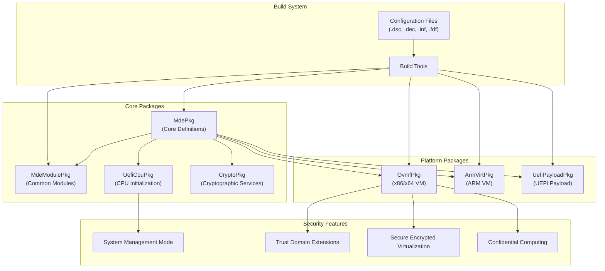
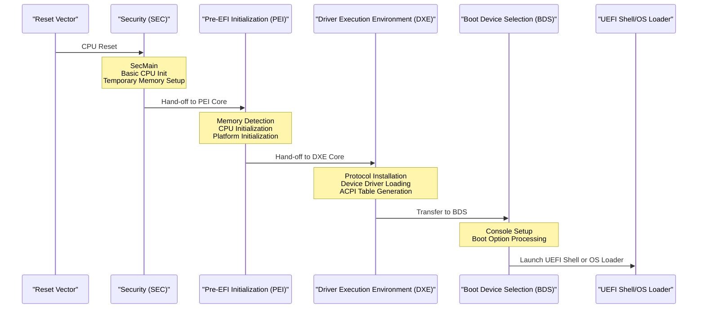
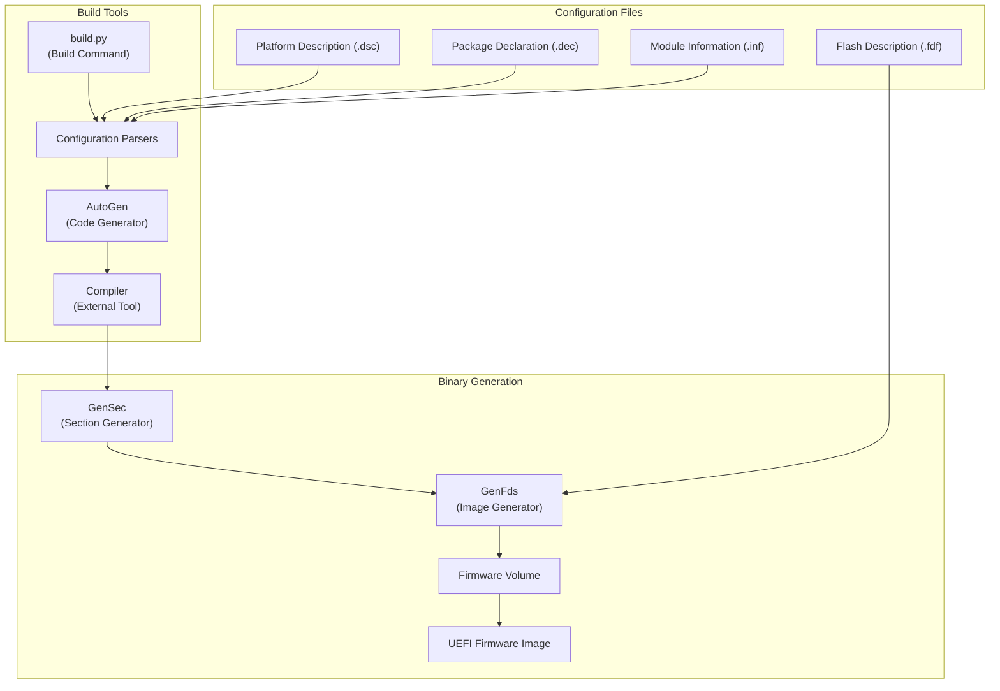
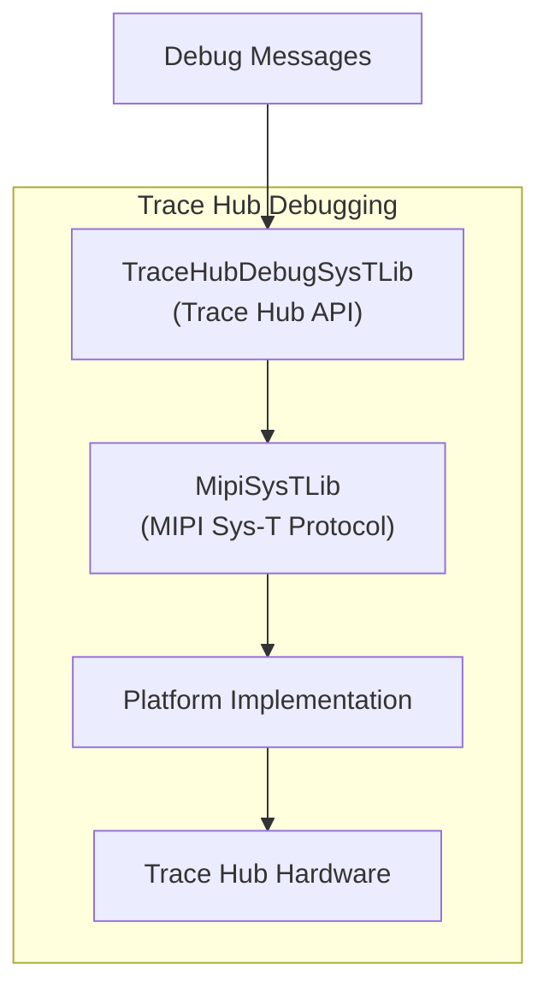
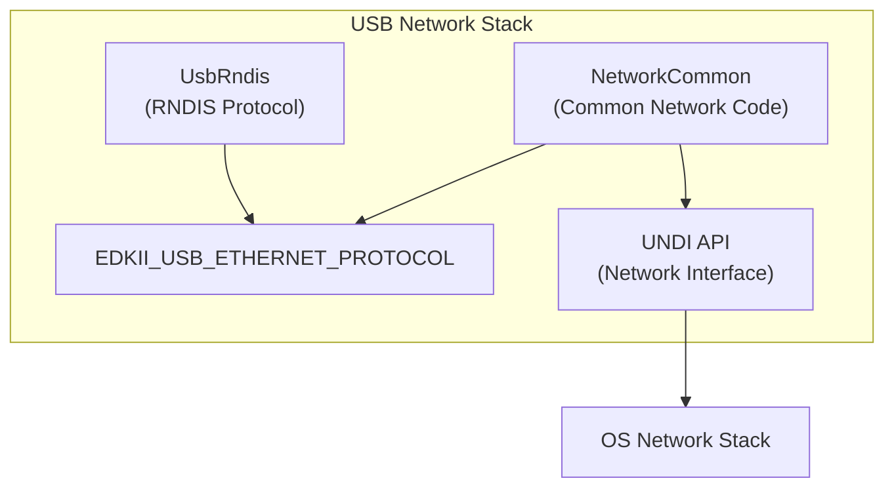
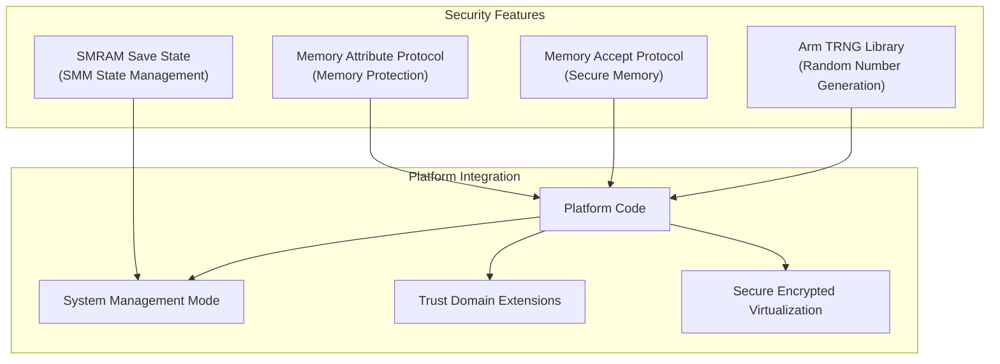

<!-- source: DeepWiki mcp.deepwiki.com · repo NVIDIA/edk2 · page 1 EDK II Overview · fetched 2026-10-26 -->

# EDK II Overview

Relevant source files

The following files were used as context for generating this wiki page:

- [Maintainers.txt](Maintainers.txt)
- [MdeModulePkg/Bus/Usb/UsbNetwork/NetworkCommon/ComponentName.c](MdeModulePkg/Bus/Usb/UsbNetwork/NetworkCommon/ComponentName.c)
- [MdeModulePkg/Bus/Usb/UsbNetwork/NetworkCommon/DriverBinding.c](MdeModulePkg/Bus/Usb/UsbNetwork/NetworkCommon/DriverBinding.c)
- [MdeModulePkg/Bus/Usb/UsbNetwork/NetworkCommon/DriverBinding.h](MdeModulePkg/Bus/Usb/UsbNetwork/NetworkCommon/DriverBinding.h)
- [MdeModulePkg/Bus/Usb/UsbNetwork/NetworkCommon/NetworkCommon.inf](MdeModulePkg/Bus/Usb/UsbNetwork/NetworkCommon/NetworkCommon.inf)
- [MdeModulePkg/Bus/Usb/UsbNetwork/NetworkCommon/PxeFunction.c](MdeModulePkg/Bus/Usb/UsbNetwork/NetworkCommon/PxeFunction.c)
- [MdeModulePkg/Bus/Usb/UsbNetwork/UsbRndis/ComponentName.c](MdeModulePkg/Bus/Usb/UsbNetwork/UsbRndis/ComponentName.c)
- [MdeModulePkg/Bus/Usb/UsbNetwork/UsbRndis/UsbRndis.c](MdeModulePkg/Bus/Usb/UsbNetwork/UsbRndis/UsbRndis.c)
- [MdeModulePkg/Bus/Usb/UsbNetwork/UsbRndis/UsbRndis.h](MdeModulePkg/Bus/Usb/UsbNetwork/UsbRndis/UsbRndis.h)
- [MdeModulePkg/Bus/Usb/UsbNetwork/UsbRndis/UsbRndis.inf](MdeModulePkg/Bus/Usb/UsbNetwork/UsbRndis/UsbRndis.inf)
- [MdeModulePkg/Bus/Usb/UsbNetwork/UsbRndis/UsbRndisFunction.c](MdeModulePkg/Bus/Usb/UsbNetwork/UsbRndis/UsbRndisFunction.c)
- [MdeModulePkg/Include/Protocol/FormBrowserEx.h](MdeModulePkg/Include/Protocol/FormBrowserEx.h)
- [MdePkg/Include/Guid/EventGroup.h](MdePkg/Include/Guid/EventGroup.h)
- [MdePkg/Include/IndustryStandard/IpmiKcs.h](MdePkg/Include/IndustryStandard/IpmiKcs.h)
- [MdePkg/Include/Library/ArmTrngLib.h](MdePkg/Include/Library/ArmTrngLib.h)
- [MdePkg/Include/Library/MipiSysTLib.h](MdePkg/Include/Library/MipiSysTLib.h)
- [MdePkg/Include/Library/TraceHubDebugSysTLib.h](MdePkg/Include/Library/TraceHubDebugSysTLib.h)
- [MdePkg/Include/LoongArch64/ProcessorBind.h](MdePkg/Include/LoongArch64/ProcessorBind.h)
- [MdePkg/Include/Protocol/MemoryAccept.h](MdePkg/Include/Protocol/MemoryAccept.h)
- [MdePkg/Include/Protocol/MemoryAttribute.h](MdePkg/Include/Protocol/MemoryAttribute.h)
- [MdePkg/Include/Register/Amd/SmramSaveStateMap.h](MdePkg/Include/Register/Amd/SmramSaveStateMap.h)
- [MdePkg/Library/MipiSysTLib/GenMipiSystH.py](MdePkg/Library/MipiSysTLib/GenMipiSystH.py)
- [MdePkg/Library/MipiSysTLib/MipiSysTLib.c](MdePkg/Library/MipiSysTLib/MipiSysTLib.c)
- [MdePkg/Library/MipiSysTLib/MipiSysTLib.inf](MdePkg/Library/MipiSysTLib/MipiSysTLib.inf)
- [MdePkg/Library/MipiSysTLib/Platform.c](MdePkg/Library/MipiSysTLib/Platform.c)
- [MdePkg/Library/MipiSysTLib/Platform.h](MdePkg/Library/MipiSysTLib/Platform.h)
- [MdePkg/Library/MipiSysTLib/Readme.md](MdePkg/Library/MipiSysTLib/Readme.md)
- [MdePkg/Library/MipiSysTLib/mipi_syst.h](MdePkg/Library/MipiSysTLib/mipi_syst.h)
- [MdePkg/Library/TraceHubDebugSysTLibNull/TraceHubDebugSysTLibNull.c](MdePkg/Library/TraceHubDebugSysTLibNull/TraceHubDebugSysTLibNull.c)
- [MdePkg/Library/TraceHubDebugSysTLibNull/TraceHubDebugSysTLibNull.inf](MdePkg/Library/TraceHubDebugSysTLibNull/TraceHubDebugSysTLibNull.inf)
- [MdePkg/Library/UefiDevicePathLib/DevicePathUtilitiesBase.c](MdePkg/Library/UefiDevicePathLib/DevicePathUtilitiesBase.c)
- [MdePkg/Library/UefiDevicePathLib/UefiDevicePathLibBase.inf](MdePkg/Library/UefiDevicePathLib/UefiDevicePathLibBase.inf)
- [MdePkg/MdePkg.ci.yaml](MdePkg/MdePkg.ci.yaml)
- [MdePkg/MdePkg.dec](MdePkg/MdePkg.dec)
- [MdePkg/MdePkg.dsc](MdePkg/MdePkg.dsc)

EDK II (UEFI Development Kit II) is a modern, open-source framework implementation of the Unified Extensible Firmware Interface (UEFI) specification. It provides the necessary tools, libraries, and definitions for developing UEFI-compliant firmware for various platforms and architectures. This overview explains the fundamental architecture, key components, and relationships within the EDK II codebase.

For information about the build system, see [Build System](#2). For information about specific platform implementations, see [Platform Support](#3).

## Key Components and Structure

EDK II is organized into a hierarchical structure of packages, each serving a specific purpose in the firmware development ecosystem. The core components of EDK II include packages with foundational definitions, platform-specific implementations, and services that facilitate various firmware operations.

Sources: [Maintainers.txt:1-675](Maintainers.txt:1-675), [MdePkg/MdePkg.dec:1-304](MdePkg/MdePkg.dec:1-304)

## MdePkg - The Foundation

The MdePkg (Module Development Environment Package) serves as the foundation of the EDK II framework. It provides the core definitions, library classes, and implementations needed by all other packages in the ecosystem.

Key characteristics of MdePkg:

- Defines the interfaces specified in the UEFI and PI specifications
- Provides platform-independent library classes and implementations
- Includes architecture-specific definitions for various CPU types
- Contains industry standard definitions for protocols and formats

### Library Class Architecture

MdePkg defines a comprehensive set of library classes that provide various services to EDK II modules. These library classes are implemented in different ways depending on the phase and environment in which they're used.

```mermaid
graph TD
    subgraph "Base Libraries"
        BaseLib["BaseLib\n(Core Functions)"]
        BaseMemoryLib["BaseMemoryLib\n(Memory Operations)"]
        DebugLib["DebugLib\n(Debug Services)"]
        IoLib["IoLib\n(I/O Operations)"]
        PcdLib["PcdLib\n(Platform Configuration)"]
    end
    
    subgraph "UEFI Libraries"
        UefiLib["UefiLib\n(UEFI Services)"]
        UefiBootServicesTableLib["UefiBootServicesTableLib"]
        UefiRuntimeServicesTableLib["UefiRuntimeServicesTableLib"]
        DevicePathLib["DevicePathLib"]
        UefiDriverEntryPoint["UefiDriverEntryPoint"]
        UefiApplicationEntryPoint["UefiApplicationEntryPoint"]
    end
    
    subgraph "PEI Libraries"
        PeiServicesLib["PeiServicesLib"]
        PeiServicesTablePointerLib["PeiServicesTablePointerLib"]
        PeimEntryPoint["PeimEntryPoint"]
    end
    
    subgraph "DXE Libraries"
        DxeServicesLib["DxeServicesLib"]
        DxeServicesTableLib["DxeServicesTableLib"]
        HobLib["HobLib"]
    end
    
    BaseLib --> UefiLib
    BaseMemoryLib --> UefiLib
    DebugLib --> UefiLib
    
    UefiBootServicesTableLib --> UefiLib
    UefiRuntimeServicesTableLib --> UefiLib
    DevicePathLib --> UefiDriverEntryPoint
    DevicePathLib --> UefiApplicationEntryPoint
    
    PcdLib --> PeiServicesLib
    PcdLib --> DxeServicesLib
    
    BaseLib --> PeiServicesLib
    BaseLib --> DxeServicesLib
```

Sources: [MdePkg/MdePkg.dec:54-303](MdePkg/MdePkg.dec:54-303), [MdePkg/MdePkg.dsc:35-142](MdePkg/MdePkg.dsc:35-142)

### Supported Architectures

EDK II provides cross-platform support for multiple architectures, including:

| Architecture | Description | Header Location |
|--------------|-------------|-----------------|
| IA32         | 32-bit x86  | Include/Ia32    |
| X64          | 64-bit x86  | Include/X64     |
| EBC          | EFI Byte Code | Include/Ebc   |
| ARM          | 32-bit ARM  | Include/Arm     |
| AARCH64      | 64-bit ARM  | Include/AArch64 |
| RISCV64      | 64-bit RISC-V | Include/RiscV64 |
| LOONGARCH64  | 64-bit LoongArch | Include/LoongArch64 |

Sources: [MdePkg/MdePkg.dec:33-52](MdePkg/MdePkg.dec:33-52), [MdePkg/Include/LoongArch64/ProcessorBind.h:1-121](MdePkg/Include/LoongArch64/ProcessorBind.h:1-121)

## Firmware Execution Flow

The UEFI firmware execution progresses through several defined phases, each with specific responsibilities in the boot process.

The firmware execution flow is coordinated through a series of event notifications. EDK II defines several standard event groups for significant phases in the boot process:

| Event Group | GUID | Purpose |
|-------------|------|---------|
| ExitBootServices | gEfiEventExitBootServicesGuid | Signals when boot services are about to terminate |
| ReadyToBoot | gEfiEventReadyToBootGuid | Signals when system is about to load OS |
| MemoryMapChange | gEfiEventMemoryMapChangeGuid | Signals when memory map has changed |
| VirtualAddressChange | gEfiEventVirtualAddressChangeGuid | Signals when virtual addressing starts |
| EndOfDxe | gEfiEndOfDxeEventGroupGuid | Signals end of DXE phase initialization |

Sources: [MdePkg/Include/Guid/EventGroup.h:1-53](MdePkg/Include/Guid/EventGroup.h:1-53)

## Build System

The EDK II build system transforms source code into firmware images through a well-defined process that handles dependencies, generates intermediate files, and creates the final binary outputs.

The build system typically runs CI (Continuous Integration) tests to ensure code quality, as specified in configuration files like `MdePkg.ci.yaml`.

Sources: [MdePkg/MdePkg.ci.yaml:1-189](MdePkg/MdePkg.ci.yaml:1-189)

## Recent Additions and Technologies

EDK II is continuously evolving with new features and technologies. Some recent additions include:

### Trace Hub Debug Support

The TraceHubDebugSysTLib provides an interface for outputting debug messages to a Trace Hub, which offers an alternative debugging channel that can be useful when traditional debug methods aren't available.

Sources: [MdePkg/Include/Library/TraceHubDebugSysTLib.h:1-82](MdePkg/Include/Library/TraceHubDebugSysTLib.h:1-82), [MdePkg/Library/TraceHubDebugSysTLibNull/TraceHubDebugSysTLibNull.c:1-77](MdePkg/Library/TraceHubDebugSysTLibNull/TraceHubDebugSysTLibNull.c:1-77), [MdePkg/Library/MipiSysTLib/MipiSysTLib.c:1-14](MdePkg/Library/MipiSysTLib/MipiSysTLib.c:1-14)

### USB Network Support

Recent additions to the MdeModulePkg include USB networking capabilities, specifically support for the RNDIS (Remote Network Driver Interface Specification) protocol, allowing for UEFI network functionality over USB connections.

Sources: [MdeModulePkg/Bus/Usb/UsbNetwork/UsbRndis/UsbRndis.h:1-265](MdeModulePkg/Bus/Usb/UsbNetwork/UsbRndis/UsbRndis.h:1-265), [MdeModulePkg/Bus/Usb/UsbNetwork/UsbRndis/UsbRndis.c:1-183](MdeModulePkg/Bus/Usb/UsbNetwork/UsbRndis/UsbRndis.c:1-183), [MdeModulePkg/Bus/Usb/UsbNetwork/NetworkCommon/DriverBinding.h:1-84](MdeModulePkg/Bus/Usb/UsbNetwork/NetworkCommon/DriverBinding.h:1-84)

### Security Features

EDK II includes extensive security features, including:

- System Management Mode (SMM) for privileged system management
- Memory protection mechanisms through the Memory Attribute Protocol
- Cryptographic services through the CryptoPkg
- Hardware security features like ARM TRNG (True Random Number Generator) support
- Confidential Computing features like AMD SEV and Intel TDX

Sources: [MdePkg/Include/Protocol/MemoryAttribute.h:1-47](MdePkg/Include/Protocol/MemoryAttribute.h:1-47), [MdePkg/Include/Protocol/MemoryAccept.h:1-38](MdePkg/Include/Protocol/MemoryAccept.h:1-38), [MdePkg/Include/Library/ArmTrngLib.h:1-21](MdePkg/Include/Library/ArmTrngLib.h:1-21), [MdePkg/Include/Register/Amd/SmramSaveStateMap.h:1-195](MdePkg/Include/Register/Amd/SmramSaveStateMap.h:1-195)

## Conclusion

EDK II provides a comprehensive framework for developing UEFI-compliant firmware across multiple architectures and platforms. Its modular design, extensive library support, and standardized interfaces create a flexible ecosystem for firmware development. The framework continues to evolve with new features, improved security mechanisms, and support for the latest hardware technologies.

Sources: [Maintainers.txt:56-675](Maintainers.txt:56-675), [MdePkg/MdePkg.dec:1-646](MdePkg/MdePkg.dec:1-646), [MdePkg/MdePkg.dsc:1-204](MdePkg/MdePkg.dsc:1-204)

---

