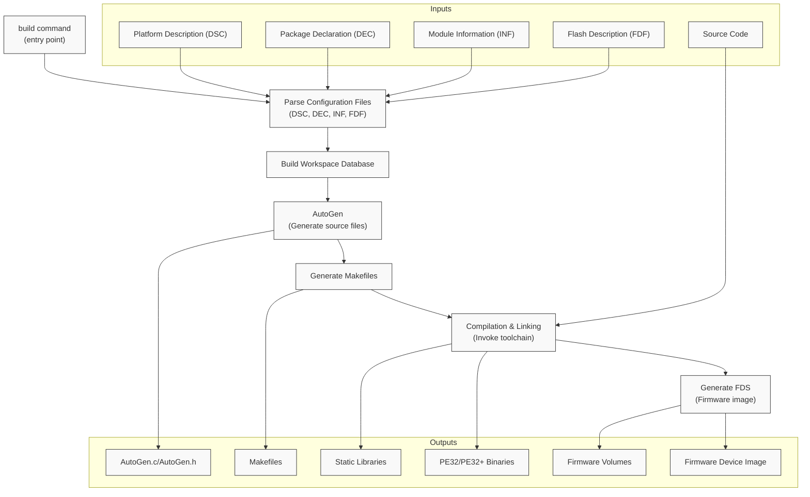
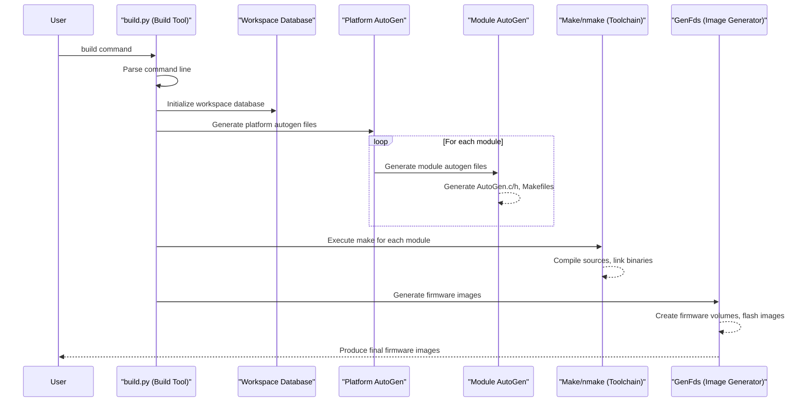
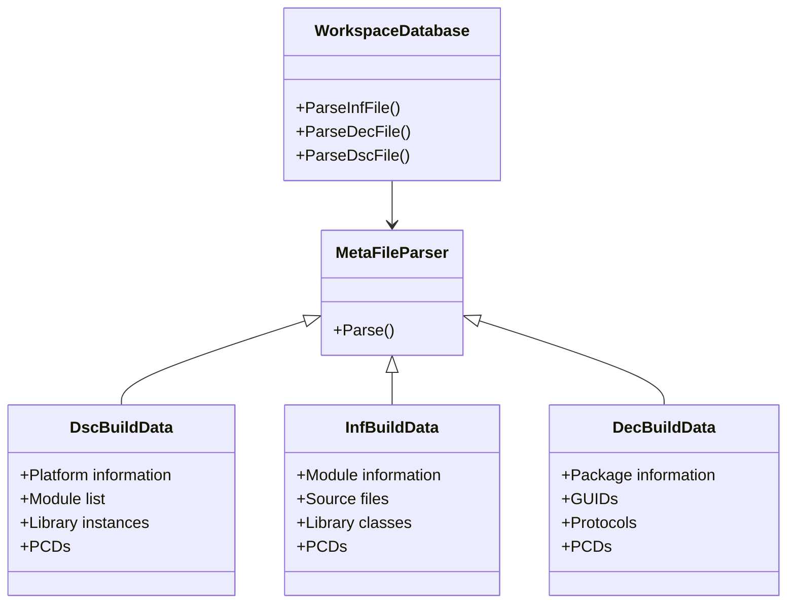
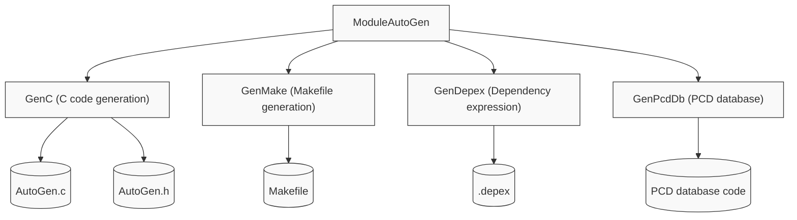
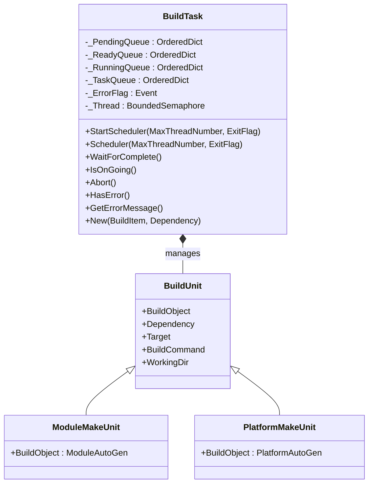
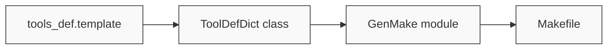
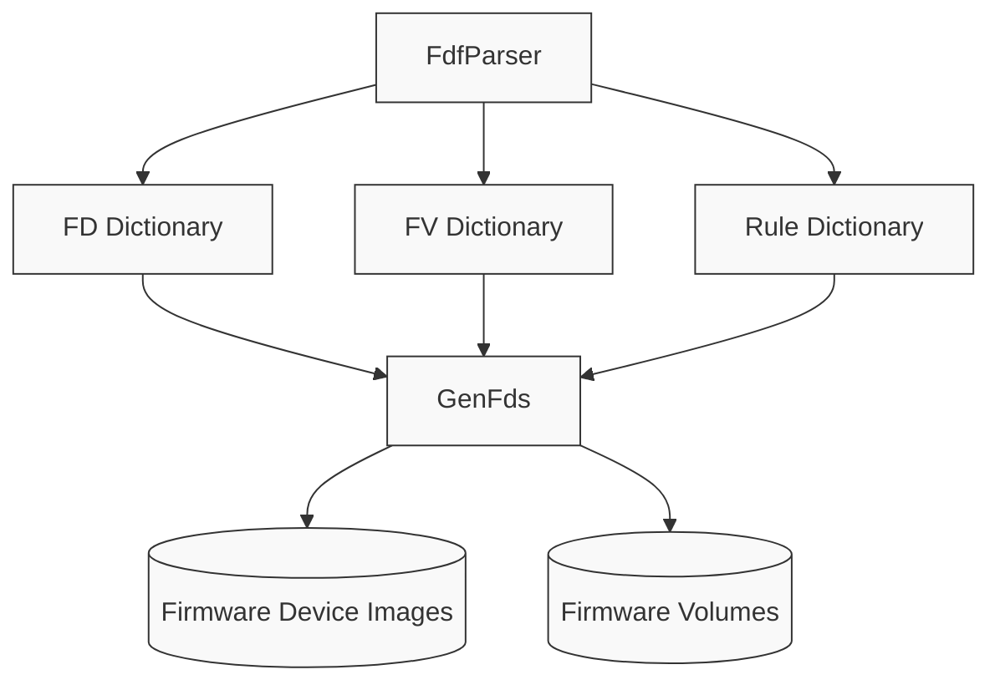
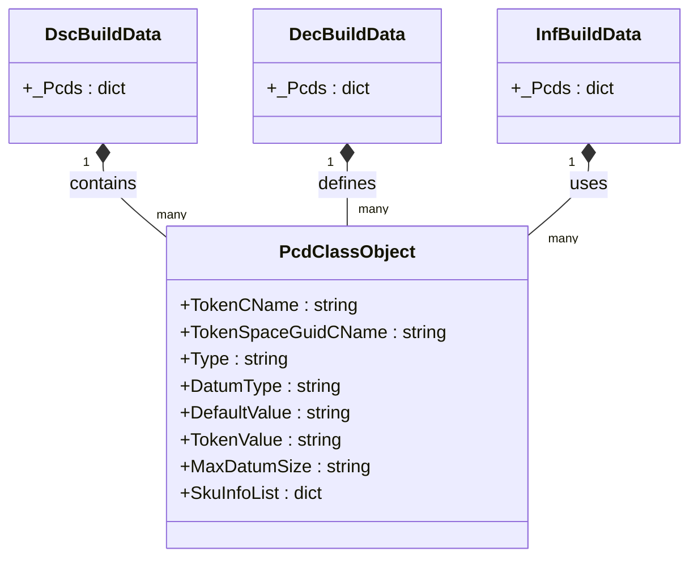

<!-- source: DeepWiki mcp.deepwiki.com · repo NVIDIA/edk2 · page 2 Build System · fetched 2026-10-26 -->

# Build System

<details>
<summary>Relevant source files</summary>

The following files were used as context for generating this wiki page:

- [ArmPkg/Library/GnuNoteBti.bin](ArmPkg/Library/GnuNoteBti.bin)
- [BaseTools/BinWrappers/PosixLike/AmlToC](BaseTools/BinWrappers/PosixLike/AmlToC)
- [BaseTools/BinWrappers/WindowsLike/AmlToC.bat](BaseTools/BinWrappers/WindowsLike/AmlToC.bat)
- [BaseTools/BuildEnv](BaseTools/BuildEnv)
- [BaseTools/Conf/build_rule.template](BaseTools/Conf/build_rule.template)
- [BaseTools/Conf/target.template](BaseTools/Conf/target.template)
- [BaseTools/Conf/tools_def.template](BaseTools/Conf/tools_def.template)
- [BaseTools/Scripts/SetVisualStudio.bat](BaseTools/Scripts/SetVisualStudio.bat)
- [BaseTools/Scripts/ShowEnvironment.bat](BaseTools/Scripts/ShowEnvironment.bat)
- [BaseTools/Source/C/GenFfs/GenFfs.c](BaseTools/Source/C/GenFfs/GenFfs.c)
- [BaseTools/Source/C/GenSec/GenSec.c](BaseTools/Source/C/GenSec/GenSec.c)
- [BaseTools/Source/C/Include/Common/BaseTypes.h](BaseTools/Source/C/Include/Common/BaseTypes.h)
- [BaseTools/Source/C/Include/Common/PiFirmwareFile.h](BaseTools/Source/C/Include/Common/PiFirmwareFile.h)
- [BaseTools/Source/Python/AmlToC/AmlToC.py](BaseTools/Source/Python/AmlToC/AmlToC.py)
- [BaseTools/Source/Python/AutoGen/AutoGen.py](BaseTools/Source/Python/AutoGen/AutoGen.py)
- [BaseTools/Source/Python/AutoGen/AutoGenWorker.py](BaseTools/Source/Python/AutoGen/AutoGenWorker.py)
- [BaseTools/Source/Python/AutoGen/BuildEngine.py](BaseTools/Source/Python/AutoGen/BuildEngine.py)
- [BaseTools/Source/Python/AutoGen/DataPipe.py](BaseTools/Source/Python/AutoGen/DataPipe.py)
- [BaseTools/Source/Python/AutoGen/GenC.py](BaseTools/Source/Python/AutoGen/GenC.py)
- [BaseTools/Source/Python/AutoGen/GenMake.py](BaseTools/Source/Python/AutoGen/GenMake.py)
- [BaseTools/Source/Python/AutoGen/GenPcdDb.py](BaseTools/Source/Python/AutoGen/GenPcdDb.py)
- [BaseTools/Source/Python/AutoGen/GenVar.py](BaseTools/Source/Python/AutoGen/GenVar.py)
- [BaseTools/Source/Python/AutoGen/IncludesAutoGen.py](BaseTools/Source/Python/AutoGen/IncludesAutoGen.py)
- [BaseTools/Source/Python/AutoGen/ModuleAutoGen.py](BaseTools/Source/Python/AutoGen/ModuleAutoGen.py)
- [BaseTools/Source/Python/AutoGen/ModuleAutoGenHelper.py](BaseTools/Source/Python/AutoGen/ModuleAutoGenHelper.py)
- [BaseTools/Source/Python/AutoGen/PlatformAutoGen.py](BaseTools/Source/Python/AutoGen/PlatformAutoGen.py)
- [BaseTools/Source/Python/AutoGen/StrGather.py](BaseTools/Source/Python/AutoGen/StrGather.py)
- [BaseTools/Source/Python/AutoGen/WorkspaceAutoGen.py](BaseTools/Source/Python/AutoGen/WorkspaceAutoGen.py)
- [BaseTools/Source/Python/BPDG/GenVpd.py](BaseTools/Source/Python/BPDG/GenVpd.py)
- [BaseTools/Source/Python/Common/DataType.py](BaseTools/Source/Python/Common/DataType.py)
- [BaseTools/Source/Python/Common/Expression.py](BaseTools/Source/Python/Common/Expression.py)
- [BaseTools/Source/Python/Common/GlobalData.py](BaseTools/Source/Python/Common/GlobalData.py)
- [BaseTools/Source/Python/Common/Misc.py](BaseTools/Source/Python/Common/Misc.py)
- [BaseTools/Source/Python/Common/RangeExpression.py](BaseTools/Source/Python/Common/RangeExpression.py)
- [BaseTools/Source/Python/Common/StringUtils.py](BaseTools/Source/Python/Common/StringUtils.py)
- [BaseTools/Source/Python/Common/TargetTxtClassObject.py](BaseTools/Source/Python/Common/TargetTxtClassObject.py)
- [BaseTools/Source/Python/Common/ToolDefClassObject.py](BaseTools/Source/Python/Common/ToolDefClassObject.py)
- [BaseTools/Source/Python/Common/VpdInfoFile.py](BaseTools/Source/Python/Common/VpdInfoFile.py)
- [BaseTools/Source/Python/GenFds/DataSection.py](BaseTools/Source/Python/GenFds/DataSection.py)
- [BaseTools/Source/Python/GenFds/EfiSection.py](BaseTools/Source/Python/GenFds/EfiSection.py)
- [BaseTools/Source/Python/GenFds/FdfParser.py](BaseTools/Source/Python/GenFds/FdfParser.py)
- [BaseTools/Source/Python/GenFds/FfsInfStatement.py](BaseTools/Source/Python/GenFds/FfsInfStatement.py)
- [BaseTools/Source/Python/GenFds/Fv.py](BaseTools/Source/Python/GenFds/Fv.py)
- [BaseTools/Source/Python/GenFds/FvImageSection.py](BaseTools/Source/Python/GenFds/FvImageSection.py)
- [BaseTools/Source/Python/GenFds/GenFds.py](BaseTools/Source/Python/GenFds/GenFds.py)
- [BaseTools/Source/Python/GenFds/GenFdsGlobalVariable.py](BaseTools/Source/Python/GenFds/GenFdsGlobalVariable.py)
- [BaseTools/Source/Python/GenFds/Region.py](BaseTools/Source/Python/GenFds/Region.py)
- [BaseTools/Source/Python/GenFds/Section.py](BaseTools/Source/Python/GenFds/Section.py)
- [BaseTools/Source/Python/PatchPcdValue/PatchPcdValue.py](BaseTools/Source/Python/PatchPcdValue/PatchPcdValue.py)
- [BaseTools/Source/Python/TargetTool/TargetTool.py](BaseTools/Source/Python/TargetTool/TargetTool.py)
- [BaseTools/Source/Python/UPT/Library/DataType.py](BaseTools/Source/Python/UPT/Library/DataType.py)
- [BaseTools/Source/Python/Workspace/BuildClassObject.py](BaseTools/Source/Python/Workspace/BuildClassObject.py)
- [BaseTools/Source/Python/Workspace/DecBuildData.py](BaseTools/Source/Python/Workspace/DecBuildData.py)
- [BaseTools/Source/Python/Workspace/DscBuildData.py](BaseTools/Source/Python/Workspace/DscBuildData.py)
- [BaseTools/Source/Python/Workspace/InfBuildData.py](BaseTools/Source/Python/Workspace/InfBuildData.py)
- [BaseTools/Source/Python/Workspace/MetaDataTable.py](BaseTools/Source/Python/Workspace/MetaDataTable.py)
- [BaseTools/Source/Python/Workspace/MetaFileParser.py](BaseTools/Source/Python/Workspace/MetaFileParser.py)
- [BaseTools/Source/Python/Workspace/MetaFileTable.py](BaseTools/Source/Python/Workspace/MetaFileTable.py)
- [BaseTools/Source/Python/Workspace/WorkspaceCommon.py](BaseTools/Source/Python/Workspace/WorkspaceCommon.py)
- [BaseTools/Source/Python/Workspace/WorkspaceDatabase.py](BaseTools/Source/Python/Workspace/WorkspaceDatabase.py)
- [BaseTools/Source/Python/build/BuildReport.py](BaseTools/Source/Python/build/BuildReport.py)
- [BaseTools/Source/Python/build/build.py](BaseTools/Source/Python/build/build.py)
- [BaseTools/Source/Python/build/buildoptions.py](BaseTools/Source/Python/build/buildoptions.py)
- [BaseTools/Tests/PythonTest.py](BaseTools/Tests/PythonTest.py)
- [BaseTools/Tests/RunTests.py](BaseTools/Tests/RunTests.py)
- [BaseTools/get_vsvars.bat](BaseTools/get_vsvars.bat)
- [BaseTools/set_vsprefix_envs.bat](BaseTools/set_vsprefix_envs.bat)
- [BaseTools/toolsetup.bat](BaseTools/toolsetup.bat)
- [edksetup.bat](edksetup.bat)
- [edksetup.sh](edksetup.sh)

</details>


The EDK II build system transforms platform description files, module source code, and other inputs into UEFI firmware binaries. This document explains the architecture of the build system, the build process flow, key components, and configuration files used in the build process.

## Architecture Overview

The EDK II build system is primarily implemented in Python with supporting batch files and shell scripts for environment setup. It orchestrates the build process by parsing configuration files, generating source files and makefiles, invoking toolchains, and producing final firmware images.



**Build System Architecture**

Sources: [BaseTools/Source/Python/build/build.py:1-114](), [BaseTools/Source/Python/AutoGen/AutoGen.py:1-114](), [BaseTools/Source/Python/GenFds/GenFds.py:1-89]()

## Environment Setup

Before using the build system, the development environment must be configured. This is done using the `edksetup.bat` (Windows) or `edksetup.sh` (Linux/macOS) scripts, which call `BaseTools/toolsetup.bat` or equivalent to set up necessary environment variables and paths.

Key environment variables include:
- `WORKSPACE`: The root directory of the EDK II workspace
- `EDK_TOOLS_PATH`: The directory containing the build tools
- `PACKAGES_PATH`: Additional directories containing packages (optional)

Sources: [BaseTools/toolsetup.bat:1-14](), [edksetup.bat:1-5](), [edksetup.sh:1-5]()

## Build Process Flow



**Build Process Flow**

Sources: [BaseTools/Source/Python/build/build.py:67-119](), [BaseTools/Source/Python/build/build.py:293-368]()

## Build Components in Detail

### 1. Workspace Management

The build process begins by setting up a workspace database that tracks all packages, modules, libraries, and other components. This database is populated by parsing the configuration files and is used throughout the build process.



**Workspace Database Class Relationships**

Sources: [BaseTools/Source/Python/Workspace/WorkspaceDatabase.py](), [BaseTools/Source/Python/Workspace/DscBuildData.py:1-20](), [BaseTools/Source/Python/Workspace/InfBuildData.py:1-30](), [BaseTools/Source/Python/Workspace/DecBuildData.py:1-20]()

### 2. Configuration Files Parsing

The build system uses several types of configuration files:

#### Platform Description (DSC) Files

DSC files define the platform being built, including:
- Platform information (name, GUID, version)
- Modules to be built
- Library instances to be used
- Platform-specific PCDs (Platform Configuration Database entries)
- Build options

Example DSC file section (simplified):
```
[Defines]
  PLATFORM_NAME           = MyPlatform
  PLATFORM_GUID           = 12345678-1234-1234-1234-123456789012
  PLATFORM_VERSION        = 0.1
  
[LibraryClasses]
  BaseLib|MdePkg/Library/BaseLib/BaseLib.inf
  
[Components]
  MyPkg/MyModule/MyModule.inf
```

DSC files are parsed by the `DscBuildData` class, which extracts platform information, modules, libraries, PCDs, and build options.

Sources: [BaseTools/Source/Python/Workspace/DscBuildData.py:20-100](), [BaseTools/Source/Python/Workspace/DscBuildData.py:183-207]()

#### Module Information (INF) Files

INF files define individual modules, including:
- Module information (name, GUID, version)
- Module type (PEIM, DXE_DRIVER, etc.)
- Source files
- Library classes needed
- Protocols/PPIs consumed or produced
- GUIDs used
- Module-specific PCDs

Example INF file section (simplified):
```
[Defines]
  INF_VERSION             = 0x00010005
  BASE_NAME               = MyModule
  FILE_GUID               = 12345678-1234-1234-1234-123456789012
  MODULE_TYPE             = DXE_DRIVER
  
[Sources]
  MyModule.c
  
[LibraryClasses]
  BaseLib
  UefiBootServicesTableLib
```

INF files are parsed by the `InfBuildData` class, which extracts module information, source files, library dependencies, and other module-specific data.

Sources: [BaseTools/Source/Python/Workspace/InfBuildData.py:62-100]()

#### Package Declaration (DEC) Files

DEC files define packages, including:
- Package information (name, GUID, version)
- GUIDs, Protocols, PPIs provided by the package
- PCDs defined by the package
- Include paths

Example DEC file section (simplified):
```
[Defines]
  DEC_SPECIFICATION       = 0x00010005
  PACKAGE_NAME            = MyPackage
  PACKAGE_GUID            = 12345678-1234-1234-1234-123456789012
  
[Guids]
  gMyPkgTokenSpaceGuid    = { 0x12345678, 0x1234, 0x1234, { 0x12, 0x34, 0x56, 0x78, 0x9a, 0xbc, 0xde, 0xf0 } }
  
[Protocols]
  gMyProtocolGuid         = { 0x12345678, 0x1234, 0x1234, { 0x12, 0x34, 0x56, 0x78, 0x9a, 0xbc, 0xde, 0xf0 } }
```

DEC files are parsed by the `DecBuildData` class, which extracts package information, GUIDs, protocols, and PCDs.

Sources: [BaseTools/Source/Python/Workspace/DecBuildData.py:1-20]()

#### Flash Description (FDF) Files

FDF files define the flash layout and firmware volumes, including:
- Flash device layout (regions)
- Firmware volumes
- Firmware files (modules) to include in each volume
- Rules for processing files

Example FDF file section (simplified):
```
[FD.MyFlashDevice]
  BaseAddress   = 0xFF800000
  Size          = 0x00800000
  
[FV.MyFirmwareVolume]
  FvAlignment   = 16
  
  INF MyPkg/MyModule/MyModule.inf
```

FDF files are parsed by the `FdfParser` class, which extracts flash layout information, firmware volumes, and firmware files.

Sources: [BaseTools/Source/Python/GenFds/FdfParser.py:1-100]()

### 3. AutoGen Process

The AutoGen process generates C code, header files, and makefiles needed to build modules. This includes:

- `AutoGen.c` - Contains generated code such as PCD access methods, entry points, and configuration data
- `AutoGen.h` - Contains declarations, PCD definitions, and other generated information
- Makefiles - Used by the toolchain to compile and link the module

The AutoGen process is performed by the `PlatformAutoGen` and `ModuleAutoGen` classes, which generate platform-level and module-level files respectively.



**AutoGen Components**

Sources: [BaseTools/Source/Python/AutoGen/ModuleAutoGen.py:1-24](), [BaseTools/Source/Python/AutoGen/GenC.py:1-57](), [BaseTools/Source/Python/AutoGen/GenMake.py:1-60](), [BaseTools/Source/Python/AutoGen/GenPcdDb.py:1-25]()

### 4. Build Tasks Management

The build system manages build tasks using the `BuildTask` class, which schedules and executes the compilation of modules. The process is multi-threaded to improve performance.



**Build Task Management Classes**

Sources: [BaseTools/Source/Python/build/build.py:285-556]()

### 5. Toolchain Integration

The build system integrates with different toolchains (compilers, linkers, etc.) through a toolchain definition file (`tools_def.template`). This file defines:

- Paths to toolchain executables
- Compiler flags
- Linker flags
- Other toolchain-specific settings

The toolchain definitions are processed and used to generate appropriate makefiles and build commands.



**Toolchain Integration Flow**

Sources: [BaseTools/Conf/tools_def.template:1-30](), [BaseTools/Source/Python/Common/ToolDefClassObject.py]()

The toolchain definition file is structured with patterns like:

```
*_TOOLCHAIN_ARCH_COMMANDTYPE_ATTRIBUTE = Value
```

Where:
- `*` is a wildcard matching any target or tool
- `TOOLCHAIN` is the toolchain family (MSFT, GCC, etc.)
- `ARCH` is the architecture (IA32, X64, etc.)
- `COMMANDTYPE` is the command type (CC, LINK, ASM, etc.)
- `ATTRIBUTE` is the attribute (FLAGS, PATH, etc.)

Sources: [BaseTools/Source/Python/AutoGen/AutoGen.py:74-114]()

### 6. Firmware Image Generation

After modules are built, the build system generates firmware images using the GenFds module. This process:

1. Parses the FDF file
2. Creates firmware volumes (FVs)
3. Adds firmware files (FFs) to volumes
4. Creates firmware device (FD) images



**Firmware Image Generation Components**

Sources: [BaseTools/Source/Python/GenFds/GenFds.py:1-60](), [BaseTools/Source/Python/GenFds/FdfParser.py:1-60](), [BaseTools/Source/Python/GenFds/Fv.py:1-20]()

## Build Rules

The build system uses build rules to specify how different file types should be processed. These rules are defined in the build_rule.template file and specify:

- How to process different source file types
- How to generate output files
- Command-line options for toolchain tools

Example rule (simplified):
```
[C-Code-File]
  <InputFile>
    ?.c
  <ExtraDependency>
    $(MAKE_FILE)
  <OutputFile>
    $(OUTPUT_DIR)(+)${s_dir}(+)${s_base}.obj
  <Command>
    "$(CC)" /Fo${dst} $(CC_FLAGS) $(INC) ${src}
```

Sources: [BaseTools/Conf/build_rule.template:1-85]()

## Building with the EDK II Build System

### Common Build Commands

The build command has the following format:
```
build [options] [target]
```

Common options include:
- `-p, --platform`: Specify platform DSC file
- `-m, --module`: Specify module INF file
- `-a, --arch`: Specify architecture
- `-t, --tagname`: Specify toolchain
- `-b, --buildtarget`: Specify build target (DEBUG/RELEASE)

Common targets include:
- `all`: Build all modules (default)
- `modules`: Build modules only
- `libraries`: Build libraries only
- `fds`: Build firmware image
- `clean`: Clean intermediate files
- `cleanall`: Clean all generated files

Sources: [BaseTools/Source/Python/build/build.py:66-69]()

### Build Process Example

A typical build process for a platform might look like:

1. Setup environment:
   ```bash
   . edksetup.sh
   ```

2. Build a platform:
   ```bash
   build -p OvmfPkg/OvmfPkgX64.dsc -a X64 -t GCC5
   ```

3. Build a single module:
   ```bash
   build -p OvmfPkg/OvmfPkgX64.dsc -m MdeModulePkg/Core/Dxe/DxeMain.inf -a X64 -t GCC5
   ```

4. Clean build outputs:
   ```bash
   build -p OvmfPkg/OvmfPkgX64.dsc -a X64 -t GCC5 clean
   ```

## Platform Configuration Database (PCD)

PCDs are a key mechanism in EDK II for configuring modules and platforms. The build system processes PCD definitions and values from DEC, INF, and DSC files, and generates code to access PCDs.

PCD types include:
- FeatureFlag: Boolean value for enabling/disabling features
- FixedAtBuild: Value fixed at build time
- PatchableInModule: Value can be patched in the binary module
- Dynamic/DynamicEx: Value set at runtime
- DynamicHii/DynamicExHii: Value from HII
- DynamicVpd/DynamicExVpd: Value from VPD



**PCD Processing Classes**

Sources: [BaseTools/Source/Python/Workspace/BuildClassObject.py:48-115](), [BaseTools/Source/Python/AutoGen/GenPcdDb.py:1-24]()

## Conclusion

The EDK II build system is a comprehensive set of tools that automate the process of building firmware images from source code and configuration files. It handles the complexity of module dependencies, platform configurations, and toolchain integration, allowing developers to focus on writing UEFI code rather than managing build details.

The build system's modular design makes it extensible and adaptable to different platforms, architectures, and toolchains. By understanding the build system's architecture and components, developers can more effectively customize their build process and troubleshoot build issues.

For information on specific platforms and how to build them, see the Platform Support documentation [Platform Support](#3).

Sources: [BaseTools/Source/Python/build/build.py](), [BaseTools/Source/Python/AutoGen](), [BaseTools/Source/Python/Workspace](), [BaseTools/Source/Python/GenFds]()

---

