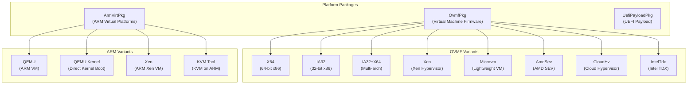
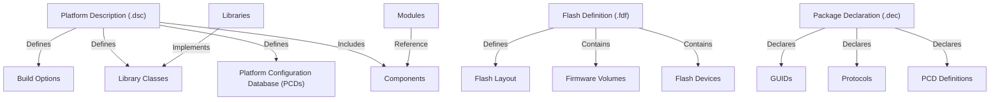
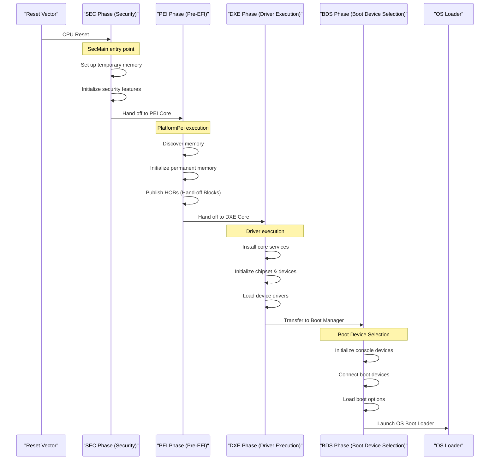
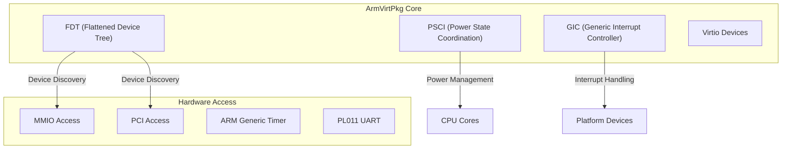
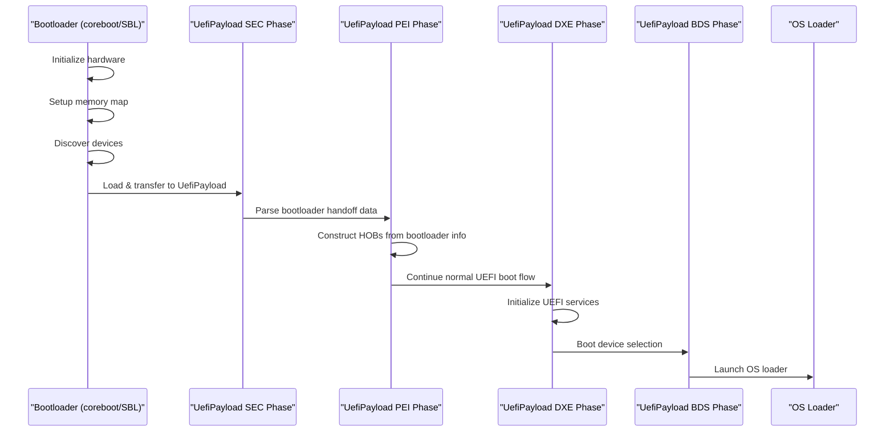

<!-- source: DeepWiki mcp.deepwiki.com · repo NVIDIA/edk2 · page 3 Platform Support · fetched 2026-10-26 -->

# Platform Support

Relevant source files

The following files were used as context for generating this wiki page:

- [ArmPkg/Drivers/ArmPciCpuIo2Dxe/ArmPciCpuIo2Dxe.inf](ArmPkg/Drivers/ArmPciCpuIo2Dxe/ArmPciCpuIo2Dxe.inf)
- [ArmVirtPkg/ArmVirt.dsc.inc](ArmVirtPkg/ArmVirt.dsc.inc)
- [ArmVirtPkg/ArmVirtCloudHv.dsc](ArmVirtPkg/ArmVirtCloudHv.dsc)
- [ArmVirtPkg/ArmVirtCloudHv.fdf](ArmVirtPkg/ArmVirtCloudHv.fdf)
- [ArmVirtPkg/ArmVirtKvmTool.dsc](ArmVirtPkg/ArmVirtKvmTool.dsc)
- [ArmVirtPkg/ArmVirtKvmTool.fdf](ArmVirtPkg/ArmVirtKvmTool.fdf)
- [ArmVirtPkg/ArmVirtPkg.dec](ArmVirtPkg/ArmVirtPkg.dec)
- [ArmVirtPkg/ArmVirtQemu.dsc](ArmVirtPkg/ArmVirtQemu.dsc)
- [ArmVirtPkg/ArmVirtQemu.fdf](ArmVirtPkg/ArmVirtQemu.fdf)
- [ArmVirtPkg/ArmVirtQemuFvMain.fdf.inc](ArmVirtPkg/ArmVirtQemuFvMain.fdf.inc)
- [ArmVirtPkg/ArmVirtQemuKernel.dsc](ArmVirtPkg/ArmVirtQemuKernel.dsc)
- [ArmVirtPkg/ArmVirtQemuKernel.fdf](ArmVirtPkg/ArmVirtQemuKernel.fdf)
- [ArmVirtPkg/ArmVirtRules.fdf.inc](ArmVirtPkg/ArmVirtRules.fdf.inc)
- [ArmVirtPkg/ArmVirtXen.dsc](ArmVirtPkg/ArmVirtXen.dsc)
- [ArmVirtPkg/ArmVirtXen.fdf](ArmVirtPkg/ArmVirtXen.fdf)
- [ArmVirtPkg/CloudHvAcpiPlatformDxe/CloudHvAcpi.c](ArmVirtPkg/CloudHvAcpiPlatformDxe/CloudHvAcpi.c)
- [ArmVirtPkg/CloudHvAcpiPlatformDxe/CloudHvAcpiPlatformDxe.inf](ArmVirtPkg/CloudHvAcpiPlatformDxe/CloudHvAcpiPlatformDxe.inf)
- [ArmVirtPkg/CloudHvPlatformHasAcpiDtDxe/CloudHvHasAcpiDtDxe.c](ArmVirtPkg/CloudHvPlatformHasAcpiDtDxe/CloudHvHasAcpiDtDxe.c)
- [ArmVirtPkg/CloudHvPlatformHasAcpiDtDxe/CloudHvHasAcpiDtDxe.inf](ArmVirtPkg/CloudHvPlatformHasAcpiDtDxe/CloudHvHasAcpiDtDxe.inf)
- [ArmVirtPkg/Include/Guid/Early16550UartBaseAddress.h](ArmVirtPkg/Include/Guid/Early16550UartBaseAddress.h)
- [ArmVirtPkg/KvmtoolPlatformDxe/KvmtoolPlatformDxe.c](ArmVirtPkg/KvmtoolPlatformDxe/KvmtoolPlatformDxe.c)
- [ArmVirtPkg/KvmtoolPlatformDxe/KvmtoolPlatformDxe.inf](ArmVirtPkg/KvmtoolPlatformDxe/KvmtoolPlatformDxe.inf)
- [ArmVirtPkg/Library/ArmVirtPsciResetSystemPeiLib/ArmVirtPsciResetSystemPeiLib.c](ArmVirtPkg/Library/ArmVirtPsciResetSystemPeiLib/ArmVirtPsciResetSystemPeiLib.c)
- [ArmVirtPkg/Library/ArmVirtPsciResetSystemPeiLib/ArmVirtPsciResetSystemPeiLib.inf](ArmVirtPkg/Library/ArmVirtPsciResetSystemPeiLib/ArmVirtPsciResetSystemPeiLib.inf)
- [ArmVirtPkg/Library/KvmtoolRtcFdtClientLib/KvmtoolRtcFdtClientLib.c](ArmVirtPkg/Library/KvmtoolRtcFdtClientLib/KvmtoolRtcFdtClientLib.c)
- [ArmVirtPkg/Library/KvmtoolRtcFdtClientLib/KvmtoolRtcFdtClientLib.inf](ArmVirtPkg/Library/KvmtoolRtcFdtClientLib/KvmtoolRtcFdtClientLib.inf)
- [ArmVirtPkg/Library/KvmtoolVirtMemInfoLib/KvmtoolVirtMemInfoLib.c](ArmVirtPkg/Library/KvmtoolVirtMemInfoLib/KvmtoolVirtMemInfoLib.c)
- [ArmVirtPkg/Library/KvmtoolVirtMemInfoLib/KvmtoolVirtMemInfoLib.inf](ArmVirtPkg/Library/KvmtoolVirtMemInfoLib/KvmtoolVirtMemInfoLib.inf)
- [ArmVirtPkg/Library/NorFlashKvmtoolLib/NorFlashKvmtool.c](ArmVirtPkg/Library/NorFlashKvmtoolLib/NorFlashKvmtool.c)
- [ArmVirtPkg/Library/NorFlashKvmtoolLib/NorFlashKvmtoolLib.inf](ArmVirtPkg/Library/NorFlashKvmtoolLib/NorFlashKvmtoolLib.inf)
- [ArmVirtPkg/Library/XenArmGenericTimerVirtCounterLib/XenArmGenericTimerVirtCounterLib.c](ArmVirtPkg/Library/XenArmGenericTimerVirtCounterLib/XenArmGenericTimerVirtCounterLib.c)
- [ArmVirtPkg/Library/XenArmGenericTimerVirtCounterLib/XenArmGenericTimerVirtCounterLib.inf](ArmVirtPkg/Library/XenArmGenericTimerVirtCounterLib/XenArmGenericTimerVirtCounterLib.inf)
- [OvmfPkg/AmdSev/AmdSevX64.dsc](OvmfPkg/AmdSev/AmdSevX64.dsc)
- [OvmfPkg/AmdSev/AmdSevX64.fdf](OvmfPkg/AmdSev/AmdSevX64.fdf)
- [OvmfPkg/Bhyve/BhyveDefines.fdf.inc](OvmfPkg/Bhyve/BhyveDefines.fdf.inc)
- [OvmfPkg/Bhyve/BhyveX64.dsc](OvmfPkg/Bhyve/BhyveX64.dsc)
- [OvmfPkg/Bhyve/BhyveX64.fdf](OvmfPkg/Bhyve/BhyveX64.fdf)
- [OvmfPkg/CloudHv/CloudHvDefines.fdf.inc](OvmfPkg/CloudHv/CloudHvDefines.fdf.inc)
- [OvmfPkg/CloudHv/CloudHvX64.dsc](OvmfPkg/CloudHv/CloudHvX64.dsc)
- [OvmfPkg/CloudHv/CloudHvX64.fdf](OvmfPkg/CloudHv/CloudHvX64.fdf)
- [OvmfPkg/IntelTdx/IntelTdxX64.dsc](OvmfPkg/IntelTdx/IntelTdxX64.dsc)
- [OvmfPkg/IntelTdx/IntelTdxX64.fdf](OvmfPkg/IntelTdx/IntelTdxX64.fdf)
- [OvmfPkg/Microvm/MicrovmX64.dsc](OvmfPkg/Microvm/MicrovmX64.dsc)
- [OvmfPkg/Microvm/MicrovmX64.fdf](OvmfPkg/Microvm/MicrovmX64.fdf)
- [OvmfPkg/OvmfPkgIa32.dsc](OvmfPkg/OvmfPkgIa32.dsc)
- [OvmfPkg/OvmfPkgIa32.fdf](OvmfPkg/OvmfPkgIa32.fdf)
- [OvmfPkg/OvmfPkgIa32X64.dsc](OvmfPkg/OvmfPkgIa32X64.dsc)
- [OvmfPkg/OvmfPkgIa32X64.fdf](OvmfPkg/OvmfPkgIa32X64.fdf)
- [OvmfPkg/OvmfPkgX64.dsc](OvmfPkg/OvmfPkgX64.dsc)
- [OvmfPkg/OvmfPkgX64.fdf](OvmfPkg/OvmfPkgX64.fdf)
- [OvmfPkg/OvmfXen.dsc](OvmfPkg/OvmfXen.dsc)
- [OvmfPkg/OvmfXen.fdf](OvmfPkg/OvmfXen.fdf)
- [OvmfPkg/PlatformHasAcpiDtDxe/PlatformHasAcpiDtDxe.c](OvmfPkg/PlatformHasAcpiDtDxe/PlatformHasAcpiDtDxe.c)
- [OvmfPkg/PlatformHasAcpiDtDxe/PlatformHasAcpiDtDxe.inf](OvmfPkg/PlatformHasAcpiDtDxe/PlatformHasAcpiDtDxe.inf)
- [SecurityPkg/Tcg/TdTcg2Dxe/MeasureBootPeCoff.c](SecurityPkg/Tcg/TdTcg2Dxe/MeasureBootPeCoff.c)
- [SecurityPkg/Tcg/TdTcg2Dxe/TdTcg2Dxe.inf](SecurityPkg/Tcg/TdTcg2Dxe/TdTcg2Dxe.inf)
- [UefiPayloadPkg/BlSupportDxe/BlSupportDxe.c](UefiPayloadPkg/BlSupportDxe/BlSupportDxe.c)
- [UefiPayloadPkg/BlSupportDxe/BlSupportDxe.h](UefiPayloadPkg/BlSupportDxe/BlSupportDxe.h)
- [UefiPayloadPkg/BlSupportDxe/BlSupportDxe.inf](UefiPayloadPkg/BlSupportDxe/BlSupportDxe.inf)
- [UefiPayloadPkg/Include/Library/BlParseLib.h](UefiPayloadPkg/Include/Library/BlParseLib.h)
- [UefiPayloadPkg/Library/CbParseLib/CbParseLib.c](UefiPayloadPkg/Library/CbParseLib/CbParseLib.c)
- [UefiPayloadPkg/Library/PciSegmentInfoLibAcpiBoardInfo/PciSegmentInfoLibAcpiBoardInfo.c](UefiPayloadPkg/Library/PciSegmentInfoLibAcpiBoardInfo/PciSegmentInfoLibAcpiBoardInfo.c)
- [UefiPayloadPkg/Library/PciSegmentInfoLibAcpiBoardInfo/PciSegmentInfoLibAcpiBoardInfo.inf](UefiPayloadPkg/Library/PciSegmentInfoLibAcpiBoardInfo/PciSegmentInfoLibAcpiBoardInfo.inf)
- [UefiPayloadPkg/Library/PlatformBootManagerLib/PlatformBootManager.c](UefiPayloadPkg/Library/PlatformBootManagerLib/PlatformBootManager.c)
- [UefiPayloadPkg/Library/PlatformBootManagerLib/PlatformBootManagerLib.inf](UefiPayloadPkg/Library/PlatformBootManagerLib/PlatformBootManagerLib.inf)
- [UefiPayloadPkg/Library/PlatformBootManagerLib/PlatformConsole.c](UefiPayloadPkg/Library/PlatformBootManagerLib/PlatformConsole.c)
- [UefiPayloadPkg/Library/PlatformBootManagerLib/PlatformConsole.h](UefiPayloadPkg/Library/PlatformBootManagerLib/PlatformConsole.h)
- [UefiPayloadPkg/Library/SblParseLib/SblParseLib.c](UefiPayloadPkg/Library/SblParseLib/SblParseLib.c)
- [UefiPayloadPkg/Library/SblParseLib/SblParseLib.inf](UefiPayloadPkg/Library/SblParseLib/SblParseLib.inf)
- [UefiPayloadPkg/UefiPayloadEntry/AcpiTable.c](UefiPayloadPkg/UefiPayloadEntry/AcpiTable.c)
- [UefiPayloadPkg/UefiPayloadEntry/LoadDxeCore.c](UefiPayloadPkg/UefiPayloadEntry/LoadDxeCore.c)
- [UefiPayloadPkg/UefiPayloadEntry/PrintHob.c](UefiPayloadPkg/UefiPayloadEntry/PrintHob.c)
- [UefiPayloadPkg/UefiPayloadEntry/UefiPayloadEntry.c](UefiPayloadPkg/UefiPayloadEntry/UefiPayloadEntry.c)
- [UefiPayloadPkg/UefiPayloadEntry/UefiPayloadEntry.h](UefiPayloadPkg/UefiPayloadEntry/UefiPayloadEntry.h)
- [UefiPayloadPkg/UefiPayloadEntry/UefiPayloadEntry.inf](UefiPayloadPkg/UefiPayloadEntry/UefiPayloadEntry.inf)
- [UefiPayloadPkg/UefiPayloadEntry/UniversalPayloadEntry.c](UefiPayloadPkg/UefiPayloadEntry/UniversalPayloadEntry.c)
- [UefiPayloadPkg/UefiPayloadEntry/UniversalPayloadEntry.inf](UefiPayloadPkg/UefiPayloadEntry/UniversalPayloadEntry.inf)
- [UefiPayloadPkg/UefiPayloadPkg.dec](UefiPayloadPkg/UefiPayloadPkg.dec)
- [UefiPayloadPkg/UefiPayloadPkg.dsc](UefiPayloadPkg/UefiPayloadPkg.dsc)
- [UefiPayloadPkg/UefiPayloadPkg.fdf](UefiPayloadPkg/UefiPayloadPkg.fdf)

This document provides an overview of the platform packages available in EDK II, explaining their structure, key differences, and use cases. It focuses on the architecture and relationships between different platform implementations within the NVIDIA edk2 codebase.

## Platform Package Overview

EDK II provides several platform packages that implement UEFI firmware for various virtual and physical hardware platforms. Each platform package is tailored to a specific hardware environment or use case, containing the necessary drivers, libraries, and configurations for that environment.

Sources: [OvmfPkg/OvmfPkgX64.dsc](), [OvmfPkg/OvmfPkgIa32.dsc](), [OvmfPkg/OvmfPkgIa32X64.dsc](), [OvmfPkg/OvmfXen.dsc](), [OvmfPkg/Microvm/MicrovmX64.dsc](), [OvmfPkg/AmdSev/AmdSevX64.dsc](), [OvmfPkg/Bhyve/BhyveX64.dsc](), [OvmfPkg/CloudHv/CloudHvX64.dsc](), [OvmfPkg/IntelTdx/IntelTdxX64.dsc](), [ArmVirtPkg/ArmVirtQemu.dsc](), [ArmVirtPkg/ArmVirtQemuKernel.dsc](), [ArmVirtPkg/ArmVirtXen.dsc](), [ArmVirtPkg/ArmVirtKvmTool.dsc](), [UefiPayloadPkg/UefiPayloadPkg.dsc]()

## Platform Package Structure

Each platform package in EDK II follows a similar structure, consisting of the following key components:

Key files:
- **DSC (Platform Description)**: Defines the platform characteristics, libraries, and components to build
- **FDF (Flash Definition)**: Defines the flash device layout and firmware volumes
- **DEC (Package Declaration)**: Declares the package information, including GUIDs, protocols, and PCDs

Sources: [OvmfPkg/OvmfPkgX64.dsc:1-137](), [OvmfPkg/OvmfPkgX64.fdf:1-40](), [UefiPayloadPkg/UefiPayloadPkg.dec]()

## Platform Initialization Flow

All platforms in EDK II follow the UEFI platform initialization specification, with phases that initialize the system from reset to OS handoff:

While all platforms follow this flow, each platform provides its own specific implementations for certain components, particularly in the early SEC and PEI phases where hardware initialization occurs.

Sources: [OvmfPkg/Sec/SecMain.inf](), [OvmfPkg/PlatformPei/PlatformPei.inf](), [ArmVirtPkg/MemoryInitPei/MemoryInitPeim.inf]()

## OVMF (Open Virtual Machine Firmware)

The Open Virtual Machine Firmware (OVMF) platform is designed to provide UEFI support for virtual machines. It's the most extensive platform in EDK II with multiple variants for different virtualization technologies and security features.

### OVMF Architecture Variants

| Variant | Description | Key Features |
|---------|-------------|-------------|
| OvmfPkgX64 | 64-bit x86 | Standard OVMF for 64-bit VMs |
| OvmfPkgIa32 | 32-bit x86 | Legacy 32-bit support |
| OvmfPkgIa32X64 | Dual architecture | Supports both 32-bit and 64-bit |

Each variant is defined in its own DSC file which specifies the supported architectures and components to include.

Sources: [OvmfPkg/OvmfPkgX64.dsc:17-27](), [OvmfPkg/OvmfPkgIa32.dsc:17-27](), [OvmfPkg/OvmfPkgIa32X64.dsc:17-27]()

### OVMF Hypervisor Variants

OVMF supports several hypervisors, each with specific optimizations:

| Variant | Target Hypervisor | Notes |
|---------|-------------------|-------|
| Standard OVMF | QEMU/KVM | Primary development target |
| OvmfXen | Xen | Optimized for Xen hypervisor |
| BhyveX64 | bhyve | FreeBSD's hypervisor |
| MicrovmX64 | Microvm | Lightweight VMs |
| CloudHvX64 | Cloud Hypervisor | Rust-based hypervisor |

The hypervisor-specific variants implement platform services appropriate for each virtualization technology.

Sources: [OvmfPkg/OvmfXen.dsc:17-27](), [OvmfPkg/Bhyve/BhyveX64.dsc:17-27](), [OvmfPkg/Microvm/MicrovmX64.dsc:17-27](), [OvmfPkg/CloudHv/CloudHvX64.dsc:17-27]()

### OVMF Security Extension Variants

OVMF has variants specifically designed for confidential computing technologies:

| Variant | Security Technology | Features |
|---------|---------------------|----------|
| AmdSevX64 | AMD SEV (Secure Encrypted Virtualization) | Memory encryption, attestation, secret injection |
| IntelTdxX64 | Intel TDX (Trust Domain Extensions) | Protected VM execution, attestation |

These variants include specialized libraries and modules to interact with the security features provided by the hardware.

Sources: [OvmfPkg/AmdSev/AmdSevX64.dsc:17-68](), [OvmfPkg/IntelTdx/IntelTdxX64.dsc]()

## ArmVirtPkg (ARM Virtual Platforms)

The ArmVirtPkg provides UEFI firmware implementations for ARM-based virtual machines. It supports several hypervisors and configurations.

### ArmVirt Variants

| Variant | Description | Key Features |
|---------|-------------|-------------|
| ArmVirtQemu | Standard ARM VM for QEMU | Full UEFI implementation |
| ArmVirtQemuKernel | Direct kernel loading | Optimized for direct kernel boot |
| ArmVirtXen | Xen on ARM | Xen hypervisor support |
| ArmVirtKvmTool | KVM tools for ARM | KVM virtualization support |

All ARM virtual platforms share common code through `ArmVirt.dsc.inc`, which defines shared libraries and components.

Sources: [ArmVirtPkg/ArmVirtQemu.dsc:15-45](), [ArmVirtPkg/ArmVirtQemuKernel.dsc:15-42](), [ArmVirtPkg/ArmVirtXen.dsc](), [ArmVirtPkg/ArmVirt.dsc.inc:11-36]()

### ArmVirt Architecture Characteristics

The ArmVirt platform supports both 32-bit ARM and 64-bit AArch64 architectures. Key features include:

- Device Tree support for hardware discovery
- PSCI (Power State Coordination Interface) for power management
- ARM GIC (Generic Interrupt Controller) support
- Virtio device support
- PCI support via the ECAM (Enhanced Configuration Access Mechanism)

Sources: [ArmVirtPkg/ArmVirtQemu.dsc:56-83](), [ArmVirtPkg/Library/QemuVirtMemInfoLib/QemuVirtMemInfoLib.inf]()

## UefiPayloadPkg

The UefiPayloadPkg is designed to provide UEFI environment as a payload for other bootloaders, rather than functioning as a complete firmware solution itself.

### UefiPayload Characteristics

| Feature | Description |
|---------|-------------|
| Purpose | UEFI payload for bootloaders like coreboot or Slim Bootloader |
| Target Architectures | IA32, X64 |
| Memory Model | Uses bootloader-provided memory map |
| Device Discovery | Relies on bootloader-provided device information |

Unlike OVMF or ArmVirtPkg, which initialize hardware from scratch, UefiPayloadPkg relies on the bootloader's initialization and handoff information.

Sources: [UefiPayloadPkg/UefiPayloadPkg.dsc:17-58]()

### UefiPayload Boot Flow

The key difference is that UefiPayloadPkg does not perform low-level hardware initialization, instead using the information provided by the bootloader.

Sources: [UefiPayloadPkg/UefiPayloadPkg.dsc:287-325]()

## Platform Configuration Options

Each platform provides build-time configuration options that can be customized to enable or disable specific features. Common platform configuration options include:

| Option | Description | Availability |
|--------|-------------|--------------|
| SECURE_BOOT_ENABLE | Enable UEFI Secure Boot | OVMF, ArmVirt |
| SMM_REQUIRE | Enable System Management Mode | OVMF (x86 only) |
| SOURCE_DEBUG_ENABLE | Enable source-level debugging | All platforms |
| NETWORK_TLS_ENABLE | Enable TLS for network stack | All platforms |
| NETWORK_IP6_ENABLE | Enable IPv6 support | All platforms |
| TPM_ENABLE | Enable TPM support | OVMF, ArmVirt |
| FD_SIZE_IN_KB | Control flash device size | OVMF, ArmVirt |

These options are typically defined in the platform DSC file and can be set using `-D` flags when building.

Sources: [OvmfPkg/OvmfPkgX64.dsc:32-36](), [ArmVirtPkg/ArmVirtQemu.dsc:29-36](), [UefiPayloadPkg/UefiPayloadPkg.dsc:29-47]()

## Platform Selection Guide

When choosing a platform for a specific use case, consider the following factors:

1. **Hardware Architecture**:
   - x86 (32/64-bit): Use OvmfPkg variants
   - ARM: Use ArmVirtPkg variants
   - Bootloader integration: Use UefiPayloadPkg

2. **Virtualization Technology**:
   - QEMU/KVM: Standard OVMF or ArmVirtQemu
   - Xen: OvmfXen or ArmVirtXen
   - bhyve: BhyveX64
   - Microvm/Cloud Hypervisor: MicrovmX64 or CloudHvX64

3. **Security Requirements**:
   - AMD SEV: AmdSevX64
   - Intel TDX: IntelTdxX64
   - Secure Boot: Any platform with SECURE_BOOT_ENABLE=TRUE

4. **Special Requirements**:
   - Direct kernel boot: ArmVirtQemuKernel
   - Bootloader payload: UefiPayloadPkg
   - SMM support: OVMF with SMM_REQUIRE=TRUE

Sources: [OvmfPkg/OvmfPkgX64.dsc](), [ArmVirtPkg/ArmVirtQemu.dsc](), [UefiPayloadPkg/UefiPayloadPkg.dsc]()

## Common Platform Components

While each platform has unique characteristics, they share many common components:

| Component Type | Description | Examples |
|----------------|-------------|----------|
| Core Components | Standard UEFI services | DxeCore, PeiCore, SecurityStubDxe |
| Platform-specific Drivers | Platform hardware drivers | QemuVideoDxe, XenBusDxe, VirtioBlkDxe |
| Console Support | User interface drivers | ConPlatformDxe, GraphicsConsoleDxe, TerminalDxe |
| Boot Support | Boot management | BdsDxe, UefiBootManagerLib |
| Platform Libraries | Hardware abstraction | PlatformBootManagerLib, QemuFwCfgLib, ArmVirtMemInfoLib |

Each platform provides specialized implementations of these components tailored to its unique environment.

Sources: [OvmfPkg/OvmfPkgX64.dsc:720-803](), [ArmVirtPkg/ArmVirtQemu.dsc:333-472](), [UefiPayloadPkg/UefiPayloadPkg.dsc:643-698]()

---

