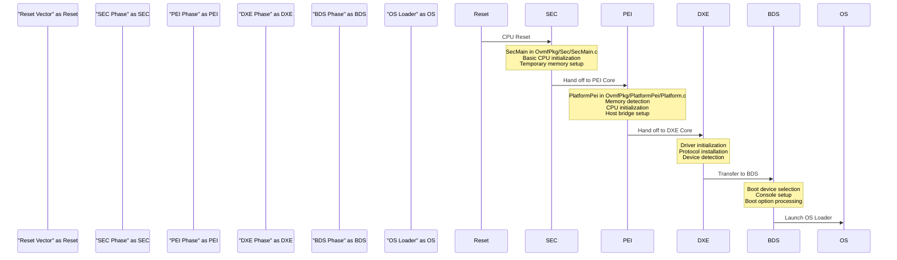
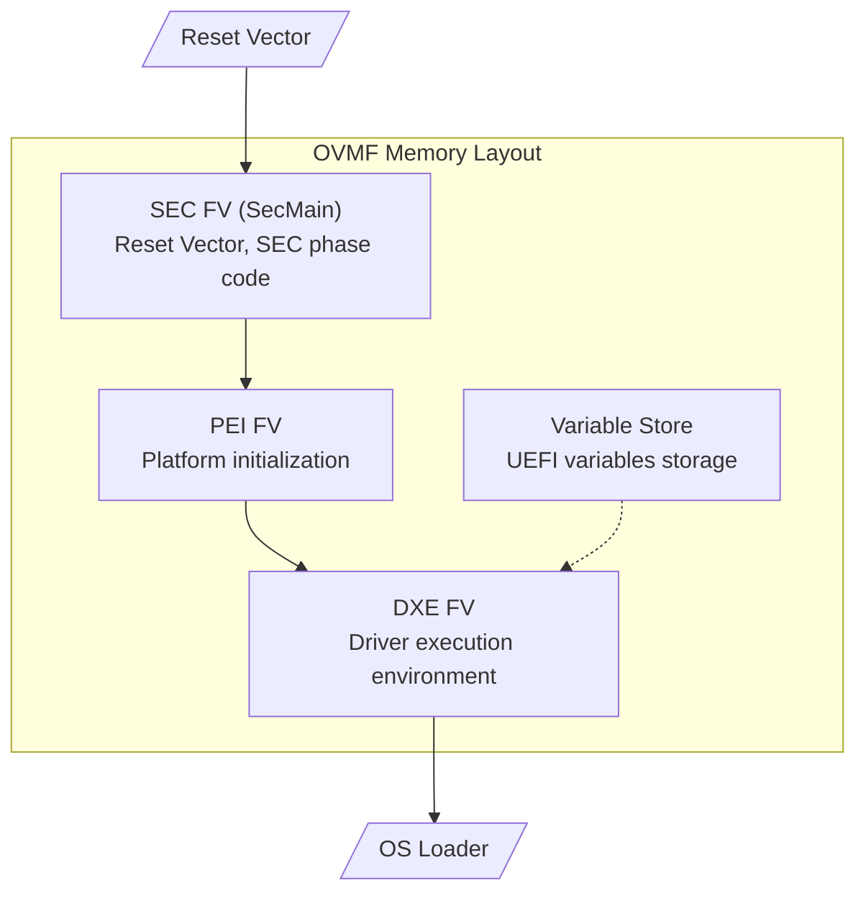
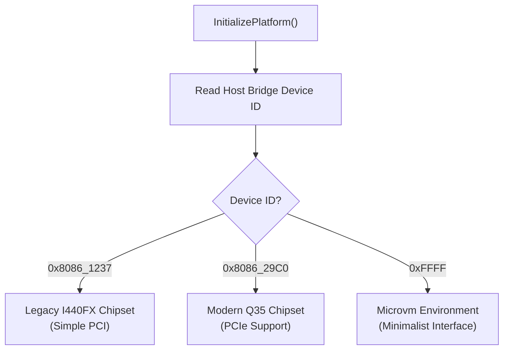
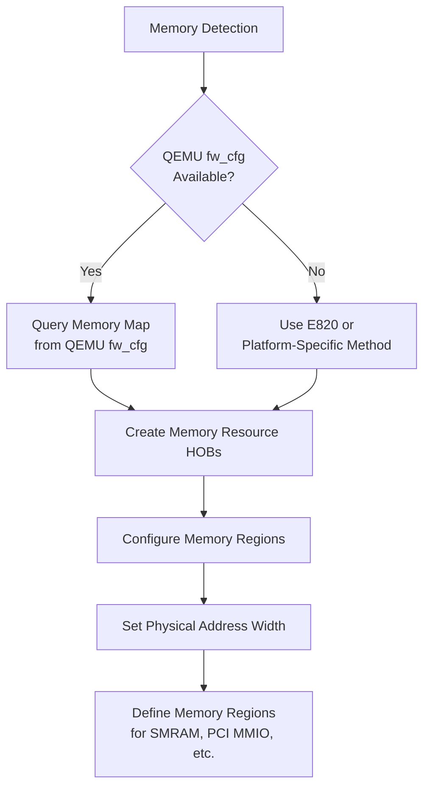
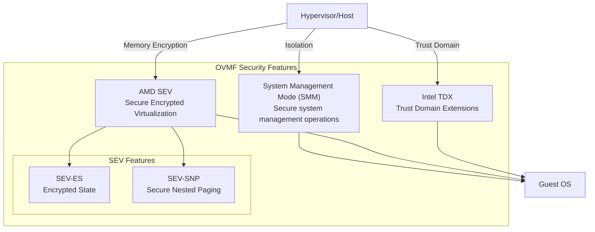
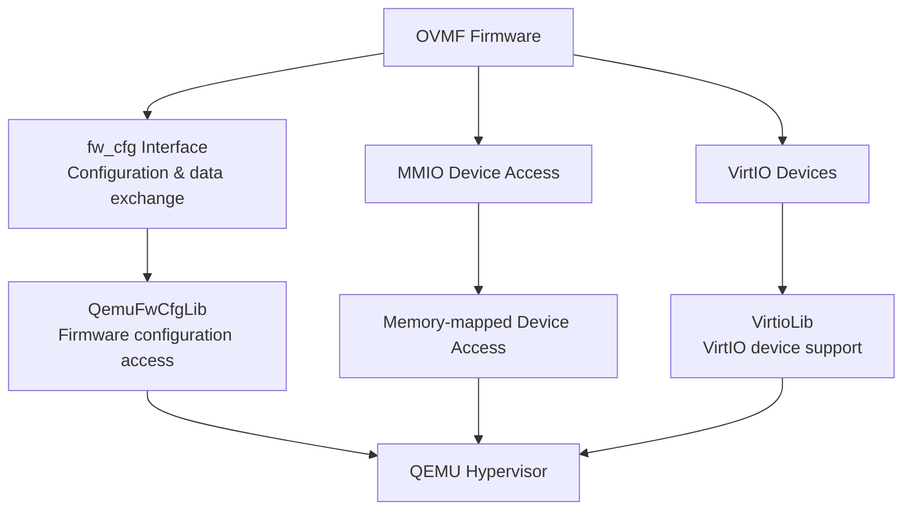
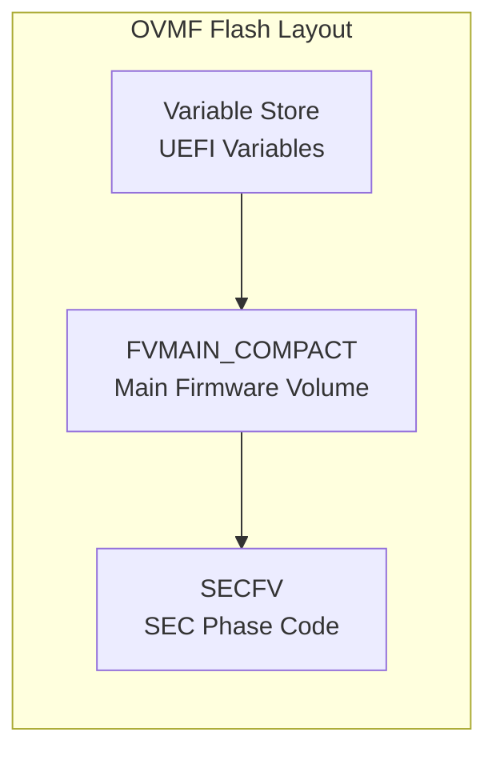

<!-- source: DeepWiki mcp.deepwiki.com · repo NVIDIA/edk2 · page 3.1 OVMF Platform (x86/x64 Virtual Machines) · fetched 2026-10-26 -->

# OVMF Platform (x86/x64 Virtual Machines)

<details>
<summary>Relevant source files</summary>

The following files were used as context for generating this wiki page:

- [OvmfPkg/AmdSev/AmdSevX64.dsc](OvmfPkg/AmdSev/AmdSevX64.dsc)
- [OvmfPkg/AmdSev/AmdSevX64.fdf](OvmfPkg/AmdSev/AmdSevX64.fdf)
- [OvmfPkg/Bhyve/BhyveDefines.fdf.inc](OvmfPkg/Bhyve/BhyveDefines.fdf.inc)
- [OvmfPkg/Bhyve/BhyveX64.dsc](OvmfPkg/Bhyve/BhyveX64.dsc)
- [OvmfPkg/Bhyve/BhyveX64.fdf](OvmfPkg/Bhyve/BhyveX64.fdf)
- [OvmfPkg/CloudHv/CloudHvDefines.fdf.inc](OvmfPkg/CloudHv/CloudHvDefines.fdf.inc)
- [OvmfPkg/CloudHv/CloudHvX64.dsc](OvmfPkg/CloudHv/CloudHvX64.dsc)
- [OvmfPkg/CloudHv/CloudHvX64.fdf](OvmfPkg/CloudHv/CloudHvX64.fdf)
- [OvmfPkg/Include/Fdf/FvmainCompactScratchEnd.fdf.inc](OvmfPkg/Include/Fdf/FvmainCompactScratchEnd.fdf.inc)
- [OvmfPkg/Include/Fdf/OvmfPkgDefines.fdf.inc](OvmfPkg/Include/Fdf/OvmfPkgDefines.fdf.inc)
- [OvmfPkg/Include/Fdf/VarStore.fdf.inc](OvmfPkg/Include/Fdf/VarStore.fdf.inc)
- [OvmfPkg/Include/Fdf/XenElfHeader.fdf.inc](OvmfPkg/Include/Fdf/XenElfHeader.fdf.inc)
- [OvmfPkg/Include/Library/PlatformInitLib.h](OvmfPkg/Include/Library/PlatformInitLib.h)
- [OvmfPkg/Include/TdxCommondefs.inc](OvmfPkg/Include/TdxCommondefs.inc)
- [OvmfPkg/Include/WorkArea.h](OvmfPkg/Include/WorkArea.h)
- [OvmfPkg/IntelTdx/IntelTdxX64.dsc](OvmfPkg/IntelTdx/IntelTdxX64.dsc)
- [OvmfPkg/IntelTdx/IntelTdxX64.fdf](OvmfPkg/IntelTdx/IntelTdxX64.fdf)
- [OvmfPkg/IntelTdx/Sec/SecMain.c](OvmfPkg/IntelTdx/Sec/SecMain.c)
- [OvmfPkg/IntelTdx/Sec/SecMain.inf](OvmfPkg/IntelTdx/Sec/SecMain.inf)
- [OvmfPkg/IntelTdx/Sec/X64/IntelTdxAPs.nasm](OvmfPkg/IntelTdx/Sec/X64/IntelTdxAPs.nasm)
- [OvmfPkg/IntelTdx/Sec/X64/SecEntry.nasm](OvmfPkg/IntelTdx/Sec/X64/SecEntry.nasm)
- [OvmfPkg/IntelTdx/TdxHelperLib/SecTdxHelper.c](OvmfPkg/IntelTdx/TdxHelperLib/SecTdxHelper.c)
- [OvmfPkg/IntelTdx/TdxHelperLib/SecTdxHelperLib.inf](OvmfPkg/IntelTdx/TdxHelperLib/SecTdxHelperLib.inf)
- [OvmfPkg/IntelTdx/TdxHelperLib/TdxMeasurementHob.c](OvmfPkg/IntelTdx/TdxHelperLib/TdxMeasurementHob.c)
- [OvmfPkg/Library/PeilessStartupLib/Hob.c](OvmfPkg/Library/PeilessStartupLib/Hob.c)
- [OvmfPkg/Library/PeilessStartupLib/PeilessStartup.c](OvmfPkg/Library/PeilessStartupLib/PeilessStartup.c)
- [OvmfPkg/Library/PeilessStartupLib/PeilessStartupInternal.h](OvmfPkg/Library/PeilessStartupLib/PeilessStartupInternal.h)
- [OvmfPkg/Library/PeilessStartupLib/PeilessStartupLib.inf](OvmfPkg/Library/PeilessStartupLib/PeilessStartupLib.inf)
- [OvmfPkg/Library/PlatformInitLib/IntelTdx.c](OvmfPkg/Library/PlatformInitLib/IntelTdx.c)
- [OvmfPkg/Library/PlatformInitLib/IntelTdxNull.c](OvmfPkg/Library/PlatformInitLib/IntelTdxNull.c)
- [OvmfPkg/Library/PlatformInitLib/MemDetect.c](OvmfPkg/Library/PlatformInitLib/MemDetect.c)
- [OvmfPkg/Library/PlatformInitLib/Platform.c](OvmfPkg/Library/PlatformInitLib/Platform.c)
- [OvmfPkg/Library/PlatformInitLib/PlatformInitLib.inf](OvmfPkg/Library/PlatformInitLib/PlatformInitLib.inf)
- [OvmfPkg/Library/SmmCpuFeaturesLib/SmmCpuFeaturesLib.c](OvmfPkg/Library/SmmCpuFeaturesLib/SmmCpuFeaturesLib.c)
- [OvmfPkg/Library/SmmCpuFeaturesLib/SmmCpuFeaturesLib.inf](OvmfPkg/Library/SmmCpuFeaturesLib/SmmCpuFeaturesLib.inf)
- [OvmfPkg/Library/TdxMailboxLib/TdxMailbox.c](OvmfPkg/Library/TdxMailboxLib/TdxMailbox.c)
- [OvmfPkg/Library/TdxMailboxLib/TdxMailboxLib.inf](OvmfPkg/Library/TdxMailboxLib/TdxMailboxLib.inf)
- [OvmfPkg/Library/TdxMailboxLib/TdxMailboxLibNull.inf](OvmfPkg/Library/TdxMailboxLib/TdxMailboxLibNull.inf)
- [OvmfPkg/Microvm/MicrovmX64.dsc](OvmfPkg/Microvm/MicrovmX64.dsc)
- [OvmfPkg/Microvm/MicrovmX64.fdf](OvmfPkg/Microvm/MicrovmX64.fdf)
- [OvmfPkg/OvmfPkg.dec](OvmfPkg/OvmfPkg.dec)
- [OvmfPkg/OvmfPkgIa32.dsc](OvmfPkg/OvmfPkgIa32.dsc)
- [OvmfPkg/OvmfPkgIa32.fdf](OvmfPkg/OvmfPkgIa32.fdf)
- [OvmfPkg/OvmfPkgIa32X64.dsc](OvmfPkg/OvmfPkgIa32X64.dsc)
- [OvmfPkg/OvmfPkgIa32X64.fdf](OvmfPkg/OvmfPkgIa32X64.fdf)
- [OvmfPkg/OvmfPkgX64.dsc](OvmfPkg/OvmfPkgX64.dsc)
- [OvmfPkg/OvmfPkgX64.fdf](OvmfPkg/OvmfPkgX64.fdf)
- [OvmfPkg/OvmfXen.dsc](OvmfPkg/OvmfXen.dsc)
- [OvmfPkg/OvmfXen.fdf](OvmfPkg/OvmfXen.fdf)
- [OvmfPkg/PlatformPei/AmdSev.c](OvmfPkg/PlatformPei/AmdSev.c)
- [OvmfPkg/PlatformPei/ClearCache.c](OvmfPkg/PlatformPei/ClearCache.c)
- [OvmfPkg/PlatformPei/FeatureControl.c](OvmfPkg/PlatformPei/FeatureControl.c)
- [OvmfPkg/PlatformPei/Fv.c](OvmfPkg/PlatformPei/Fv.c)
- [OvmfPkg/PlatformPei/IntelTdx.c](OvmfPkg/PlatformPei/IntelTdx.c)
- [OvmfPkg/PlatformPei/MemDetect.c](OvmfPkg/PlatformPei/MemDetect.c)
- [OvmfPkg/PlatformPei/MemTypeInfo.c](OvmfPkg/PlatformPei/MemTypeInfo.c)
- [OvmfPkg/PlatformPei/Platform.c](OvmfPkg/PlatformPei/Platform.c)
- [OvmfPkg/PlatformPei/Platform.h](OvmfPkg/PlatformPei/Platform.h)
- [OvmfPkg/PlatformPei/PlatformPei.inf](OvmfPkg/PlatformPei/PlatformPei.inf)
- [OvmfPkg/ResetVector/Ia16/ResetVectorVtf0.asm](OvmfPkg/ResetVector/Ia16/ResetVectorVtf0.asm)
- [OvmfPkg/ResetVector/Ia32/AmdSev.asm](OvmfPkg/ResetVector/Ia32/AmdSev.asm)
- [OvmfPkg/ResetVector/Ia32/Flat32ToFlat64.asm](OvmfPkg/ResetVector/Ia32/Flat32ToFlat64.asm)
- [OvmfPkg/ResetVector/Ia32/IntelTdx.asm](OvmfPkg/ResetVector/Ia32/IntelTdx.asm)
- [OvmfPkg/ResetVector/Ia32/PageTables64.asm](OvmfPkg/ResetVector/Ia32/PageTables64.asm)
- [OvmfPkg/ResetVector/Main.asm](OvmfPkg/ResetVector/Main.asm)
- [OvmfPkg/ResetVector/ResetVector.inf](OvmfPkg/ResetVector/ResetVector.inf)
- [OvmfPkg/ResetVector/ResetVector.nasmb](OvmfPkg/ResetVector/ResetVector.nasmb)
- [OvmfPkg/ResetVector/X64/IntelTdxMetadata.asm](OvmfPkg/ResetVector/X64/IntelTdxMetadata.asm)
- [OvmfPkg/ResetVector/X64/OvmfSevMetadata.asm](OvmfPkg/ResetVector/X64/OvmfSevMetadata.asm)
- [OvmfPkg/Sec/AmdSev.c](OvmfPkg/Sec/AmdSev.c)
- [OvmfPkg/Sec/AmdSev.h](OvmfPkg/Sec/AmdSev.h)
- [OvmfPkg/Sec/SecMain.c](OvmfPkg/Sec/SecMain.c)
- [OvmfPkg/Sec/SecMain.inf](OvmfPkg/Sec/SecMain.inf)
- [OvmfPkg/Sec/X64/SecEntry.nasm](OvmfPkg/Sec/X64/SecEntry.nasm)
- [SecurityPkg/Tcg/TdTcg2Dxe/MeasureBootPeCoff.c](SecurityPkg/Tcg/TdTcg2Dxe/MeasureBootPeCoff.c)
- [SecurityPkg/Tcg/TdTcg2Dxe/TdTcg2Dxe.inf](SecurityPkg/Tcg/TdTcg2Dxe/TdTcg2Dxe.inf)

</details>


OVMF (Open Virtual Machine Firmware) is an implementation of the UEFI (Unified Extensible Firmware Interface) specification designed specifically for x86 and x64 virtual machines. It provides a UEFI environment that enables modern operating systems to boot in virtual machines using the UEFI boot process rather than legacy BIOS methods. This document explains the architecture, components, and functionality of the OVMF platform within the EDK II ecosystem.

For information about ARM virtual platforms, see [ARM Virtual Platform](#3.2).

## OVMF Overview

OVMF is designed to run on various hypervisors, with QEMU being the primary target. It supports multiple processor architectures (IA32, X64, and mixed IA32/X64) and offers a range of platform variants optimized for specific virtualization technologies like AMD SEV, Intel TDX, Xen, Bhyve, and microVMs.

### Platform Variations

OVMF supports several platform configurations, each defined by a specific DSC (Platform Description) file:

| Platform Variant | DSC File | Target Environment |
|-----------------|----------|-------------------|
| X64 | OvmfPkgX64.dsc | 64-bit x86 virtual machines |
| IA32 | OvmfPkgIa32.dsc | 32-bit x86 virtual machines |
| IA32/X64 | OvmfPkgIa32X64.dsc | Mixed 32/64-bit environments |
| Xen | OvmfXen.dsc | Xen-based virtual machines |
| AMD SEV | AmdSev/AmdSevX64.dsc | AMD Secure Encrypted Virtualization |
| Bhyve | Bhyve/BhyveX64.dsc | FreeBSD Bhyve hypervisor |
| CloudHv | CloudHv/CloudHvX64.dsc | Cloud hypervisor VMs |
| Microvm | Microvm/MicrovmX64.dsc | Lightweight microVMs |
| Intel TDX | IntelTdx/IntelTdxX64.dsc | Intel Trust Domain Extensions |

Sources: [OvmfPkg/OvmfPkgX64.dsc](), [OvmfPkg/OvmfPkgIa32.dsc](), [OvmfPkg/OvmfPkgIa32X64.dsc](), [OvmfPkg/OvmfXen.dsc](), [OvmfPkg/AmdSev/AmdSevX64.dsc](), [OvmfPkg/Bhyve/BhyveX64.dsc](), [OvmfPkg/CloudHv/CloudHvX64.dsc](), [OvmfPkg/Microvm/MicrovmX64.dsc](), [OvmfPkg/IntelTdx/IntelTdxX64.dsc]()

## OVMF Architecture

### UEFI Boot Flow in OVMF

OVMF follows the standard UEFI boot flow with platform-specific adaptations for virtualized environments.

#### OVMF Boot Flow Diagram



Sources: [OvmfPkg/Sec/SecMain.c](), [OvmfPkg/PlatformPei/Platform.c]()

### Memory Map and Layout

OVMF organizes its firmware in memory using multiple firmware volumes (FVs):



Sources: [OvmfPkg/OvmfPkgX64.fdf]()

## Platform Initialization Process

The platform initialization process in OVMF is primarily handled by the `PlatformPei` module, which performs various initialization tasks during the PEI phase.

### Initialization Flow

```mermaid
flowchart TD
    start["CPU Reset"] --> SecMain["SEC: SecMain"]
    SecMain --> PlatformPei["PEI: InitializePlatform()"]
    
    PlatformPei --> BuildPlatformInfoHob["Build Platform Info HOB"]
    BuildPlatformInfoHob --> BootModeInit["Boot Mode Initialization"]
    BootModeInit --> HostBridgeDetect["Detect Host Bridge (I440FX/Q35)"]
    HostBridgeDetect --> AddrWidthInit["Address Width Initialization"]
    AddrWidthInit --> MaxCpuInit["Max CPU Count Initialization"]
    
    MaxCpuInit --> SmmCheck{"SMM Required?"}
    SmmCheck -->|Yes| Q35Check["Q35 Board Verification"]
    SmmCheck -->|No| MemPublish["Publish PEI Memory"]
    Q35Check --> TsegInit["Q35 TSEG Initialization"]
    TsegInit --> SmramInit["SMRAM Initialization"]
    SmramInit --> MemPublish
    
    MemPublish --> RamInit["Initialize RAM Regions"]
    RamInit --> BootCheck{"Boot Mode?"}
    BootCheck -->|Normal Boot| VarStore["Reserve Variable Storage"]
    BootCheck -->|S3 Resume| S3Path["S3 Resume Path"]
    VarStore --> FvInit["PEI FV Initialization"]
    S3Path --> Cleanup["Install Callbacks"]
    FvInit --> MemTypeInit["Memory Type Initialization"]
    MemTypeInit --> MemMapInit["Memory Map Initialization"]
    MemMapInit --> NoexecInit["No-Execute DXE Initialization"]
    NoexecInit --> Cleanup
    
    Cleanup --> AmdSevInit["AMD SEV Initialization"]
    AmdSevInit --> MiscInit["Miscellaneous Initialization"]
    MiscInit --> TdxInit["Intel TDX Initialization"]
    TdxInit --> InstallFCCallback["Install Feature Control Callback"]
    InstallFCCallback --> end["End PEI Phase"]
```

Sources: [OvmfPkg/PlatformPei/Platform.c:300-372]()

### Host Bridge Detection

OVMF supports two main host bridge types, which are detected during platform initialization:

1. **I440FX**: The traditional QEMU chipset, based on the Intel 440FX chipset
2. **Q35**: More modern chipset with PCIe support, based on the Intel Q35 MCH

The host bridge detection is performed by reading the PCI device ID:



Sources: [OvmfPkg/PlatformPei/Platform.c:332]()

### Memory Detection Process

Memory detection in OVMF is a critical part of platform initialization. The algorithm differs based on the hypervisor and platform type:



Sources: [OvmfPkg/PlatformPei/MemDetect.c](), [OvmfPkg/Library/PlatformInitLib/MemDetect.c]()

## Security Features

OVMF includes support for several advanced security technologies depending on the platform variant.

### Confidential Computing Features



Sources: [OvmfPkg/PlatformPei/AmdSev.c](), [OvmfPkg/PlatformPei/IntelTdx.c]()

### AMD SEV Support

AMD SEV (Secure Encrypted Virtualization) provides memory encryption for virtual machines, protecting VM data from the hypervisor. OVMF includes support for AMD SEV through:

1. SEV detection during platform initialization
2. Configuration of memory encryption
3. Implementation of secret injection and attestation mechanisms

The `AmdSev.c` module initializes SEV support during the PEI phase, setting up encrypted memory and configuring platform components for SEV operation.

Sources: [OvmfPkg/PlatformPei/AmdSev.c](), [OvmfPkg/AmdSev/AmdSevX64.dsc]()

### Intel TDX Support

Intel TDX (Trust Domain Extensions) provides hardware-based isolation of virtual machines. OVMF's TDX support includes:

1. TDX detection during platform initialization
2. Configuration of secure memory regions
3. Implementation of TDX-specific interfaces

Sources: [OvmfPkg/PlatformPei/IntelTdx.c](), [OvmfPkg/IntelTdx/IntelTdxX64.dsc]()

## Hypervisor Integration

OVMF integrates with various hypervisors through specialized interfaces and protocols.

### QEMU Integration



Sources: [OvmfPkg/Library/QemuFwCfgLib/QemuFwCfgDxeLib.inf](), [OvmfPkg/Library/VirtioLib/VirtioLib.inf]()

### Other Hypervisor Support

OVMF includes support for various other hypervisors through specialized platform variants:

1. **Xen Support**: Implemented in the OvmfXen platform variant, using Xen-specific interfaces
2. **Bhyve Support**: Implemented in the BhyveX64 platform variant
3. **MicroVM Support**: Lightweight VM support implemented in the MicrovmX64 platform variant

## Build Configuration Options

OVMF can be built with various configuration options to enable or disable features:

| Option | Description | Default |
|--------|-------------|---------|
| `SECURE_BOOT_ENABLE` | Enable UEFI Secure Boot support | FALSE |
| `SMM_REQUIRE` | Enable System Management Mode support | FALSE |
| `SOURCE_DEBUG_ENABLE` | Enable source-level debugging | FALSE |
| `NETWORK_TLS_ENABLE` | Enable TLS support for networking | FALSE |
| `NETWORK_IP6_ENABLE` | Enable IPv6 support | FALSE |
| `FD_SIZE_IN_KB` | Flash device size in KB | 4096 |
| `BUILD_SHELL` | Include UEFI shell | TRUE |

Sources: [OvmfPkg/OvmfPkgX64.dsc:32-79]()

### Flash Memory Layout

OVMF organizes its firmware in a flash memory layout defined by the FDF (Flash Description File):



The flash layout can be built in two ways:
1. **Single flash device**: Variables and firmware in one image
2. **Split flash device**: Variables in `OVMF_VARS.fd` and firmware in `OVMF_CODE.fd`

Sources: [OvmfPkg/OvmfPkgX64.fdf:20-59]()

## Library Components

OVMF includes several specialized libraries for platform-specific functionality:

| Library | Purpose | 
|---------|---------|
| `QemuFwCfgLib` | Interface to QEMU firmware configuration |
| `MemEncryptSevLib` | AMD SEV memory encryption support |
| `MemEncryptTdxLib` | Intel TDX memory encryption support |
| `PlatformInitLib` | Platform initialization routines |
| `ResetSystemLib` | System reset functionality |
| `QemuBootOrderLib` | QEMU boot order handling |
| `VirtioLib` | VirtIO device support |
| `XenHypercallLib` | Xen hypercall support |

Sources: [OvmfPkg/OvmfPkg.dec:22-146]()

## Conclusion

The OVMF platform provides a complete UEFI implementation for virtual machines on x86 and x64 platforms. It supports a wide range of hypervisors and includes advanced features like AMD SEV and Intel TDX for confidential computing. The modular architecture and extensive configuration options make it adaptable to various virtualization environments and use cases.

---

