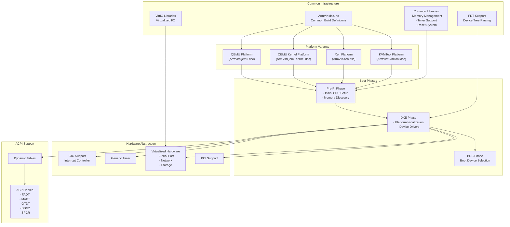
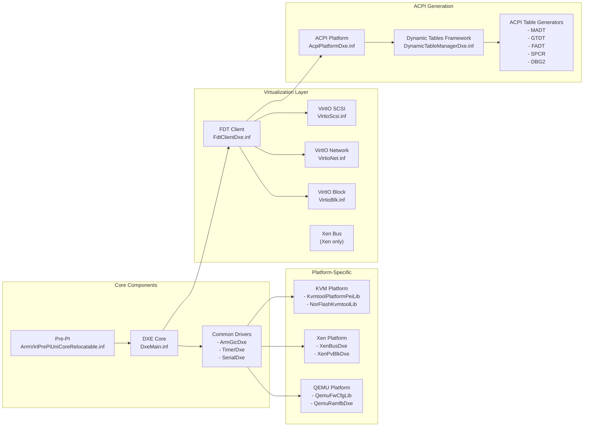
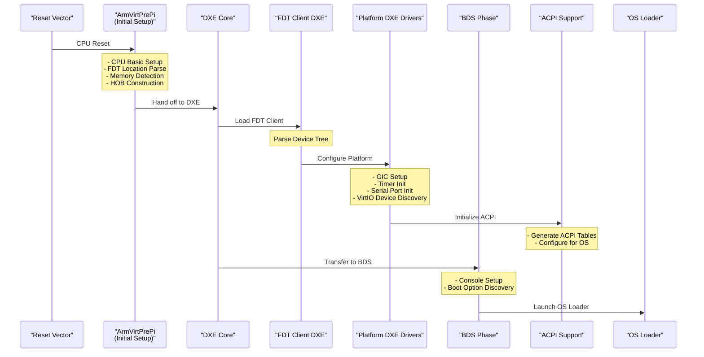
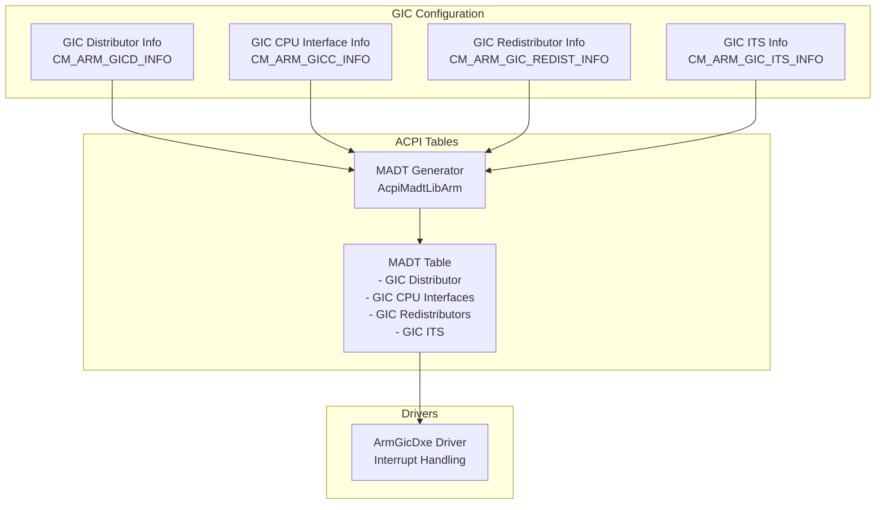
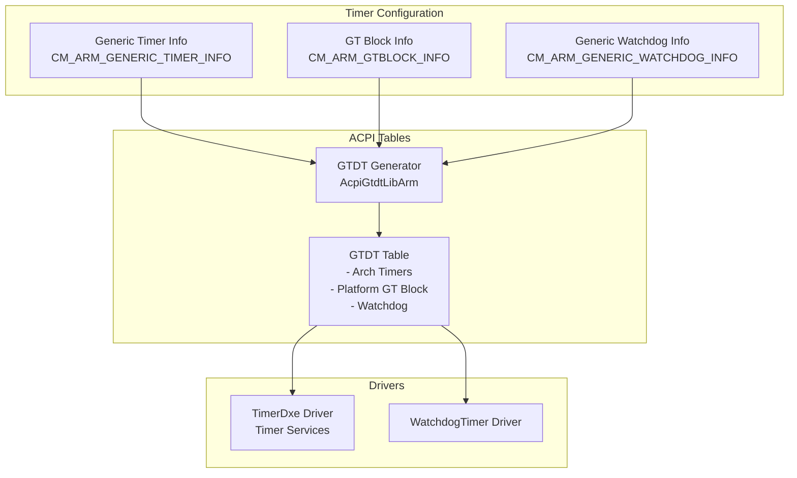
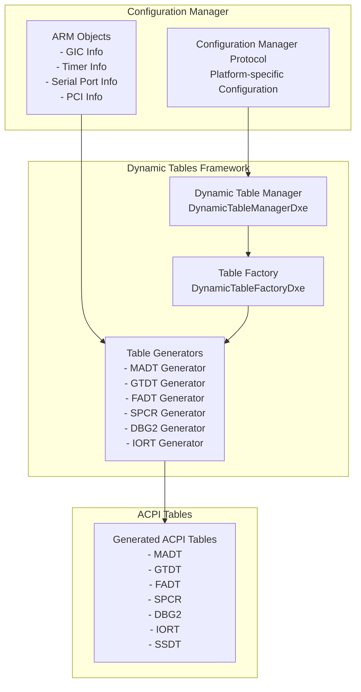
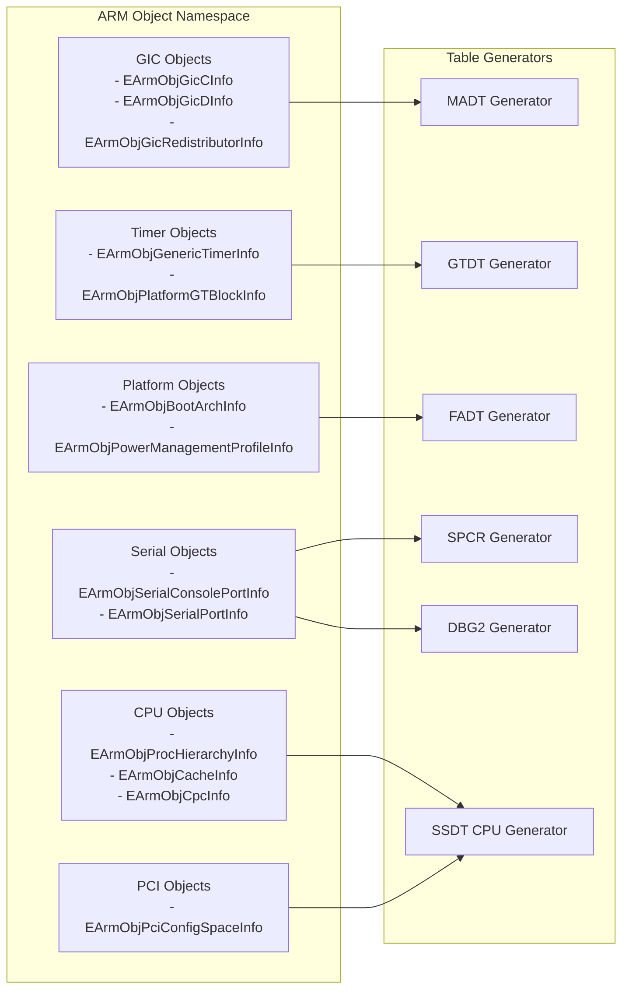

<!-- source: DeepWiki mcp.deepwiki.com · repo NVIDIA/edk2 · page 3.2 ARM Virtual Platform · fetched 2026-10-26 -->

# ARM Virtual Platform

Relevant source files

The following files were used as context for generating this wiki page:

- [ArmPkg/Drivers/ArmPciCpuIo2Dxe/ArmPciCpuIo2Dxe.inf](ArmPkg/Drivers/ArmPciCpuIo2Dxe/ArmPciCpuIo2Dxe.inf)
- [ArmVirtPkg/ArmVirt.dsc.inc](ArmVirtPkg/ArmVirt.dsc.inc)
- [ArmVirtPkg/ArmVirtCloudHv.dsc](ArmVirtPkg/ArmVirtCloudHv.dsc)
- [ArmVirtPkg/ArmVirtCloudHv.fdf](ArmVirtPkg/ArmVirtCloudHv.fdf)
- [ArmVirtPkg/ArmVirtKvmTool.dsc](ArmVirtPkg/ArmVirtKvmTool.dsc)
- [ArmVirtPkg/ArmVirtKvmTool.fdf](ArmVirtPkg/ArmVirtKvmTool.fdf)
- [ArmVirtPkg/ArmVirtPkg.dec](ArmVirtPkg/ArmVirtPkg.dec)
- [ArmVirtPkg/ArmVirtQemu.dsc](ArmVirtPkg/ArmVirtQemu.dsc)
- [ArmVirtPkg/ArmVirtQemu.fdf](ArmVirtPkg/ArmVirtQemu.fdf)
- [ArmVirtPkg/ArmVirtQemuFvMain.fdf.inc](ArmVirtPkg/ArmVirtQemuFvMain.fdf.inc)
- [ArmVirtPkg/ArmVirtQemuKernel.dsc](ArmVirtPkg/ArmVirtQemuKernel.dsc)
- [ArmVirtPkg/ArmVirtQemuKernel.fdf](ArmVirtPkg/ArmVirtQemuKernel.fdf)
- [ArmVirtPkg/ArmVirtRules.fdf.inc](ArmVirtPkg/ArmVirtRules.fdf.inc)
- [ArmVirtPkg/ArmVirtXen.dsc](ArmVirtPkg/ArmVirtXen.dsc)
- [ArmVirtPkg/ArmVirtXen.fdf](ArmVirtPkg/ArmVirtXen.fdf)
- [ArmVirtPkg/CloudHvAcpiPlatformDxe/CloudHvAcpi.c](ArmVirtPkg/CloudHvAcpiPlatformDxe/CloudHvAcpi.c)
- [ArmVirtPkg/CloudHvAcpiPlatformDxe/CloudHvAcpiPlatformDxe.inf](ArmVirtPkg/CloudHvAcpiPlatformDxe/CloudHvAcpiPlatformDxe.inf)
- [ArmVirtPkg/CloudHvPlatformHasAcpiDtDxe/CloudHvHasAcpiDtDxe.c](ArmVirtPkg/CloudHvPlatformHasAcpiDtDxe/CloudHvHasAcpiDtDxe.c)
- [ArmVirtPkg/CloudHvPlatformHasAcpiDtDxe/CloudHvHasAcpiDtDxe.inf](ArmVirtPkg/CloudHvPlatformHasAcpiDtDxe/CloudHvHasAcpiDtDxe.inf)
- [ArmVirtPkg/Include/Guid/Early16550UartBaseAddress.h](ArmVirtPkg/Include/Guid/Early16550UartBaseAddress.h)
- [ArmVirtPkg/KvmtoolPlatformDxe/KvmtoolPlatformDxe.c](ArmVirtPkg/KvmtoolPlatformDxe/KvmtoolPlatformDxe.c)
- [ArmVirtPkg/KvmtoolPlatformDxe/KvmtoolPlatformDxe.inf](ArmVirtPkg/KvmtoolPlatformDxe/KvmtoolPlatformDxe.inf)
- [ArmVirtPkg/Library/ArmVirtPsciResetSystemPeiLib/ArmVirtPsciResetSystemPeiLib.c](ArmVirtPkg/Library/ArmVirtPsciResetSystemPeiLib/ArmVirtPsciResetSystemPeiLib.c)
- [ArmVirtPkg/Library/ArmVirtPsciResetSystemPeiLib/ArmVirtPsciResetSystemPeiLib.inf](ArmVirtPkg/Library/ArmVirtPsciResetSystemPeiLib/ArmVirtPsciResetSystemPeiLib.inf)
- [ArmVirtPkg/Library/KvmtoolRtcFdtClientLib/KvmtoolRtcFdtClientLib.c](ArmVirtPkg/Library/KvmtoolRtcFdtClientLib/KvmtoolRtcFdtClientLib.c)
- [ArmVirtPkg/Library/KvmtoolRtcFdtClientLib/KvmtoolRtcFdtClientLib.inf](ArmVirtPkg/Library/KvmtoolRtcFdtClientLib/KvmtoolRtcFdtClientLib.inf)
- [ArmVirtPkg/Library/KvmtoolVirtMemInfoLib/KvmtoolVirtMemInfoLib.c](ArmVirtPkg/Library/KvmtoolVirtMemInfoLib/KvmtoolVirtMemInfoLib.c)
- [ArmVirtPkg/Library/KvmtoolVirtMemInfoLib/KvmtoolVirtMemInfoLib.inf](ArmVirtPkg/Library/KvmtoolVirtMemInfoLib/KvmtoolVirtMemInfoLib.inf)
- [ArmVirtPkg/Library/NorFlashKvmtoolLib/NorFlashKvmtool.c](ArmVirtPkg/Library/NorFlashKvmtoolLib/NorFlashKvmtool.c)
- [ArmVirtPkg/Library/NorFlashKvmtoolLib/NorFlashKvmtoolLib.inf](ArmVirtPkg/Library/NorFlashKvmtoolLib/NorFlashKvmtoolLib.inf)
- [ArmVirtPkg/Library/XenArmGenericTimerVirtCounterLib/XenArmGenericTimerVirtCounterLib.c](ArmVirtPkg/Library/XenArmGenericTimerVirtCounterLib/XenArmGenericTimerVirtCounterLib.c)
- [ArmVirtPkg/Library/XenArmGenericTimerVirtCounterLib/XenArmGenericTimerVirtCounterLib.inf](ArmVirtPkg/Library/XenArmGenericTimerVirtCounterLib/XenArmGenericTimerVirtCounterLib.inf)
- [DynamicTablesPkg/DynamicTables.dsc.inc](DynamicTablesPkg/DynamicTables.dsc.inc)
- [DynamicTablesPkg/Include/AcpiTableGenerator.h](DynamicTablesPkg/Include/AcpiTableGenerator.h)
- [DynamicTablesPkg/Include/AmlCpcInfo.h](DynamicTablesPkg/Include/AmlCpcInfo.h)
- [DynamicTablesPkg/Include/ArmNameSpaceObjects.h](DynamicTablesPkg/Include/ArmNameSpaceObjects.h)
- [DynamicTablesPkg/Include/Library/TableHelperLib.h](DynamicTablesPkg/Include/Library/TableHelperLib.h)
- [DynamicTablesPkg/Library/Acpi/Arm/AcpiDbg2LibArm/AcpiDbg2LibArm.inf](DynamicTablesPkg/Library/Acpi/Arm/AcpiDbg2LibArm/AcpiDbg2LibArm.inf)
- [DynamicTablesPkg/Library/Acpi/Arm/AcpiDbg2LibArm/Dbg2Generator.c](DynamicTablesPkg/Library/Acpi/Arm/AcpiDbg2LibArm/Dbg2Generator.c)
- [DynamicTablesPkg/Library/Acpi/Arm/AcpiFadtLibArm/FadtGenerator.c](DynamicTablesPkg/Library/Acpi/Arm/AcpiFadtLibArm/FadtGenerator.c)
- [DynamicTablesPkg/Library/Acpi/Arm/AcpiGtdtLibArm/GtdtGenerator.c](DynamicTablesPkg/Library/Acpi/Arm/AcpiGtdtLibArm/GtdtGenerator.c)
- [DynamicTablesPkg/Library/Acpi/Arm/AcpiIortLibArm/IortGenerator.c](DynamicTablesPkg/Library/Acpi/Arm/AcpiIortLibArm/IortGenerator.c)
- [DynamicTablesPkg/Library/Acpi/Arm/AcpiMadtLibArm/MadtGenerator.c](DynamicTablesPkg/Library/Acpi/Arm/AcpiMadtLibArm/MadtGenerator.c)
- [DynamicTablesPkg/Library/Acpi/Arm/AcpiMcfgLibArm/McfgGenerator.c](DynamicTablesPkg/Library/Acpi/Arm/AcpiMcfgLibArm/McfgGenerator.c)
- [DynamicTablesPkg/Library/Acpi/Arm/AcpiMpamLibArm/AcpiMpamLibArm.inf](DynamicTablesPkg/Library/Acpi/Arm/AcpiMpamLibArm/AcpiMpamLibArm.inf)
- [DynamicTablesPkg/Library/Acpi/Arm/AcpiMpamLibArm/MpamGenerator.c](DynamicTablesPkg/Library/Acpi/Arm/AcpiMpamLibArm/MpamGenerator.c)
- [DynamicTablesPkg/Library/Acpi/Arm/AcpiMpamLibArm/MpamGenerator.h](DynamicTablesPkg/Library/Acpi/Arm/AcpiMpamLibArm/MpamGenerator.h)
- [DynamicTablesPkg/Library/Acpi/Arm/AcpiSpcrLibArm/AcpiSpcrLibArm.inf](DynamicTablesPkg/Library/Acpi/Arm/AcpiSpcrLibArm/AcpiSpcrLibArm.inf)
- [DynamicTablesPkg/Library/Acpi/Arm/AcpiSpcrLibArm/SpcrGenerator.c](DynamicTablesPkg/Library/Acpi/Arm/AcpiSpcrLibArm/SpcrGenerator.c)
- [DynamicTablesPkg/Library/Acpi/Arm/AcpiSpmiLibArm/AcpiSpmiLibArm.inf](DynamicTablesPkg/Library/Acpi/Arm/AcpiSpmiLibArm/AcpiSpmiLibArm.inf)
- [DynamicTablesPkg/Library/Acpi/Arm/AcpiSpmiLibArm/SpmiGenerator.c](DynamicTablesPkg/Library/Acpi/Arm/AcpiSpmiLibArm/SpmiGenerator.c)
- [DynamicTablesPkg/Library/Acpi/Arm/AcpiSsdtCpuTopologyLibArm/SsdtCpuTopologyGenerator.c](DynamicTablesPkg/Library/Acpi/Arm/AcpiSsdtCpuTopologyLibArm/SsdtCpuTopologyGenerator.c)
- [DynamicTablesPkg/Library/Acpi/Arm/AcpiSsdtCpuTopologyLibArm/SsdtCpuTopologyGenerator.h](DynamicTablesPkg/Library/Acpi/Arm/AcpiSsdtCpuTopologyLibArm/SsdtCpuTopologyGenerator.h)
- [DynamicTablesPkg/Library/Acpi/Arm/AcpiSsdtCpuTopologyLibArm/SsdtCpuTopologyLibArm.inf](DynamicTablesPkg/Library/Acpi/Arm/AcpiSsdtCpuTopologyLibArm/SsdtCpuTopologyLibArm.inf)
- [DynamicTablesPkg/Library/Acpi/Arm/AcpiTpm2LibArm/AcpiTpm2LibArm.inf](DynamicTablesPkg/Library/Acpi/Arm/AcpiTpm2LibArm/AcpiTpm2LibArm.inf)
- [DynamicTablesPkg/Library/Acpi/Arm/AcpiTpm2LibArm/Tpm2Generator.c](DynamicTablesPkg/Library/Acpi/Arm/AcpiTpm2LibArm/Tpm2Generator.c)
- [DynamicTablesPkg/Library/Common/TableHelperLib/ConfigurationManagerObjectParser.c](DynamicTablesPkg/Library/Common/TableHelperLib/ConfigurationManagerObjectParser.c)
- [DynamicTablesPkg/Library/Common/TableHelperLib/ConfigurationManagerObjectParser.h](DynamicTablesPkg/Library/Common/TableHelperLib/ConfigurationManagerObjectParser.h)
- [DynamicTablesPkg/Library/Common/TableHelperLib/TableHelper.c](DynamicTablesPkg/Library/Common/TableHelperLib/TableHelper.c)
- [DynamicTablesPkg/Library/Common/TableHelperLib/TableHelperLib.inf](DynamicTablesPkg/Library/Common/TableHelperLib/TableHelperLib.inf)
- [MdePkg/Include/IndustryStandard/ServiceProcessorManagementInterfaceTable.h](MdePkg/Include/IndustryStandard/ServiceProcessorManagementInterfaceTable.h)
- [OvmfPkg/PlatformHasAcpiDtDxe/PlatformHasAcpiDtDxe.c](OvmfPkg/PlatformHasAcpiDtDxe/PlatformHasAcpiDtDxe.c)
- [OvmfPkg/PlatformHasAcpiDtDxe/PlatformHasAcpiDtDxe.inf](OvmfPkg/PlatformHasAcpiDtDxe/PlatformHasAcpiDtDxe.inf)

The ARM Virtual Platform (ArmVirtPkg) is a component of the UEFI Development Kit II (EDK II) that provides UEFI firmware implementation for ARM-based virtual machines. It supports various virtualization technologies including QEMU, KVM, Xen, and other hypervisors, enabling standard UEFI boot capabilities in virtualized ARM environments for both 32-bit (ARM) and 64-bit (AArch64) architectures.

This document covers the architecture, components, and functionality of the ARM Virtual Platform. For information about device-specific platforms, see [Platform Support](#3).

## Architecture Overview

The ARM Virtual Platform provides a modular architecture that adapts to different virtualization technologies through dedicated platform configurations while sharing common code.

### ARM Virtual Platform Architecture

Sources: 
- [ArmVirtPkg/ArmVirt.dsc.inc]()
- [ArmVirtPkg/ArmVirtQemu.dsc]()
- [ArmVirtPkg/ArmVirtQemuKernel.dsc]()
- [ArmVirtPkg/ArmVirtXen.dsc]()
- [ArmVirtPkg/ArmVirtKvmTool.dsc]()

### Supported Virtual Platforms

The ARM Virtual Platform package provides support for several virtualization technologies, each with its own platform configuration:

| Platform | Description | Configuration File | Hypervisors |
|----------|-------------|-------------------|-------------|
| QEMU | Standard QEMU ARM platform | ArmVirtQemu.dsc | QEMU, KVM |
| QEMU Kernel | QEMU with direct kernel loading | ArmVirtQemuKernel.dsc | QEMU, KVM |
| Xen | Xen hypervisor support | ArmVirtXen.dsc | Xen |
| KVMTool | KVMTool lightweight hypervisor | ArmVirtKvmTool.dsc | KVMTool |
| CloudHv | Cloud hypervisors | ArmVirtCloudHv.dsc | Various cloud hypervisors |

Sources:
- [ArmVirtPkg/ArmVirtQemu.dsc]()
- [ArmVirtPkg/ArmVirtQemuKernel.dsc]()
- [ArmVirtPkg/ArmVirtXen.dsc]()
- [ArmVirtPkg/ArmVirtKvmTool.dsc]()
- [ArmVirtPkg/ArmVirtCloudHv.dsc]()

## Platform Components

The ARM Virtual Platform implementations share common components with configuration differences to support specific hypervisors.

Sources:
- [ArmVirtPkg/ArmVirtQemu.fdf]()
- [ArmVirtPkg/ArmVirtQemuKernel.fdf]()
- [ArmVirtPkg/ArmVirtXen.fdf]()
- [ArmVirtPkg/ArmVirtKvmTool.fdf]()
- [ArmVirtPkg/ArmVirtQemuFvMain.fdf.inc]()

### Common Libraries and Components

The ARM Virtual Platform provides essential libraries that abstract hardware and virtualization technologies:

| Library | Purpose | Used By |
|---------|---------|---------|
| ArmVirtMemInfoLib | Provides memory information from hypervisor | Memory initialization |
| NorFlashQemuLib/NorFlashKvmtoolLib | Flash device emulation | Variable storage |
| VirtioLib | VirtIO protocol support | Block, Network, SCSI devices |
| VirtioMmioDeviceLib | Memory-mapped VirtIO devices | VirtIO device drivers |
| QemuFwCfgLib | QEMU firmware configuration interface | Platform initialization |
| PlatformPeiLib | Platform Pre-EFI initialization | PrePi phase |
| PlatformBootManagerLib | Boot device handling | BDS phase |
| FdtPciPcdProducerLib | FDT PCIe information extraction | PCI initialization |

Sources:
- [ArmVirtPkg/ArmVirtQemu.dsc:54-82]()
- [ArmVirtPkg/ArmVirtQemuKernel.dsc:53-81]()
- [ArmVirtPkg/ArmVirtXen.dsc:31-53]()
- [ArmVirtPkg/ArmVirtKvmTool.dsc:41-86]()

## Boot Flow

The ARM Virtual Platform follows the standard EDK II boot flow but with platform-specific considerations for virtualized environments.

Sources:
- [ArmVirtPkg/PrePi/ArmVirtPrePiUniCoreRelocatable.inf]()
- [ArmVirtPkg/ArmVirtQemuFvMain.fdf.inc:41-62]()
- [ArmVirtPkg/ArmVirtQemu.dsc:260-347]()

### Pre-PI Phase

The Pre-PI phase is responsible for the initial setup of the virtual platform. It performs these key functions:

1. Basic CPU initialization
2. Location and parsing of the Flattened Device Tree (FDT) provided by the hypervisor
3. Memory detection and setup
4. Construction of the Hand-Off Block (HOB) list for DXE phase
5. Preparation for the DXE phase

The Pre-PI component is either implemented as a standalone module (ArmVirtPrePiUniCoreRelocatable.inf) for kernel-loaded configurations or as a combination of components (PrePeiCore, PeiMain, PlatformPeim) for traditional UEFI boot flows.

Sources:
- [ArmVirtPkg/PrePi/ArmVirtPrePiUniCoreRelocatable.inf]()
- [ArmVirtPkg/ArmVirtQemu.dsc:337-340]()
- [ArmVirtPkg/ArmVirtQemuKernel.dsc:264-275]()

### DXE Phase

The DXE phase loads drivers that initialize the platform hardware and provides runtime services. For the ARM Virtual Platform, the key DXE components include:

1. FDT Client (parses the device tree provided by the hypervisor)
2. ARM GIC driver (interrupt controller)
3. ARM Timer driver
4. PCI support (when available)
5. VirtIO device drivers for block, SCSI, network, and other virtualized I/O
6. Dynamic ACPI table generation

Sources:
- [ArmVirtPkg/ArmVirtQemuFvMain.fdf.inc:50-75]()
- [ArmVirtPkg/ArmVirtQemu.dsc:384-426]()

## Virtualized Hardware Support

The ARM Virtual Platform supports various virtualized hardware through abstraction layers and device-specific drivers.

### Generic Interrupt Controller (GIC)

The platform supports ARM's Generic Interrupt Controller (GIC) which handles interrupt routing in the virtualized environment. The ACPI MADT (Multiple APIC Description Table) table describes the GIC configuration to the operating system.

Sources:
- [DynamicTablesPkg/Library/Acpi/Arm/AcpiMadtLibArm/MadtGenerator.c:1-254]()
- [DynamicTablesPkg/Include/ArmNameSpaceObjects.h:111-224]()

### ARM Generic Timer

The ARM Virtual Platform uses the ARM Architectural Timer, which is presented to the OS through the GTDT (Generic Timer Description Table) in ACPI.

Sources:
- [DynamicTablesPkg/Library/Acpi/Arm/AcpiGtdtLibArm/GtdtGenerator.c:1-70]()
- [DynamicTablesPkg/Include/ArmNameSpaceObjects.h:337-378]()

### VirtIO Devices

VirtIO provides a standardized interface for virtualized I/O devices. The ArmVirtPkg supports several VirtIO devices:

| VirtIO Device | Driver | Description |
|---------------|--------|-------------|
| VirtIO Block | VirtioBlkDxe | Block storage device |
| VirtIO SCSI | VirtioScsiDxe | SCSI device for more complex storage |
| VirtIO Network | VirtioNetDxe | Network adapter |
| VirtIO Serial | VirtioSerialDxe | Serial communication device |
| VirtIO RNG | VirtioRngDxe | Random number generator |
| VirtIO GPU | VirtioGpuDxe | Graphics adapter |
| VirtIO File System | VirtioFsDxe | Shared file system |

All VirtIO devices rely on the common VirtioLib and use either VirtioMmioDeviceLib for memory-mapped devices or VirtioPciDeviceDxe for PCI-based VirtIO devices.

Sources:
- [ArmVirtPkg/ArmVirtQemuFvMain.fdf.inc:95-102]()
- [ArmVirtPkg/ArmVirtQemu.dsc:448-452]()

## Dynamic ACPI Table Generation

The ARM Virtual Platform uses the Dynamic Tables Framework for ACPI table generation, providing flexible ACPI support for different configurations.

Sources:
- [DynamicTablesPkg/DynamicTables.dsc.inc:23-80]()
- [DynamicTablesPkg/Include/AcpiTableGenerator.h:1-74]()

### ACPI Tables

The ARM Virtual Platform generates the following ACPI tables for ARM-based virtual machines:

| ACPI Table | Generator | Purpose |
|------------|-----------|---------|
| FADT | AcpiFadtLibArm | Fixed ACPI Description Table - platform configuration |
| MADT | AcpiMadtLibArm | Multiple APIC Description Table - GIC configuration |
| GTDT | AcpiGtdtLibArm | Generic Timer Description Table - ARM timer configuration |
| SPCR | AcpiSpcrLibArm | Serial Port Console Redirection Table - debug console |
| DBG2 | AcpiDbg2LibArm | Debug Port Table 2 - debug port information |
| IORT | AcpiIortLibArm | IO Remapping Table - I/O topology information |
| SSDT CPU | SsdtCpuTopologyLibArm | Secondary System Description Table - CPU topology |

The Dynamic Tables Framework allows for the generation of these tables based on platform-specific information provided via the Configuration Manager.

Sources:
- [DynamicTablesPkg/Library/Acpi/Arm/AcpiMadtLibArm/MadtGenerator.c]()
- [DynamicTablesPkg/Library/Acpi/Arm/AcpiGtdtLibArm/GtdtGenerator.c]()
- [DynamicTablesPkg/Library/Acpi/Arm/AcpiFadtLibArm/FadtGenerator.c]()
- [DynamicTablesPkg/Library/Acpi/Arm/AcpiSpcrLibArm/SpcrGenerator.c]()
- [DynamicTablesPkg/Library/Acpi/Arm/AcpiDbg2LibArm/Dbg2Generator.c]()
- [DynamicTablesPkg/Library/Acpi/Arm/AcpiIortLibArm/IortGenerator.c]()
- [DynamicTablesPkg/Library/Acpi/Arm/AcpiSsdtCpuTopologyLibArm/SsdtCpuTopologyGenerator.c]()

### Configuration Manager Objects

The Configuration Manager provides platform-specific information through well-defined objects:

Sources:
- [DynamicTablesPkg/Include/ArmNameSpaceObjects.h:24-79]()
- [DynamicTablesPkg/Library/Common/TableHelperLib/ConfigurationManagerObjectParser.c:30-394]()

## Platform-Specific Features

### QEMU-specific Features

QEMU platforms have specific features and components:

1. QemuFwCfgLib - Provides access to QEMU's firmware configuration interface
2. QemuRamfbDxe - Simple framebuffer support
3. QemuKernelLoaderFsDxe - Supports loading kernels directly from QEMU
4. VirtioGpuDxe - VirtIO GPU support

Sources:
- [ArmVirtPkg/ArmVirtQemu.dsc:61-66]()
- [ArmVirtPkg/ArmVirtQemuFvMain.fdf.inc:165-167]()

### Xen-specific Features

Xen platforms include:

1. XenBusDxe - Xen bus support
2. XenPvBlkDxe - Paravirtualized block device support
3. XenIoMmioLib - Memory-mapped I/O support for Xen
4. XenConsoleSerialPortLib - Console support for Xen

Sources:
- [ArmVirtPkg/ArmVirtXen.dsc:31-35]()
- [ArmVirtPkg/ArmVirtXen.fdf:228-229]()

### KVMTool-specific Features

KVMTool platforms include:

1. KvmtoolPlatformPeiLib - Platform initialization for KVMTool
2. KvmtoolVirtMemInfoLib - Memory information for KVMTool
3. NorFlashKvmtoolLib - NOR flash emulation for KVMTool

Sources:
- [ArmVirtPkg/ArmVirtKvmTool.dsc:50-53]()
- [ArmVirtPkg/Library/NorFlashKvmtoolLib/NorFlashKvmtoolLib.inf]()

## Conclusion

The ARM Virtual Platform (ArmVirtPkg) provides a flexible, modular UEFI firmware implementation for ARM-based virtual machines. It supports various virtualization technologies through platform-specific configurations while sharing common components. The Dynamic Tables Framework enables generating appropriate ACPI tables based on the platform configuration, allowing the same codebase to support different virtual hardware configurations.

The package leverages device trees provided by hypervisors for hardware discovery and configuration, translating this information into UEFI and ACPI representations that can be consumed by operating systems. This abstraction allows operating systems to boot on ARM virtual machines using standard interfaces regardless of the underlying virtualization technology.

---

