<!-- source: DeepWiki mcp.deepwiki.com · repo NVIDIA/edk2 · page 3.3 UEFI Payload Package · fetched 2026-10-26 -->

# UEFI Payload Package

Relevant source files

The following files were used as context for generating this wiki page:

- [UefiPayloadPkg/BlSupportDxe/BlSupportDxe.c](UefiPayloadPkg/BlSupportDxe/BlSupportDxe.c)
- [UefiPayloadPkg/BlSupportDxe/BlSupportDxe.h](UefiPayloadPkg/BlSupportDxe/BlSupportDxe.h)
- [UefiPayloadPkg/BlSupportDxe/BlSupportDxe.inf](UefiPayloadPkg/BlSupportDxe/BlSupportDxe.inf)
- [UefiPayloadPkg/Include/Library/BlParseLib.h](UefiPayloadPkg/Include/Library/BlParseLib.h)
- [UefiPayloadPkg/Library/CbParseLib/CbParseLib.c](UefiPayloadPkg/Library/CbParseLib/CbParseLib.c)
- [UefiPayloadPkg/Library/PciSegmentInfoLibAcpiBoardInfo/PciSegmentInfoLibAcpiBoardInfo.c](UefiPayloadPkg/Library/PciSegmentInfoLibAcpiBoardInfo/PciSegmentInfoLibAcpiBoardInfo.c)
- [UefiPayloadPkg/Library/PciSegmentInfoLibAcpiBoardInfo/PciSegmentInfoLibAcpiBoardInfo.inf](UefiPayloadPkg/Library/PciSegmentInfoLibAcpiBoardInfo/PciSegmentInfoLibAcpiBoardInfo.inf)
- [UefiPayloadPkg/Library/PlatformBootManagerLib/PlatformBootManager.c](UefiPayloadPkg/Library/PlatformBootManagerLib/PlatformBootManager.c)
- [UefiPayloadPkg/Library/PlatformBootManagerLib/PlatformBootManagerLib.inf](UefiPayloadPkg/Library/PlatformBootManagerLib/PlatformBootManagerLib.inf)
- [UefiPayloadPkg/Library/PlatformBootManagerLib/PlatformConsole.c](UefiPayloadPkg/Library/PlatformBootManagerLib/PlatformConsole.c)
- [UefiPayloadPkg/Library/PlatformBootManagerLib/PlatformConsole.h](UefiPayloadPkg/Library/PlatformBootManagerLib/PlatformConsole.h)
- [UefiPayloadPkg/Library/SblParseLib/SblParseLib.c](UefiPayloadPkg/Library/SblParseLib/SblParseLib.c)
- [UefiPayloadPkg/Library/SblParseLib/SblParseLib.inf](UefiPayloadPkg/Library/SblParseLib/SblParseLib.inf)
- [UefiPayloadPkg/UefiPayloadEntry/AcpiTable.c](UefiPayloadPkg/UefiPayloadEntry/AcpiTable.c)
- [UefiPayloadPkg/UefiPayloadEntry/LoadDxeCore.c](UefiPayloadPkg/UefiPayloadEntry/LoadDxeCore.c)
- [UefiPayloadPkg/UefiPayloadEntry/PrintHob.c](UefiPayloadPkg/UefiPayloadEntry/PrintHob.c)
- [UefiPayloadPkg/UefiPayloadEntry/UefiPayloadEntry.c](UefiPayloadPkg/UefiPayloadEntry/UefiPayloadEntry.c)
- [UefiPayloadPkg/UefiPayloadEntry/UefiPayloadEntry.h](UefiPayloadPkg/UefiPayloadEntry/UefiPayloadEntry.h)
- [UefiPayloadPkg/UefiPayloadEntry/UefiPayloadEntry.inf](UefiPayloadPkg/UefiPayloadEntry/UefiPayloadEntry.inf)
- [UefiPayloadPkg/UefiPayloadEntry/UniversalPayloadEntry.c](UefiPayloadPkg/UefiPayloadEntry/UniversalPayloadEntry.c)
- [UefiPayloadPkg/UefiPayloadEntry/UniversalPayloadEntry.inf](UefiPayloadPkg/UefiPayloadEntry/UniversalPayloadEntry.inf)
- [UefiPayloadPkg/UefiPayloadPkg.dec](UefiPayloadPkg/UefiPayloadPkg.dec)
- [UefiPayloadPkg/UefiPayloadPkg.dsc](UefiPayloadPkg/UefiPayloadPkg.dsc)
- [UefiPayloadPkg/UefiPayloadPkg.fdf](UefiPayloadPkg/UefiPayloadPkg.fdf)

## Purpose and Scope

The UEFI Payload Package provides drivers, libraries, and definitions required to create UEFI payloads for bootloaders like Slim Bootloader (SBL) and Coreboot. It serves as a bridge between these non-UEFI bootloaders and the UEFI environment, allowing them to boot UEFI-compliant operating systems and applications.

This package enables developers to:
- Connect non-UEFI bootloaders to a UEFI environment
- Create standardized UEFI firmware that can be loaded by various bootloaders
- Provide consistent platform initialization across different bootloader implementations

For information about UEFI fundamentals and EDK II infrastructure, see page [1](#1).

Sources: [UefiPayloadPkg/UefiPayloadPkg.dec:1-9]()

## Architecture Overview

The UEFI Payload Package fits into the boot process as an interface layer between the bootloader and the UEFI DXE (Driver Execution Environment) phase.

### UEFI Payload in Boot Process

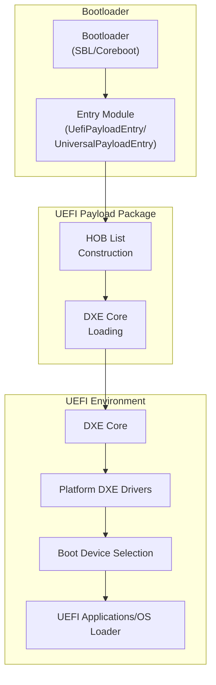

Sources: [UefiPayloadPkg/UefiPayloadEntry/UefiPayloadEntry.c:386-478](), [UefiPayloadPkg/UefiPayloadEntry/UniversalPayloadEntry.c:450-499]()

### Key Components

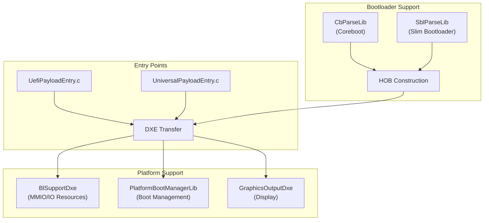

Sources: [UefiPayloadPkg/UefiPayloadPkg.dsc:600-617](), [UefiPayloadPkg/UefiPayloadPkg.fdf:140-317]()

## Boot Flow

The UEFI Payload starts with the bootloader passing a parameter pointer and transitions through initialization stages to eventually reach the DXE phase.

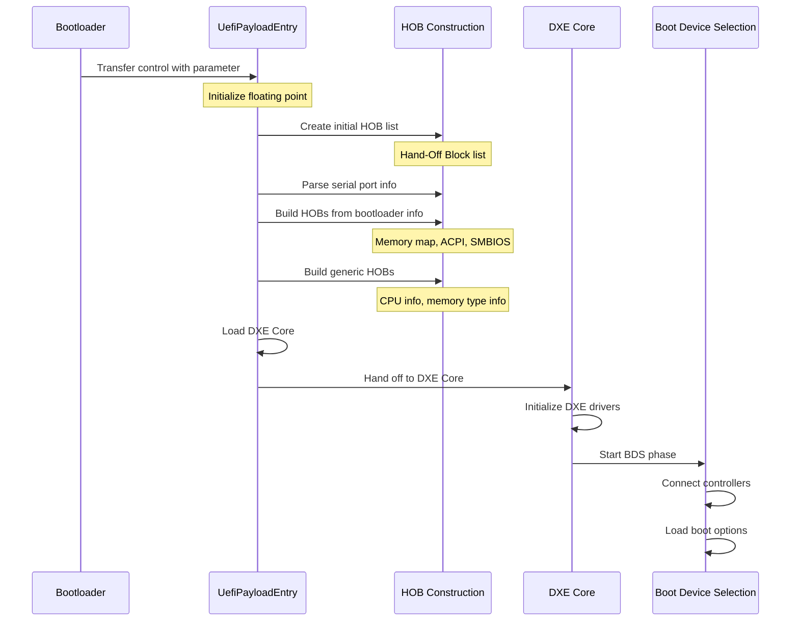

Sources: [UefiPayloadPkg/UefiPayloadEntry/UefiPayloadEntry.c:394-478](), [UefiPayloadPkg/UefiPayloadEntry/UniversalPayloadEntry.c:450-499]()

## Bootloader Parameter Parsing

The payload needs to extract information from the bootloader to initialize the UEFI environment. This is done through bootloader-specific parsing libraries.

### Parsing Libraries

The package provides specialized libraries for each supported bootloader:

| Library | Target Bootloader | Description |
|---------|-------------------|-------------|
| CbParseLib | Coreboot | Parses Coreboot tables to extract memory map, ACPI, SMBIOS |
| SblParseLib | Slim Bootloader | Parses Slim Bootloader HOBs to extract required info |

Sources: [UefiPayloadPkg/Library/CbParseLib/CbParseLib.c](), [UefiPayloadPkg/Library/SblParseLib/SblParseLib.c]()

### Common Parsing Interface

Both parsing libraries implement a common interface defined in `BlParseLib.h`:

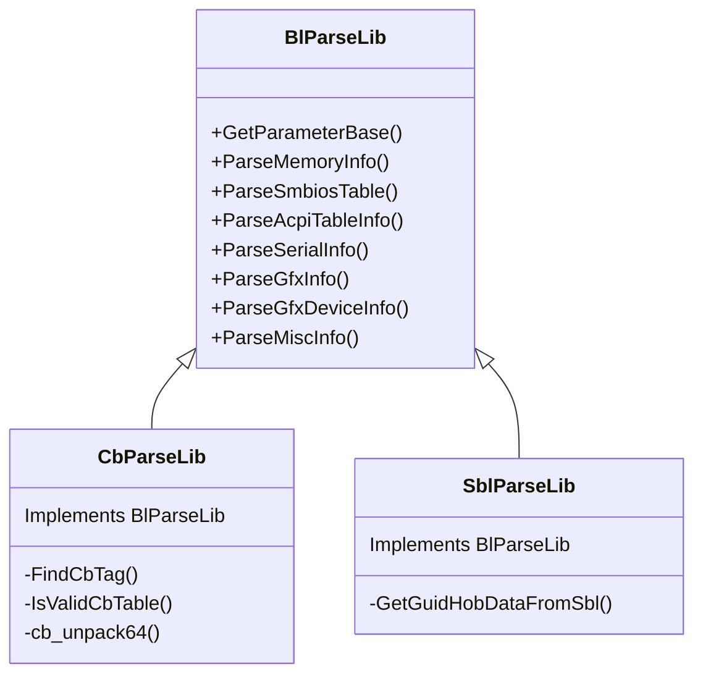

Sources: [UefiPayloadPkg/Include/Library/BlParseLib.h:10-152]()

## HOB Construction

The UEFI Payload builds a series of Hand-Off Blocks (HOBs) to pass information to the DXE phase.

### HOB Types Created

1. **Memory Resource HOBs**: Define system memory layout
2. **MMIO Resource HOBs**: Define memory-mapped I/O regions
3. **Graphics Info HOBs**: Framebuffer information for GOP
4. **ACPI Table HOBs**: Pointers to ACPI tables
5. **SMBIOS Table HOBs**: Pointers to SMBIOS structures
6. **CPU Architecture HOBs**: CPU information

Sources: [UefiPayloadPkg/UefiPayloadEntry/UefiPayloadEntry.c:231-343](), [UefiPayloadPkg/UefiPayloadEntry/UniversalPayloadEntry.c:292-441]()

### Memory Map Handling

The payload converts bootloader-provided memory maps to UEFI-compatible memory types:

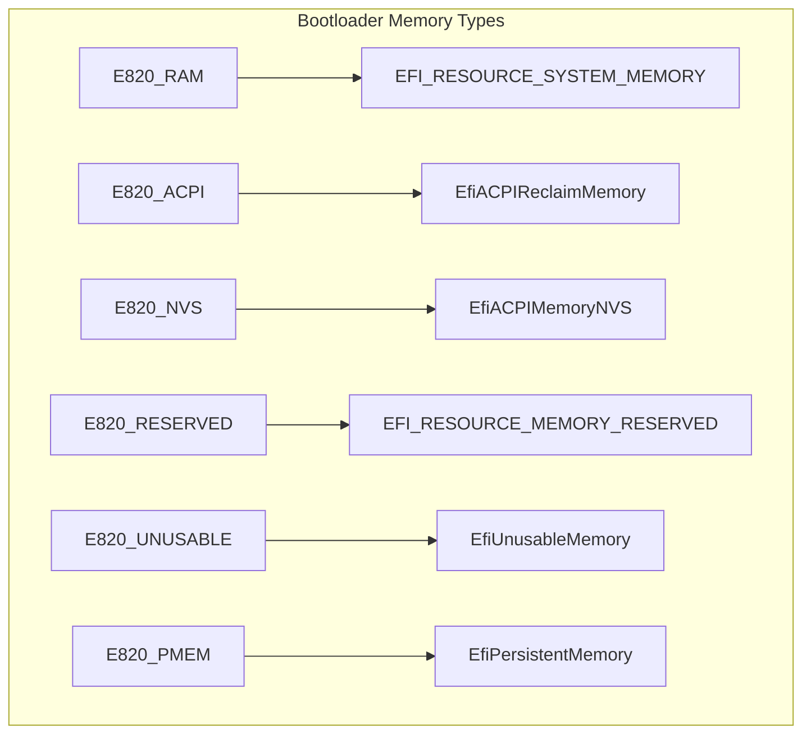

Sources: [UefiPayloadPkg/UefiPayloadEntry/UefiPayloadEntry.c:180-223](), [UefiPayloadPkg/UefiPayloadEntry/UefiPayloadEntry.c:35-101]()

## Universal Payload Support

The UEFI Payload Package supports both traditional payload entry and the newer Universal Payload format.

### Universal Payload Format

The Universal Payload format provides a standardized interface between bootloaders and UEFI payloads with well-defined data structures:

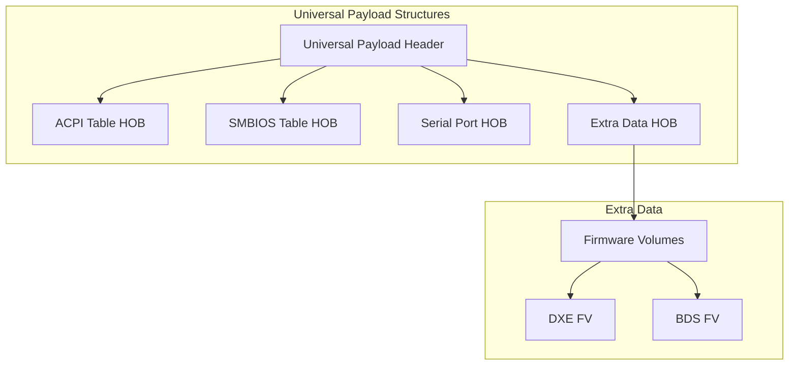

Sources: [UefiPayloadPkg/UefiPayloadEntry/UniversalPayloadEntry.c:59-142](), [UefiPayloadPkg/UefiPayloadEntry/UniversalPayloadEntry.inf:10-97]()

### PCD Database Fixup

Universal Payload includes a mechanism to fix up the PCD (Platform Configuration Database) to ensure compatibility:

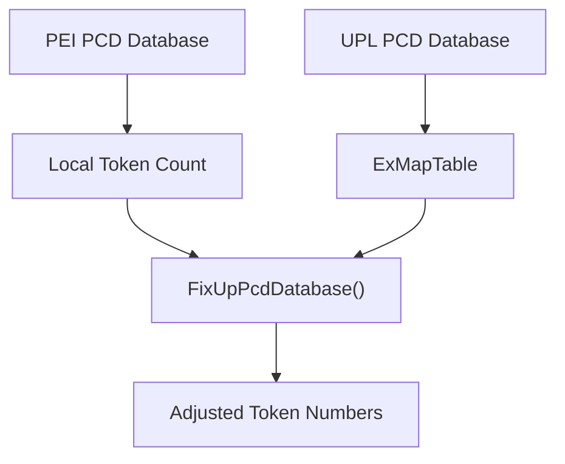

Sources: [UefiPayloadPkg/UefiPayloadEntry/UniversalPayloadEntry.c:49-95]()

## Platform Boot Manager

The package provides a platform boot manager that handles console initialization and boot device selection.

### Console Initialization

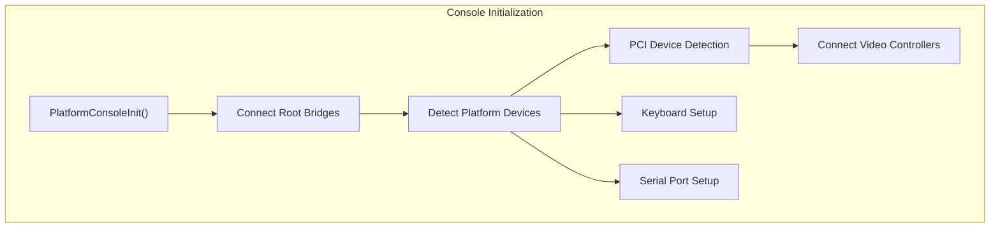

Sources: [UefiPayloadPkg/Library/PlatformBootManagerLib/PlatformConsole.c:464-479](), [UefiPayloadPkg/Library/PlatformBootManagerLib/PlatformConsole.c:406-431]()

### Boot Option Management

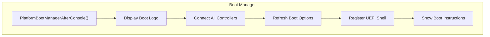

Sources: [UefiPayloadPkg/Library/PlatformBootManagerLib/PlatformBootManager.c:290-334]()

## DXE Support Drivers

The package includes several DXE drivers that provide platform support.

### BlSupportDxe

This driver reports MMIO/IO resources to the DXE core and extracts system information from HOBs:

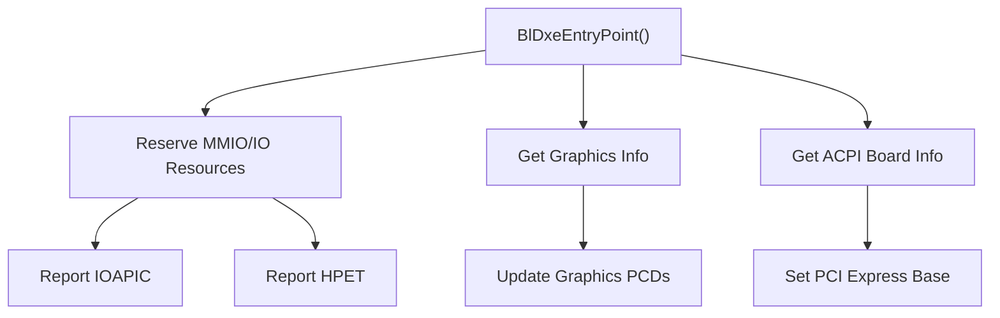

Sources: [UefiPayloadPkg/BlSupportDxe/BlSupportDxe.c:99-148]()

### GraphicsOutputDxe

Provides GOP (Graphics Output Protocol) support using framebuffer information from the bootloader.

## Configuration Options

The package supports numerous build-time configuration options through the DSC file.

### Major Configuration Options

| Option | Values | Description |
|--------|--------|-------------|
| BOOTLOADER | SBL, COREBOOT | Target bootloader |
| UNIVERSAL_PAYLOAD | TRUE, FALSE | Enable Universal Payload format |
| VARIABLE_SUPPORT | EMU, SPI, NONE | UEFI variable storage type |
| SMM_SUPPORT | TRUE, FALSE | System Management Mode support |
| SHELL_TYPE | BUILD_SHELL, MIN_BIN, NONE, UEFI_BIN | UEFI shell type |
| NETWORK_DRIVER_ENABLE | TRUE, FALSE | Network stack support |
| NVME_ENABLE | TRUE, FALSE | NVMe storage support |
| ATA_ENABLE | TRUE, FALSE | ATA storage support |
| SD_ENABLE | TRUE, FALSE | SD/MMC storage support |

Sources: [UefiPayloadPkg/UefiPayloadPkg.dsc:29-57](), [UefiPayloadPkg/UefiPayloadPkg.dsc:600-831]()

## Payload Libraries

The package provides several specialized libraries for payload operation.

### Memory Management Libraries

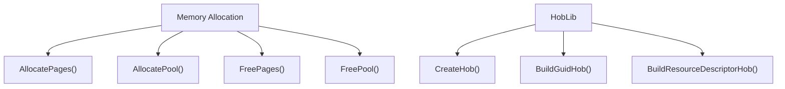

Sources: [UefiPayloadPkg/UefiPayloadEntry/MemoryAllocation.c]()

### Platform Support Libraries

- **PlatformHookLib**: Hardware-specific hooks for serial port initialization
- **ResetSystemLib**: System reset functionality
- **AcpiTimerLib**: Timing services using the ACPI timer
- **PciHostBridgeLib**: PCI host bridge initialization

## Summary

The UEFI Payload Package provides a bridge between non-UEFI bootloaders and the UEFI environment, allowing these bootloaders to boot UEFI-compliant operating systems. It accomplishes this by:

1. Accepting control from the bootloader
2. Building UEFI HOBs from bootloader information
3. Loading and initializing the DXE Core
4. Providing platform-specific drivers and libraries
5. Supporting both traditional and Universal Payload formats

By providing these capabilities, the package enables a standardized firmware interface across different bootloader implementations.

Sources: [UefiPayloadPkg/UefiPayloadPkg.dec:1-9](), [UefiPayloadPkg/UefiPayloadPkg.dsc:1-9]()

---

